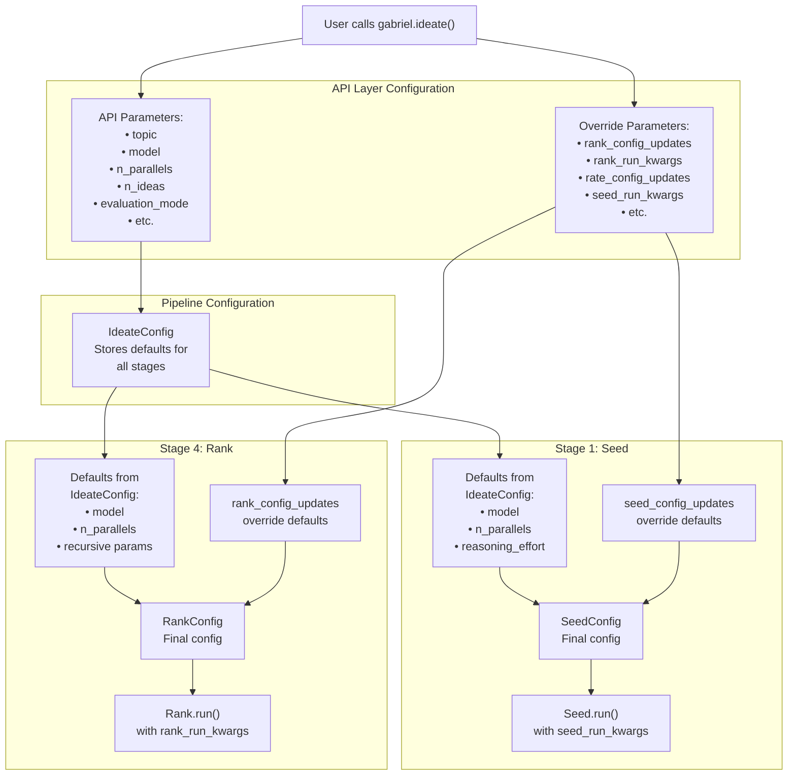
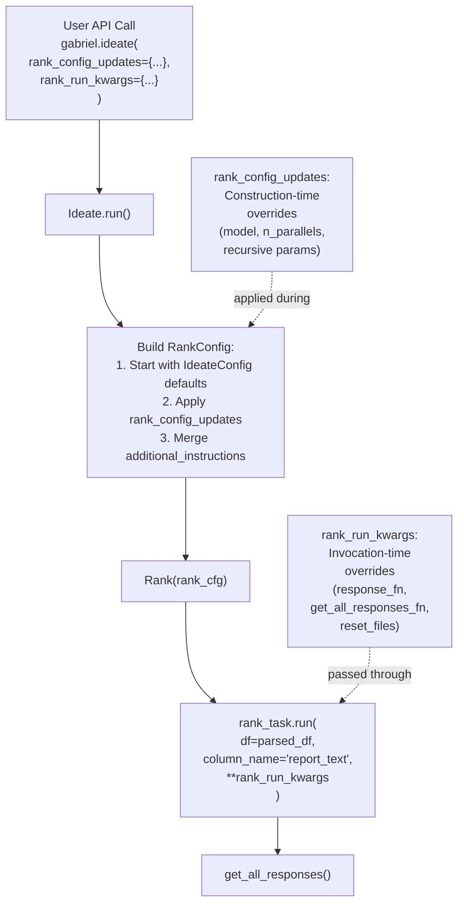

<!-- source: DeepWiki mcp.deepwiki.com · repo openai/GABRIEL · page 7 Complex Multi-Stage Pipelines · fetched 2026-10-26 -->

# Complex Multi-Stage Pipelines

<details>
<summary>Relevant source files</summary>

The following files were used as context for generating this wiki page:

- [src/gabriel/api.py](src/gabriel/api.py)
- [src/gabriel/tasks/ideate.py](src/gabriel/tasks/ideate.py)
- [src/gabriel/tasks/seed.py](src/gabriel/tasks/seed.py)

</details>


This page describes tasks that orchestrate multiple sub-tasks into sophisticated multi-stage workflows. These pipelines coordinate several GABRIEL operations in sequence, passing data between stages and aggregating results into a final output.

For documentation on individual simple tasks (Rate, Rank, Classify, etc.), see [Measurement Tasks](#4) and [Data Cleaning Tasks](#5). For deep dives into specific pipeline implementations, see [gabriel.ideate - Theory Generation](#7.1) and [gabriel.debias - Bias Correction](#7.2).

## Overview

Complex multi-stage pipelines differ from simple tasks in several key ways:

| Aspect | Simple Tasks | Multi-Stage Pipelines |
|--------|--------------|----------------------|
| **LLM Interactions** | Single prompt template, direct calls to `openai_utils` | Multiple distinct prompt templates across stages |
| **Configuration** | Single `Config` dataclass | Nested configs for each sub-task |
| **Save Structure** | Flat directory with CSV + responses | Hierarchical subdirectories per stage |
| **Data Flow** | Input DataFrame → LLM → Output DataFrame | Input → Stage 1 → Stage 2 → ... → Final Output |
| **Resumability** | Single checkpoint file | Multiple checkpoints across stages |
| **Customization** | Template path, additional instructions | Per-stage config overrides and run kwargs |

Pipelines in GABRIEL fall into two categories:

1. **Sequential Processing Pipelines**: Generate or transform data through multiple dependent stages (e.g., `gabriel.ideate`, `gabriel.discover`)
2. **Statistical Post-Processing Pipelines**: Apply regression-based corrections to measurement outputs (e.g., `gabriel.debias`)

Sources: [src/gabriel/api.py:554-710](), [src/gabriel/tasks/ideate.py:104-240]()

## Pipeline Architecture Pattern

### Task Composition Model

```mermaid
graph TB
    subgraph "Simple Task (e.g., Rate)"
        ST_API["gabriel.rate()"]
        ST_Config["RateConfig"]
        ST_Task["Rate.run()"]
        ST_Template["rate_prompt.jinja2"]
        ST_OpenAI["openai_utils.get_all_responses()"]
        
        ST_API --> ST_Config
        ST_Config --> ST_Task
        ST_Task --> ST_Template
        ST_Task --> ST_OpenAI
    end
    
    subgraph "Multi-Stage Pipeline (e.g., Ideate)"
        P_API["gabriel.ideate()"]
        P_Config["IdeateConfig"]
        P_Task["Ideate.run()"]
        
        subgraph "Stage 1: Seed Generation"
            S1_Config["SeedConfig"]
            S1_Task["Seed.run()"]
            S1_Template["seed.jinja2"]
            S1_OpenAI["get_all_responses()"]
        end
        
        subgraph "Stage 2: Idea Generation"
            S2_Template["ideation_prompt.jinja2"]
            S2_OpenAI["get_all_responses()"]
        end
        
        subgraph "Stage 3: Deduplication"
            S3_Config["DeduplicateConfig"]
            S3_Task["Deduplicate.run()"]
        end
        
        subgraph "Stage 4: Ranking"
            S4_Config["RankConfig"]
            S4_Task["Rank.run()"]
            S4_Recursive["Recursive pruning<br/>across rounds"]
        end
        
        P_API --> P_Config
        P_Config --> P_Task
        
        P_Task --> S1_Config
        S1_Config --> S1_Task
        S1_Task --> S1_Template
        S1_Task --> S1_OpenAI
        
        S1_Task -->|"seed_df"| S2_Template
        S2_Template --> S2_OpenAI
        
        S2_OpenAI -->|"raw_df"| S3_Config
        S3_Config --> S3_Task
        
        S3_Task -->|"deduped_df"| S4_Config
        S4_Config --> S4_Task
        S4_Task --> S4_Recursive
        
        S4_Recursive -->|"scored_df"| P_Task
    end
    
    style P_Task fill:#f9f9f9
    style ST_Task fill:#f9f9f9
```



**Diagram: Simple Task vs. Multi-Stage Pipeline Architecture**

The key architectural difference is that pipelines instantiate and execute multiple independent Task objects, each with its own configuration and lifecycle, while simple tasks make a single pass through the LLM orchestration infrastructure.

Sources: [src/gabriel/api.py:554-710](), [src/gabriel/tasks/ideate.py:123-240]()

### Configuration Hierarchy



**Diagram: Configuration Cascade in Multi-Stage Pipelines**

Pipeline tasks establish default configurations for all sub-tasks, which users can override selectively via `*_config_updates` dictionaries or `*_run_kwargs` dictionaries. This two-level override system allows both construction-time (Config) and invocation-time (run kwargs) customization.

Sources: [src/gabriel/api.py:655-710](), [src/gabriel/tasks/ideate.py:594-688]()

## Data Flow and State Management

### DataFrame Chaining Pattern

```mermaid
flowchart LR
    Input["Input:<br/>topic string"]
    
    Stage1["Stage 1: Seed<br/>_generate_seed_entities()"]
    DF1["seed_df:<br/>columns: entity,<br/>entity_id,<br/>source_batch"]
    
    Stage2["Stage 2: Generate<br/>_generate_reports()"]
    DF2["raw_df:<br/>columns: idea_id,<br/>topic, report_text,<br/>seed_text, Response,<br/>Time Taken, etc."]
    
    Stage3["Stage 3: Parse<br/>_parse_reports()"]
    DF3["parsed_df:<br/>columns: idea_id,<br/>topic, title,<br/>in_a_nutshell,<br/>in_one_paragraph,<br/>full_thinking, etc."]
    
    Stage4["Stage 4: Deduplicate<br/>_deduplicate_ideas()"]
    DF4["deduped_df:<br/>columns: same as<br/>parsed_df but with<br/>mapped_report_text,<br/>_dedup_id"]
    
    Stage5["Stage 5: Rank/Rate<br/>_apply_rank() or<br/>_apply_rate()"]
    DF5["scored_df:<br/>columns: all previous<br/>+ attribute scores<br/>+ attribute_rank"]
    
    Output["Output:<br/>final.csv"]
    
    Input --> Stage1
    Stage1 --> DF1
    DF1 --> Stage2
    Stage2 --> DF2
    DF2 --> Stage3
    Stage3 --> DF3
    DF3 --> Stage4
    Stage4 --> DF4
    DF4 --> Stage5
    Stage5 --> DF5
    DF5 --> Output
    
    Save1["seed/<br/>seed_entities.csv"]
    Save2["ideation_raw_responses.csv"]
    Save4["ideate_deduplicate/<br/>deduplicate.csv"]
    Save5["rank/ or rate/<br/>rankings.csv or ratings.csv"]
    
    DF1 -.->|persisted| Save1
    DF2 -.->|persisted| Save2
    DF4 -.->|persisted| Save4
    DF5 -.->|persisted| Save5
```



**Diagram: Data Flow Through Ideate Pipeline**

Each stage receives the DataFrame output from the previous stage, performs its operation (which may involve LLM calls), and produces an augmented or transformed DataFrame. Intermediate results are persisted to stage-specific subdirectories, enabling inspection and resumability.

Sources: [src/gabriel/tasks/ideate.py:185-239](), [src/gabriel/tasks/ideate.py:241-329]()

### Hierarchical Save Directory Structure

Pipelines organize artifacts into subdirectories to isolate concerns and enable stage-specific resumability:

```
save_dir/
├── ideation_raw_responses.csv          # Stage 2: Raw LLM outputs
├── ideation_final.csv                   # Final aggregated results
├── seed/                                # Stage 1: Seed generation
│   ├── seed_entities.csv
│   ├── seed_raw_responses.csv
│   └── seed_deduplicate/                # Nested if deduplicate enabled
│       └── seed_deduplicate_cycle0.csv
├── ideate_deduplicate/                  # Stage 4: Idea deduplication
│   ├── deduplicate.csv
│   └── deduplicate_raw_responses.csv
└── rank/  (or rate/)                    # Stage 5: Scoring
    ├── rankings_raw_responses.csv
    ├── rankings_final.csv
    └── rankings_recursive/              # If recursive=True
        ├── stage0_rankings.csv
        ├── stage1_rankings.csv
        └── recursive_final.csv
```

Each sub-task receives its own `save_dir` parameter pointing to a subdirectory within the parent pipeline's `save_dir`. This isolation ensures that:

1. **Checkpoint independence**: Each stage can resume independently
2. **Artifact clarity**: User can inspect intermediate results without parsing
3. **Configuration transparency**: Each subdirectory contains only artifacts for that stage
4. **Concurrent safety**: Multiple stages don't compete for the same checkpoint files

Sources: [src/gabriel/tasks/ideate.py:343-368](), [src/gabriel/tasks/ideate.py:464-519](), [src/gabriel/tasks/ideate.py:606-635]()

## Pipeline Implementation Patterns

### Async Orchestration

All pipeline stages are async methods that `await` sub-task execution:

```python
# From Ideate._generate_seed_entities (lines 331-371)
async def _generate_seed_entities(self, topic, ...) -> pd.DataFrame:
    seed_cfg = SeedConfig(...)  # Build config
    seed_task = Seed(seed_cfg, template_path=...)
    seed_df = await seed_task.run(...)  # Await sub-task
    return seed_df

# From Ideate._apply_rank (lines 637-688)
async def _apply_rank(self, df, ...) -> pd.DataFrame:
    rank_cfg = RankConfig(...)  # Build config
    rank_task = Rank(rank_cfg)
    df_ranked = await rank_task.run(...)  # Await sub-task
    return df_ranked
```

This async pattern enables:
- **Transparent concurrency**: Sub-tasks inherit the async execution context
- **Clean composition**: Pipeline code reads sequentially despite async internals
- **Consistent error handling**: Exceptions propagate up through await chain

Sources: [src/gabriel/tasks/ideate.py:331-371](), [src/gabriel/tasks/ideate.py:637-688]()

### Configuration Override Propagation



**Diagram: Configuration Override Propagation**

The two-level override system allows:
- **Config updates**: Override dataclass fields during sub-task construction
- **Run kwargs**: Override runtime parameters during sub-task invocation

This pattern is used consistently across all pipeline implementations in GABRIEL.

Sources: [src/gabriel/api.py:679-691](), [src/gabriel/tasks/ideate.py:649-688]()

### Callable Override Forwarding

Pipeline API functions accept `response_fn` and `get_all_responses_fn` parameters and propagate them to all sub-tasks:

```python
# From api.ideate (lines 679-691)
def _with_callable_overrides(payload):
    updated = dict(payload or {})
    if response_fn is not None:
        updated.setdefault("response_fn", response_fn)
    if get_all_responses_fn is not None:
        updated.setdefault("get_all_responses_fn", get_all_responses_fn)
    return updated

generation_kwargs = _with_callable_overrides(generation_kwargs)
rank_run_kwargs = _with_callable_overrides(rank_run_kwargs)
rate_run_kwargs = _with_callable_overrides(rate_run_kwargs)
seed_run_kwargs = _with_callable_overrides(seed_run_kwargs)
deduplicate_run_kwargs = _with_callable_overrides(deduplicate_run_kwargs)
```

This ensures that if a user provides a custom LLM backend via `get_all_responses_fn`, it applies uniformly across all pipeline stages.

Sources: [src/gabriel/api.py:679-691]()

## Key Pipeline Examples

### Ideate Pipeline (5 Stages)

The `gabriel.ideate` function implements a theory generation pipeline:

| Stage | Task | Purpose | Key Configuration |
|-------|------|---------|-------------------|
| 1 | **Seed** | Generate diverse seed concepts | `seed_config_updates`, `seed_run_kwargs` |
| 2 | **Generate** | Create full theories from seeds | `generation_kwargs` |
| 3 | **Parse** | Extract structured sections | Built-in parser |
| 4 | **Deduplicate** | Remove similar ideas | `deduplicate_run_kwargs` |
| 5 | **Rank/Rate** | Score theories | `rank_config_updates`, `rank_run_kwargs`, `rate_config_updates`, `rate_run_kwargs` |

The evaluation stage (Stage 5) supports three modes:
- `evaluation_mode="recursive_rank"`: Multi-round tournament with pruning
- `evaluation_mode="rank"`: Standard Bradley-Terry ranking
- `evaluation_mode="rate"`: Absolute scoring without comparison

Full documentation: [gabriel.ideate - Theory Generation](#7.1)

Sources: [src/gabriel/api.py:554-710](), [src/gabriel/tasks/ideate.py:123-240]()

### Discover Pipeline (3 Stages)

The `gabriel.discover` function implements a feature discovery pipeline:

| Stage | Task | Purpose |
|-------|------|---------|
| 1 | **Codify/Compare** | Extract discriminating terms from passages |
| 2 | **Bucket** | Group terms into emergent taxonomy |
| 3 | **Classify** | Apply discovered labels to full dataset |

This pipeline operates differently from Ideate:
- Does not use a dedicated Config dataclass
- Returns a dictionary of DataFrames (one per stage)
- Supports bidirectional discovery via `circle_column_name` and `square_column_name`

Sources: [src/gabriel/api.py:1440-1574]()

### Debias Pipeline (Statistical Post-Processing)

The `gabriel.debias` function applies regression-based bias correction to measurement outputs. Unlike generation pipelines, it operates entirely in statistical/dataframe space without LLM calls.

Full documentation: [gabriel.debias - Bias Correction](#7.2)

Sources: [src/gabriel/api.py:1677-1791]()

## Design Principles

Multi-stage pipelines in GABRIEL follow consistent design principles:

### 1. Stage Independence

Each stage should be executable independently with appropriate inputs:

```python
# Stage can be run standalone if intermediate DataFrame exists
seed_df = await Seed(seed_cfg).run()  # Produces DataFrame
rank_df = await Rank(rank_cfg).run(seed_df, "entity")  # Consumes DataFrame
```

This enables:
- **Debugging**: Run individual stages in isolation
- **Experimentation**: Try different scoring methods on same generated ideas
- **Inspection**: Examine intermediate outputs before committing to expensive downstream stages

Sources: [src/gabriel/tasks/ideate.py:331-371](), [src/gabriel/tasks/ideate.py:637-688]()

### 2. Progressive Enhancement

Pipeline outputs preserve all data from earlier stages:

```python
# From Ideate._parse_reports (lines 449-453)
for key, values in sections.items():
    df_proc[key] = values  # Add parsed sections
df_proc["topic"] = topic  # Preserve topic
return self._clean_columns(df_proc)  # Preserve all columns
```

Users receive a single DataFrame containing:
- Original inputs
- Intermediate transformations
- Final scores/rankings
- Provenance metadata (seed_text, idea_id, etc.)

This "wide" format enables post-hoc analysis without reconstructing the pipeline.

Sources: [src/gabriel/tasks/ideate.py:409-453](), [src/gabriel/tasks/ideate.py:521-558]()

### 3. Resumability at Every Stage

Each stage checks for cached results before executing:

```python
# From Ideate.run (lines 147-156)
base_name = os.path.splitext(self.cfg.file_name)[0]
final_path = os.path.join(self.cfg.save_dir, f"{base_name}_final.csv")

if not reset_files and os.path.exists(final_path):
    try:
        print(f"[Ideate] Loading cached results from {final_path}")
        cached = pd.read_csv(final_path)
        return cached
    except Exception:
        print("[Ideate] Failed to load cached results; recomputing.")
```

Combined with stage-specific subdirectories, this enables:
- **Partial recomputation**: Regenerate only failing stages
- **Cost optimization**: Skip expensive stages when experimenting with cheaper ones
- **Fault tolerance**: Resume after crashes or rate limits

Sources: [src/gabriel/tasks/ideate.py:147-156]()

### 4. Configurable Sub-Task Behavior

Every sub-task accepts both config overrides and run kwargs:

```python
# From Ideate._apply_rank (lines 652-677)
cfg_kwargs = dict(
    attributes=attributes,
    save_dir=rank_save,
    model=self.cfg.ranking_model or self.cfg.model,
    n_parallels=self.cfg.n_parallels,
    recursive=recursive,
    # ... many more defaults ...
)
cfg_kwargs.update(config_updates)  # Apply user overrides

rank_cfg = RankConfig(**cfg_kwargs)
rank_task = Rank(rank_cfg)
df_ranked = await rank_task.run(
    df, "report_text", 
    reset_files=reset_files,
    **rank_run_kwargs  # Apply run-time overrides
)
```

This granular control allows users to:
- Use different models for different stages
- Apply custom response parsers to specific stages
- Override concurrency limits for memory-intensive stages

Sources: [src/gabriel/tasks/ideate.py:637-688]()

## Common Pipeline Patterns

### Pattern 1: Seed-Generate-Refine

Used by `gabriel.ideate`:

1. **Seed**: Generate diverse starting points (e.g., research angles)
2. **Generate**: Expand seeds into full artifacts (e.g., complete theories)
3. **Refine**: Deduplicate, score, and rank

This pattern ensures diversity in generation by seeding from a representative distribution rather than generating all items in parallel from the same prompt.

Sources: [src/gabriel/tasks/ideate.py:241-329]()

### Pattern 2: Extract-Group-Classify

Used by `gabriel.discover`:

1. **Extract**: Pull discriminating features from individual passages
2. **Group**: Cluster features into emergent taxonomy
3. **Classify**: Apply taxonomy to entire dataset

This pattern discovers labels from data rather than requiring predefined categories.

Sources: [src/gabriel/api.py:1440-1574]()

### Pattern 3: Measure-Embed-Match

Used by `gabriel.merge`:

1. **Measure**: Optional initial pass to extract matching candidates
2. **Embed**: Generate embeddings for rapid similarity filtering
3. **Match**: LLM-based fuzzy matching on high-similarity pairs

This pattern combines cheap embedding-based filtering with expensive LLM-based matching.

Sources: Described in system diagrams; full implementation in separate file not provided

### Pattern 4: Tournament Pruning

Used by `gabriel.rank` with `recursive=True`:

1. **Rate**: Initial absolute scoring pass (optional)
2. **Round 1**: Tournament on full dataset
3. **Prune**: Keep top/bottom fraction
4. **Round N**: Tournament on pruned dataset
5. **Final**: Intensified final round with more matches

This pattern reduces O(n²) pairwise comparisons to manageable scale while maintaining ranking quality.

Sources: Referenced in [src/gabriel/api.py:843-853](); full implementation in rank.py not provided

## Error Handling in Pipelines

Pipelines propagate errors from sub-tasks but add contextual information:

```python
# From Ideate._generate_reports (lines 313-319)
df_resp = await get_all_responses(
    prompts=prompts,
    identifiers=identifiers,
    **kwargs,
)
if not isinstance(df_resp, pd.DataFrame):
    raise RuntimeError("get_all_responses returned no DataFrame")
```

Each stage validates its inputs and outputs, ensuring that corrupted intermediate states don't propagate silently through the pipeline. The hierarchical save structure preserves evidence of partial failures.

Sources: [src/gabriel/tasks/ideate.py:313-329](), [src/gabriel/tasks/ideate.py:369-371]()

## Performance Considerations

Multi-stage pipelines inherit the concurrency and rate limiting infrastructure from `openai_utils` (see [LLM Orchestration Infrastructure](#3.1)), but introduce additional considerations:

### Sequential Bottlenecks

Stages execute sequentially, not in parallel. A pipeline with 5 stages that each take 2 minutes will take 10 minutes minimum, even if each stage is internally parallelized.

Mitigation strategies:
- Use stage-specific caching aggressively
- Tune `n_parallels` per stage based on stage characteristics
- Skip expensive stages during development via `evaluation_mode="none"`

### Checkpoint Overhead

Each stage writes checkpoints, creating filesystem I/O:

```python
# From Seed._finalize_entities (lines 296-310)
final_path = os.path.join(self.cfg.save_dir, self.cfg.file_name)
df.to_csv(final_path, index=False)
print(f"[Seed] Generated {len(df)} entities. Saved to {final_path}.")
```

For very large datasets, this I/O can become significant. The checkpoint system is designed for resumability over raw throughput.

Sources: [src/gabriel/tasks/seed.py:296-310]()

### Memory Accumulation

Pipeline DataFrames grow monotonically as stages add columns:

```python
# From Ideate._parse_reports (lines 449-451)
for key, values in sections.items():
    df_proc[key] = values  # Adds columns without removing old ones
```

For pipelines processing thousands of items with rich metadata, memory usage can grow to gigabytes. Consider using `df.drop(columns=[...])` in custom pipelines if intermediate columns are not needed in final output.

Sources: [src/gabriel/tasks/ideate.py:449-453]()

## Extending Pipelines

To create a custom multi-stage pipeline:

### Step 1: Define Pipeline Config

```python
@dataclass
class CustomPipelineConfig:
    save_dir: str
    model: str = "gpt-5-mini"
    n_parallels: int = 650
    stage1_param: str = "default"
    stage2_param: int = 10
    # ... other parameters
```

### Step 2: Create Pipeline Task Class

```python
class CustomPipeline:
    def __init__(self, cfg: CustomPipelineConfig, 
                 template_path: Optional[str] = None):
        self.cfg = cfg
        # Initialize templates, create save_dir, etc.
    
    async def run(self, df: pd.DataFrame, **kwargs) -> pd.DataFrame:
        # Check for cached final output
        # Execute stage 1
        # Execute stage 2
        # Save final output
        return final_df
```

### Step 3: Implement Stage Methods

```python
async def _stage1_operation(self, df: pd.DataFrame, 
                            reset_files: bool) -> pd.DataFrame:
    stage1_save = os.path.join(self.cfg.save_dir, "stage1")
    # Build sub-task config
    task = SomeTask(config)
    result = await task.run(df, column_name="text", reset_files=reset_files)
    return result
```

### Step 4: Add API Function

```python
async def custom_pipeline(
    df: pd.DataFrame,
    *,
    save_dir: str,
    stage1_config_updates: Optional[Dict] = None,
    stage2_run_kwargs: Optional[Dict] = None,
    # ... more parameters
) -> pd.DataFrame:
    cfg = CustomPipelineConfig(save_dir=save_dir, ...)
    pipeline = CustomPipeline(cfg)
    return await pipeline.run(df, **kwargs)
```

Follow the patterns demonstrated in `Ideate` for configuration cascading, callable override forwarding, and hierarchical save directories.

Sources: [src/gabriel/tasks/ideate.py:60-122](), [src/gabriel/api.py:554-710]()

---

