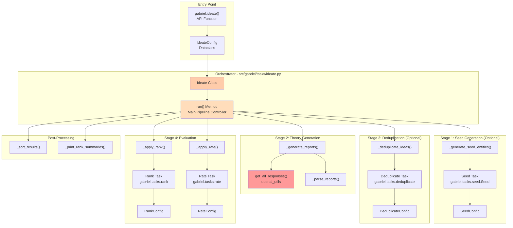
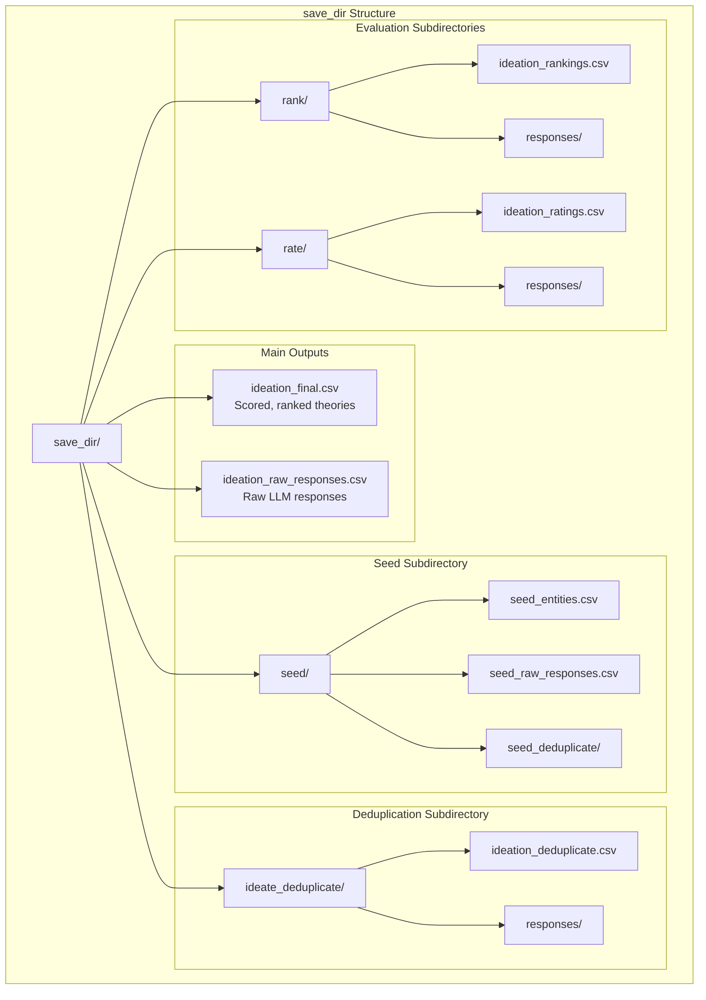

<!-- source: DeepWiki mcp.deepwiki.com · repo openai/GABRIEL · page 7.1 gabriel.ideate - Theory Generation · fetched 2026-10-26 -->

# gabriel.ideate - Theory Generation

<details>
<summary>Relevant source files</summary>

The following files were used as context for generating this wiki page:

- [src/gabriel/tasks/ideate.py](src/gabriel/tasks/ideate.py)
- [src/gabriel/tasks/seed.py](src/gabriel/tasks/seed.py)

</details>


## Purpose and Scope

The `gabriel.ideate` task implements a multi-stage pipeline for generating and evaluating large batches of scientific theories or general-purpose ideas. It orchestrates five sequential stages: seed entity generation, theory/idea generation, ranking, rating, and deduplication. The pipeline produces scored, ranked, and deduplicated results optimized for scientific research ideation or strategic planning.

For single-step generation without evaluation, see [gabriel.seed - Diverse Generation](#6.3). For standalone ranking or rating of existing ideas, see [gabriel.rank - Pairwise Ranking](#4.2) and [gabriel.rate - Absolute Scoring](#4.1). For understanding the underlying LLM orchestration infrastructure, see [LLM Orchestration Infrastructure](#3.1).

---

## System Architecture Overview

The `Ideate` task is implemented as a high-level orchestrator that chains together multiple sub-tasks from the GABRIEL task system. It manages state transitions between stages, configures sub-tasks dynamically, and aggregates results.



**Diagram: Code Entity Architecture**

Sources: [src/gabriel/tasks/ideate.py:1-827]()

---

## Pipeline Flow and Data Transformations

The `Ideate` pipeline transforms a single `topic` string into a scored, ranked DataFrame of theories through five distinct stages:

```mermaid
graph LR
    subgraph "Input"
        Topic["topic: str<br/>'Research question or domain'"]
    end
    
    subgraph "Stage 1: Seed Generation"
        SeedPrompt["N prompts asking for<br/>diverse seed entities"]
        SeedResp["Raw JSON responses"]
        SeedDF["seed_df: DataFrame<br/>Columns: entity, entity_id"]
    end
    
    subgraph "Stage 2: Theory Generation"
        GenPrompt["N=n_ideas prompts<br/>each with a seed"]
        GenResp["Raw LLM responses<br/>with structured sections"]
        ParsedDF["parsed_df: DataFrame<br/>Columns: idea_id, topic,<br/>report_text, title,<br/>in_a_nutshell, etc."]
    end
    
    subgraph "Stage 3: Deduplication"
        DedupeMap["Similarity analysis<br/>group similar ideas"]
        RepDF["Representative ideas<br/>Reduced row count"]
    end
    
    subgraph "Stage 4: Evaluation"
        RankPairs["Pairwise comparisons<br/>Bradley-Terry model"]
        RateScores["0-100 absolute scores<br/>per attribute"]
        ScoredDF["scored_df: DataFrame<br/>Columns: ..., z_score,<br/>attribute_score, etc."]
    end
    
    subgraph "Output"
        FinalDF["Final DataFrame<br/>Sorted by score/rank<br/>Saved to save_dir"]
    end
    
    Topic --> SeedPrompt
    SeedPrompt --> SeedResp
    SeedResp --> SeedDF
    
    SeedDF --> GenPrompt
    Topic --> GenPrompt
    GenPrompt --> GenResp
    GenResp --> ParsedDF
    
    ParsedDF --> DedupeMap
    DedupeMap --> RepDF
    
    RepDF --> RankPairs
    RepDF --> RateScores
    RankPairs --> ScoredDF
    RateScores --> ScoredDF
    
    ScoredDF --> FinalDF
```



**Diagram: Data Transformation Pipeline**

Sources: [src/gabriel/tasks/ideate.py:123-239](), [src/gabriel/tasks/ideate.py:241-329]()

---

## Configuration Parameters

The `IdeateConfig` dataclass consolidates all configuration parameters for the pipeline and its sub-tasks:

### Core Parameters

| Parameter | Type | Default | Description |
|-----------|------|---------|-------------|
| `save_dir` | `str` | `"~/Documents/runs"` | Root directory for all outputs |
| `file_name` | `str` | `"ideation.csv"` | Base name for output files |
| `model` | `str` | `"gpt-5-mini"` | LLM model for generation |
| `ranking_model` | `Optional[str]` | `None` | Separate model for evaluation (defaults to `model`) |
| `n_parallels` | `int` | `650` | Concurrent LLM requests |
| `n_ideas` | `int` | `1000` | Number of theories to generate |

### Evaluation Parameters

| Parameter | Type | Default | Description |
|-----------|------|---------|-------------|
| `evaluation_mode` | `str` | `"recursive_rank"` | One of: `"recursive_rank"`, `"rank"`, `"rate"`, `"none"` |
| `scientific_theory` | `bool` | `True` | Whether generating scientific theories (vs. general ideas) |
| `attributes` | `Optional[Dict[str, str]]` | `None` | Attribute definitions for scoring (auto-generated if `None`) |
| `rank_attribute` | `Optional[str]` | `None` | Attribute to use for recursive ranking cuts |

### Recursive Ranking Parameters

| Parameter | Type | Default | Description |
|-----------|------|---------|-------------|
| `recursive_fraction` | `float` | `1.0 / 3.0` | Fraction of items to keep per round |
| `recursive_min_remaining` | `int` | `30` | Stop recursion at this threshold |
| `recursive_final_round_multiplier` | `int` | `3` | Comparison multiplier for final round |
| `recursive_cut_side` | `str` | `"top"` | Which items to keep (`"top"` or `"bottom"`) |
| `recursive_rate_first_round` | `bool` | `True` | Whether to rate items before first ranking round |

### Seed Generation Parameters

| Parameter | Type | Default | Description |
|-----------|------|---------|-------------|
| `use_seed_entities` | `bool` | `True` | Whether to generate seed entities |
| `seed_num_entities` | `Optional[int]` | `None` | Number of seeds (defaults to `n_ideas`) |
| `seed_entities_per_generation` | `Optional[int]` | `None` | Seeds per LLM call |
| `seed_entity_batch_frac` | `Optional[float]` | `None` | Batch size fraction |
| `seed_existing_entities_cap` | `Optional[int]` | `None` | Max existing seeds shown to LLM |
| `seed_additional_instructions` | `Optional[str]` | `None` | Custom instructions for seed generation |
| `seed_template_path` | `Optional[str]` | `None` | Custom Jinja2 template for seeds |
| `seed_deduplicate` | `bool` | `True` | Deduplicate seeds during generation |

### Deduplication Parameters

| Parameter | Type | Default | Description |
|-----------|------|---------|-------------|
| `deduplicate_ideas` | `bool` | `True` | Deduplicate theories before evaluation |

Sources: [src/gabriel/tasks/ideate.py:60-102]()

---

## Default Attributes

The system provides carefully calibrated default attribute definitions based on the `scientific_theory` flag:

### Scientific Theory Mode (`scientific_theory=True`)

**Attribute**: `"major new contribution to literature"`

The default description emphasizes:
- Originality, reasoning quality, and consequential impact
- Novel creative thought beyond existing work
- Testable, non-trivial, and brilliant/inspired theories
- Parsimony and clarity in presentation
- Explanation of big, significant phenomena (not trivial effects)
- Penalization of jargon, obfuscation, and uncreative rehashing

### General Idea Mode (`scientific_theory=False`)

**Attribute**: `"overall idea quality"`

The default description emphasizes:
- Usefulness, clarity, and high-leverage impact
- Non-trivial scope tailored to context
- Clear mechanism explanation
- Genuine value if executed or tested
- Practicality and adaptability
- Penalization of vague wording, buzzwords, and jargon-heavy writing

Sources: [src/gabriel/tasks/ideate.py:20-57]()

---

## Stage Details

### Stage 1: Seed Entity Generation

**Method**: `_generate_seed_entities()` [src/gabriel/tasks/ideate.py:331-371]()

Seeds provide diverse anchor points for theory generation. Each seed is a 1-2 sentence description of a specific angle, mechanism, dataset, or real-world scenario. The stage:

1. Constructs seed instructions using `_build_seed_instruction()` [src/gabriel/tasks/ideate.py:373-407]()
2. Creates a `SeedConfig` with overridden parameters
3. Instantiates and runs a `Seed` task (see [#6.3](#6.3))
4. Returns a DataFrame with columns: `entity`, `entity_id`

**Seed Distribution**: Seeds are distributed cyclically across theories. If insufficient seeds are generated, the system recycles them to cover all `n_ideas`.

**Key Configuration**: The seed instruction differs based on `scientific_theory`:
- **Scientific**: Emphasizes frontier research angles, novel mechanisms, and diverse theoretical directions
- **General**: Emphasizes practical scenarios, workflows, and high-leverage focus areas

Sources: [src/gabriel/tasks/ideate.py:331-407]()

---

### Stage 2: Theory Generation

**Method**: `_generate_reports()` [src/gabriel/tasks/ideate.py:241-329]()

This stage generates the raw theories by:

1. **Prompt Construction**: For each of `n_ideas` theories, renders the `ideation_prompt.jinja2` template with:
   - `topic`: User-provided research question
   - `additional_instructions`: Optional guidance
   - `seed`: Assigned seed entity (if `use_seed_entities=True`)
   - `scientific_theory`: Boolean flag

2. **Parallel LLM Calls**: Invokes `get_all_responses()` [src/gabriel/utils/openai_utils.py]() with:
   - `model=cfg.model`
   - `n_parallels=cfg.n_parallels` (default 650)
   - `reasoning_effort=cfg.reasoning_effort`
   - `web_search=cfg.web_search`

3. **Response Parsing**: Calls `_parse_reports()` [src/gabriel/tasks/ideate.py:409-453]() to extract structured sections

**Output DataFrame Columns**:
- `idea_id`: Unique identifier (e.g., `"idea-00042"`)
- `topic`: Research question
- `seed_text`: Assigned seed (if applicable)
- `report_text`: Full LLM response
- `title`: Extracted theory title
- `in_a_nutshell`: Brief summary
- `in_one_paragraph`: Detailed explanation
- `illustrative_examples`: Example scenarios
- `testable_predictions`: Falsifiable predictions
- `full_thinking`: Complete reasoning

Sources: [src/gabriel/tasks/ideate.py:241-329](), [src/gabriel/tasks/ideate.py:409-453]()

---

### Stage 3: Deduplication (Optional)

**Method**: `_deduplicate_ideas()` [src/gabriel/tasks/ideate.py:455-519]()

When `deduplicate_ideas=True`, this stage:

1. Creates a `DeduplicateConfig` with:
   - `save_dir`: `{save_dir}/ideate_deduplicate`
   - `additional_instructions`: Custom prompt for conceptual similarity
   - `group_size=25`: Ideas compared in groups
   - `max_words_per_text=500`: Truncation limit

2. Runs `Deduplicate` task on `report_text` column

3. Filters to representative ideas only (one per cluster)

4. Preserves `report_text_original` column for traceability

**Reduction**: Typically reduces 1000 generated ideas to 300-500 unique representatives.

Sources: [src/gabriel/tasks/ideate.py:455-519]()

---

### Stage 4a: Ranking Evaluation

**Method**: `_apply_rank()` [src/gabriel/tasks/ideate.py:637-688]()

When `evaluation_mode` is `"rank"` or `"recursive_rank"`:

1. Creates a `RankConfig` with:
   - `attributes`: Scoring criteria
   - `model`: Separate ranking model or default
   - `recursive=True` for `"recursive_rank"` mode
   - Recursive parameters (`recursive_fraction`, `recursive_min_remaining`, etc.)

2. Appends topic context to `additional_instructions`

3. Runs `Rank` task on `report_text` column

4. Calls `_sort_results()` to order by z-score

**Recursive Ranking**: See [#4.2](#4.2) for tournament details. The recursive mode progressively prunes theories through multiple rounds, dramatically reducing comparison count for large batches.

Sources: [src/gabriel/tasks/ideate.py:637-688]()

---

### Stage 4b: Rating Evaluation

**Method**: `_apply_rate()` [src/gabriel/tasks/ideate.py:594-635]()

When `evaluation_mode` is `"rate"`:

1. Creates a `RateConfig` with:
   - `attributes`: Scoring criteria (all attributes rated)
   - `model`: Separate ranking model or default
   - `reasoning_effort`: Inherited from `IdeateConfig`

2. Appends topic context to `additional_instructions`

3. Runs `Rate` task on `report_text` column

4. Calls `_sort_results()` to order by primary attribute score

**Comparison**: Rating is faster (1 LLM call per theory) but less precise than ranking (O(n log n) comparisons).

Sources: [src/gabriel/tasks/ideate.py:594-635]()

---

### Post-Processing

After evaluation, the pipeline:

1. **Sorts Results**: `_sort_results()` [src/gabriel/tasks/ideate.py:690-712]()
   - Orders by primary attribute (descending)
   - Adds `{attribute}_rank` column with positions

2. **Prints Summaries**: `_print_rank_summaries()` [src/gabriel/tasks/ideate.py:740-778]()
   - Shows top 5 theories with scores
   - Shows bottom 5 theories with scores
   - Displays using `_build_preview()` [src/gabriel/tasks/ideate.py:802-826]()

3. **Saves Output**: Writes final DataFrame to `{base_name}_final.csv`

Sources: [src/gabriel/tasks/ideate.py:690-826]()

---

## Evaluation Modes

The `evaluation_mode` parameter determines the scoring strategy:

| Mode | Description | Performance | Precision |
|------|-------------|-------------|-----------|
| `"recursive_rank"` | Multi-round tournament with pruning | O(n log n) comparisons | Highest |
| `"rank"` | Single-round pairwise ranking | O(n²) comparisons | High |
| `"rate"` | Absolute 0-100 scoring | O(n) calls | Moderate |
| `"none"` | Skip evaluation entirely | 0 calls | N/A |

### Choosing an Evaluation Mode

**Use `"recursive_rank"` when**:
- Generating 500+ theories
- Precision is critical
- Willing to wait for multiple rounds

**Use `"rank"` when**:
- Generating <200 theories
- Want single-pass ranking
- Have time for full pairwise comparisons

**Use `"rate"` when**:
- Need fastest evaluation
- Absolute scores are sufficient
- Comparing theories to external benchmarks

**Use `"none"` when**:
- Manually evaluating later
- Exporting to external tools
- Just need diverse generation

Sources: [src/gabriel/tasks/ideate.py:164-168]()

---

## Output Structure

The `Ideate` pipeline produces multiple output files in the configured `save_dir`:



**Diagram: File Organization**

### Key Output Files

**`ideation_final.csv`**: The primary output containing:
- All columns from theory generation (`idea_id`, `topic`, `report_text`, etc.)
- Evaluation scores (e.g., `major_new_contribution_to_literature_z_score`)
- Ranking columns (e.g., `major_new_contribution_to_literature_rank`)
- Deduplicated and sorted by score

**`ideation_raw_responses.csv`**: Raw LLM outputs with metadata:
- `Identifier`, `Response`, `Time Taken`, `Input Tokens`, `Output Tokens`
- Useful for debugging and auditing generation quality

Sources: [src/gabriel/tasks/ideate.py:146-148](), [src/gabriel/tasks/ideate.py:252-253]()

---

## Usage Examples

### Basic Scientific Theory Generation

```python
from gabriel import ideate

# Generate and rank 500 theories on a research question
df = await ideate(
    topic="How do social norms emerge and stabilize in online communities?",
    n_ideas=500,
    evaluation_mode="recursive_rank",
    save_dir="~/research/theory_generation"
)

# Top theories automatically sorted by score
print(df.head()[['title', 'in_a_nutshell', 'major_new_contribution_to_literature']])
```

### General Idea Generation with Custom Attributes

```python
from gabriel import ideate

# Generate business ideas with custom evaluation criteria
df = await ideate(
    topic="Novel B2B SaaS opportunities in healthcare automation",
    n_ideas=300,
    scientific_theory=False,
    evaluation_mode="rate",
    attributes={
        "market_potential": "Addressable market size and revenue opportunity",
        "technical_feasibility": "Implementation difficulty and resource requirements",
        "competitive_moat": "Defensibility and sustainable competitive advantage"
    },
    save_dir="~/business/ideation"
)
```

### Generation Without Evaluation

```python
from gabriel import ideate

# Generate ideas for manual review
df = await ideate(
    topic="Interventions to reduce algorithmic bias in hiring",
    n_ideas=200,
    evaluation_mode="none",
    deduplicate_ideas=True,
    save_dir="~/studies/bias_interventions"
)

# Export for external evaluation
df.to_csv("theories_for_expert_review.csv")
```

---

## Advanced Customization

### Passing Configuration to Sub-Tasks

The `run()` method accepts dictionaries to override sub-task configurations:

```python
df = await ideate(
    topic="Causes of declining social trust in democracies",
    n_ideas=500,
    
    # Override seed generation
    seed_config_updates={
        "entities_per_generation": 30,
        "entity_batch_frac": 0.5
    },
    
    # Override ranking parameters
    rank_config_updates={
        "recursive_fraction": 0.4,  # More aggressive pruning
        "recursive_min_remaining": 20
    },
    
    # Pass run-time kwargs to ranking
    rank_run_kwargs={
        "web_search": True  # Enable web context for ranking
    }
)
```

**Available Override Parameters**:
- `seed_config_updates`: Dict passed to `SeedConfig`
- `seed_run_kwargs`: Dict passed to `Seed.run()`
- `deduplicate_config_updates`: Dict passed to `DeduplicateConfig`
- `deduplicate_run_kwargs`: Dict passed to `Deduplicate.run()`
- `rank_config_updates`: Dict passed to `RankConfig`
- `rank_run_kwargs`: Dict passed to `Rank.run()`
- `rate_config_updates`: Dict passed to `RateConfig`
- `rate_run_kwargs`: Dict passed to `Rate.run()`
- `generation_kwargs`: Dict passed to `get_all_responses()` during theory generation

Sources: [src/gabriel/tasks/ideate.py:132-142]()

---

## Resumability and Caching

The `Ideate` pipeline supports resumability at multiple levels:

### Final Output Caching

If `{base_name}_final.csv` exists and `reset_files=False`, the pipeline immediately returns the cached results without re-running any stages.

```python
# First run: generates everything
df1 = await ideate(topic="...", n_ideas=500)

# Second run: loads cached final.csv instantly
df2 = await ideate(topic="...", n_ideas=500)  # <1 second
```

### Stage-Level Checkpointing

Each sub-task maintains its own checkpoints:
- **Seed**: `seed/seed_entities.csv`
- **Generation**: `ideation_raw_responses.csv`
- **Deduplication**: `ideate_deduplicate/ideation_deduplicate.csv`
- **Ranking**: `rank/ideation_rankings.csv`
- **Rating**: `rate/ideation_ratings.csv`

Use `reset_files=True` to force regeneration:

```python
# Force regeneration of all stages
df = await ideate(
    topic="...",
    n_ideas=500,
    reset_files=True
)
```

Sources: [src/gabriel/tasks/ideate.py:149-156]()

---

## Section Extraction Logic

The `_extract_sections()` method [src/gabriel/tasks/ideate.py:560-592]() parses structured LLM outputs by:

1. **Header Detection**: Matches lines starting with:
   - `"title:"`
   - `"in a nutshell:"`
   - `"in one paragraph:"`
   - `"illustrative examples:"`
   - `"testable predictions:"`
   - `"the full thinking:"`

2. **Content Aggregation**: Accumulates lines until next header

3. **Whitespace Handling**: Preserves formatting within sections

This parser is robust to variations in LLM output formatting and extracts content even from partially structured responses.

Sources: [src/gabriel/tasks/ideate.py:560-592]()

---

## Performance Characteristics

### Time Complexity

| Stage | Complexity | Typical Time (n=1000) |
|-------|------------|----------------------|
| Seed Generation | O(n_seeds) | 2-5 minutes |
| Theory Generation | O(n_ideas) | 5-15 minutes |
| Deduplication | O(n_ideas) | 5-10 minutes |
| Recursive Ranking | O(n log n) | 15-30 minutes |
| Standard Ranking | O(n²) | 60-120 minutes |
| Rating | O(n) | 5-10 minutes |

### Token Usage

Approximate token consumption for n=1000 theories:

- **Seed Generation**: ~50K input + ~200K output tokens
- **Theory Generation**: ~500K input + ~3M output tokens (varies by model)
- **Deduplication**: ~1M input + ~50K output tokens
- **Recursive Ranking**: ~2M input + ~200K output tokens
- **Rating**: ~1M input + ~100K output tokens

**Total**: ~4.5M input + ~3.5M output tokens for full pipeline with recursive ranking

Sources: [src/gabriel/tasks/ideate.py:1-827]()

---

## Integration with Analysis Tools

Results from `gabriel.ideate` integrate seamlessly with GABRIEL's analysis ecosystem:

### Statistical Analysis

```python
from gabriel.utils.plot_utils import regression_plot

# Analyze relationship between attributes
fig = regression_plot(
    df,
    x_var="technical_feasibility",
    y_var="market_potential",
    title="Market Potential vs. Technical Feasibility"
)
```

See [#9.1](#9.1) for details on regression analysis.

### Interactive Viewer

```python
from gabriel import view

# Explore theories interactively
view(
    df,
    snippet_columns=["in_a_nutshell", "illustrative_examples"],
    boolean_columns=["use_seed_entities"],
    numeric_columns=["major_new_contribution_to_literature"]
)
```

See [#9.2](#9.2) for details on the interactive viewer.

---

## Common Patterns

### Iterative Refinement

Generate theories, manually filter, then re-rank:

```python
# Stage 1: Generate without evaluation
df_raw = await ideate(
    topic="...",
    n_ideas=500,
    evaluation_mode="none"
)

# Stage 2: Manual filtering (e.g., in Jupyter)
df_filtered = df_raw[df_raw['some_condition']]

# Stage 3: Rank filtered subset
from gabriel import rank
df_ranked = await rank(
    df_filtered,
    column_name="report_text",
    attributes={"quality": "Overall theory quality"},
    recursive=True
)
```

### Seed Customization

Provide pre-defined seeds instead of auto-generating:

```python
df = await ideate(
    topic="Climate adaptation strategies",
    n_ideas=100,
    use_seed_entities=False,  # Skip seed generation
    seed_config_updates={
        "instructions": "Focus on coastal regions"
    }
)
```

### Multi-Attribute Analysis

Evaluate on multiple dimensions:

```python
df = await ideate(
    topic="...",
    evaluation_mode="rate",
    attributes={
        "novelty": "Originality and creative insight",
        "feasibility": "Practical implementability",
        "impact": "Potential societal benefit",
        "rigor": "Logical soundness and testability"
    }
)

# Creates columns: novelty, feasibility, impact, rigor
# Each scored 0-100
```

Sources: [src/gabriel/tasks/ideate.py:1-827]()

---

