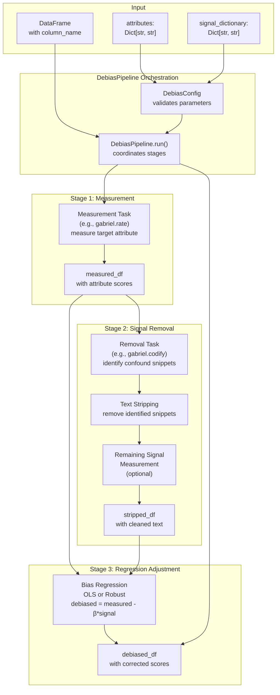
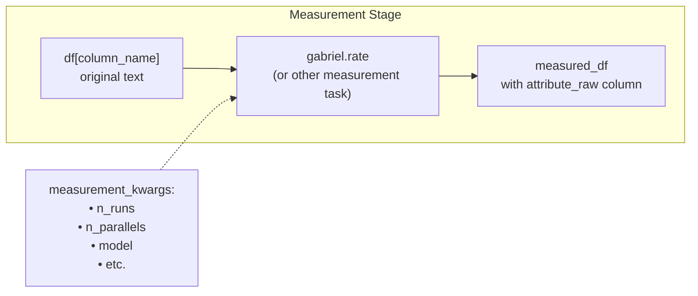
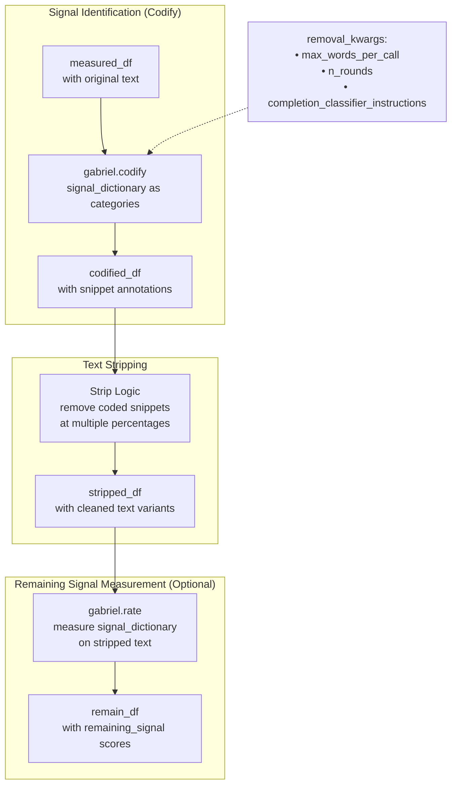
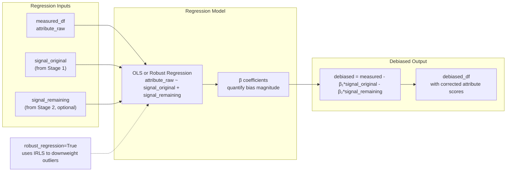
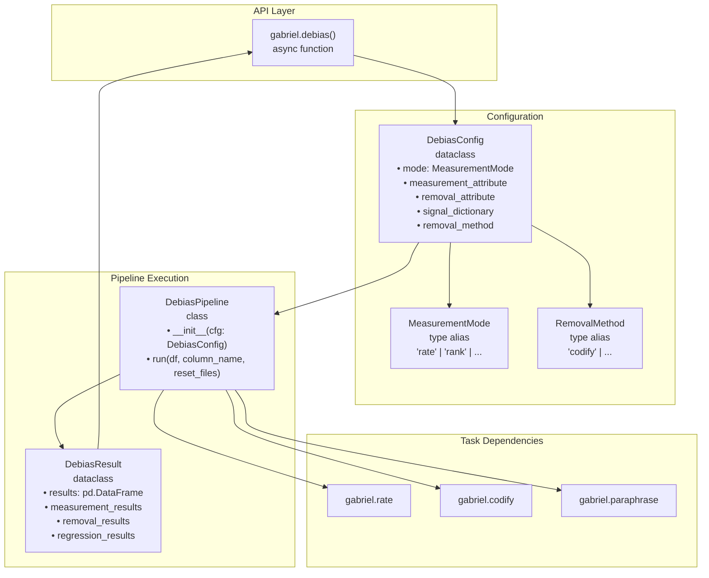
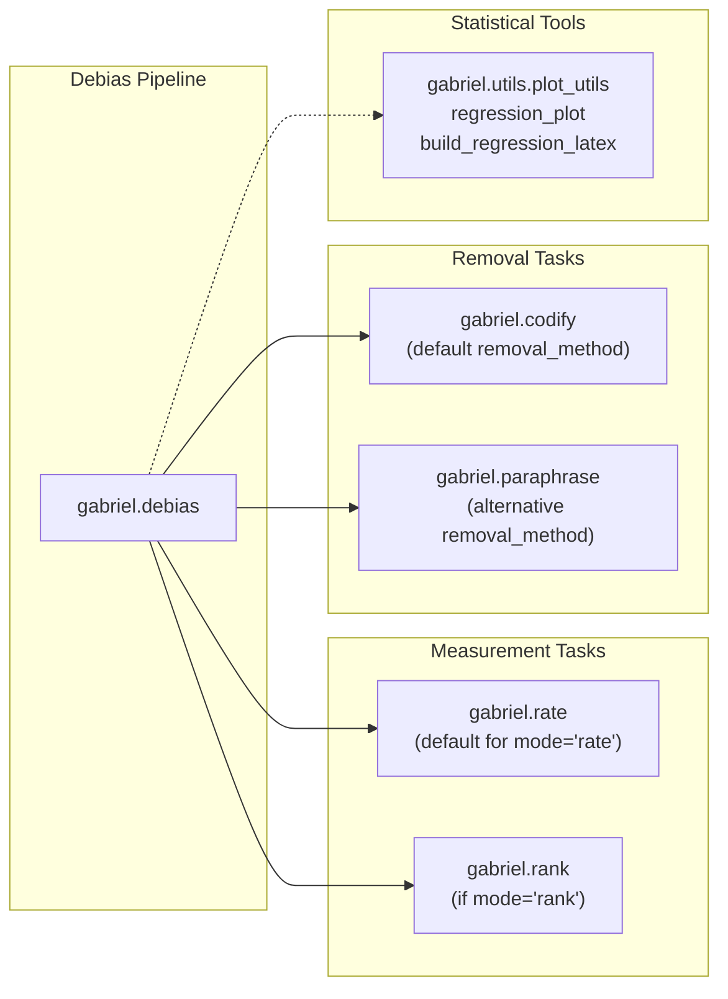

<!-- source: DeepWiki mcp.deepwiki.com · repo openai/GABRIEL · page 7.2 gabriel.debias - Bias Correction · fetched 2026-10-26 -->

# gabriel.debias - Bias Correction

<details>
<summary>Relevant source files</summary>

The following files were used as context for generating this wiki page:

- [README.md](README.md)
- [src/gabriel/api.py](src/gabriel/api.py)

</details>


## Purpose and Scope

The `gabriel.debias` function provides statistical post-processing to remove systematic inference bias from LLM-based measurements. It implements a multi-stage pipeline that measures attributes on text, identifies and removes confounding signals, then applies regression adjustment to correct biased estimates.

This page covers the debiasing workflow, configuration options, statistical methods, and output structure. For basic measurement tasks without bias correction, see [gabriel.rate - Absolute Scoring](#4.1) and [gabriel.rank - Pairwise Ranking](#4.2). For qualitative coding used in the removal stage, see [gabriel.codify, gabriel.compare, gabriel.bucket](#6.1).

**Sources:** [src/gabriel/api.py:1911-2073]()

---

## Overview: The Debiasing Problem

LLM-based measurements may conflate the target attribute with correlated confounds. For example, when rating "climate change rhetoric" in political speeches, the model might inadvertently infer opinions from general political ideology rather than textual content. The `debias` pipeline addresses this by:

1. **Measuring** the target attribute on original text
2. **Removing** textual markers of confounding signals via passage coding
3. **Measuring** the remaining signal prevalence on stripped text
4. **Regressing** out the confounding relationship to produce debiased estimates

**Sources:** [src/gabriel/api.py:1940-1945](), [README.md:66]()

---

## High-Level Pipeline Architecture



**Key Components:**
- **`DebiasConfig`**: Validates and stores all pipeline parameters
- **`DebiasPipeline`**: Orchestrates measurement, removal, and regression stages
- **`DebiasResult`**: Container for final outputs and intermediate artifacts

**Sources:** [src/gabriel/api.py:2049-2072]()

---

## Configuration: DebiasConfig

The `DebiasConfig` dataclass centralizes all debiasing parameters and enforces validation rules.

### Core Parameters

| Parameter | Type | Description |
|-----------|------|-------------|
| `mode` | `MeasurementMode` | Measurement strategy (e.g., `"rate"`) |
| `measurement_attribute` | `Optional[str]` | Target attribute to measure; inferred from `attributes` if omitted |
| `removal_attribute` | `Optional[str]` | Confound signal to remove; inferred from `signal_dictionary` if omitted |
| `signal_dictionary` | `Dict[str, str]` | Mapping of confound signals to their definitions (used in removal) |
| `attributes` | `Dict[str, str]` | Rating attributes for measurement tasks |
| `removal_method` | `RemovalMethod` | Strategy for removing confounds (e.g., `"codify"`) |

### Statistical Options

| Parameter | Type | Default | Description |
|-----------|------|---------|-------------|
| `remaining_signal` | `bool` | `True` | Measure remaining confound prevalence after stripping for two-step regression |
| `robust_regression` | `bool` | `True` | Use robust regression (iteratively reweighted least squares) instead of OLS |
| `random_seed` | `int` | `12345` | Seed for reproducibility in sampling-heavy steps |

### Operational Parameters

| Parameter | Type | Default | Description |
|-----------|------|---------|-------------|
| `save_dir` | `str` | `"~/Documents/runs"` | Base directory for artifacts |
| `run_name` | `Optional[str]` | Auto-generated | Subdirectory name; defaults to `debias_{attribute}` |
| `model` | `str` | `"gpt-5-mini"` | Model used across measurement and removal |
| `n_parallels` | `int` | `650` | Concurrency limit for all LLM calls |
| `verbose` | `bool` | `True` | Print inference notices and progress |

### Task-Specific Overrides

| Parameter | Type | Description |
|-----------|------|-------------|
| `measurement_kwargs` | `Optional[Dict[str, Any]]` | Overrides passed to measurement task (e.g., `rate_kwargs`) |
| `removal_kwargs` | `Optional[Dict[str, Any]]` | Overrides passed to removal task (e.g., `codify` parameters) |
| `strip_percentages` | `Optional[List[int]]` | List of stripping percentages to evaluate (e.g., `[25, 50, 75, 100]`) |
| `categories_to_strip` | `Optional[List[str]]` | Specific categories to remove; defaults to all |
| `template_path` | `Optional[str]` | Custom template for removal prompts |

**Sources:** [src/gabriel/api.py:1911-2049]()

---

## Pipeline Stages in Detail

### Stage 1: Measurement on Original Text

The pipeline begins by measuring the target attribute on unmodified text using the specified `mode` (typically `"rate"`).



**Implementation Details:**
- Uses `gabriel.rate` by default (when `mode="rate"`)
- Inherits `model`, `n_parallels`, and other settings from `DebiasConfig`
- Allows fine-grained overrides via `measurement_kwargs`
- Outputs are saved to `{save_dir}/{run_name}/measurement/`

**Sources:** [src/gabriel/api.py:1954-1963](), [src/gabriel/api.py:2022-2029]()

---

### Stage 2: Signal Removal via Passage Coding

The removal stage identifies and strips textual markers of confounding signals.



**Removal Method: `"codify"`**

When `removal_method="codify"`:
1. Calls `gabriel.codify` with `signal_dictionary` as `categories` parameter
2. Each signal becomes a qualitative code that highlights relevant snippets
3. Strips identified snippets to produce cleaned text
4. Supports multiple stripping percentages (e.g., remove top 25%, 50%, 75%, 100% of coded passages)

**Remaining Signal Measurement:**

When `remaining_signal=True` (default):
- Measures `signal_dictionary` attributes on stripped text
- Provides a second-stage regressor for more accurate bias correction
- Two-step regression: `debiased = measured - β₁*signal_original - β₂*signal_remaining`

**Sources:** [src/gabriel/api.py:1920-1933](), [src/gabriel/api.py:2035-2047]()

---

### Stage 3: Regression Adjustment

The final stage applies statistical corrections to remove the confounding relationship.



**Regression Methods:**

| Method | When Used | Implementation |
|--------|-----------|----------------|
| **Robust Regression** | `robust_regression=True` (default) | Iteratively reweighted least squares (IRLS) via statsmodels |
| **OLS** | `robust_regression=False` | Standard ordinary least squares |

**Two-Step vs. One-Step:**

- **Two-step** (when `remaining_signal=True`): Regresses on both original signal prevalence and remaining signal after stripping
- **One-step** (when `remaining_signal=False`): Regresses only on original signal prevalence

**Sources:** [src/gabriel/api.py:1930-1933](), [src/gabriel/api.py:1992-1993]()

---

## Code Entity Relationships



**Key Classes and Functions:**

- **`gabriel.debias()`** [src/gabriel/api.py:1911-2073](): Main entry point; constructs `DebiasConfig` and delegates to `DebiasPipeline`
- **`DebiasConfig`** [src/gabriel/api.py:44](): Configuration dataclass imported from `gabriel.tasks.debias`
- **`DebiasPipeline`** [src/gabriel/api.py:45](): Orchestrates multi-stage workflow
- **`DebiasResult`** [src/gabriel/api.py:46](): Container for outputs and intermediate results
- **`MeasurementMode`** [src/gabriel/api.py:47](): Type alias for measurement strategies
- **`RemovalMethod`** [src/gabriel/api.py:48](): Type alias for removal strategies

**Sources:** [src/gabriel/api.py:43-49](), [src/gabriel/api.py:2049-2072]()

---

## Output Structure: DebiasResult

The `DebiasPipeline.run()` method returns a `DebiasResult` object containing:

### Primary Output

```python
result.results: pd.DataFrame
```

The main DataFrame with these columns:

| Column Pattern | Description |
|----------------|-------------|
| `{attribute}_raw` | Original measured scores from Stage 1 |
| `{attribute}_stripped_{pct}` | Scores on text with `pct`% of confound snippets removed |
| `{attribute}_debiased_{pct}` | Regression-corrected scores for each stripping percentage |
| `{column_name}_stripped_{pct}` | Cleaned text variants |
| `{removal_attribute}_remaining_{pct}` | Remaining signal prevalence after stripping (if `remaining_signal=True`) |

### Intermediate Artifacts

The `DebiasResult` also stores:

| Attribute | Type | Description |
|-----------|------|-------------|
| `measurement_results` | `pd.DataFrame` | Full output from Stage 1 measurement task |
| `removal_results` | `pd.DataFrame` | Codified passages with snippet annotations |
| `regression_results` | `Dict[str, Any]` | Regression coefficients, standard errors, R² values |

### File System Layout

```
{save_dir}/{run_name}/
├── debias_results.csv          # Final debiased output (result.results)
├── measurement/
│   ├── ratings.csv             # Stage 1: measured attributes
│   └── responses/              # Raw LLM responses
├── removal/
│   ├── coding_results.csv      # Stage 2: codified passages
│   ├── responses/
│   └── stripped_texts/         # Text variants at each stripping percentage
├── remaining_signal/           # (if remaining_signal=True)
│   ├── ratings.csv             # Signal prevalence on stripped text
│   └── responses/
└── regression/
    └── coefficients.csv        # Regression statistics per stripping percentage
```

**Sources:** [src/gabriel/api.py:2020-2021](), [src/gabriel/api.py:2069-2072]()

---

## Usage Patterns

### Basic Usage: Remove Political Ideology from Climate Rhetoric Measurement

```python
import gabriel

df = pd.DataFrame({"text": ["speech 1...", "speech 2...", ...]})

result = await gabriel.debias(
    df,
    column_name="text",
    mode="rate",
    measurement_attribute="climate_rhetoric",
    signal_dictionary={
        "political_ideology": "General left-wing or right-wing political positioning"
    },
    attributes={
        "climate_rhetoric": "Emphasis on climate change policy"
    },
    removal_method="codify",
    save_dir="~/Documents/debias_climate",
    robust_regression=True,
)

# Access debiased scores
debiased_scores = result["climate_rhetoric_debiased_100"]
```

**Sources:** [src/gabriel/api.py:1940-1945](), [README.md:66]()

---

### Advanced: Multi-Attribute Measurement with Custom Stripping

```python
result = await gabriel.debias(
    df,
    column_name="text",
    mode="rate",
    attributes={
        "populist_rhetoric": "Anti-establishment messaging",
        "economic_policy": "Focus on economic issues",
    },
    measurement_attribute="populist_rhetoric",  # Primary target
    signal_dictionary={
        "party_affiliation": "Democratic or Republican party markers",
        "geographic_references": "Regional or state-specific language",
    },
    removal_attribute="party_affiliation",  # Primary confound
    strip_percentages=[25, 50, 75, 100],  # Evaluate multiple stripping levels
    removal_method="codify",
    removal_kwargs={
        "n_rounds": 3,  # Multiple codify passes for completeness
        "max_words_per_call": 1000,
    },
    save_dir="~/Documents/debias_populism",
    run_name="populism_debiased_2024",
    robust_regression=True,
    verbose=True,
)

# Compare bias magnitude across stripping levels
for pct in [25, 50, 75, 100]:
    debiased_col = f"populist_rhetoric_debiased_{pct}"
    print(f"Stripping {pct}%: mean = {result[debiased_col].mean():.2f}")
```

**Sources:** [src/gabriel/api.py:1911-2012]()

---

### Disabling Remaining Signal Measurement

For faster runs when two-step regression is unnecessary:

```python
result = await gabriel.debias(
    df,
    column_name="text",
    measurement_attribute="toxicity",
    signal_dictionary={"political_lean": "Liberal or conservative stance"},
    attributes={"toxicity": "Hostile or aggressive language"},
    removal_method="codify",
    remaining_signal=False,  # Skip Stage 2b: remaining signal measurement
    save_dir="~/Documents/debias_toxicity",
)
```

**Sources:** [src/gabriel/api.py:1930-1933](), [src/gabriel/api.py:1983-1986]()

---

### Loading Cached Results

When `df=None`, the function loads previously computed results:

```python
# Initial run
result = await gabriel.debias(
    df,
    column_name="text",
    measurement_attribute="rhetoric",
    signal_dictionary={"ideology": "Political lean"},
    attributes={"rhetoric": "Rhetorical intensity"},
    removal_method="codify",
    save_dir="~/Documents/debias_rhetoric",
    run_name="rhetoric_v1",
)

# Later: load cached results without recomputing
cached_result = await gabriel.debias(
    None,  # Triggers cache loading
    column_name="text",
    measurement_attribute="rhetoric",
    signal_dictionary={"ideology": "Political lean"},
    save_dir="~/Documents/debias_rhetoric",
    run_name="rhetoric_v1",
)
```

**Sources:** [src/gabriel/api.py:2014-2021]()

---

## Parameter Inference and Defaults

The `debias` function applies intelligent defaults when optional parameters are omitted:

### Attribute Inference

```python
# measurement_attribute defaults to first key in attributes
await gabriel.debias(
    df, "text",
    attributes={"toxicity": "...", "sentiment": "..."},  # toxicity inferred
    signal_dictionary={"ideology": "..."},
    removal_method="codify",
    save_dir="...",
)
```

### Removal Attribute Inference

```python
# removal_attribute defaults to:
# 1. measurement_attribute if present in signal_dictionary
# 2. Otherwise, first key in signal_dictionary
await gabriel.debias(
    df, "text",
    measurement_attribute="toxicity",
    signal_dictionary={"toxicity": "...", "ideology": "..."},  # toxicity inferred
    removal_method="codify",
    save_dir="...",
)
```

### Run Name Generation

```python
# run_name defaults to "debias_{attribute}"
# with special characters replaced by underscores
await gabriel.debias(
    df, "text",
    measurement_attribute="climate change rhetoric",  # run_name = "debias_climate_change_rhetoric"
    signal_dictionary={"ideology": "..."},
    removal_method="codify",
    save_dir="...",
)
```

**Helper Function:** `_debias_default_run_name()` [src/gabriel/api.py:95-102]()

**Sources:** [src/gabriel/api.py:95-102](), [src/gabriel/api.py:1956-1962]()

---

## Relationship to Other Tasks

The `debias` pipeline composes existing GABRIEL tasks:



**Task Integration:**

- **Measurement:** Delegates to `gabriel.rate` (most common) or `gabriel.rank` depending on `mode`
- **Removal:** Uses `gabriel.codify` by default to identify confound snippets
- **Analysis:** Output DataFrames are compatible with `gabriel.utils.plot_utils` for regression visualization

**See Also:**
- [gabriel.rate - Absolute Scoring](#4.1) for Stage 1 measurement
- [gabriel.codify, gabriel.compare, gabriel.bucket](#6.1) for removal methods
- [Statistical Analysis with plot_utils](#9.1) for regression visualization

**Sources:** [src/gabriel/api.py:1911-2073]()

---

## Statistical Methodology

### Robust Regression (Default)

When `robust_regression=True`, the pipeline uses **iteratively reweighted least squares (IRLS)** to downweight outliers:

1. Fit initial OLS model
2. Compute residuals and assign weights based on residual magnitude
3. Refit weighted least squares
4. Iterate until convergence

**Advantages:**
- Resistant to outliers in measurement or signal prevalence
- More stable coefficients when text length varies substantially

### Ordinary Least Squares

When `robust_regression=False`, standard OLS is used:

```
debiased = measured - β * signal
```

Where `β` is estimated via least squares minimization.

### Model Specification

**One-step model** (`remaining_signal=False`):
```
measured ~ signal_original
debiased = measured - β₁ * signal_original
```

**Two-step model** (`remaining_signal=True`):
```
measured ~ signal_original + signal_remaining
debiased = measured - β₁ * signal_original - β₂ * signal_remaining
```

The two-step model accounts for incomplete removal by including a second regressor that measures confound prevalence on stripped text.

**Sources:** [src/gabriel/api.py:1930-1933](), [src/gabriel/api.py:1992-1993]()

---

## Extensibility: Custom Response Functions

Like all GABRIEL tasks, `debias` supports custom LLM backends:

```python
async def custom_response_fn(prompt, **kwargs):
    # Route to alternative LLM provider
    response = await my_llm_api.complete(prompt)
    return response

result = await gabriel.debias(
    df, "text",
    measurement_attribute="sentiment",
    signal_dictionary={"topic": "Subject matter"},
    removal_method="codify",
    save_dir="...",
    response_fn=custom_response_fn,  # Propagated to all stages
)
```

**Automatic Propagation:**

The `response_fn` and `get_all_responses_fn` parameters are automatically forwarded to:
- Measurement tasks (via `measurement_kwargs`)
- Removal tasks (via `removal_kwargs`)

**Sources:** [src/gabriel/api.py:2024-2029]()

---

## Common Pitfalls and Best Practices

### 1. Attribute Name Consistency

**Problem:** Mismatch between `measurement_attribute` and keys in `attributes` or `signal_dictionary`

```python
# ❌ WRONG: "rhetoric" not in attributes
await gabriel.debias(
    df, "text",
    measurement_attribute="rhetoric",
    attributes={"rhetorical_intensity": "..."},  # Different name!
    signal_dictionary={"ideology": "..."},
    removal_method="codify",
    save_dir="...",
)

# ✅ CORRECT: consistent naming
await gabriel.debias(
    df, "text",
    measurement_attribute="rhetorical_intensity",
    attributes={"rhetorical_intensity": "..."},
    signal_dictionary={"ideology": "..."},
    removal_method="codify",
    save_dir="...",
)
```

### 2. Stripping Percentage Selection

**Best Practice:** Evaluate multiple percentages to assess bias-variance tradeoff:

- **Low percentages (25%):** Preserve more text, but may not fully remove confound
- **High percentages (100%):** Maximum debiasing, but may remove valid signal

Inspect outputs across percentages to choose the optimal level.

### 3. Remaining Signal Measurement

**Default is recommended:** `remaining_signal=True` provides more accurate bias estimates when stripping is incomplete. Only disable for faster runs when stripping is known to be complete.

### 4. Deprecated Parameters

**Warning:** `completion_max_rounds` in `removal_kwargs` is deprecated. Use `n_rounds` instead:

```python
# ❌ DEPRECATED
await gabriel.debias(
    df, "text", ...,
    removal_kwargs={"completion_max_rounds": 3},
)

# ✅ CORRECT
await gabriel.debias(
    df, "text", ...,
    n_rounds=3,  # Convenience parameter
    # OR
    removal_kwargs={"n_rounds": 3},  # Explicit override
)
```

**Sources:** [src/gabriel/api.py:2037-2047]()

---

## Performance Considerations

### Computational Cost

The `debias` pipeline runs multiple tasks sequentially:

1. **Measurement:** `O(n)` LLM calls on original text
2. **Removal:** `O(n * k)` calls for codification (where `k` = number of signals)
3. **Remaining Signal:** `O(n * p)` calls per stripping percentage `p`
4. **Regression:** Local computation (negligible)

**Total cost:** Approximately `2-4×` the cost of a single `gabriel.rate` call, depending on configuration.

### Optimization Strategies

**1. Reduce Measurement Runs:**
```python
measurement_kwargs={"n_runs": 1}  # Single pass instead of multiple
```

**2. Disable Remaining Signal:**
```python
remaining_signal=False  # Skip Stage 2b
```

**3. Limit Stripping Percentages:**
```python
strip_percentages=[100]  # Only evaluate full stripping
```

**4. Increase Concurrency:**
```python
n_parallels=650  # Default maximum (adjust based on rate limits)
```

**Sources:** [src/gabriel/api.py:1979-1980]()

---

## Troubleshooting

### Issue: "Cannot load cached results"

**Symptom:** `FileNotFoundError` when calling `debias(df=None, ...)`

**Cause:** The `run_name` or `save_dir` doesn't match the original run

**Solution:** Verify paths match exactly, including tilde expansion:
```python
save_dir = os.path.expanduser("~/Documents/runs")  # Explicit expansion
```

### Issue: Debiased scores are NaN

**Cause:** Insufficient variation in signal prevalence (regression is singular)

**Solution:** 
1. Check that `signal_dictionary` attributes vary across the corpus
2. Verify codification successfully identified snippets (inspect `removal_results`)
3. Consider alternative `removal_attribute` with more variation

### Issue: Regression coefficients seem wrong

**Cause:** Outliers distorting OLS estimates

**Solution:** Enable robust regression (default):
```python
robust_regression=True  # Use IRLS to downweight outliers
```

**Sources:** [src/gabriel/api.py:2014-2021]()

---

## Summary: Key Takeaways

1. **`gabriel.debias`** implements a three-stage pipeline: measure → remove → regress
2. **Configuration** is managed by `DebiasConfig` and executed by `DebiasPipeline`
3. **Statistical correction** uses robust or OLS regression with optional two-step modeling
4. **Output** includes raw, stripped, and debiased scores for multiple stripping percentages
5. **Integration** with existing tasks (rate, codify) makes it composable with other GABRIEL workflows

**Sources:** [src/gabriel/api.py:1911-2073]()

---

