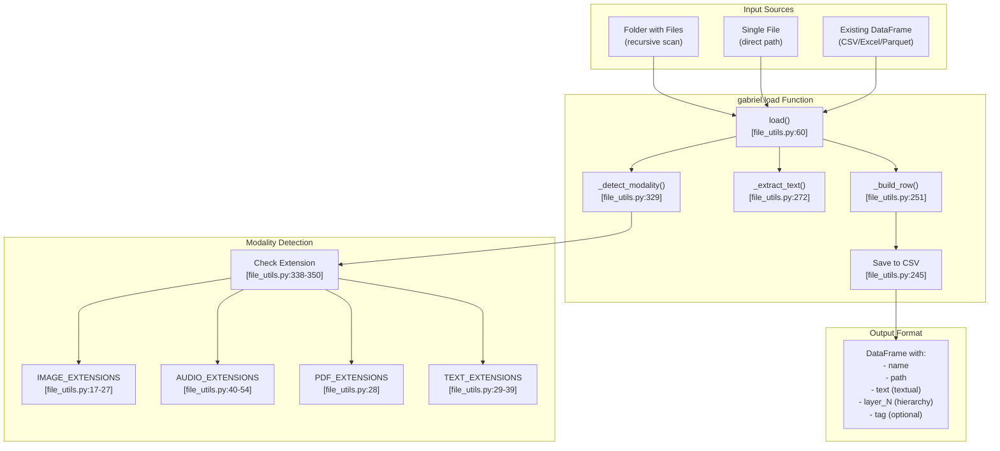
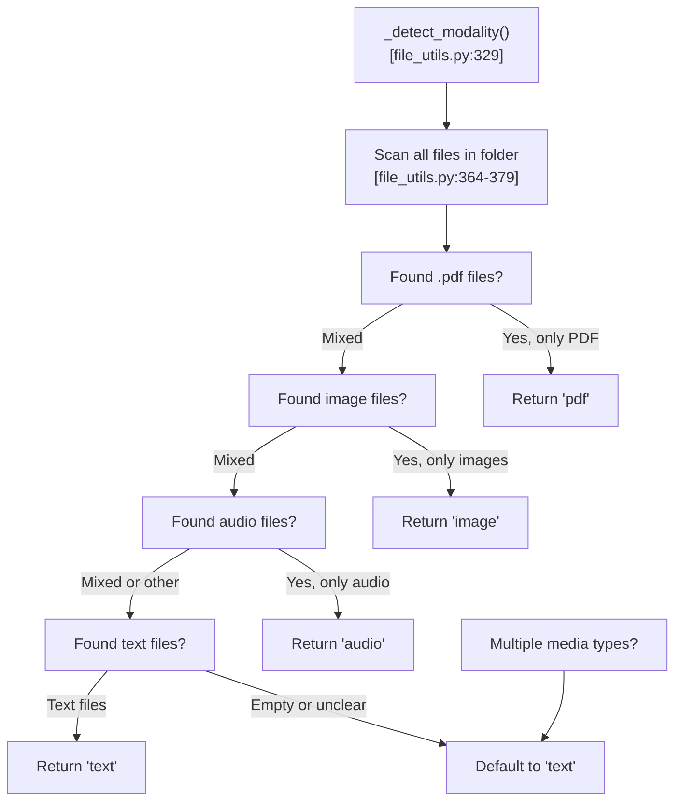
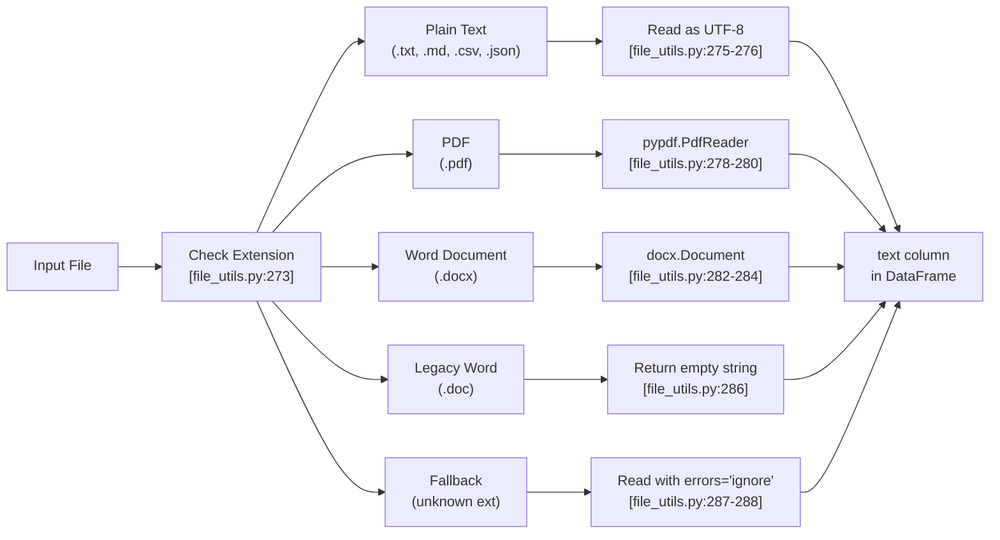

<!-- source: DeepWiki mcp.deepwiki.com · repo openai/GABRIEL · page 8 Data Loading and Preparation · fetched 2026-10-26 -->

# Data Loading and Preparation

<details>
<summary>Relevant source files</summary>

The following files were used as context for generating this wiki page:

- [README.md](README.md)
- [src/gabriel/utils/file_utils.py](src/gabriel/utils/file_utils.py)
- [src/gabriel/utils/modality_utils.py](src/gabriel/utils/modality_utils.py)
- [tests/test_load_files.py](tests/test_load_files.py)

</details>


## Purpose and Scope

This page covers the data preparation layer that converts raw files and existing datasets into standardized DataFrames suitable for GABRIEL's task system. The primary mechanism is the `gabriel.load()` function, which aggregates files from directories, detects modalities, and produces analysis-ready tabular data. For detailed documentation of the `load()` function parameters and advanced usage patterns, see [gabriel.load - File Aggregation](#8.1).

For information about how loaded data flows into measurement tasks, see [Measurement Tasks](#4). For multimodal processing details, see [Multimodal Processing](#11).

---

## Data Loading Architecture

GABRIEL accepts two types of inputs: (1) folders containing files of various types, or (2) existing DataFrames. The `load()` function in [src/gabriel/utils/file_utils.py:60-248]() serves as the aggregation engine, recursively scanning directories, detecting file types, and producing standardized output schemas.



**Sources:** [src/gabriel/utils/file_utils.py:1-473]()

---

## Modality System

GABRIEL distinguishes between **textual modalities** (where content is extracted into a `text` column) and **path modalities** (where file paths are preserved for later processing). The system automatically detects modalities or accepts explicit `modality` parameter values.

### Modality Types

| Modality | Type | Behavior | Use Cases |
|----------|------|----------|-----------|
| `text` | Textual | Extracts content into `text` column | Passages, documents, articles |
| `entity` | Textual | Treats short strings as entities | Product names, job titles, concepts |
| `web` | Textual | Indicates web search context | Search queries, URLs to augment |
| `image` | Path | Stores file paths for image files | Photos, diagrams, scanned documents |
| `audio` | Path | Stores file paths for audio files | Interviews, podcasts, speeches |
| `pdf` | Path | Stores file paths for PDF files | Reports, papers (with layout/figures) |

The modality categorization is defined in [src/gabriel/utils/file_utils.py:13-15]():

```python
TEXTUAL_MODALITIES = {"text", "entity", "web"}
PATH_MODALITIES = {"image", "audio", "pdf"}
```

**Sources:** [src/gabriel/utils/file_utils.py:13-15](), [src/gabriel/utils/file_utils.py:382-387]()

### Modality Detection Algorithm

When `modality=None`, the `_detect_modality()` function scans files and infers the appropriate modality:



**Sources:** [src/gabriel/utils/file_utils.py:329-361]()

### Modality Validation

The `warn_if_modality_mismatch()` function in [src/gabriel/utils/modality_utils.py:14-100]() inspects a sample of DataFrame values and warns users when the specified modality conflicts with detected content. For example:

- PDFs detected with `modality='text'` → warns to use `modality='pdf'` for layout fidelity
- Image paths detected with `modality='text'` → warns to use `modality='image'`
- Short text (< 10 words) with `modality='text'` → suggests `modality='entity'`
- Long text (> 30 words) with `modality='entity'` → suggests `modality='text'`

**Sources:** [src/gabriel/utils/modality_utils.py:14-100]()

---

## DataFrame Schema and Column Structure

The `load()` function produces a standardized DataFrame schema that all GABRIEL tasks expect. The schema varies based on modality and folder hierarchy.

### Core Columns

| Column | Always Present | Description | Example |
|--------|----------------|-------------|---------|
| `name` | Yes | Filename with extension | `"report_2023.pdf"` |
| `path` | Yes | Absolute path to file | `"/home/user/data/report_2023.pdf"` |
| `text` | Textual only | Extracted content | `"This report summarizes..."` |
| `layer_1`, `layer_2`, ... | If nested | Subfolder hierarchy | `"fiscal_year"`, `"q1"` |
| `tag` | If `tag_dict` provided | User-defined tags | `"baseline"`, `"treatment"` |

### Layer Hierarchy System

When files are nested in subdirectories, the `load()` function creates `layer_N` columns to preserve the hierarchy. The number of layer columns equals the maximum nesting depth:

```
data/
├── baseline/
│   └── doc1.txt          → layer_1="baseline"
└── treatment/
    ├── round1/
    │   └── doc2.txt      → layer_1="treatment", layer_2="round1"
    └── round2/
        └── doc3.txt      → layer_1="treatment", layer_2="round2"
```

The layer creation logic is in [src/gabriel/utils/file_utils.py:200-204]() and [src/gabriel/utils/file_utils.py:229-233]().

**Sources:** [src/gabriel/utils/file_utils.py:200-233](), [src/gabriel/utils/file_utils.py:251-269]()

### Tag Assignment

The `tag_dict` parameter allows substring-based tagging. For example:

```python
tag_dict = {"baseline": 0, "treatment": 1, "control": 0}
```

The `_match_tag()` function in [src/gabriel/utils/file_utils.py:300-307]() performs case-insensitive substring matching on filenames to assign tag values.

**Sources:** [src/gabriel/utils/file_utils.py:300-307]()

---

## Text Extraction Pipeline

For textual modalities, the `_extract_text()` function in [src/gabriel/utils/file_utils.py:272-288]() extracts content from various file formats:



**Optional Dependencies:** PDF and DOCX extraction require `pypdf` and `python-docx` packages respectively. The `_optional_import()` function in [src/gabriel/utils/file_utils.py:291-297]() raises informative errors if these dependencies are missing.

**Sources:** [src/gabriel/utils/file_utils.py:272-297]()

---

## File Persistence and Resumability

The `load()` function writes output to `{save_dir}/{save_name}` (default: `"gabriel_aggregated_content.csv"`). The `reset_files` parameter controls reuse behavior:

- **`reset_files=False`** (default): If the output file exists, it is loaded directly without re-scanning the folder. This enables fast iteration during development.
- **`reset_files=True`**: Forces re-scanning and overwrites existing output.

The reuse logic is in [src/gabriel/utils/file_utils.py:109-114]():

```python
if os.path.exists(save_path) and not reset_files:
    logger.info("Loading existing aggregated file from %s", save_path)
    df = _read_tabular_file(save_path)
    return df
```

**Sources:** [src/gabriel/utils/file_utils.py:106-114](), [src/gabriel/utils/file_utils.py:460-472]()

---

## Integration with Task System

The standardized DataFrame output from `gabriel.load()` flows directly into GABRIEL's task functions. Tasks expect specific column configurations based on the `modality` parameter:

| Task Modality | Expected Columns | Example Task Calls |
|---------------|------------------|-------------------|
| `text`, `entity`, `web` | `text` column with content | `gabriel.rate(df, column_name="text", modality="text")` |
| `image`, `audio`, `pdf` | `path` column with file paths | `gabriel.classify(df, column_name="path", modality="image")` |

The task system internally calls `warn_if_modality_mismatch()` from [src/gabriel/utils/modality_utils.py:14-100]() to validate that the DataFrame content matches the specified modality, providing helpful warnings when mismatches are detected.

**Example workflow:**

```python
import gabriel
import pandas as pd

# Load files from folder
df = gabriel.load(
    folder_path="~/data/speeches",
    modality="text",
    save_dir="~/outputs",
    reset_files=True
)

# Pass directly to measurement task
results = await gabriel.rate(
    df,
    column_name="text",
    attributes={"populism": "Degree of populist rhetoric"},
    modality="text",
    save_dir="~/outputs/ratings"
)
```

**Sources:** [src/gabriel/utils/modality_utils.py:14-100](), [src/gabriel/utils/file_utils.py:60-248]()

---

## Direct DataFrame Inputs

GABRIEL also accepts pre-existing DataFrames without using `gabriel.load()`. Users can pass any DataFrame with the required columns:

- For textual tasks: A column containing text content
- For path-based tasks: A column containing file paths

When `gabriel.load()` receives a path to a tabular file (CSV, Excel, Parquet) with textual modalities, it loads the file directly without creating a copy:

```python
# In [src/gabriel/utils/file_utils.py:142-150]()
if is_textual and ext in TABULAR_EXTENSIONS:
    logger.info("Input path %s is a tabular file; loading it without creating a copy.")
    df = _read_tabular_file(folder_path)
    return df
```

This enables seamless integration with existing data pipelines that already produce tabular outputs.

**Sources:** [src/gabriel/utils/file_utils.py:142-150](), [src/gabriel/utils/file_utils.py:460-472]()

---

## File Extension Constants

The file type detection system uses predefined extension sets defined in [src/gabriel/utils/file_utils.py:17-57]():

| Constant | Extensions | Usage |
|----------|-----------|--------|
| `TABULAR_EXTENSIONS` | `.csv`, `.tsv`, `.xlsx`, `.parquet`, `.feather` | Direct DataFrame loading |
| `IMAGE_EXTENSIONS` | `.png`, `.jpg`, `.gif`, `.bmp`, `.tiff`, `.webp`, `.svg` | Image modality detection |
| `AUDIO_EXTENSIONS` | `.mp3`, `.wav`, `.flac`, `.m4a`, `.ogg`, `.opus`, `.aiff` | Audio modality detection |
| `PDF_EXTENSIONS` | `.pdf` | PDF modality detection |
| `TEXT_EXTENSIONS` | `.txt`, `.md`, `.html`, `.json`, `.xml` | Text extraction |

**Sources:** [src/gabriel/utils/file_utils.py:16-57]()

---

## Common Patterns and Examples

### Pattern 1: Loading Mixed Hierarchy

```python
# Folder structure:
# experiments/
#   ├── baseline/
#   │   ├── sample1.txt
#   │   └── sample2.txt
#   └── treatment/
#       └── sample3.txt

df = gabriel.load(
    folder_path="experiments",
    tag_dict={"baseline": 0, "treatment": 1},
    save_name="experiment_data.csv"
)
# Result: DataFrame with name, path, text, layer_1, tag columns
```

### Pattern 2: Loading Images for Classification

```python
df = gabriel.load(
    folder_path="product_photos",
    modality="image",
    extensions=["png", "jpg"]
)
# Result: DataFrame with name, path columns (no text column)
```

### Pattern 3: Reusing Cached Load

```python
# First run: scans folder, creates CSV
df = gabriel.load("data", save_name="cache.csv", reset_files=True)

# Subsequent runs: instantly loads CSV
df = gabriel.load("data", save_name="cache.csv")  # Fast!
```

**Sources:** [tests/test_load_files.py:1-152](), [README.md:152-153]()

---

