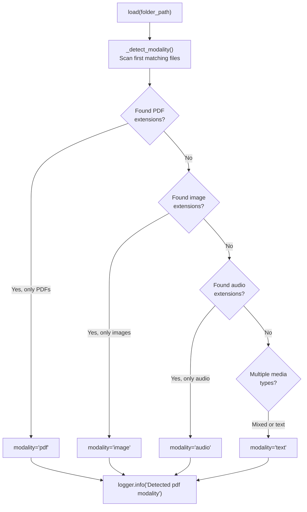
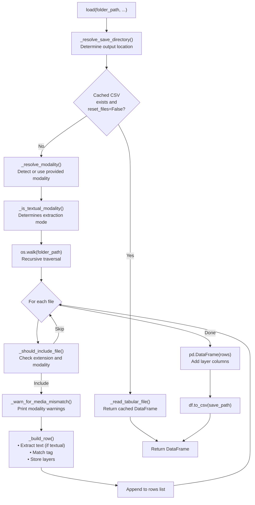
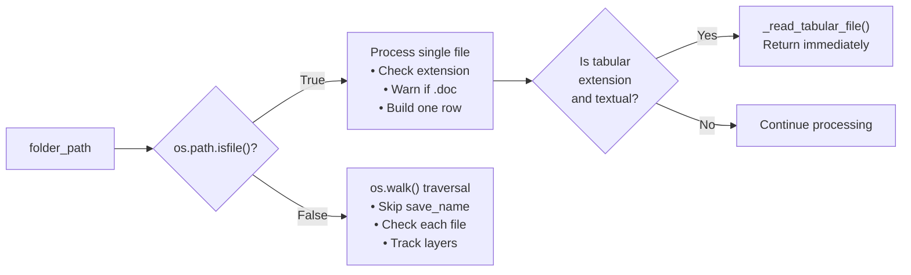
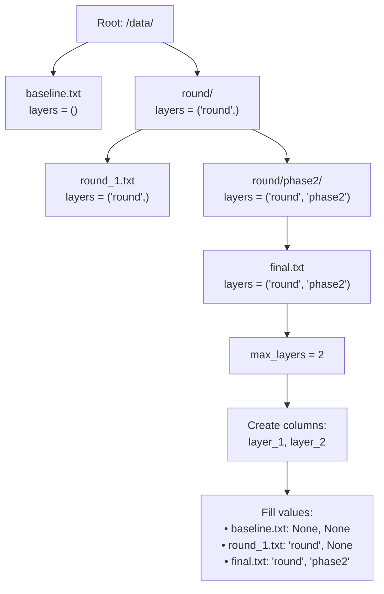
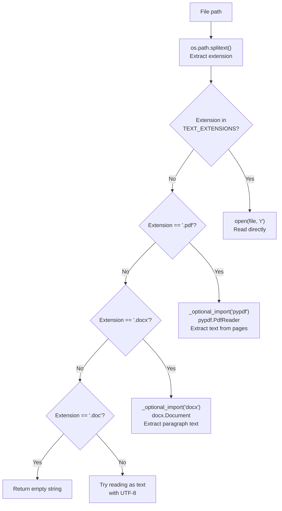
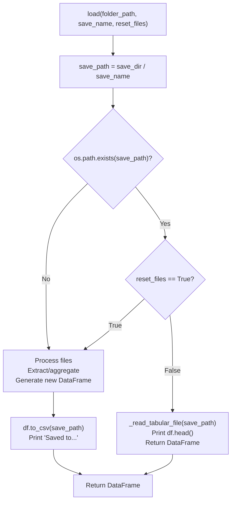
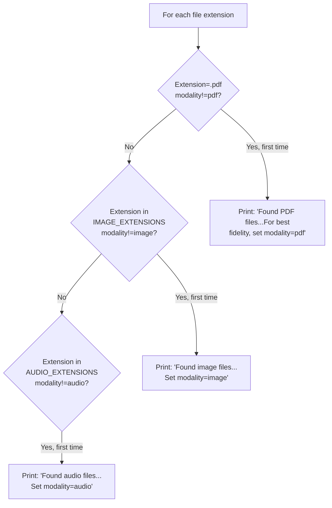

<!-- source: DeepWiki mcp.deepwiki.com · repo openai/GABRIEL · page 8.1 gabriel.load - File Aggregation · fetched 2026-10-26 -->

# gabriel.load - File Aggregation

<details>
<summary>Relevant source files</summary>

The following files were used as context for generating this wiki page:

- [src/gabriel/utils/file_utils.py](src/gabriel/utils/file_utils.py)
- [src/gabriel/utils/modality_utils.py](src/gabriel/utils/modality_utils.py)
- [tests/test_load_files.py](tests/test_load_files.py)

</details>


## Purpose and Scope

This page documents the `gabriel.load` function, GABRIEL's entry point for converting raw files into structured DataFrames. The function performs automatic modality detection, recursive directory traversal, text extraction, and file path aggregation. It handles text files (.txt, .md, .json, etc.), Microsoft Word documents (.docx), PDFs (.pdf), images (.png, .jpg, etc.), and audio files (.mp3, .wav, etc.).

For downstream task execution using the loaded data, see [Core Architecture](#3) and [Measurement Tasks](#4). For interactive visualization of loaded data, see [gabriel.view - Interactive Viewer](#9.2).

---

## Function Overview

The `load()` function aggregates files from a directory (or single file) into a pandas DataFrame with consistent column structure. It automatically detects file modalities, extracts text content when appropriate, and organizes files by directory hierarchy.

**Core responsibilities:**
- Recursive directory traversal with extension filtering
- Automatic modality detection (text, image, audio, pdf)
- Text extraction from supported formats
- Directory structure preservation via layer columns
- Optional substring-based tagging
- CSV output caching for reusability

**Sources:** [src/gabriel/utils/file_utils.py:60-103]()

---

## Modality System

### Modality Types

GABRIEL distinguishes between **textual modalities** (content extracted into `text` column) and **path modalities** (file paths stored in `path` column):

| Modality | Type | Behavior | Use Case |
|----------|------|----------|----------|
| `text` | Textual | Extracts text content | Long-form documents, articles |
| `entity` | Textual | Same as text | Short entity names, identifiers |
| `web` | Textual | Same as text | Web search queries |
| `image` | Path | Stores file paths | Visual content for GPT-Vision |
| `audio` | Path | Stores file paths | Audio transcription/analysis |
| `pdf` | Path | Stores file paths | Rich PDF layout preservation |

**Key distinction:** Setting `modality='text'` on PDFs extracts plain text. Setting `modality='pdf'` attaches the PDF directly to LLM calls, preserving layout, figures, and images.

**Sources:** [src/gabriel/utils/file_utils.py:13-15](), [src/gabriel/utils/file_utils.py:382-387]()

### Automatic Modality Detection



The detection algorithm scans candidate files using `_detect_modality()` and `_iter_candidate_files()`. If a single media type dominates (all PDFs, all images, or all audio), that modality is selected. Mixed directories default to `text` modality.

**Sources:** [src/gabriel/utils/file_utils.py:329-361](), [src/gabriel/utils/file_utils.py:310-326]()

---

## Parameters and Configuration

### Core Parameters

```python
def load(
    folder_path: str,
    extensions: Optional[Iterable[str]] = None,
    *,
    tag_dict: Optional[Dict[str, Any]] = None,
    save_name: str = "gabriel_aggregated_content.csv",
    save_dir: Optional[str] = None,
    reset_files: bool = False,
    modality: Optional[str] = None,
) -> pd.DataFrame
```

| Parameter | Type | Default | Purpose |
|-----------|------|---------|---------|
| `folder_path` | str | Required | Path to directory or single file |
| `extensions` | Iterable[str] | None | Filter by extensions (e.g., `["txt", "md"]`) |
| `tag_dict` | Dict[str, Any] | None | Map filename substrings to tag values |
| `save_name` | str | `"gabriel_aggregated_content.csv"` | Output filename |
| `save_dir` | str | None | Output directory (defaults to `folder_path`) |
| `reset_files` | bool | False | Force regeneration, ignoring cached CSV |
| `modality` | str | None | Override automatic modality detection |

**Sources:** [src/gabriel/utils/file_utils.py:60-103]()

### Extension Filtering

The `extensions` parameter accepts an iterable of extensions **without leading dots**:

```python
# Correct usage:
df = load("documents/", extensions=["txt", "md", "pdf"])

# Extensions are normalized and case-insensitive
df = load("documents/", extensions=["TXT", ".txt"])  # Both work
```

Filtering occurs in `_should_include_file()`, which checks both the explicit extension list and modality-specific restrictions.

**Sources:** [src/gabriel/utils/file_utils.py:390-407]()

### Tag Dictionary

The `tag_dict` parameter enables automatic labeling based on filename substrings. Matching is case-insensitive and uses substring search:

```python
tag_dict = {
    "baseline": "control",
    "treatment_a": "group_1", 
    "treatment_b": "group_2"
}

df = load("experiment/", tag_dict=tag_dict)
# Files containing "baseline" get tag="control"
# Files containing "treatment_a" get tag="group_1"
```

The first matching substring wins. Tags are assigned by `_match_tag()` during row construction.

**Sources:** [src/gabriel/utils/file_utils.py:300-307](), [src/gabriel/utils/file_utils.py:259]()

---

## Processing Workflow

### High-Level Flow



**Sources:** [src/gabriel/utils/file_utils.py:105-248]()

### Single File vs Directory Handling

The function handles both single files and directories:



When `folder_path` points to an existing CSV/Excel file in textual mode, it's loaded directly without creating a copy. This optimization avoids unnecessary file duplication.

**Sources:** [src/gabriel/utils/file_utils.py:131-170](), [src/gabriel/utils/file_utils.py:142-150]()

---

## Output Schema

### Column Structure

The output DataFrame has a consistent schema determined by modality and directory structure:

#### Textual Modality Output

```
name          | path                | layer_1  | layer_2  | tag        | text
--------------+---------------------+----------+----------+------------+-------------------
baseline.txt  | /path/to/baseline.txt | None     | None     | control    | "Document text..."
round_1.txt   | /path/to/round/round_1.txt | "round"  | None     | treatment  | "More text..."
```

#### Path Modality Output

```
name          | path                | layer_1  | layer_2  | tag
--------------+---------------------+----------+----------+------------
image1.png    | /path/to/image1.png | None     | None     | None
audio.wav     | /path/to/sub/audio.wav | "sub"    | None     | None
```

**Column descriptions:**

| Column | Always Present | Description |
|--------|----------------|-------------|
| `name` | Yes | Filename without directory path |
| `path` | Yes | Absolute file path |
| `layer_1`, `layer_2`, ... | Yes | Directory hierarchy (None if at root) |
| `tag` | If `tag_dict` provided | Substring-matched tag value |
| `text` | If textual modality | Extracted text content |

The number of `layer_N` columns equals the maximum directory depth encountered during traversal.

**Sources:** [src/gabriel/utils/file_utils.py:228-248](), [src/gabriel/utils/file_utils.py:251-269]()

### Layer Column Generation



The system tracks `max_layers` during traversal and adds `layer_1` through `layer_N` columns to the final DataFrame, ensuring consistent schema across all rows.

**Sources:** [src/gabriel/utils/file_utils.py:204](), [src/gabriel/utils/file_utils.py:229-233](), [src/gabriel/utils/file_utils.py:267-268]()

---

## Text Extraction Details

### Supported Formats and Methods



**Sources:** [src/gabriel/utils/file_utils.py:272-288]()

### Extension Constants

The system defines comprehensive extension sets:

```python
# TEXT_EXTENSIONS - Read with open()
TEXT_EXTENSIONS = {
    ".txt", ".md", ".rtf", ".html", ".htm", 
    ".xml", ".json", ".csv", ".tsv"
}

# IMAGE_EXTENSIONS - Path modality only
IMAGE_EXTENSIONS = {
    ".png", ".jpg", ".jpeg", ".gif", ".bmp", 
    ".tiff", ".tif", ".webp", ".svg"
}

# AUDIO_EXTENSIONS - Path modality only
AUDIO_EXTENSIONS = {
    ".mp3", ".wav", ".flac", ".m4a", ".aac", 
    ".ogg", ".oga", ".opus", ".aiff", ".aif", 
    ".aifc", ".wma", ".alac"
}

# PDF_EXTENSIONS - Dual behavior
PDF_EXTENSIONS = {".pdf"}
```

**Sources:** [src/gabriel/utils/file_utils.py:17-54]()

### Optional Dependency Handling

Text extraction for PDFs and DOCX files requires optional dependencies:

```python
def _optional_import(module_name: str, package_name: str):
    """Lazy import with helpful error message."""
    if importlib.util.find_spec(module_name) is None:
        raise ImportError(
            f"Missing optional dependency '{package_name}'. "
            f"Install it to extract {module_name} documents."
        )
    return importlib.import_module(module_name)
```

**Installation requirements:**
- PDF extraction: `pip install pypdf`
- DOCX extraction: `pip install python-docx`

The system only imports these libraries when processing files of the corresponding type, allowing GABRIEL to function without them if only processing plain text.

**Sources:** [src/gabriel/utils/file_utils.py:291-297](), [src/gabriel/utils/file_utils.py:278-280](), [src/gabriel/utils/file_utils.py:282-284]()

### Legacy Format Handling

Microsoft `.doc` (legacy Word format) files are explicitly **not supported** and are skipped with a warning:

```
[gabriel.load] Ignoring legacy .doc files. Please convert them to .docx or PDF before loading.
```

This warning appears once per `load()` call when `.doc` files are encountered.

**Sources:** [src/gabriel/utils/file_utils.py:133-139](), [src/gabriel/utils/file_utils.py:176-183]()

---

## Caching and Resumability

### Cache Behavior



**Key behaviors:**

1. **Default caching:** When `save_path` exists and `reset_files=False`, the cached CSV is loaded immediately without scanning the directory
2. **Force regeneration:** Setting `reset_files=True` always processes files from scratch
3. **Automatic save:** Every call that processes files saves the result to `save_path`

**Practical implications:**

```python
# First call: Processes all files, saves CSV
df1 = load("data/")

# Second call: Loads cached CSV instantly (no file scanning)
df2 = load("data/")

# Third call: Forces reprocessing (useful if files changed)
df3 = load("data/", reset_files=True)
```

**Sources:** [src/gabriel/utils/file_utils.py:109-114](), [src/gabriel/utils/file_utils.py:245-247]()

### Tabular File Pass-Through

When loading an existing CSV, Excel, Parquet, or Feather file directly (without aggregation), the file is read and returned **without creating a copy**:

```python
# Input is already a DataFrame-like file
df = load("existing_data.csv")
# Returns pd.read_csv("existing_data.csv") directly
# Does NOT create "gabriel_aggregated_content.csv"
```

This optimization applies when:
1. `folder_path` points to a file (not directory)
2. The file has a tabular extension (`.csv`, `.xlsx`, `.parquet`, etc.)
3. The resolved modality is textual

**Sources:** [src/gabriel/utils/file_utils.py:142-150]()

---

## Modality Warning System

### Automatic Mismatch Detection

The function prints warnings when file types don't match the selected modality:



Warnings are printed **once per modality type per call** using boolean flags (`warned_pdf`, `warned_image`, `warned_audio`).

**Example output:**

```
[gabriel.load] Found PDF files in /data/documents while modality='text'. 
PDFs will be extracted into plain text. For best PDF fidelity (layout, 
figures, and images), set modality='pdf' here and in the downstream 
gabriel call.
```

**Sources:** [src/gabriel/utils/file_utils.py:410-438](), [src/gabriel/utils/file_utils.py:153-160](), [src/gabriel/utils/file_utils.py:189-196]()

### PDF-Specific Guidance

When `modality='pdf'` is set, additional guidance is provided:

```python
if modality == "pdf" and has_non_pdf:
    print("[gabriel.load] Detected non-PDF files in a PDF run. "
          "Only PDFs were ingested. Set modality='text' if you "
          "need to include non-PDF files.")

if modality == "pdf" and has_pdf:
    print("[gabriel.load] PDF modality attaches PDFs directly. "
          "Set modality='text' to extract text-only versions.")
```

This helps users understand the trade-off between text extraction (simpler, more compatible) and direct PDF attachment (preserves layout and images).

**Sources:** [src/gabriel/utils/file_utils.py:215-226]()

---

## Integration with GABRIEL Tasks

### Modality Propagation

The `modality` parameter in `load()` should match the `modality` parameter in downstream task calls:

```python
# Load images as paths
df = load("images/", modality="image")

# Pass same modality to task
result = gabriel.classify(
    df, 
    input_column="path",
    modality="image",  # Must match
    attribute="contains a cat",
    ...
)
```

The `modality_utils` module provides runtime validation in task functions to detect and warn about mismatches.

**Sources:** [src/gabriel/utils/modality_utils.py:14-100]()

### Common Patterns

#### Pattern 1: Text Document Analysis

```python
# Load and extract text from documents
df = load("documents/", extensions=["txt", "md", "pdf"])

# Rate extracted text
results = gabriel.rate(
    df,
    input_column="text",
    modality="text",
    attribute="clarity of writing",
    ...
)
```

#### Pattern 2: Image Classification

```python
# Load image file paths
df = load("photos/", modality="image")

# Classify images
results = gabriel.classify(
    df,
    input_column="path",
    modality="image",
    categories=["landscape", "portrait", "abstract"],
    ...
)
```

#### Pattern 3: Multi-Tier Organization

```python
# Organize by directory structure
df = load("experiment/", tag_dict={"control": 0, "treatment": 1})

# Filter by layer and tag
control_baseline = df[(df["layer_1"] == "baseline") & (df["tag"] == 0)]
treatment_phase1 = df[(df["layer_1"] == "phase1") & (df["tag"] == 1)]
```

**Sources:** Inferred from function design and integration patterns

---

## Edge Cases and Limitations

### Empty Directories

If no files match the filters, an empty DataFrame is returned with the expected column structure:

```python
df = load("empty_folder/")
# Returns: DataFrame with columns [name, path] but 0 rows
```

**Sources:** [src/gabriel/utils/file_utils.py:228]()

### Symbolic Links

The `os.walk()` traversal follows symbolic links by default. Circular symlinks may cause infinite loops. Use caution when loading directories with symlinks.

**Sources:** [src/gabriel/utils/file_utils.py:171]()

### Large Files

Text extraction loads entire file contents into memory. For very large files (>1GB), this may cause memory issues. Consider:
- Using `modality="pdf"` for large PDFs (streams to API)
- Pre-processing large files before loading
- Filtering with `extensions` parameter

**Sources:** [src/gabriel/utils/file_utils.py:275-276]()

### Unicode Handling

All text files are opened with `encoding="utf-8", errors="ignore"`. Invalid UTF-8 sequences are silently dropped. For critical data, verify encodings beforehand.

**Sources:** [src/gabriel/utils/file_utils.py:275]()

---

## Code Reference Summary

| Function/Constant | Location | Purpose |
|-------------------|----------|---------|
| `load()` | [src/gabriel/utils/file_utils.py:60-248]() | Main entry point |
| `_build_row()` | [src/gabriel/utils/file_utils.py:251-269]() | Constructs DataFrame row |
| `_extract_text()` | [src/gabriel/utils/file_utils.py:272-288]() | Handles text extraction |
| `_detect_modality()` | [src/gabriel/utils/file_utils.py:329-361]() | Automatic modality detection |
| `_resolve_modality()` | [src/gabriel/utils/file_utils.py:310-326]() | Modality resolution logic |
| `_should_include_file()` | [src/gabriel/utils/file_utils.py:390-407]() | Extension and modality filtering |
| `_warn_for_media_mismatch()` | [src/gabriel/utils/file_utils.py:410-438]() | Prints modality warnings |
| `_match_tag()` | [src/gabriel/utils/file_utils.py:300-307]() | Tag dictionary matching |
| `_read_tabular_file()` | [src/gabriel/utils/file_utils.py:460-472]() | Loads cached CSVs |
| `_resolve_save_directory()` | [src/gabriel/utils/file_utils.py:441-457]() | Determines output directory |
| `TEXT_EXTENSIONS` | [src/gabriel/utils/file_utils.py:29-39]() | Supported text formats |
| `IMAGE_EXTENSIONS` | [src/gabriel/utils/file_utils.py:17-27]() | Supported image formats |
| `AUDIO_EXTENSIONS` | [src/gabriel/utils/file_utils.py:40-54]() | Supported audio formats |
| `TEXTUAL_MODALITIES` | [src/gabriel/utils/file_utils.py:13]() | Modalities with text extraction |
| `PATH_MODALITIES` | [src/gabriel/utils/file_utils.py:14]() | Modalities with path storage |

**Sources:** [src/gabriel/utils/file_utils.py:1-473]()

---

