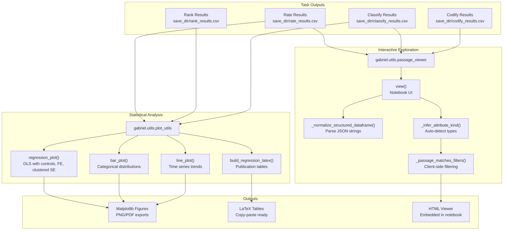
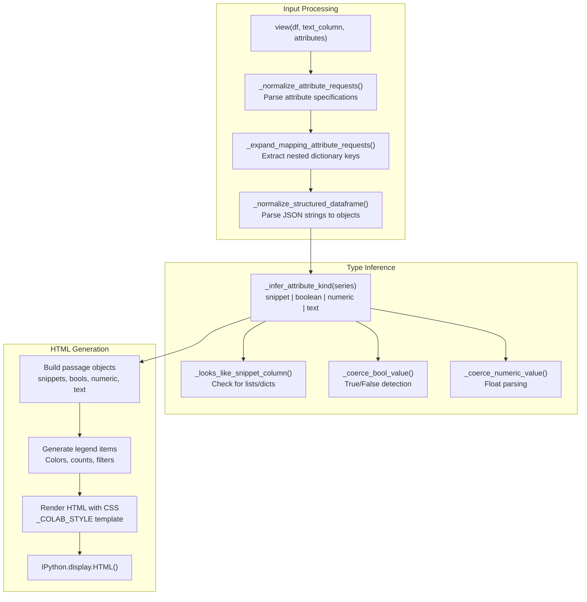
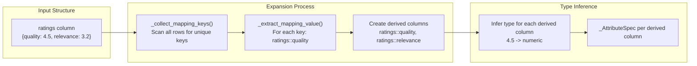
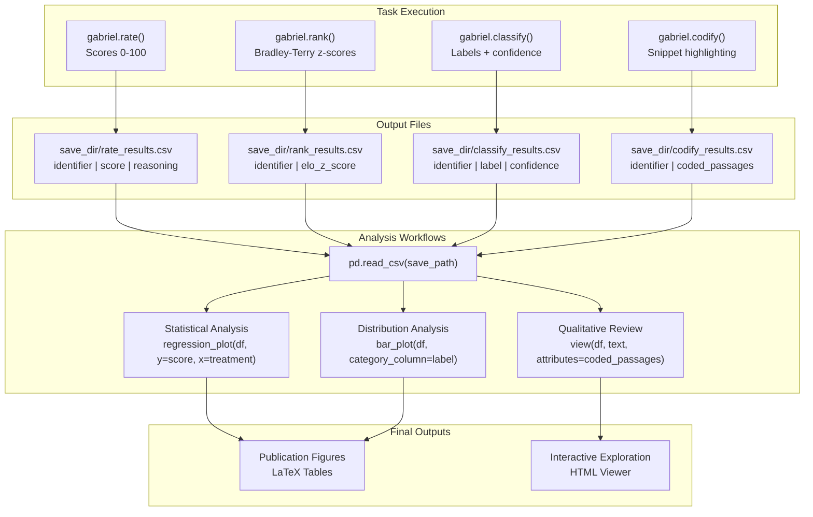

<!-- source: DeepWiki mcp.deepwiki.com · repo openai/GABRIEL · page 9 Analysis and Visualization · fetched 2026-10-26 -->

# Analysis and Visualization

<details>
<summary>Relevant source files</summary>

The following files were used as context for generating this wiki page:

- [src/gabriel/utils/passage_viewer.py](src/gabriel/utils/passage_viewer.py)
- [src/gabriel/utils/plot_utils.py](src/gabriel/utils/plot_utils.py)
- [tests/test_codify_completion.py](tests/test_codify_completion.py)
- [tests/test_colab_viewer.py](tests/test_colab_viewer.py)
- [tests/test_discover_exports.py](tests/test_discover_exports.py)
- [tests/test_imports.py](tests/test_imports.py)
- [tests/test_plot_utils.py](tests/test_plot_utils.py)

</details>


## Purpose and Scope

This page documents GABRIEL's post-processing tools for analyzing and visualizing task outputs. The system provides two complementary approaches: **statistical analysis** via `plot_utils` for quantitative evaluation, and **interactive exploration** via `passage_viewer` for qualitative auditing. These tools consume the CSV outputs produced by measurement and data cleaning tasks.

For information about the underlying task execution that produces these outputs, see [Measurement Tasks](#4) and [Data Cleaning Tasks](#5). For details on output file structure, see [Save Directory Structure](#12.1).

---

## Overview

The analysis layer operates independently of task execution, consuming saved results to enable reproducible analysis workflows. Both tools are designed for Jupyter notebook environments, producing publication-ready outputs or interactive UIs.



**Sources:** [src/gabriel/utils/plot_utils.py:1-60](), [src/gabriel/utils/passage_viewer.py:1-35]()

---

## Statistical Analysis with plot_utils

The `plot_utils` module provides econometric-grade statistical analysis with an emphasis on robust inference and publication-quality visualizations.

### Core Functions

| Function | Purpose | Key Features |
|----------|---------|--------------|
| `regression_plot()` | OLS regression with controls | Robust SE (HC3), fixed effects, clustered SE, binned scatter plots |
| `bar_plot()` | Categorical distributions | Auto-sizing, label wrapping, error bars |
| `line_plot()` | Time series visualization | Multi-series, confidence intervals, gradient colors |
| `build_regression_latex()` | LaTeX table generation | Coefficient formatting, significance stars, custom layouts |
| `fit_ols()` | Direct OLS estimation | Returns structured dictionary with coefficients, SE, p-values |

**Sources:** [src/gabriel/utils/plot_utils.py:945-1012](), [src/gabriel/utils/plot_utils.py:604-686]()

### Regression Infrastructure

The regression system uses `statsmodels` for estimation with sophisticated support for fixed effects and clustered standard errors:

```mermaid
graph LR
    subgraph "Input Data"
        DataFrame["pd.DataFrame<br/>with outcome, predictors"]
    end
    
    subgraph "regression_plot Function"
        ValidateInputs["Validate Parameters<br/>y, x, controls, entity_fe, time_fe"]
        PrepareData["_prepare_fixed_effect_columns()<br/>Normalize categorical columns<br/>Identify base levels"]
        BuildFormula["_fit_formula_model()<br/>Construct R-style formula<br/>Handle interactions"]
        FitModel["smf.ols().fit()<br/>cov_type: HC3 or cluster"]
        ExtractResults["_results_to_dict()<br/>coef, se, t, p, r2, F"]
    end
    
    subgraph "Optional Post-Processing"
        YearExcess["_apply_year_excess()<br/>Difference/ratio/percent<br/>relative to rolling window"]
        LaTeXGen["build_regression_latex()<br/>Format coefficients<br/>Significance stars"]
    end
    
    subgraph "Outputs"
        ResultDict["results dictionary<br/>{(y, x): {simple, with_controls}}"]
        Figures["Matplotlib scatter + regression line"]
        Tables["LaTeX regression table"]
    end
    
    DataFrame --> ValidateInputs
    ValidateInputs --> PrepareData
    PrepareData --> BuildFormula
    BuildFormula --> FitModel
    FitModel --> ExtractResults
    
    ExtractResults --> YearExcess
    YearExcess --> ResultDict
    ExtractResults --> ResultDict
    
    ResultDict --> Figures
    ResultDict --> LaTeXGen
    LaTeXGen --> Tables
```



**Sources:** [src/gabriel/utils/plot_utils.py:530-602](), [src/gabriel/utils/plot_utils.py:150-207]()

### Fixed Effects and Clustering

The system handles fixed effects by converting categorical columns to dummy variables, automatically selecting base levels based on frequency:

```mermaid
graph TB
    subgraph "Fixed Effects Preparation"
        RawColumn["Categorical Column<br/>entity_id, time_period"]
        CountFreq["Count value frequencies"]
        IdentifyRare["Identify rare levels<br/>share < min_share"]
        Placeholder["Merge rare into __rare__ placeholder"]
        SelectBase["Base level = most frequent<br/>(or __rare__ if exists)"]
        CreateCategorical["pd.Categorical()<br/>with ordered levels"]
    end
    
    subgraph "Clustering Groups"
        ClusterCols["cluster_cols=['entity_id']"]
        NumericCheck["Is column numeric?"]
        UseRaw["Use raw values"]
        ToCodes["pd.Categorical().codes"]
        ClusterArray["Cluster groups array<br/>for statsmodels"]
    end
    
    RawColumn --> CountFreq
    CountFreq --> IdentifyRare
    IdentifyRare --> Placeholder
    Placeholder --> SelectBase
    SelectBase --> CreateCategorical
    
    ClusterCols --> NumericCheck
    NumericCheck -->|Yes| UseRaw
    NumericCheck -->|No| ToCodes
    UseRaw --> ClusterArray
    ToCodes --> ClusterArray
```



**Sources:** [src/gabriel/utils/plot_utils.py:150-207](), [src/gabriel/utils/plot_utils.py:210-227]()

### LaTeX Table Generation

The `build_regression_latex()` function produces camera-ready tables with flexible column specifications:

| Configuration Key | Purpose | Default |
|------------------|---------|---------|
| `columns` | List of model specs: `{key: (y,x), model: "simple"/"with_controls"}` | All estimated models |
| `row_order` | Variables to display and their order | All coefficients |
| `include_intercept` | Show intercept row | `False` |
| `float_format` | Number formatting string | `"{:.3f}"` |
| `include_controls_row` | Summary row for controls | `False` |
| `include_fe_rows` | Rows for each fixed effect | `True` |
| `include_cluster_row` | Rows for clustering indicators | `True` |
| `notes` | Footnote text | Significance legend |

**Sources:** [src/gabriel/utils/plot_utils.py:604-939]()

### Bar and Line Plots

The plotting functions include intelligent auto-sizing and label management:

```python
# Bar plot with auto-wrapping of long labels
bar_plot(
    data=df,
    category_column="feature_description",
    value_column="importance_score",
    as_percent=True,
    label_wrap_mode="auto",  # or "fixed", "none"
    orientation="horizontal"
)

# Line plot with multiple series
line_plot(
    data=df,
    x="year",
    y=["treatment_group", "control_group"],
    series_column="condition",
    gradient=True,  # Color gradient along line
    confidence_alpha=0.95
)
```

The `bar_plot()` function implements sophisticated label wrapping:

| Mode | Behavior |
|------|----------|
| `"auto"` | Dynamically adjusts wrap width based on label length and bar count |
| `"fixed"` | Wraps at `wrap_width` characters |
| `"none"` | No wrapping (may require manual figure width adjustment) |

**Sources:** [src/gabriel/utils/plot_utils.py:1013-1582](), [tests/test_plot_utils.py:162-192]()

---

## Interactive Viewer (passage_viewer)

The `view()` function provides a notebook-embedded interface for exploring task results with filtering and highlighting capabilities.

### Entry Point and Normalization Pipeline



**Sources:** [src/gabriel/utils/passage_viewer.py:225-316](), [src/gabriel/utils/passage_viewer.py:458-490]()

### Attribute Types and Inference

The system automatically infers attribute types based on sample values:

| Type | Detection Criteria | Display |
|------|-------------------|---------|
| `snippet` | Lists, dicts, or >50% values are structured | Color-coded chips with counts |
| `boolean` | ≥60% of values are True/False | Toggle chips with glow effects |
| `numeric` | ≥60% of values are numbers | Sortable chips with intensity shading |
| `text` | Default fallback | Plain text display in header |

**Sources:** [src/gabriel/utils/passage_viewer.py:458-490](), [src/gabriel/utils/passage_viewer.py:187-202]()

### Snippet Highlighting System

The viewer highlights text passages matching snippet categories using a multi-color palette:

```mermaid
graph LR
    subgraph "Snippet Data Structure"
        RawData["coded_passages column<br/>{category: [snippet1, snippet2]}"]
        ParseJSON["Parse if JSON string"]
        ExtractSnippets["Extract snippet list per category"]
    end
    
    subgraph "Color Assignment"
        GenColors["_generate_distinct_colors(n)<br/>tab20 cmap up to 20 colors<br/>HSV beyond 20"]
        AssignPerCategory["Map category -> hex color"]
    end
    
    subgraph "Text Highlighting"
        FindOccurrences["Find snippet occurrences in text"]
        BuildSpans["Create <span> elements<br/>with background color"]
        HandleOverlaps["Resolve overlapping ranges<br/>nested spans"]
        RenderHTML["Highlighted HTML output"]
    end
    
    RawData --> ParseJSON
    ParseJSON --> ExtractSnippets
    
    ExtractSnippets --> GenColors
    GenColors --> AssignPerCategory
    
    AssignPerCategory --> FindOccurrences
    FindOccurrences --> BuildSpans
    BuildSpans --> HandleOverlaps
    HandleOverlaps --> RenderHTML
```



**Sources:** [src/gabriel/utils/passage_viewer.py:36-72](), [src/gabriel/utils/passage_viewer.py:1566-1821]()

### Filtering and Sorting

The viewer implements client-side filtering using JavaScript embedded in the HTML output:

| Filter Type | Behavior | Visual Indicator |
|------------|----------|-----------------|
| Snippet filter | Show only passages containing selected snippets (AND logic) | Chip border highlight + glow |
| Boolean filter | Show only passages where boolean is True | Chip background change + glow |
| Numeric filter | Show only passages within min-max range | Chip border highlight |
| Numeric sort | Reorder passages by selected numeric attribute | Arrow indicator (↑/↓) |

**Sources:** [src/gabriel/utils/passage_viewer.py:509-537](), [src/gabriel/utils/passage_viewer.py:147-184]()

### Header Columns

The `header_columns` parameter displays metadata above each passage:

```python
view(
    df,
    text_column="passage",
    attributes=["sentiment", "topics"],
    header_columns=["speaker", "date", "location"]
)
```

Headers are rendered in a responsive grid layout that adapts to screen width, with each column showing a label-value pair.

**Sources:** [src/gabriel/utils/passage_viewer.py:1822-2016](), [tests/test_colab_viewer.py:27-43]()

### Mapping Expansion

When an attribute contains nested dictionaries, the system automatically expands them into individual sub-attributes:



This allows viewing complex results from tasks like `extract()` that return structured dictionaries without manual column creation.

**Sources:** [src/gabriel/utils/passage_viewer.py:319-383](), [tests/test_colab_viewer.py:161-178]()

---

## Data Flow from Tasks to Analysis

The following diagram shows how task outputs flow into analysis tools:



**Sources:** [src/gabriel/utils/plot_utils.py:1-60](), [src/gabriel/utils/passage_viewer.py:1-35]()

---

## Common Usage Patterns

### Statistical Analysis Workflow

```python
import pandas as pd
from gabriel.utils.plot_utils import regression_plot, build_regression_latex

# Load results from rate task
df = pd.read_csv("save_dir/rate_results.csv")

# Run regression with controls and fixed effects
results = regression_plot(
    data=df,
    y="outcome_score",
    x="treatment",
    controls=["age", "income"],
    entity_fixed_effects=["region"],
    time_fixed_effects=["year"],
    cluster_cols=["region"],
    robust=True,
    latex_options=True,
    save_path="figures/regression.png"
)

# Generate LaTeX table
latex = build_regression_latex(
    results,
    options={
        "caption": "Treatment Effects on Outcome",
        "label": "tab:treatment",
        "include_adj_r2": True,
        "save_path": "tables/regression.tex"
    }
)
```

**Sources:** [src/gabriel/utils/plot_utils.py:1583-2350]()

### Interactive Viewer Workflow

```python
from gabriel import view
import pandas as pd

# Load codify results
df = pd.read_csv("save_dir/codify_results.csv")

# Launch interactive viewer
view(
    df,
    text_column="passage",
    attributes={
        "coded_passages": "Categories",
        "is_persuasive": "Persuasive?",
        "quality_score": "Quality Rating"
    },
    header_columns=["speaker", "date"],
    theme="dark"
)
```

The viewer automatically:
1. Parses JSON strings in `coded_passages`
2. Infers `is_persuasive` as boolean
3. Infers `quality_score` as numeric with color intensity
4. Displays metadata headers
5. Enables filtering and sorting

**Sources:** [src/gabriel/utils/passage_viewer.py:1358-1565](), [tests/test_colab_viewer.py:18-24]()

---

## Integration with Task Outputs

### Regression Analysis of Rate Results

The `rate()` task produces numeric scores suitable for regression:

```python
# Rate passages on persuasiveness
gabriel.rate(
    data=df,
    text="argument_text",
    attribute="persuasiveness",
    save_dir="rate_persuasiveness"
)

# Analyze treatment effects
results_df = pd.read_csv("rate_persuasiveness/rate_results.csv")
regression_plot(
    data=results_df,
    y="rating",
    x="treatment_condition",
    controls=["length", "complexity"],
    save_path="persuasiveness_effects.png"
)
```

**Sources:** [src/gabriel/utils/plot_utils.py:1583-2350]()

### Qualitative Review of Codify Results

The `codify()` task produces snippet dictionaries ideal for the viewer:

```python
# Codify passages
gabriel.codify(
    data=df,
    text="passage",
    categories={
        "evidence": "Citations or empirical data",
        "reasoning": "Logical arguments",
        "appeals": "Emotional appeals"
    },
    save_dir="codify_arguments"
)

# Review in viewer
results_df = pd.read_csv("codify_arguments/codify_results.csv")
view(
    results_df,
    text_column="passage",
    attributes="coded_passages",  # Special handling for nested structure
    header_columns=["author", "context"]
)
```

**Sources:** [src/gabriel/utils/passage_viewer.py:1358-1565](), [tests/test_colab_viewer.py:77-91]()

### Distribution Analysis of Classify Results

The `classify()` task produces categorical labels suitable for bar plots:

```python
# Classify sentiment
gabriel.classify(
    data=df,
    text="review_text",
    categories=["positive", "neutral", "negative"],
    save_dir="sentiment_classification"
)

# Visualize distribution
results_df = pd.read_csv("sentiment_classification/classify_results.csv")
bar_plot(
    data=results_df,
    category_column="label",
    as_percent=True,
    title="Sentiment Distribution",
    save_path="sentiment_dist.png"
)
```

**Sources:** [src/gabriel/utils/plot_utils.py:1013-1582]()

---

## Performance Considerations

### plot_utils

- **Statsmodels dependency**: Requires `statsmodels>=0.14.5` for Python 3.12+ and SciPy 1.16+
- **Fixed effects**: Large categorical variables with many levels can cause memory issues; use `min_share` to group rare levels
- **LaTeX compilation**: Generated tables are plain LaTeX; no compilation is performed by GABRIEL

**Sources:** [src/gabriel/utils/plot_utils.py:38-59]()

### passage_viewer

- **Client-side filtering**: All filtering/sorting happens in JavaScript, so large datasets (>1000 rows) may cause browser lag
- **JSON parsing**: The system parses JSON strings on DataFrame load, not in the browser, so initial load time scales with dataset size
- **Color generation**: Uses `tab20` colormap for up to 20 categories, then falls back to HSV generation

**Sources:** [src/gabriel/utils/passage_viewer.py:36-72](), [src/gabriel/utils/passage_viewer.py:1358-1565]()

---

