<!-- source: DeepWiki mcp.deepwiki.com · repo openai/GABRIEL · page 9.1 Statistical Analysis with plot_utils · fetched 2026-10-26 -->

# Statistical Analysis with plot_utils

<details>
<summary>Relevant source files</summary>

The following files were used as context for generating this wiki page:

- [src/gabriel/utils/plot_utils.py](src/gabriel/utils/plot_utils.py)
- [tests/test_plot_utils.py](tests/test_plot_utils.py)

</details>


## Purpose and Scope

The `plot_utils` module provides publication-quality statistical analysis tools for post-processing GABRIEL task outputs. This page covers regression analysis with robust standard errors, fixed effects, clustered covariance, binned scatter plots, and LaTeX table generation. For interactive qualitative review of results, see [gabriel.view - Interactive Viewer](#9.2).

**Sources:** [src/gabriel/utils/plot_utils.py:1-17]()

---

## System Overview

The `plot_utils` module operates as a standalone statistical analysis layer that consumes GABRIEL task outputs (typically DataFrames with scored/ranked items) and produces regression results, publication-ready visualizations, and LaTeX tables. Unlike core GABRIEL tasks that orchestrate LLM calls, `plot_utils` performs purely local computation using `statsmodels`, `matplotlib`, and `numpy`.

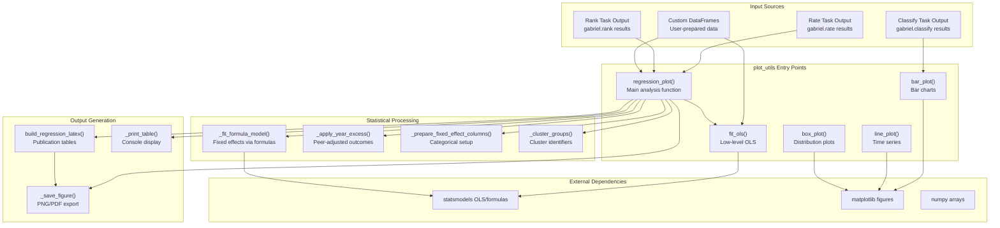

**Sources:** [src/gabriel/utils/plot_utils.py:1-60](), [src/gabriel/utils/plot_utils.py:1081-1615]()

---

## Core Function: `regression_plot`

The `regression_plot()` function is the primary interface for statistical analysis. It accepts a DataFrame and produces OLS regression results, binned scatter plots, and optional LaTeX tables.

### Basic Signature and Parameters

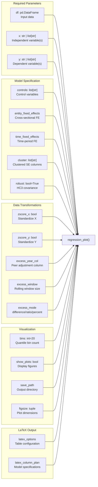

**Sources:** [src/gabriel/utils/plot_utils.py:1081-1195]()

---

## Regression Pipeline Architecture

The `regression_plot()` function orchestrates a multi-stage pipeline for each `(y, x)` pair. The pipeline adapts based on whether fixed effects or clustering are specified.

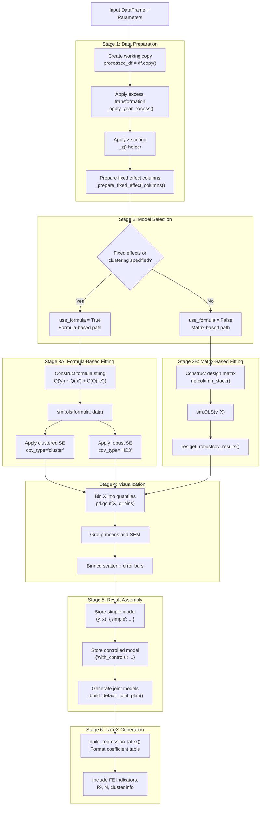

**Sources:** [src/gabriel/utils/plot_utils.py:1273-1468](), [src/gabriel/utils/plot_utils.py:530-601]()

---

## Fixed Effects Implementation

Fixed effects are implemented through statsmodels' formula API with categorical transformations. Rare levels (appearing in fewer than `fixed_effect_min_share` of observations) are pooled into a combined baseline category.

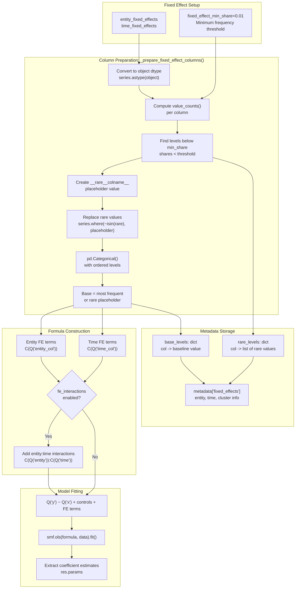

**Sources:** [src/gabriel/utils/plot_utils.py:150-207](), [src/gabriel/utils/plot_utils.py:1255-1271](), [src/gabriel/utils/plot_utils.py:1381-1393]()

---

## Clustered Standard Errors

Clustering adjusts standard errors to account for correlation within groups (e.g., observations from the same firm, year, or geographic unit). The implementation uses statsmodels' clustered covariance estimator.

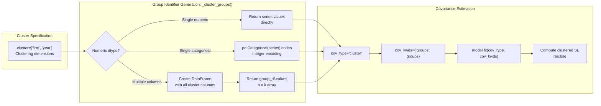

**Sources:** [src/gabriel/utils/plot_utils.py:210-226](), [src/gabriel/utils/plot_utils.py:571-576]()

---

## Excess/Year Adjustments

The excess transformation computes outcome variables relative to a rolling window of peer observations. This is useful for isolating idiosyncratic variation by removing time trends or cohort effects.

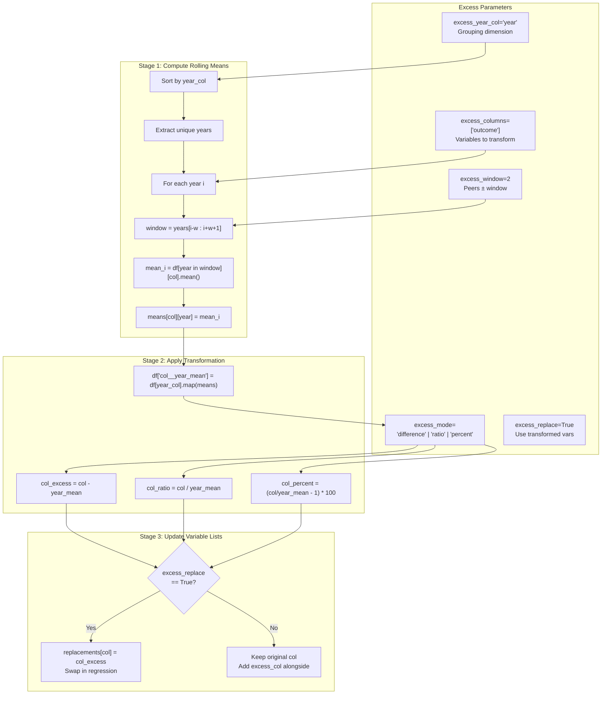

**Sources:** [src/gabriel/utils/plot_utils.py:229-310](), [src/gabriel/utils/plot_utils.py:1204-1225]()

---

## Result Dictionary Structure

The `regression_plot()` function returns a nested dictionary keyed by `(y_var, x_var)` tuples, with separate entries for simple and controlled models, plus joint specifications for LaTeX tables.

| Key Type | Example | Contents |
|----------|---------|----------|
| `(y, x)` pair | `("outcome", "treatment")` | `{"simple": {...}, "with_controls": {...}, "binned_df": pd.DataFrame, "metadata": {...}}` |
| Joint model | `("outcome", "joint_0")` | `{"joint": {...}, "metadata": {...}}` |
| LaTeX metadata | `"_joint_columns"` | `{y_var: [{"key": ..., "model": ..., "label": ...}, ...]}` |
| LaTeX table | `"latex_table"` | Complete LaTeX table string (if `latex_options` enabled) |

### Model Entry Contents

Each model dictionary (simple/with_controls/joint) contains:

```python
{
    "coef": pd.Series,          # Coefficient estimates indexed by variable name
    "se": pd.Series,            # Standard errors
    "t": pd.Series,             # t-statistics
    "p": pd.Series,             # p-values
    "r2": float,                # R-squared
    "adj_r2": float,            # Adjusted R-squared
    "n": int,                   # Number of observations
    "k": int,                   # Number of parameters (excluding intercept)
    "rse": float,               # Residual standard error
    "F": float,                 # F-statistic
    "resid": np.ndarray,        # Residuals
    "varnames": list[str],      # Original parameter names
    "display_varnames": list[str],  # Pretty display names
    "param_lookup": dict,       # Mapping display -> statsmodels param name
    "sm_results": RegressionResultsWrapper,  # Full statsmodels result object
    "metadata": dict,           # Model specification details
}
```

**Sources:** [src/gabriel/utils/plot_utils.py:500-527](), [src/gabriel/utils/plot_utils.py:1463-1468]()

---

## LaTeX Table Generation

The `build_regression_latex()` function converts regression results into publication-ready LaTeX tables with coefficient formatting, significance stars, and summary statistics.

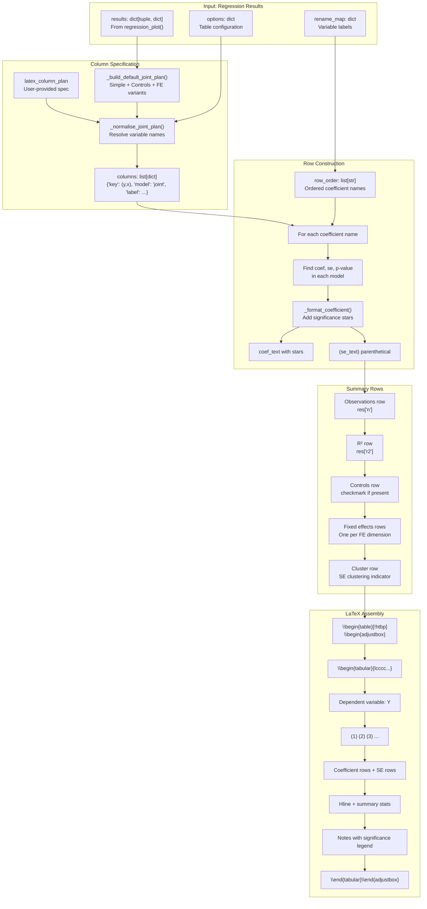

**Sources:** [src/gabriel/utils/plot_utils.py:604-939](), [src/gabriel/utils/plot_utils.py:313-366](), [src/gabriel/utils/plot_utils.py:453-476]()

---

## Significance Stars and Formatting

Coefficients are formatted with significance stars following standard conventions. Standard errors appear in parentheses below coefficients.

| p-value range | Stars | Meaning |
|---------------|-------|---------|
| p < 0.01 | `***` | Significant at 1% level |
| 0.01 ≤ p < 0.05 | `**` | Significant at 5% level |
| 0.05 ≤ p < 0.10 | `*` | Significant at 10% level |
| p ≥ 0.10 | (none) | Not significant |

The `float_format` option controls decimal precision (default: `"{:.3f}"`).

**Sources:** [src/gabriel/utils/plot_utils.py:453-476](), [src/gabriel/utils/plot_utils.py:758-759]()

---

## Low-Level Function: `fit_ols`

The `fit_ols()` function provides direct access to OLS estimation for users who need control over the design matrix construction without the full `regression_plot` pipeline.

```mermaid
graph LR
    subgraph "Inputs"
        YArray["y: np.ndarray<br/>Dependent variable"]
        XMatrix["X: np.ndarray<br/>Design matrix with intercept"]
        Varnames["varnames: list[str]<br/>Parameter names"]
        RobustFlag["robust: bool=True<br/>Use HC3"]
    end
    
    subgraph "Model Setup"
        CheckVarnames{"len(varnames)<br/>== X.shape[1]?"}
        CreateDF["exog = pd.DataFrame(X, columns=varnames)"]
        UseMatrix["exog = X<br/>Raw matrix"]
    end
    
    subgraph "Fitting"
        BuildModel["model = sm.OLS(y, exog)"]
        FitBasic["res = model.fit()"]
        ApplyHC3{"robust<br/>== True?"}
        GetHC3["res.get_robustcov_results('HC3')"]
        GetHC1["Fallback: get_robustcov_results('HC1')"]
        UseClassical["use = res<br/>Classical SE"]
    end
    
    subgraph "Extract Results"
        GetParams["params, bse, tvalues, pvalues"]
        EnsureSeries["Convert to pd.Series<br/>if needed"]
        ComputeStats["R², adj R², RSE, F-stat"]
        PackageDict["Return result dict"]
    end
    
    YArray --> BuildModel
    XMatrix --> CheckVarnames
    Varnames --> CheckVarnames
    CheckVarnames -->|Yes| CreateDF
    CheckVarnames -->|No| UseMatrix
    CreateDF --> BuildModel
    UseMatrix --> BuildModel
    
    BuildModel --> FitBasic
    FitBasic --> ApplyHC3
    RobustFlag --> ApplyHC3
    ApplyHC3 -->|Yes| GetHC3
    GetHC3 -->|ValueError| GetHC1
    GetHC3 --> GetParams
    GetHC1 --> GetParams
    ApplyHC3 -->|No| UseClassical
    UseClassical --> GetParams
    
    GetParams --> EnsureSeries
    EnsureSeries --> ComputeStats
    ComputeStats --> PackageDict
```

**Sources:** [src/gabriel/utils/plot_utils.py:950-1044]()

---

## Binned Scatter Plots

Binned scatter plots visualize relationships between X and Y by grouping observations into quantile bins and plotting bin means with error bars (standard error of the mean).

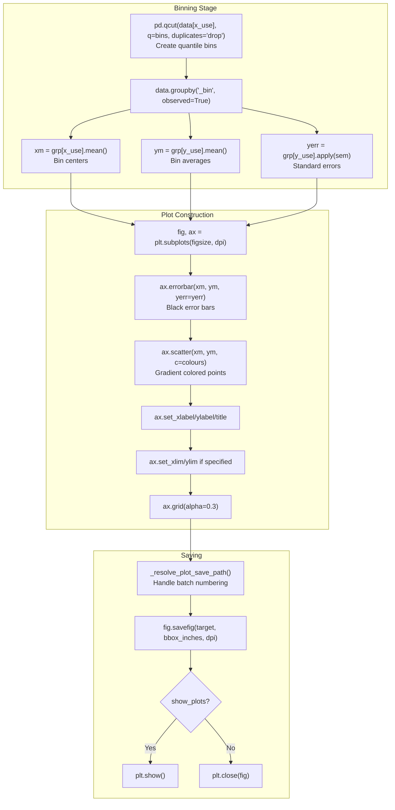

**Sources:** [src/gabriel/utils/plot_utils.py:1325-1362]()

---

## Bar Plot Function

The `bar_plot()` function creates bar charts with automatic sizing, label wrapping, and optional error bars. It can aggregate data from a DataFrame or accept pre-computed values.

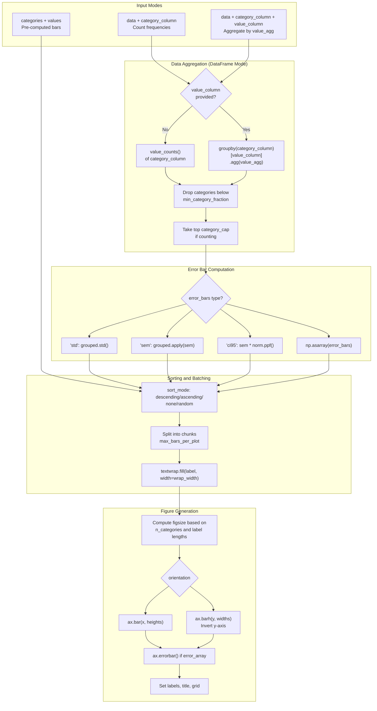

**Sources:** [src/gabriel/utils/plot_utils.py:1618-2282](), [tests/test_plot_utils.py:34-87]()

---

## Configuration Options Summary

### `regression_plot()` Key Parameters

| Parameter | Type | Default | Purpose |
|-----------|------|---------|---------|
| `x` | `str \| list[str]` | Required | Independent variable(s) |
| `y` | `str \| list[str]` | Required | Dependent variable(s) |
| `controls` | `list[str]` | `None` | Control variables |
| `entity_fixed_effects` | `list[str]` | `None` | Cross-sectional fixed effects |
| `time_fixed_effects` | `list[str]` | `None` | Time-period fixed effects |
| `fe_interactions` | `bool` | `False` | Add entity×time interactions |
| `cluster` | `list[str]` | `None` | Clustering dimensions for SE |
| `robust` | `bool` | `True` | Use HC3 robust covariance |
| `zscore_x` | `bool` | `False` | Standardize X before regression |
| `zscore_y` | `bool` | `False` | Standardize Y before regression |
| `bins` | `int` | `20` | Number of quantile bins for scatter |
| `excess_year_col` | `str` | `None` | Column for peer adjustment |
| `excess_window` | `int` | `None` | Rolling window size (±) |
| `excess_mode` | `str` | `"difference"` | `difference` / `ratio` / `percent` |
| `latex_options` | `bool \| dict` | `True` | Enable LaTeX table generation |
| `save_path` | `Path` | `None` | Output directory for plots |

**Sources:** [src/gabriel/utils/plot_utils.py:1081-1120]()

### `build_regression_latex()` Options

| Option | Type | Default | Purpose |
|--------|------|---------|---------|
| `columns` | `list[dict]` | Auto-generated | Model column specifications |
| `row_order` | `list[str]` | All coefficients | Displayed coefficient order |
| `include_intercept` | `bool` | `False` | Show intercept row |
| `include_controls_row` | `bool` | `False` | Show controls indicator |
| `include_fe_rows` | `bool` | `True` | Show FE indicator rows |
| `include_cluster_row` | `bool` | `True` | Show clustering indicators |
| `include_model_numbers` | `bool` | `True` | Add (1) (2) ... headers |
| `show_model_labels` | `bool` | `False` | Show descriptive column labels |
| `float_format` | `str` | `"{:.3f}"` | Coefficient format string |
| `notes` | `str` | Significance legend | Footer notes |
| `caption` | `str` | `"Regression results"` | Table caption |
| `label` | `str` | `"tab:regression_results"` | LaTeX label for crossref |
| `save_path` | `Path` | `None` | Save .tex file to disk |

**Sources:** [src/gabriel/utils/plot_utils.py:604-685]()

---

## Usage Examples

### Basic Regression with Controls

```python
from gabriel.utils.plot_utils import regression_plot

results = regression_plot(
    df,
    x="treatment",
    y="outcome",
    controls=["age", "income", "education"],
    bins=25,
    save_path="results/regression_plots/",
    latex_options=True,
)

# Access coefficient for treatment
coef = results[("outcome", "treatment")]["simple"]["coef"]["treatment"]
se = results[("outcome", "treatment")]["simple"]["se"]["treatment"]
print(f"Treatment effect: {coef:.3f} (SE={se:.3f})")

# LaTeX table automatically printed and stored in results["latex_table"]
```

### Fixed Effects with Clustering

```python
results = regression_plot(
    df,
    x=["policy_a", "policy_b"],
    y="firm_performance",
    entity_fixed_effects=["firm_id"],
    time_fixed_effects=["year"],
    cluster=["firm_id"],
    fixed_effect_min_share=0.02,  # Pool firms appearing in <2% of data
    latex_options={
        "include_fe_rows": True,
        "include_cluster_row": True,
        "caption": "Policy Impact on Firm Performance",
        "label": "tab:policy_impact",
    },
)
```

### Excess Outcome Analysis

```python
results = regression_plot(
    df,
    x="innovation_count",
    y="patent_citations",
    controls=["firm_size", "r_and_d_spending"],
    excess_year_col="application_year",
    excess_window=3,  # Compare to ±3 years
    excess_mode="percent",  # Percent deviation from peer mean
    excess_replace=True,  # Use excess_outcome instead of raw outcome
    zscore_x=True,  # Standardize X for interpretability
)
```

### Custom LaTeX Column Plan

```python
results = regression_plot(
    df,
    x=["var_a", "var_b", "var_c"],
    y="outcome",
    controls=["control_1", "control_2"],
    entity_fixed_effects=["category"],
    latex_column_plan={
        "outcome": [
            {"label": "Baseline", "x": ["var_a"]},
            {"label": "Full Model", "x": ["var_a", "var_b", "var_c"], 
             "controls": ["control_1", "control_2"]},
            {"label": "With FE", "x": ["var_a", "var_b"], 
             "entity_fe": ["category"]},
        ]
    },
    latex_options={
        "float_format": "{:.4f}",
        "include_adj_r2": True,
        "save_path": "paper/tables/main_results.tex",
    },
)
```

### Low-Level OLS

```python
from gabriel.utils.plot_utils import fit_ols
import numpy as np

y = df["outcome"].values
X = np.column_stack([
    np.ones(len(df)),  # Intercept
    df["treatment"].values,
    df["control_1"].values,
])

results = fit_ols(
    y, X,
    varnames=["Intercept", "Treatment", "Control"],
    robust=True,  # HC3 covariance
)

print(results["coef"])
print(results["se"])
```

**Sources:** [src/gabriel/utils/plot_utils.py:1182-1194](), [src/gabriel/utils/plot_utils.py:660-675]()

---

## Integration with GABRIEL Tasks

The `plot_utils` module is designed to consume outputs from measurement tasks:

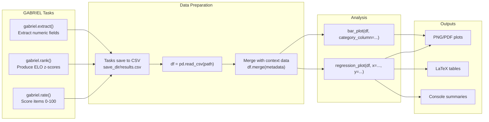

**Example workflow:**

```python
import pandas as pd
from gabriel import rate
from gabriel.utils.plot_utils import regression_plot

# Step 1: Score documents
df = pd.read_csv("documents.csv")
rate(
    df,
    prompt="Rate the persuasiveness of this argument on a 0-100 scale",
    answer_col="persuasiveness",
    save_dir="outputs/persuasiveness/",
)

# Step 2: Load results and merge with covariates
results_df = pd.read_csv("outputs/persuasiveness/results.csv")
covariates = pd.read_csv("document_metadata.csv")
analysis_df = results_df.merge(covariates, on="identifier")

# Step 3: Regression analysis
regression_plot(
    analysis_df,
    x=["argument_length", "evidence_count"],
    y="persuasiveness",
    controls=["topic_category", "author_expertise"],
    entity_fixed_effects=["topic_category"],
    save_path="outputs/analysis/",
    latex_options={"caption": "Determinants of Persuasiveness"},
)
```

**Sources:** [src/gabriel/utils/plot_utils.py:1-17](), diagram context from system architecture

---

## Technical Implementation Notes

### Robust Covariance Fallback

When HC3 covariance estimation fails (typically due to insufficient observations or rank-deficient designs), the system automatically falls back to HC1:

**Sources:** [src/gabriel/utils/plot_utils.py:577-584](), [src/gabriel/utils/plot_utils.py:1000-1003]()

### F-Statistic Handling

The F-statistic calculation can fail when fixed effects absorb all variation. The system gracefully handles this by caching `NaN` and continuing:

**Sources:** [src/gabriel/utils/plot_utils.py:479-497]()

### Statsmodels Import Protection

The module implements lazy error raising for statsmodels, allowing the module to be imported even when statsmodels is unavailable (useful for environments that only need non-regression plotting functions):

**Sources:** [src/gabriel/utils/plot_utils.py:44-58]()

### Categorical Baseline Selection

For fixed effects, the baseline level is chosen as:
1. The pooled rare category placeholder (if rare categories exist)
2. The most frequent level (if no rare pooling)

This ensures coefficient interpretability and avoids omitting important categories:

**Sources:** [src/gabriel/utils/plot_utils.py:186-206]()

---

## Performance Considerations

| Operation | Complexity | Notes |
|-----------|------------|-------|
| Basic OLS | O(n·k² + k³) | n=observations, k=parameters |
| Fixed effects with many levels | O(n·L·k) | L=number of FE levels, increases memory |
| Clustered SE | O(n·G·k²) | G=number of clusters, requires group processing |
| Binned scatter | O(n log n) | Dominated by quantile calculation |
| LaTeX generation | O(models·params) | Fast; purely string formatting |

For datasets with >1M observations or >100 fixed effect levels, consider:
- Reducing the number of fixed effect dimensions
- Using `fixed_effect_min_share` to pool rare categories
- Splitting analysis into subsamples

**Sources:** Based on statsmodels complexity and [src/gabriel/utils/plot_utils.py:150-207]()

---

## Appendix: Helper Functions Reference

| Function | Purpose | Key Parameters |
|----------|---------|----------------|
| `_ensure_list()` | Normalize scalar/sequence to list | `values` |
| `_normalize_save_format()` | Clean file extension string | `save_format` |
| `_resolve_plot_save_path()` | Construct output path with batching | `save_path`, `batch_idx`, `total_batches` |
| `_save_figure()` | Write figure to disk | `fig`, `save_path`, `dpi`, `bbox_inches` |
| `_prepare_fixed_effect_columns()` | Setup FE categoricals | `data`, `columns`, `min_share` |
| `_cluster_groups()` | Generate cluster identifiers | `df`, `columns` |
| `_apply_year_excess()` | Compute peer-adjusted outcomes | `df`, `year_col`, `window`, `mode` |
| `_build_default_joint_plan()` | Generate LaTeX column specs | `y_vars`, `x_vars`, `controls`, FE lists |
| `_normalise_joint_plan()` | Resolve user LaTeX config | `plan`, `default_plan`, variable lists |
| `_format_coefficient()` | Format coef with stars | `coef`, `se`, `pval`, `float_fmt` |
| `_fit_formula_model()` | Fit OLS via formulas | `data`, `y`, `main_vars`, FE/cluster specs |
| `_results_to_dict()` | Package statsmodels result | `res`, `display_varnames`, `param_lookup` |
| `_print_table()` | Console coefficient table | `res`, `tablefmt` |
| `_z()` | Z-score transformation | `s: pd.Series` |

**Sources:** [src/gabriel/utils/plot_utils.py:61-948]()

---

