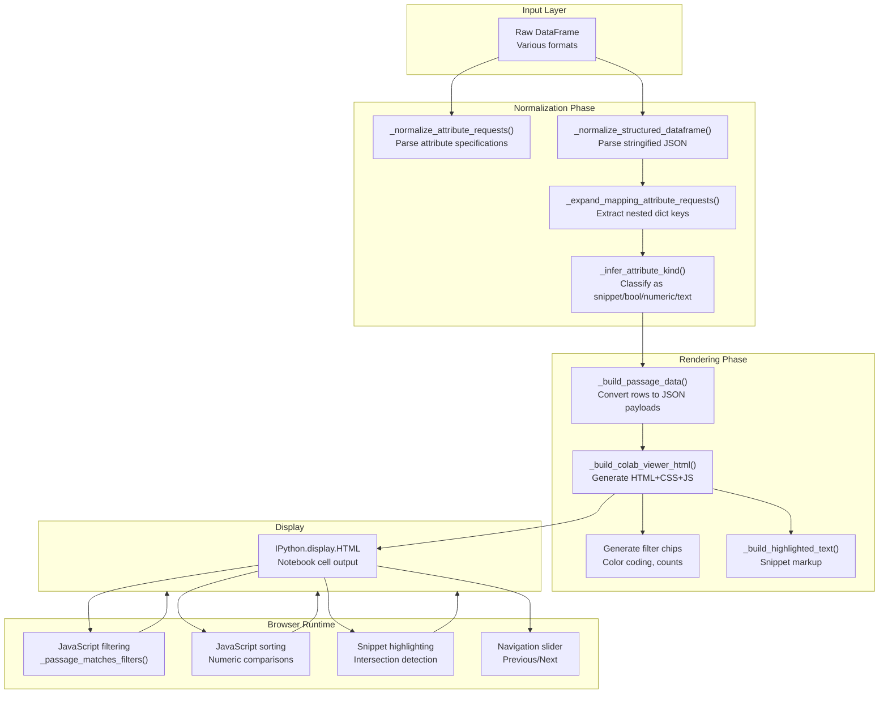
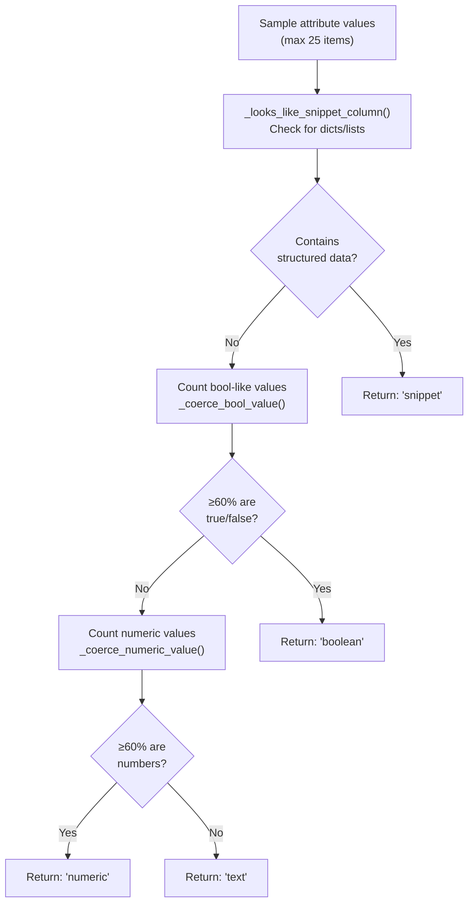
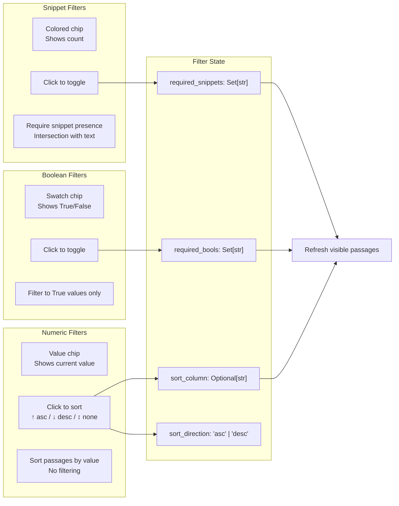
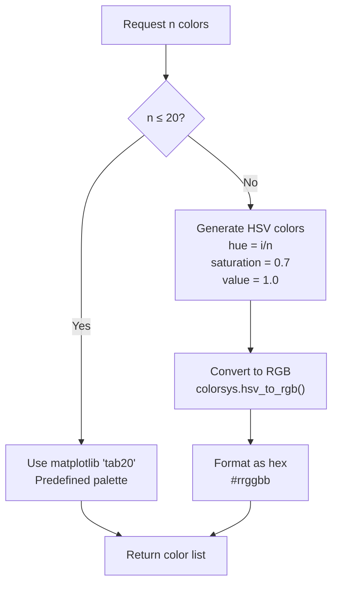

<!-- source: DeepWiki mcp.deepwiki.com · repo openai/GABRIEL · page 9.2 gabriel.view - Interactive Viewer · fetched 2026-10-26 -->

# gabriel.view - Interactive Viewer

<details>
<summary>Relevant source files</summary>

The following files were used as context for generating this wiki page:

- [src/gabriel/utils/passage_viewer.py](src/gabriel/utils/passage_viewer.py)
- [tests/test_codify_completion.py](tests/test_codify_completion.py)
- [tests/test_colab_viewer.py](tests/test_colab_viewer.py)
- [tests/test_discover_exports.py](tests/test_discover_exports.py)
- [tests/test_imports.py](tests/test_imports.py)

</details>


## Purpose and Scope

The `gabriel.view` function provides an interactive notebook-based interface for qualitatively inspecting and auditing GABRIEL task outputs. It renders an HTML viewer that supports filtering, sorting, and snippet highlighting across multiple attribute types (snippets, booleans, numerics, and text). The viewer automatically normalizes diverse input formats (stringified JSON, nested dictionaries, raw lists) and infers attribute types to provide appropriate UI controls.

For statistical analysis of task outputs, see [Statistical Analysis with plot_utils](#9.1). For bias correction workflows, see [gabriel.debias - Bias Correction](#7.2).

**Sources:** [src/gabriel/utils/passage_viewer.py:540-553]()

---

## Basic Usage

The viewer is invoked through the top-level `gabriel.view()` function, which is available in both the root module and `gabriel.api`:

```python
import gabriel
import pandas as pd

# Example DataFrame with task outputs
df = pd.DataFrame({
    'text': ['Passage one...', 'Passage two...'],
    'quality': [85.3, 72.1],
    'is_relevant': [True, False],
    'topics': [['economics', 'policy'], ['technology']]
})

# Launch interactive viewer
gabriel.view(
    df,
    text_column='text',
    attributes=['quality', 'is_relevant', 'topics'],
    header_columns=['quality']
)
```

The function signature follows this pattern:

| Parameter | Type | Purpose |
|-----------|------|---------|
| `df` | `pd.DataFrame` | DataFrame containing passages and attributes |
| `text_column` | `str` | Column containing the primary text to display |
| `attributes` | `Union[Sequence, Mapping, str]` | Attributes to show as filter chips (see [Attribute Specification](#attribute-specification)) |
| `categories` | `Optional[Union[Sequence, str]]` | Deprecated alias for `attributes` |
| `header_columns` | `Optional[Sequence[str]]` | Columns to display in the header metadata section |
| `theme` | `Literal["auto", "dark", "light"]` | Color scheme for the viewer |

**Sources:** [src/gabriel/utils/passage_viewer.py:1223-1382](), [tests/test_colab_viewer.py:18-24]()

---

## Architecture Overview

The viewer operates in three phases: **normalization**, **rendering**, and **client-side interaction**. All filtering and sorting logic runs in the browser via embedded JavaScript, enabling instant response without Python round-trips.



**Diagram 1: Viewer Processing Pipeline**

The Python layer handles data normalization and HTML generation, while all interaction logic runs client-side for performance.

**Sources:** [src/gabriel/utils/passage_viewer.py:225-316](), [src/gabriel/utils/passage_viewer.py:1383-1538]()

---

## Attribute Specification

Attributes can be specified in multiple formats, all of which are normalized by `_normalize_attribute_requests()`:

### Simple List Format
```python
attributes=['quality_score', 'is_relevant', 'topics']
```

### Mapping with Labels
```python
attributes={
    'quality_score': 'Quality Rating',
    'is_relevant': 'Relevance Flag',
    'topics': {'label': 'Topic Tags', 'description': 'Extracted topics'}
}
```

### Dynamic "coded_passages" Format
The special `"coded_passages"` column triggers dynamic expansion where each unique key in the mapping becomes a separate filter chip:

```python
# DataFrame with nested mappings
df['coded_passages'] = [
    {'sentiment': ['positive phrase'], 'entities': ['Company X']},
    {'sentiment': [], 'entities': ['Person Y', 'Company Z']}
]

# This creates separate chips for "sentiment" and "entities"
gabriel.view(df, 'text', attributes='coded_passages')
```

**Sources:** [src/gabriel/utils/passage_viewer.py:225-316](), [tests/test_colab_viewer.py:77-90]()

---

## Attribute Type Inference

The system automatically infers attribute types using `_infer_attribute_kind()`, which samples up to 25 values to classify each attribute:



**Diagram 2: Attribute Type Inference Logic**

### Type Characteristics

| Type | Detection Logic | UI Rendering |
|------|----------------|---------------|
| **snippet** | Contains `dict`, `list`, or structured JSON strings | Colored chip with snippet count; highlights matching text |
| **boolean** | ≥60% of values are `True`/`False`/`"yes"`/`"no"` | Toggle chip with swatch; filters to `True` only |
| **numeric** | ≥60% of values are parseable floats | Chip with formatted value; click to sort; intensity-based color |
| **text** | Default fallback | Header metadata display only |

**Sources:** [src/gabriel/utils/passage_viewer.py:458-491](), [src/gabriel/utils/passage_viewer.py:422-456]()

---

## Data Normalization

The viewer handles outputs from various GABRIEL tasks that may store structured data as stringified JSON. The normalization process runs automatically:

### JSON String Parsing

```python
# _parse_structured_cell() handles various formats
df = pd.DataFrame({
    'snippets_raw': ['["phrase one", "phrase two"]'],  # Stringified list
    'coded_passages': ['{"topic": ["excerpt A"]}'],   # Stringified dict
    'scores': [42.5]                                   # Already structured
})

# All are normalized automatically
gabriel.view(df, 'text', attributes=['snippets_raw', 'coded_passages', 'scores'])
```

The function `_parse_structured_cell()` attempts multiple parsing strategies:

1. Direct return if already structured (`dict`, `list`, `set`, `tuple`)
2. `ast.literal_eval()` for Python literal syntax
3. `json.loads()` for JSON syntax
4. Fallback to raw value if parsing fails

**Sources:** [src/gabriel/utils/passage_viewer.py:1540-1565](), [tests/test_colab_viewer.py:46-75]()

### Mapping Attribute Expansion

When an attribute contains mappings (dictionaries), the viewer extracts each key as a separate derived attribute:

```python
df = pd.DataFrame({
    'text': ['Sample text'],
    'metrics': [{'accuracy': 0.92, 'f1': 0.88, 'precision': {'value': 0.90}}]
})

# This internally creates:
# - metrics::accuracy (numeric)
# - metrics::f1 (numeric)
# - metrics::precision (numeric, extracted from nested {'value': 0.90})
gabriel.view(df, 'text', attributes=['metrics'])
```

The extraction logic in `_extract_mapping_value()` looks for nested value keys in this priority order:
1. `"value"`
2. `"rating"`
3. `"score"`
4. `"answer"`
5. `"label"`
6. `"text"`

**Sources:** [src/gabriel/utils/passage_viewer.py:319-384](), [tests/test_colab_viewer.py:161-177]()

---

## Interactive Filtering

The viewer provides client-side filtering with instant updates. Filtering logic is implemented in both Python (for initial payload construction) and JavaScript (for browser interaction).

### Filter Types



**Diagram 3: Filter System Architecture**

### Snippet Intersection Logic

Snippet highlighting uses character-level substring matching to identify highlighted regions within the text:

```python
# Example: passage_viewer.py implements this logic
text = "The quick brown fox jumps over the lazy dog"
snippets = {"speed": ["quick brown fox"], "animals": ["dog"]}

# Intersection detection:
# 1. Find all character ranges for each snippet in text
# 2. Merge overlapping ranges
# 3. Render HTML with <span class="gabriel-snippet"> for each range
# 4. Apply category color to background
```

The function `_passage_matches_filters()` implements the filtering predicate:

```python
def _passage_matches_filters(
    passage: Mapping[str, Any],
    *,
    required_snippets: Optional[Set[str]] = None,
    required_bools: Optional[Set[str]] = None,
    numeric_filters: Optional[Mapping[str, Tuple[float, float]]] = None,
) -> bool:
    """Return True if passage matches all active filters."""
```

For snippet filters, the passage is shown only if **all** required snippet categories have at least one match in the text.

**Sources:** [src/gabriel/utils/passage_viewer.py:509-537](), [tests/test_colab_viewer.py:116-128]()

---

## Numeric Attribute Rendering

Numeric attributes receive special treatment with intensity-based styling to visually encode magnitude:

### Intensity Calculation

The function `_compute_numeric_intensity()` maps each value to a 0-1 range based on global min/max:

```python
# Example: value=75, range=[50, 100]
intensity = (75 - 50) / (100 - 50) = 0.5

# Chip styling interpolates between neutral and highlighted:
background_alpha = 0.05 + 0.17 * intensity  # 0.05 to 0.22
border_alpha = 0.08 + 0.47 * intensity      # 0.08 to 0.55
glow_alpha = 0.04 + 0.31 * intensity        # 0.04 to 0.35
```

When all values are identical (zero-width range), intensity defaults to 0.0 to avoid misleading highlighting.

### Value Formatting

Numeric chips display truncated values using `_format_numeric_chip()`:

| Magnitude | Format | Example |
|-----------|--------|---------|
| ≥100 | `{:.0f}` | `"142"` |
| ≥10 | `{:.1f}` | `"42.5"` |
| <10 | `{:.2f}` | `"3.14"` |
| Max 4 chars | Truncate | `"99.9"` not `"99.99"` |

**Sources:** [src/gabriel/utils/passage_viewer.py:148-185](), [src/gabriel/utils/passage_viewer.py:493-506]()

---

## Multimodal Support

The viewer renders image and audio content embedded in DataFrame cells:

### Image Display

```python
df = pd.DataFrame({
    'image': ['path/to/image.png'],
    'caption': ['Description of image content']
})

# Images are base64-encoded and embedded
gabriel.view(df, text_column='caption', image_column='image')
```

Images are processed by `load_image_inputs()` from `gabriel.utils.media_utils`, converted to base64, and rendered within a styled container with rounded corners and shadow.

### Audio Display

```python
df = pd.DataFrame({
    'audio': ['path/to/recording.mp3'],
    'transcript': ['Transcribed text...']
})

gabriel.view(df, text_column='transcript', audio_column='audio')
```

Audio files are base64-encoded using `encode_audio()` from `gabriel.utils.audio_utils` and rendered as HTML5 `<audio>` controls.

**Sources:** [src/gabriel/utils/passage_viewer.py:32-33](), [src/gabriel/utils/passage_viewer.py:1016-1033]()

---

## Color Generation and Theming

### Distinct Color Palette

The viewer generates visually distinct colors using `_generate_distinct_colors()`:



**Diagram 4: Color Generation Strategy**

### Theme Support

The viewer supports three theme modes:

| Theme | Behavior |
|-------|----------|
| `"auto"` | Respects system/notebook preference via `@media (prefers-color-scheme)` |
| `"dark"` | Forces dark theme with `gabriel-theme-dark` class |
| `"light"` | Forces light theme (no dark mode class) |

Dark theme uses:
- Background: `#13161a` (panel), `#0b1016` (body)
- Border: `#2b323c`
- Text: `rgba(255, 255, 255, 0.95)`

Light theme uses:
- Background: `#f7f9fb` (panel), white (body)
- Border: `#d0d7e2`
- Text: `#1f2933`

**Sources:** [src/gabriel/utils/passage_viewer.py:36-72](), [src/gabriel/utils/passage_viewer.py:555-1223]()

---

## Header Metadata Display

The `header_columns` parameter displays structured metadata at the top of each passage:

```python
gabriel.view(
    df,
    text_column='passage',
    attributes=['topics'],
    header_columns=['speaker', 'timestamp', 'document_id']
)
```

Headers render as a responsive grid of label-value pairs with pill-shaped containers. The layout automatically adjusts to available width using CSS Grid with `minmax(150px, 1fr)`.

On mobile (<640px), the grid collapses to a single column for readability.

**Sources:** [src/gabriel/utils/passage_viewer.py:880-948](), [tests/test_colab_viewer.py:27-43]()

---

## Implementation Details

### Key Functions and Classes

| Function | Purpose | Location |
|----------|---------|----------|
| `view()` | Main entry point; orchestrates normalization and rendering | [passage_viewer.py:1223-1382]() |
| `_normalize_attribute_requests()` | Parse attribute specifications into structured requests | [passage_viewer.py:225-316]() |
| `_normalize_structured_dataframe()` | Parse stringified JSON in DataFrame cells | [passage_viewer.py:1567-1609]() |
| `_expand_mapping_attribute_requests()` | Extract nested dictionary keys as derived attributes | [passage_viewer.py:352-384]() |
| `_infer_attribute_kind()` | Classify attributes as snippet/boolean/numeric/text | [passage_viewer.py:458-491]() |
| `_build_colab_viewer_html()` | Generate complete HTML output with embedded JavaScript | [passage_viewer.py:1383-1538]() |
| `_build_highlighted_text()` | Create HTML with snippet highlighting | [passage_viewer.py:1725-1888]() |
| `_passage_matches_filters()` | Filtering predicate for client-side logic | [passage_viewer.py:509-537]() |
| `_compute_numeric_intensity()` | Calculate intensity for numeric chip styling | [passage_viewer.py:148-185]() |

### Legacy Viewer Deprecation

The original `tkinter`-based `PassageViewer` class has been retired. Any attempt to instantiate it raises:

```python
raise RuntimeError(
    "The tkinter-based PassageViewer has been retired. "
    "Use gabriel.view(...) inside a notebook environment."
)
```

This ensures users migrate to the notebook-based viewer, which is more widely compatible (Google Colab, Jupyter, VSCode notebooks) and requires no desktop environment.

**Sources:** [src/gabriel/utils/passage_viewer.py:540-553](), [tests/test_imports.py:27-31]()

---

## Usage Patterns

### Auditing `gabriel.rate` Outputs

```python
import gabriel

# Rate passages on a quality dimension
df = gabriel.rate(
    df,
    text_column='text',
    attribute='methodological rigor',
    save_dir='outputs/quality_check'
)

# Inspect high/low ratings interactively
gabriel.view(
    df,
    text_column='text',
    attributes=['methodological rigor'],
    header_columns=['source', 'author']
)
```

### Exploring `gabriel.classify` Results

```python
# Classify passages into categories
df = gabriel.classify(
    df,
    text_column='text',
    labels=['economic', 'political', 'social'],
    save_dir='outputs/classification'
)

# View with boolean filters for each category
gabriel.view(
    df,
    text_column='text',
    attributes=['economic', 'political', 'social']
)
```

### Reviewing `gabriel.codify` Snippets

```python
# Extract coded passages
df = gabriel.codify(
    df,
    text_column='text',
    categories={'bias': 'Language exhibiting bias', 'evidence': 'Empirical claims'},
    save_dir='outputs/coded'
)

# Highlight and filter coded snippets
gabriel.view(
    df,
    text_column='text',
    attributes='coded_passages'  # Special dynamic expansion
)
```

**Sources:** [tests/test_colab_viewer.py:77-90](), [tests/test_colab_viewer.py:93-105]()

---

## Performance Considerations

### Client-Side Processing

All filtering and sorting runs in JavaScript, avoiding Python round-trips. The viewer serializes passage data once during initial render, then all interactions happen in the browser.

### Pagination

The viewer includes a slider control for navigating through filtered results. Only one passage displays at a time, reducing DOM size and improving responsiveness on large datasets.

### Snippet Highlighting Complexity

The snippet intersection algorithm runs in O(n*m) where n = number of snippets and m = average snippet length. For passages with hundreds of snippets, rendering may slow down. In practice, this is rarely an issue as most GABRIEL tasks produce <50 snippets per passage.

**Sources:** [src/gabriel/utils/passage_viewer.py:1725-1888]()

---

