# Page: Overview

# Overview

<details>
<summary>Relevant source files</summary>

The following files were used as context for generating this wiki page:

- [README.md](README.md)
- [pyproject.toml](pyproject.toml)
- [src/gabriel/_version.py](src/gabriel/_version.py)
- [src/gabriel/api.py](src/gabriel/api.py)

</details>


This page provides a high-level introduction to GABRIEL (Generalized Attribute Based Ratings Information Extraction Library), its architecture, and core concepts. For installation instructions, see [Installation and Setup](#2). For detailed information about specific tasks, see [Measurement Tasks](#4), [Data Cleaning Tasks](#5), and [Helper and Composition Tasks](#6).

## Purpose and Scope

GABRIEL is a Python library that transforms unstructured qualitative data (text, images, audio, PDFs) into structured, analysis-ready datasets using Large Language Models. The library provides operational infrastructure—parallel execution, rate limiting, retry logic, checkpointing, and audit trails—so researchers can treat LLM-based measurements as reliable research instruments.

This overview covers:
- The library's purpose and design philosophy
- Three-layer architecture (API, Tasks, Infrastructure)
- Core abstractions that unify all tasks
- Task taxonomy and capabilities
- Data flow patterns

**Sources:** [README.md:1-27](), [pyproject.toml:1-46]()

## What is GABRIEL?

GABRIEL bridges the gap between qualitative social science data and quantitative analysis by providing:

| Capability | Description | Example |
|------------|-------------|---------|
| **Attribute Measurement** | Score or rank items on natural language attributes | Rate speeches for "populist rhetoric" on 0-100 scale |
| **Structured Extraction** | Extract facts into typed columns | Parse product descriptions into company, CEO, year fields |
| **Classification** | Apply categorical labels with definitions | Tag news articles into topical categories |
| **Data Cleaning** | Fuzzy matching, deduplication, filtering | Match two product catalogs with different naming conventions |
| **Feature Discovery** | Identify discriminating characteristics | Find what distinguishes 5-star vs 1-star reviews |

The library is installed via `pip install openai-gabriel` and accessed by importing the `gabriel` module. All public functions are exposed through [src/gabriel/api.py]().

**Sources:** [README.md:1-71](), [pyproject.toml:6-8]()

## Core Concept: Attributes as Measurement Instruments

The central abstraction in GABRIEL is the **attribute**: a natural language description of what to measure, paired with a name for the output column. This pattern appears across most tasks:

```python
attributes = {
    "savory taste": "How savory the dish is",
    "sweet taste": "Dessert-like sweetness",  
    "tangy taste": "Notes of tartness or acidity",
}

await gabriel.rate(df, "entity", attributes=attributes, save_dir="./output")
```

Rather than designing task-specific prompts, users express measurement intent in natural language. GABRIEL handles:
- Prompt construction via Jinja2 templates
- Batching (multiple attributes per API call via `n_attributes_per_run`)
- Response parsing and aggregation
- Multi-run consistency (via `n_runs` parameter)

This abstraction enables composition: complex tasks like `gabriel.ideate` orchestrate multiple sub-tasks (`seed` → `generate` → `rank` → `rate` → `deduplicate`), each using the same attribute-based interface.

**Sources:** [src/gabriel/api.py:109-143](), [README.md:38-47]()

## Three-Layer Architecture

GABRIEL's architecture consists of three layers that separate concerns:

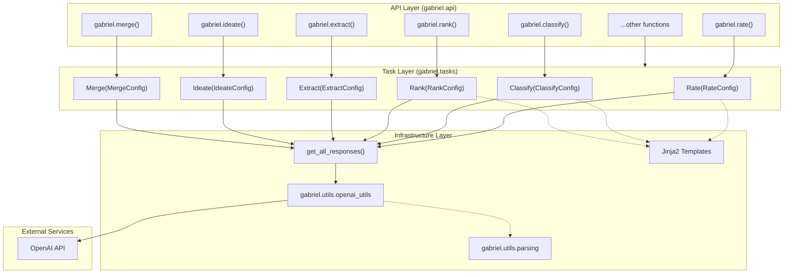

**Layer 1: API Functions** ([src/gabriel/api.py]()) provide the public interface. Each function:
- Accepts high-level parameters (`df`, `column_name`, `attributes`, `save_dir`)
- Constructs a Config dataclass with validation
- Instantiates and runs a Task object
- Returns a `pandas.DataFrame` with results

**Layer 2: Task Classes** ([src/gabriel/tasks/]()) implement business logic:
- Render prompts from Jinja2 templates
- Call `get_all_responses()` for LLM interaction
- Parse and aggregate responses
- Write outputs to CSV/Parquet

**Layer 3: Infrastructure** ([src/gabriel/utils/openai_utils.py]()) provides execution guarantees:
- Parallel request batching (default 650 concurrent requests)
- Rate limit detection and dynamic backoff
- Exponential retry with jitter for transient errors
- Checkpoint-based resumability
- Response caching and logging

This separation allows users to customize at different levels: `additional_instructions` for simple tweaks, `template_path` for prompt redesign, `get_all_responses_fn` for alternative LLM backends (see [Advanced Configuration](#10)).

**Sources:** [src/gabriel/api.py:1-72](), architecture diagrams

## Task Taxonomy

GABRIEL provides three categories of tasks:

### Measurement Tasks

Tasks that quantify attributes or extract structured information:

| Function | Input → Output | Primary Use Case |
|----------|----------------|------------------|
| `gabriel.rate` | Text/image/audio → 0-100 scores | Measure rhetoric, toxicity, luxury |
| `gabriel.rank` | Items → relative z-scores | Tournament-style ranking on attributes |
| `gabriel.classify` | Items → categorical labels | Multi-label tagging with thresholds |
| `gabriel.extract` | Items → typed columns | Fact extraction (company, CEO, date) |
| `gabriel.discover` | Two labeled sets → discriminating features | Find what distinguishes classes |

See [Measurement Tasks](#4) for detailed documentation.

### Data Cleaning Tasks

Tasks that prepare, match, or filter data:

| Function | Input → Output | Primary Use Case |
|----------|----------------|------------------|
| `gabriel.merge` | Two DataFrames → crosswalk mapping | Fuzzy joins between datasets |
| `gabriel.deduplicate` | Items → deduplicated list | Collapse semantic duplicates |
| `gabriel.filter` | Items → Boolean mask | High-throughput screening |
| `gabriel.deidentify` | Text → anonymized text + mapping | PII replacement |

See [Data Cleaning Tasks](#5) for detailed documentation.

### Helper and Composition Tasks

Supporting tasks for coding, generation, and multi-stage workflows:

| Function | Input → Output | Primary Use Case |
|----------|----------------|------------------|
| `gabriel.codify` | Text → highlighted snippets | Qualitative coding |
| `gabriel.compare` | Item pairs → differences/similarities | Contrastive analysis |
| `gabriel.bucket` | Terms → taxonomy/clusters | Category discovery |
| `gabriel.seed` | Instructions → diverse entities | Initialize representative samples |
| `gabriel.ideate` | Topic → ranked theories | Scientific hypothesis generation |
| `gabriel.paraphrase` | Text → rewritten text | Consistent summarization |
| `gabriel.whatever` | Custom prompts → responses | Arbitrary prompting with infrastructure |

See [Helper and Composition Tasks](#6) and [Complex Multi-Stage Pipelines](#7).

**Sources:** [src/gabriel/api.py:51-71](), [README.md:38-71]()

## Common Abstractions and Parameters

All tasks share a consistent parameter interface:

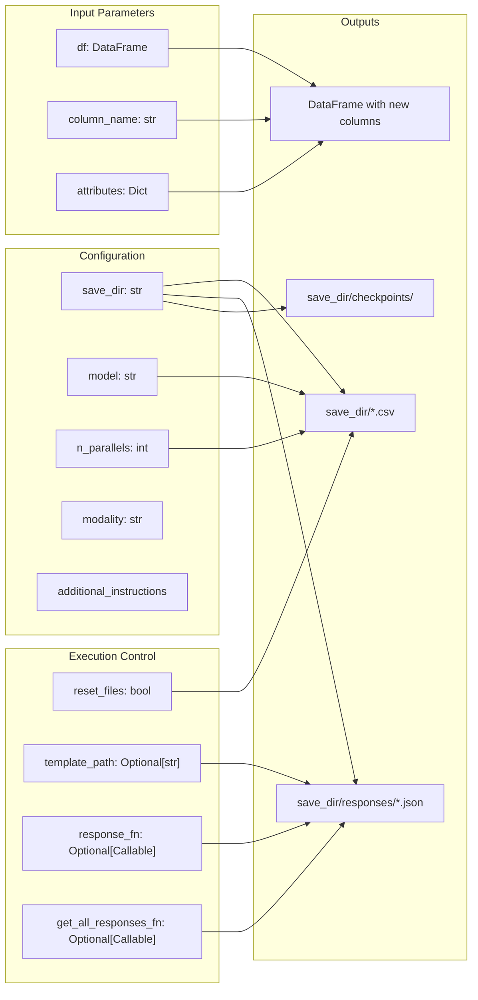

### Core Parameters

| Parameter | Type | Purpose | Example |
|-----------|------|---------|---------|
| `df` | `pd.DataFrame` or `None` | Input data; when `None`, loads cached results | `pd.read_csv("data.csv")` |
| `column_name` | `str` | Column containing content to analyze | `"text"`, `"image_path"` |
| `attributes` | `Dict[str, str]` | Attribute name → description mapping | `{"populism": "Use of us vs them rhetoric"}` |
| `save_dir` | `str` | Output directory (supports `~` and env vars) | `"~/results/rate_run"` |

### Model and Execution Parameters

| Parameter | Type | Default | Purpose |
|-----------|------|---------|---------|
| `model` | `str` | `"gpt-5-mini"` | OpenAI model name |
| `n_parallels` | `int` | `650` | Max concurrent requests |
| `n_runs` | `int` | `1` | Repeat passes for consistency |
| `modality` | `str` | `"text"` | Input type: `text`, `entity`, `web`, `image`, `audio`, `pdf` |
| `reasoning_effort` | `Optional[str]` | `None` | `none`, `low`, `medium`, `high` |
| `reset_files` | `bool` | `False` | Overwrite existing outputs |

### Customization Hooks

| Parameter | Type | Purpose | Details |
|-----------|------|---------|---------|
| `additional_instructions` | `Optional[str]` | Append to prompt template | See [Prompt Customization](#10.1) |
| `template_path` | `Optional[str]` | Replace default Jinja2 template | See [Prompt Customization](#10.1) |
| `response_fn` | `Optional[Callable]` | Custom response parsing | See [Custom Response Parsing](#10.2) |
| `get_all_responses_fn` | `Optional[Callable]` | Replace OpenAI backend | See [Alternative LLM Backends](#10.3) |

**Sources:** [src/gabriel/api.py:105-215](), [src/gabriel/api.py:433-551]()

## Data Flow and Persistence

GABRIEL follows a checkpoint-driven data flow pattern:

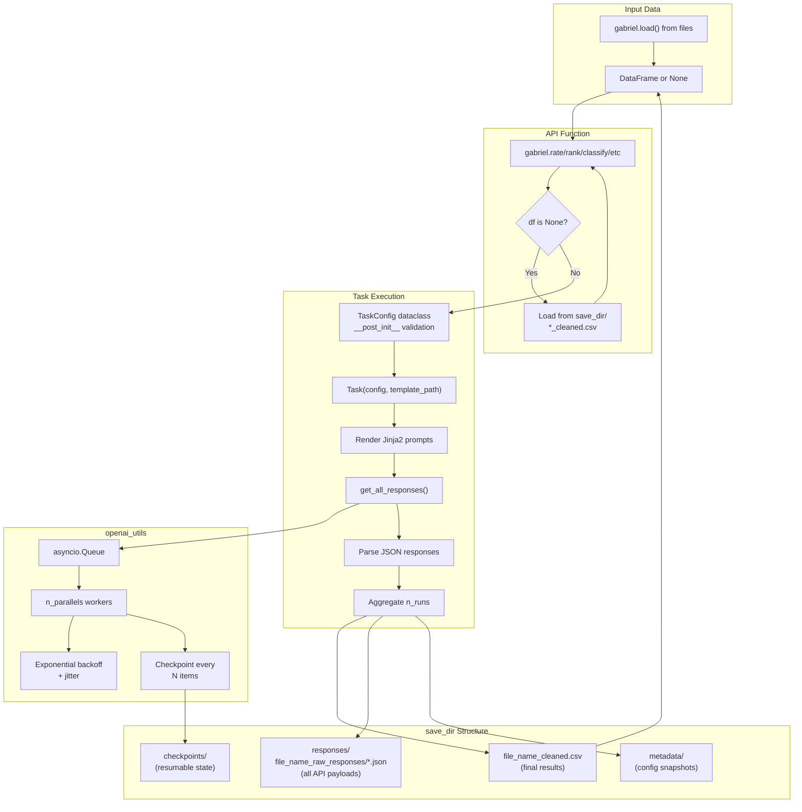

### Save Directory Structure

When `gabriel.rate(df, ..., save_dir="./output", file_name="ratings.csv")` runs, it creates:

```
output/
├── ratings_cleaned.csv          # Final aggregated results
├── responses/
│   └── ratings_raw_responses/
│       ├── 00000.json          # Raw API response for item 0
│       ├── 00001.json
│       └── ...
├── checkpoints/
│   └── ratings_checkpoint.csv  # Resumable state
└── metadata/
    └── config.json             # Task configuration snapshot
```

- **Cleaned CSV**: Final DataFrame with attribute columns merged into original data
- **Raw Responses**: Full API payloads for auditing, includes tokens, latency, model version
- **Checkpoints**: Allow resumption with `reset_files=False` after crashes
- **Metadata**: Config snapshots for reproducibility

See [Save Directory Structure](#12.1) and [Checkpointing and Resumability](#12.2).

**Sources:** [src/gabriel/api.py:189-215](), architecture diagrams

## Relationship to OpenAI API

GABRIEL wraps the OpenAI Responses API with production-grade infrastructure:

```mermaid
graph TB
    subgraph User_Code["User Code"]
        call["await gabriel.rate(df, attributes=...)"]
    end
    
    subgraph openai_utils["gabriel.utils.openai_utils"]
        gar["get_all_responses()"]
        build_params["_build_params()"]
        rate_limiter["Rate limit detection"]
        worker_pool["Worker pool<br/>(n_parallels=650)"]
        error_handler["Error classifier<br/>Rate/Timeout/Connection"]
        cooldown["Global cooldown<br/>coordination"]
        checkpoint["Checkpoint manager"]
    end
    
    subgraph OpenAI_Services["OpenAI Services"]
        completions["Completions API"]
        embeddings["Embeddings API"]
        web_search["Web Search<br/>(via search_context_size)"]
    end
    
    call --> gar
    gar --> build_params
    build_params --> rate_limiter
    rate_limiter --> worker_pool
    worker_pool --> completions
    worker_pool --> embeddings
    build_params --> web_search
    web_search --> completions
    
    completions --> error_handler
    error_handler --> cooldown
    error_handler --> worker_pool
    cooldown --> worker_pool
    worker_pool --> checkpoint
```

### Infrastructure Guarantees

The `openai_utils` module ([src/gabriel/utils/openai_utils.py]()) provides:

| Feature | Implementation | Benefit |
|---------|----------------|---------|
| **Rate Limiting** | Reads `x-ratelimit-*` headers, calculates `concurrency_cap` | Avoids 429 errors, maximizes throughput |
| **Massive Concurrency** | Default 650 parallel workers via `asyncio` | 10-100x faster than sequential |
| **Retry Logic** | Exponential backoff + jitter for transient errors | Handles network issues, API timeouts |
| **Checkpointing** | Saves progress every N items to CSV | Resume multi-hour runs after crashes |
| **Background Mode** | Polling architecture for `timeout=None` | Handles requests >60 seconds |
| **Error Classification** | Rate limit → global pause; Connection → retry; Auth → fail fast | Appropriate response per error type |

For concurrency tuning details, see [Concurrency and Rate Limiting](#12.3). For error handling specifics, see [Error Handling and Retry Logic](#12.4).

**Sources:** [src/gabriel/utils/openai_utils.py](), architecture diagram 4

## Multimodal Support

GABRIEL supports six modalities via the `modality` parameter:

| Modality | Input Format | Use Case | Example |
|----------|--------------|----------|---------|
| `text` | Text strings | Long passages, documents | Speeches, articles, transcripts |
| `entity` | Short text | Names, titles, terms | Product names, technologies |
| `web` | Entities or queries | Web-augmented context | County data, company info |
| `image` | File paths or base64 | Visual content | Product photos, artwork |
| `audio` | File paths | Spoken content | Interviews, podcasts |
| `pdf` | File paths | Document scans | Research papers, contracts |

The `gabriel.load()` function ([src/gabriel/utils/file_utils.py]()) automatically detects modality and converts file directories into DataFrames. See [Data Loading and Preparation](#8) and [Multimodal Processing](#11).

**Sources:** [src/gabriel/api.py:118-164](), [README.md:161-164]()

## Extensibility and Customization Levels

GABRIEL supports five levels of customization:

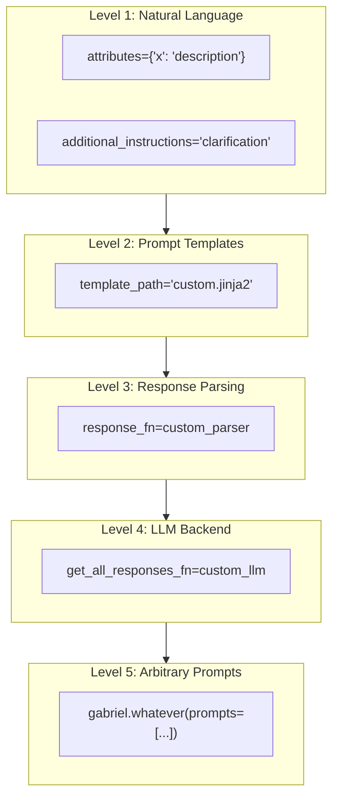

1. **Natural Language Tweaks**: `additional_instructions` appends to existing templates
2. **Custom Templates**: `template_path` replaces prompt entirely while retaining infrastructure
3. **Response Parsing**: `response_fn` handles non-standard LLM outputs
4. **Backend Replacement**: `get_all_responses_fn` swaps OpenAI for alternatives (Anthropic, local models)
5. **Maximum Flexibility**: `gabriel.whatever()` accepts arbitrary prompts with full parallelism/checkpointing

See [Advanced Configuration](#10) for implementation details.

**Sources:** [src/gabriel/api.py:111-124](), architecture diagram 6

## Getting Started

For hands-on examples:
- **Tutorial Notebook**: [gabriel_tutorial_notebook.ipynb](https://colab.research.google.com/drive/1RMUeAWACpViqiUMlPMMwPTKyGU-OX756?usp=sharing) walks through complete projects
- **Installation**: See [Installation and Setup](#2)
- **Quick Start**: See README [README.md:92-134]() for minimal rating example
- **Task Documentation**: Browse [Measurement Tasks](#4), [Data Cleaning Tasks](#5), [Helper Tasks](#6)

**Sources:** [README.md:1-197]()

---

# Page: Installation and Setup

# Installation and Setup

<details>
<summary>Relevant source files</summary>

The following files were used as context for generating this wiki page:

- [README.md](README.md)
- [pyproject.toml](pyproject.toml)
- [src/gabriel/_version.py](src/gabriel/_version.py)

</details>


## Purpose and Scope

This page provides instructions for installing GABRIEL, configuring API credentials, and verifying the installation is working correctly. It covers system requirements, installation methods (PyPI, GitHub, development mode), API key configuration, and dependency management.

For information about the overall system architecture and how components interact, see [Core Architecture](#3). For development-specific setup including testing and contributing, see [Development and Contributing](#13).

---

## System Requirements

GABRIEL requires Python 3.7 or higher and is compatible with major operating systems (Linux, macOS, Windows).

**Python Version Requirement:**

| Requirement | Value |
|-------------|-------|
| Minimum Python | 3.7 |
| Supported versions | 3.7, 3.8, 3.9, 3.10, 3.11, 3.12 |
| Package name | `openai-gabriel` |
| Current version | 1.0.7 |

**Sources:** [pyproject.toml:15](), [pyproject.toml:37-42](), [src/gabriel/_version.py:1]()

---

## Installation Methods

### Standard Installation (PyPI)

The recommended installation method is via PyPI using `pip`:

```bash
pip install openai-gabriel
```

This installs the core GABRIEL package with all required dependencies. After installation, import the library in Python:

```python
import gabriel
```

**Sources:** [README.md:75](), [pyproject.toml:6]()

### GitHub Installation (Latest Development Version)

To install the latest development version directly from the GitHub repository:

```bash
pip install \
  --force-reinstall \
  git+https://github.com/openai/GABRIEL.git@main
```

The `--force-reinstall` flag ensures you get the latest version even if GABRIEL is already installed.

**Sources:** [README.md:78-80]()

### Development Installation

For contributors or users who want to modify GABRIEL's source code, install in editable mode with development extras:

```bash
# Clone the repository
git clone https://github.com/openai/GABRIEL.git
cd GABRIEL

# Install in editable mode with development dependencies
pip install -e .[dev]
```

This installs additional tools for testing, linting, and type checking (pytest, ruff, mypy).

**Sources:** [README.md:180](), [pyproject.toml:67-74]()

### Installation Flow Diagram

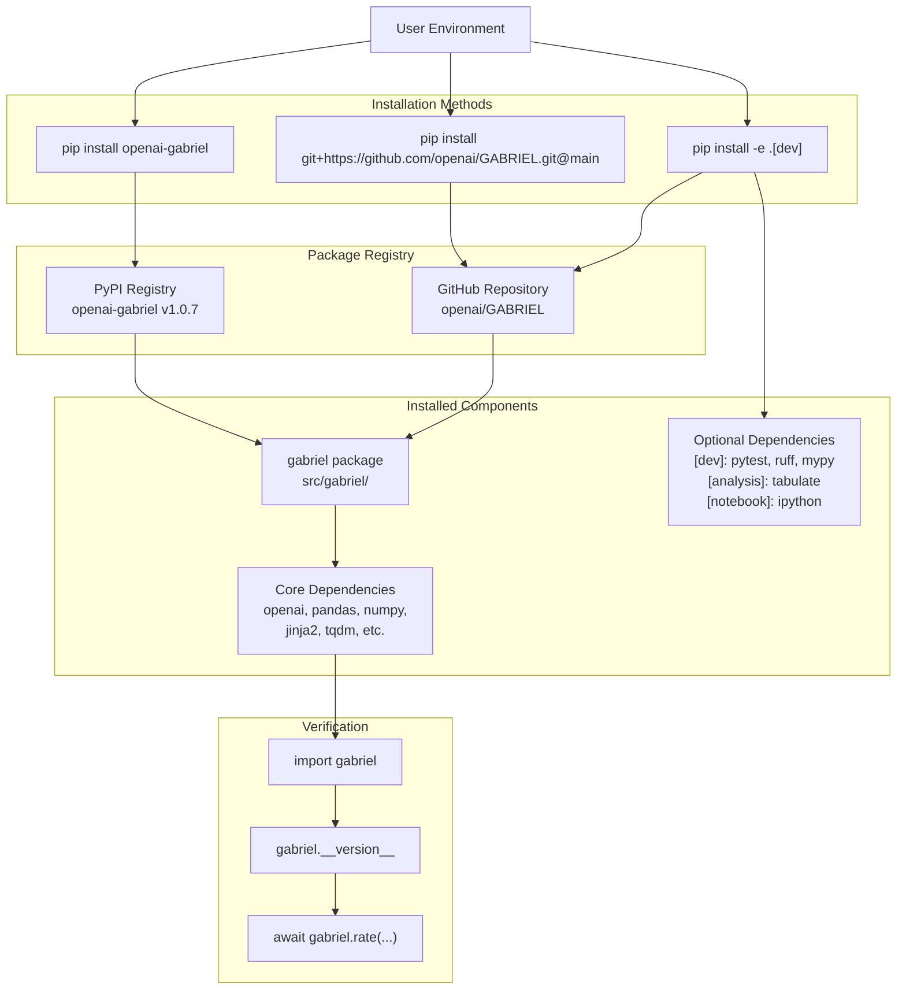

**Sources:** [pyproject.toml:1-101](), [README.md:74-83]()

---

## Core Dependencies

GABRIEL has several categories of dependencies that are automatically installed with the core package:

### LLM and API Infrastructure

| Package | Version | Purpose |
|---------|---------|---------|
| `openai` | >=1.0.0 | OpenAI API client for LLM interactions |
| `aiohttp` | >=3.7.0 | Async HTTP for concurrent API calls |
| `aiolimiter` | >=1.0.0 | Rate limiting for API requests |
| `httpx` | >=0.23.0 | Alternative HTTP client with timeout support |
| `tiktoken` | >=0.2.0 | Token counting for prompt construction |

### Data Processing

| Package | Version | Purpose |
|---------|---------|---------|
| `pandas` | >=1.0.0 | DataFrame manipulation and CSV I/O |
| `numpy` | >=1.18.0 | Numerical operations |
| `scipy` | >=1.8.0 | Statistical computations |
| `statsmodels` | >=0.14.0 | Regression analysis in plot_utils |

### Template and Output Handling

| Package | Version | Purpose |
|---------|---------|---------|
| `Jinja2` | >=3.0.0 | Prompt template rendering |
| `pydantic` | >=1.10.0 | Config validation via dataclasses |
| `tqdm` | >=4.40.0 | Progress bars for long-running tasks |

### Multimodal and Visualization

| Package | Version | Purpose |
|---------|---------|---------|
| `pypdf` | >=4.0.0 | PDF text extraction |
| `python-docx` | >=1.1.0 | Word document processing |
| `plotly` | >=5.0.0 | Interactive visualizations |
| `matplotlib` | >=3.6.0 | Statistical plots in plot_utils |
| `requests` | >=2.0.0 | HTTP requests for web search |

**Sources:** [pyproject.toml:46-64]()

### Optional Dependencies

Optional dependency groups can be installed with bracket notation:

```bash
# Development tools (testing, linting, type checking)
pip install openai-gabriel[dev]

# Analysis tools (tabulate for LaTeX tables)
pip install openai-gabriel[analysis]

# Notebook support (IPython for interactive viewing)
pip install openai-gabriel[notebook]

# Multiple groups
pip install openai-gabriel[dev,analysis,notebook]
```

**Sources:** [pyproject.toml:66-80]()

### Dependency Architecture

```mermaid
graph TB
    subgraph "Core Package"
        Gabriel["gabriel package<br/>pyproject.toml:name=openai-gabriel"]
    end
    
    subgraph "LLM Infrastructure Layer"
        OpenAIClient["openai>=1.0.0<br/>API client"]
        AsyncHTTP["aiohttp>=3.7.0<br/>httpx>=0.23.0<br/>Concurrent requests"]
        RateLimit["aiolimiter>=1.0.0<br/>Rate limiting"]
        Tokens["tiktoken>=0.2.0<br/>Token counting"]
    end
    
    subgraph "Data Processing Layer"
        DataFrames["pandas>=1.0.0<br/>DataFrames"]
        Numerical["numpy>=1.18.0<br/>scipy>=1.8.0<br/>Numerical ops"]
        Stats["statsmodels>=0.14.0<br/>Regressions"]
    end
    
    subgraph "Template and Config Layer"
        Templates["Jinja2>=3.0.0<br/>Prompt rendering"]
        Validation["pydantic>=1.10.0<br/>Config validation"]
        Progress["tqdm>=4.40.0<br/>Progress tracking"]
    end
    
    subgraph "Multimodal Layer"
        PDFs["pypdf>=4.0.0<br/>python-docx>=1.1.0<br/>Document extraction"]
        Plots["matplotlib>=3.6.0<br/>plotly>=5.0.0<br/>Visualizations"]
        Web["requests>=2.0.0<br/>Web search"]
    end
    
    subgraph "Optional Dependencies"
        Dev["[dev]<br/>pytest, ruff, mypy"]
        Analysis["[analysis]<br/>tabulate"]
        Notebook["[notebook]<br/>ipython"]
    end
    
    Gabriel --> OpenAIClient
    Gabriel --> AsyncHTTP
    Gabriel --> RateLimit
    Gabriel --> Tokens
    Gabriel --> DataFrames
    Gabriel --> Numerical
    Gabriel --> Stats
    Gabriel --> Templates
    Gabriel --> Validation
    Gabriel --> Progress
    Gabriel --> PDFs
    Gabriel --> Plots
    Gabriel --> Web
    
    Gabriel -.->|optional| Dev
    Gabriel -.->|optional| Analysis
    Gabriel -.->|optional| Notebook
```

**Sources:** [pyproject.toml:46-80]()

---

## API Key Configuration

GABRIEL requires an OpenAI API key to make LLM requests. The key must be set before executing any GABRIEL tasks.

### Environment Variable (Recommended)

Set the `OPENAI_API_KEY` environment variable in your shell:

```bash
export OPENAI_API_KEY="sk-..."
```

This makes the key available to all Python processes in that shell session.

**Sources:** [README.md:88]()

### Python Environment (Notebooks)

In Jupyter notebooks or interactive Python sessions, set the environment variable programmatically:

```python
import os
os.environ['OPENAI_API_KEY'] = "sk-..."
```

This must be executed before importing or using GABRIEL functions.

**Sources:** [README.md:89]()

### Persistent Configuration

For persistent configuration across sessions, add the export statement to your shell profile:

```bash
# For bash
echo 'export OPENAI_API_KEY="sk-..."' >> ~/.bashrc

# For zsh
echo 'export OPENAI_API_KEY="sk-..."' >> ~/.zshrc

# Then reload
source ~/.bashrc  # or source ~/.zshrc
```

### API Key Flow

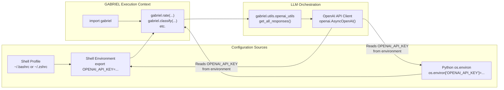

**Sources:** [README.md:86-90]()

---

## Verifying Installation

### Basic Import Test

Verify GABRIEL is installed correctly by importing the package:

```python
import gabriel

# Check version
print(gabriel.__version__)  # Should print: 1.0.7
```

If the import succeeds without errors, the core package is installed correctly.

**Sources:** [README.md:82](), [src/gabriel/_version.py:1]()

### Minimal Working Example

The following minimal example verifies the full pipeline (API key, dependencies, LLM orchestration):

```python
import os
import pandas as pd
import gabriel

# Set API key (if not already in environment)
# os.environ['OPENAI_API_KEY'] = "sk-..."

# Create toy dataset
toy_data = pd.DataFrame({
    "entity": [
        "turkey",
        "pumpkin pie",
        "green bean casserole",
        "cornbread",
    ]
})

# Define attributes
attributes = {
    "savory taste": "How savory the dish is",
    "sweet taste": "Dessert-like sweetness",
    "tangy taste": "Notes of tartness or acidity",
}

# Run rating task
rate_results = await gabriel.rate(
    toy_data,
    column_name="entity",
    attributes=attributes,
    save_dir=os.path.expanduser("~/Documents/gabriel_runs/toy_rate"),
    model="gpt-5-mini",
    n_runs=1,
    modality="entity",
    reset_files=True,
)

# View results
print(rate_results.head())
```

**Expected output:** A DataFrame with columns for each attribute (`savory taste`, `sweet taste`, `tangy taste`) containing 0-100 ratings.

**Sources:** [README.md:96-130]()

### Running in Different Environments

**Jupyter Notebook / Google Colab:**
The example above works directly in notebook cells, as notebooks support top-level `await`.

**Python Script:**
Wrap the async call with `asyncio.run()`:

```python
import asyncio

# ... (same setup as above)

rate_results = asyncio.run(gabriel.rate(
    toy_data,
    column_name="entity",
    attributes=attributes,
    save_dir=os.path.expanduser("~/Documents/gabriel_runs/toy_rate"),
    model="gpt-5-mini",
    n_runs=1,
    modality="entity",
    reset_files=True,
))
```

**Sources:** [README.md:133]()

### Verification Checklist

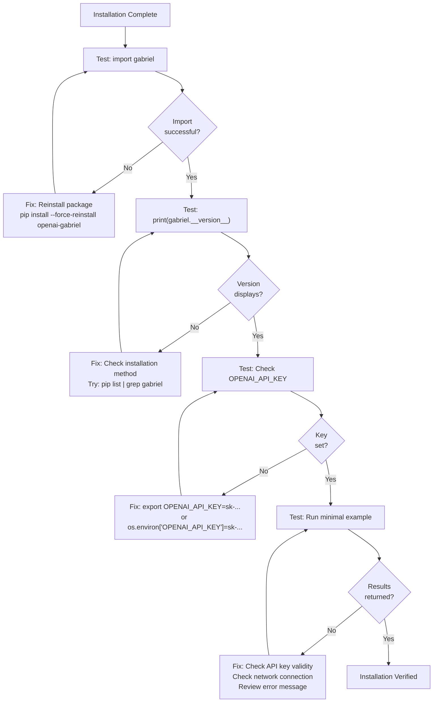

**Sources:** [README.md:74-133]()

---

## Common Installation Issues

### Issue: `ModuleNotFoundError: No module named 'gabriel'`

**Cause:** Package not installed or installed in different Python environment.

**Fix:**
```bash
# Check which Python pip is using
which pip
which python

# Ensure pip matches your Python environment
python -m pip install openai-gabriel

# Or use pip3 explicitly
pip3 install openai-gabriel
```

### Issue: `ImportError: cannot import name 'AsyncOpenAI'`

**Cause:** Outdated `openai` package (version <1.0.0).

**Fix:**
```bash
pip install --upgrade openai>=1.0.0
```

**Sources:** [pyproject.toml:47]()

### Issue: API Key Not Found

**Error message:** `AuthenticationError` or `OpenAI API key not found`

**Fix:**
1. Verify key is set: `echo $OPENAI_API_KEY` (bash) or `print(os.environ.get('OPENAI_API_KEY'))` (Python)
2. Ensure key starts with `sk-`
3. Set key before importing GABRIEL
4. For notebooks, set in same cell or earlier cell

**Sources:** [README.md:86-90]()

### Issue: Dependency Conflicts

**Cause:** Conflicting package versions in environment.

**Fix:**
```bash
# Create fresh virtual environment
python -m venv gabriel_env
source gabriel_env/bin/activate  # On Windows: gabriel_env\Scripts\activate

# Install GABRIEL
pip install openai-gabriel
```

### Issue: Development Mode Installation Not Working

**Cause:** Missing build dependencies or incorrect directory.

**Fix:**
```bash
# Ensure you're in repository root
cd GABRIEL

# Check pyproject.toml exists
ls pyproject.toml

# Install build dependencies first
pip install --upgrade setuptools build

# Then install in editable mode
pip install -e .[dev]
```

**Sources:** [pyproject.toml:1-3](), [README.md:180]()

---

## Next Steps

After successful installation and verification:

1. **Learn Core Concepts:** Read [Core Architecture](#3) to understand how GABRIEL's layers interact
2. **Run Your First Task:** See [gabriel.rate - Absolute Scoring](#4.1) for detailed usage examples
3. **Explore Tutorials:** Work through the Colab notebook referenced in [README.md:5]()
4. **Configure Advanced Options:** See [Advanced Configuration](#10) for customization

For troubleshooting runtime issues related to rate limiting, retries, or checkpointing, see [Operational Topics](#12).

**Sources:** [README.md:1-197](), [pyproject.toml:1-101]()

---

# Page: Core Architecture

# Core Architecture

<details>
<summary>Relevant source files</summary>

The following files were used as context for generating this wiki page:

- [src/gabriel/api.py](src/gabriel/api.py)
- [src/gabriel/prompts/paraphrase_prompt.jinja2](src/gabriel/prompts/paraphrase_prompt.jinja2)
- [src/gabriel/tasks/paraphrase.py](src/gabriel/tasks/paraphrase.py)
- [src/gabriel/utils/openai_utils.py](src/gabriel/utils/openai_utils.py)
- [src/gabriel/utils/parsing.py](src/gabriel/utils/parsing.py)
- [tests/test_basic.py](tests/test_basic.py)

</details>


## Purpose and Scope

This page provides an overview of GABRIEL's three-layer architecture: the **API Layer**, the **Task Execution Layer**, and the **Infrastructure Layer**. It explains how user requests flow through public API functions, are routed to task-specific implementations, and ultimately execute via the centralized LLM orchestration infrastructure.

For detailed information about specific layers, see:
- LLM orchestration engine implementation: [LLM Orchestration Infrastructure](#3.1)
- Public API function signatures and routing logic: [API Layer and Function Router](#3.2)
- Task system patterns and lifecycle: [Task System Architecture](#3.3)

---

## Architectural Overview

GABRIEL is organized into three distinct layers that separate concerns and provide clean abstraction boundaries:

| Layer | Primary Components | Responsibility |
|-------|-------------------|----------------|
| **API Layer** | `gabriel.api`, CLI | User-facing functions that accept natural language parameters |
| **Task Execution Layer** | Task classes (`Rate`, `Rank`, `Classify`, etc.) | Prompt construction, response parsing, result aggregation |
| **Infrastructure Layer** | `openai_utils`, `parsing` | LLM communication, concurrency, rate limiting, error handling, checkpointing |

Each layer communicates through well-defined interfaces. User code never directly interacts with the infrastructure layer; all LLM calls are mediated by task implementations that delegate to `openai_utils.get_all_responses()`.

**Sources:** [src/gabriel/api.py](), [src/gabriel/utils/openai_utils.py:1-100](), System Architecture Diagrams

---

## Three-Layer Architecture Diagram

```mermaid
graph TB
    subgraph "API_Layer[API Layer - gabriel.api]"
        rate_fn["gabriel.rate()"]
        classify_fn["gabriel.classify()"]
        rank_fn["gabriel.rank()"]
        extract_fn["gabriel.extract()"]
        merge_fn["gabriel.merge()"]
        dedupe_fn["gabriel.deduplicate()"]
        ideate_fn["gabriel.ideate()"]
        discover_fn["gabriel.discover()"]
        other_fn["...other API functions"]
    end
    
    subgraph "Task_Layer[Task Execution Layer - gabriel.tasks.*]"
        RateTask["Rate"]
        ClassifyTask["Classify"]
        RankTask["Rank"]
        ExtractTask["Extract"]
        MergeTask["Merge"]
        DedupeTask["Deduplicate"]
        IdeateTask["Ideate"]
        DiscoverTask["Discover"]
        
        RateConfig["RateConfig"]
        ClassifyConfig["ClassifyConfig"]
        RankConfig["RankConfig"]
        OtherConfigs["...other Config dataclasses"]
        
        PromptTemplate["PromptTemplate"]
    end
    
    subgraph "Infra_Layer[Infrastructure Layer - gabriel.utils.*]"
        get_all_responses["get_all_responses()"]
        get_response["get_response()"]
        RateLimiter["AsyncLimiter"]
        ErrorHandler["Error Classification & Retry"]
        Checkpointer["Checkpoint Manager"]
        parsing["parse_json_with_status()"]
    end
    
    subgraph "External[External Services]"
        OpenAI_API["OpenAI Responses API"]
    end
    
    rate_fn --> RateConfig
    classify_fn --> ClassifyConfig
    rank_fn --> RankConfig
    
    RateConfig --> RateTask
    ClassifyConfig --> ClassifyTask
    RankConfig --> RankTask
    
    RateTask --> PromptTemplate
    ClassifyTask --> PromptTemplate
    RankTask --> PromptTemplate
    
    RateTask --> get_all_responses
    ClassifyTask --> get_all_responses
    RankTask --> get_all_responses
    ExtractTask --> get_all_responses
    MergeTask --> get_all_responses
    DedupeTask --> get_all_responses
    IdeateTask --> get_all_responses
    DiscoverTask --> get_all_responses
    
    get_all_responses --> get_response
    get_all_responses --> RateLimiter
    get_all_responses --> ErrorHandler
    get_all_responses --> Checkpointer
    
    get_response --> OpenAI_API
    get_all_responses --> parsing
    
    OpenAI_API -.->|"Responses"| get_response
```

**Sources:** [src/gabriel/api.py:1-71](), [src/gabriel/tasks/](), [src/gabriel/utils/openai_utils.py:1-100]()

---

## Request Flow Lifecycle

A typical GABRIEL operation follows this sequence:

### 1. User Invocation (API Layer)

User calls an async function from `gabriel.api`:

```python
result = await gabriel.rate(
    df=data,
    column_name="text",
    attributes={"clarity": "Is the text clear and understandable?"},
    save_dir="output/",
    model="gpt-5-mini"
)
```

**Sources:** [src/gabriel/api.py:105-215]()

### 2. Configuration Construction

The API function constructs a configuration dataclass and instantiates the corresponding task class:

```python
cfg = RateConfig(
    attributes=attributes,
    save_dir=save_dir,
    model=model,
    n_parallels=n_parallels,
    ...
)
task = Rate(cfg, template_path=template_path)
```

**Sources:** [src/gabriel/api.py:195-209](), [src/gabriel/tasks/rate.py]()

### 3. Task Execution

The task's `.run()` method orchestrates:
- Prompt construction using Jinja2 templates
- Identifier generation for tracking
- Delegation to `get_all_responses()`

**Sources:** [src/gabriel/tasks/rate.py](), [src/gabriel/core/prompt_template.py]()

### 4. Infrastructure Processing

`get_all_responses()` in `openai_utils`:
- Estimates tokens and cost
- Configures rate limiters
- Spawns worker pool (default: 650 parallel)
- Handles retries, checkpointing, error classification
- Returns DataFrame with responses

**Sources:** [src/gabriel/utils/openai_utils.py:1250-1700]()

### 5. Response Aggregation

The task parses LLM responses, aggregates across runs, and returns the enriched DataFrame.

**Sources:** [src/gabriel/tasks/rate.py](), [src/gabriel/utils/parsing.py:134-141]()

---

## Data Flow Through Code Entities

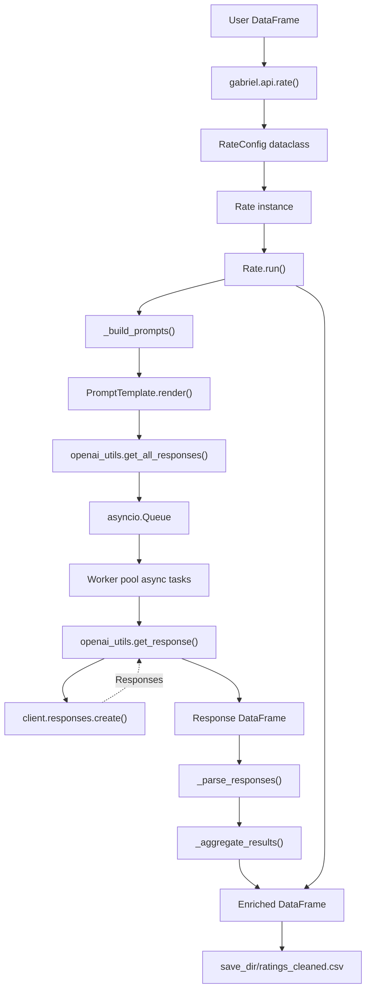

**Sources:** [src/gabriel/api.py:105-215](), [src/gabriel/tasks/rate.py](), [src/gabriel/utils/openai_utils.py:1250-1700]()

---

## Key Design Principles

### Separation of Concerns

Each layer has distinct responsibilities:

- **API Layer**: Parameter validation, user-friendly defaults
- **Task Layer**: Domain logic (prompt templates, parsing rules, aggregation strategies)
- **Infrastructure Layer**: Reliability (rate limiting, retries, concurrency, persistence)

This separation allows tasks to focus on *what* to compute while the infrastructure handles *how* to execute reliably at scale.

**Sources:** [src/gabriel/api.py:1-71](), [src/gabriel/utils/openai_utils.py:1-24]()

### Single Point of LLM Orchestration

All tasks funnel through `openai_utils.get_all_responses()`, which provides:

- Consistent rate limiting and retry logic
- Unified checkpoint/resume semantics
- Shared concurrency management
- Centralized error classification

This bottleneck pattern ensures all tasks benefit from infrastructure improvements without code duplication.

**Sources:** [src/gabriel/utils/openai_utils.py:1-100](), System Architecture Diagram 1

### Configuration-Driven Execution

Every task is configured through a dataclass (e.g., `RateConfig`, `ClassifyConfig`) that:

- Validates parameters in `__post_init__()`
- Encapsulates all task-specific settings
- Is easily serializable for provenance tracking

**Sources:** [src/gabriel/tasks/rate.py](), [src/gabriel/tasks/classify.py](), [tests/test_basic.py:823-828]()

### Template-Based Prompt Construction

Prompts are constructed via Jinja2 templates stored in `src/gabriel/prompts/`:

- `ratings_prompt.jinja2`
- `classification_prompt.jinja2`
- `paraphrase_prompt.jinja2`
- ...and others

Tasks call `PromptTemplate.render()` with context variables. Users can override templates via `template_path` parameter.

**Sources:** [src/gabriel/core/prompt_template.py](), [src/gabriel/prompts/paraphrase_prompt.jinja2:1-23](), [tests/test_basic.py:202-205]()

---

## Component Interaction Map

This diagram maps high-level concepts to specific code entities:

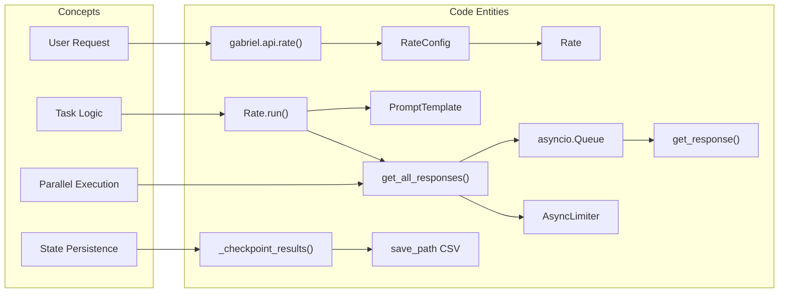

**Sources:** [src/gabriel/api.py:105-215](), [src/gabriel/tasks/rate.py](), [src/gabriel/utils/openai_utils.py:1250-1700]()

---

## Configuration Dataclass Pattern

All tasks follow a consistent configuration pattern. Each task has an associated `Config` dataclass:

| Task | Config Class | Key Parameters |
|------|--------------|----------------|
| Rate | `RateConfig` | `attributes`, `n_runs`, `n_attributes_per_run` |
| Classify | `ClassifyConfig` | `labels`, `differentiate`, `min_frequency` |
| Rank | `RankConfig` | `n_rounds`, `matches_per_round`, `power_matching` |
| Extract | `ExtractConfig` | `attributes`, `types` |
| Merge | `MergeConfig` | `left_on`, `right_on`, `strategy` |
| Deduplicate | `DeduplicateConfig` | `similarity_threshold`, `iterative` |

Configuration objects validate parameters in `__post_init__()` and are immutable after construction.

**Sources:** [src/gabriel/tasks/rate.py](), [src/gabriel/tasks/classify.py](), [src/gabriel/tasks/rank.py](), [src/gabriel/api.py:1-71]()

---

## Infrastructure Layer Core Functions

The infrastructure layer provides three primary entry points:

### `get_all_responses()`

Batch processing function that accepts lists of prompts and identifiers:

```python
df = await get_all_responses(
    prompts=["prompt1", "prompt2", ...],
    identifiers=["id1", "id2", ...],
    save_path="output/responses.csv",
    model="gpt-5-mini",
    n_parallels=650,
    ...
)
```

Returns DataFrame with columns: `Identifier`, `Response`, `Time Taken`, `Input Tokens`, `Output Tokens`, `Successful`, `Error Log`.

**Sources:** [src/gabriel/utils/openai_utils.py:1250-1280]()

### `get_response()`

Single-prompt function for individual requests:

```python
responses, duration = await get_response(
    prompt="...",
    model="gpt-5-mini",
    ...
)
```

Returns `(List[str], float)` tuple.

**Sources:** [src/gabriel/utils/openai_utils.py:1700-1850]()

### `parse_json_with_status()`

Response parsing with error reporting:

```python
parsed, success = parse_json_with_status(response_text)
```

Returns `(Optional[Union[dict, list]], bool)`.

**Sources:** [src/gabriel/utils/parsing.py:134-141]()

---

## Task Lifecycle

Every task follows this execution pattern:

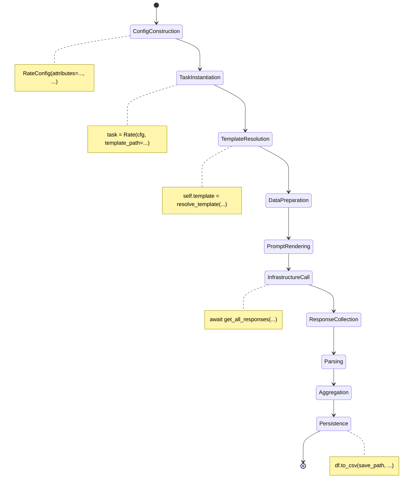

**Sources:** [src/gabriel/tasks/rate.py](), [src/gabriel/tasks/paraphrase.py:125-298]()

---

## Extensibility Points

GABRIEL provides multiple levels of customization:

### Level 1: Natural Language Parameters

Users modify behavior through `additional_instructions`:

```python
await gabriel.rate(
    ...,
    additional_instructions="Focus on technical accuracy over readability"
)
```

**Sources:** [src/gabriel/api.py:111]()

### Level 2: Custom Templates

Users override default prompts via `template_path`:

```python
await gabriel.rate(
    ...,
    template_path="custom_rating_prompt.jinja2"
)
```

**Sources:** [src/gabriel/api.py:121](), [src/gabriel/core/prompt_template.py]()

### Level 3: Custom Response Functions

Users replace per-prompt LLM invocation:

```python
async def custom_llm(prompt: str, **kwargs):
    # Custom model call
    return ["response"]

await gabriel.rate(
    ...,
    response_fn=custom_llm
)
```

**Sources:** [src/gabriel/api.py:122](), [tests/test_basic.py:525-543]()

### Level 4: Custom Driver Functions

Users replace entire `get_all_responses()` logic:

```python
async def custom_driver(prompts, identifiers, **kwargs):
    # Custom batch processing
    return pd.DataFrame(...)

await gabriel.rate(
    ...,
    get_all_responses_fn=custom_driver
)
```

**Sources:** [src/gabriel/api.py:123](), [tests/test_basic.py:583-622]()

---

## Persistence Model

All tasks persist results to disk with consistent structure:

```
save_dir/
├── <file_name>_raw_responses.csv       # Raw API responses
├── <file_name>_cleaned.csv              # Aggregated results
├── <file_name>_full_disaggregated.csv  # Multi-run details (if n_runs > 1)
└── .checkpoint_<file_name>.pkl          # Resume state
```

The `save_dir` parameter controls output location. Setting `reset_files=True` ignores existing state and regenerates all outputs.

**Sources:** [src/gabriel/utils/openai_utils.py:1250-1280](), [tests/test_basic.py:831-838]()

---

## Summary

GABRIEL's three-layer architecture provides:

1. **Simple API surface** - Natural language parameters, sensible defaults
2. **Composable task system** - Mix simple tasks into complex pipelines (e.g., `ideate` = `seed` + `generate` + `rank` + `rate` + `deduplicate`)
3. **Robust infrastructure** - Rate limiting, retries, checkpointing, and concurrency management handled transparently

All layers communicate through well-defined interfaces, allowing each to evolve independently while maintaining backward compatibility.

**Sources:** [src/gabriel/api.py:1-71](), [src/gabriel/utils/openai_utils.py:1-100](), System Architecture Diagrams

---

# Page: LLM Orchestration Infrastructure

# LLM Orchestration Infrastructure

<details>
<summary>Relevant source files</summary>

The following files were used as context for generating this wiki page:

- [src/gabriel/utils/openai_utils.py](src/gabriel/utils/openai_utils.py)
- [src/gabriel/utils/parsing.py](src/gabriel/utils/parsing.py)

</details>


This page documents the core infrastructure layer that powers all LLM interactions in GABRIEL. The `openai_utils` module serves as the single point of orchestration for every task in the system, providing rate limiting, concurrency management, retry logic, checkpointing, and fault tolerance.

For information about the high-level API functions that users interact with, see [API Layer and Function Router](#3.2). For details on how individual tasks use this infrastructure, see [Task System Architecture](#3.3).

---

## Purpose and Architecture

The `openai_utils` module ([src/gabriel/utils/openai_utils.py]()) is the most critical component in GABRIEL with an importance score of 195.93. Every task—from simple operations like `rate` and `classify` to complex multi-stage pipelines like `ideate` and `discover`—funnels through this module to interact with the OpenAI API.

**Key responsibilities:**
- Concurrent request execution (up to 650 parallel workers by default)
- Dynamic rate limiting based on API response headers
- Exponential backoff retry logic with jitter
- Automatic checkpointing for resumability
- Background polling for long-running requests
- Cost estimation and usage reporting
- Multimodal input handling (images, audio, PDFs)
- Web search integration

### High-Level Entry Points

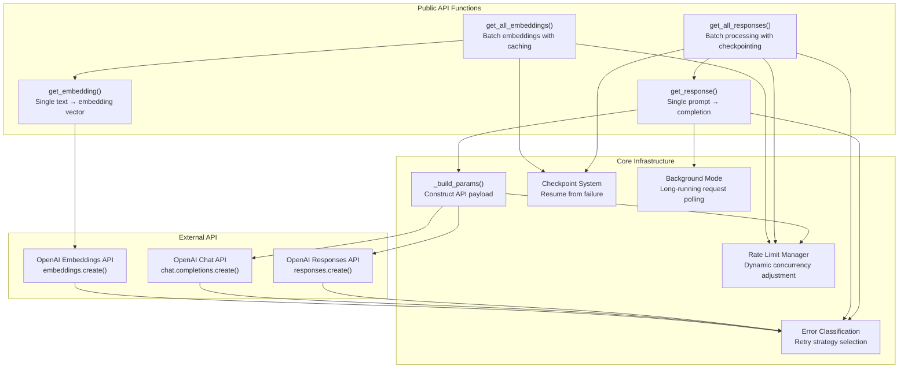

**Sources:** [src/gabriel/utils/openai_utils.py:1672-2189](), [src/gabriel/utils/openai_utils.py:2250-2339](), [src/gabriel/utils/openai_utils.py:2342-2579]()

---

## Single Request Processing: `get_response()`

The `get_response()` function ([src/gabriel/utils/openai_utils.py:1672-2189]()) is the foundational async coroutine for sending a single prompt to the OpenAI API. It handles both the newer Responses API and the legacy Chat Completions API, automatically selecting the appropriate endpoint based on input modality.

### Function Signature and Key Parameters

| Parameter | Type | Default | Purpose |
|-----------|------|---------|---------|
| `prompt` | `str` | required | User question or instruction |
| `model` | `str` | `"gpt-5-mini"` | Model identifier |
| `n` | `int` | `1` | Number of parallel completions |
| `max_output_tokens` | `Optional[int]` | `None` | Output length cap |
| `timeout` | `Optional[float]` | `None` | Client-side timeout in seconds |
| `json_mode` | `bool` | `False` | Request structured JSON output |
| `web_search` | `bool` | `False` | Enable built-in web search tool |
| `reasoning_effort` | `Optional[str]` | `None` | Reasoning intensity (`"low"`, `"medium"`, `"high"`) |
| `images` | `Optional[List[str]]` | `None` | Base64-encoded images |
| `audio` | `Optional[List[Dict]]` | `None` | Audio input payloads |
| `pdfs` | `Optional[List[Dict]]` | `None` | PDF document payloads |
| `background_mode` | `Optional[bool]` | `None` | Enable background polling (auto-enabled when `timeout=None`) |

### API Routing Logic

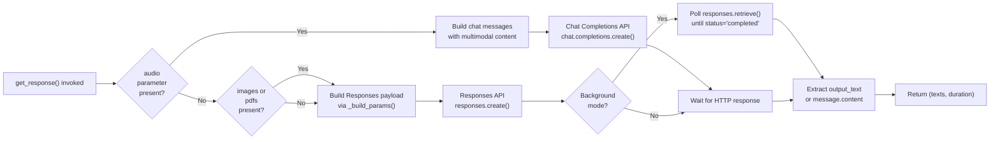

**Sources:** [src/gabriel/utils/openai_utils.py:1935-2017](), [src/gabriel/utils/openai_utils.py:2018-2188]()

### Background Mode Polling

When `background_mode=True` or `timeout=None`, the function uses background polling ([src/gabriel/utils/openai_utils.py:1849-1930]()) to handle long-running requests that exceed typical HTTP connection timeouts:

1. Submit request with `background=True` parameter
2. Receive immediate response with `status="queued"` or `status="in_progress"`
3. Poll `responses.retrieve(response_id)` every `background_poll_interval` seconds (default: 10s)
4. Continue until `status="completed"` or timeout exceeded
5. Extract final result from completed response object

This prevents connection timeouts for requests that may take minutes to complete (e.g., deep research models with high reasoning effort).

**Sources:** [src/gabriel/utils/openai_utils.py:1849-1930](), [src/gabriel/utils/openai_utils.py:2116-2178]()

---

## Batch Processing: `get_all_responses()`

The `get_all_responses()` function ([src/gabriel/utils/openai_utils.py:2582-3638]()) orchestrates parallel execution of hundreds or thousands of prompts with sophisticated concurrency control, fault tolerance, and progress persistence.

### Core Architecture

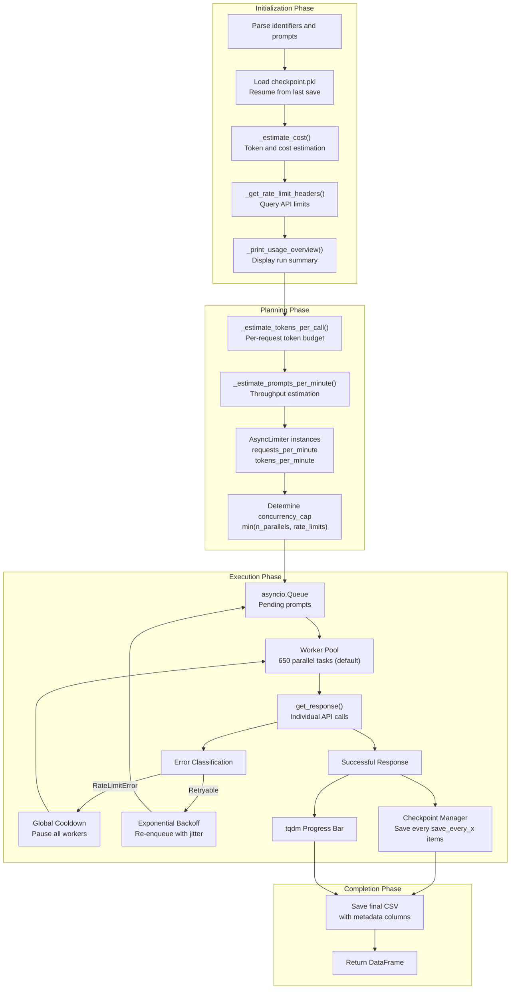

**Sources:** [src/gabriel/utils/openai_utils.py:2582-3638]()

### Key Data Structures

#### StatusTracker

The `StatusTracker` dataclass ([src/gabriel/utils/openai_utils.py:196-212]()) maintains runtime counters:

```python
@dataclass
class StatusTracker:
    num_tasks_started: int = 0
    num_tasks_in_progress: int = 0
    num_tasks_succeeded: int = 0
    num_tasks_failed: int = 0
    num_rate_limit_errors: int = 0
    num_connection_errors: int = 0
    num_api_errors: int = 0
    num_timeout_errors: int = 0
    num_json_parse_errors: int = 0
    num_other_errors: int = 0
    time_of_last_rate_limit_error: float = 0.0
    time_of_last_connection_error: float = 0.0
```

**Sources:** [src/gabriel/utils/openai_utils.py:196-212]()

#### Request Payload Structure

Individual requests are represented as dictionaries with metadata:

| Field | Purpose |
|-------|---------|
| `identifier` | Unique key for result lookup |
| `prompt` | Text prompt to send |
| `prompt_images` | Optional image payloads (base64) |
| `prompt_audio` | Optional audio payloads |
| `prompt_pdfs` | Optional PDF document payloads |
| `web_search_filters` | Per-prompt web search configuration |
| `attempts_left` | Remaining retry attempts |
| `errors` | Accumulated error messages |

**Sources:** [src/gabriel/utils/openai_utils.py:2742-2821]()

---

## Rate Limiting System

The rate limiting system dynamically adjusts concurrency based on real-time API feedback to maximize throughput while respecting quota boundaries.

### Rate Limit Discovery

```mermaid
graph LR
    Start["get_all_responses() starts"]
    
    FetchHeaders["_get_rate_limit_headers(model)<br/>Make cheap API call"]
    
    ParseHeaders["Extract x-ratelimit-* headers<br/>limit_requests<br/>remaining_requests<br/>limit_tokens<br/>remaining_tokens"]
    
    EstimateTokens["_estimate_tokens_per_call()<br/>avg_input + output_headroom"]
    
    CalcThroughput["_estimate_prompts_per_minute()<br/>min(req_limit, tok_limit/tokens_per_call)"]
    
    SetConcurrency["concurrency_cap = min(<br/>n_parallels,<br/>throughput,<br/>available_budget<br/>)"]
    
    InitLimiters["Create AsyncLimiter instances<br/>requests: HEADROOM × req_limit<br/>tokens: HEADROOM × tok_limit"]
    
    Start --> FetchHeaders
    FetchHeaders --> ParseHeaders
    ParseHeaders --> EstimateTokens
    EstimateTokens --> CalcThroughput
    CalcThroughput --> SetConcurrency
    SetConcurrency --> InitLimiters
```

**Sources:** [src/gabriel/utils/openai_utils.py:890-994](), [src/gabriel/utils/openai_utils.py:549-621]()

### Dynamic Concurrency Adjustment

The system continuously monitors error rates and adjusts the concurrency cap in response:

| Event | Adjustment Strategy | Implementation |
|-------|---------------------|----------------|
| **Rate Limit Error** | Decrease aggressively: `max(2, ceil(cap × 0.4))` | [src/gabriel/utils/openai_utils.py:1245-1248]() |
| **Connection Error** | Decrease aggressively: same as rate limit | [src/gabriel/utils/openai_utils.py:1251-1254]() |
| **Successful Burst** | Increase gradually: `cap × 1.18` (max step) | [src/gabriel/utils/openai_utils.py:1257-1294]() |
| **Timeout Warning** | No immediate change; log warning | Tracked via `StatusTracker.num_timeout_errors` |

The `_smooth_wait_based_cap()` function ([src/gabriel/utils/openai_utils.py:1257-1294]()) implements cooldown periods to prevent oscillation:
- **Upward adjustments:** 20-second cooldown
- **Downward adjustments:** 10-second cooldown

**Sources:** [src/gabriel/utils/openai_utils.py:1245-1294](), [src/gabriel/utils/openai_utils.py:3203-3304]()

### Headroom Constants

```python
RATE_LIMIT_HEADROOM = 0.85  # Apply to limiter budgets for safety margin
PLANNING_RATE_LIMIT_BUFFER = 0.85  # Apply to initial concurrency calculation
OUTPUT_TOKEN_HEADROOM_INITIAL = 2.0  # Conservative output estimate
OUTPUT_TOKEN_HEADROOM_STEADY = 1.0  # Relaxed after observing real usage
```

**Sources:** [src/gabriel/utils/openai_utils.py:183-191]()

---

## Error Handling and Retry Logic

### Error Classification

The system categorizes exceptions into distinct classes with tailored retry strategies:

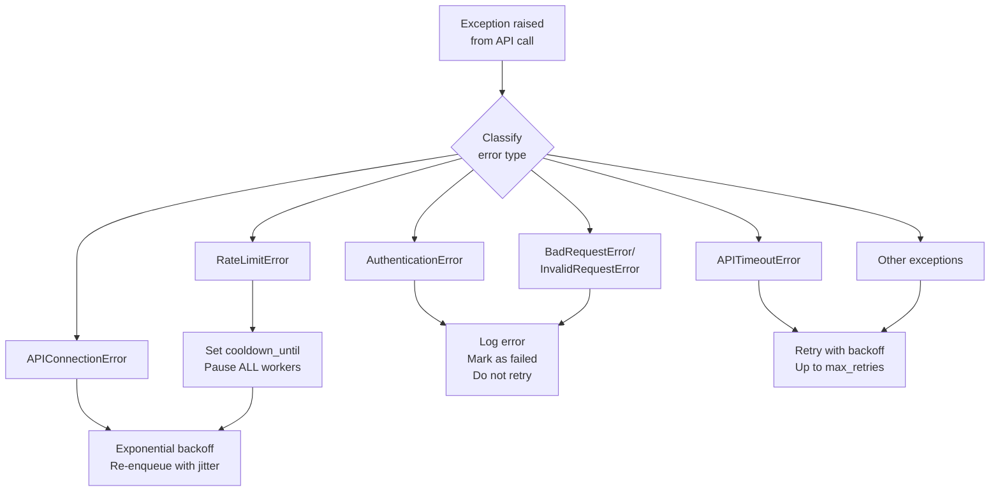

**Sources:** [src/gabriel/utils/openai_utils.py:3364-3594]()

### Retry Strategy Implementation

**Exponential Backoff with Jitter:**

```python
# Simplified logic from the actual implementation
base_delay = 2 ** attempt  # 2, 4, 8, 16, 32 seconds...
jitter = random.uniform(0, 0.3 * base_delay)  # Up to 30% jitter
actual_delay = base_delay + jitter
```

**Global Cooldown for Rate Limits:**

When a `RateLimitError` occurs:
1. Extract `retry_after` seconds from error headers ([src/gabriel/utils/openai_utils.py:247-268]())
2. Set `cooldown_until = time.time() + retry_after`
3. All workers check this timestamp before dequeuing new work
4. Pause progress bar to indicate cooldown state

**Sources:** [src/gabriel/utils/openai_utils.py:247-268](), [src/gabriel/utils/openai_utils.py:3364-3450]()

### Error Message Extraction

The `_extract_retry_after_seconds()` helper ([src/gabriel/utils/openai_utils.py:247-268]()) attempts multiple strategies:
1. Check exception attributes: `retry_after`, `retry_after_s`, `retry_after_seconds`, `retry_after_ms`
2. Parse error message with regex: `r"after\s+([0-9]+(?:\.[0-9]+)?)\s*seconds"`
3. Return `None` if no retry timing is found

**Sources:** [src/gabriel/utils/openai_utils.py:247-268]()

---

## Checkpointing and Resumability

### Checkpoint File Structure

The checkpoint system saves state to `{save_path}_checkpoint.pkl` containing:

| Key | Type | Contents |
|-----|------|----------|
| `results` | `Dict[str, Any]` | Mapping from identifier to response data |
| `prompt_tokens_dict` | `Dict[str, int]` | Token counts per identifier |
| `completion_tokens_dict` | `Dict[str, int]` | Output token counts per identifier |
| `duration_dict` | `Dict[str, float]` | API call durations per identifier |
| `token_usage_dict` | `Dict[str, Dict[str, int]]` | Detailed usage breakdown |

**Sources:** [src/gabriel/utils/openai_utils.py:2702-2741]()

### Checkpoint Save Logic

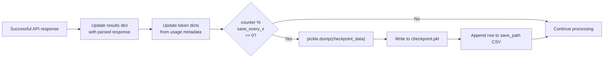

**Sources:** [src/gabriel/utils/openai_utils.py:3450-3560]()

### Resume Behavior

On startup, `get_all_responses()`:
1. Checks for `{save_path}_checkpoint.pkl`
2. If `reset_files=False` and checkpoint exists:
   - Load `results` dictionary
   - Skip prompts with identifiers already in `results`
   - Continue from where previous run stopped
3. If `reset_files=True` or no checkpoint:
   - Delete existing checkpoint and CSV files
   - Start fresh

**Sources:** [src/gabriel/utils/openai_utils.py:2702-2741](), [src/gabriel/utils/openai_utils.py:2652-2701]()

---

## Cost Estimation and Usage Reporting

### Pricing Table

The module maintains a pricing dictionary ([src/gabriel/utils/openai_utils.py:362-407]()) with per-million-token costs:

```python
MODEL_PRICING: Dict[str, Dict[str, float]] = {
    "gpt-5-mini": {
        "input": 0.25,
        "cached_input": 0.025,
        "output": 2.00,
        "batch": 0.5
    },
    "gpt-5-nano": {
        "input": 0.05,
        "cached_input": 0.005,
        "output": 0.40,
        "batch": 0.5
    },
    # ... more models
}
```

Lookup uses longest prefix matching to handle model variants (e.g., `"gpt-5-mini-2025-01-20"` matches `"gpt-5-mini"`).

**Sources:** [src/gabriel/utils/openai_utils.py:362-407](), [src/gabriel/utils/openai_utils.py:458-468]()

### Usage Summary Banner

Before execution begins, `_print_usage_overview()` ([src/gabriel/utils/openai_utils.py:996-1243]()) displays:

**Prompt Statistics:**
- Total prompt count
- Approximate input words and tokens (sampled for large datasets)
- Words per prompt average

**Rate Limit Information:**
- Requests per minute (from API headers)
- Tokens per minute (from API headers)
- Calculated concurrency cap: `min(n_parallels, rate_limits)`

**Cost Estimate:**
- Estimated input tokens: `sum(tokens per prompt) × n`
- Estimated output tokens: `max_output_tokens × prompts × n` or `500 × prompts × n` (default assumption)
- Total estimated cost: `(input_cost + output_cost) × batch_factor`

**Throughput Forecast:**
- Expected prompts per minute
- Estimated total runtime in minutes
- Limiting factor: requests/minute or tokens/minute

**Usage Tier Information:**
- Current tier qualification table
- Suggestions for upgrading to higher tiers

**Sources:** [src/gabriel/utils/openai_utils.py:996-1243](), [src/gabriel/utils/openai_utils.py:410-440]()

### Token Counting

Token estimation uses multiple strategies:
1. **Exact counting:** `tiktoken.encoding_for_model(model).encode(text)` ([src/gabriel/utils/openai_utils.py:303-312]())
2. **Approximate heuristic:** `len(text.split()) × 1.5` ([src/gabriel/utils/openai_utils.py:442-444]())
3. **Sampling:** For datasets with >5000 prompts, sample and scale ([src/gabriel/utils/openai_utils.py:689-724]())

**Sources:** [src/gabriel/utils/openai_utils.py:303-312](), [src/gabriel/utils/openai_utils.py:442-444](), [src/gabriel/utils/openai_utils.py:689-724]()

---

## Request Parameter Construction: `_build_params()`

The `_build_params()` function ([src/gabriel/utils/openai_utils.py:1532-1669]()) assembles the JSON payload for the Responses API, handling:

### Core Parameters

| Parameter | Mapping |
|-----------|---------|
| `model` | Direct passthrough |
| `input` | Conversation history as list of role/content dicts |
| `truncation` | Always set to `"auto"` |
| `max_output_tokens` | Optional output length cap |

### JSON Mode

When `json_mode=True`:
```python
params["text"] = {
    "format": {
        "type": "json_schema" if expected_schema else "json_object",
        "schema": expected_schema  # if provided
    }
}
```

**Sources:** [src/gabriel/utils/openai_utils.py:1619-1624]()

### Tool Configuration

**Regular Tools:**
```python
if tools:
    params["tools"] = tools
if tool_choice is not None:
    params["tool_choice"] = tool_choice
```

**Web Search Tool:**
```python
if web_search:
    tool = {
        "type": "web_search",
        "search_context_size": "low" | "medium" | "high",
        "filters": {
            "allowed_domains": ["example.com", ...]
        },
        "user_location": {
            "city": "...",
            "country": "...",
            "type": "approximate"
        }
    }
    params["tools"].append(tool)
```

Web search automatically adds `"web_search_call.action.sources"` to the `include` parameter to retrieve source URLs.

**Sources:** [src/gabriel/utils/openai_utils.py:1625-1667]()

### Reasoning Parameters

For modern models (non-legacy GPT-3/4):
```python
params["reasoning"] = {
    "effort": reasoning_effort,  # "low", "medium", "high"
    "summary": reasoning_summary  # "auto", "concise", "detailed"
}
```

Legacy models use `temperature` instead.

**Sources:** [src/gabriel/utils/openai_utils.py:1642-1655]()

---

## Multimodal Input Handling

### Image Processing

Images are embedded in the `input` list as content objects:

```python
{
    "type": "input_image",
    "image_url": "data:image/jpeg;base64,<base64_string>"
}
```

If the provided image string doesn't start with `"data:"`, the prefix is automatically added ([src/gabriel/utils/openai_utils.py:2023-2028]()).

**Sources:** [src/gabriel/utils/openai_utils.py:2019-2028]()

### PDF Processing

PDFs are sent as file content objects:

```python
{
    "type": "input_file",
    "filename": "document.pdf",
    "file_data": "data:application/pdf;base64,<base64_string>"
    # OR
    "file_url": "https://example.com/document.pdf"
}
```

**Sources:** [src/gabriel/utils/openai_utils.py:2029-2045]()

### Audio Processing

Audio inputs route through the Chat Completions API instead of Responses API:

```python
{
    "type": "input_audio",
    "input_audio": {
        "data": "<base64_audio>",
        "format": "wav"
    }
}
```

Audio models automatically set `modalities=["text"]` to request text output.

**Sources:** [src/gabriel/utils/openai_utils.py:1935-1972]()

---

## Embedding Infrastructure

### Single Embedding: `get_embedding()`

The `get_embedding()` function ([src/gabriel/utils/openai_utils.py:2250-2339]()) is a lightweight async wrapper:

```python
embed, duration = await get_embedding(
    text="Sample text to embed",
    model="text-embedding-3-small",
    timeout=30.0
)
# embed: List[float] - typically 1536 dimensions
# duration: float - seconds elapsed
```

**Sources:** [src/gabriel/utils/openai_utils.py:2250-2339]()

### Batch Embeddings: `get_all_embeddings()`

The `get_all_embeddings()` function ([src/gabriel/utils/openai_utils.py:2342-2579]()) provides parallel embedding computation with checkpointing:

**Key Features:**
- Concurrent requests up to `n_parallels` (default: 150)
- Results saved to `save_path` (pickle format)
- Automatic resume from checkpoint
- Exponential backoff retry logic
- Per-request timeout handling
- Global cooldown after rate limit errors

**Output Format:**
```python
{
    "identifier_1": [0.123, -0.456, ...],  # 1536 floats
    "identifier_2": [0.789, -0.012, ...],
    ...
}
```

**Sources:** [src/gabriel/utils/openai_utils.py:2342-2579]()

---

## Web Search Integration

### Web Search Sources Extraction

When `web_search=True`, the `_extract_web_search_sources()` helper ([src/gabriel/utils/openai_utils.py:1444-1529]()) recursively walks response objects to collect source URLs:

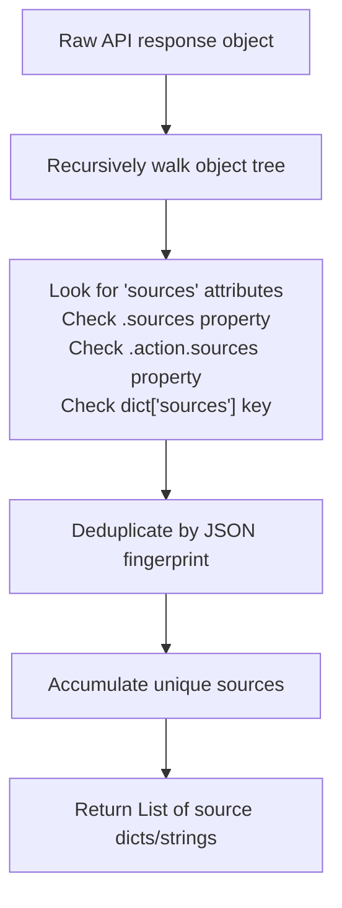

This works with both Pydantic models and plain dictionaries, handling various API response formats.

**Sources:** [src/gabriel/utils/openai_utils.py:1444-1529]()

### Web Search Filters

The `_normalise_web_search_filters()` function ([src/gabriel/utils/openai_utils.py:1297-1340]()) transforms user-friendly filter dicts:

**Input format:**
```python
{
    "allowed_domains": ["wikipedia.org", "britannica.com"],
    "city": "New York",
    "country": "US",
    "type": "approximate"
}
```

**Output format (Responses API schema):**
```python
{
    "filters": {
        "allowed_domains": ["wikipedia.org", "britannica.com"]
    },
    "user_location": {
        "city": "New York",
        "country": "US",
        "type": "approximate"
    }
}
```

**Sources:** [src/gabriel/utils/openai_utils.py:1297-1340]()

---

## Worker Concurrency Model

### Worker Pool Architecture

```mermaid
graph TB
    subgraph "Coordinator"
        MainTask["Main async task"]
        Queue["asyncio.Queue<br/>Pending requests"]
        StatusTracker["StatusTracker<br/>Shared counters"]
    end
    
    subgraph "Worker Pool"
        W1["Worker 1"]
        W2["Worker 2"]
        W3["Worker 3"]
        Wn["Worker n_parallels"]
    end
    
    subgraph "Rate Limiters"
        ReqLimiter["AsyncLimiter<br/>requests_per_minute"]
        TokLimiter["AsyncLimiter<br/>tokens_per_minute"]
    end
    
    subgraph "Per-Request Processing"
        Dequeue["Dequeue request"]
        CheckCooldown{"Global<br/>cooldown<br/>active?"}
        AcquireLimits["Acquire rate limit permits"]
        CallAPI["get_response()"]
        HandleResult{"Success<br/>or error?"}
    end
    
    MainTask --> Queue
    Queue --> W1
    Queue --> W2
    Queue --> W3
    Queue --> Wn
    
    W1 --> Dequeue
    W2 --> Dequeue
    W3 --> Dequeue
    Wn --> Dequeue
    
    Dequeue --> CheckCooldown
    CheckCooldown -->|Active| Sleep["await asyncio.sleep(1)"]
    CheckCooldown -->|Inactive| AcquireLimits
    Sleep --> Dequeue
    
    AcquireLimits --> ReqLimiter
    AcquireLimits --> TokLimiter
    ReqLimiter --> CallAPI
    TokLimiter --> CallAPI
    
    CallAPI --> HandleResult
    HandleResult -->|Success| SaveResult["Save to results dict<br/>Update checkpoint"]
    HandleResult -->|Error| Classify["Classify error<br/>Update StatusTracker"]
    
    SaveResult --> Dequeue
    Classify --> Dequeue
```

**Sources:** [src/gabriel/utils/openai_utils.py:3085-3636]()

### Worker Lifecycle

Each worker ([src/gabriel/utils/openai_utils.py:3085-3594]()) runs in an infinite loop:

1. **Dequeue:** Wait for next request from queue
2. **Cooldown Check:** If global cooldown active, sleep 1 second and retry
3. **Rate Limit Acquisition:** 
   - `await request_limiter.acquire()`
   - `await token_limiter.acquire(tokens_per_call)`
4. **API Call:** `await get_response(prompt, **params)`
5. **Result Handling:**
   - Success: Save result, update counters, checkpoint if needed
   - Error: Classify, potentially re-enqueue with backoff
6. **Loop:** Return to step 1

Workers are spawned via `asyncio.create_task()` and run concurrently until the queue is exhausted.

**Sources:** [src/gabriel/utils/openai_utils.py:3085-3594]()

---

## Dummy Mode for Testing

### DummyResponseSpec

The `DummyResponseSpec` dataclass ([src/gabriel/utils/openai_utils.py:214-228]()) configures synthetic responses:

```python
@dataclass
class DummyResponseSpec:
    responses: Optional[Any] = None  # Pre-defined response text/list
    duration: Optional[float] = None  # Simulated latency
    input_tokens: Optional[int] = None  # Fake usage stats
    output_tokens: Optional[int] = None
    reasoning_tokens: Optional[int] = None
    response_id: Optional[str] = None
    successful: Optional[bool] = None  # Force success/failure
    error_log: Optional[Union[str, List[str]]] = None  # Simulated errors
```

**Sources:** [src/gabriel/utils/openai_utils.py:214-228]()

### Dummy Behavior

When `use_dummy=True`:
- `get_response()` returns `["DUMMY {prompt}"]` immediately ([src/gabriel/utils/openai_utils.py:1799-1803]())
- `get_all_responses()` uses `dummy_responses` mapping or generates `f"DUMMY {prompt}"` ([src/gabriel/utils/openai_utils.py:2996-3045]())
- No network calls are made
- Progress bars and checkpointing still function normally
- Useful for integration tests and notebook demonstrations

**Sources:** [src/gabriel/utils/openai_utils.py:1799-1803](), [src/gabriel/utils/openai_utils.py:2996-3045]()

---

## JSON Parsing Integration

The module integrates with `gabriel.utils.parsing` for robust JSON extraction.

### JSON Mode Validation

When `json_mode=True`, responses are validated with `parse_json_with_status()` ([src/gabriel/utils/parsing.py:134-141]()]:

```python
from gabriel.utils.parsing import parse_json_with_status

parsed_obj, success = parse_json_with_status(response_text)
if not success:
    status_tracker.num_json_parse_errors += 1
    # Mark request as failed or retry
```

This handles:
- Markdown code fences: ` ```json ... ``` `
- Quoted JSON strings
- JavaScript-style comments
- Embedded JSON within larger text blocks

**Sources:** [src/gabriel/utils/openai_utils.py:121](), [src/gabriel/utils/parsing.py:134-141]()

---

## Logging and Verbosity Control

### Logger Configuration

The module uses a dedicated logger ([src/gabriel/utils/openai_utils.py:74]()):

```python
from gabriel.utils.logging import get_logger, set_log_level

logger = get_logger(__name__)
```

**Log Level Control:**
```python
await get_response(..., logging_level="debug")  # Per-call override
set_log_level("warning")  # Module-wide setting
```

**Sources:** [src/gabriel/utils/openai_utils.py:61-74](), [src/gabriel/utils/openai_utils.py:1804-1805]()

### Verbose Output Control

The `verbose` parameter controls user-facing output:
- **Progress bars:** Disabled when `verbose=False` ([src/gabriel/utils/openai_utils.py:127-132]())
- **Usage summaries:** Skipped when `verbose=False` ([src/gabriel/utils/openai_utils.py:1027-1028]())
- **Example prompts:** Hidden when `verbose=False` ([src/gabriel/utils/openai_utils.py:135-143]())

**Sources:** [src/gabriel/utils/openai_utils.py:127-143](), [src/gabriel/utils/openai_utils.py:1027-1028]()

---

## Performance Tuning Parameters

### Concurrency Settings

| Parameter | Default | Recommended Range | Impact |
|-----------|---------|-------------------|--------|
| `n_parallels` | `650` | `50-1000` | Max concurrent requests |
| `timeout` | `60.0` | `30.0-300.0` | Per-request timeout (seconds) |
| `save_every_x` | `1000` | `100-5000` | Checkpoint frequency |
| `max_retries` | `3` | `1-10` | Retry attempts per request |
| `global_cooldown` | `15` | `10-60` | Cooldown after rate limit (seconds) |

**Sources:** [src/gabriel/utils/openai_utils.py:2582-2650]()

### Memory and Disk Considerations

**Checkpoint File Size:**
- Roughly `500 bytes × num_prompts` for small responses
- Can grow to several GB for datasets with 100K+ prompts and long responses

**Queue Memory:**
- Each queued request: ~2-10 KB depending on prompt length
- Total queue memory: `remaining_prompts × avg_request_size`

**CSV Output:**
- Appended incrementally, so disk usage is proportional to completed prompts
- Safe for datasets with millions of rows

**Sources:** [src/gabriel/utils/openai_utils.py:3450-3560]()

---

## Client Connection Pooling

### AsyncOpenAI Client Cache

A module-level dictionary ([src/gabriel/utils/openai_utils.py:124]()) maintains one client per `base_url`:

```python
_clients_async: Dict[Optional[str], openai.AsyncOpenAI] = {}

def _get_client(base_url: Optional[str] = None) -> openai.AsyncOpenAI:
    url = base_url or os.getenv("OPENAI_BASE_URL")
    client = _clients_async.get(url)
    if client is None:
        kwargs = {}
        if url:
            kwargs["base_url"] = url
        if httpx is not None:
            kwargs["timeout"] = httpx.Timeout(
                connect=10.0,
                read=None,  # No read timeout
                write=None,
                pool=None
            )
        client = openai.AsyncOpenAI(**kwargs)
        _clients_async[url] = client
    return client
```

**Benefits:**
- Connection reuse across multiple calls
- HTTP/2 multiplexing for parallelism
- Reduced overhead from TLS handshakes

**Sources:** [src/gabriel/utils/openai_utils.py:124](), [src/gabriel/utils/openai_utils.py:145-172]()

---

## Summary Table: Key Functions

| Function | Purpose | Input | Output | Key Features |
|----------|---------|-------|--------|--------------|
| `get_response()` | Single prompt completion | `prompt: str` | `(texts, duration)` | Background polling, multimodal, web search |
| `get_all_responses()` | Batch parallel processing | `prompts: List[str]` | `DataFrame` | Checkpointing, rate limiting, retry logic |
| `get_embedding()` | Single text embedding | `text: str` | `(embedding, duration)` | Async, timeout support |
| `get_all_embeddings()` | Batch embedding computation | `texts: List[str]` | `Dict[str, List[float]]` | Parallel execution, pickle cache |
| `_build_params()` | Construct API payload | Model, input, tools | `Dict[str, Any]` | Web search, JSON mode, reasoning |
| `_get_rate_limit_headers()` | Fetch API limits | `model: str` | `Dict[str, str]` | Probes Responses/Chat endpoints |
| `_estimate_cost()` | Calculate token usage & cost | `prompts`, `model` | `Dict[str, float]` | Samples large datasets |

**Sources:** [src/gabriel/utils/openai_utils.py:1672-2189](), [src/gabriel/utils/openai_utils.py:2582-3638](), [src/gabriel/utils/openai_utils.py:2250-2339](), [src/gabriel/utils/openai_utils.py:2342-2579](), [src/gabriel/utils/openai_utils.py:1532-1669](), [src/gabriel/utils/openai_utils.py:890-994](), [src/gabriel/utils/openai_utils.py:471-527]()

---

# Page: API Layer and Function Router

# API Layer and Function Router

<details>
<summary>Relevant source files</summary>

The following files were used as context for generating this wiki page:

- [README.md](README.md)
- [src/gabriel/api.py](src/gabriel/api.py)
- [src/gabriel/prompts/paraphrase_prompt.jinja2](src/gabriel/prompts/paraphrase_prompt.jinja2)
- [src/gabriel/tasks/paraphrase.py](src/gabriel/tasks/paraphrase.py)
- [tests/test_basic.py](tests/test_basic.py)

</details>


## Purpose and Scope

This page documents the **public API layer** in `src/gabriel/api.py`, which provides the user-facing entry points for all GABRIEL functionality. The API layer acts as a thin routing and parameter-validation facade that translates natural-language function calls into properly configured Task objects. This page covers how API functions map to task implementations, common parameter patterns, configuration dataclasses, and customization hooks.

For the underlying task execution mechanics (Config dataclasses, PromptTemplate system, Task.run() lifecycle), see [Task System Architecture](#3.3). For the LLM orchestration infrastructure that handles concurrency and retries, see [LLM Orchestration Infrastructure](#3.1).

---

## API Function Inventory

The API layer exports 19 public functions, all defined in `src/gabriel/api.py` and listed in the `__all__` variable:

| Function | Purpose | Return Type | Task Class |
|----------|---------|-------------|------------|
| `gabriel.rate` | Score items 0-100 on natural language attributes | `pd.DataFrame` | `Rate` |
| `gabriel.rank` | Pairwise rankings producing ELO-like z-scores | `pd.DataFrame` | `Rank` |
| `gabriel.classify` | Apply categorical labels with confidence thresholds | `pd.DataFrame` | `Classify` |
| `gabriel.extract` | Extract structured facts into columns | `pd.DataFrame` | `Extract` |
| `gabriel.discover` | Multi-stage feature discovery pipeline | `pd.DataFrame` | `Discover` |
| `gabriel.merge` | Fuzzy matching crosswalks between datasets | `pd.DataFrame` | `Merge` |
| `gabriel.deduplicate` | Find and consolidate semantic duplicates | `pd.DataFrame` | `Deduplicate` |
| `gabriel.filter` | Boolean screening with natural language conditions | `pd.DataFrame` | `Filter` |
| `gabriel.deidentify` | Replace PII with consistent fake identifiers | `pd.DataFrame` | `Deidentifier` |
| `gabriel.codify` | Highlight passages matching qualitative codes | `pd.DataFrame` | `Codify` |
| `gabriel.compare` | Identify similarities/differences in paired items | `pd.DataFrame` | `Compare` |
| `gabriel.bucket` | Build taxonomies from many terms | `pd.DataFrame` | `Bucket` |
| `gabriel.paraphrase` | Rewrite texts consistently per instructions | `pd.DataFrame` | `Paraphrase` |
| `gabriel.seed` | Generate diverse representative entities | `pd.DataFrame` | `Seed` |
| `gabriel.ideate` | Theory generation and evaluation pipeline | `pd.DataFrame` | `Ideate` |
| `gabriel.debias` | Statistical post-processing for bias removal | `DebiasResult` | `DebiasPipeline` |
| `gabriel.whatever` | Arbitrary prompts with infrastructure support | `pd.DataFrame` | `Whatever` |
| `gabriel.view` | Interactive notebook viewer for auditing | HTML display | `_view_passages` |
| `gabriel.id8` | Alias for `gabriel.ideate` | `pd.DataFrame` | `Ideate` |

Sources: [src/gabriel/api.py:51-71](), [src/gabriel/api.py:7-40]()

---

## Function Router Architecture

Each API function follows a consistent routing pattern: parameter collection → Config instantiation → Task instantiation → execution. The diagram below shows how user calls flow through the API layer:

```mermaid
graph TD
    User["User Code<br/>await gabriel.rate(df, ...)"]
    
    subgraph API["api.py - Function Router"]
        RateFunc["rate() function<br/>Lines 105-216"]
        ClassifyFunc["classify() function<br/>Lines 433-551"]
        RankFunc["rank() function<br/>Lines 823-1039"]
        OtherFuncs["17 other API functions"]
    end
    
    subgraph ConfigLayer["Configuration Layer"]
        RateCfg["RateConfig dataclass<br/>Validation in __post_init__"]
        ClassifyCfg["ClassifyConfig dataclass"]
        RankCfg["RankConfig dataclass"]
        OtherCfgs["Other Config classes"]
    end
    
    subgraph TaskLayer["Task Implementation Layer"]
        RateTask["Rate(cfg, template_path)"]
        ClassifyTask["Classify(cfg, template_path)"]
        RankTask["Rank(cfg, template_path)"]
        OtherTasks["Other Task classes"]
    end
    
    subgraph Execution["Execution"]
        RunMethod["task.run(df, column_name,<br/>reset_files, response_fn,<br/>get_all_responses_fn)"]
    end
    
    User --> RateFunc
    User --> ClassifyFunc
    User --> RankFunc
    User --> OtherFuncs
    
    RateFunc --> RateCfg
    ClassifyFunc --> ClassifyCfg
    RankFunc --> RankCfg
    OtherFuncs --> OtherCfgs
    
    RateCfg --> RateTask
    ClassifyCfg --> ClassifyTask
    RankCfg --> RankTask
    OtherCfgs --> OtherTasks
    
    RateTask --> RunMethod
    ClassifyTask --> RunMethod
    RankTask --> RunMethod
    OtherTasks --> RunMethod
    
    RunMethod --> Result["pd.DataFrame<br/>with new columns"]
```

**Routing Flow Details**:

1. **API Function Entry**: User calls `await gabriel.rate(df, column_name, ...)` with natural-language parameters
2. **Save Directory Expansion**: Path variables expanded via `os.path.expandvars(os.path.expanduser(save_dir))`
3. **Cache Check**: If `df is None`, attempts to load cached results from `save_dir/{file_name}_cleaned.csv`
4. **Config Construction**: Function builds a Config dataclass (e.g., `RateConfig`) from parameters
5. **Task Instantiation**: Task object created with Config and optional `template_path`
6. **Execution**: `task.run()` called with DataFrame and runtime parameters
7. **Return**: Augmented DataFrame returned to user

Sources: [src/gabriel/api.py:105-216](), [src/gabriel/api.py:189-215]()

---

## Common Parameter Patterns

API functions share a consistent parameter vocabulary. The table below categorizes parameters by frequency and purpose:

| Parameter Category | Parameters | Appears In | Purpose |
|-------------------|------------|------------|---------|
| **Data Input** | `df`, `column_name` | Most functions | Source DataFrame and target column |
| **Output Control** | `save_dir`, `file_name` | All functions | Persistence location and naming |
| **Model Selection** | `model`, `reasoning_effort` | All measurement tasks | LLM routing and reasoning intensity |
| **Concurrency** | `n_parallels` | All functions | Max concurrent API requests (default 650) |
| **Execution Control** | `reset_files` | All functions | Force regeneration vs. resume |
| **Modality** | `modality`, `search_context_size` | Measurement tasks | Content type (text/image/audio/pdf/web/entity) |
| **Task Configuration** | `attributes`, `labels`, `instructions` | Task-specific | Natural language specifications |
| **Repetition** | `n_runs`, `n_rounds` | Measurement tasks | Multiple passes for robustness |
| **Customization Hooks** | `template_path`, `response_fn`, `get_all_responses_fn`, `additional_instructions` | All functions | User customization points |

Sources: [src/gabriel/api.py:105-125](), [src/gabriel/api.py:433-456]()

---

## Parameter Flow: API Function to Task Execution

The diagram below traces how parameters flow from an API function call through to task execution:

```mermaid
graph LR
    subgraph UserCall["User Function Call"]
        Params["gabriel.rate(<br/>df=data,<br/>column_name='text',<br/>attributes={'clarity': 'desc'},<br/>save_dir='~/output',<br/>model='gpt-5-mini',<br/>n_parallels=650,<br/>template_path=None,<br/>response_fn=None,<br/>**cfg_kwargs)"]
    end
    
    subgraph APIFunction["rate() in api.py"]
        Expand["save_dir expansion<br/>os.path.expandvars"]
        CacheCheck["Cache check<br/>if df is None"]
        ConfigBuild["RateConfig(<br/>attributes=attributes,<br/>save_dir=save_dir,<br/>model=model,<br/>n_parallels=n_parallels,<br/>**cfg_kwargs)"]
    end
    
    subgraph TaskLayer["Task Instance"]
        TaskInit["Rate(cfg, template_path)"]
        TaskRun["task.run(<br/>df, column_name,<br/>reset_files,<br/>response_fn,<br/>get_all_responses_fn)"]
    end
    
    subgraph Infrastructure["openai_utils"]
        GetAllResp["get_all_responses(<br/>prompts, identifiers,<br/>model, n_parallels,<br/>save_path, ...)"]
    end
    
    Params --> Expand
    Expand --> CacheCheck
    CacheCheck --> ConfigBuild
    ConfigBuild --> TaskInit
    TaskInit --> TaskRun
    TaskRun --> GetAllResp
    
    GetAllResp --> Output["pd.DataFrame with<br/>attribute columns"]
```

**Parameter Destinations**:

- **Config Parameters**: `attributes`, `model`, `n_parallels`, `save_dir`, `modality`, `reasoning_effort` → stored in Config dataclass
- **Runtime Parameters**: `df`, `column_name`, `reset_files` → passed directly to `task.run()`
- **Customization Parameters**: `template_path` → passed to Task constructor; `response_fn`, `get_all_responses_fn` → passed to `task.run()`

Sources: [src/gabriel/api.py:195-215](), [src/gabriel/api.py:209-215]()

---

## Configuration Dataclass Pattern

Every API function constructs a **Config dataclass** that encapsulates task-specific settings. These dataclasses live in `src/gabriel/tasks/{task_name}.py` and follow a consistent pattern:

### Config Dataclass Structure

```mermaid
graph TB
    subgraph APIFunction["API Function: rate()"]
        BuildConfig["cfg = RateConfig(<br/>attributes=attributes,<br/>save_dir=save_dir,<br/>model=model,<br/>n_parallels=n_parallels,<br/>**cfg_kwargs)"]
    end
    
    subgraph ConfigClass["RateConfig Dataclass"]
        Fields["@dataclass<br/>class RateConfig:<br/>  attributes: Dict[str, str]<br/>  save_dir: str<br/>  model: str<br/>  n_parallels: int<br/>  modality: str<br/>  reasoning_effort: Optional[str]<br/>  ..."]
        PostInit["__post_init__():<br/>  Validate attributes dict<br/>  Normalize save_dir path<br/>  Check modality values<br/>  Set defaults"]
    end
    
    subgraph TaskInstance["Task Instance"]
        TaskConstructor["Rate(cfg, template_path)"]
        AccessConfig["self.cfg.attributes<br/>self.cfg.model<br/>self.cfg.n_parallels"]
    end
    
    BuildConfig --> Fields
    Fields --> PostInit
    PostInit --> TaskConstructor
    TaskConstructor --> AccessConfig
```

**Key Characteristics**:

1. **Immutable After Construction**: Config objects are built once and not modified during execution
2. **Validation in `__post_init__`**: Type checking, range validation, and normalization happens automatically
3. **Default Values**: Configs provide defaults for optional parameters
4. **Serializable**: Configs can be saved alongside results for reproducibility

Sources: [src/gabriel/api.py:195-208]()

---

## Task Instantiation and Execution Flow

The typical execution pattern for any API function follows these steps:

### Step-by-Step Execution (Example: `gabriel.rate`)

```mermaid
sequenceDiagram
    participant User
    participant rate_func as rate() in api.py
    participant RateConfig
    participant Rate as Rate Task
    participant run_method as task.run()
    participant openai_utils
    
    User->>rate_func: await gabriel.rate(df, 'text', attributes={...})
    
    rate_func->>rate_func: Expand save_dir path
    rate_func->>rate_func: os.makedirs(save_dir)
    
    alt df is None
        rate_func->>rate_func: Load cached results from<br/>save_dir/{file_name}_cleaned.csv
        rate_func->>User: Return cached DataFrame
    end
    
    rate_func->>RateConfig: RateConfig(attributes=..., save_dir=..., model=...)
    RateConfig->>RateConfig: __post_init__() validation
    RateConfig->>rate_func: Return validated config
    
    rate_func->>Rate: Rate(cfg, template_path=template_path)
    Rate->>Rate: Load/resolve prompt template
    Rate->>rate_func: Return task instance
    
    rate_func->>run_method: task.run(df, column_name,<br/>reset_files, response_fn, get_all_responses_fn)
    
    run_method->>run_method: Build prompts from template
    run_method->>openai_utils: get_all_responses(prompts, ...)
    openai_utils->>run_method: DataFrame with responses
    
    run_method->>run_method: Parse responses, aggregate runs
    run_method->>run_method: Save cleaned results to CSV
    run_method->>rate_func: Return augmented DataFrame
    
    rate_func->>User: Return final DataFrame
```

Sources: [src/gabriel/api.py:105-216]()

---

## Cached Results and Resume Logic

API functions support **resumable execution** through a caching mechanism. When `df=None`, the function attempts to load previously computed results instead of rerunning the task.

### Cache Loading Pattern

```mermaid
graph TD
    APICall["User calls:<br/>await gabriel.rate(df=None, ...)"]
    
    CheckDF["Is df None?"]
    
    BuildPath["Construct cache path:<br/>save_dir / {file_name}_cleaned.csv"]
    
    PathExists["Does file exist?"]
    
    LoadCache["Load cached DataFrame<br/>pd.read_csv(final_path)"]
    
    RaiseError["Raise FileNotFoundError:<br/>'Provide a DataFrame to<br/>compute results'"]
    
    RunTask["Build Config, instantiate Task,<br/>execute task.run(df, ...)"]
    
    Return["Return DataFrame"]
    
    APICall --> CheckDF
    CheckDF -->|Yes| BuildPath
    CheckDF -->|No| RunTask
    
    BuildPath --> PathExists
    PathExists -->|Yes| LoadCache
    PathExists -->|No| RaiseError
    
    LoadCache --> Return
    RunTask --> Return
```

**Implementation Details**:

- Helper function `_load_cached_dataframe()` [src/gabriel/api.py:74-92]() handles path construction and error messages
- Cache paths follow pattern: `{save_dir}/{base_name}_cleaned.csv`
- Recursive `rank` uses different path: `{save_dir}/{file_name}_recursive/recursive_final.csv` [src/gabriel/api.py:939-944]()
- User must provide `save_dir` even when loading cached results (it's a required parameter)

Sources: [src/gabriel/api.py:74-92](), [src/gabriel/api.py:191-194]()

---

## Customization Hooks

API functions expose three primary customization points that allow users to override default behavior while retaining infrastructure benefits:

### Customization Hook Architecture

```mermaid
graph TB
    subgraph UserOptions["User Customization Options"]
        TemplPath["template_path: Optional[str]<br/>Custom Jinja2 template file"]
        RespFn["response_fn: Callable<br/>Replace per-prompt LLM call"]
        GetAllFn["get_all_responses_fn: Callable<br/>Replace entire batch executor"]
        AddInst["additional_instructions: str<br/>Append to default prompt"]
    end
    
    subgraph APILayer["API Function Processing"]
        PassToTask["Forward to Task constructor<br/>or task.run()"]
    end
    
    subgraph TaskExecution["Task Execution"]
        TemplateResolution["Resolve template:<br/>1. template_path (if provided)<br/>2. Default from package"]
        
        PromptBuild["Build prompts using<br/>resolved template +<br/>additional_instructions"]
        
        CallRouter["Route execution:<br/>IF get_all_responses_fn:<br/>  Call custom driver<br/>ELSE IF response_fn:<br/>  Pass to get_all_responses<br/>ELSE:<br/>  Use default openai_utils"]
    end
    
    TemplPath --> PassToTask
    RespFn --> PassToTask
    GetAllFn --> PassToTask
    AddInst --> PassToTask
    
    PassToTask --> TemplateResolution
    TemplateResolution --> PromptBuild
    PromptBuild --> CallRouter
```

### Hook Descriptions

| Hook | Passed To | Purpose | Example Use Case |
|------|-----------|---------|------------------|
| `template_path` | Task constructor | Replace default Jinja2 template | Domain-specific prompt engineering |
| `additional_instructions` | Config dataclass | Append text to default prompt | "Labels are mutually exclusive" |
| `response_fn` | `task.run()` → `get_all_responses()` | Replace per-prompt LLM call | Use local model, add logging |
| `get_all_responses_fn` | `task.run()` | Replace entire batch executor | Route to non-OpenAI provider |

**Key Implementation Details**:

1. **`template_path`**: Passed to Task constructor, resolved in Task `__init__` via `resolve_template()` [src/gabriel/api.py:209]()
2. **`response_fn`**: Forwarded to `get_all_responses()` via `task.run()` kwargs [src/gabriel/api.py:213-214]()
3. **`get_all_responses_fn`**: Replaces the entire `openai_utils.get_all_responses` call [src/gabriel/api.py:214]()
4. **`additional_instructions`**: Stored in Config, injected into prompt template during rendering

Sources: [src/gabriel/api.py:111-124](), [src/gabriel/api.py:209-215]()

---

## Special Handling: Ideate and Debias

Two API functions deviate from the standard pattern due to their complex multi-stage nature:

### `gabriel.ideate` - Nested Task Orchestration

```mermaid
graph TD
    IdeateCall["gabriel.ideate(topic, ...)"]
    
    IdeateConfig["IdeateConfig with<br/>generation + evaluation settings"]
    
    IdeateRun["Ideate.run() orchestrates<br/>5-stage pipeline"]
    
    subgraph Pipeline["Nested Task Calls"]
        Seed["gabriel.seed() for entities"]
        Generate["LLM generation for ideas"]
        Rank["gabriel.rank() for tournaments"]
        Rate["gabriel.rate() for quality scores"]
        Dedupe["gabriel.deduplicate() for cleanup"]
    end
    
    PropagateHooks["Propagate response_fn and<br/>get_all_responses_fn to<br/>nested tasks via<br/>_with_callable_overrides()"]
    
    IdeateCall --> IdeateConfig
    IdeateConfig --> IdeateRun
    IdeateRun --> Seed
    IdeateRun --> Generate
    IdeateRun --> Rank
    IdeateRun --> Rate
    IdeateRun --> Dedupe
    
    IdeateCall --> PropagateHooks
    PropagateHooks --> Seed
    PropagateHooks --> Rank
    PropagateHooks --> Rate
    PropagateHooks --> Dedupe
```

**Implementation Notes**:

- `ideate()` accepts `*_config_updates` and `*_run_kwargs` dicts to customize nested tasks [src/gabriel/api.py:576-585]()
- Helper `_with_callable_overrides()` ensures `response_fn` and `get_all_responses_fn` propagate to all nested calls [src/gabriel/api.py:679-691]()

Sources: [src/gabriel/api.py:554-710](), [src/gabriel/api.py:679-691]()

### `gabriel.debias` - Non-Task Function

```mermaid
graph LR
    DebiasCall["gabriel.debias(df, ...)"]
    
    DebiasConfig["DebiasConfig with<br/>measurement and removal specs"]
    
    Pipeline["DebiasPipeline.run()<br/>Statistical processing"]
    
    Result["DebiasResult object<br/>(not DataFrame)"]
    
    DebiasCall --> DebiasConfig
    DebiasConfig --> Pipeline
    Pipeline --> Result
```

**Unique Aspects**:

- Does **not** follow the Task pattern; no prompts or LLM calls
- Performs statistical regression to remove confounds
- Returns `DebiasResult` dataclass, not `pd.DataFrame`
- No `template_path`, `response_fn`, or `get_all_responses_fn` parameters

Sources: [src/gabriel/api.py:1040-1128]()

---

## Example Walkthrough: `gabriel.rate`

Let's trace a complete execution from user call to returned DataFrame:

### Code Flow with Line References

```python
# User code
result = await gabriel.rate(
    df=my_data,
    column_name="speech_text",
    attributes={"populism": "Degree of populist rhetoric"},
    save_dir="~/experiments/populism",
    model="gpt-5-mini",
    n_runs=3,
    template_path=None,
    response_fn=None,
)
```

**Execution Steps**:

1. **Entry Point** [src/gabriel/api.py:105](): `async def rate(df, column_name, *, attributes, save_dir, ...)`

2. **Path Expansion** [src/gabriel/api.py:189-190]():
   ```python
   save_dir = os.path.expandvars(os.path.expanduser(save_dir))
   os.makedirs(save_dir, exist_ok=True)
   ```

3. **Cache Check** [src/gabriel/api.py:191-194]():
   ```python
   if df is None:
       base_name = os.path.splitext(file_name)[0]
       final_path = os.path.join(save_dir, f"{base_name}_cleaned.csv")
       return _load_cached_dataframe(final_path, task_name="Rate")
   ```
   → Skipped (df is not None)

4. **Config Construction** [src/gabriel/api.py:195-208]():
   ```python
   cfg = RateConfig(
       attributes=attributes,
       save_dir=save_dir,
       file_name=file_name,
       model=model,
       n_parallels=n_parallels,
       n_runs=n_runs,
       # ... other parameters
       **cfg_kwargs,
   )
   ```

5. **Task Instantiation** [src/gabriel/api.py:209]():
   ```python
   return await Rate(cfg, template_path=template_path).run(...)
   ```
   - `Rate.__init__` loads template from `ratings_prompt.jinja2`
   - Config validation runs in `RateConfig.__post_init__`

6. **Task Execution** [src/gabriel/api.py:209-215]():
   ```python
   .run(
       df,
       column_name,
       reset_files=reset_files,
       response_fn=response_fn,
       get_all_responses_fn=get_all_responses_fn,
   )
   ```
   - `Rate.run()` builds prompts for each (item, attribute, run) tuple
   - Calls `get_all_responses()` with prompts
   - Parses JSON responses
   - Averages across runs
   - Saves to `{save_dir}/ratings_cleaned.csv`

7. **Return** [src/gabriel/api.py:209](): Returns augmented DataFrame with attribute columns

Sources: [src/gabriel/api.py:105-216]()

---

## API Function Signatures by Category

### Measurement Tasks

All accept `df`, `column_name`, `attributes`/`labels`, `save_dir`, and return `pd.DataFrame`:

| Function | First Positional | Required Keyword Args | Unique Parameters |
|----------|------------------|----------------------|-------------------|
| `rate` | `df, column_name` | `attributes, save_dir` | `n_attributes_per_run` |
| `rank` | `df, column_name` | `attributes, save_dir` | `n_rounds, matches_per_round, recursive, primer_scores` |
| `classify` | `df, column_name` | `labels, save_dir` | `differentiate, min_frequency, circle_column_name, square_column_name` |
| `extract` | `df, column_name` | `attributes, save_dir` | `types` (type hints for extracted values) |
| `discover` | `df, column_name` | `attribute, save_dir` | `true_value` (class discriminator) |

Sources: [src/gabriel/api.py:105-125](), [src/gabriel/api.py:433-456](), [src/gabriel/api.py:823-862]()

### Data Cleaning Tasks

| Function | First Positional | Required Keyword Args | Unique Parameters |
|----------|------------------|----------------------|-------------------|
| `merge` | `df_left, df_right, column_left, column_right` | `save_dir` | `auto_match_threshold, max_comparisons_per_source` |
| `deduplicate` | `df, column_name` | `save_dir` | `initial_sample_size, recursive_sample_size` |
| `filter` | `df, column_name` | `condition, save_dir` | `output_column_name` |
| `deidentify` | `df, column_name` | `save_dir` | `grouping_column, mapping_column, n_passes` |

Sources: [src/gabriel/api.py:1041-1128](), [src/gabriel/api.py:719-821]()

### Helper Tasks

| Function | First Positional | Required Keyword Args | Unique Parameters |
|----------|------------------|----------------------|-------------------|
| `codify` | `df, column_name` | `codes, save_dir` | None |
| `compare` | `df, circle_column_name, square_column_name` | `save_dir` | None |
| `bucket` | `df, column_name` | `instructions, save_dir` | `sample_size, max_buckets` |
| `paraphrase` | `df, column_name` | `instructions, save_dir` | `n_rounds, validation_attribute` |
| `seed` | `instructions` | `save_dir` | `num_entities, deduplicate` |
| `ideate` | `topic` | `save_dir` | `scientific_theory, evaluation_mode, use_seed_entities` |
| `whatever` | `df, column_name` | `instructions, save_dir` | None |

Sources: [src/gabriel/api.py:327-430](), [src/gabriel/api.py:554-710]()

---

## File Organization

The API layer is entirely contained in a single file:

```
src/gabriel/
├── api.py                  # All public API functions (92.98 importance)
│   ├── Imports (lines 1-49)
│   ├── Exports __all__ (lines 51-71)
│   ├── Helper functions (lines 74-103)
│   ├── Measurement functions (lines 105-551)
│   ├── Generation functions (lines 554-716)
│   ├── Cleaning functions (lines 719-1039)
│   ├── Advanced functions (lines 1040-1260)
│   └── View/utility functions (lines 1262-1283)
└── tasks/                  # Task implementations (imported by api.py)
    ├── rate.py
    ├── classify.py
    ├── rank.py
    └── ... (other tasks)
```

Sources: [src/gabriel/api.py:1-71]()

---

## Summary

The API layer serves as the **user-facing contract** for GABRIEL, providing:

1. **Consistent Interface**: All measurement tasks follow the pattern `async def task(df, column_name, *, attributes/labels, save_dir, ...)`
2. **Parameter Translation**: Natural-language function parameters are translated into validated Config dataclasses
3. **Caching Support**: `df=None` enables loading previously computed results
4. **Customization Hooks**: `template_path`, `response_fn`, and `get_all_responses_fn` allow surgical overrides
5. **Thin Routing**: API functions are deliberately simple (~50-100 lines each), delegating complex logic to Task implementations

The next page ([Task System Architecture](#3.3)) covers how Task classes execute the actual work after receiving their Config objects from this API layer.

Sources: [src/gabriel/api.py:1-1283]()

---

# Page: Task System Architecture

# Task System Architecture

<details>
<summary>Relevant source files</summary>

The following files were used as context for generating this wiki page:

- [src/gabriel/api.py](src/gabriel/api.py)
- [src/gabriel/prompts/paraphrase_prompt.jinja2](src/gabriel/prompts/paraphrase_prompt.jinja2)
- [src/gabriel/tasks/paraphrase.py](src/gabriel/tasks/paraphrase.py)
- [tests/test_basic.py](tests/test_basic.py)

</details>


## Purpose and Scope

This page documents the common architectural patterns shared across all tasks in GABRIEL. Every task—whether simple (Rate, Classify) or complex (Ideate, Discover)—follows a consistent structure built around Config dataclasses, Task classes, and the PromptTemplate system. This uniformity enables reliable composition, extensibility, and maintainable code.

For details on how tasks interact with the LLM orchestration layer, see [LLM Orchestration Infrastructure](#3.1). For information on how the public API functions route to tasks, see [API Layer and Function Router](#3.2). For specifics on individual task implementations, see sections [4](#4) through [7](#7).

---

## Config Dataclass Pattern

Every task defines a `Config` dataclass that encapsulates all parameters required for task execution. These configs provide type safety, validation, and a single source of truth for task behavior.

### Structure

Config dataclasses are defined as Python `@dataclass` objects with explicit type annotations. They reside alongside their corresponding Task class in the task module (e.g., `RateConfig` in `src/gabriel/tasks/rate.py`, `ClassifyConfig` in `src/gabriel/tasks/classify.py`).

| Config Class | Location | Key Responsibilities |
|--------------|----------|---------------------|
| `RateConfig` | `src/gabriel/tasks/rate.py` | Attributes to rate, scale settings, n_runs |
| `ClassifyConfig` | `src/gabriel/tasks/classify.py` | Labels, differentiate mode, min_frequency |
| `RankConfig` | `src/gabriel/tasks/rank.py` | Tournament parameters, recursive settings |
| `ParaphraseConfig` | `src/gabriel/tasks/paraphrase.py` | Instructions, validation settings, n_rounds |
| `ExtractConfig` | `src/gabriel/tasks/extract.py` | Attributes, types, entity handling |
| `IdeateConfig` | `src/gabriel/tasks/ideate.py` | Evaluation mode, recursive ranking parameters |

**Sources:** [src/gabriel/api.py:28-39](), [src/gabriel/tasks/paraphrase.py:28-104](), [tests/test_basic.py:823-824]()

### Validation via __post_init__

Configs implement validation logic in `__post_init__` methods. This ensures that invalid configurations are caught immediately at construction time rather than during task execution.

```python
def __post_init__(self) -> None:
    try:
        rounds = int(self.n_rounds)
    except (TypeError, ValueError):
        rounds = 1
    if rounds < 1:
        rounds = 1
    self.n_rounds = rounds
```

Common validation patterns include:
- Type coercion (converting strings to integers, etc.)
- Boundary checks (ensuring counts are positive)
- Dependency validation (ensuring required fields are present)
- Default value normalization

**Sources:** [src/gabriel/tasks/paraphrase.py:95-103]()

### Common Parameters

Most Config dataclasses share a core set of parameters inherited from a common design pattern:

| Parameter | Type | Purpose | Default |
|-----------|------|---------|---------|
| `save_dir` | `str` | Directory for outputs and checkpoints | Task-specific |
| `file_name` | `str` | Base name for CSV outputs | Task-specific |
| `model` | `str` | OpenAI model identifier | `"gpt-5-mini"` |
| `n_parallels` | `int` | Maximum concurrent API requests | `650` |
| `use_dummy` | `bool` | Use dummy responses for testing | `False` |
| `modality` | `str` | Content type: text/image/audio/pdf/entity/web | `"text"` |
| `reasoning_effort` | `Optional[str]` | Reasoning intensity: none/low/medium/high | `None` |
| `additional_instructions` | `Optional[str]` | Appended to prompt templates | `None` |

**Sources:** [src/gabriel/tasks/paraphrase.py:28-94](), [src/gabriel/api.py:195-208]()

---

## Task Class Pattern

Each task is implemented as a Python class that accepts a Config at initialization and exposes an async `run()` method for execution.

### Task Class Structure

```mermaid
graph TB
    ConfigDC["Config Dataclass<br/>(e.g., ParaphraseConfig)"]
    TaskClass["Task Class<br/>(e.g., Paraphrase)"]
    Template["PromptTemplate<br/>(Jinja2)"]
    RunMethod["async run() method"]
    OpenAIUtils["get_all_responses<br/>(from openai_utils)"]
    DataFrame["Output DataFrame"]
    
    ConfigDC -->|"passed to __init__"| TaskClass
    Template -->|"resolved in __init__"| TaskClass
    TaskClass -->|"exposes"| RunMethod
    RunMethod -->|"calls"| OpenAIUtils
    OpenAIUtils -->|"returns"| DataFrame
    RunMethod -->|"parses & returns"| DataFrame
```

**Sources:** [src/gabriel/tasks/paraphrase.py:106-124](), [src/gabriel/api.py:209-215]()

### Constructor Pattern

Task constructors accept a Config, an optional pre-constructed `PromptTemplate`, and an optional `template_path` for custom templates:

```python
def __init__(
    self,
    cfg: ParaphraseConfig,
    template: Optional[PromptTemplate] = None,
    template_path: Optional[str] = None,
) -> None:
    self.cfg = cfg
    expanded = Path(os.path.expandvars(os.path.expanduser(cfg.save_dir)))
    expanded.mkdir(parents=True, exist_ok=True)
    cfg.save_dir = str(expanded)
    self.template = resolve_template(
        template=template,
        template_path=template_path,
        reference_filename="paraphrase_prompt.jinja2",
    )
```

The constructor:
1. Stores the Config
2. Expands and creates the `save_dir`
3. Resolves the prompt template using `resolve_template()`

**Sources:** [src/gabriel/tasks/paraphrase.py:109-123]()

### run() Method Signature

The `run()` method is async and accepts:
- A DataFrame (`df`)
- A column name identifying the target content (`column_name`)
- Optional keyword arguments for customization (`**kwargs`)

```python
async def run(
    self,
    df: pd.DataFrame,
    column_name: str,
    *,
    reset_files: bool = False,
    **kwargs: Any,
) -> pd.DataFrame:
```

The method returns an augmented DataFrame with task-specific columns added.

**Sources:** [src/gabriel/tasks/paraphrase.py:125-138]()

---

## Prompt Template System

GABRIEL uses Jinja2 templates stored in `src/gabriel/prompts/` to render prompts. This separates prompt engineering from code logic and enables easy customization.

### Template Resolution Flow

```mermaid
graph LR
    User["User Code"]
    APIFunc["API Function<br/>(e.g., gabriel.rate)"]
    TaskInit["Task.__init__"]
    ResolveTemplate["resolve_template()"]
    FromPackage["PromptTemplate.from_package()"]
    FromPath["PromptTemplate.from_path()"]
    Template["PromptTemplate Instance"]
    
    User -->|"optional template_path"| APIFunc
    APIFunc -->|"forwards"| TaskInit
    TaskInit -->|"calls"| ResolveTemplate
    ResolveTemplate -->|"if template_path provided"| FromPath
    ResolveTemplate -->|"else load default"| FromPackage
    FromPath --> Template
    FromPackage --> Template
    Template -->|"used in run()"| TaskInit
```

**Sources:** [src/gabriel/tasks/paraphrase.py:119-123](), [src/gabriel/api.py:209-215]()

### Template Context Variables

Templates receive context dictionaries during rendering. Common variables include:

| Variable | Type | Purpose |
|----------|------|---------|
| `text` | `str` | The passage or entity to process |
| `attributes` | `dict` or `list` | Attributes to evaluate |
| `instructions` | `str` | Task-specific instructions |
| `modality` | `str` | Content type (text/image/audio/pdf/entity/web) |
| `json_mode` | `bool` | Whether to request JSON-only output |
| `additional_instructions` | `str` | User-provided guidance appended to prompt |

Example rendering call:

```python
prompt = self.template.render(
    text=base_text,
    instructions=self.cfg.instructions,
    modality=self.cfg.modality,
    json_mode=self.cfg.json_mode,
)
```

**Sources:** [src/gabriel/tasks/paraphrase.py:184-196](), [src/gabriel/tasks/paraphrase.py:420-426]()

### Template Example

The paraphrase template illustrates typical structure:

```jinja2

{{ snip.single_entry(modality, text) }}

Task: rewrite the provided content according to the instructions below.

BEGIN INSTRUCTIONS
{{ instructions }}
END INSTRUCTIONS

Modality guidance:
- text: paraphrase/consolidate/modify the text
- entity: rewrite the entity name consistently
- ...
```

Templates use imports (like `snippets.jinja2`) to share common patterns across tasks.

**Sources:** [src/gabriel/prompts/paraphrase_prompt.jinja2:1-23]()

---

## Task.run() Lifecycle

The `run()` method follows a consistent six-stage lifecycle across all tasks:

### Lifecycle Flow Diagram

```mermaid
graph TB
    Input["1. Input DataFrame<br/>column_name parameter"]
    Validate["2. Validate & Prepare<br/>- Reset index<br/>- Coerce to strings<br/>- Check modality<br/>- Load multimodal inputs"]
    Prompts["3. Build Prompts<br/>- Render templates<br/>- Generate identifiers<br/>- Prepare image/audio/pdf dicts"]
    LLM["4. LLM Interaction<br/>get_all_responses()<br/>from openai_utils"]
    Parse["5. Parse Responses<br/>- Extract JSON<br/>- Aggregate runs<br/>- Map to rows"]
    Persist["6. Persist & Return<br/>- Write _cleaned.csv<br/>- Return augmented DataFrame"]
    
    Input --> Validate
    Validate --> Prompts
    Prompts --> LLM
    LLM --> Parse
    Parse --> Persist
```

**Sources:** [src/gabriel/tasks/paraphrase.py:125-298]()

### Stage 1: Input DataFrame Handling

Tasks reset the DataFrame index to ensure contiguous integer indices for deterministic response mapping:

```python
df_proc = df.reset_index(drop=True).copy()
values = df_proc[column_name].tolist()
texts: List[str] = [str(v) for v in values]
```

Modality validation warns if the column content doesn't match the specified modality:

```python
warn_if_modality_mismatch(values, self.cfg.modality, column_name=column_name)
```

**Sources:** [src/gabriel/tasks/paraphrase.py:140-149]()

### Stage 2: Multimodal Input Loading

For non-text modalities, tasks load file references into structured formats:

```python
if self.cfg.modality == "image":
    prompt_images: Dict[str, List[str]] = {}
    for idx, val in enumerate(values):
        imgs = load_image_inputs(val)
        if imgs:
            prompt_images[f"row_{idx}_rev{j}"] = imgs
elif self.cfg.modality == "audio":
    prompt_audio: Dict[str, List[Dict[str, str]]] = {}
    for idx, val in enumerate(values):
        auds = load_audio_inputs(val)
        # ...
```

**Sources:** [src/gabriel/tasks/paraphrase.py:204-227]()

### Stage 3: Prompt Construction

Prompts are constructed using template rendering with unique identifiers:

```python
prompts: List[str] = []
identifiers: List[str] = []
for idx, text in enumerate(texts):
    prompt_text = text if self.cfg.modality in {"text", "entity", "web"} else ""
    for j in range(1, n + 1):
        prompts.append(
            self.template.render(
                text=prompt_text,
                instructions=self.cfg.instructions,
                modality=self.cfg.modality,
                json_mode=self.cfg.json_mode,
            )
        )
        identifiers.append(f"row_{idx}_rev{j}")
```

Identifiers encode row indices and run numbers for later parsing.

**Sources:** [src/gabriel/tasks/paraphrase.py:181-198]()

### Stage 4: LLM Interaction

All tasks delegate to `get_all_responses` from `openai_utils`:

```python
resp_df = await get_all_responses(
    prompts=prompts,
    identifiers=identifiers,
    prompt_images=prompt_images,
    prompt_audio=prompt_audio,
    prompt_pdfs=prompt_pdfs,
    save_path=save_path,
    model=self.cfg.model,
    json_mode=self.cfg.json_mode,
    n_parallels=self.cfg.n_parallels,
    use_dummy=self.cfg.use_dummy,
    reset_files=reset_files,
    reasoning_effort=self.cfg.reasoning_effort,
    **kwargs,
)
```

This function handles all concurrency, rate limiting, retries, and checkpointing. See [LLM Orchestration Infrastructure](#3.1) for details.

**Sources:** [src/gabriel/tasks/paraphrase.py:236-250]()

### Stage 5: Response Parsing

Responses are mapped back to rows using identifier parsing:

```python
resp_map: Dict[Tuple[int, int], str] = {}
for ident, resp in zip(resp_df["Identifier"], resp_df["Response"]):
    main = resp[0] if isinstance(resp, list) and resp else resp
    m = re.match(r"row_(\d+)_rev(\d+)", ident)
    if m:
        row = int(m.group(1))
        rev = int(m.group(2)) - 1
        resp_map[(row, rev)] = main
```

Tasks typically use regex to decode identifiers and reconstruct the (row, run) mapping.

**Sources:** [src/gabriel/tasks/paraphrase.py:252-259]()

### Stage 6: Output Persistence

Tasks write two files:
1. Raw responses CSV (from `get_all_responses`)
2. Cleaned output CSV with augmented columns

```python
out_path = os.path.join(
    self.cfg.save_dir,
    f"{os.path.splitext(self.cfg.file_name)[0]}_cleaned.csv",
)
df_proc.to_csv(out_path, index=False)
return df_proc
```

**Sources:** [src/gabriel/tasks/paraphrase.py:290-298]()

---

## Persistence Conventions

Tasks follow consistent file naming and directory structure conventions to enable resumability and auditability.

### Directory Structure

```
save_dir/
├── {file_name}                          # Raw responses CSV from get_all_responses
├── {file_name}_cleaned.csv              # Cleaned output with task-specific columns
├── {file_name}_full_disaggregated.csv   # Optional: disaggregated multi-run data
└── validation/                          # Optional: nested task outputs (e.g., Paraphrase)
    └── ...
```

**Sources:** [src/gabriel/tasks/paraphrase.py:199](), [src/gabriel/tasks/paraphrase.py:293-297]()

### File Naming Patterns

| File Suffix | Purpose | Contains |
|-------------|---------|----------|
| (base name) | Raw responses | Identifier, Response, Time Taken, Input Tokens, Output Tokens, Successful, Error Log |
| `_cleaned.csv` | Final output | Original DataFrame columns + task-specific result columns |
| `_full_disaggregated.csv` | Disaggregated runs | Multi-index with (row_id, run) for n_runs > 1 |
| `_raw_responses.csv` | Explicit raw | Used by some tasks (e.g., Rate) for clarity |
| `_final.csv` | Final rankings | Used by Rank task for z-scores and metadata |

**Sources:** [src/gabriel/api.py:192-194](), [tests/test_basic.py:837-838]()

### Checkpoint Resumability

The raw response CSV doubles as a checkpoint. When `reset_files=False` (default), `get_all_responses` loads existing responses and skips identifiers already present. This enables fault-tolerant resumption after crashes or interruptions.

**Sources:** See [Checkpointing and Resumability](#12.2) for details.

---

## Extension Points

The Task system exposes multiple extension points for customization without forking the codebase.

### Custom Template Path

Users can override default templates by providing `template_path`:

```python
await gabriel.rate(
    df, "text",
    attributes={"clarity": "Is it clear?"},
    save_dir="outputs",
    template_path="/path/to/custom_ratings.jinja2"
)
```

The custom template must accept the same context variables as the default.

**Sources:** [src/gabriel/api.py:171](), [src/gabriel/tasks/paraphrase.py:112-113]()

### Custom Response Function

The `response_fn` parameter allows replacing the per-prompt LLM call:

```python
async def custom_response(prompt: str, **kwargs) -> list:
    # Custom logic here
    return ["custom response"]

await gabriel.rate(
    df, "text",
    attributes={"clarity": ""},
    save_dir="outputs",
    response_fn=custom_response
)
```

The function must accept a `prompt` parameter and return a list of strings.

**Sources:** [src/gabriel/api.py:122](), [tests/test_basic.py:528-543]()

### Custom Driver Function

The `get_all_responses_fn` parameter replaces the entire orchestration layer:

```python
async def custom_driver(prompts, identifiers, **kwargs) -> pd.DataFrame:
    # Custom bulk processing
    return pd.DataFrame({
        "Identifier": identifiers,
        "Response": [[f"resp:{i}"] for i in identifiers]
    })

await gabriel.rate(
    df, "text",
    attributes={"clarity": ""},
    save_dir="outputs",
    get_all_responses_fn=custom_driver
)
```

The function must accept `prompts` and `identifiers` and return a DataFrame with `Identifier` and `Response` columns.

**Sources:** [src/gabriel/api.py:123](), [tests/test_basic.py:583-621]()

---

## Task Composition Patterns

Complex tasks orchestrate multiple simpler tasks to achieve sophisticated pipelines. This section illustrates common composition patterns.

### Sequential Pipeline Pattern

Tasks like Discover run a sequence of sub-tasks:

```mermaid
graph LR
    Input["Input DataFrame"]
    Codify["Codify Task<br/>Extract raw terms"]
    Bucket["Bucket Task<br/>Group into taxonomy"]
    Classify["Classify Task<br/>Apply labels"]
    Output["Output DataFrame<br/>with classifications"]
    
    Input --> Codify
    Codify --> Bucket
    Bucket --> Classify
    Classify --> Output
```

Each stage instantiates a nested Task with its own Config and calls its `run()` method.

**Sources:** See [gabriel.discover](#4.5) for implementation details.

### Recursive Validation Pattern

The Paraphrase task uses a classifier in a feedback loop:

```mermaid
graph TB
    Generate["Generate Paraphrases<br/>Template.render() + get_all_responses"]
    Classify["Classify Each Candidate<br/>Classify.run() with validation prompt"]
    Check{"Any Candidate<br/>Passed?"}
    Accept["Accept First Passing Candidate"]
    Retry["Keep for Next Round"]
    Done["Final Output"]
    
    Generate --> Classify
    Classify --> Check
    Check -->|"Yes"| Accept
    Check -->|"No"| Retry
    Accept --> Done
    Retry -->|"Round < max_rounds"| Generate
    Retry -->|"Round >= max_rounds"| Done
```

**Sources:** [src/gabriel/tasks/paraphrase.py:300-637]()

### Tournament Pattern

The Rank task implements Bradley-Terry tournaments with recursive pruning:

```mermaid
graph TB
    Initial["Initial Rating Pass<br/>Rate.run() for seed scores"]
    Tournament["Tournament Rounds<br/>Pairwise comparisons"]
    Update["Update Scores<br/>Bradley-Terry algorithm"]
    Check{"Recursive<br/>Mode?"}
    Prune["Prune Bottom Fraction"]
    NextStage["Next Stage Tournament"]
    Final["Final Rankings"]
    
    Initial --> Tournament
    Tournament --> Update
    Update --> Check
    Check -->|"Yes"| Prune
    Check -->|"No"| Final
    Prune --> NextStage
    NextStage -->|"Stage < max_stages"| Tournament
    NextStage -->|"Final stage"| Final
```

**Sources:** See [gabriel.rank](#4.2) for implementation details.

---

## Summary: Task Architecture Map

This diagram maps the relationship between user code, API functions, configs, tasks, templates, and infrastructure:

```mermaid
graph TB
    UserCode["User Code<br/>gabriel.rate(df, ...)"]
    APIFunc["API Function<br/>src/gabriel/api.py::rate"]
    ConfigDC["RateConfig<br/>Validation in __post_init__"]
    TaskClass["Rate Task<br/>src/gabriel/tasks/rate.py"]
    Template["PromptTemplate<br/>src/gabriel/prompts/ratings_prompt.jinja2"]
    RunMethod["Task.run()<br/>6-stage lifecycle"]
    GetAllResp["get_all_responses<br/>src/gabriel/utils/openai_utils.py"]
    RawCSV["ratings_raw_responses.csv"]
    CleanedCSV["ratings_cleaned.csv"]
    OutputDF["Augmented DataFrame"]
    
    UserCode -->|"calls"| APIFunc
    APIFunc -->|"instantiates"| ConfigDC
    APIFunc -->|"instantiates"| TaskClass
    ConfigDC -->|"passed to"| TaskClass
    Template -->|"resolved in __init__"| TaskClass
    TaskClass -->|"exposes"| RunMethod
    APIFunc -->|"awaits"| RunMethod
    RunMethod -->|"calls"| GetAllResp
    GetAllResp -->|"writes"| RawCSV
    RunMethod -->|"parses responses"| RunMethod
    RunMethod -->|"writes"| CleanedCSV
    RunMethod -->|"returns"| OutputDF
    OutputDF -->|"to"| UserCode
```

**Sources:** [src/gabriel/api.py:105-215](), [src/gabriel/tasks/paraphrase.py:106-298]()

---

# Page: Measurement Tasks

# Measurement Tasks

<details>
<summary>Relevant source files</summary>

The following files were used as context for generating this wiki page:

- [README.md](README.md)
- [src/gabriel/api.py](src/gabriel/api.py)
- [src/gabriel/prompts/paraphrase_prompt.jinja2](src/gabriel/prompts/paraphrase_prompt.jinja2)
- [src/gabriel/tasks/paraphrase.py](src/gabriel/tasks/paraphrase.py)
- [tests/test_basic.py](tests/test_basic.py)

</details>


## Purpose and Scope

Measurement tasks quantify qualitative data by applying natural language attributes to text, images, audio, PDFs, or web-sourced content. They produce structured numerical or categorical outputs suitable for downstream statistical analysis. This page covers the shared architecture, configuration patterns, and execution lifecycle common to all measurement tasks.

For specific measurement task details, see:
- [gabriel.rate - Absolute Scoring](#4.1)
- [gabriel.rank - Pairwise Ranking](#4.2)
- [gabriel.classify - Categorical Labeling](#4.3)
- [gabriel.extract - Structured Extraction](#4.4)
- [gabriel.discover - Feature Discovery](#4.5)

For data preparation and cleaning operations, see [Data Cleaning Tasks](#5). For auxiliary operations like qualitative coding or taxonomy building, see [Helper and Composition Tasks](#6).

Sources: [src/gabriel/api.py:1-100](), [README.md:38-46]()

---

## Task Categories

GABRIEL provides five core measurement tasks:

| Task | Function | Config Class | Output Type | Primary Use |
|------|----------|--------------|-------------|-------------|
| **Rate** | `gabriel.rate()` | `RateConfig` | Numeric scores (0-100) | Absolute attribute scoring |
| **Rank** | `gabriel.rank()` | `RankConfig` | Z-scores and rankings | Relative pairwise comparisons |
| **Classify** | `gabriel.classify()` | `ClassifyConfig` | Boolean labels + confidence | Categorical tagging |
| **Extract** | `gabriel.extract()` | `ExtractConfig` | Structured values | Fact extraction into columns |
| **Discover** | `gabriel.discover()` | `DiscoverConfig` | Feature taxonomy | Discriminating attribute discovery |

Sources: [src/gabriel/api.py:7-40](), [README.md:40-46]()

---

## Common Architecture

All measurement tasks follow a three-layer architecture:

```mermaid
graph TB
    subgraph "API Layer"
        rate_api["gabriel.rate()<br/>src/gabriel/api.py:105-216"]
        rank_api["gabriel.rank()<br/>src/gabriel/api.py:823-983"]
        classify_api["gabriel.classify()<br/>src/gabriel/api.py:433-551"]
        extract_api["gabriel.extract()<br/>src/gabriel/api.py:217-324"]
        discover_api["gabriel.discover()<br/>src/gabriel/api.py:1034-1141"]
    end
    
    subgraph "Task Implementation Layer"
        RateTask["Rate.run()<br/>src/gabriel/tasks/rate.py"]
        RankTask["Rank.run()<br/>src/gabriel/tasks/rank.py"]
        ClassifyTask["Classify.run()<br/>src/gabriel/tasks/classify.py"]
        ExtractTask["Extract.run()<br/>src/gabriel/tasks/extract.py"]
        DiscoverTask["Discover.run()<br/>src/gabriel/tasks/discover.py"]
    end
    
    subgraph "Configuration Layer"
        RateConfig["RateConfig<br/>dataclass"]
        RankConfig["RankConfig<br/>dataclass"]
        ClassifyConfig["ClassifyConfig<br/>dataclass"]
        ExtractConfig["ExtractConfig<br/>dataclass"]
        DiscoverConfig["DiscoverConfig<br/>dataclass"]
    end
    
    subgraph "Infrastructure Layer"
        PromptTemplate["PromptTemplate<br/>Jinja2 rendering"]
        get_all_responses["get_all_responses()<br/>openai_utils.py"]
    end
    
    rate_api --> RateConfig
    rate_api --> RateTask
    rank_api --> RankConfig
    rank_api --> RankTask
    classify_api --> ClassifyConfig
    classify_api --> ClassifyTask
    extract_api --> ExtractConfig
    extract_api --> ExtractTask
    discover_api --> DiscoverConfig
    discover_api --> DiscoverTask
    
    RateTask --> PromptTemplate
    RankTask --> PromptTemplate
    ClassifyTask --> PromptTemplate
    ExtractTask --> PromptTemplate
    DiscoverTask --> PromptTemplate
    
    RateTask --> get_all_responses
    RankTask --> get_all_responses
    ClassifyTask --> get_all_responses
    ExtractTask --> get_all_responses
    DiscoverTask --> get_all_responses
```

**API Layer**: Public async functions that accept natural language parameters and return DataFrames. Each function constructs a Config dataclass and instantiates the corresponding Task.

**Task Implementation Layer**: Task classes implement prompt construction, multimodal input handling, response parsing, and result aggregation. Each exposes a `run()` method that orchestrates the full pipeline.

**Configuration Layer**: Dataclasses validate parameters via `__post_init__` methods and provide type safety for task-specific settings.

**Infrastructure Layer**: All tasks funnel through `get_all_responses()` for LLM orchestration and use `PromptTemplate` for Jinja2-based prompt rendering.

Sources: [src/gabriel/api.py:7-40](), [src/gabriel/tasks/rate.py:1-50](), [README.md:38-70]()

---

## Task Configuration Pattern

Every measurement task follows the same configuration lifecycle:

```mermaid
graph LR
    UserCall["User calls gabriel.rate()"]
    BuildConfig["Construct RateConfig<br/>validate parameters"]
    InstantiateTask["Instantiate Rate(cfg)"]
    RunTask["await Rate.run(df, col)"]
    ValidateConfig["__post_init__<br/>type checking"]
    ExpandPaths["os.path.expanduser<br/>os.path.expandvars"]
    CreateDirs["os.makedirs(save_dir)"]
    
    UserCall --> BuildConfig
    BuildConfig --> ValidateConfig
    ValidateConfig --> ExpandPaths
    ExpandPaths --> CreateDirs
    CreateDirs --> InstantiateTask
    InstantiateTask --> RunTask
```

### Configuration Dataclass Structure

All Config classes share common fields:

| Field | Type | Purpose |
|-------|------|---------|
| `save_dir` | `str` | Output directory for responses and results |
| `file_name` | `str` | Base filename for CSV outputs |
| `model` | `str` | OpenAI model identifier (default: `"gpt-5-mini"`) |
| `n_parallels` | `int` | Concurrent request limit (default: 650) |
| `modality` | `str` | Input type: `text`, `entity`, `image`, `audio`, `pdf`, `web` |
| `additional_instructions` | `Optional[str]` | Natural language prompt augmentation |
| `reasoning_effort` | `Optional[str]` | `none`/`low`/`medium`/`high` for extended reasoning |
| `use_dummy` | `bool` | Testing flag to bypass real API calls |

Task-specific fields are documented on individual task pages.

Sources: [src/gabriel/tasks/rate.py:14-95](), [src/gabriel/api.py:195-208]()

---

## Task Execution Lifecycle

All measurement tasks follow this execution pattern:

```mermaid
sequenceDiagram
    participant User
    participant API as "gabriel.rate()"
    participant Config as "RateConfig"
    participant Task as "Rate"
    participant Template as "PromptTemplate"
    participant OpenAI as "get_all_responses()"
    participant Parser as "Response Parser"
    participant FS as "File System"
    
    User->>API: df, column_name, attributes
    API->>Config: Validate parameters
    Config->>Config: __post_init__()
    API->>Task: Instantiate Rate(cfg)
    API->>Task: await run(df, column_name)
    
    Task->>Task: Validate inputs
    Task->>Task: Build identifier list
    
    loop For each row
        Task->>Template: render(text, attributes)
        Template-->>Task: prompt_text
    end
    
    Task->>OpenAI: prompts, identifiers, save_path
    OpenAI-->>Task: response_df
    
    loop For each response
        Task->>Parser: Parse JSON
        Parser-->>Task: attribute_values
    end
    
    Task->>Task: Aggregate across n_runs
    Task->>FS: Write *_cleaned.csv
    Task->>FS: Write *_disaggregated.csv
    Task-->>User: result_df
```

### Key Lifecycle Phases

1. **Input Validation**: Tasks drop malformed rows (non-string values in text mode, missing files in image/audio mode)
2. **Identifier Generation**: Each prompt receives a unique identifier (e.g., `row_0_attr_helpfulness_run_1`)
3. **Prompt Construction**: `PromptTemplate.render()` generates model inputs from Jinja2 templates
4. **Parallel Execution**: `get_all_responses()` manages concurrency, retries, rate limiting, and checkpointing
5. **Response Parsing**: Task-specific parsers extract structured data from LLM outputs
6. **Aggregation**: Results are averaged/merged across multiple runs when `n_runs > 1`
7. **Persistence**: Both raw responses and cleaned outputs are written to `save_dir`

Sources: [src/gabriel/tasks/rate.py:97-300](), [tests/test_basic.py:822-838]()

---

## Input Modalities

All measurement tasks support six modality types, controlled by the `modality` parameter:

| Modality | Input Format | Processing |
|----------|--------------|------------|
| `text` | String content | Passed directly to prompt |
| `entity` | Short names/terms | Treated as entities rather than passages |
| `image` | File paths or base64 | Loaded via `load_image_inputs()` |
| `audio` | File paths or encoded dicts | Loaded via `load_audio_inputs()` |
| `pdf` | File paths or encoded dicts | Loaded via `load_pdf_inputs()` |
| `web` | Search queries | Model performs web search before responding |

### Multimodal Input Handling

Tasks use helper functions to prepare non-text inputs:

```mermaid
graph TB
    ColumnValue["df[column_name]"]
    CheckModality{"modality?"}
    
    TextPath["Direct prompt inclusion"]
    ImagePath["load_image_inputs()"]
    AudioPath["load_audio_inputs()"]
    PDFPath["load_pdf_inputs()"]
    WebPath["Web search enabled"]
    
    BuildPromptImages["prompt_images dict"]
    BuildPromptAudio["prompt_audio dict"]
    BuildPromptPDFs["prompt_pdfs dict"]
    
    PassToAPI["get_all_responses()"]
    
    ColumnValue --> CheckModality
    CheckModality -->|"text/entity"| TextPath
    CheckModality -->|"image"| ImagePath
    CheckModality -->|"audio"| AudioPath
    CheckModality -->|"pdf"| PDFPath
    CheckModality -->|"web"| WebPath
    
    ImagePath --> BuildPromptImages
    AudioPath --> BuildPromptAudio
    PDFPath --> BuildPromptPDFs
    
    TextPath --> PassToAPI
    WebPath --> PassToAPI
    BuildPromptImages --> PassToAPI
    BuildPromptAudio --> PassToAPI
    BuildPromptPDFs --> PassToAPI
```

For image modality, file paths are read and base64-encoded. For audio, paths are converted to `{"data": base64_str, "format": "mp3"}` dictionaries. Web modality enables search context retrieval before rating/classification.

Sources: [src/gabriel/tasks/rate.py:150-220](), [src/gabriel/utils/file_utils.py:1-200]()

---

## Output Structure

Measurement tasks produce three categories of output files:

### 1. Raw Responses

Located at `{save_dir}/{file_name}_raw_responses.csv`, containing:

| Column | Description |
|--------|-------------|
| `Identifier` | Unique prompt identifier (e.g., `row_0_attr_clarity_run_1`) |
| `Response` | Serialized list of LLM outputs |
| `Time Taken` | API call duration in seconds |
| `Input Tokens` | Prompt token count |
| `Output Tokens` | Response token count |
| `Reasoning Tokens` | Extended reasoning token count (when applicable) |
| `Successful` | Boolean indicating call success |
| `Error Log` | Serialized error details for failed calls |

### 2. Cleaned Results

Located at `{save_dir}/{file_name}_cleaned.csv`:
- Original DataFrame columns
- One column per measured attribute
- Aggregated values when `n_runs > 1`
- Task-specific metadata (e.g., `predicted_classes` for classify)

### 3. Disaggregated Results

Located at `{save_dir}/{file_name}_full_disaggregated.csv`:
- Multi-index with `(id, run)` or `(id, attribute, run)` 
- Individual scores for each run before averaging
- Used for reliability analysis and measurement validation

Sources: [src/gabriel/tasks/rate.py:250-300](), [tests/test_basic.py:837-839]()

---

## Customization Points

All measurement tasks expose four levels of customization:

### Level 1: Additional Instructions

```python
await gabriel.rate(
    df, "text",
    attributes={"clarity": "How clear is the writing?"},
    additional_instructions="Focus on technical clarity, not literary style.",
    save_dir="output"
)
```

The `additional_instructions` string is injected into the prompt template via `{{ additional_instructions }}` placeholders.

Sources: [src/gabriel/api.py:111](), [src/gabriel/prompts/ratings_prompt.jinja2:1-30]()

### Level 2: Custom Templates

```python
await gabriel.rate(
    df, "text",
    attributes={"clarity": ""},
    template_path="my_custom_rating_prompt.jinja2",
    save_dir="output"
)
```

Custom Jinja2 templates replace default prompts while preserving infrastructure (retries, checkpointing, multimodal handling). Templates receive context variables like `text`, `attributes`, `modality`, and `additional_instructions`.

Sources: [src/gabriel/api.py:171](), [src/gabriel/core/prompt_template.py:1-100]()

### Level 3: Custom Response Functions

```python
async def my_parser(prompt: str, **kwargs) -> list:
    # Custom LLM call or local model
    return ["custom response"]

await gabriel.rate(
    df, "text",
    attributes={"clarity": ""},
    response_fn=my_parser,
    save_dir="output"
)
```

The `response_fn` replaces individual LLM calls while retaining parallelism, checkpointing, and progress tracking from `get_all_responses()`.

Sources: [src/gabriel/api.py:172-175](), [tests/test_basic.py:525-544]()

### Level 4: Custom Driver Functions

```python
async def my_driver(prompts, identifiers, **kwargs) -> pd.DataFrame:
    # Fully custom backend (e.g., local models, alternative APIs)
    return pd.DataFrame({
        "Identifier": identifiers,
        "Response": [["result"] for _ in identifiers]
    })

await gabriel.rate(
    df, "text",
    attributes={"clarity": ""},
    get_all_responses_fn=my_driver,
    save_dir="output"
)
```

The `get_all_responses_fn` replaces the entire orchestration layer, allowing complete control over parallelism and execution while preserving task-specific logic (prompt construction, response parsing, aggregation).

Sources: [src/gabriel/api.py:176-179](), [tests/test_basic.py:583-621]()

---

## Shared Parameters

These parameters are consistent across all measurement tasks:

| Parameter | Type | Default | Description |
|-----------|------|---------|-------------|
| `df` | `Optional[pd.DataFrame]` | - | Input data; `None` loads cached results |
| `column_name` | `str` | - | Column containing passages to measure |
| `save_dir` | `str` | - | Output directory (tilde/env vars expanded) |
| `model` | `str` | `"gpt-5-mini"` | OpenAI model identifier |
| `n_parallels` | `int` | 650 | Maximum concurrent requests |
| `n_runs` | `int` | 1 | Repeat measurements for reliability |
| `reset_files` | `bool` | `False` | Regenerate outputs (ignore checkpoints) |
| `modality` | `str` | `"text"` | Input type (see Input Modalities section) |
| `reasoning_effort` | `Optional[str]` | `None` | Extended reasoning intensity |
| `additional_instructions` | `Optional[str]` | `None` | Natural language prompt augmentation |
| `template_path` | `Optional[str]` | `None` | Custom Jinja2 template file |
| `response_fn` | `Optional[Callable]` | `None` | Custom per-prompt function |
| `get_all_responses_fn` | `Optional[Callable]` | `None` | Custom orchestration driver |

Sources: [src/gabriel/api.py:105-216]()

---

## Comparison: Measurement Tasks

```mermaid
graph TB
    Input["Qualitative Input<br/>text/image/audio/pdf/web"]
    
    subgraph "Measurement Approach"
        Rate["gabriel.rate<br/>Absolute scoring<br/>0-100 scale"]
        Rank["gabriel.rank<br/>Pairwise tournaments<br/>ELO z-scores"]
        Classify["gabriel.classify<br/>Label application<br/>Boolean + confidence"]
        Extract["gabriel.extract<br/>Fact extraction<br/>Structured values"]
        Discover["gabriel.discover<br/>Feature discovery<br/>Multi-stage pipeline"]
    end
    
    subgraph "Output Format"
        RateOut["Numeric columns<br/>per attribute"]
        RankOut["Z-score columns<br/>+ raw scores + SE"]
        ClassifyOut["Boolean columns<br/>+ predicted_classes"]
        ExtractOut["Value columns<br/>per field + entity_name"]
        DiscoverOut["Feature taxonomy<br/>+ classification results"]
    end
    
    Input --> Rate
    Input --> Rank
    Input --> Classify
    Input --> Extract
    Input --> Discover
    
    Rate --> RateOut
    Rank --> RankOut
    Classify --> ClassifyOut
    Extract --> ExtractOut
    Discover --> DiscoverOut
```

### Key Differences

| Dimension | Rate | Rank | Classify | Extract | Discover |
|-----------|------|------|----------|---------|----------|
| **Output Scale** | Continuous (0-100) | Relative (z-scores) | Categorical (boolean) | Mixed (strings/numbers) | Taxonomy + labels |
| **Comparison Type** | Absolute | Pairwise | Absolute | N/A | Contrastive |
| **Prompt Strategy** | Attribute descriptions | Tournament pairs | Label definitions | Field descriptions | Multi-stage codify/bucket/classify |
| **N Runs Impact** | Averaged scores | Tournament rounds | Consensus voting | Averaged when applicable | N/A (fixed pipeline) |
| **Primary Use** | Scaled measurement | Relative ranking | Tagging | Structured extraction | Feature discovery |

Sources: [src/gabriel/api.py:105-1141](), [README.md:40-46]()

---

## Error Handling and Validation

Measurement tasks implement defensive input validation:

### Pre-execution Validation

1. **Datatype Checks**: Tasks in text mode drop rows where `df[column_name]` contains non-string values (floats, NaN, None)
2. **File Existence**: Image/audio/pdf modes verify file paths exist and are readable
3. **Column Existence**: Tasks raise `KeyError` if `column_name` is not in `df.columns`
4. **Empty DataFrame Handling**: Tasks return immediately with empty results if `df` has zero rows

Example from Rank task:

```python
# From src/gabriel/tasks/rank.py (simplified)
if modality in {"text", "entity"}:
    valid_mask = df[column_name].apply(
        lambda x: isinstance(x, str) and len(str(x).strip()) > 0
    )
    dropped = len(df) - valid_mask.sum()
    if dropped > 0:
        print(f"Dropping {dropped}/{len(df)} rows with invalid text")
    df = df[valid_mask].reset_index(drop=True)
```

Sources: [tests/test_basic.py:967-983](), [tests/test_basic.py:986-1005]()

### Runtime Error Handling

All tasks inherit error handling from `get_all_responses()`:
- **Rate Limit Errors**: Global cooldown pauses all workers
- **Timeout Errors**: Exponential backoff with jitter
- **Connection Errors**: Retry with backoff
- **Authentication Errors**: Fail immediately

See [Error Handling and Retry Logic](#12.4) for infrastructure details.

Sources: [src/gabriel/utils/openai_utils.py:1-500]()

---

## Performance Characteristics

### Concurrency

Default `n_parallels=650` supports massive parallelism. Web search mode automatically caps to 10 concurrent workers to respect search API limits.

### Token Estimation

Tasks estimate token counts for rate limit planning:
- **Rate/Classify**: Samples first prompt, estimates based on attribute count
- **Rank**: Estimates based on passage length and match count
- **Extract/Discover**: Samples representative prompts

### Checkpointing

All tasks support resumable execution:
- Progress saved every N items (configurable in `get_all_responses()`)
- Setting `reset_files=False` (default) resumes from last checkpoint
- Identifiers are deterministic, allowing safe restarts

Sources: [src/gabriel/utils/openai_utils.py:200-400](), [README.md:171-173]()

---

## Relationship to Infrastructure

```mermaid
graph TB
    User["User Code"]
    
    subgraph "Measurement Tasks"
        RateTask["Rate"]
        RankTask["Rank"]
        ClassifyTask["Classify"]
        ExtractTask["Extract"]
        DiscoverTask["Discover"]
    end
    
    subgraph "Shared Infrastructure"
        Templates["PromptTemplate<br/>Jinja2 rendering"]
        GetAll["get_all_responses()<br/>openai_utils"]
        Parsing["safest_json()<br/>Response parsing"]
        FileUtils["file_utils<br/>Image/audio/pdf loading"]
    end
    
    subgraph "External Services"
        OpenAI["OpenAI Responses API"]
        Embeddings["Embedding API"]
    end
    
    User --> RateTask
    User --> RankTask
    User --> ClassifyTask
    User --> ExtractTask
    User --> DiscoverTask
    
    RateTask --> Templates
    RankTask --> Templates
    ClassifyTask --> Templates
    ExtractTask --> Templates
    DiscoverTask --> Templates
    
    RateTask --> GetAll
    RankTask --> GetAll
    ClassifyTask --> GetAll
    ExtractTask --> GetAll
    DiscoverTask --> GetAll
    
    RateTask --> FileUtils
    RankTask --> FileUtils
    ClassifyTask --> FileUtils
    ExtractTask --> FileUtils
    
    GetAll --> Parsing
    GetAll --> OpenAI
    DiscoverTask --> Embeddings
    
    GetAll -.->|"Rate limiting<br/>Retries<br/>Checkpointing"| OpenAI
```

All measurement tasks are thin wrappers around shared infrastructure. Task-specific logic focuses on:
- Prompt construction (via templates)
- Response parsing (via task-specific extractors)
- Result aggregation (averaging, voting, merging)

The heavy lifting (concurrency, retries, rate limiting, persistence) is handled by `openai_utils.get_all_responses()`, documented in [LLM Orchestration Infrastructure](#3.1).

Sources: [src/gabriel/api.py:1-100](), [src/gabriel/utils/openai_utils.py:1-100]()

---

# Page: gabriel.rate - Absolute Scoring

# gabriel.rate - Absolute Scoring

<details>
<summary>Relevant source files</summary>

The following files were used as context for generating this wiki page:

- [src/gabriel/api.py](src/gabriel/api.py)
- [src/gabriel/prompts/paraphrase_prompt.jinja2](src/gabriel/prompts/paraphrase_prompt.jinja2)
- [src/gabriel/tasks/paraphrase.py](src/gabriel/tasks/paraphrase.py)
- [tests/test_basic.py](tests/test_basic.py)

</details>


## Purpose and Scope

This page documents the `gabriel.rate` function, which assigns absolute numeric scores (0-100 scale) to items based on natural language attribute definitions. The function evaluates each item independently against specified criteria, making it suitable for measuring subjective qualities where no reference points are needed.

For relative comparisons between items, see [gabriel.rank - Pairwise Ranking](#4.2). For categorical labeling, see [gabriel.classify - Categorical Labeling](#4.3). For extracting specific structured facts, see [gabriel.extract - Structured Extraction](#4.4).

**Sources:** [src/gabriel/api.py:105-215]()

---

## Core Concept

The `rate` task measures items on natural language attributes using a fixed 0-100 scale. Unlike ranking (which compares items against each other), rating evaluates each item in isolation. The LLM receives the item content and attribute definitions, then returns numeric scores.

**Common use cases:**
- Measuring "populist rhetoric" intensity in political speeches
- Scoring "toxicity" levels in social media posts
- Evaluating "luxury" perception in advertisement images
- Assessing "clarity" of technical documentation

The scores are interpretable as absolute measurements where 0 represents complete absence of the attribute and 100 represents maximum presence.

**Sources:** [src/gabriel/api.py:126-130]()

---

## Basic Usage Pattern

```python
import gabriel
import pandas as pd

df = pd.DataFrame({
    "text": [
        "This product revolutionizes everything!",
        "A reliable tool for daily tasks.",
        "Mediocre quality, not recommended."
    ]
})

result = await gabriel.rate(
    df=df,
    column_name="text",
    attributes={
        "enthusiasm": "How enthusiastic is the tone?",
        "credibility": "How credible does this sound?"
    },
    save_dir="./ratings_output"
)

# Result DataFrame includes original columns plus:
# - enthusiasm: float (0-100)
# - credibility: float (0-100)
```

**Sources:** [src/gabriel/api.py:105-215](), [tests/test_basic.py:822-828]()

---

## Data Flow Architecture

```mermaid
graph TB
    Input["Input DataFrame<br/>df[column_name]"]
    API["gabriel.rate()<br/>[api.py:105]"]
    Config["RateConfig<br/>Validation"]
    Task["Rate.run()<br/>Task orchestration"]
    
    Prompts["Prompt Generation<br/>• Batch attributes<br/>• Render template<br/>• Handle modality"]
    
    OpenAI["get_all_responses()<br/>[openai_utils]<br/>• Parallel execution<br/>• Rate limiting<br/>• Checkpointing"]
    
    Parse["Response Parsing<br/>• Extract JSON<br/>• Validate scores"]
    
    Aggregate["Aggregation<br/>• Average across runs<br/>• Compute disaggregated"]
    
    Output["Output DataFrame<br/>Original + attributes"]
    
    Cache["Disk Persistence<br/>save_dir/<br/>• ratings.csv<br/>• ratings_raw_responses.csv<br/>• ratings_full_disaggregated.csv"]
    
    Input --> API
    API --> Config
    Config --> Task
    Task --> Prompts
    Prompts --> OpenAI
    OpenAI --> Parse
    Parse --> Aggregate
    Aggregate --> Output
    Aggregate --> Cache
    
    LoadCache["Load Cached<br/>df=None"]
    LoadCache -.->|"ratings_cleaned.csv"| Output
```

**Diagram: Rating Pipeline from DataFrame Input to Scored Output**

**Key steps:**
1. **Configuration validation**: `RateConfig.__post_init__` ensures parameters are valid
2. **Prompt batching**: Attributes split into groups of `n_attributes_per_run` (default 8)
3. **Parallel execution**: Up to `n_parallels` (default 650) concurrent LLM calls
4. **Score extraction**: JSON responses parsed to extract numeric scores
5. **Multi-run aggregation**: When `n_runs > 1`, scores are averaged across runs

**Sources:** [src/gabriel/api.py:189-215]()

---

## Configuration Parameters

| Parameter | Type | Default | Description |
|-----------|------|---------|-------------|
| `df` | `Optional[pd.DataFrame]` | Required | Source DataFrame. When `None`, loads cached results from `save_dir`. |
| `column_name` | `str` | Required | Column containing items to rate (text/images/audio/PDFs depending on `modality`). |
| `attributes` | `Dict[str, str]` | Required | Mapping of attribute names to natural language descriptions. Keys become output column names. |
| `save_dir` | `str` | Required | Directory for persisting raw responses, aggregated results, and metadata. Created if absent. |
| `additional_instructions` | `Optional[str]` | `None` | Free-form text appended to the prompt template for context-specific guidance. |
| `model` | `str` | `"gpt-5-mini"` | Model identifier passed to OpenAI Responses API. |
| `n_parallels` | `int` | `650` | Maximum concurrent requests. Dynamically adjusted based on rate limits. |
| `n_runs` | `int` | `1` | Number of independent rating passes per item. Results averaged to improve reliability. |
| `n_attributes_per_run` | `int` | `8` | Maximum attributes evaluated per prompt. Larger sets split across multiple prompts. |
| `reset_files` | `bool` | `False` | When `True`, ignores existing outputs in `save_dir` and regenerates from scratch. |
| `file_name` | `str` | `"ratings.csv"` | Base filename for saved artifacts (without automatic suffixes like `_raw_responses`). |
| `modality` | `str` | `"text"` | Input type: `"text"`, `"entity"`, `"web"`, `"image"`, `"audio"`, or `"pdf"`. Controls prompt rendering. |
| `reasoning_effort` | `Optional[str]` | `None` | Reasoning intensity for GPT-5 models: `"low"`, `"medium"`, or `"high"`. Higher is slower but more accurate. |
| `search_context_size` | `str` | `"medium"` | Web search context size when `modality="web"`. Options: `"low"`, `"medium"`, `"high"`. |
| `template_path` | `Optional[str]` | `None` | Path to custom Jinja2 template overriding the default `ratings_prompt.jinja2`. See [Prompt Customization](#10.1). |
| `response_fn` | `Optional[Callable]` | `None` | Custom callable replacing per-prompt LLM invocation. See [Custom Response Parsing](#10.2). |
| `get_all_responses_fn` | `Optional[Callable]` | `None` | Custom callable replacing entire `get_all_responses` infrastructure. See [Alternative LLM Backends](#10.3). |

**Additional keyword arguments** are forwarded to `RateConfig.__init__`, enabling advanced configuration like custom dummy response specifications for testing.

**Sources:** [src/gabriel/api.py:132-187]()

---

## Attribute Batching Logic

When the number of attributes exceeds `n_attributes_per_run`, the system automatically splits them across multiple prompts per item. This prevents token overflow and maintains response quality.

```mermaid
graph LR
    Attrs["attributes =<br/>{a1, a2, ..., a12}"]
    Check{"len(attrs) ><br/>n_attributes_per_run?"}
    
    NoBatch["Single prompt<br/>per item"]
    
    Batch["Split into batches:<br/>Batch 0: {a1..a8}<br/>Batch 1: {a9..a12}"]
    
    Prompts["Generate prompts:<br/>item0_batch0<br/>item0_batch1<br/>item1_batch0<br/>item1_batch1"]
    
    Merge["Merge responses<br/>by item ID"]
    
    Attrs --> Check
    Check -->|No| NoBatch
    Check -->|Yes| Batch
    Batch --> Prompts
    Prompts --> Merge
```

**Diagram: Attribute Batching Strategy**

**Implementation details:**
- Batches constructed in [`Rate._build_prompts()`](src/gabriel/tasks/rate.py) (referenced in task implementation)
- Batch identifiers encoded as `{hash}_batch{N}` where N is zero-indexed
- Responses merged by stripping batch suffix from identifiers
- Final DataFrame contains all attributes regardless of batching

**Example:** Rating 15 attributes with `n_attributes_per_run=8` creates 2 prompts per item:
- Prompt 1: attributes 0-7
- Prompt 2: attributes 8-14

**Sources:** [src/gabriel/api.py:154-156]()

---

## Multiple Runs and Aggregation

Setting `n_runs > 1` generates multiple independent ratings for each item-attribute pair, improving measurement reliability by reducing single-call variance.

### Aggregation Output Structure

| File | Content | Use Case |
|------|---------|----------|
| `ratings_raw_responses.csv` | Raw LLM responses with identifiers, timestamps, token counts | Debugging, auditability |
| `ratings_full_disaggregated.csv` | Individual scores indexed by `(id, run)` | Analyzing inter-run variance |
| `ratings_cleaned.csv` | Mean scores per attribute | Primary analysis, returned by `rate()` |

### Disaggregated Index Structure

```python
# Example disaggregated output (n_runs=3)
#                    attribute1  attribute2
# id        run                            
# text_hash 0              45          67
#           1              48          65
#           2              46          68
```

**Access patterns:**
```python
# Load disaggregated scores
disagg = pd.read_csv("save_dir/ratings_full_disaggregated.csv", 
                     index_col=[0, 1])

# Calculate variance for quality assessment
variance = disagg.groupby(level=0).var()

# Identify high-variance items requiring re-rating
uncertain = variance[variance['attribute1'] > 100].index
```

**Sources:** [tests/test_basic.py:831-838]()

---

## Multimodal Input Support

The `rate` function adapts prompt construction based on the `modality` parameter, enabling scoring of diverse content types.

### Modality-Specific Behavior

```mermaid
graph TB
    subgraph "Text/Entity/Web"
        TextCol["df[column_name]<br/>strings"]
        TextPrompt["Inline in prompt<br/>as text content"]
    end
    
    subgraph "Image"
        ImageCol["df[column_name]<br/>file paths"]
        ImageLoad["load_image_inputs()<br/>Base64 encoding"]
        ImagePrompt["prompt_images dict<br/>passed to API"]
    end
    
    subgraph "Audio"
        AudioCol["df[column_name]<br/>file paths or dicts"]
        AudioLoad["load_audio_inputs()<br/>Base64 + format"]
        AudioPrompt["prompt_audio dict<br/>passed to API"]
    end
    
    subgraph "PDF"
        PDFCol["df[column_name]<br/>file paths or dicts"]
        PDFLoad["load_pdf_inputs()<br/>Base64 + page info"]
        PDFPrompt["prompt_pdfs dict<br/>passed to API"]
    end
    
    TextCol --> TextPrompt
    ImageCol --> ImageLoad --> ImagePrompt
    AudioCol --> AudioLoad --> AudioPrompt
    PDFCol --> PDFLoad --> PDFPrompt
```

**Diagram: Modality-Specific Input Processing**

### Example: Rating Image Clarity

```python
# DataFrame with image file paths
df = pd.DataFrame({
    "image_path": [
        "/path/to/image1.jpg",
        "/path/to/image2.png"
    ]
})

result = await gabriel.rate(
    df=df,
    column_name="image_path",
    attributes={
        "clarity": "How clear and sharp is the image?",
        "composition": "Quality of visual composition"
    },
    save_dir="./image_ratings",
    modality="image"  # Triggers image-specific handling
)
```

### Example: Rating Audio Clips

```python
# Pre-encoded audio (no file I/O)
df = pd.DataFrame({
    "audio": [
        [{"data": base64_audio, "format": "mp3"}],
        [{"data": base64_audio2, "format": "wav"}]
    ]
})

result = await gabriel.rate(
    df=df,
    column_name="audio",
    attributes={"clarity": "", "background_noise": ""},
    save_dir="./audio_ratings",
    modality="audio"
)
```

**Sources:** [tests/test_basic.py:873-902](), [src/gabriel/api.py:163-165]()

---

## Output DataFrame Structure

The returned DataFrame extends the input with computed attribute columns and preserves original row order.

### Column Additions

| Column Pattern | Type | Description |
|----------------|------|-------------|
| `{attribute_name}` | `float` | Mean score across `n_runs` repetitions (0-100 scale) |

### Example Transformation

**Input DataFrame:**
```
   text
0  "Revolutionary product!"
1  "Reliable and steady."
```

**After `rate()` with `attributes={"enthusiasm": "", "credibility": ""}`:**
```
   text                      enthusiasm  credibility
0  "Revolutionary product!"      92.0        65.0
1  "Reliable and steady."        45.0        88.0
```

### Handling Missing/Invalid Scores

- Failed LLM calls: Column contains `NaN` for affected rows
- Invalid JSON responses: Parsed using `safest_json()` with fallback to `None` → `NaN`
- Out-of-range scores: Not automatically clipped; downstream analysis should validate

**Sources:** [src/gabriel/api.py:183-187]()

---

## Caching and Resumability

The `rate` function implements automatic checkpointing and supports loading cached results without re-computation.

### Cache Directory Structure

```
save_dir/
├── ratings.csv                      # Legacy format (if exists)
├── ratings_raw_responses.csv        # All LLM responses with metadata
├── ratings_full_disaggregated.csv   # Per-run scores indexed by (id, run)
└── ratings_cleaned.csv              # Aggregated means (loaded when df=None)
```

### Loading Cached Results

```python
# Initial computation
await gabriel.rate(
    df=df,
    column_name="text",
    attributes={"score": ""},
    save_dir="./cache"
)

# Later: load without recomputing
cached_df = await gabriel.rate(
    df=None,  # Triggers cache load
    column_name="text",  # Still required but unused
    attributes={"score": ""},  # Still required but unused
    save_dir="./cache"
)
```

### Resuming Interrupted Runs

When a run is interrupted (e.g., network failure, process termination), re-executing with the same parameters automatically resumes from the last checkpoint:

```python
# Run interrupted after processing 500/1000 rows
await gabriel.rate(...)

# Re-run with identical parameters (reset_files=False)
# Detects existing responses for rows 0-499
# Continues from row 500
await gabriel.rate(...)
```

**Checkpoint granularity:** Controlled by `checkpoint_interval` in `get_all_responses` (inherited from infrastructure layer).

**Force regeneration:** Set `reset_files=True` to ignore all cached outputs.

**Sources:** [src/gabriel/api.py:189-194](), [tests/test_basic.py:841-870]()

---

## Advanced Customization

### Custom Prompt Templates

Override the default Jinja2 template to inject domain-specific logic or modify the rating instructions.

**Default template location:** `src/gabriel/prompts/ratings_prompt.jinja2`

**Custom template example:**
```python
# custom_rate.jinja2
Rate the following {{ modality }} on a 0-100 scale.
Focus on {{ domain_context }}.

Content: {{ text }}

Attributes:

- {{ attr }}: {{ desc }}


Return JSON: {{"{"}}"{{ attr }}": <score>{{ "," if not loop.last }}{{"}"}}.

await gabriel.rate(
    df=df,
    column_name="text",
    attributes={"quality": "Overall quality"},
    save_dir="./custom",
    template_path="./custom_rate.jinja2"
)
```

**Available template variables:**
- `text`: Item content (empty for non-text modalities)
- `attributes`: List of attribute names
- `descriptions`: List of attribute descriptions (parallel to `attributes`)
- `modality`: Input modality string
- `additional_instructions`: User-provided extra guidance
- `json_mode`: Boolean indicating JSON output mode

**Sources:** [src/gabriel/api.py:171](), [tests/test_basic.py:202-205]()

---

### Custom Response Functions

Replace the default LLM invocation with a custom callable for testing or alternative backends.

**Signature requirements:**
```python
from typing import List, Awaitable

async def custom_response_fn(
    prompt: str,
    *,
    n: int = 1,
    model: str = "gpt-5-mini",
    json_mode: bool = False,
    **kwargs
) -> List[str]:
    """Return list of response strings."""
    ...
```

**Example: Mock responses for testing**
```python
async def mock_scorer(prompt: str, **kwargs) -> List[str]:
    return ['{"enthusiasm": 50, "credibility": 75}']

result = await gabriel.rate(
    df=df,
    column_name="text",
    attributes={"enthusiasm": "", "credibility": ""},
    save_dir="./mock",
    response_fn=mock_scorer
)
```

**Sources:** [src/gabriel/api.py:122-123](), [tests/test_basic.py:525-543]()

---

### Alternative LLM Backends

Replace the entire `get_all_responses` infrastructure to use non-OpenAI LLM providers while retaining all task-level logic.

**Required signature:**
```python
async def custom_driver(
    prompts: List[str],
    identifiers: List[str],
    *,
    model: str,
    json_mode: bool,
    **kwargs
) -> pd.DataFrame:
    """Return DataFrame with columns: Identifier, Response"""
    ...
```

**Example: Anthropic Claude backend**
```python
async def anthropic_driver(prompts, identifiers, **kwargs):
    import anthropic
    client = anthropic.AsyncAnthropic()
    
    responses = []
    for prompt in prompts:
        msg = await client.messages.create(
            model="claude-3-5-sonnet-20241022",
            messages=[{"role": "user", "content": prompt}]
        )
        responses.append([msg.content[0].text])
    
    return pd.DataFrame({
        "Identifier": identifiers,
        "Response": responses
    })

result = await gabriel.rate(
    df=df,
    column_name="text",
    attributes={"score": ""},
    save_dir="./anthropic",
    get_all_responses_fn=anthropic_driver
)
```

**Note:** Custom drivers bypass GABRIEL's built-in rate limiting, retry logic, and checkpointing. Implement these features in the custom driver if needed.

**Sources:** [src/gabriel/api.py:123-124](), [tests/test_basic.py:583-621]()

---

## Integration with Core Infrastructure

The `rate` function is a thin wrapper around the `Rate` task class, which delegates infrastructure concerns to the LLM orchestration layer.

```mermaid
graph TB
    API["gabriel.rate()<br/>[api.py:105]"]
    Config["RateConfig<br/>[tasks/rate.py]<br/>Parameter validation"]
    Task["Rate.run()<br/>[tasks/rate.py]<br/>Prompt construction<br/>Response parsing"]
    
    GetAll["get_all_responses()<br/>[openai_utils.py]<br/>★ Core Infrastructure ★"]
    
    subgraph "Infrastructure Services"
        RateLimit["Dynamic rate limiting"]
        Retry["Exponential backoff"]
        Checkpoint["Append-only CSV"]
        Parallel["650 concurrent workers"]
    end
    
    API --> Config
    Config --> Task
    Task --> GetAll
    
    GetAll --> RateLimit
    GetAll --> Retry
    GetAll --> Checkpoint
    GetAll --> Parallel
```

**Diagram: Rate Task Infrastructure Delegation**

### Inherited Infrastructure Features

From `get_all_responses` (see [LLM Orchestration Infrastructure](#3.1)):

1. **Rate limit management**: Automatically queries `x-ratelimit-*` headers and adjusts `concurrency_cap`
2. **Error classification**: Distinguishes rate limit errors, timeouts, connection failures, and auth errors with tailored retry strategies
3. **Checkpointing**: Saves progress every N items (configurable via `checkpoint_interval`)
4. **Background mode**: For long-running requests, polls completion status to survive HTTP timeouts
5. **Token tracking**: Records input/output/reasoning token counts for cost analysis

### Performance Tuning

**Maximize throughput:**
```python
await gabriel.rate(
    ...,
    n_parallels=650,  # Default: near rate limit
    n_runs=1,         # Reduce for faster results
    n_attributes_per_run=8  # Balance prompt size vs. parallelism
)
```

**Maximize reliability:**
```python
await gabriel.rate(
    ...,
    n_runs=3,         # Triple-check scores
    reasoning_effort="high",  # Slower but more accurate
    n_parallels=100   # Reduce load on rate limits
)
```

**Sources:** [src/gabriel/api.py:209-215]()

---

## Relationship to Other Measurement Tasks

| Task | Output Type | Comparison Mode | Best For |
|------|-------------|-----------------|----------|
| **rate** (this page) | Absolute scores (0-100) | None (independent evaluation) | Measuring intensity/presence of attributes |
| [rank](#4.2) | Relative z-scores | Pairwise tournaments | Ordering items by subjective quality |
| [classify](#4.3) | Boolean labels | None (independent evaluation) | Applying predefined category labels |
| [extract](#4.4) | Structured values | None (independent evaluation) | Pulling specific facts/entities |
| [discover](#4.5) | Feature taxonomy | Contrastive analysis | Finding discriminating attributes |

**When to use `rate` vs. `rank`:**
- Use `rate` when absolute magnitude matters (e.g., toxicity levels for moderation thresholds)
- Use `rank` when relative ordering matters (e.g., top 10 candidates for funding)

**Sources:** [src/gabriel/api.py:105-215]()

---

# Page: gabriel.rank - Pairwise Ranking

# gabriel.rank - Pairwise Ranking

<details>
<summary>Relevant source files</summary>

The following files were used as context for generating this wiki page:

- [src/gabriel/prompts/paraphrase_prompt.jinja2](src/gabriel/prompts/paraphrase_prompt.jinja2)
- [src/gabriel/tasks/paraphrase.py](src/gabriel/tasks/paraphrase.py)
- [src/gabriel/tasks/rank.py](src/gabriel/tasks/rank.py)
- [tests/test_basic.py](tests/test_basic.py)

</details>


## Purpose and Scope

This page documents the `gabriel.rank` task, which performs pairwise ranking of items using the Bradley-Terry model. Instead of assigning absolute scores to individual items (see [gabriel.rate](#4.1) for absolute scoring), this task compares pairs of items head-to-head to establish a relative ranking. The system generates tournament-style matchups, collects LLM judgments on which item better exhibits each attribute, and fits a Bradley-Terry model to produce z-scores with standard errors.

For feature discovery workflows that rank discovered attributes, see [gabriel.discover](#4.5). For multi-stage theory generation pipelines that use ranking as a component, see [gabriel.ideate](#7.1).

**Sources:** [src/gabriel/tasks/rank.py:1-41]()

---

## System Architecture

```mermaid
graph TB
    subgraph "User API"
        API["gabriel.rank()<br/>gabriel.api"]
    end
    
    subgraph "Configuration Layer"
        RankConfig["RankConfig<br/>dataclass<br/>rank.py:102-221"]
    end
    
    subgraph "Task Execution"
        Rank["Rank<br/>class<br/>rank.py:223-1486"]
        Run["run()<br/>main entry point<br/>rank.py:1206-1486"]
    end
    
    subgraph "Ranking Algorithms"
        FitBT["_fit_bt()<br/>Bradley-Terry model<br/>rank.py:464-533"]
        StandardErrors["_bt_standard_errors()<br/>Fisher information<br/>rank.py:535-596"]
        FitPL["_fit_pl()<br/>Plackett-Luce model<br/>rank.py:598-652"]
    end
    
    subgraph "Pairing Strategies"
        GenPairs["_generate_pairs()<br/>dispatch logic<br/>rank.py:829-847"]
        InfoGain["_pairs_info_gain()<br/>maximize information<br/>rank.py:698-827"]
        Adjacent["_pairs_adjacent()<br/>rating neighbors<br/>rank.py:672-696"]
        Random["_pairs_random()<br/>baseline pairing<br/>rank.py:657-670"]
    end
    
    subgraph "Recursive Execution"
        RunRecursive["_run_recursive()<br/>multi-stage pruning<br/>rank.py:1107-1204"]
        RunStage["_run_stage()<br/>single stage logic<br/>rank.py:846-1105"]
    end
    
    subgraph "Utilities"
        RatePass["_run_rate_pass()<br/>seed with absolute scores<br/>rank.py:383-420"]
        CatchUp["_catch_up_existing_rounds()<br/>resume from checkpoint<br/>rank.py:849-1105"]
        ApplyPrimer["_apply_primer()<br/>inject seed ratings<br/>rank.py:302-346"]
    end
    
    subgraph "Infrastructure"
        GetAllResponses["get_all_responses()<br/>openai_utils"]
        PromptTemplate["PromptTemplate<br/>rankings_prompt.jinja2"]
    end
    
    API --> RankConfig
    RankConfig --> Rank
    Rank --> Run
    
    Run --> RunRecursive
    Run --> RunStage
    
    RunRecursive --> RatePass
    RunRecursive --> RunStage
    
    RunStage --> GenPairs
    RunStage --> FitBT
    RunStage --> StandardErrors
    RunStage --> CatchUp
    
    GenPairs --> InfoGain
    GenPairs --> Adjacent
    GenPairs --> Random
    
    FitBT --> StandardErrors
    
    RunStage --> GetAllResponses
    RunStage --> PromptTemplate
    
    ApplyPrimer --> RunStage
    RatePass --> ApplyPrimer
```

**Diagram: Rank Task Architecture**

The `Rank` class orchestrates the entire pairwise ranking workflow. The user-facing API routes through `RankConfig` to configure behavior, then delegates to either `_run_recursive()` for multi-stage pruning or directly to the internal stage runner. Each stage generates pairs using information gain heuristics, collects LLM judgments via `get_all_responses()`, and fits a Bradley-Terry model to produce rankings with standard errors.

**Sources:** [src/gabriel/tasks/rank.py:223-263](), [src/gabriel/tasks/rank.py:1206-1486]()

---

## Configuration

The `RankConfig` dataclass exposes parameters for controlling ranking behavior:

| Parameter | Type | Default | Description |
|-----------|------|---------|-------------|
| `attributes` | `Dict[str, str]` or `List[str]` | Required | Mapping from attribute names to definitions |
| `n_rounds` | `int` | `5` | Number of rounds of pairwise comparisons |
| `matches_per_round` | `int` | `5` | Number of matches per item per round |
| `power_matching` | `bool` | `True` | Use information gain pairing heuristics |
| `learning_rate` | `float` | `0.1` | Pseudo-count for BT regularization |
| `model` | `str` | `"gpt-5-mini"` | Language model identifier |
| `n_parallels` | `int` | `650` | Number of concurrent API calls |
| `save_dir` | `str` | `"~/Documents/runs"` | Directory for output files |
| `file_name` | `str` | `"rankings"` | Stem for output CSV files |
| `initial_rating_pass` | `bool` | `True` | Run absolute rating before pairwise comparisons |
| `recursive` | `bool` | `False` | Enable multi-stage pruning |
| `recursive_fraction` | `float` | `1/3` | Fraction of items to retain per stage |
| `recursive_min_remaining` | `int` | `30` | Minimum items in final stage |
| `recursive_rate_first_round` | `bool` | `True` | Rate items before first recursive stage |
| `primer_scores` | `Dict` | `None` | Manual seed ratings by identifier |

**Sources:** [src/gabriel/tasks/rank.py:102-221]()

### Example Usage

```python
import gabriel
import pandas as pd

df = pd.DataFrame({"text": ["First passage", "Second passage", "Third passage"]})

# Basic pairwise ranking
result = await gabriel.rank(
    df,
    "text",
    attributes={"clarity": "How clear is the writing?", "originality": "How novel is the idea?"},
    n_rounds=5,
    matches_per_round=5,
    save_dir="ranking_output"
)
```

**Sources:** [tests/test_basic.py:1044-1068]()

---

## Core Algorithm: Bradley-Terry Model

```mermaid
graph LR
    subgraph "Input Data"
        Outcomes["Pairwise Outcomes<br/>List[(winner, loser)]"]
    end
    
    subgraph "BT Fitting Process"
        WinMatrix["Win Matrix<br/>wins[i,j] = times i beat j"]
        Pseudo["Add Pseudo-count<br/>learning_rate=0.1"]
        FixedPoint["Fixed-Point Iteration<br/>p_new = w_i / sum(n_ij/(p_i+p_j))"]
        Converge{"Converged?<br/>|p_new - p| < 1e-6"}
        LogScale["Log Transform<br/>s = log(p)"]
        Center["Center at Zero<br/>s -= mean(s)"]
    end
    
    subgraph "Standard Error Computation"
        FisherInfo["Fisher Information Matrix<br/>I = diag(q*1) - q<br/>q = n_ij * p_ij * (1-p_ij)"]
        Project["Project to Constrained Subspace<br/>proj = I - 1*1'/n"]
        Ridge["Add Ridge Term<br/>I_proj += 1e-5 * I"]
        Invert["Pseudo-inverse<br/>cov = pinv(I_proj)"]
        SE["Standard Errors<br/>se = sqrt(diag(cov))"]
    end
    
    subgraph "Output"
        Scores["BT Scores<br/>Dict[item_id, float]"]
        Errors["Standard Errors<br/>Dict[item_id, float]"]
        ZScores["Z-Scores<br/>(score - mean) / std"]
    end
    
    Outcomes --> WinMatrix
    WinMatrix --> Pseudo
    Pseudo --> FixedPoint
    FixedPoint --> Converge
    Converge -->|No| FixedPoint
    Converge -->|Yes| LogScale
    LogScale --> Center
    Center --> Scores
    
    Converge --> FisherInfo
    FisherInfo --> Project
    Project --> Ridge
    Ridge --> Invert
    Invert --> SE
    SE --> Errors
    
    Scores --> ZScores
    Errors --> ZScores
```

**Diagram: Bradley-Terry Model Fitting and Standard Error Computation**

The Bradley-Terry model estimates log-skill parameters for each item by fitting pairwise comparison outcomes. The implementation uses iterative fixed-point updates with pseudo-count regularization (`learning_rate` parameter) to stabilize estimates when items have few comparisons.

**Sources:** [src/gabriel/tasks/rank.py:464-533]()

### Fixed-Point Iteration

The core BT update rule is implemented in [src/gabriel/tasks/rank.py:517-524]():

```python
for _ in range(max_iter):
    denom = (n_ij / (p[:, None] + p[None, :])).sum(axis=1)
    p_new = w_i / denom
    if np.max(np.abs(p_new - p)) < tol:
        p = p_new
        break
    p = p_new
```

Each iteration recomputes the skill parameter `p[i]` as the ratio of total wins to the sum of expected win probabilities across all opponents. Convergence typically occurs within 10-20 iterations with the default tolerance of `1e-6`.

**Sources:** [src/gabriel/tasks/rank.py:517-524]()

### Standard Error Estimation

Standard errors are computed from the observed Fisher information matrix [src/gabriel/tasks/rank.py:535-596]():

```
I = diag(q·1) - q
q[i,j] = n_ij * p_ij * (1 - p_ij)
```

Where:
- `n_ij` is the total number of comparisons between items i and j
- `p_ij` is the predicted win probability for i versus j under the BT model
- `q[i,j]` encodes the information contributed by each pairwise comparison

The BT estimates satisfy a sum-to-zero constraint, making the Fisher information rank-deficient. The implementation projects `I` onto the constrained subspace and computes the Moore-Penrose pseudoinverse with a ridge term (`1e-5` by default) for numerical stability:

```python
proj = np.eye(n) - ones @ ones.T / n
I_proj = proj @ I @ proj
I_proj[np.diag_indices(n)] += ridge
cov = np.linalg.pinv(I_proj, rcond=1e-12)
se = np.sqrt(np.clip(np.diag(cov), 0.0, None))
```

**Sources:** [src/gabriel/tasks/rank.py:535-596]()

### Z-Score Normalization

After fitting, raw BT scores are standardized to z-scores for interpretability. The final output includes three columns per attribute:
- `<attribute>`: z-score (mean=0, std=1)
- `<attribute>_raw`: raw BT log-skill parameter (zero-centered)
- `<attribute>_se`: standard error of the raw parameter

**Sources:** [tests/test_basic.py:930-948]()

---

## Pairing Strategies

```mermaid
graph TB
    Start["_generate_pairs()"]
    
    PowerMatch{"power_matching<br/>enabled?"}
    
    InfoGain["_pairs_info_gain()<br/>rank.py:698-827"]
    
    subgraph "Information Gain Pairing"
        BuildCandidates["Build Candidate Pairs<br/>- Rating neighbors (±20)<br/>- High SE items (25% most uncertain)<br/>- Random exploration (20%)"]
        
        ScorePairs["Score Each Pair<br/>score = outcome_var * param_unc * closeness<br/>outcome_var = p(1-p)<br/>param_unc = se_a² + se_b²<br/>closeness = 1/(1+|diff|)"]
        
        SelectGreedy["Greedy Selection<br/>Sort by score (desc)<br/>Select until each item<br/>has matches_per_round matches"]
        
        FillRandom["Fill Remaining<br/>Random pairs for<br/>undermatched items"]
    end
    
    Adjacent["_pairs_adjacent()<br/>rank.py:672-696<br/>Sort by rating<br/>Pair neighbors"]
    
    Random["_pairs_random()<br/>rank.py:657-670<br/>Random sampling"]
    
    Output["List[(id_a, text_a), (id_b, text_b)]"]
    
    Start --> PowerMatch
    PowerMatch -->|Yes or default| InfoGain
    PowerMatch -->|No| Adjacent
    
    InfoGain --> BuildCandidates
    BuildCandidates --> ScorePairs
    ScorePairs --> SelectGreedy
    SelectGreedy --> FillRandom
    FillRandom --> Output
    
    Adjacent --> Output
    Random --> Output
```

**Diagram: Pairing Strategy Decision Flow**

The pairing strategy determines which items are compared in each round. Information gain pairing (`power_matching=True`) maximizes the expected reduction in uncertainty by:

1. **Building Candidate Pairs** [src/gabriel/tasks/rank.py:735-765](): Each item considers neighbors within ±20 positions in the current rating order, plus random exploration pairs (20% of total matches).

2. **Scoring Pairs** [src/gabriel/tasks/rank.py:783-797](): Each candidate pair `(a, b)` receives a score based on:
   - **Outcome variance**: `p(1-p)` where `p` is the predicted win probability
   - **Parameter uncertainty**: `se_a² + se_b²` from current standard errors
   - **Closeness**: `1/(1 + |rating_a - rating_b|)` to favor similar-rated items

3. **Greedy Selection** [src/gabriel/tasks/rank.py:799-810](): Pairs are selected in descending score order, ensuring each item participates in exactly `matches_per_round` comparisons.

4. **Random Fill** [src/gabriel/tasks/rank.py:811-826](): If any item has fewer than `matches_per_round` matches after greedy selection, random pairs are added to satisfy the quota.

**Sources:** [src/gabriel/tasks/rank.py:698-847]()

### Scalability Constraints

For large datasets (10,000+ items), evaluating all possible pairs becomes intractable. The implementation caps the total candidate pairs at 200,000 [src/gabriel/tasks/rank.py:292-299]():

```python
self._MAX_CANDIDATE_PAIRS_PER_ROUND = 200_000
```

This translates to approximately 20 neighbors per item for a 10,000-item dataset. Items with high standard errors receive additional random exploration matches to accelerate convergence [src/gabriel/tasks/rank.py:738-755]().

**Sources:** [src/gabriel/tasks/rank.py:292-299](), [src/gabriel/tasks/rank.py:721-765]()

---

## Workflow and Execution

```mermaid
sequenceDiagram
    participant User
    participant Rank
    participant Rate as Rate Task
    participant Pairs as Pairing
    participant LLM as get_all_responses
    participant BT as Bradley-Terry
    
    User->>Rank: run(df, column_name)
    
    alt initial_rating_pass=True
        Rank->>Rate: _run_rate_pass()
        Rate->>LLM: Absolute scores 0-100
        LLM-->>Rate: Scores
        Rate-->>Rank: Centered scores
        Rank->>BT: _apply_primer(seed ratings)
    end
    
    loop n_rounds times
        Rank->>Pairs: _generate_pairs(current_ratings, se)
        Pairs-->>Rank: List of pairs
        
        Rank->>LLM: Pairwise comparison prompts
        Note over LLM: "circle", "square", "draw",<br/>"insufficient signal"
        LLM-->>Rank: Judgments
        
        Rank->>BT: _fit_bt(outcomes)
        BT-->>Rank: Updated ratings
        
        Rank->>BT: _bt_standard_errors()
        BT-->>Rank: Standard errors
        
        Rank->>Rank: Center ratings per attribute
    end
    
    Rank->>Rank: Compute z-scores
    Rank->>Rank: Save to CSV
    Rank-->>User: DataFrame with rankings
```

**Diagram: Rank Task Execution Flow**

### Step-by-Step Process

1. **Data Preparation** [src/gabriel/tasks/rank.py:1206-1258]():
   - Reset DataFrame indices for deterministic mapping
   - Hash text values to stable identifiers (8-character SHA1 prefix)
   - Load multimodal inputs (images, audio, PDFs) if specified
   - Drop rows with malformed values in strict text mode

2. **Optional Initial Rating Pass** [src/gabriel/tasks/rank.py:383-420]():
   - If `initial_rating_pass=True`, run `Rate` task on all items
   - Center scores per attribute (subtract mean)
   - Use centered scores as primer for BT initialization
   - Helps pairing focus on refinement rather than initial exploration

3. **Iterative Ranking Rounds** [src/gabriel/tasks/rank.py:1318-1445]():
   - For each round (default: 5 rounds):
     - Generate pairs using information gain strategy
     - Render prompts with `rankings_prompt.jinja2` template
     - Call `get_all_responses()` with 650 parallel workers
     - Parse LLM judgments: "circle"/"square"/"draw"/"insufficient signal"
     - Fit Bradley-Terry model to cumulative outcomes
     - Compute standard errors from Fisher information
     - Center ratings per attribute (subtract mean)

4. **Output Generation** [src/gabriel/tasks/rank.py:1446-1486]():
   - Compute z-scores: `(raw_score - mean) / std`
   - Create columns: `<attr>`, `<attr>_raw`, `<attr>_se`
   - Write to `{save_dir}/{file_name}_final.csv`
   - Write intermediate round data to `{save_dir}/{file_name}_round{N}.csv`

**Sources:** [src/gabriel/tasks/rank.py:1206-1486]()

### Prompt Template

The `rankings_prompt.jinja2` template presents two passages (labeled "circle" and "square") and asks the LLM to judge which better exhibits each attribute. The LLM returns JSON with keys for each attribute and values:
- `"circle"`: First passage wins
- `"square"`: Second passage wins
- `"draw"`: Tie or indistinguishable
- `"insufficient signal"`: Cannot judge

Both "draw" and "insufficient signal" are treated as ties, contributing equally to both items in the BT model [src/gabriel/tasks/rank.py:1058-1065]().

**Sources:** [src/gabriel/tasks/rank.py:20-25](), [src/gabriel/tasks/rank.py:1058-1065]()

---

## Recursive Ranking

```mermaid
graph TB
    Start["Initial Dataset<br/>N items"]
    
    subgraph "Stage 1"
        Rate1["Optional: Rate all items<br/>if recursive_rate_first_round=True"]
        Rank1["Rank all items<br/>n_rounds rounds"]
        Prune1["Prune to top/bottom fraction<br/>default: keep 1/3"]
    end
    
    subgraph "Stage 2"
        Rewrite2["Optional: Rewrite survivors<br/>recursive_rewrite_func"]
        Rank2["Rank survivors<br/>n_rounds rounds"]
        Prune2["Prune to fraction again"]
    end
    
    subgraph "Stage K"
        RankK["Final stage<br/>n_rounds * final_round_multiplier<br/>default: 3x rounds"]
        Stop{"Reached<br/>recursive_min_remaining?"}
    end
    
    Output["Final Rankings<br/>overall_rank<br/>exit_stage<br/>stage-specific scores"]
    
    Start --> Rate1
    Rate1 --> Rank1
    Rank1 --> Prune1
    Prune1 --> Rewrite2
    
    Rewrite2 --> Rank2
    Rank2 --> Prune2
    Prune2 --> Stop
    
    Stop -->|No| RankK
    Stop -->|Yes| Output
    RankK --> Output
```

**Diagram: Recursive Ranking Multi-Stage Pipeline**

Recursive ranking enables pruning of large datasets by ranking in stages. After each stage, only a fraction of items (default: 1/3) advances to the next stage, reducing computational cost while focusing comparisons on the top/bottom candidates.

**Sources:** [src/gabriel/tasks/rank.py:1107-1204]()

### Configuration

| Parameter | Type | Default | Description |
|-----------|------|---------|-------------|
| `recursive` | `bool` | `False` | Enable multi-stage pruning |
| `recursive_fraction` | `float` | `1/3` | Fraction to retain per stage |
| `recursive_min_remaining` | `int` | `30` | Stop pruning at this size |
| `recursive_final_round_multiplier` | `int` | `3` | Extra rounds in final stage |
| `recursive_cut_attr` | `str` | First attribute | Which attribute to prune on |
| `recursive_cut_side` | `str` | `"top"` | Keep `"top"` or `"bottom"` items |
| `recursive_rate_first_round` | `bool` | `True` | Rate before first stage |
| `recursive_rewrite_func` | `Callable` | `None` | Optional passage rewriter |
| `recursive_keep_stage_columns` | `bool` | `True` | Merge stage outputs |
| `recursive_add_stage_suffix` | `bool` | `True` | Prefix columns with `stage{N}_` |

**Sources:** [src/gabriel/tasks/rank.py:194-216]()

### Stage Execution

Each recursive stage follows the same workflow as non-recursive ranking [src/gabriel/tasks/rank.py:1161-1204]():

1. **Pruning Decision**: After fitting the BT model, items are sorted by the `recursive_cut_attr` score. The top (or bottom) `recursive_fraction` advance.

2. **Passage Rewriting** (optional): If `recursive_rewrite_func` is provided, each surviving passage is rewritten. The callable signature is:
   ```python
   def rewrite(original_text: str, current_text: str, stage_number: int) -> str
   ```
   This allows progressive refinement (e.g., shortening passages in later stages).

3. **Stage Metadata**: Output DataFrame includes:
   - `overall_rank`: Final rank across all stages (1 = best)
   - `exit_stage`: Which stage the item was eliminated (survivors have final stage number)
   - `stage{N}_{attr}`: Per-stage scores for each attribute
   - `stage{N}_{attr}_raw`, `stage{N}_{attr}_se`: Per-stage raw scores and standard errors

4. **Final Stage Multiplier**: The last stage runs `n_rounds * recursive_final_round_multiplier` rounds to maximize differentiation among finalists.

**Sources:** [src/gabriel/tasks/rank.py:1161-1204](), [tests/test_basic.py:1018-1042]()

### Example: Tournament-Style Ranking

```python
# Rank 1000 items in 3 stages
df = pd.DataFrame({"text": [...] * 1000})

result = await gabriel.rank(
    df,
    "text",
    attributes={"quality": ""},
    recursive=True,
    recursive_fraction=0.3,        # Keep top 30% each stage
    recursive_min_remaining=50,     # Stop at 50 items
    recursive_rate_first_round=True,# Rate before first pruning
    recursive_final_round_multiplier=3,  # 15 rounds in final stage
    n_rounds=5,
    matches_per_round=5
)

# Stage 1: 1000 items → rank → keep top 300
# Stage 2: 300 items → rank → keep top 90
# Stage 3: 90 items → rank → keep top 50 (hit min_remaining)
# Stage 4: 50 items → 15 rounds (5 * 3 multiplier)
```

**Sources:** [src/gabriel/tasks/rank.py:194-216]()

---

## Output Format

The ranking task produces multiple output files in `save_dir`:

### Primary Output: `{file_name}_final.csv`

Contains one row per item with columns:

| Column Pattern | Type | Description |
|----------------|------|-------------|
| `{text_column}` | `str` | Original text or identifier |
| `{attribute}` | `float` | Z-score for attribute (mean=0, std=1) |
| `{attribute}_raw` | `float` | Raw BT log-skill (zero-centered) |
| `{attribute}_se` | `float` | Standard error of raw score |

By default, the API function `gabriel.rank()` hides `_raw` and `_se` columns in the returned DataFrame but persists them to CSV [tests/test_basic.py:1044-1068]().

**Sources:** [tests/test_basic.py:930-948](), [tests/test_basic.py:1044-1068]()

### Intermediate Round Files: `{file_name}_round{N}.csv`

Each round's raw LLM responses are saved with columns:

| Column | Type | Description |
|--------|------|-------------|
| `Identifier` | `str` | Format: `{batch_idx}\|{pair_idx}\|{id_a}\|{id_b}` |
| `Response` | `List[str]` | JSON with attribute judgments |
| `Batch` | `int` | Attribute batch index |
| `Pair` | `int` | Pair index within batch |
| `IdA`, `IdB` | `str` | Item identifiers |
| `Time Taken` | `float` | API latency in seconds |
| `Input Tokens`, `Output Tokens` | `int` | Token counts |
| `Successful` | `bool` | Whether API call succeeded |
| `Error Log` | `str` | Error message if failed |

These files enable checkpoint-based resumption and debugging.

**Sources:** [src/gabriel/tasks/rank.py:1008-1020]()

### Recursive Output: Additional Columns

When `recursive=True`, the output includes:

| Column | Type | Description |
|--------|------|-------------|
| `overall_rank` | `int` | Final rank (1 = best) |
| `exit_stage` | `int` | Stage where item was eliminated |
| `stage{N}_{attribute}` | `float` | Z-score from stage N |
| `stage{N}_{attribute}_raw` | `float` | Raw score from stage N |
| `stage{N}_{attribute}_se` | `float` | Standard error from stage N |

**Sources:** [tests/test_basic.py:1018-1042]()

---

## Checkpoint and Resumability

```mermaid
graph LR
    subgraph "Initial Run"
        Start1["Start ranking"]
        Round1["Round 1: 100 pairs"]
        Round2["Round 2: 100 pairs"]
        Crash["Crash at pair 50"]
    end
    
    subgraph "Resume Run"
        Start2["Restart ranking"]
        Detect["Detect existing round files"]
        CountPairs["Count pairs per item ID"]
        CatchUp["_catch_up_existing_rounds()"]
        GenNew["Generate remaining pairs"]
        Resume["Resume from Round 2, pair 50"]
    end
    
    subgraph "Checkpoint Files"
        Round1File["rankings_round1.csv<br/>Complete"]
        Round2File["rankings_round2.csv<br/>Partial (50/100)"]
    end
    
    Start1 --> Round1
    Round1 --> Round1File
    Round1 --> Round2
    Round2 --> Round2File
    Round2 --> Crash
    
    Start2 --> Detect
    Detect --> Round1File
    Detect --> Round2File
    Round1File --> CountPairs
    Round2File --> CountPairs
    CountPairs --> CatchUp
    CatchUp --> GenNew
    GenNew --> Resume
```

**Diagram: Checkpoint-Based Resumption**

The ranking task automatically resumes from interruptions by examining existing round files [src/gabriel/tasks/rank.py:849-1105]():

1. **Count Existing Matches**: For each round file, parse identifiers to count how many matches each item has participated in.

2. **Generate Missing Pairs**: For items with fewer than `matches_per_round` matches, generate additional pairs to satisfy the quota [src/gabriel/tasks/rank.py:894-903]().

3. **Catch-Up API Calls**: Submit missing comparisons to `get_all_responses()` with `reset_files=False` to append to existing round files [src/gabriel/tasks/rank.py:992-1007]().

4. **Refit Model**: After catching up, refit the Bradley-Terry model on all outcomes (existing + new) to produce updated rankings [src/gabriel/tasks/rank.py:1067-1105]().

This mechanism enables resumption even if the process crashes mid-round. When `reset_files=True`, all checkpoint files are deleted before starting [src/gabriel/api.py]().

**Sources:** [src/gabriel/tasks/rank.py:849-1105](), [src/gabriel/tasks/rank.py:1318-1445]()

---

## Multimodal Support

The ranking task supports text, images, audio, PDFs, and web search:

### Modality Configuration

| Modality | `modality` Value | Behavior |
|----------|------------------|----------|
| Text | `"text"` | Default; passages are embedded in prompt |
| Entity | `"entity"` | Short text strings (e.g., names) |
| Web | `"web"` | Search terms; uses web search augmentation |
| Image | `"image"` | Loads images from file paths |
| Audio | `"audio"` | Loads audio from file paths; uses `gpt-audio` model |
| PDF | `"pdf"` | Loads PDFs from file paths |

**Sources:** [src/gabriel/tasks/rank.py:191]()

### Image Ranking Example

```python
df = pd.DataFrame({"image_path": ["img1.png", "img2.jpg", "img3.png"]})

result = await gabriel.rank(
    df,
    "image_path",
    attributes={"visual_quality": "How aesthetically pleasing is the image?"},
    modality="image",
    n_rounds=3,
    matches_per_round=5
)
```

Images are loaded via [src/gabriel/utils/__init__.py:load_image_inputs]() and passed to `get_all_responses()` as `prompt_images` [src/gabriel/tasks/rank.py:943-957]().

**Sources:** [tests/test_basic.py:905-928](), [src/gabriel/tasks/rank.py:943-957]()

### Audio Ranking Example

```python
df = pd.DataFrame({"audio": [
    [{"data": "base64...", "format": "mp3"}],  # Pre-encoded
    [{"data": "base64...", "format": "wav"}]
]})

result = await gabriel.rank(
    df,
    "audio",
    attributes={"clarity": "", "inspiring": ""},
    modality="audio",
    n_rounds=1,
    matches_per_round=1
)
```

Audio inputs can be file paths (loaded and encoded automatically) or pre-encoded dictionaries with `data` and `format` keys [tests/test_basic.py:905-928]().

**Sources:** [tests/test_basic.py:905-928](), [src/gabriel/tasks/rank.py:958-973]()

---

## Implementation Details

### Hash-Based Identifiers

When no explicit `id_column` is provided, items are identified by hashing their text content [src/gabriel/tasks/rank.py:85-99]():

```python
def _hash_text_identifier(value: Any, *, strict: bool) -> Optional[str]:
    text = str(value).strip()
    return hashlib.sha1(text.encode("utf-8")).hexdigest()[:8]
```

The 8-character SHA1 prefix provides collision resistance for typical datasets (< 100k items) while maintaining readability in output files.

**Sources:** [src/gabriel/tasks/rank.py:85-99]()

### Primer Mechanism

Manual seed ratings can be injected via `primer_scores` [src/gabriel/tasks/rank.py:302-346]():

```python
primer = {
    "item_id_1": {"clarity": 10.0, "originality": 30.0},
    "item_id_2": {"clarity": -5.0, "originality": 15.0}
}

result = await gabriel.rank(
    df, "text",
    attributes={"clarity": "", "originality": ""},
    primer_scores=primer,
    primer_center=True,   # Center per attribute
    primer_scale=1.0       # Scaling factor
)
```

Primers are centered per attribute (subtract mean) if `primer_center=True`, then scaled by `primer_scale` before injection into the initial BT state [src/gabriel/tasks/rank.py:313-346]().

**Sources:** [src/gabriel/tasks/rank.py:302-346](), [tests/test_basic.py:1008-1016]()

### Attribute Batching

When ranking on many attributes, prompts are batched to avoid exceeding model context limits. The `n_attributes_per_run` parameter (default: 8) controls batch size [src/gabriel/tasks/rank.py:192]():

```python
# Rank on 20 attributes in batches of 8
result = await gabriel.rank(
    df, "text",
    attributes={f"attr_{i}": "" for i in range(20)},
    n_attributes_per_run=8
)
# Creates 3 batches: [0-7], [8-15], [16-19]
```

Each batch receives separate API calls, but outcomes are merged when fitting the BT model [src/gabriel/tasks/rank.py:1364-1385]().

**Sources:** [src/gabriel/tasks/rank.py:192](), [src/gabriel/tasks/rank.py:1364-1385]()

### Plackett-Luce Extension

The `_fit_pl()` method [src/gabriel/tasks/rank.py:598-652]() implements the Plackett-Luce model for multiway rankings (rankings of length > 2). Currently unused, but supports the `add_multiway_ranking()` API [src/gabriel/tasks/rank.py:351-360]() for potential future extensions.

**Sources:** [src/gabriel/tasks/rank.py:598-652](), [src/gabriel/tasks/rank.py:351-360]()

### Internal Constants

Several hyperparameters are hardcoded as instance variables to avoid cluttering the public API [src/gabriel/tasks/rank.py:273-299]():

| Constant | Value | Purpose |
|----------|-------|---------|
| `_EXPLORE_FRAC` | `0.2` | Fraction of random pairs per round |
| `_CANDIDATE_NEIGHBORS` | `20` | Neighborhood size for info gain pairing |
| `_HIGH_SE_FRAC` | `0.25` | Fraction of high-uncertainty items |
| `_MAX_ITER` | `1000` | Maximum BT iterations |
| `_TOL` | `1e-6` | BT convergence tolerance |
| `_SE_RIDGE` | `1e-5` | Ridge term for Fisher info inversion |
| `_MAX_CANDIDATE_PAIRS_PER_ROUND` | `200000` | Maximum candidate pairs per round |

These values were chosen empirically and rarely need adjustment. For custom behavior, modify the instance variables after instantiation.

**Sources:** [src/gabriel/tasks/rank.py:273-299]()

---

## Relationship to Other Tasks

- **gabriel.rate** ([#4.1](#4.1)): Absolute scoring alternative; often used as `initial_rating_pass` to seed rankings
- **gabriel.ideate** ([#7.1](#7.1)): Uses recursive ranking to select top theories from generated candidates
- **gabriel.discover** ([#4.5](#4.5)): Can use ranking to prioritize discovered features
- **LLM Orchestration Infrastructure** ([#3.1](#3.1)): All API calls route through `get_all_responses()` for rate limiting, retries, and checkpointing

**Sources:** [src/gabriel/tasks/rank.py:1-41](), [src/gabriel/tasks/rank.py:71]()

---

# Page: gabriel.classify - Categorical Labeling

# gabriel.classify - Categorical Labeling

<details>
<summary>Relevant source files</summary>

The following files were used as context for generating this wiki page:

- [src/gabriel/api.py](src/gabriel/api.py)
- [src/gabriel/prompts/paraphrase_prompt.jinja2](src/gabriel/prompts/paraphrase_prompt.jinja2)
- [src/gabriel/tasks/paraphrase.py](src/gabriel/tasks/paraphrase.py)
- [tests/test_basic.py](tests/test_basic.py)

</details>


## Purpose and Scope

This page documents the `gabriel.classify` task, which applies predefined categorical labels to items in a DataFrame. Unlike `gabriel.rate` which produces numeric scores (see [#4.1](#4.1)) or `gabriel.extract` which extracts arbitrary structured facts (see [#4.4](#4.4)), `classify` determines which labels from a fixed set apply to each item. The task supports multi-label classification (items can receive multiple labels), confidence thresholds, and a specialized "differentiation" mode for contrastive classification.

For feature discovery where labels are not predefined, see `gabriel.discover` ([#4.5](#4.5)).

---

## Core Concept

The `classify` task evaluates each item against a dictionary of label definitions and returns boolean indicators showing which labels apply. The system implements several key features:

1. **Multi-label classification**: Each item can receive zero, one, or multiple labels
2. **Confidence thresholds**: Labels must appear in a minimum fraction of runs (`min_frequency`) to be included
3. **Differentiation mode**: Highlights contrasts between paired items (e.g., "more assertive than the alternative")
4. **Multiple runs**: Repeat classification passes to assess label reliability

**Sources:** [src/gabriel/api.py:433-551]()

---

## Basic Usage Pattern

```python
import gabriel
import pandas as pd

# Prepare data
df = pd.DataFrame({
    "text": [
        "The product exceeded my expectations.",
        "Terrible service, would not recommend.",
        "It's okay, nothing special."
    ]
})

# Define labels
labels = {
    "positive_sentiment": "The text expresses satisfaction or positive emotion",
    "negative_sentiment": "The text expresses dissatisfaction or negative emotion",
    "mentions_service": "The text explicitly references customer service"
}

# Run classification
result = await gabriel.classify(
    df,
    column_name="text",
    labels=labels,
    save_dir="./classification_output",
    min_frequency=0.6,  # Label must appear in 60% of runs to be kept
    n_runs=3            # Run classification 3 times per item
)

# Result includes boolean columns for each label + aggregated predictions
# result["positive_sentiment"]  → [True, False, False]
# result["negative_sentiment"]  → [False, True, False]
# result["predicted_classes"]   → [["positive_sentiment"], ["negative_sentiment"], []]
```

**Sources:** [src/gabriel/api.py:433-551](), [tests/test_basic.py:1132-1140]()

---

## Data Flow Architecture

```mermaid
graph TB
    subgraph "Input"
        DF["DataFrame<br/>+ column_name"]
        Labels["labels: Dict[str, str]<br/>Label → Definition"]
        Config["ClassifyConfig<br/>n_runs, min_frequency,<br/>differentiate, modality"]
    end
    
    subgraph "API Layer"
        ClassifyFn["gabriel.classify()<br/>src/gabriel/api.py:433-551"]
    end
    
    subgraph "Task Layer"
        ClassifyTask["Classify Task<br/>src/gabriel/tasks/classify.py"]
        ClassifyConfig["ClassifyConfig dataclass<br/>Validates parameters"]
        PromptBuilder["_build_prompts()<br/>Batches labels,<br/>handles differentiation"]
        Parser["_parse()<br/>Extracts boolean values"]
    end
    
    subgraph "Prompt Templates"
        ClassTemplate["classification_prompt.jinja2<br/>Standard mode"]
        DiffTemplate["differentiation_prompt.jinja2<br/>Contrast mode"]
    end
    
    subgraph "Infrastructure"
        GetAllResp["openai_utils.get_all_responses()<br/>Parallel LLM calls"]
    end
    
    subgraph "Output Processing"
        Aggregator["Aggregate runs<br/>Apply min_frequency"]
        Collector["_collect_predictions()<br/>Build predicted_classes"]
    end
    
    subgraph "Output"
        ResultDF["DataFrame<br/>+ label columns (bool)<br/>+ predicted_classes (list)"]
        CSV["save_dir/<br/>classify_responses_cleaned.csv"]
    end
    
    DF --> ClassifyFn
    Labels --> ClassifyFn
    Config --> ClassifyFn
    
    ClassifyFn --> ClassifyTask
    
    ClassifyTask --> ClassifyConfig
    ClassifyTask --> PromptBuilder
    
    PromptBuilder --> ClassTemplate
    PromptBuilder --> DiffTemplate
    
    PromptBuilder --> GetAllResp
    GetAllResp --> Parser
    
    Parser --> Aggregator
    Aggregator --> Collector
    
    Collector --> ResultDF
    Collector --> CSV
    
    style ClassifyFn fill:#99ccff
    style GetAllResp fill:#ff9999
```

**Sources:** [src/gabriel/api.py:433-551](), [src/gabriel/tasks/classify.py:1-300]()

---

## Configuration Parameters

The `classify` function accepts the following parameters:

| Parameter | Type | Default | Description |
|-----------|------|---------|-------------|
| `df` | `Optional[pd.DataFrame]` | Required | Input DataFrame. When `None`, loads cached results from `save_dir` |
| `column_name` | `Optional[str]` | Required* | Column containing content to classify. Can be `None` in differentiate mode |
| `labels` | `Dict[str, str]` | Required | Mapping of label names to natural language definitions |
| `save_dir` | `str` | Required | Directory for outputs (CSV, raw responses, checkpoints) |
| `additional_instructions` | `Optional[str]` | `None` | Extra guidance appended to prompts |
| `model` | `str` | `"gpt-5-mini"` | OpenAI model identifier |
| `differentiate` | `bool` | `False` | Enable contrastive classification mode |
| `circle_column_name` | `Optional[str]` | `None` | First column in differentiation pairs |
| `square_column_name` | `Optional[str]` | `None` | Second column in differentiation pairs |
| `n_parallels` | `int` | `650` | Maximum concurrent API requests |
| `n_runs` | `int` | `1` | Number of independent classification passes |
| `n_attributes_per_run` | `int` | `8` | Maximum labels evaluated per prompt (labels split into batches) |
| `min_frequency` | `float` | `0.6` | Minimum fraction of runs a label must appear in to be retained |
| `reset_files` | `bool` | `False` | When `True`, regenerates all outputs ignoring cached files |
| `file_name` | `str` | `"classify_responses.csv"` | Base filename for saved artifacts |
| `modality` | `str` | `"text"` | Content type: `"text"`, `"image"`, `"audio"`, `"pdf"`, `"entity"`, `"web"` |
| `reasoning_effort` | `Optional[str]` | `None` | Reasoning intensity: `"none"`, `"low"`, `"medium"`, `"high"` |
| `search_context_size` | `str` | `"medium"` | Web search context size when `modality="web"` |
| `template_path` | `Optional[str]` | `None` | Custom Jinja2 template path to override defaults |
| `response_fn` | `Optional[Callable]` | `None` | Custom function replacing per-prompt model calls |
| `get_all_responses_fn` | `Optional[Callable]` | `None` | Custom function replacing entire orchestration layer |

*Required unless using differentiate mode with paired columns

**Sources:** [src/gabriel/api.py:433-551]()

---

## Label Definition Guidelines

Effective label definitions are critical for classification accuracy. The model evaluates each label independently, so definitions should be:

### 1. Self-Contained and Explicit

```python
# ✓ Good: Explicit criteria
labels = {
    "technical_jargon": "The text contains specialized terminology from fields like "
                        "engineering, medicine, or computer science that would be "
                        "unfamiliar to a general audience"
}

# ✗ Poor: Vague
labels = {
    "technical_jargon": "Contains jargon"
}
```

### 2. Mutually Compatible (for Multi-Label)

Since items can receive multiple labels, avoid mutually exclusive definitions:

```python
# ✓ Good: Compatible labels
labels = {
    "mentions_price": "Text discusses cost, pricing, or monetary value",
    "mentions_quality": "Text discusses durability, craftsmanship, or quality",
    "positive_tone": "Text expresses satisfaction or approval"
}

# ✗ Poor: Exclusive labels (use separate runs instead)
labels = {
    "short": "Text has fewer than 50 words",
    "medium": "Text has 50-150 words",
    "long": "Text has more than 150 words"
}
```

### 3. Boundary-Aware for Edge Cases

```python
labels = {
    "question": "Text asks a question, identified by interrogative words "
                "(who, what, when, where, why, how) or question marks. "
                "Rhetorical questions count as questions."
}
```

**Sources:** [src/gabriel/prompts/classification_prompt.jinja2:1-30]()

---

## Standard vs. Differentiation Mode

### Standard Mode

Evaluates each item independently against all labels:

```python
df = pd.DataFrame({"review": ["Great product!", "Terrible experience."]})

result = await gabriel.classify(
    df,
    column_name="review",
    labels={
        "positive": "Expresses satisfaction",
        "negative": "Expresses dissatisfaction"
    },
    save_dir="./standard_classify"
)
# result["positive"]  → [True, False]
# result["negative"]  → [False, True]
```

### Differentiation Mode

Highlights contrasts between paired items (e.g., "circle is MORE assertive than square"):

```python
df = pd.DataFrame({
    "original": ["I think we should proceed.", "Perhaps we might consider moving forward."],
    "revised": ["We must proceed immediately.", "We should proceed."]
})

result = await gabriel.classify(
    df,
    column_name=None,  # Not used in differentiation mode
    circle_column_name="revised",
    square_column_name="original",
    labels={
        "assertiveness": "The speaker expresses confidence and directness",
        "formality": "The language uses formal register and polite constructions"
    },
    differentiate=True,
    save_dir="./diff_classify"
)
# Labels are evaluated as "revised is MORE [label] than original"
```

**Differentiation Mode Prompt Structure:**

```mermaid
graph LR
    subgraph "Input Pair"
        Circle["Circle Text<br/>(revised)"]
        Square["Square Text<br/>(original)"]
    end
    
    subgraph "Prompt Template"
        Template["differentiation_prompt.jinja2"]
        Question["Is CIRCLE more [label] than SQUARE?"]
    end
    
    subgraph "Model Evaluation"
        LLM["LLM evaluates<br/>relative difference"]
    end
    
    subgraph "Output"
        Result["True/False per label"]
    end
    
    Circle --> Template
    Square --> Template
    Template --> Question
    Question --> LLM
    LLM --> Result
    
    style Template fill:#ffffcc
    style LLM fill:#ffcccc
```

**Sources:** [src/gabriel/api.py:433-551](), [src/gabriel/tasks/classify.py:200-280]()

---

## Output Format and Predicted Classes

The returned DataFrame contains the original columns plus:

### Label Columns (Boolean)

One column per label with boolean values indicating whether the label applies:

```python
result["positive_sentiment"]  # Boolean column
result["mentions_price"]      # Boolean column
```

### Predicted Classes Column (List)

The `predicted_classes` column contains a list of label names that apply to each item:

```python
result["predicted_classes"]
# Example output:
# [
#   ["positive_sentiment", "mentions_quality"],  # Row 0: both labels apply
#   ["mentions_price"],                           # Row 1: one label applies
#   []                                            # Row 2: no labels apply
# ]
```

### Disaggregated Runs (When n_runs > 1)

If `n_runs > 1`, a separate disaggregated CSV is saved showing results from each individual run:

```
save_dir/
├── classify_responses_cleaned.csv          # Aggregated results
└── classify_responses_full_disaggregated.csv  # Per-run results (multi-index)
```

The disaggregated file uses a multi-index with levels `(text, run)` to preserve all individual classifications before aggregation.

**Sources:** [src/gabriel/tasks/classify.py:300-450](), [tests/test_basic.py:1182-1190]()

---

## Multi-Run Aggregation and Confidence Thresholds

### Frequency-Based Filtering

When `n_runs > 1`, each item is classified multiple times. Labels are only retained if they appear in at least `min_frequency` fraction of runs:

```python
# Run classification 5 times per item
result = await gabriel.classify(
    df,
    column_name="text",
    labels={"positive": "...", "urgent": "..."},
    n_runs=5,
    min_frequency=0.6,  # Label must appear in ≥60% of runs (≥3 of 5)
    save_dir="./multi_run"
)

# If "positive" appeared in runs [1, 2, 5] → 3/5 = 60% → Kept
# If "urgent" appeared in runs [1] → 1/5 = 20% → Dropped
```

### The `_collect_predictions` Function

After aggregating runs, the system collects labels that passed the threshold:

```mermaid
graph TB
    subgraph "Per-Run Results"
        Run1["Run 1: {pos: True, neg: False, neu: False}"]
        Run2["Run 2: {pos: True, neg: False, neu: True}"]
        Run3["Run 3: {pos: False, neg: False, neu: True}"]
    end
    
    subgraph "Aggregation Logic"
        Counter["Count appearances:<br/>pos: 2/3 (67%)<br/>neg: 0/3 (0%)<br/>neu: 2/3 (67%)"]
        Threshold["min_frequency = 0.6<br/>Keep if ≥60%"]
        Filter["pos: Keep<br/>neg: Drop<br/>neu: Keep"]
    end
    
    subgraph "Output Row"
        BoolCols["positive: True<br/>negative: False<br/>neutral: True"]
        PredList["predicted_classes:<br/>['positive', 'neutral']"]
    end
    
    Run1 --> Counter
    Run2 --> Counter
    Run3 --> Counter
    Counter --> Threshold
    Threshold --> Filter
    Filter --> BoolCols
    Filter --> PredList
    
    style Threshold fill:#ccffcc
```

**Sources:** [src/gabriel/tasks/classify.py:400-480](), [tests/test_basic.py:1343-1346]()

---

## Label Batching

When the number of labels exceeds `n_attributes_per_run`, labels are split into multiple prompts to avoid overwhelming the model:

```python
labels = {
    "label_1": "...",
    "label_2": "...",
    # ... 12 total labels
}

result = await gabriel.classify(
    df,
    column_name="text",
    labels=labels,
    n_attributes_per_run=5,  # Max 5 labels per prompt
    save_dir="./batched"
)
# System automatically creates 3 prompts per item:
# Batch 1: labels 1-5
# Batch 2: labels 6-10
# Batch 3: labels 11-12
```

The batching is handled transparently by the task implementation and does not affect the output format.

**Sources:** [src/gabriel/tasks/classify.py:150-250]()

---

## Internal Classification Pipeline

```mermaid
graph TB
    subgraph "Input Processing"
        LoadDF["Load DataFrame"]
        ValidateCols["Validate columns<br/>handle differentiation mode"]
        PrepLabels["Prepare label dictionary<br/>enforce ordering"]
    end
    
    subgraph "Prompt Construction"
        BatchLabels["Batch labels<br/>(n_attributes_per_run)"]
        MultiRun["Replicate for n_runs"]
        RenderTemplate["Render Jinja2 template<br/>classification_prompt.jinja2<br/>OR differentiation_prompt.jinja2"]
    end
    
    subgraph "LLM Orchestration"
        BuildIdentifiers["Build identifiers<br/>format: {hash}_batch{n}"]
        GetResponses["openai_utils.get_all_responses()<br/>JSON mode enabled"]
    end
    
    subgraph "Response Parsing"
        ParseJSON["Parse JSON response<br/>extract boolean values"]
        HandleMissing["Handle None/missing<br/>default to False"]
        ValidateSchema["Validate label keys<br/>match expected"]
    end
    
    subgraph "Multi-Run Aggregation"
        CountOccurrences["Count label occurrences<br/>across runs"]
        ApplyThreshold["Apply min_frequency<br/>threshold"]
        BuildPredicted["Call _collect_predictions()<br/>build predicted_classes"]
    end
    
    subgraph "Persistence"
        SaveRaw["Save raw responses<br/>{file_name}"]
        SaveDisagg["Save disaggregated<br/>{file_name}_full_disaggregated.csv"]
        SaveCleaned["Save cleaned results<br/>{file_name}_cleaned.csv"]
    end
    
    LoadDF --> ValidateCols
    ValidateCols --> PrepLabels
    PrepLabels --> BatchLabels
    
    BatchLabels --> MultiRun
    MultiRun --> RenderTemplate
    RenderTemplate --> BuildIdentifiers
    BuildIdentifiers --> GetResponses
    
    GetResponses --> ParseJSON
    ParseJSON --> HandleMissing
    HandleMissing --> ValidateSchema
    
    ValidateSchema --> CountOccurrences
    CountOccurrences --> ApplyThreshold
    ApplyThreshold --> BuildPredicted
    
    BuildPredicted --> SaveRaw
    SaveRaw --> SaveDisagg
    SaveDisagg --> SaveCleaned
    
    style GetResponses fill:#ff9999
    style ApplyThreshold fill:#ccffcc
```

**Sources:** [src/gabriel/tasks/classify.py:1-550]()

---

## Advanced Features

### Custom Response Functions

Replace the default LLM call with a custom function:

```python
async def custom_classifier(prompt: str, **kwargs) -> list:
    # Custom classification logic
    return ['{"label_1": true, "label_2": false}']

result = await gabriel.classify(
    df,
    column_name="text",
    labels={"label_1": "...", "label_2": "..."},
    save_dir="./custom",
    response_fn=custom_classifier
)
```

### Custom Backend Driver

Replace the entire orchestration layer:

```python
async def custom_driver(prompts, identifiers, **kwargs):
    # Custom batch processing
    responses = my_batch_api(prompts)
    return pd.DataFrame({
        "Identifier": identifiers,
        "Response": responses
    })

result = await gabriel.classify(
    df,
    column_name="text",
    labels={"label": "..."},
    save_dir="./driver",
    get_all_responses_fn=custom_driver
)
```

**Sources:** [src/gabriel/api.py:505-551](), [tests/test_basic.py:1431-1476]()

---

## Multimodal Classification

The `classify` task supports various input modalities through the `modality` parameter:

| Modality | Input Format | Example Use Case |
|----------|--------------|------------------|
| `"text"` | Plain text strings | Classify news articles, reviews |
| `"image"` | File paths to images | Tag photos, identify objects |
| `"audio"` | File paths or encoded audio | Classify speech tone, music genre |
| `"pdf"` | File paths to PDFs | Categorize documents |
| `"entity"` | Short entity names | Classify company types, person roles |
| `"web"` | Search queries | Classify web search results |

```python
# Image classification
df_images = pd.DataFrame({
    "image_path": ["/path/to/image1.jpg", "/path/to/image2.png"]
})

result = await gabriel.classify(
    df_images,
    column_name="image_path",
    labels={
        "contains_people": "Image shows one or more human figures",
        "outdoor_scene": "Image depicts an outdoor setting"
    },
    modality="image",
    save_dir="./image_classify"
)
```

**Sources:** [src/gabriel/api.py:496-502](), [src/gabriel/tasks/classify.py:100-150]()

---

## Common Patterns

### Pattern 1: Topical Tagging

```python
topics = {
    "technology": "Discusses computers, software, gadgets, or digital innovation",
    "politics": "References government, elections, policy, or political figures",
    "business": "Covers companies, markets, economy, or commerce",
    "science": "Addresses scientific research, discoveries, or natural phenomena"
}

tagged = await gabriel.classify(
    articles_df,
    column_name="article_text",
    labels=topics,
    n_runs=3,
    min_frequency=0.67,
    save_dir="./topic_tags"
)

# Filter to technology articles
tech_articles = tagged[tagged["technology"] == True]
```

### Pattern 2: Content Moderation

```python
moderation_labels = {
    "spam": "Content is unsolicited advertising or promotional material",
    "offensive": "Contains hate speech, profanity, or aggressive language",
    "off_topic": "Does not relate to the forum's stated purpose",
    "low_quality": "Is poorly written, uninformative, or lacks substance"
}

moderated = await gabriel.classify(
    posts_df,
    column_name="post_content",
    labels=moderation_labels,
    n_runs=2,
    min_frequency=0.5,
    save_dir="./moderation"
)

# Flag posts needing review
moderated["needs_review"] = moderated["predicted_classes"].apply(len) > 0
```

### Pattern 3: Feature Detection

```python
features = {
    "mentions_competitor": "References rival companies or competing products",
    "requests_feature": "Asks for new functionality or capabilities",
    "reports_bug": "Describes unexpected behavior or errors",
    "expresses_urgency": "Indicates time pressure or immediate need"
}

classified = await gabriel.classify(
    feedback_df,
    column_name="customer_feedback",
    labels=features,
    save_dir="./feedback_features"
)

# Route to appropriate teams
urgent_bugs = classified[
    classified["reports_bug"] & classified["expresses_urgency"]
]
```

**Sources:** [src/gabriel/api.py:458-551]()

---

## Relationship to Other Tasks

```mermaid
graph LR
    subgraph "Labeling Tasks"
        Classify["classify<br/>Apply predefined labels"]
        Discover["discover<br/>Find discriminating features"]
        Codify["codify<br/>Highlight passages"]
        Bucket["bucket<br/>Build taxonomy"]
    end
    
    subgraph "Scoring Tasks"
        Rate["rate<br/>Numeric 0-100 scores"]
        Rank["rank<br/>Relative ELO scores"]
    end
    
    subgraph "Extraction Tasks"
        Extract["extract<br/>Structured facts"]
        Filter["filter<br/>Boolean screen"]
    end
    
    Classify -.->|"Labels known"| Classify
    Discover -.->|"Labels unknown"| Classify
    Codify -.->|"Within-text snippets"| Classify
    Bucket -.->|"Hierarchical taxonomy"| Classify
    
    Classify -.->|"Categorical vs numeric"| Rate
    Classify -.->|"Absolute vs relative"| Rank
    
    Classify -.->|"Labels vs facts"| Extract
    Classify -.->|"Multi-label vs single bool"| Filter
    
    style Classify fill:#99ccff
```

**Key Distinctions:**

- **classify vs. rate**: `classify` returns boolean (label applies or not), `rate` returns numeric scores (0-100)
- **classify vs. discover**: `classify` requires predefined labels, `discover` generates labels automatically
- **classify vs. extract**: `classify` applies categorical labels, `extract` extracts structured facts with arbitrary values
- **classify vs. filter**: `classify` is multi-label (multiple can apply), `filter` is single boolean (item passes or fails)
- **classify vs. codify**: `classify` labels entire items, `codify` highlights specific passages within text

**Sources:** [src/gabriel/api.py:1-552]()

---

## Save Directory Structure

```
save_dir/
├── classify_responses.csv                    # Raw API responses with metadata
├── classify_responses_cleaned.csv             # Aggregated results (main output)
├── classify_responses_full_disaggregated.csv  # Per-run results (if n_runs > 1)
└── responses/
    └── checkpoint_*.json                      # Resumability checkpoints
```

**File Contents:**

1. **Raw responses**: Identifier, Response (JSON), Time Taken, Token counts, Success status
2. **Cleaned**: Original DataFrame columns + boolean label columns + `predicted_classes`
3. **Disaggregated**: Multi-indexed by (text_hash, run_number) showing individual run results

**Sources:** [src/gabriel/tasks/classify.py:500-550]()

---

## Code Entity Reference

| Concept | Code Entity | Location |
|---------|-------------|----------|
| Public API | `gabriel.classify()` | [src/gabriel/api.py:433-551]() |
| Configuration | `ClassifyConfig` dataclass | [src/gabriel/tasks/classify.py:20-80]() |
| Task Implementation | `Classify` class | [src/gabriel/tasks/classify.py:100-550]() |
| Prompt Template (Standard) | `classification_prompt.jinja2` | [src/gabriel/prompts/classification_prompt.jinja2:1-30]() |
| Prompt Template (Differentiation) | `differentiation_prompt.jinja2` | [src/gabriel/prompts/differentiation_prompt.jinja2:1-25]() |
| Prediction Collector | `_collect_predictions()` | [src/gabriel/tasks/classify.py:400-420]() |
| Response Parser | `Classify._parse()` | [src/gabriel/tasks/classify.py:350-380]() |
| LLM Orchestration | `openai_utils.get_all_responses()` | [src/gabriel/utils/openai_utils.py:500-1000]() |

**Sources:** [src/gabriel/api.py:433-551](), [src/gabriel/tasks/classify.py:1-550]()

---

# Page: gabriel.extract - Structured Extraction

# gabriel.extract - Structured Extraction

<details>
<summary>Relevant source files</summary>

The following files were used as context for generating this wiki page:

- [src/gabriel/api.py](src/gabriel/api.py)
- [src/gabriel/prompts/paraphrase_prompt.jinja2](src/gabriel/prompts/paraphrase_prompt.jinja2)
- [src/gabriel/tasks/paraphrase.py](src/gabriel/tasks/paraphrase.py)
- [tests/test_basic.py](tests/test_basic.py)

</details>


## Purpose and Scope

`gabriel.extract` performs **structured fact extraction** from qualitative data, parsing each input item to extract specific values (strings, numbers, dates, etc.) into dedicated columns. Unlike **rating** ([4.1](#4.1)), which produces numeric scores, or **classification** ([4.3](#4.3)), which applies categorical labels, extraction pulls out precise factual information based on field definitions.

For example, given a product description, extract the "company name", "CEO", and "founding year" into separate structured columns.

This page documents the public API function `gabriel.extract`, the underlying `Extract` task class, configuration options, and how extraction handles single vs. multiple entities per input.

---

## Core Execution Flow

The following diagram shows how user calls flow through the API layer to the task implementation and LLM orchestration:

```mermaid
graph TB
    UserCall["User calls gabriel.extract()"]
    APIFunc["gabriel.api.extract()<br/>[api.py:217-324]"]
    ConfigCreate["Create ExtractConfig<br/>[api.py:304-316]"]
    TaskCreate["Instantiate Extract task<br/>[api.py:317]"]
    TaskRun["Extract.run()<br/>[tasks/extract.py]"]
    PromptGen["Generate prompts<br/>with attributes"]
    GetAllResp["get_all_responses()<br/>[openai_utils.py]"]
    Parse["Parse JSON responses<br/>Extract._parse()"]
    Expand["Expand multiple entities<br/>if needed"]
    Merge["Merge with input DataFrame"]
    SaveCSV["Save to save_dir/<br/>extraction_cleaned.csv"]
    ReturnDF["Return augmented DataFrame"]
    
    UserCall --> APIFunc
    APIFunc --> ConfigCreate
    ConfigCreate --> TaskCreate
    TaskCreate --> TaskRun
    TaskRun --> PromptGen
    PromptGen --> GetAllResp
    GetAllResp --> Parse
    Parse --> Expand
    Expand --> Merge
    Merge --> SaveCSV
    Merge --> ReturnDF
```

**Sources:** [src/gabriel/api.py:217-324](), [tests/test_basic.py:1142-1180]()

---

## Basic Usage Pattern

```python
import pandas as pd
import gabriel

df = pd.DataFrame({
    "product": ["iPhone 15", "Tesla Model S", "ChatGPT Plus"]
})

result = await gabriel.extract(
    df,
    column_name="product",
    attributes={
        "company": "The company that makes this product",
        "ceo": "Current CEO of the company",
        "year_founded": "Year the company was founded"
    },
    save_dir="./extraction_output"
)

# result now has columns: product, company, ceo, year_founded, entity_name
```

The output DataFrame augments the input with one column per attribute. An additional `entity_name` column identifies which entity each row corresponds to when multiple entities are extracted from a single input.

**Sources:** [src/gabriel/api.py:238-296](), [tests/test_basic.py:1142-1149]()

---

## Key Configuration Parameters

| Parameter | Type | Default | Description |
|-----------|------|---------|-------------|
| `attributes` | `Dict[str, str]` | Required | Field names → extraction descriptions |
| `modality` | `str` | `"entity"` | Input type: entity/text/image/audio/pdf/web |
| `n_runs` | `int` | `1` | Number of extraction passes (results averaged) |
| `n_attributes_per_run` | `int` | `8` | Max attributes per prompt; splits into batches |
| `types` | `Optional[Dict[str, Any]]` | `None` | Type hints for extracted values |
| `save_dir` | `str` | Required | Output directory for CSVs |
| `file_name` | `str` | `"extraction.csv"` | Base filename for raw responses |
| `model` | `str` | `"gpt-5-mini"` | OpenAI model to use |
| `n_parallels` | `int` | `650` | Max concurrent API calls |
| `reset_files` | `bool` | `False` | Regenerate outputs even if cached |
| `reasoning_effort` | `Optional[str]` | `None` | LLM reasoning intensity (none/low/medium/high) |
| `template_path` | `Optional[str]` | `None` | Custom Jinja2 template override |

**Default Modality:** Unlike `gabriel.rate` and `gabriel.classify` which default to `modality="text"`, extraction defaults to `modality="entity"` because it typically operates on entity names or short identifiers rather than full passages.

**Sources:** [src/gabriel/api.py:244-290](), [src/gabriel/api.py:304-316]()

---

## Extraction vs. Rating vs. Classification

The following table clarifies when to use each measurement task:

| Task | Output Type | Use Case | Example |
|------|-------------|----------|---------|
| **extract** | Strings/numbers | Pull specific facts | Extract "CEO name", "revenue", "founding date" |
| **rate** ([4.1](#4.1)) | 0-100 scores | Quantify subjective attributes | Rate "innovation level" or "brand prestige" |
| **classify** ([4.3](#4.3)) | Boolean labels | Apply categorical tags | Tag as "B2B", "Consumer", "Enterprise" |
| **discover** ([4.5](#4.5)) | Feature taxonomy | Find discriminating patterns | Discover what distinguishes successful products |

Extraction is the only task designed to handle **structured multi-field output** where each field can contain arbitrary text or numeric values.

**Sources:** [src/gabriel/api.py:105-551]()

---

## Task Execution Lifecycle

```mermaid
graph TB
    subgraph "Extract Task Lifecycle"
        Init["Extract.__init__<br/>Load template"]
        Run["Extract.run()<br/>Entry point"]
        Validate["Validate DataFrame<br/>and column_name"]
        BuildPrompts["Build prompts<br/>per row × n_runs"]
        BatchAttrs["Split attributes<br/>into batches if > n_attributes_per_run"]
        GetResp["get_all_responses()<br/>Parallel LLM calls"]
        ParseJSON["Extract._parse()<br/>JSON → Python dict"]
        HandleMulti["Detect multiple entities<br/>per input"]
        ExpandRows["Expand DataFrame<br/>if multiple entities found"]
        AggRuns["Average across n_runs<br/>if n_runs > 1"]
        SaveClean["Save *_cleaned.csv"]
        Return["Return DataFrame"]
    end
    
    Init --> Run
    Run --> Validate
    Validate --> BuildPrompts
    BuildPrompts --> BatchAttrs
    BatchAttrs --> GetResp
    GetResp --> ParseJSON
    ParseJSON --> HandleMulti
    HandleMulti --> ExpandRows
    ExpandRows --> AggRuns
    AggRuns --> SaveClean
    SaveClean --> Return
```

**Sources:** [src/gabriel/api.py:317-324](), [tests/test_basic.py:1142-1149]()

---

## Multiple Entity Extraction

A unique feature of `gabriel.extract` is its ability to **detect and expand multiple entities** within a single input item. When the LLM returns a nested JSON structure with multiple entity keys, the task automatically expands these into separate DataFrame rows.

### Single Entity Response (Default)

```json
{
  "company": "Apple Inc.",
  "ceo": "Tim Cook",
  "year_founded": "1976"
}
```

Result: 1 row with columns `company`, `ceo`, `year_founded`, and `entity_name=NaN`

### Multiple Entity Response

```json
{
  "Alpha": {
    "company": "Alpha Corp",
    "ceo": "Jane Doe",
    "year_founded": "1990"
  },
  "Beta": {
    "company": "Beta Industries",
    "ceo": "John Smith",
    "year_founded": "2000"
  }
}
```

Result: 2 rows with `entity_name` column containing "Alpha" and "Beta"

**Expansion Logic:**
1. Parse JSON response
2. Detect if top-level keys are entity identifiers (nested dicts)
3. If yes: create one row per entity, populate `entity_name` column
4. If no: treat as single entity, `entity_name=NaN`

**Sources:** [tests/test_basic.py:1152-1180]()

---

## Multiple Entity Extraction Flow

```mermaid
graph LR
    Input["Input item:<br/>'Product listing'"]
    LLM["LLM response"]
    ParseJSON["JSON parser"]
    CheckNested{"Nested<br/>structure?"}
    ExpandRows["Create row<br/>per entity"]
    SingleRow["Single row"]
    Output["Final DataFrame"]
    
    Input --> LLM
    LLM --> ParseJSON
    ParseJSON --> CheckNested
    CheckNested -->|Yes| ExpandRows
    CheckNested -->|No| SingleRow
    ExpandRows --> Output
    SingleRow --> Output
    
    ExpandRows -.->|"entity_name:<br/>Alpha, Beta"| Output
    SingleRow -.->|"entity_name:<br/>NaN"| Output
```

**Example Test Case:**
```python
# Input: 1 row
df = pd.DataFrame({"txt": ["listing"]})

# LLM returns multiple entities
payload = json.dumps({
    "Alpha": {"year": "1990", "price": "10"},
    "Beta": {"year": "2000", "price": "20"}
})

# Output: 2 rows with entity_name column
result = await extract(df, "txt", attributes={"year": "", "price": ""}, ...)
# result.shape[0] == 2
# result["entity_name"] == ["Alpha", "Beta"]
```

**Sources:** [tests/test_basic.py:1152-1180]()

---

## Configuration and Template System

```mermaid
graph TB
    subgraph "Configuration Layer"
        ExtractConfig["ExtractConfig dataclass<br/>[tasks/extract.py]"]
        APIDefaults["API defaults<br/>[api.py:304-316]"]
        UserOverrides["User **cfg_kwargs"]
    end
    
    subgraph "Template System"
        DefaultTemplate["extraction_prompt.jinja2<br/>[prompts/]"]
        CustomTemplate["template_path override"]
        PromptTemplate["PromptTemplate.render()"]
    end
    
    subgraph "Task Instance"
        ExtractTask["Extract task instance"]
        ResolvedTemplate["Resolved template"]
    end
    
    APIDefaults --> ExtractConfig
    UserOverrides --> ExtractConfig
    ExtractConfig --> ExtractTask
    
    DefaultTemplate --> PromptTemplate
    CustomTemplate --> PromptTemplate
    PromptTemplate --> ResolvedTemplate
    ResolvedTemplate --> ExtractTask
```

**Config Validation:** The `ExtractConfig` dataclass performs validation in `__post_init__` to ensure:
- `attributes` is a non-empty dictionary
- `n_runs` and `n_attributes_per_run` are positive integers
- `modality` is a recognized value
- File paths are expanded (environment variables and `~`)

**Sources:** [src/gabriel/api.py:304-316]()

---

## Output Structure

The extract task produces two CSV files in `save_dir`:

### 1. Raw Responses: `{file_name}_raw_responses.csv`

Contains low-level API interaction details:

| Column | Description |
|--------|-------------|
| `Identifier` | Row identifier (e.g., `"abc123_batch0"`) |
| `Response` | Raw JSON list from LLM |
| `Time Taken` | API call duration (seconds) |
| `Input Tokens` | Token count for prompt |
| `Reasoning Tokens` | Tokens used for reasoning (if reasoning_effort set) |
| `Output Tokens` | Token count for response |
| `Successful` | Boolean success flag |
| `Error Log` | Serialized error details if failed |

### 2. Cleaned Output: `{file_name}_cleaned.csv`

The primary output file returned by `extract()`:

| Column | Description |
|--------|-------------|
| Original columns | All columns from input DataFrame |
| `entity_name` | Entity identifier (populated when multiple entities extracted) |
| `{attr1}`, `{attr2}`, ... | One column per attribute in `attributes` dict |

**Aggregation Across Runs:** When `n_runs > 1`, responses are averaged for numeric attributes. For string attributes, the most common response is selected. The disaggregated results (one row per run) are saved to `{file_name}_full_disaggregated.csv`.

**Sources:** [src/gabriel/api.py:297-298](), [tests/test_basic.py:1152-1180]()

---

## Prompt Template and Customization

### Default Template Flow

```mermaid
graph LR
    Attributes["attributes dict"]
    Modality["modality parameter"]
    ColumnValue["df[column_name] value"]
    
    Template["extraction_prompt.jinja2"]
    Render["PromptTemplate.render()"]
    Prompt["Final prompt string"]
    
    Attributes --> Render
    Modality --> Render
    ColumnValue --> Render
    Template --> Render
    Render --> Prompt
    
    Prompt --> LLM["get_all_responses()"]
```

### Custom Template Override

Users can replace the default prompt by passing `template_path`:

```python
result = await gabriel.extract(
    df,
    "product",
    attributes={"company": "...", "ceo": "..."},
    template_path="./my_extraction_template.jinja2",
    save_dir="./output"
)
```

The custom template receives these Jinja2 variables:
- `text`: The value from `df[column_name]` (for text/entity/web modalities)
- `attributes`: List of attribute names
- `descriptions`: List of attribute descriptions
- `modality`: The modality string
- `json_mode`: Boolean indicating JSON output requirement

**Sources:** [src/gabriel/api.py:279-280](), [src/gabriel/api.py:317-324]()

---

## Advanced Customization Hooks

For users needing deeper control, `gabriel.extract` supports the same customization hooks as other tasks (see [10](#10) for details):

### Response Function Override

Replace per-prompt LLM invocation:

```python
async def custom_parser(prompt: str, **kwargs):
    # Custom logic here
    return ['{"company": "CustomCorp"}']

result = await gabriel.extract(
    df, "product",
    attributes={"company": ""},
    response_fn=custom_parser,
    save_dir="./output"
)
```

### Full Driver Replacement

Replace the entire orchestration layer:

```python
async def custom_driver(prompts, identifiers, **kwargs):
    # Custom parallelization, caching, etc.
    return pd.DataFrame({
        "Identifier": identifiers,
        "Response": [['{"company": "X"}'] for _ in identifiers]
    })

result = await gabriel.extract(
    df, "product",
    attributes={"company": ""},
    get_all_responses_fn=custom_driver,
    save_dir="./output"
)
```

**Sources:** [src/gabriel/api.py:234-235](), [src/gabriel/api.py:285-288](), [tests/test_basic.py:1431-1477]()

---

## Attribute Batching

When `len(attributes) > n_attributes_per_run`, the task automatically **splits attributes across multiple prompts** to avoid overwhelming the LLM. Each prompt batch is processed independently, and results are merged before returning.

```mermaid
graph TB
    Attrs["attributes dict<br/>(12 attributes)"]
    BatchSize["n_attributes_per_run=8"]
    Split["Split into batches"]
    Batch1["Batch 1: attrs 1-8"]
    Batch2["Batch 2: attrs 9-12"]
    Process1["Process batch 1"]
    Process2["Process batch 2"]
    Merge["Merge results"]
    Output["Combined output"]
    
    Attrs --> Split
    BatchSize --> Split
    Split --> Batch1
    Split --> Batch2
    Batch1 --> Process1
    Batch2 --> Process2
    Process1 --> Merge
    Process2 --> Merge
    Merge --> Output
```

**Default Value:** `n_attributes_per_run=8` balances prompt complexity with API efficiency. Increase for simpler attributes, decrease for complex extraction logic.

**Sources:** [src/gabriel/api.py:263-266]()

---

## Caching and Resumability

Like all GABRIEL tasks, extraction supports **checkpointing and resumption**:

1. **First Run:** Results saved to `save_dir/{file_name}_raw_responses.csv`
2. **Subsequent Runs:** Existing identifiers are skipped unless `reset_files=True`
3. **Partial Completion:** If interrupted, re-running continues from the last checkpoint

```python
# Initial run processes 100 items, crashes at item 50
result = await gabriel.extract(df, "text", attributes={...}, save_dir="./out")

# Re-run automatically resumes from item 50
result = await gabriel.extract(df, "text", attributes={...}, save_dir="./out")

# Force full regeneration
result = await gabriel.extract(df, "text", attributes={...}, save_dir="./out", reset_files=True)
```

**Checkpoint Mechanism:** The task builds identifiers by hashing input values and appending a batch suffix (e.g., `"abc123_batch0"`). If this identifier exists in the raw responses CSV, the prompt is skipped. See [12.2](#12.2) for complete checkpointing details.

**Sources:** [src/gabriel/api.py:267-268]()

---

## Loading Cached Results

The `extract` API function supports loading previously computed results without re-running the task:

```python
# Pass df=None to load cached results
result = await gabriel.extract(
    df=None,
    column_name="text",  # Not used, but required by signature
    attributes={"company": ""},
    save_dir="./output"
)
# Loads from ./output/extraction_cleaned.csv
```

This pattern allows workflows to separate computation from analysis:
1. **Computation phase:** Run extract with `df` parameter
2. **Analysis phase:** Load cached results with `df=None`

**Sources:** [src/gabriel/api.py:300-303](), [src/gabriel/api.py:74-92]()

---

## Multimodal Extraction

Extraction works across all GABRIEL modalities:

| Modality | Input Format | Example |
|----------|--------------|---------|
| `entity` | Short text/name | `"Apple Inc."` |
| `text` | Full passages | `"The company was founded..."` |
| `image` | File paths | `"/path/to/product.jpg"` |
| `audio` | File paths | `"/path/to/earnings_call.mp3"` |
| `pdf` | File paths | `"/path/to/report.pdf"` |
| `web` | Search queries | `"Apple Inc. founding history"` |

For multimodal inputs, the LLM analyzes the visual/audio/document content and extracts requested attributes.

**Sources:** [src/gabriel/api.py:270-273]()

---

## Type Hints and Validation

The `types` parameter provides optional type hints for extracted values:

```python
result = await gabriel.extract(
    df,
    "product",
    attributes={
        "revenue": "Annual revenue",
        "founded": "Founding year"
    },
    types={
        "revenue": float,
        "founded": int
    },
    save_dir="./output"
)
```

While GABRIEL does not automatically cast values (extraction returns strings from JSON), the `types` parameter:
1. Documents expected types for downstream consumers
2. Can be used by custom response functions for validation
3. Serves as metadata for analysis tools

**Note:** The default extraction logic does not enforce or cast to these types. Users should perform type conversion in post-processing if needed.

**Sources:** [src/gabriel/api.py:276-278]()

---

## Relationship to Other Tasks

```mermaid
graph TB
    subgraph "Measurement Tasks"
        Extract["extract<br/>Structured facts"]
        Rate["rate<br/>0-100 scores"]
        Rank["rank<br/>Relative rankings"]
        Classify["classify<br/>Boolean labels"]
        Discover["discover<br/>Feature taxonomies"]
    end
    
    subgraph "Infrastructure"
        OpenAI["openai_utils<br/>get_all_responses()"]
    end
    
    Extract --> OpenAI
    Rate --> OpenAI
    Rank --> OpenAI
    Classify --> OpenAI
    Discover --> OpenAI
    
    Discover -.->|"Uses internally"| Classify
    Discover -.->|"Uses internally"| Extract
```

**Discover Pipeline:** The `gabriel.discover` task ([4.5](#4.5)) uses extraction internally during its feature discovery phase to identify discriminating terms and patterns.

**Sources:** [src/gabriel/api.py:7-40]()

---

## Common Patterns

### Pattern 1: Extract then Analyze

```python
# Step 1: Extract structured data
df = await gabriel.extract(
    products_df,
    "description",
    attributes={
        "price_range": "Low/Medium/High price tier",
        "target_market": "B2B or B2C",
        "tech_level": "Technology sophistication (Low/Medium/High)"
    },
    save_dir="./extraction"
)

# Step 2: Analyze distributions
print(df["price_range"].value_counts())
print(df.groupby("target_market")["tech_level"].value_counts())
```

### Pattern 2: Multimodal Entity Extraction

```python
# Extract from product images
df = pd.DataFrame({"image_path": ["/path/to/img1.jpg", "/path/to/img2.jpg"]})

result = await gabriel.extract(
    df,
    "image_path",
    attributes={
        "brand_name": "Brand visible in the image",
        "product_category": "Type of product",
        "color_scheme": "Dominant colors"
    },
    modality="image",
    save_dir="./image_extraction"
)
```

### Pattern 3: Custom Types for Validation

```python
result = await gabriel.extract(
    df,
    "company_text",
    attributes={
        "founded_year": "Year company was founded (YYYY format)",
        "employee_count": "Number of employees (integer)",
        "revenue_millions": "Annual revenue in millions USD"
    },
    types={
        "founded_year": int,
        "employee_count": int,
        "revenue_millions": float
    },
    save_dir="./extraction"
)

# Post-processing: convert and validate
result["founded_year"] = pd.to_numeric(result["founded_year"], errors="coerce")
result = result[result["founded_year"].between(1800, 2024)]
```

**Sources:** [src/gabriel/api.py:238-242](), [tests/test_basic.py:1398-1408]()

---

# Page: gabriel.discover - Feature Discovery

# gabriel.discover - Feature Discovery

<details>
<summary>Relevant source files</summary>

The following files were used as context for generating this wiki page:

- [src/gabriel/prompts/paraphrase_prompt.jinja2](src/gabriel/prompts/paraphrase_prompt.jinja2)
- [src/gabriel/tasks/bucket.py](src/gabriel/tasks/bucket.py)
- [src/gabriel/tasks/discover.py](src/gabriel/tasks/discover.py)
- [src/gabriel/tasks/paraphrase.py](src/gabriel/tasks/paraphrase.py)
- [tests/test_basic.py](tests/test_basic.py)

</details>


## Purpose and Scope

This page documents the **Discover** task, a multi-stage pipeline for automated feature discovery and taxonomy construction. Discover identifies discriminating attributes in qualitative data through a three-stage process: **candidate generation** → **bucketization** → **classification**. The pipeline can operate on a single text column to extract latent features, or on two columns to surface differentiating attributes between groups.

For applying pre-defined labels to data, see [gabriel.classify - Categorical Labeling](#4.3). For generating diverse sets of entities, see [gabriel.seed - Diverse Generation](#6.3). For the underlying bucketing logic, see [gabriel.bucket - Taxonomy Building](#6.1).

**Sources:** [src/gabriel/tasks/discover.py:1-518]()

---

## Pipeline Architecture Overview

The Discover pipeline orchestrates three specialized tasks in sequence, each building on the outputs of the previous stage:

```mermaid
graph TB
    Input["Input DataFrame"]
    
    subgraph Stage1["Stage 1: Candidate Discovery"]
        ModeChoice{"Operating Mode?"}
        Codify["Codify Task<br/>Extract features from<br/>single column"]
        Compare["Compare Task<br/>Surface differentiating<br/>attributes between columns"]
    end
    
    subgraph Stage2["Stage 2: Bucketization"]
        Bucket["Bucket Task<br/>Group raw terms into<br/>mutually exclusive categories"]
    end
    
    subgraph Stage3["Stage 3: Classification"]
        Classify["Classify Task<br/>Apply discovered labels<br/>back to dataset"]
    end
    
    Output["Output Dictionary<br/>- candidates<br/>- buckets<br/>- classification<br/>- summary (if 2-column)<br/>- codify/compare"]
    
    Input --> ModeChoice
    ModeChoice -->|"column_name provided"| Codify
    ModeChoice -->|"circle_column_name +<br/>square_column_name"| Compare
    
    Codify --> Bucket
    Compare --> Bucket
    
    Bucket --> Classify
    
    Classify --> Output
    
    class Input,Output nodeStyle
    class Codify,Compare,Bucket,Classify taskStyle
```

**Diagram: Three-stage pipeline flow with mode selection**

The pipeline automatically selects between two operating modes based on input parameters. Single-column mode uses `Codify` to extract open-ended features. Two-column mode uses `Compare` to identify attributes that differentiate between groups.

**Sources:** [src/gabriel/tasks/discover.py:51-60](), [src/gabriel/tasks/discover.py:146-174](), [src/gabriel/tasks/discover.py:176-187]()

---

## Core Implementation Structure

```mermaid
graph LR
    subgraph DiscoverModule["gabriel.tasks.discover"]
        DiscoverCfg["DiscoverConfig<br/>dataclass"]
        DiscoverClass["Discover<br/>class"]
        RunMethod["async run()<br/>main pipeline"]
    end
    
    subgraph Dependencies["Imported Tasks"]
        CodifyMod["Codify + CodifyConfig<br/>gabriel.tasks.codify"]
        CompareMod["Compare + CompareConfig<br/>gabriel.tasks.compare"]
        BucketMod["Bucket + BucketConfig<br/>gabriel.tasks.bucket"]
        ClassifyMod["Classify + ClassifyConfig<br/>gabriel.tasks.classify"]
    end
    
    subgraph Utilities["Helper Methods"]
        ToSerial["_to_serializable()<br/>JSON conversion"]
        PersistSnap["_persist_result_snapshot()<br/>Save JSON summary"]
        ExportArchive["_export_result_archive()<br/>Create ZIP of tables"]
        ValueToDf["_value_to_dataframe()<br/>Convert to DataFrame"]
    end
    
    DiscoverCfg --> DiscoverClass
    DiscoverClass --> RunMethod
    
    RunMethod --> CodifyMod
    RunMethod --> CompareMod
    RunMethod --> BucketMod
    RunMethod --> ClassifyMod
    
    RunMethod --> ToSerial
    RunMethod --> PersistSnap
    RunMethod --> ExportArchive
    PersistSnap --> ToSerial
    ExportArchive --> ValueToDf
```

**Diagram: Discover class structure and dependencies**

**Sources:** [src/gabriel/tasks/discover.py:1-20](), [src/gabriel/tasks/discover.py:51-66](), [src/gabriel/tasks/discover.py:68-144]()

---

## Configuration Reference

The `DiscoverConfig` dataclass consolidates parameters for all three pipeline stages:

| Parameter | Type | Default | Description |
|-----------|------|---------|-------------|
| `save_dir` | `str` | `"discover"` | Root directory for all outputs and intermediate files |
| `model` | `str` | `"gpt-5-mini"` | OpenAI model for all LLM calls across stages |
| `n_parallels` | `int` | `650` | Maximum concurrent API requests |
| `n_runs` | `int` | `1` | Number of classification runs for confidence estimation |
| `min_frequency` | `float` | `0.6` | Minimum label frequency threshold for classification |
| `bucket_count` | `int` | `10` | Target number of final buckets/categories |
| `additional_instructions` | `Optional[str]` | `None` | Natural language guidance appended to all prompts |
| `differentiate` | `bool` | `True` | Enable contrast-focused prompts (auto-set by mode) |
| `max_words_per_call` | `int` | `1000` | Token limit for codify chunks |
| `max_categories_per_call` | `int` | `8` | Maximum categories per codify call |
| `use_dummy` | `bool` | `False` | Use dummy responses for testing |
| `modality` | `str` | `"text"` | Input type: text, image, audio, pdf, entity, web |
| `n_terms_per_prompt` | `int` | `250` | Terms per bucket generation/voting prompt |
| `repeat_bucketing` | `int` | `5` | Number of bucket generation repetitions |
| `repeat_voting` | `int` | `25` | Number of voting rounds per bucket stage |
| `next_round_frac` | `float` | `0.25` | Fraction of candidates retained per reduction round |
| `top_k_per_round` | `int` | `1` | Buckets selected per final selection round |
| `raw_term_definitions` | `bool` | `True` | Include term definitions in bucket prompts |
| `reasoning_effort` | `Optional[str]` | `None` | Reasoning effort for LLM (low/medium/high) |

**Table: DiscoverConfig parameters**

Configuration validation occurs in `__post_init__`, which sanitizes `additional_instructions` by stripping whitespace and converting empty strings to `None`.

**Sources:** [src/gabriel/tasks/discover.py:21-49]()

---

## Operating Modes

### Mode Selection Logic

```mermaid
graph TD
    RunInvoked["Discover.run() invoked"]
    
    CheckParams{"Parameter<br/>pattern?"}
    
    SingleMode["Single Column Mode<br/>column_name provided"]
    PairMode["Pair Mode<br/>circle_column_name +<br/>square_column_name"]
    ErrorMode["ValueError:<br/>Must provide either<br/>column_name OR both<br/>circle/square"]
    
    SetDiffFalse["cfg.differentiate = False"]
    SetDiffTrue["cfg.differentiate = True"]
    
    RunInvoked --> CheckParams
    
    CheckParams -->|"column_name not None<br/>AND both circle/square None"| SingleMode
    CheckParams -->|"circle_column_name not None<br/>AND square_column_name not None"| PairMode
    CheckParams -->|"Any other combination"| ErrorMode
    
    SingleMode --> SetDiffFalse
    PairMode --> SetDiffTrue
    
    SetDiffFalse --> Stage1Single["Stage 1: Codify"]
    SetDiffTrue --> Stage1Pair["Stage 1: Compare"]
```

**Diagram: Mode selection based on input parameters**

The `run()` method enforces mutual exclusivity: exactly one of `column_name` or the pair `(circle_column_name, square_column_name)` must be provided. The `differentiate` flag is automatically overridden to match the selected mode.

**Sources:** [src/gabriel/tasks/discover.py:176-186]()

---

## Stage 1: Candidate Discovery

### Single Column Mode (Codify)

When `column_name` is provided, the pipeline uses the `Codify` task to extract latent features from passages:

```mermaid
graph TB
    InputDf["Input DataFrame<br/>with column_name"]
    
    subgraph CodifyExecution["Codify Task Execution"]
        CodifyCfg["CodifyConfig<br/>save_dir: discover/codify<br/>max_words_per_call<br/>max_categories_per_call"]
        CodifyRun["Codify.run()<br/>Extract coded passages"]
        CodifyOut["Output:<br/>coded_passages column<br/>Dict[term, definition]"]
    end
    
    subgraph TermExtraction["Term Extraction"]
        ParseEntries["Iterate coded_passages"]
        BuildTermDefs["Build term_defs dict<br/>Collect first definition<br/>for each unique term"]
        CheckRawFlag{"raw_term_definitions?"}
        RawDf["candidate_df:<br/>Single row with<br/>full term dict"]
        FlatDf["candidate_df:<br/>One row per term<br/>term names only"]
    end
    
    InputDf --> CodifyCfg
    CodifyCfg --> CodifyRun
    CodifyRun --> CodifyOut
    
    CodifyOut --> ParseEntries
    ParseEntries --> BuildTermDefs
    BuildTermDefs --> CheckRawFlag
    
    CheckRawFlag -->|"True"| RawDf
    CheckRawFlag -->|"False"| FlatDf
    
    RawDf --> Stage2["Stage 2: Bucket"]
    FlatDf --> Stage2
```

**Diagram: Single column candidate generation flow**

The `Codify` task is configured with a dedicated subdirectory `discover/codify/` and inherits model, parallelism, and dummy settings from the parent config. Coded passages are parsed to extract unique terms and their definitions. The `raw_term_definitions` flag controls whether definitions are preserved for downstream bucketing.

**Sources:** [src/gabriel/tasks/discover.py:192-229]()

---

### Two Column Mode (Compare)

When `circle_column_name` and `square_column_name` are provided, the pipeline uses the `Compare` task to surface differentiating attributes:

```mermaid
graph TB
    InputDf["Input DataFrame<br/>with circle and square columns"]
    
    subgraph CompareExecution["Compare Task Execution"]
        CompareCfg["CompareConfig<br/>save_dir: discover/compare<br/>differentiate: True<br/>modality"]
        CompareRun["Compare.run()<br/>Extract discriminating attributes"]
        CompareOut["Output:<br/>attribute + explanation columns"]
    end
    
    subgraph TermExtraction["Term Extraction"]
        ZipAttrExpl["Zip attribute, explanation"]
        BuildTermDefs["Build term_defs dict<br/>attribute → explanation"]
        CheckRawFlag{"raw_term_definitions?"}
        RawDf["candidate_df:<br/>Single row with<br/>full term dict"]
        FlatDf["candidate_df:<br/>One row per attribute<br/>names only"]
    end
    
    InputDf --> CompareCfg
    CompareCfg --> CompareRun
    CompareRun --> CompareOut
    
    CompareOut --> ZipAttrExpl
    ZipAttrExpl --> BuildTermDefs
    BuildTermDefs --> CheckRawFlag
    
    CheckRawFlag -->|"True"| RawDf
    CheckRawFlag -->|"False"| FlatDf
    
    RawDf --> Stage2["Stage 2: Bucket"]
    FlatDf --> Stage2
```

**Diagram: Two column candidate generation flow**

The `Compare` task identifies attributes where the two columns differ systematically. The `differentiate` flag is automatically set to `True`, which instructs prompts to focus on contrasting features. The optional `modality` parameter supports multimodal comparisons (images, audio, PDFs).

**Sources:** [src/gabriel/tasks/discover.py:230-262]()

---

## Stage 2: Bucketization

The `Bucket` task consolidates raw candidate terms into a smaller, mutually exclusive set of categories:

```mermaid
graph TB
    CandidateDf["candidate_df<br/>Raw terms + definitions"]
    
    subgraph BucketConfig["Bucket Configuration"]
        BucketCfg["BucketConfig<br/>bucket_count: 10<br/>n_terms_per_prompt: 250<br/>repeat_bucketing: 5<br/>repeat_voting: 25<br/>raw_term_definitions: True"]
    end
    
    subgraph BucketPipeline["Bucket Pipeline (3 phases)"]
        Phase1["Phase 1: Generate<br/>Multiple bucket proposals<br/>repeat_bucketing times"]
        Phase2["Phase 2: Reduce<br/>Iterative voting rounds<br/>Keep top candidates"]
        Phase3["Phase 3: Select<br/>Final selection via voting<br/>Until bucket_count reached"]
    end
    
    BucketOut["Output DataFrame<br/>bucket | definition"]
    
    LabelsDict["labels dict<br/>bucket → definition<br/>For classification stage"]
    
    CandidateDf --> BucketCfg
    BucketCfg --> Phase1
    Phase1 --> Phase2
    Phase2 --> Phase3
    Phase3 --> BucketOut
    
    BucketOut --> LabelsDict
```

**Diagram: Bucketization sub-pipeline**

The bucket task operates in three phases:

1. **Generation**: Creates multiple bucket proposals by shuffling terms and generating `bucket_count` categories repeatedly (`repeat_bucketing` times)
2. **Reduction**: Iteratively filters candidates through voting rounds until the pool reaches roughly `3 × bucket_count`
3. **Final Selection**: Uses voting with awareness of already-selected buckets to choose the final set

The `raw_term_definitions` flag controls whether term definitions (not just names) are included in prompts, providing richer context for categorization. All intermediate results are persisted to `discover/bucket/` with resumability via state files.

**Sources:** [src/gabriel/tasks/discover.py:264-291](), [src/gabriel/tasks/bucket.py:1-425]()

---

## Stage 3: Classification

The final stage applies discovered buckets as labels to the original dataset:

### Single Column Classification

For single-column mode, classification is straightforward:

```mermaid
graph TB
    LabelsDict["labels dict<br/>From bucket stage"]
    
    InputDf["Original DataFrame"]
    
    subgraph ClassifyConfig["Classify Configuration"]
        ClassifyCfg["ClassifyConfig<br/>labels: labels dict<br/>n_runs: from DiscoverConfig<br/>min_frequency: 0.6<br/>n_attributes_per_run: 8"]
    end
    
    subgraph ClassifyExecution["Classification"]
        ClassifyRun["Classify.run()<br/>column_name"]
        ClassifyOut["DataFrame with<br/>boolean columns<br/>per label"]
    end
    
    subgraph LabelReconciliation["Cache Reconciliation"]
        CheckCache{"Cached labels<br/>match buckets?"}
        UseCached["Use cached labels<br/>Print mismatch warning<br/>Update bucket_df"]
        UseGenerated["Use generated labels"]
    end
    
    LabelsDict --> ClassifyCfg
    InputDf --> ClassifyRun
    ClassifyCfg --> ClassifyRun
    
    ClassifyRun --> ClassifyOut
    ClassifyOut --> CheckCache
    
    CheckCache -->|"Mismatch"| UseCached
    CheckCache -->|"Match"| UseGenerated
    
    UseCached --> FinalResult["classification result"]
    UseGenerated --> FinalResult
```

**Diagram: Single-column classification flow**

The classification stage creates boolean columns for each discovered bucket. The `n_attributes_per_run` parameter is hardcoded to 8 to limit prompt complexity. If cached classification results exist with different labels (from a previous run), the cached labels take precedence and the bucket definitions are retroactively updated.

**Sources:** [src/gabriel/tasks/discover.py:466-501]()

---

### Two Column Classification with Inversion

For two-column mode, classification is more sophisticated, applying both "actual" and "inverted" perspectives:

```mermaid
graph TB
    LabelsDict["labels dict<br/>bucket → definition"]
    
    subgraph InversionLogic["Label Inversion"]
        SwapCS["swap_cs() function<br/>Swap 'circle' ↔ 'square'"]
        BuildCombined["Build combined labels:<br/>- original: label → desc<br/>- inverted: swapped_label → swapped_desc"]
        CombinedDict["combined_labels dict<br/>2x labels"]
        RenameMap["rename_map dict<br/>label → label_actual<br/>swapped → label_inverted"]
    end
    
    subgraph Classification["Classify with Combined Labels"]
        ClassifyCfg["ClassifyConfig<br/>labels: combined_labels<br/>differentiate: True"]
        ClassifyRun["Classify.run()<br/>circle_column_name<br/>square_column_name"]
        RawResult["Raw classification result"]
    end
    
    subgraph Reconciliation["Rename and Reconcile"]
        RenameColumns["Apply rename_map:<br/>original → label_actual<br/>inverted → label_inverted"]
        CheckPairs{"Both columns<br/>present?"}
        KeepLabel["Keep label in results"]
        SkipLabel["Skip label<br/>Print warning"]
    end
    
    subgraph SummaryGeneration["Summary Statistics"]
        CalcActualPct["actual_pct:<br/>% True in label_actual"]
        CalcInvertedPct["inverted_pct:<br/>% True in label_inverted"]
        CalcNetPct["net_pct:<br/>actual_pct - inverted_pct<br/>(Circle minus Square)"]
        SummaryDf["summary DataFrame:<br/>Per-label statistics"]
    end
    
    LabelsDict --> SwapCS
    SwapCS --> BuildCombined
    BuildCombined --> CombinedDict
    BuildCombined --> RenameMap
    
    CombinedDict --> ClassifyCfg
    ClassifyCfg --> ClassifyRun
    ClassifyRun --> RawResult
    
    RawResult --> RenameColumns
    RenameColumns --> CheckPairs
    
    CheckPairs -->|"Both present"| KeepLabel
    CheckPairs -->|"Missing"| SkipLabel
    
    KeepLabel --> CalcActualPct
    CalcActualPct --> CalcInvertedPct
    CalcInvertedPct --> CalcNetPct
    CalcNetPct --> SummaryDf
```

**Diagram: Two-column classification with inversion and summary**

The inversion mechanism works by:

1. **Label Doubling**: Each bucket label generates two classification labels—the original and an inverted version where "circle" and "square" are swapped in both the label name and definition
2. **Differentiated Classification**: The classifier applies both perspectives simultaneously, producing `label_actual` and `label_inverted` columns
3. **Summary Statistics**: Per-label statistics compute `net_pct` as the percentage point difference (circle minus square), quantifying which group exhibits each attribute more strongly

This approach surfaces bidirectional differences without bias toward either column.

**Sources:** [src/gabriel/tasks/discover.py:304-464]()

---

## Output Format

The `run()` method returns a dictionary with the following keys:

| Key | Type | Description | Always Present |
|-----|------|-------------|----------------|
| `candidates` | `pd.DataFrame` | Raw candidate terms/attributes from Stage 1. Single row with dict (if `raw_term_definitions=True`) or one row per term. | Yes |
| `buckets` | `Dict[str, str]` | Final bucket labels mapped to definitions. Used as input to classification. | Yes |
| `classification` | `pd.DataFrame` | Original DataFrame with added boolean columns for each discovered label. For two-column mode, includes `_actual` and `_inverted` suffixes. | Yes |
| `bucket_df` | `pd.DataFrame` | Tabular representation of buckets with columns `bucket` and `definition`. Only present if buckets are non-empty. | Conditional |
| `summary` | `pd.DataFrame` | Per-label summary statistics for two-column mode. Columns: `label`, `actual_true`, `inverted_true`, `total`, `actual_pct`, `inverted_pct`, `net_pct`. | Two-column only |
| `compare` | `pd.DataFrame` | Full output from the Compare task, including `attribute` and `explanation` columns. | Two-column only |
| `codify` | `pd.DataFrame` | Full output from the Codify task, including `coded_passages` column. | Single-column only |

**Table: Output dictionary structure**

Two additional files are written to the `save_dir`:

- **`discover_results_snapshot.json`**: Complete JSON serialization of the output dictionary with timestamp metadata
- **`discover_results_export.zip`**: ZIP archive containing CSV exports of all DataFrame values in the output dictionary

**Sources:** [src/gabriel/tasks/discover.py:502-517](), [src/gabriel/tasks/discover.py:89-143]()

---

## Cache and State Management

### Checkpoint Files by Stage

Each stage writes persistent state to enable resumability:

```mermaid
graph TB
    SaveDir["save_dir/<br/>(default: 'discover')"]
    
    subgraph Stage1Files["Stage 1: Candidate Discovery"]
        CodifyDir["codify/<br/>Codify task outputs"]
        CompareDir["compare/<br/>Compare task outputs"]
    end
    
    subgraph Stage2Files["Stage 2: Bucketization"]
        BucketDir["bucket/"]
        BucketState["bucket_state.json<br/>Resumability state"]
        BucketDefs["bucket_definitions.csv<br/>Final buckets cache"]
        BucketGen["bucket_generation.csv<br/>Raw responses"]
        VoteReduce["vote_reduce*.csv<br/>Reduction rounds"]
        VoteFinal["vote_final*.csv<br/>Selection rounds"]
    end
    
    subgraph Stage3Files["Stage 3: Classification"]
        ClassifyDir["classify/<br/>Classify task outputs"]
    end
    
    subgraph SummaryFiles["Summary Outputs"]
        Snapshot["discover_results_snapshot.json<br/>Full output with timestamp"]
        Archive["discover_results_export.zip<br/>CSV tables in ZIP"]
    end
    
    SaveDir --> Stage1Files
    SaveDir --> Stage2Files
    SaveDir --> Stage3Files
    SaveDir --> SummaryFiles
    
    Stage1Files --> CodifyDir
    Stage1Files --> CompareDir
    
    Stage2Files --> BucketDir
    BucketDir --> BucketState
    BucketDir --> BucketDefs
    BucketDir --> BucketGen
    BucketDir --> VoteReduce
    BucketDir --> VoteFinal
    
    Stage3Files --> ClassifyDir
```

**Diagram: Directory structure and checkpoint files**

### Resumability Behavior

The `reset_files` parameter controls cache behavior:

- **`reset_files=False`** (default): Each stage checks for existing results and resumes from the last completed checkpoint. Bucket state is preserved across runs.
- **`reset_files=True`**: All caches and state files are cleared before execution. Forces complete re-execution of all stages.

The bucket stage implements the most sophisticated state tracking via `bucket_state.json`, which records:
- `terms_signature`: SHA-1 hash of input terms to detect changes
- `stage`: Current progress (candidates, reduce, finalizing, complete)
- `candidate_defs`, `current_candidates`, `selected`: Intermediate bucket lists
- `reduce_round`, `final_loop`: Round counters for resumption

**Sources:** [src/gabriel/tasks/discover.py:146-154](), [src/gabriel/tasks/bucket.py:71-96](), [src/gabriel/tasks/bucket.py:120-136]()

---

## Label Reconciliation in Classification

When cached classification results exist from a previous run, label mismatches may occur if the bucket stage produced different categories:

### Single Column Reconciliation

```python
# From discover.py lines 486-500
actual_labels = dict(clf.cfg.labels)
if actual_labels != labels:
    print(
        "[Discover] Detected mismatch between cached classifier labels "
        "and generated buckets; using cached labels from the "
        "classification cache instead."
    )
    labels = actual_labels
    if labels:
        bucket_df = pd.DataFrame(
            {"bucket": list(labels.keys()), "definition": list(labels.values())}
        )
    else:
        bucket_df = pd.DataFrame(columns=["bucket", "definition"])
```

The cached labels take precedence, and the `bucket_df` is reconstructed to match.

### Two Column Reconciliation

For two-column mode, the reconciliation is more complex due to the inversion mechanism:

```python
# From discover.py lines 389-429
actual_combined_labels = dict(clf.cfg.labels)
if set(actual_combined_labels.keys()) != set(combined_labels.keys()):
    print("[Discover] Detected mismatch...")
    combined_labels = actual_combined_labels
    labels, rename_map = derive_base_from_combined(combined_labels)
    # Rebuild bucket_df from cached labels

# Check for missing columns after renaming
available: Dict[str, str] = {}
missing: List[str] = []
for lab, desc in labels.items():
    actual_col = f"{lab}_actual"
    inverted_col = f"{lab}_inverted"
    if actual_col not in classify_result.columns or inverted_col not in classify_result.columns:
        missing.append(lab)
        continue
    available[lab] = desc

if missing:
    print("[Discover] Warning: classification cache is missing the following labels...")
    bucket_df = bucket_df[bucket_df["bucket"].isin(available.keys())]
```

The `derive_base_from_combined()` helper function reverses the inversion process to reconstruct original bucket definitions from the cached combined labels.

**Sources:** [src/gabriel/tasks/discover.py:389-429](), [src/gabriel/tasks/discover.py:486-500](), [src/gabriel/tasks/discover.py:340-369]()

---

## Advanced Configuration Patterns

### Differentiate Mode

The `differentiate` flag controls prompt tone across all stages:

- **`differentiate=False`**: Prompts emphasize comprehensive feature extraction without contrasting
- **`differentiate=True`**: Prompts emphasize discriminating attributes that distinguish between groups

This flag is automatically set based on operating mode but can be manually overridden in the config. It affects:
- Compare task prompts (Stage 1)
- Bucket prompts (Stage 2)
- Classify prompts with `circle_column_name`/`square_column_name` (Stage 3)

**Sources:** [src/gabriel/tasks/discover.py:32](), [src/gabriel/tasks/discover.py:184-186](), [src/gabriel/tasks/discover.py:276](), [src/gabriel/tasks/discover.py:314]()

### Raw Term Definitions

The `raw_term_definitions` flag determines how candidate terms are passed to the bucket stage:

- **`True`** (default): Candidate DataFrame contains a single row with a dictionary mapping terms to definitions. Bucket prompts receive both term names and explanations.
- **`False`**: Candidate DataFrame contains one row per term with names only. Bucket prompts receive term names without context.

This trades off prompt length (and cost) against categorization quality. Raw definitions provide richer semantic context for grouping.

**Sources:** [src/gabriel/tasks/discover.py:42](), [src/gabriel/tasks/discover.py:222-229](), [src/gabriel/tasks/discover.py:255-262](), [src/gabriel/tasks/bucket.py:98-103](), [src/gabriel/tasks/bucket.py:226-228]()

### Modality Support

The `modality` parameter supports multiple input types:

- **`text`**: Standard text analysis (default)
- **`image`**: Feature discovery from images
- **`audio`**: Feature discovery from audio files
- **`pdf`**: Feature discovery from PDF documents
- **`entity`**: Entity-focused feature extraction
- **`web`**: Web search result analysis

Modality is forwarded to both Compare (if used) and Classify stages. Single-column Codify mode currently only supports text.

**Sources:** [src/gabriel/tasks/discover.py:36](), [src/gabriel/tasks/discover.py:238](), [src/gabriel/tasks/discover.py:311](), [src/gabriel/tasks/discover.py:475]()

---

## Example Usage Patterns

### Single Column Feature Discovery

```python
import pandas as pd
from gabriel.tasks.discover import Discover, DiscoverConfig

df = pd.DataFrame({"feedback": [
    "Great service, friendly staff",
    "Slow response times, unhelpful",
    "Product quality exceeded expectations",
    # ... more rows
]})

cfg = DiscoverConfig(
    save_dir="feedback_discovery",
    bucket_count=5,
    min_frequency=0.7,
    n_runs=3  # Multiple runs for confidence
)

discover = Discover(cfg)
result = await discover.run(df, column_name="feedback")

# Access outputs
print(result["buckets"])  # Dict of discovered feature categories
classified_df = result["classification"]  # Original data + labels
```

### Two Column Contrast Discovery

```python
df = pd.DataFrame({
    "positive_reviews": ["Excellent quality", "Fast shipping", ...],
    "negative_reviews": ["Poor packaging", "Delayed delivery", ...]
})

cfg = DiscoverConfig(
    save_dir="review_contrast",
    bucket_count=8,
    differentiate=True  # Auto-set, but explicit here
)

discover = Discover(cfg)
result = await discover.run(
    df,
    circle_column_name="positive_reviews",
    square_column_name="negative_reviews"
)

# Examine differences
summary = result["summary"]
# Columns: label, actual_pct, inverted_pct, net_pct
# net_pct > 0 means more common in positive reviews
top_positive = summary.sort_values("net_pct", ascending=False).head(3)
```

**Sources:** [src/gabriel/tasks/discover.py:146-174]()

---

## Integration with Other Tasks

Discover can be chained with other GABRIEL tasks for advanced workflows:

### Pre-processing with Merge

```python
# Match entities across datasets before discovery
merged = await gabriel.merge(df1, df2, ...)
result = await discover.run(merged, column_name="matched_text")
```

### Post-processing with Debias

```python
# Discover features, then correct for confounds
result = await discover.run(df, circle_column_name="A", square_column_name="B")
classified = result["classification"]

# Apply bias correction to discovered labels
debiased = await gabriel.debias(
    classified,
    target_columns=list(result["buckets"].keys()),
    confound_columns=["demographic", "region"]
)
```

### Iterative Refinement with Filter

```python
# First pass: discover broad features
result1 = await discover.run(df, column_name="text", bucket_count=15)

# Filter to high-signal subset
filtered = await gabriel.filter(
    result1["classification"],
    criteria="Has any of the top 5 labels"
)

# Second pass: discover finer-grained features
result2 = await discover.run(filtered, column_name="text", bucket_count=10)
```

**Sources:** [src/gabriel/tasks/discover.py:1-20]()

---

# Page: Data Cleaning Tasks

# Data Cleaning Tasks

<details>
<summary>Relevant source files</summary>

The following files were used as context for generating this wiki page:

- [README.md](README.md)
- [src/gabriel/api.py](src/gabriel/api.py)
- [src/gabriel/tasks/deduplicate.py](src/gabriel/tasks/deduplicate.py)
- [src/gabriel/tasks/merge.py](src/gabriel/tasks/merge.py)

</details>


## Purpose and Scope

This page documents the four data cleaning tasks in GABRIEL that prepare, transform, and standardize data before measurement or analysis. These tasks handle fuzzy matching (`gabriel.merge`), duplicate consolidation (`gabriel.deduplicate`), boolean screening (`gabriel.filter`), and privacy protection (`gabriel.deidentify`).

For measurement tasks that quantify attributes, see [Measurement Tasks](#4). For multi-stage workflows like `gabriel.ideate`, see [Complex Multi-Stage Pipelines](#7). For loading data from files, see [Data Loading and Preparation](#8).

---

## Task Overview and Characteristics

The data cleaning tasks share common infrastructure but differ in their primary objectives:

| Task | Primary Use Case | Input | Output | Key Feature |
|------|------------------|-------|--------|-------------|
| `gabriel.merge` | Fuzzy joins between DataFrames | Two DataFrames with key columns | Merged DataFrame with matched records | Two-phase: embeddings + LLM validation |
| `gabriel.deduplicate` | Consolidate semantically similar items | Single DataFrame column | Mapping to canonical representatives | Iterative consensus across multiple runs |
| `gabriel.filter` | High-throughput boolean screening | DataFrame with items to screen | Subset meeting natural language criteria | Fast, parallelized yes/no decisions |
| `gabriel.deidentify` | Replace PII with consistent fakes | DataFrame with sensitive text | Anonymized text + replacement mappings | Consistent within-group substitution |

All four tasks route through `openai_utils.get_all_responses` for LLM orchestration and leverage the same concurrency, retry, and checkpointing infrastructure described in [LLM Orchestration Infrastructure](#3.1).

**Sources:** [src/gabriel/api.py:1-100](), [README.md:48-56]()

---

## Common Architecture Patterns

```mermaid
graph TB
    subgraph "User API Layer"
        MergeAPI["gabriel.merge()"]
        DedupeAPI["gabriel.deduplicate()"]
        FilterAPI["gabriel.filter()"]
        DeidentifyAPI["gabriel.deidentify()"]
    end
    
    subgraph "Configuration Layer"
        MergeCfg["MergeConfig"]
        DedupeCfg["DeduplicateConfig"]
        FilterCfg["FilterConfig"]
        DeidentifyCfg["DeidentifyConfig"]
    end
    
    subgraph "Task Implementation Layer"
        MergeTask["Merge.run()"]
        DedupeTask["Deduplicate.run()"]
        FilterTask["Filter.run()"]
        DeidentifyTask["Deidentifier.run()"]
    end
    
    subgraph "Shared Infrastructure"
        OpenAIUtils["openai_utils.get_all_responses"]
        Embeddings["get_all_embeddings"]
        Templates["PromptTemplate<br/>Jinja2 rendering"]
        Checkpoints["Checkpoint Manager<br/>Resumable state"]
    end
    
    MergeAPI --> MergeCfg
    DedupeAPI --> DedupeCfg
    FilterAPI --> FilterCfg
    DeidentifyAPI --> DeidentifyCfg
    
    MergeCfg --> MergeTask
    DedupeCfg --> DedupeTask
    FilterCfg --> FilterTask
    DeidentifyCfg --> DeidentifyTask
    
    MergeTask --> OpenAIUtils
    MergeTask --> Embeddings
    DedupeTask --> OpenAIUtils
    DedupeTask --> Embeddings
    FilterTask --> OpenAIUtils
    DeidentifyTask --> OpenAIUtils
    
    MergeTask --> Templates
    DedupeTask --> Templates
    FilterTask --> Templates
    DeidentifyTask --> Templates
    
    OpenAIUtils --> Checkpoints
```

**Diagram: Data Cleaning Task Architecture**

Each task follows the standard GABRIEL pattern:
1. **Config dataclass** validates parameters in `__post_init__`
2. **Task class** wraps configuration and template resolution
3. **Task.run()** method orchestrates the workflow
4. **Shared infrastructure** handles parallelism, retries, and persistence

The key architectural decision is when to use embeddings versus pure LLM calls. Tasks like `merge` and `deduplicate` use embeddings for initial clustering or similarity scoring, then invoke the LLM only for ambiguous cases. Tasks like `filter` and `deidentify` rely primarily on LLM calls with minimal preprocessing.

**Sources:** [src/gabriel/api.py:7-40](), [src/gabriel/tasks/merge.py:25-50](), [src/gabriel/tasks/deduplicate.py:26-47]()

---

## gabriel.merge - Fuzzy Joins Between DataFrames

### Overview

`gabriel.merge` creates crosswalks between two DataFrames by matching similar but non-identical keys. It implements a two-phase strategy: embedding-based automatic matches for high-confidence pairs, followed by iterative LLM-based fuzzy matching for ambiguous cases.

### Two-Phase Matching Strategy

```mermaid
graph TB
    subgraph "Phase 1: Embedding-Based Auto-Matching"
        Input["df_left, df_right<br/>with key columns"]
        Dedupe["Normalize & Deduplicate<br/>_deduplicate()"]
        Embed["Compute Embeddings<br/>get_all_embeddings()"]
        AutoMatch["Cosine Similarity<br/>Threshold Filter"]
        AutoResults["Matched Pairs<br/>(high confidence)"]
    end
    
    subgraph "Phase 2: Iterative LLM Matching"
        Remaining["Unmatched Keys"]
        Cluster["K-means Clustering<br/>_build_groups()"]
        Prompts["Generate Prompts<br/>short_list + long_list"]
        LLM["get_all_responses<br/>JSON mode"]
        Parse["Parse & Aggregate<br/>_parse_response()"]
        VoteCheck["Consensus Check<br/>n_runs voting"]
        Matches["Additional Matches"]
    end
    
    subgraph "Phase 2 Iteration Control"
        Attempt["attempt = 0..max_attempts"]
        ShrinkShort["Reduce short_list_len<br/>× short_list_multiplier"]
        MultiScan["Expand candidate_scan_chunks"]
    end
    
    Input --> Dedupe
    Dedupe --> Embed
    Embed --> AutoMatch
    AutoMatch --> AutoResults
    AutoMatch --> Remaining
    
    Remaining --> Cluster
    Cluster --> Prompts
    Prompts --> LLM
    LLM --> Parse
    Parse --> VoteCheck
    VoteCheck --> Matches
    
    Matches --> Attempt
    Attempt --> ShrinkShort
    Attempt --> MultiScan
    ShrinkShort --> Remaining
    MultiScan --> Cluster
```

**Diagram: Two-Phase Merge Workflow**

**Phase 1: Embedding-Based Auto-Matching** ([src/gabriel/tasks/merge.py:169-183]()):
- Computes embeddings for all unique keys in both DataFrames
- Calculates cosine similarity matrix between short (left) and long (right) keys
- Auto-matches pairs where similarity ≥ `auto_match_threshold` (default 0.75)
- If multiple candidates exceed threshold, selects highest if `use_best_auto_match=True`

**Phase 2: Iterative LLM Matching** ([src/gabriel/tasks/merge.py:185-262]()):
- Groups remaining unmatched keys using k-means clustering on embeddings
- For each group, presents a `short_list` (items to match) and `long_list` (candidates) to the LLM
- Runs `n_runs` independent matching attempts and aggregates via voting
- Repeats for `max_attempts` iterations, progressively reducing `short_list_len` and expanding candidate search space

**Sources:** [src/gabriel/tasks/merge.py:99-463]()

---

### Configuration and Key Parameters

```python
@dataclass
class MergeConfig:
    save_dir: str = "merge"
    file_name: str = "merge_responses.csv"
    model: str = "gpt-5-nano"  # Faster model for matching
    n_parallels: int = 650
    n_runs: int = 1  # Voting runs per prompt
    use_embeddings: bool = True
    short_list_len: int = 16  # Items to match per prompt
    long_list_len: int = 256  # Candidate pool size
    max_attempts: int = 4  # Iteration count
    short_list_multiplier: float = 0.5  # Shrinkage per iteration
    auto_match_threshold: float = 0.75  # Cosine similarity cutoff
    use_best_auto_match: bool = False  # Allow ties in auto-match
    candidate_scan_chunks: int = 5  # Expand search in later attempts
```

| Parameter | Purpose | Tuning Guidance |
|-----------|---------|-----------------|
| `use_embeddings` | Enable/disable embedding-based matching | Always `True` for large datasets (>256 items) |
| `auto_match_threshold` | Cosine similarity cutoff for automatic matches | Lower (0.65-0.70) for lenient matching; higher (0.80-0.85) for strict |
| `short_list_len` | Items per LLM prompt | Smaller (8-12) for complex matching; larger (16-20) for simple |
| `long_list_len` | Candidate pool per prompt | Must be large enough to include true match |
| `max_attempts` | Number of refinement iterations | Increase for difficult matching problems |
| `short_list_multiplier` | Shrinkage factor per iteration | 0.5 = halve group size each round |
| `candidate_scan_chunks` | Embedding neighborhood scans | Increase to search wider in embedding space |

**Sources:** [src/gabriel/tasks/merge.py:25-50]()

---

### Merge API and Usage

The public API in `gabriel.merge` handles configuration, invokes the task, and returns a merged DataFrame:

```python
async def merge(
    df_left: pd.DataFrame,
    df_right: pd.DataFrame,
    *,
    on: Optional[str] = None,
    left_on: Optional[str] = None,
    right_on: Optional[str] = None,
    how: str = "left",  # or "right"
    reset_files: bool = False,
    **kwargs
) -> pd.DataFrame
```

**Merge Direction:**
- `how="left"`: df_left keys drive matching; df_left rows preserved
- `how="right"`: df_right keys drive matching; df_right rows preserved

**Internal Logic** ([src/gabriel/tasks/merge.py:99-463]()):
1. Deduplicates keys using `_normalize()` (strips non-alphanumeric, lowercases, handles HTML entities)
2. Tracks original→representative mappings to handle variants ("F-18" vs "f-18 hornet")
3. Builds match dictionary, expands to all variants, then performs pandas merge
4. Writes progress CSV tracking matches per attempt

**Output Structure:**
- Returns merged DataFrame with all columns from both inputs
- Unmatched left-hand keys have null right-hand columns
- Duplicate columns receive `_y` suffix (standard pandas behavior)

**Sources:** [src/gabriel/api.py:1273-1458]() (function signature in api.py, though implementation details are in merge.py)

---

### Normalization and Deduplication

Before matching, `Merge._deduplicate()` ([src/gabriel/tasks/merge.py:72-96]()) consolidates lexically similar keys:

```python
@staticmethod
def _normalize(val: str) -> str:
    """Normalize strings for fuzzy matching."""
    txt = html.unescape(val).lower()
    txt = unicodedata.normalize("NFKD", txt)
    return "".join(ch for ch in txt if ch.isalnum())
```

This collapses variations like:
- "Company, Inc." → "companyinc"
- "Über" → "uber"
- "F-18" → "f18"

The method returns `(unique_values, rep_to_group, norm_to_rep)` where:
- `unique_values`: List of representative keys
- `rep_to_group`: Maps representative → all variants
- `norm_to_rep`: Maps normalized form → representative

After LLM matching, results are expanded back to all variants before the final pandas merge.

**Sources:** [src/gabriel/tasks/merge.py:72-96]()

---

### Prompt Structure and LLM Response Format

The merge prompt template (`merge_prompt.jinja2`) presents:
- **Short list**: Dictionary of items to match (keys with empty string values)
- **Long list**: Array of candidate targets
- **Task**: Return JSON mapping short→long keys, or "no_certain_match" for unclear cases

Example prompt structure:
```
Match each item in the short list to the most appropriate item in the long list.
If no clear match exists, use "no_certain_match".

Short list: {"Apple Inc.": "", "Microsoft Corp": ""}
Long list: ["Apple Computer", "Microsoft Corporation", "Google LLC", ...]

Return JSON: {"Apple Inc.": "Apple Computer", "Microsoft Corp": "Microsoft Corporation"}
```

**Response Parsing** ([src/gabriel/tasks/merge.py:264-285]()):
- `_parse_response()` handles nested lists, stringified JSON, and dictionary responses
- Normalizes keys to handle case/spacing variations
- Filters out "no_certain_match" or similar null indicators
- Aggregates across `n_runs` using majority voting

**Sources:** [src/gabriel/tasks/merge.py:264-285](), [src/gabriel/core/prompt_template.py]() (template resolution)

---

### Performance and Checkpointing

**Checkpointing Strategy:**
- Embeddings cached in `save_dir/short_embeddings.pkl` and `long_embeddings.pkl`
- LLM responses saved per attempt: `merge_groups_attempt0.json`, `merge_groups_attempt1.json`, etc.
- Progress tracked in `merge_progress.csv` with columns: `attempt`, `matches_this_round`, `total_matches`, `remaining`

**Performance Characteristics:**
- Embedding computation: O(n) API calls via `get_all_embeddings` with batching
- Auto-matching phase: O(n×m) cosine similarity matrix (fast, local computation)
- LLM phase: O(remaining_items / short_list_len) prompts per attempt
- Total cost dominated by LLM calls on ambiguous cases

**Resumability:**
If `reset_files=False`:
- Reuses existing embeddings
- Skips attempts with existing `merge_groups_attempt*.json` files
- Appends to progress CSV

**Sources:** [src/gabriel/tasks/merge.py:287-426]()

---

## gabriel.deduplicate - Semantic Duplicate Detection

### Overview

`gabriel.deduplicate` identifies semantically similar items in a single DataFrame column and maps them to canonical representatives. Unlike exact deduplication, it handles conceptual equivalence (e.g., "F-18", "Super Hornet Fighter Jet", "f-18 hornet" → "F-18").

### Clustering and Multi-Run Consensus

```mermaid
graph TB
    subgraph "Input Processing"
        Input["df[column_name]"]
        TextMode{"modality == 'text'?"}
        Hash["Hash to 8-char IDs<br/>Truncate to max_words"]
        EntityMode["Use values directly"]
        InitDedupe["Initial Deduplication<br/>_deduplicate()"]
    end
    
    subgraph "Single Run Workflow"
        Embed["Compute Embeddings<br/>get_all_embeddings()"]
        KMeans["K-means Clustering<br/>k = ceil(n/group_size)"]
        Batches["Create Batches<br/>group_size items each"]
        Prompt["Generate Prompts<br/>deduplicate_prompt.jinja2"]
        LLM["get_all_responses<br/>JSON mode"]
        Parse["Parse Response<br/>Extract mappings"]
        Apply["Apply to Column<br/>Create mapped_* column"]
    end
    
    subgraph "Multi-Run Iteration"
        Run1["Run 1"]
        Run2["Run 2"]
        RunN["Run n_runs"]
        Consensus["Final Column<br/>mapped_*_final"]
    end
    
    subgraph "Text Modality Only"
        Remap["Remap IDs to Original<br/>id_to_original dict"]
    end
    
    Input --> TextMode
    TextMode -->|Yes| Hash
    TextMode -->|No| EntityMode
    Hash --> InitDedupe
    EntityMode --> InitDedupe
    
    InitDedupe --> Embed
    Embed --> KMeans
    KMeans --> Batches
    Batches --> Prompt
    Prompt --> LLM
    LLM --> Parse
    Parse --> Apply
    
    Apply --> Run1
    Run1 --> Run2
    Run2 --> RunN
    RunN --> Consensus
    
    Consensus --> Remap
```

**Diagram: Deduplicate Workflow with Multi-Run Consensus**

**Key Design Decisions:**

1. **Modality Handling** ([src/gabriel/tasks/deduplicate.py:254-290]()):
   - `modality="entity"`: Works directly with values (e.g., product names, technology terms)
   - `modality="text"`: Hashes long texts to 8-character IDs, truncates to `max_words_per_text`, then remaps at the end

2. **Embedding-Based Clustering** ([src/gabriel/tasks/deduplicate.py:119-152]()):
   - Only triggers if `use_embeddings=True` and `len(uniques) >= group_size`
   - Uses k-means to create semantically coherent batches
   - Ensures related items appear in the same prompt for better LLM performance

3. **Multi-Run Consensus** ([src/gabriel/tasks/deduplicate.py:291-322]()):
   - Each run creates a new `mapped_*_run{i}` column
   - Final column uses last run's output: `mapped_*_final`
   - Iterative refinement: run i+1 deduplicates the output of run i

**Sources:** [src/gabriel/tasks/deduplicate.py:105-340]()

---

### Configuration Options

```python
@dataclass
class DeduplicateConfig:
    save_dir: str = "deduplicate"
    file_name: str = "deduplicate_responses.csv"
    model: str = "gpt-5-mini"
    n_parallels: int = 650
    n_runs: int = 3  # Iterative refinement passes
    use_embeddings: bool = True
    group_size: int = 500  # Items per prompt
    modality: str = "entity"  # "entity" or "text"
    max_words_per_text: int = 500  # Truncation for text mode
```

| Parameter | Purpose | Typical Values |
|-----------|---------|----------------|
| `n_runs` | Number of iterative refinement passes | 3 for high quality; 1 for speed |
| `group_size` | Items per LLM prompt | 500 for entities; 25 for text mode |
| `use_embeddings` | Enable clustering before prompting | `True` for large datasets |
| `modality` | How to interpret values | `"entity"` for short strings; `"text"` for passages |
| `max_words_per_text` | Truncation limit in text mode | 500 typical; adjust based on prompt budget |

**Text Mode Considerations:**
- When `modality="text"`, system automatically warns if `group_size > 25` ([src/gabriel/tasks/deduplicate.py:255-259]())
- Long texts are truncated, but original values preserved and restored at the end
- Truncation stats printed: `"Truncated X/Y texts (Z%) to max_words_per_text=500"`

**Sources:** [src/gabriel/tasks/deduplicate.py:26-47]()

---

### Prompt Structure and Response Parsing

The deduplicate prompt template (`deduplicate_prompt.jinja2`) presents a list of items and asks the LLM to group duplicates under representative terms.

**Expected Response Formats** ([src/gabriel/tasks/deduplicate.py:197-219]()):

Format 1 (preferred):
```json
{
  "F-18": ["F-18", "Super Hornet", "f-18 hornet"],
  "Apache Helicopter": ["Apache", "AH-64"]
}
```

Format 2 (alternative):
```json
[
  {"input": "Super Hornet", "mapped": "F-18"},
  {"input": "f-18 hornet", "mapped": "F-18"},
  {"input": "Apache", "mapped": "Apache Helicopter"}
]
```

**Parsing Logic:**
- Handles nested lists, stringified JSON, and mixed formats
- Ensures all items not explicitly mapped default to themselves
- Validates that mapped keys exist in the original batch

**Sources:** [src/gabriel/tasks/deduplicate.py:197-231]()

---

### Statistics and Progress Tracking

After each run, `_print_stats()` ([src/gabriel/tasks/deduplicate.py:88-102]()) reports:
```
[Deduplicate] Run 1/3: 47 deduplications (4.70% of 1000).
[Deduplicate] Unique mapped terms: 953; avg terms per mapping: 1.05.
```

Metrics:
- **Deduplications**: Items whose mapped value differs from input
- **Unique mapped terms**: Distinct representatives after deduplication
- **Avg terms per mapping**: Total items / unique representatives (ideally > 1.0)

These statistics help diagnose whether the task is:
- Under-deduplicating (avg ≈ 1.0, few changes)
- Over-deduplicating (avg >> 1.0, too aggressive)
- Converging across runs (decreasing deduplications in later runs)

**Sources:** [src/gabriel/tasks/deduplicate.py:88-102]()

---

### Checkpointing and File Structure

**File Layout:**
```
save_dir/
├── deduplicate_embeddings.pkl          # Cached embeddings (if use_embeddings=True)
├── deduplicate_responses.csv           # LLM responses (if n_runs=1)
├── deduplicate_responses_run1.csv      # Run-specific responses (if n_runs>1)
├── deduplicate_responses_run2.csv
├── deduplicate_responses_run3.csv
└── deduplicate_responses_raw_responses/  # Raw JSON payloads per identifier
```

**Resumability:**
- If `reset_files=False`, reuses embeddings from previous runs
- Each run creates its own response CSV to avoid conflicts
- Embedding cache shared across runs but regenerated if `reset_files=True` on first run

**Sources:** [src/gabriel/tasks/deduplicate.py:125-130](), [src/gabriel/tasks/deduplicate.py:171-176]()

---

## gabriel.filter and gabriel.deidentify

### gabriel.filter - High-Throughput Boolean Screening

`gabriel.filter` applies natural language screening criteria to a DataFrame, returning only rows that meet the condition. It's optimized for high throughput on large datasets (millions of items).

**Key Characteristics:**
- Simple boolean logic: item passes or fails the filter
- Minimal prompt overhead: single criterion per call
- Parallel processing across all items simultaneously
- Returns filtered DataFrame with original columns intact

**Typical Use Cases:**
- Subset 18M Wikipedia titles to only technologies
- Filter product descriptions to FDA-regulated items
- Screen job postings for remote-eligible positions

**Configuration:** Similar to other tasks, with `FilterConfig` dataclass defining `save_dir`, `model`, `n_parallels`, and filter-specific parameters.

**Sources:** [README.md:54](), [src/gabriel/api.py:34]() (import reference)

---

### gabriel.deidentify - Consistent PII Replacement

`gabriel.deidentify` replaces personally identifiable information (PII) with realistic but fake substitutes, maintaining consistency within groups.

**Architecture:**

```mermaid
graph TB
    subgraph "Input Processing"
        Input["df[column_name]"]
        Group{"grouping_column<br/>provided?"}
        MapCol{"mapping_column<br/>provided?"}
    end
    
    subgraph "Deidentification Strategy"
        Chunk["Chunk Text<br/>max_words_per_call"]
        Prompt["Generate Prompts<br/>deidentify_prompt.jinja2"]
        LLM["get_all_responses<br/>Extract PII + replacements"]
        Aggregate["Aggregate Mappings<br/>Ensure consistency"]
    end
    
    subgraph "Multi-Pass Refinement"
        Pass1["Pass 1<br/>Initial deidentification"]
        PassN["Pass n_passes<br/>Catch missed PII"]
    end
    
    subgraph "Consistency Enforcement"
        WithinGroup["Within-group mapping<br/>Same PII → Same fake"]
        AcrossGroups["Across-group diversity<br/>Different fakes per group"]
    end
    
    Input --> Group
    Group -->|Yes| WithinGroup
    Group -->|No| Chunk
    MapCol -->|Yes| WithinGroup
    MapCol -->|No| Chunk
    
    Chunk --> Prompt
    Prompt --> LLM
    LLM --> Aggregate
    
    Aggregate --> Pass1
    Pass1 --> PassN
    
    WithinGroup --> AcrossGroups
    AcrossGroups --> Pass1
```

**Diagram: Deidentify Workflow with Consistency Guarantees**

**Key Features:**

1. **Grouping Strategy** ([src/gabriel/api.py:719-821]()):
   - `grouping_column`: Rows with same group ID share PII mappings (e.g., all interviews from same person)
   - `mapping_column`: Explicit deterministic seed for replacements
   - Without grouping: Each row processed independently

2. **Multi-Pass Refinement:**
   - `n_passes`: Number of deidentification rounds (default 1)
   - Each pass scans for PII missed by previous passes
   - Useful for nested references or complex name patterns

3. **Mapping Persistence:**
   - Saves PII→fake mappings to enable consistent re-deidentification
   - `use_existing_mappings_only=True`: Apply saved mappings without new LLM calls

4. **Chunking:**
   - `max_words_per_call`: Splits long texts to fit within prompt budget
   - Maintains context across chunks via mapping dictionary

**Output Columns:**
- Deidentified text in new column (e.g., `deidentified_text`)
- Mapping metadata showing original→replacement pairs
- Provenance tracking for auditability

**Sources:** [src/gabriel/api.py:719-821](), [README.md:55]()

---

## Persistence and File Organization

All data cleaning tasks follow a consistent persistence strategy:

```
save_dir/
├── {file_name}.csv                      # Main output (e.g., merge_responses.csv)
├── {file_name}_raw_responses/           # Raw JSON per identifier
│   ├── merge_00_00000.json
│   ├── merge_00_00001.json
│   └── ...
├── short_embeddings.pkl                 # Merge-specific: left keys
├── long_embeddings.pkl                  # Merge-specific: right keys
├── deduplicate_embeddings.pkl           # Deduplicate-specific
├── merge_groups_attempt0.json           # Merge-specific: clustering metadata
├── merge_progress.csv                   # Merge-specific: iteration stats
└── metadata.json                        # Config snapshot
```

**Checkpoint Behavior:**
- `reset_files=True`: Deletes all files in `save_dir` and regenerates
- `reset_files=False`: Resumes from existing checkpoints, skipping completed work

**Embedding Caches:**
- Stored as pickled dictionaries: `{identifier: [float, float, ...]}`
- Reused across runs unless `reset_files=True`
- Computed via `get_all_embeddings()` with same parallelism as LLM calls

**Sources:** [src/gabriel/tasks/merge.py:140-165](), [src/gabriel/tasks/deduplicate.py:125-130]()

---

## Integration with Measurement Tasks

Data cleaning tasks often precede measurement workflows:

**Example Pipeline:**
1. **Load** raw datasets with `gabriel.load`
2. **Merge** datasets using `gabriel.merge` to create unified entity table
3. **Deduplicate** merged entities with `gabriel.deduplicate`
4. **Filter** to relevant subset using `gabriel.filter`
5. **Deidentify** sensitive fields with `gabriel.deidentify`
6. **Rate** or **classify** cleaned data with measurement tasks (see [Measurement Tasks](#4))

**Data Flow:**
- Cleaning tasks return modified DataFrames that can be directly passed to measurement functions
- All tasks preserve original columns, adding new columns with prefixes like `mapped_*` or `deidentified_*`
- Use `save_dir` outputs for auditability and debugging before proceeding to measurement

**Sources:** [README.md:48-70](), architecture diagrams

---

# Page: gabriel.merge - Fuzzy Joins

# gabriel.merge - Fuzzy Joins

<details>
<summary>Relevant source files</summary>

The following files were used as context for generating this wiki page:

- [src/gabriel/tasks/deduplicate.py](src/gabriel/tasks/deduplicate.py)
- [src/gabriel/tasks/merge.py](src/gabriel/tasks/merge.py)

</details>


## Purpose and Scope

This page documents the `gabriel.merge` task, which performs LLM-assisted fuzzy joins between two DataFrames when exact key matching is insufficient. The system creates crosswalks between datasets using a hybrid approach: embedding-based similarity for high-confidence matches, followed by iterative LLM-based fuzzy matching with clustering for ambiguous cases.

For duplicate detection within a single DataFrame, see [gabriel.deduplicate - Duplicate Detection](#5.2). For other data cleaning tasks, see [Data Cleaning Tasks](#5).

**Sources:** [src/gabriel/tasks/merge.py:1-464]()

---

## Overview: Two-Phase Hybrid Matching

The merge system combines two complementary techniques to maximize accuracy while minimizing LLM calls:

1. **Embedding-Based Auto-Matching**: Fast, deterministic matching for unambiguous cases using cosine similarity
2. **LLM-Based Fuzzy Matching**: Intelligent matching for complex cases where embeddings alone are insufficient

The process iterates through multiple attempts with progressively smaller batches and wider candidate searches to handle increasingly difficult matches.

**Sources:** [src/gabriel/tasks/merge.py:99-463]()

---

## Architecture and Data Flow

```mermaid
graph TB
    subgraph "Input DataFrames"
        DFL["df_left<br/>(short_df after orientation)"]
        DFR["df_right<br/>(long_df after orientation)"]
    end
    
    subgraph "Merge Class"
        MergeTask["Merge.run()<br/>[merge.py:99-463]"]
        Config["MergeConfig<br/>[merge.py:26-50]"]
        Template["PromptTemplate<br/>merge_prompt.jinja2"]
    end
    
    subgraph "Phase 1: Normalization & Deduplication"
        Normalize["_normalize()<br/>[merge.py:73-78]<br/>HTML unescape + NFKD + alphanumeric"]
        Dedupe["_deduplicate()<br/>[merge.py:81-96]<br/>Returns (uniques, groups, norm_map)"]
    end
    
    subgraph "Phase 2: Embedding Generation"
        GetEmbed["get_all_embeddings()<br/>[merge.py:150-165]"]
        ShortEmb["short_embeddings.pkl<br/>Cached vectors for left keys"]
        LongEmb["long_embeddings.pkl<br/>Cached vectors for right keys"]
    end
    
    subgraph "Phase 3: Auto-Match"
        CosineSim["Cosine Similarity Matrix<br/>[merge.py:170-183]<br/>short @ long.T / norms"]
        AutoThresh["auto_match_threshold<br/>Default: 0.75"]
        AutoMatches["High-confidence matches<br/>Unambiguous or best"]
    end
    
    subgraph "Phase 4: Iterative LLM Matching"
        BuildGroups["_build_groups()<br/>[merge.py:185-262]<br/>K-means clustering + candidate selection"]
        RenderPrompts["Template.render()<br/>[merge.py:317-321]<br/>Short list dict + long list"]
        GetResponses["get_all_responses()<br/>[merge.py:333-343]<br/>json_mode=True"]
        ParseVote["Vote & Parse<br/>[merge.py:348-400]<br/>Majority consensus + embedding tiebreak"]
    end
    
    subgraph "Phase 5: Results Assembly"
        MapDF["Build mapping DataFrame<br/>[merge.py:427-453]<br/>Expand groups to all variants"]
        FinalMerge["pandas.merge()<br/>[merge.py:437-461]<br/>Left join with temp column"]
    end
    
    subgraph "Infrastructure"
        OpenAI["openai_utils.get_all_responses<br/>Rate limiting, retries, checkpointing"]
        EmbedAPI["get_all_embeddings<br/>Cached embedding API calls"]
    end
    
    DFL --> MergeTask
    DFR --> MergeTask
    Config --> MergeTask
    Template --> MergeTask
    
    MergeTask --> Normalize
    Normalize --> Dedupe
    
    Dedupe --> GetEmbed
    GetEmbed --> ShortEmb
    GetEmbed --> LongEmb
    
    ShortEmb --> CosineSim
    LongEmb --> CosineSim
    CosineSim --> AutoThresh
    AutoThresh --> AutoMatches
    
    AutoMatches --> BuildGroups
    BuildGroups --> RenderPrompts
    RenderPrompts --> GetResponses
    GetResponses --> OpenAI
    OpenAI --> ParseVote
    
    ParseVote --> BuildGroups
    
    ParseVote --> MapDF
    MapDF --> FinalMerge
    
    GetEmbed --> EmbedAPI
```

**Diagram: Merge Pipeline Architecture**

The system flows through five distinct phases: (1) normalization removes variations in whitespace/casing/encoding, (2) embeddings are generated and cached, (3) auto-matching handles unambiguous cases, (4) iterative LLM matching processes remaining items with progressively finer granularity, and (5) results are assembled into a merged DataFrame.

**Sources:** [src/gabriel/tasks/merge.py:99-463](), [src/gabriel/tasks/merge.py:26-50](), [src/gabriel/tasks/merge.py:73-96]()

---

## Configuration Options

The `MergeConfig` dataclass [merge.py:26-50]() controls all aspects of the merge process:

| Parameter | Type | Default | Description |
|-----------|------|---------|-------------|
| `save_dir` | `str` | `"merge"` | Directory for outputs, embeddings, checkpoints |
| `file_name` | `str` | `"merge_responses.csv"` | Name for LLM response CSV |
| `model` | `str` | `"gpt-5-nano"` | LLM model for fuzzy matching prompts |
| `n_parallels` | `int` | `650` | Concurrent LLM requests |
| `n_runs` | `int` | `1` | Number of runs per batch for voting |
| `use_embeddings` | `bool` | `True` | Enable embedding-based matching |
| `short_list_len` | `int` | `16` | Items from left DataFrame per LLM call |
| `long_list_len` | `int` | `256` | Candidate items from right DataFrame per LLM call |
| `max_attempts` | `int` | `4` | Number of iterative refinement passes |
| `short_list_multiplier` | `float` | `0.5` | Reduction factor per attempt (e.g., 16→8→4→2) |
| `auto_match_threshold` | `float` | `0.75` | Cosine similarity threshold for auto-matching |
| `use_best_auto_match` | `bool` | `False` | Auto-match even with multiple high-similarity candidates |
| `candidate_scan_chunks` | `int` | `5` | Additional candidate windows to scan in later attempts |
| `additional_instructions` | `str?` | `None` | Custom instructions appended to prompts |
| `verbose` | `bool` | `True` | Progress logging |

**Sources:** [src/gabriel/tasks/merge.py:26-50]()

---

## Key Normalization and Deduplication

Before any matching occurs, the system normalizes and deduplicates keys to handle minor variations:

### Normalization [merge.py:73-78]()

The `_normalize()` method canonicalizes strings:
1. HTML entity decoding (e.g., `&amp;` → `&`)
2. Unicode NFKD normalization (decomposes accented characters)
3. Lowercase conversion
4. Retain only alphanumeric characters

**Example:**
- Input: `"Café & Bar™"`
- Output: `"cafebar"`

### Deduplication [merge.py:81-96]()

The `_deduplicate()` method groups equivalent variations:

```mermaid
graph LR
    subgraph "Input Series"
        I1["'Apple Inc.'"]
        I2["'APPLE INC.'"]
        I3["'Apple  Inc'"]
        I4["'Banana Corp'"]
    end
    
    subgraph "_deduplicate() Returns"
        U["uniques: ['Apple Inc.', 'Banana Corp']"]
        G["groups: {'Apple Inc.': ['Apple Inc.', 'APPLE INC.', 'Apple  Inc'], 'Banana Corp': ['Banana Corp']}"]
        N["norm_map: {'appleinc': 'Apple Inc.', 'bananacorp': 'Banana Corp'}"]
    end
    
    I1 --> U
    I2 --> U
    I3 --> U
    I4 --> U
    
    U --> G
    U --> N
```

**Diagram: Deduplication Groups Equivalent Variants**

The representative (first occurrence) becomes the canonical form. All variants map back to the representative for matching.

**Sources:** [src/gabriel/tasks/merge.py:73-96]()

---

## Embedding-Based Auto-Matching

### When Enabled

Auto-matching activates when `use_embeddings=True` and the right DataFrame has at least `long_list_len` (default 256) unique keys [merge.py:138]().

### Algorithm [merge.py:169-183]()

1. **Generate embeddings**: Calls `get_all_embeddings()` for both DataFrames, caching results in `short_embeddings.pkl` and `long_embeddings.pkl`
2. **Compute similarity matrix**: Cosine similarity between all left keys and all right keys
3. **Threshold filtering**: For each left key, find right keys with similarity ≥ `auto_match_threshold`
4. **Disambiguation**:
   - If exactly 1 candidate: auto-match
   - If >1 candidates and `use_best_auto_match=True`: pick highest similarity
   - Otherwise: defer to LLM phase

### Similarity Calculation

```
similarity[i, j] = (short_vec[i] · long_vec[j]) / (||short_vec[i]|| × ||long_vec[j]||)
```

Implemented at [merge.py:174]():
```python
sims = (short_matrix @ long_matrix.T) / (short_norms[:, None] * long_norms[None, :])
```

**Example Impact:**

For a dataset with 1,000 left keys and 10,000 right keys where 60% have unambiguous high-similarity matches:
- Auto-matched: 600 items (0 LLM calls)
- Remaining: 400 items (requires LLM matching)

**Sources:** [src/gabriel/tasks/merge.py:138-183]()

---

## LLM-Based Fuzzy Matching

### Clustering and Candidate Selection

The `_build_groups()` function [merge.py:185-262]() prepares batches for LLM matching:

```mermaid
graph TB
    subgraph "Input"
        Remaining["remaining_short: List[str]<br/>Items not auto-matched"]
        ShortLen["short_len: int<br/>Items per batch"]
        ExtraScans["extra_scans: int<br/>Candidate windows"]
    end
    
    subgraph "Embedding-Based Path"
        KMeans["K-means clustering<br/>[merge.py:191-201]<br/>Group similar items"]
        Clusters["cluster_sets: List[List[str]]<br/>Batches of ≤short_len items"]
        
        TopK["Per-item top-K selection<br/>[merge.py:203-228]<br/>Rank long_list by similarity"]
        Union["Union top candidates<br/>[merge.py:218-233]<br/>Combine across cluster items"]
    end
    
    subgraph "Alphabetic Path"
        AlphaSortShort["Sort left keys alphabetically"]
        AlphaSortLong["Sort right keys alphabetically"]
        Bisect["bisect.bisect_left<br/>[merge.py:246-261]<br/>Find nearby window"]
    end
    
    subgraph "Output"
        ClustersOut["clusters: List[List[str]]<br/>Short items per batch"]
        CandidatesOut["candidates: List[List[str]]<br/>Long candidates per batch"]
    end
    
    Remaining --> KMeans
    ShortLen --> KMeans
    
    KMeans --> Clusters
    Clusters --> TopK
    TopK --> Union
    Union --> CandidatesOut
    Clusters --> ClustersOut
    
    Remaining --> AlphaSortShort
    AlphaSortShort --> Bisect
    AlphaSortLong --> Bisect
    Bisect --> CandidatesOut
    AlphaSortShort --> ClustersOut
    
    ExtraScans --> Union
    ExtraScans --> Bisect
```

**Diagram: Clustering and Candidate Selection Logic**

**Two Modes:**

1. **Embedding-based** (when `use_embeddings=True` and embeddings available):
   - K-means clustering groups semantically similar left keys
   - For each cluster batch, compute union of top-K similar right keys
   - `extra_scans` parameter enables scanning multiple candidate windows

2. **Alphabetic fallback** (when embeddings disabled or unavailable):
   - Sort both lists alphabetically
   - Use binary search (`bisect`) to find nearby window in right list
   - Assumes alphabetic proximity correlates with semantic similarity

**Sources:** [src/gabriel/tasks/merge.py:185-262]()

### Prompt Rendering

For each batch, the template renders a prompt with the structure [merge.py:317-321]():

```python
prompt = self.template.render(
    short_list=short_dict,          # Dict[str, str] with empty values
    long_list=list(long_terms),     # List[str] of candidates
    additional_instructions=self.cfg.additional_instructions or "",
)
```

The default template `merge_prompt.jinja2` asks the LLM to return a JSON mapping from left keys to right keys, or `"no certain match"` if uncertain.

**Sources:** [src/gabriel/tasks/merge.py:311-331]()

### Voting and Consensus

When `n_runs > 1`, the system runs each batch multiple times and uses majority voting [merge.py:348-400]():

1. **Parse responses**: Extract JSON mappings from each run
2. **Normalize keys**: Apply `_normalize()` to both keys and values
3. **Count votes**: For each left key, tally right key selections across runs
4. **Tie-breaking**: 
   - If single winner: select it
   - If multiple winners with equal votes: use embedding similarity to pick best
   - Implemented at [merge.py:381-393]()

**Example:**

For left key `"Apple Inc"` across 3 runs:
- Run 1: `"Apple Incorporated"`
- Run 2: `"Apple Inc."`
- Run 3: `"Apple Inc."`

Result: `"Apple Inc."` wins with 2/3 votes.

**Sources:** [src/gabriel/tasks/merge.py:348-400]()

---

## Iterative Refinement Strategy

The merge process iterates up to `max_attempts` times (default 4) with progressively finer granularity:

### Attempt Progression

```mermaid
graph LR
    subgraph "Attempt 0"
        A0S["short_list_len = 16"]
        A0C["candidate_scan_chunks = 1"]
        A0R["Matches: ~40%"]
    end
    
    subgraph "Attempt 1"
        A1S["short_list_len = 8<br/>(16 × 0.5)"]
        A1C["candidate_scan_chunks = 5"]
        A1R["Matches: ~30%"]
    end
    
    subgraph "Attempt 2"
        A2S["short_list_len = 4<br/>(8 × 0.5)"]
        A2C["candidate_scan_chunks = 5"]
        A2R["Matches: ~20%"]
    end
    
    subgraph "Attempt 3"
        A3S["short_list_len = 2<br/>(4 × 0.5)"]
        A3C["candidate_scan_chunks = 5"]
        A3R["Matches: ~10%"]
    end
    
    A0S --> A1S
    A0C --> A1C
    A0R --> A1R
    
    A1S --> A2S
    A1C --> A2C
    A1R --> A2R
    
    A2S --> A3S
    A2C --> A3C
    A2R --> A3R
```

**Diagram: Progressive Refinement Across Attempts**

### Rationale

- **Attempt 0**: Large batches (16 items) for easy matches
- **Attempt 1+**: Smaller batches allow LLM to focus on fewer items, plus wider candidate scanning to find obscure matches
- **Stopping**: Process terminates early if `remaining=[]` [merge.py:295-296]()

### Checkpoint Management

Each attempt saves its groupings to `merge_groups_attempt{N}.json` [merge.py:299-309]():

```python
with open(group_path, "w", encoding="utf-8") as f:
    json.dump({"clusters": clusters, "candidates": candidates}, f)
```

This enables resumption if the process is interrupted. The groupings are deterministic given the embeddings.

### Progress Tracking

After each attempt, the system logs and saves progress [merge.py:406-425]():

```
[Merge] Attempt 0: 47 matches this round, 47 total, 153 remaining
[Merge] Attempt 1: 32 matches this round, 79 total, 121 remaining
[Merge] Attempt 2: 19 matches this round, 98 total, 102 remaining
```

Saved to `merge_progress.csv`:

| attempt | matches_this_round | total_matches | remaining |
|---------|-------------------|---------------|-----------|
| 0       | 47                | 47            | 153       |
| 1       | 32                | 79            | 121       |
| 2       | 19                | 98            | 102       |

**Sources:** [src/gabriel/tasks/merge.py:294-425]()

---

## Output Format and Results

### Crosswalk Expansion

The final `matches` dictionary maps representative keys. The system expands this to all variants [merge.py:427-453]():

```python
for short_rep, long_rep in matches.items():
    for s in short_groups.get(short_rep, []):      # All left variants
        for l in long_groups.get(long_rep, []):    # All right variants
            records.append({short_key: s, long_key: l})
```

**Example:**

Given:
- `matches = {"Apple Inc.": "Apple Corporation"}`
- `short_groups = {"Apple Inc.": ["Apple Inc.", "APPLE INC."]}`
- `long_groups = {"Apple Corporation": ["Apple Corporation", "Apple Corp"]}`

Produces 4 mapping records:
1. `"Apple Inc." → "Apple Corporation"`
2. `"Apple Inc." → "Apple Corp"`
3. `"APPLE INC." → "Apple Corporation"`
4. `"APPLE INC." → "Apple Corp"`

### Final Merge

The system performs a pandas left join [merge.py:437-461]():

1. Create mapping DataFrame from expanded records
2. Merge `short_df` with mapping
3. Merge result with `long_df`
4. Drop duplicate rows
5. Return merged DataFrame with original column order

**Column Name Handling:**

- If `short_key == long_key`: uses temporary column `{key}_match` to avoid conflicts
- If different: merges directly on both keys

**Sources:** [src/gabriel/tasks/merge.py:427-463]()

---

## Performance Considerations

### Cost-Performance Tradeoffs

| Strategy | LLM Calls | Accuracy | Use Case |
|----------|-----------|----------|----------|
| `auto_match_threshold=0.90` | Minimal | Lower | High-quality embeddings, tolerant of false negatives |
| `auto_match_threshold=0.75` | Moderate | Higher | Balanced (default) |
| `auto_match_threshold=0.0` | Maximum | Highest | No auto-matching, all LLM |
| `use_embeddings=False` | Maximum | Moderate | Small datasets (<256 right keys) |

### Scaling Characteristics

**Left DataFrame Size:**
- Linear impact on auto-matching phase (matrix multiplication)
- Linear impact on LLM calls (each item processed once per attempt)

**Right DataFrame Size:**
- Linear impact on auto-matching (matrix size)
- Sublinear impact on LLM calls (candidate selection via clustering)

**Example Benchmark:**
- 1,000 left keys × 50,000 right keys
- With `use_embeddings=True` and `auto_match_threshold=0.75`:
  - Auto-matched: ~600 items (0 LLM calls)
  - LLM phase: ~400 items → ~25 batches × 4 attempts = 100 LLM calls

### Checkpointing and Resumability

Three checkpoint types enable resumption:

1. **Embeddings**: `short_embeddings.pkl`, `long_embeddings.pkl` [merge.py:150-165]()
2. **Groupings**: `merge_groups_attempt{N}.json` [merge.py:299-309]()
3. **Responses**: `merge_responses.csv` via `get_all_responses()` [merge.py:333-343]()

To restart from scratch: `reset_files=True` [merge.py:108]()

**Sources:** [src/gabriel/tasks/merge.py:99-463]()

---

## Usage Example

```python
import asyncio
from gabriel.tasks.merge import Merge, MergeConfig

async def run_merge():
    cfg = MergeConfig(
        save_dir="./merge_output",
        model="gpt-5-nano",
        auto_match_threshold=0.75,
        short_list_len=16,
        max_attempts=4,
        n_runs=3,  # Use voting for higher accuracy
    )
    
    merger = Merge(cfg)
    
    result_df = await merger.run(
        df_left=companies_df,
        df_right=financial_data_df,
        left_on="company_name",
        right_on="entity_name",
        how="left",
        reset_files=False,  # Resume from checkpoints
    )
    
    return result_df

result = asyncio.run(run_merge())
```

**Sources:** [src/gabriel/tasks/merge.py:99-463]()

---

## Relation to Other Tasks

- **Deduplicate** ([#5.2](#5.2)): Similar clustering and voting logic, but operates on single DataFrame
- **Classify** ([#4.3](#4.3)): Also uses JSON mode and response parsing
- **LLM Orchestration** ([#3.1](#3.1)): Relies on `get_all_responses()` for rate limiting and checkpointing

**Sources:** [src/gabriel/tasks/merge.py:1-464](), [src/gabriel/tasks/deduplicate.py:1-341]()

---

# Page: gabriel.deduplicate - Duplicate Detection

# gabriel.deduplicate - Duplicate Detection

<details>
<summary>Relevant source files</summary>

The following files were used as context for generating this wiki page:

- [src/gabriel/prompts/paraphrase_prompt.jinja2](src/gabriel/prompts/paraphrase_prompt.jinja2)
- [src/gabriel/tasks/deduplicate.py](src/gabriel/tasks/deduplicate.py)
- [src/gabriel/tasks/merge.py](src/gabriel/tasks/merge.py)
- [src/gabriel/tasks/paraphrase.py](src/gabriel/tasks/paraphrase.py)
- [tests/test_basic.py](tests/test_basic.py)

</details>


## Purpose and Scope

The `gabriel.deduplicate` task identifies and consolidates semantically similar or duplicate items within a single DataFrame column using LLM-assisted analysis. Unlike [gabriel.merge](#5.1) which creates crosswalks between two separate datasets, `deduplicate` operates on one column to find and map variants to canonical representatives.

Common use cases include normalizing entity names, consolidating near-duplicate text passages, and standardizing terminology lists. The task supports multiple modalities (entity names, full texts, images, audio, PDFs) and can perform iterative refinement through multiple passes.

---

## System Overview

```mermaid
graph TB
    Input["DataFrame with<br/>target column"]
    Config["DeduplicateConfig<br/>group_size, n_runs,<br/>use_embeddings, modality"]
    
    Deduplicate["Deduplicate.run()<br/>src/gabriel/tasks/deduplicate.py"]
    
    subgraph "Pre-processing"
        NormDedup["_deduplicate()<br/>Text normalization<br/>alphanumeric only"]
        HashID["Hash ID generation<br/>(text modality only)"]
        Truncate["Truncate to<br/>max_words_per_text"]
    end
    
    subgraph "Grouping Strategy"
        CheckEmbed{"use_embeddings<br/>and len >= group_size?"}
        EmbedCluster["get_all_embeddings()<br/>+ kmeans2 clustering"]
        AlphaSort["Alphabetical sorting<br/>+ fixed-size batches"]
    end
    
    subgraph "LLM Processing"
        Prompts["Render prompts<br/>deduplicate_prompt.jinja2"]
        GetResp["get_all_responses()<br/>JSON mode"]
        Parse["safest_json()<br/>Parse mappings"]
    end
    
    subgraph "Multiple Runs"
        RunOnce["_run_once()<br/>Single pass"]
        IterCheck{"More runs?"}
        PrintStats["_print_stats()<br/>Report changes"]
    end
    
    Output["DataFrame with<br/>mapped_* columns"]
    
    Input --> Deduplicate
    Config --> Deduplicate
    
    Deduplicate --> NormDedup
    NormDedup --> HashID
    HashID --> Truncate
    Truncate --> CheckEmbed
    
    CheckEmbed -->|Yes| EmbedCluster
    CheckEmbed -->|No| AlphaSort
    
    EmbedCluster --> Prompts
    AlphaSort --> Prompts
    
    Prompts --> GetResp
    GetResp --> Parse
    Parse --> RunOnce
    
    RunOnce --> PrintStats
    PrintStats --> IterCheck
    IterCheck -->|Yes| NormDedup
    IterCheck -->|No| Output
```

**Sources:** [src/gabriel/tasks/deduplicate.py:49-340]()

---

## Configuration Parameters

The `DeduplicateConfig` dataclass controls all aspects of the deduplication process:

| Parameter | Type | Default | Description |
|-----------|------|---------|-------------|
| `save_dir` | `str` | `"deduplicate"` | Directory for outputs and embeddings cache |
| `file_name` | `str` | `"deduplicate_responses.csv"` | Base name for raw LLM responses |
| `model` | `str` | `"gpt-5-mini"` | OpenAI model for duplicate detection |
| `n_parallels` | `int` | `650` | Concurrent API requests |
| `n_runs` | `int` | `3` | Number of iterative deduplication passes |
| `use_dummy` | `bool` | `False` | Use dummy responses for testing |
| `additional_instructions` | `Optional[str]` | `None` | Extra natural language guidance |
| `use_embeddings` | `bool` | `True` | Enable embedding-based clustering |
| `group_size` | `int` | `500` | Maximum items per LLM prompt batch |
| `modality` | `str` | `"entity"` | Input type: entity/text/image/audio/pdf |
| `max_words_per_text` | `int` | `500` | Truncation limit for text modality |
| `verbose` | `bool` | `True` | Enable progress logging |

**Key Design Choices:**

- **`n_runs=3`**: Multiple passes allow iterative refinement as initial mappings provide better clusters
- **`group_size=500`**: Balances prompt length constraints with clustering efficiency
- **`modality="entity"`**: Default assumes short strings (company names, product IDs, etc.) rather than full documents

**Sources:** [src/gabriel/tasks/deduplicate.py:26-46]()

---

## Core Processing Workflow

### Entry Point: `Deduplicate.run()`

```mermaid
graph LR
    Run["run(df, column_name)"]
    
    subgraph "Input Preparation"
        ResetIndex["df.reset_index(drop=True)"]
        WarnCheck["warn_if_modality_mismatch()"]
        ModalityBranch{"modality == 'text'?"}
    end
    
    subgraph "Text Modality Path"
        GenHash["Generate SHA1 hashes<br/>(8 char prefix)"]
        TruncText["Truncate to max_words"]
        CreateID["Add _dedup_id column"]
        StoreRaw["Store id_to_original<br/>mapping"]
    end
    
    subgraph "Iteration Loop"
        RunIdx["For i in range(n_runs)"]
        CallRunOnce["_run_once()"]
        PrintLoop["_print_stats()"]
        UpdateCol["current_col = output_col"]
    end
    
    subgraph "Text Modality Reconstruction"
        TextCheck{"modality == 'text'?"}
        MapBack["Map IDs back to<br/>original texts"]
        CreateFinal["Create mapped_* column<br/>with full texts"]
    end
    
    FinalDF["Return DataFrame<br/>with mapped columns"]
    
    Run --> ResetIndex
    ResetIndex --> WarnCheck
    WarnCheck --> ModalityBranch
    
    ModalityBranch -->|Yes| GenHash
    GenHash --> TruncText
    TruncText --> CreateID
    CreateID --> StoreRaw
    StoreRaw --> RunIdx
    
    ModalityBranch -->|No| RunIdx
    
    RunIdx --> CallRunOnce
    CallRunOnce --> PrintLoop
    PrintLoop --> UpdateCol
    UpdateCol --> RunIdx
    
    UpdateCol --> TextCheck
    TextCheck -->|Yes| MapBack
    MapBack --> CreateFinal
    CreateFinal --> FinalDF
    
    TextCheck -->|No| FinalDF
```

**Sources:** [src/gabriel/tasks/deduplicate.py:235-340]()

---

## Text Normalization and Initial Deduplication

Before LLM processing, the system performs fast, deterministic deduplication using text normalization:

```mermaid
graph TB
    Series["Input Series"]
    
    Normalize["_deduplicate()<br/>Static method"]
    
    subgraph "Normalization Rules"
        Lower["Convert to lowercase"]
        AlphaNum["Extract alphanumeric:<br/>re.sub(r'[^0-9a-z]+', '', val.lower())"]
        Example["'OpenAI Inc.' → 'openaiinc'"]
    end
    
    subgraph "Grouping"
        CheckNorm{"Normalized form<br/>seen before?"}
        AddGroup["Add to existing group"]
        NewGroup["Create new group"]
    end
    
    subgraph "Output Structures"
        Uniques["List[str]:<br/>unique representatives"]
        Groups["Dict[str, List[str]]:<br/>rep → variants"]
        OrigToRep["Dict[str, str]:<br/>variant → rep"]
    end
    
    Series --> Normalize
    Normalize --> Lower
    Lower --> AlphaNum
    AlphaNum --> Example
    
    Example --> CheckNorm
    CheckNorm -->|Yes| AddGroup
    CheckNorm -->|No| NewGroup
    
    AddGroup --> Uniques
    NewGroup --> Uniques
    Uniques --> Groups
    Groups --> OrigToRep
```

This normalization catches exact duplicates modulo case, punctuation, and whitespace before LLM analysis. The first variant encountered becomes the representative for its normalized form.

**Sources:** [src/gabriel/tasks/deduplicate.py:70-85]()

---

## Embedding-Based Clustering Strategy

When `use_embeddings=True` and the unique item count exceeds `group_size`, the system uses semantic clustering to group similar items:

```mermaid
graph TB
    Check{"len(uniques) >= group_size<br/>and use_embeddings?"}
    
    subgraph "Embedding Generation"
        PrepTexts["Prepare embed_texts<br/>(use raw_texts if available)"]
        CallEmbed["get_all_embeddings()<br/>save_path: deduplicate_embeddings.pkl"]
        CacheHit["Cached embeddings<br/>reused across runs"]
    end
    
    subgraph "K-Means Clustering"
        BuildMatrix["np.array([emb[u] for u in uniques])"]
        CalcK["k = ceil(len(uniques) / group_size)"]
        Kmeans["kmeans2(arr, k, minit='points')"]
        AssignLabels["Assign each term to cluster"]
    end
    
    subgraph "Batch Assembly"
        InitBatches["clusters: List[List[str]]"]
        FillBatch["For each cluster:<br/>append terms to current batch"]
        SizeCheck{"len(current) >= group_size?"}
        FinalizeBatch["Append batch, reset current"]
    end
    
    Batches["List[List[str]]:<br/>balanced batches<br/>of similar items"]
    
    subgraph "Fallback: Alphabetical"
        AlphaSort["sorted(uniques, key=lambda x: x.lower())"]
        FixedSplit["Split into fixed-size chunks"]
    end
    
    Check -->|Yes| PrepTexts
    PrepTexts --> CallEmbed
    CallEmbed --> CacheHit
    CacheHit --> BuildMatrix
    
    BuildMatrix --> CalcK
    CalcK --> Kmeans
    Kmeans --> AssignLabels
    
    AssignLabels --> InitBatches
    InitBatches --> FillBatch
    FillBatch --> SizeCheck
    SizeCheck -->|Yes| FinalizeBatch
    SizeCheck -->|No| FillBatch
    FinalizeBatch --> Batches
    
    Check -->|No| AlphaSort
    AlphaSort --> FixedSplit
    FixedSplit --> Batches
```

**Key Implementation Details:**

- **Embedding Model**: Uses `text-embedding-3` (via `get_all_embeddings`)
- **Caching**: Embeddings saved to `deduplicate_embeddings.pkl` and reused across runs
- **K Calculation**: `k = max(1, ceil(len(uniques) / group_size))` ensures roughly equal-sized batches
- **Cluster Ordering**: Terms within each cluster are kept together but clusters themselves are processed sequentially
- **Fallback**: If embeddings disabled or item count below threshold, uses simple alphabetical sorting

**Sources:** [src/gabriel/tasks/deduplicate.py:118-152]()

---

## Modality-Specific Handling

### Text Modality: Hash-Based Indirection

For `modality="text"`, full documents are too long for efficient batching. The system uses hash IDs as proxies:

```mermaid
graph TB
    TextInput["Column with<br/>full text documents"]
    
    subgraph "Hash Generation"
        HashCalc["SHA1 hash → 8 char prefix"]
        Example["'The quick brown...' → '3a7b5c8d'"]
        Store["id_to_original[hash] = full_text"]
    end
    
    subgraph "Truncation"
        Split["text.split() → words"]
        LenCheck{"len(words) > max_words_per_text?"}
        Clip["' '.join(words[:max_words_per_text])"]
        Keep["Use full text"]
        LogTrunc["Print truncation stats"]
    end
    
    subgraph "Working Columns"
        IDCol["_dedup_id: hash strings"]
        TruncCol["*_truncated: clipped text"]
        RawTexts["raw_texts[hash] = clipped_text"]
    end
    
    subgraph "LLM Processing"
        DedupIDs["Deduplicate on _dedup_id"]
        UseRaw["Prompt includes raw_texts<br/>for context"]
        MapIDs["Output: mapped_*_ids"]
    end
    
    subgraph "Final Reconstruction"
        Lookup["For each mapped ID:<br/>retrieve from id_to_original"]
        Restore["mapped_* column<br/>contains full original texts"]
    end
    
    FinalDF["DataFrame with<br/>deduplicated full texts"]
    
    TextInput --> HashCalc
    HashCalc --> Example
    Example --> Store
    
    Store --> Split
    Split --> LenCheck
    LenCheck -->|Yes| Clip
    LenCheck -->|No| Keep
    Clip --> LogTrunc
    Keep --> LogTrunc
    
    LogTrunc --> IDCol
    LogTrunc --> TruncCol
    LogTrunc --> RawTexts
    
    IDCol --> DedupIDs
    TruncCol --> UseRaw
    RawTexts --> UseRaw
    UseRaw --> DedupIDs
    DedupIDs --> MapIDs
    
    MapIDs --> Lookup
    Lookup --> Restore
    Restore --> FinalDF
```

**Design Rationale:**
- Sending 500 full documents per prompt would exceed token limits
- Hash IDs enable efficient batching while preserving semantic content in `raw_texts` dictionary
- Truncation to `max_words_per_text=500` keeps prompts manageable
- Original texts preserved for final output reconstruction

**Sources:** [src/gabriel/tasks/deduplicate.py:254-290](), [src/gabriel/tasks/deduplicate.py:323-337]()

### Entity Modality: Direct Processing

For `modality="entity"` (default), short strings are sent directly to the LLM without hash indirection:

**Sources:** [src/gabriel/tasks/deduplicate.py:157-169]()

---

## LLM Interaction and Response Parsing

### Prompt Construction

```mermaid
graph LR
    Batches["batches:<br/>List[List[str]]"]
    
    subgraph "Prompt Rendering"
        Template["deduplicate_prompt.jinja2"]
        Render["template.render()"]
        
        Params["group_id: 'deduplicate_00042'<br/>raw_terms: items or dict<br/>additional_instructions<br/>modality"]
    end
    
    subgraph "For Entity Modality"
        ItemsList["raw_terms: ['OpenAI', 'Open AI', ...]"]
    end
    
    subgraph "For Text Modality"
        ItemsDict["raw_terms: {'3a7b5c8d': 'The quick...', ...}"]
    end
    
    Prompts["prompts: List[str]<br/>identifiers: List[str]"]
    
    GetResp["get_all_responses()<br/>json_mode=True"]
    
    Batches --> Render
    Template --> Render
    Render --> Params
    
    Params --> ItemsList
    Params --> ItemsDict
    
    ItemsList --> Prompts
    ItemsDict --> Prompts
    
    Prompts --> GetResp
```

**Sources:** [src/gabriel/tasks/deduplicate.py:154-169]()

### Response Parsing and Mapping

The LLM returns JSON in one of two formats, both parsed by the same logic:

**Format 1: Dictionary (representative → list of variants)**
```json
{
  "OpenAI": ["OpenAI", "Open AI", "open ai"],
  "Anthropic": ["Anthropic", "Antropic"]
}
```

**Format 2: List of objects (input → mapped)**
```json
[
  {"input": "Open AI", "mapped": "OpenAI"},
  {"input": "open ai", "mapped": "OpenAI"}
]
```

```mermaid
graph TB
    RespDF["Response DataFrame<br/>from get_all_responses()"]
    
    SafestJSON["safest_json()<br/>Parse each response"]
    
    subgraph "Format Detection"
        CheckDict{"isinstance(res, dict)?"}
        CheckList{"isinstance(res, list)?"}
    end
    
    subgraph "Dictionary Format"
        IterItems["For rep, vals in res.items()"]
        CheckVals{"isinstance(vals, list)?"}
        MapEach["For val in vals:<br/>mappings[val] = rep"]
    end
    
    subgraph "List Format"
        IterList["For row in res"]
        ParseRow["safe_json(row) if str"]
        ExtractPair["inp = row.get('input')<br/>mapped = row.get('mapped')"]
        MapPair["mappings[inp] = mapped"]
    end
    
    subgraph "Apply Defaults"
        SetDefault["For rep in uniques:<br/>mappings.setdefault(rep, rep)"]
    end
    
    subgraph "Build Output"
        IterOrig["For val in df[column_name]"]
        LookupRep["rep = orig_to_rep[val]"]
        GetMapped["mapped = mappings.get(rep, rep)"]
        Assign["output_col[i] = mapped"]
    end
    
    RespDF --> SafestJSON
    SafestJSON --> CheckDict
    SafestJSON --> CheckList
    
    CheckDict -->|Yes| IterItems
    IterItems --> CheckVals
    CheckVals -->|Yes| MapEach
    
    CheckList -->|Yes| IterList
    IterList --> ParseRow
    ParseRow --> ExtractPair
    ExtractPair --> MapPair
    
    MapEach --> SetDefault
    MapPair --> SetDefault
    
    SetDefault --> IterOrig
    IterOrig --> LookupRep
    LookupRep --> GetMapped
    GetMapped --> Assign
```

**Fallback Behavior:** If a term appears in a batch but receives no mapping from the LLM, it maps to itself (identity mapping).

**Sources:** [src/gabriel/tasks/deduplicate.py:192-231]()

---

## Iterative Refinement with Multiple Runs

The `n_runs` parameter enables iterative improvement:

```mermaid
graph TB
    Start["Start with column_name"]
    
    subgraph "Run 1"
        Input1["Input: original column"]
        Process1["_run_once()"]
        Output1["Output: mapped_*_run1"]
        Stats1["_print_stats(): X deduplications"]
    end
    
    subgraph "Run 2"
        Input2["Input: mapped_*_run1"]
        Process2["_run_once()"]
        Output2["Output: mapped_*_run2"]
        Stats2["_print_stats(): Y deduplications"]
    end
    
    subgraph "Run 3 (Final)"
        Input3["Input: mapped_*_run2"]
        Process3["_run_once()"]
        Output3["Output: mapped_*_final"]
        Stats3["_print_stats(): Z deduplications"]
    end
    
    FinalCol["Final column:<br/>mapped_* (n_runs=1)<br/>or mapped_*_final (n_runs>1)"]
    
    Start --> Input1
    Input1 --> Process1
    Process1 --> Output1
    Output1 --> Stats1
    
    Stats1 --> Input2
    Input2 --> Process2
    Process2 --> Output2
    Output2 --> Stats2
    
    Stats2 --> Input3
    Input3 --> Process3
    Process3 --> Output3
    Output3 --> Stats3
    
    Stats3 --> FinalCol
```

**Why Multiple Runs Help:**

1. **First Pass**: Initial mappings consolidate obvious variants (e.g., "OpenAI" ← "Open AI")
2. **Second Pass**: Operates on partially-deduplicated data, enabling detection of transitive relationships
3. **Third Pass**: Further consolidation as cluster quality improves with reduced unique count

**Statistics Output Example:**
```
[Deduplicate] Run 1/3: 127 deduplications (15.23% of 834).
[Deduplicate] Unique mapped terms: 707; avg terms per mapping: 1.18.
[Deduplicate] Run 2/3: 43 deduplications (5.16% of 834).
[Deduplicate] Unique mapped terms: 664; avg terms per mapping: 1.26.
[Deduplicate] Run 3/3: 12 deduplications (1.44% of 834).
[Deduplicate] Unique mapped terms: 652; avg terms per mapping: 1.28.
```

**Sources:** [src/gabriel/tasks/deduplicate.py:291-322]()

---

## Output Structure

### Column Naming Conventions

| Modality | n_runs=1 | n_runs>1 (intermediate) | n_runs>1 (final) |
|----------|----------|-------------------------|------------------|
| `entity` | `mapped_<column>` | `mapped_<column>_run1`, `mapped_<column>_run2` | `mapped_<column>_final` |
| `text` | `mapped_<column>_ids`, `mapped_<column>` | `mapped_<column>_ids_run1`, etc. | `mapped_<column>_ids_final`, `mapped_<column>` |

### Intermediate Artifacts

The `save_dir` contains:

- **`deduplicate_responses.csv`** (or `*_run1.csv`, `*_run2.csv`, etc.): Raw LLM responses with metadata
- **`deduplicate_embeddings.pkl`**: Cached embeddings (reused across runs)
- **`_dedup_id`** column (text modality): Hash identifiers
- **`<column>_truncated`** column (text modality): Clipped text for prompt inclusion

**Sources:** [src/gabriel/tasks/deduplicate.py:171-176](), [src/gabriel/tasks/deduplicate.py:293-306]()

---

## Integration with Core Infrastructure

```mermaid
graph TB
    Task["Deduplicate task"]
    
    subgraph "Prompt System"
        Template["PromptTemplate.from_package()<br/>'deduplicate_prompt.jinja2'"]
        Resolve["resolve_template()"]
        Render["template.render()"]
    end
    
    subgraph "Embedding Infrastructure"
        GetEmbed["get_all_embeddings()"]
        EmbedCache["Persistent pickle cache"]
        EmbedAPI["OpenAI embedding API"]
    end
    
    subgraph "LLM Orchestration"
        GetResp["get_all_responses()"]
        RateLimit["Rate limiting"]
        Retry["Retry logic"]
        Checkpoint["Checkpointing"]
        Parallel["n_parallels=650<br/>concurrent workers"]
    end
    
    subgraph "Response Parsing"
        SafestJSON["safest_json()"]
        SafeJSON["safe_json()"]
    end
    
    subgraph "Utilities"
        Announce["announce_prompt_rendering()"]
        WarnModal["warn_if_modality_mismatch()"]
    end
    
    Task --> Template
    Template --> Resolve
    Resolve --> Render
    
    Task --> GetEmbed
    GetEmbed --> EmbedCache
    GetEmbed --> EmbedAPI
    
    Render --> GetResp
    GetResp --> RateLimit
    RateLimit --> Retry
    Retry --> Checkpoint
    Checkpoint --> Parallel
    
    Parallel --> SafestJSON
    SafestJSON --> SafeJSON
    
    Task --> Announce
    Task --> WarnModal
```

**Key Integration Points:**

- **Prompt Templates**: Uses Jinja2 system from `gabriel.core.prompt_template`
- **Embedding Layer**: Leverages `get_all_embeddings()` from `gabriel.utils` with automatic caching
- **LLM Orchestration**: Relies on `get_all_responses()` in `gabriel.utils.openai_utils` for all rate limiting, retry, and concurrency management (see [3.1](#3.1))
- **JSON Parsing**: Uses `safest_json()` and `safe_json()` with fallback handling for malformed responses

**Sources:** [src/gabriel/tasks/deduplicate.py:1-23](), [src/gabriel/tasks/deduplicate.py:52-66](), [src/gabriel/tasks/deduplicate.py:178-195]()

---

## Advanced Configuration and Customization

### Custom Prompt Templates

Override the default template via `template_path`:

```python
from gabriel.tasks.deduplicate import Deduplicate, DeduplicateConfig

cfg = DeduplicateConfig(
    save_dir="custom_dedup",
    modality="entity"
)

task = Deduplicate(
    cfg,
    template_path="path/to/custom_deduplicate_prompt.jinja2"
)
```

The template receives:
- `group_id`: Unique batch identifier
- `raw_terms`: List or dict of terms to deduplicate
- `additional_instructions`: Optional user guidance
- `modality`: Processing mode hint

**Sources:** [src/gabriel/tasks/deduplicate.py:52-66]()

### Adjusting Group Size for Different Modalities

| Modality | Recommended `group_size` | Rationale |
|----------|-------------------------|-----------|
| `entity` | 500 (default) | Short strings allow large batches |
| `text` | 25-50 | Full documents require smaller batches despite truncation |
| `image`/`audio`/`pdf` | 10-25 | Multimodal tokens consume more context |

The system warns when using `modality="text"` with `group_size > 25`.

**Sources:** [src/gabriel/tasks/deduplicate.py:254-259]()

### Disabling Embeddings

Set `use_embeddings=False` to force alphabetical grouping:

```python
cfg = DeduplicateConfig(
    use_embeddings=False,
    group_size=100
)
```

Useful when:
- Semantic similarity not needed (e.g., purely spelling variants)
- Avoiding OpenAI embedding API costs
- Debugging or testing with deterministic ordering

**Sources:** [src/gabriel/tasks/deduplicate.py:118-152]()

---

## Comparison with Related Tasks

| Feature | `gabriel.deduplicate` | `gabriel.merge` |
|---------|----------------------|-----------------|
| **Input** | Single DataFrame column | Two separate DataFrames |
| **Goal** | Find duplicates within one dataset | Match rows across two datasets |
| **Output** | `mapped_*` column in same DataFrame | Joined DataFrame with columns from both sides |
| **Auto-matching** | Via text normalization | Via embedding similarity threshold |
| **Iterative refinement** | `n_runs` parameter | `max_attempts` parameter |
| **Use case** | Entity normalization, text deduplication | Fuzzy joins, crosswalk creation |

For information about joining two datasets with fuzzy matching, see [gabriel.merge](#5.1).

**Sources:** [src/gabriel/tasks/deduplicate.py](), [src/gabriel/tasks/merge.py]()

---

## Performance Considerations

### Scaling Characteristics

- **Small datasets** (< 100 items): Fast, typically single pass sufficient
- **Medium datasets** (100-10,000 items): Embedding clustering provides significant speedup
- **Large datasets** (> 10,000 items): Multiple k-means clusters, parallel LLM calls, embedding cache critical

### Caching Strategy

Embeddings are cached to `deduplicate_embeddings.pkl` and reused across:
- Multiple `n_runs` iterations
- Subsequent executions with `reset_files=False`

This eliminates redundant embedding API calls for unchanged terms.

**Sources:** [src/gabriel/tasks/deduplicate.py:125-132]()

### Parallel Processing

The system leverages `n_parallels=650` concurrent workers via `get_all_responses()`:
- Each batch is an independent prompt
- With 100 batches and 650 workers, all batches process simultaneously
- Subject to OpenAI rate limits (handled by underlying infrastructure)

For details on concurrency management, see [12.3](#12.3).

**Sources:** [src/gabriel/tasks/deduplicate.py:32](), [src/gabriel/tasks/deduplicate.py:178-188]()

---

# Page: gabriel.filter and gabriel.deidentify

# gabriel.filter and gabriel.deidentify

<details>
<summary>Relevant source files</summary>

The following files were used as context for generating this wiki page:

- [src/gabriel/api.py](src/gabriel/api.py)
- [src/gabriel/prompts/paraphrase_prompt.jinja2](src/gabriel/prompts/paraphrase_prompt.jinja2)
- [src/gabriel/tasks/paraphrase.py](src/gabriel/tasks/paraphrase.py)
- [tests/test_basic.py](tests/test_basic.py)

</details>


## Purpose and Scope

This page documents two data cleaning tasks that prepare sensitive or irrelevant data for further analysis:

- **`gabriel.filter`**: Boolean screening to retain or exclude rows based on natural language criteria
- **`gabriel.deidentify`**: Consistent replacement of personally identifiable information (PII) with realistic fake data while maintaining referential integrity

Both tasks belong to the Data Cleaning category (see [Data Cleaning Tasks](#5) for related functionality like merge and deduplicate). For structured fact extraction without PII concerns, see [gabriel.extract](#4.4). For more general text rewriting, see [gabriel.paraphrase](#6.2).

**Sources:** [src/gabriel/api.py:7-40](), [src/gabriel/api.py:51-71]()

---

## System Architecture

```mermaid
graph TB
    subgraph "API Layer"
        FilterAPI["gabriel.filter()<br/>[api.py]"]
        DeidentifyAPI["gabriel.deidentify()<br/>[api.py:719-821]"]
    end
    
    subgraph "Configuration"
        FilterConfig["FilterConfig<br/>[tasks.filter]"]
        DeidentifyConfig["DeidentifyConfig<br/>[api.py:801-812]"]
    end
    
    subgraph "Task Execution"
        FilterTask["Filter<br/>[tasks.filter]"]
        DeidentifierTask["Deidentifier<br/>[tasks.deidentify]"]
    end
    
    subgraph "Prompt Templates"
        FilterTemplate["filter_prompt.jinja2"]
        DeidentifyTemplate["deidentify_prompt.jinja2"]
    end
    
    subgraph "LLM Infrastructure"
        OpenAIUtils["openai_utils.get_all_responses<br/>[utils/openai_utils.py]"]
    end
    
    subgraph "Output Storage"
        FilterCSV["filtered.csv<br/>Boolean results"]
        DeidentifyCSV["deidentified_cleaned.csv<br/>Anonymized text + mappings"]
        MappingState["PII mapping persistence<br/>Grouping consistency"]
    end
    
    FilterAPI --> FilterConfig
    FilterConfig --> FilterTask
    FilterTask --> FilterTemplate
    FilterTask --> OpenAIUtils
    OpenAIUtils --> FilterCSV
    
    DeidentifyAPI --> DeidentifyConfig
    DeidentifyConfig --> DeidentifierTask
    DeidentifierTask --> DeidentifyTemplate
    DeidentifierTask --> OpenAIUtils
    OpenAIUtils --> DeidentifyCSV
    DeidentifierTask --> MappingState
```

**Data Flow Architecture**

Both tasks follow GABRIEL's standard three-layer pattern: API functions accept DataFrames and natural language parameters, Task classes orchestrate prompt rendering and LLM calls through `openai_utils`, and results are persisted to structured CSVs. The deidentifier additionally maintains stateful mappings to ensure consistency across grouped passages and multiple passes.

**Sources:** [src/gabriel/api.py:7-40](), [src/gabriel/api.py:719-821]()

---

## gabriel.filter

### Overview

`gabriel.filter` performs boolean screening of DataFrame rows using natural language criteria. The task returns `True` or `False` for each input, indicating whether it matches the specified filter condition. This enables programmatic exclusion or retention of rows without manual inspection.

**Common Use Cases:**
- Exclude off-topic responses from survey data
- Retain only passages mentioning specific concepts
- Filter out low-quality or spam content
- Pre-screen data before expensive downstream tasks

**Sources:** [src/gabriel/api.py:34-35](), High-level system diagrams

### API Function Signature

```python
async def filter(
    df: Optional[pd.DataFrame],
    column_name: str,
    *,
    criteria: str,
    save_dir: str,
    additional_instructions: Optional[str] = None,
    model: str = "gpt-5-mini",
    n_parallels: int = 650,
    reset_files: bool = False,
    file_name: str = "filter_results.csv",
    modality: str = "text",
    reasoning_effort: Optional[str] = None,
    template_path: Optional[str] = None,
    response_fn: Optional[Callable[..., Awaitable[Any]]] = None,
    get_all_responses_fn: Optional[Callable[..., Awaitable[pd.DataFrame]]] = None,
    **cfg_kwargs,
) -> pd.DataFrame
```

**Sources:** [src/gabriel/api.py:34]()

### Key Parameters

| Parameter | Type | Description |
|-----------|------|-------------|
| `df` | `pd.DataFrame` | Source data. When `None`, loads cached results from `save_dir`. |
| `column_name` | `str` | Column containing passages to evaluate. |
| `criteria` | `str` | Natural language description of what should pass the filter. |
| `save_dir` | `str` | Directory for outputs and checkpoints. |
| `additional_instructions` | `str` | Optional prompt refinements. |
| `model` | `str` | Model name (default: `"gpt-5-mini"`). |
| `n_parallels` | `int` | Concurrent request limit (default: 650). |
| `reset_files` | `bool` | Force regeneration, ignoring cached results. |
| `file_name` | `str` | Output CSV name. |
| `modality` | `str` | Input type: `"text"`, `"image"`, `"audio"`, `"pdf"`, `"entity"`, `"web"`. |
| `reasoning_effort` | `str` | LLM reasoning intensity: `"none"`, `"low"`, `"medium"`, `"high"`. |
| `template_path` | `str` | Override default prompt template. |
| `response_fn` | `Callable` | Custom LLM response function (see [Custom Response Parsing](#10.2)). |
| `get_all_responses_fn` | `Callable` | Replace entire orchestration layer (see [Alternative LLM Backends](#10.3)). |

**Sources:** [src/gabriel/api.py:105-125]() (similar pattern from `rate`)

### Output Format

Returns a DataFrame with the original columns plus a boolean column indicating filter results:

| Column | Type | Description |
|--------|------|-------------|
| (original columns) | (various) | Unchanged input columns. |
| `passes_filter` | `bool` | Whether the row matches the criteria. |

**Sources:** Inferred from standard GABRIEL task patterns

### Task Execution Flow

```mermaid
graph LR
    Input["Input DataFrame<br/>+ criteria string"]
    
    subgraph "Task: Filter"
        LoadData["Load/validate column"]
        RenderPrompts["Render prompts:<br/>criteria + passage"]
        CallLLM["get_all_responses()<br/>Parallel LLM calls"]
        ParseJSON["Parse boolean responses"]
        AppendColumn["Append passes_filter column"]
    end
    
    OutputDF["Output DataFrame<br/>with boolean column"]
    SaveCSV["Save to save_dir/<br/>file_name"]
    
    Input --> LoadData
    LoadData --> RenderPrompts
    RenderPrompts --> CallLLM
    CallLLM --> ParseJSON
    ParseJSON --> AppendColumn
    AppendColumn --> OutputDF
    AppendColumn --> SaveCSV
```

**Filter Task Lifecycle**

The task follows GABRIEL's standard execution pattern: validate inputs via `FilterConfig.__post_init__`, render per-passage prompts via `PromptTemplate`, invoke `get_all_responses` for parallel LLM calls with checkpointing, parse JSON booleans from responses, and append results to the input DataFrame. The boolean column enables downstream filtering with standard pandas operations.

**Sources:** [src/gabriel/tasks/rate.py:1-100]() (analogous task structure)

---

## gabriel.deidentify

### Overview

`gabriel.deidentify` replaces personally identifiable information (PII) with consistent, realistic fake substitutes. The task maintains referential integrity: the same real entity always maps to the same fake entity, even across multiple texts or passages. This enables sharing of sensitive corpora for research or review while preserving analytical utility.

**Common Use Cases:**
- Anonymize interview transcripts before external sharing
- Remove employee names from HR records
- Replace addresses and phone numbers in legal documents
- Scrub patient identifiers from medical notes

**Sources:** [src/gabriel/api.py:719-821]()

### API Function Signature

```python
async def deidentify(
    df: Optional[pd.DataFrame],
    column_name: str,
    *,
    save_dir: str,
    grouping_column: Optional[str] = None,
    mapping_column: Optional[str] = None,
    model: str = "gpt-5-mini",
    n_parallels: int = 650,
    file_name: str = "deidentified.csv",
    max_words_per_call: int = 7500,
    additional_instructions: Optional[str] = None,
    reasoning_effort: Optional[str] = None,
    n_passes: int = 1,
    use_existing_mappings_only: bool = False,
    template_path: Optional[str] = None,
    reset_files: bool = False,
    response_fn: Optional[Callable[..., Awaitable[Any]]] = None,
    get_all_responses_fn: Optional[Callable[..., Awaitable[pd.DataFrame]]] = None,
    **cfg_kwargs,
) -> pd.DataFrame
```

**Sources:** [src/gabriel/api.py:719-739]()

### Key Parameters

| Parameter | Type | Default | Description |
|-----------|------|---------|-------------|
| `df` | `pd.DataFrame` | - | Input data. When `None`, loads cached results from `save_dir`. |
| `column_name` | `str` | - | Column containing text to deidentify. |
| `save_dir` | `str` | - | Output directory for anonymized text and mappings. |
| `grouping_column` | `str` | `None` | Optional column grouping records that should share PII replacements (e.g., all passages from the same interview). |
| `mapping_column` | `str` | `None` | Optional column providing pre-existing replacement mappings. Useful for incremental deidentification. |
| `model` | `str` | `"gpt-5-mini"` | Model used for PII detection and replacement generation. |
| `n_parallels` | `int` | 650 | Concurrent request limit. |
| `file_name` | `str` | `"deidentified.csv"` | Output CSV name. |
| `max_words_per_call` | `int` | 7500 | Chunk size for long passages. |
| `additional_instructions` | `str` | `None` | Extra prompt guidance (e.g., "preserve medical terminology"). |
| `reasoning_effort` | `str` | `None` | LLM reasoning intensity: `"none"`, `"low"`, `"medium"`, `"high"`. |
| `n_passes` | `int` | 1 | Number of deidentification passes. Higher values catch more PII but increase cost. |
| `use_existing_mappings_only` | `bool` | `False` | If `True`, only apply existing mappings without generating new ones. Useful for applying finalized mappings to new data. |
| `template_path` | `str` | `None` | Override default prompt template. |
| `reset_files` | `bool` | `False` | Force regeneration, ignoring cached outputs. |
| `response_fn` | `Callable` | `None` | Custom LLM response function. |
| `get_all_responses_fn` | `Callable` | `None` | Replace entire orchestration layer. |

**Sources:** [src/gabriel/api.py:719-789]()

### Output Format

Returns a DataFrame with the original columns plus:

| Column | Type | Description |
|--------|------|-------------|
| (original columns) | (various) | Unchanged input columns. |
| `deidentified_text` | `str` | Text with PII replaced by fake substitutes. |
| `pii_mapping` | `dict` | Mapping from PII categories to real/fake pairs for this passage. |

The CSV saved to `save_dir` contains the same structure, enabling inspection of individual replacements.

**Sources:** [tests/test_basic.py:1092-1097]()

### Mapping Structure and Consistency

```mermaid
graph TB
    subgraph "Input Passages"
        P1["Passage 1:<br/>'Gabriel R. met John Doe<br/>at 123 Oak St'"]
        P2["Passage 2:<br/>'Gabriel R moved to<br/>456 Elm Ave'"]
        P3["Passage 3:<br/>'John Doe called Gabriel R.'"]
    end
    
    subgraph "PII Detection + Mapping"
        Extract["LLM detects:<br/>- Person names<br/>- Addresses"]
        
        Map1["Mapping:<br/>Gabriel R → Miles P.<br/>123 Oak St → 789 Pine Rd"]
        Map2["Mapping (reused):<br/>Gabriel R → Miles P. (same)<br/>456 Elm Ave → 321 Maple Dr"]
        Map3["Mapping (reused):<br/>Gabriel R → Miles P. (same)<br/>John Doe → Alex T. (same)"]
    end
    
    subgraph "Output Passages"
        O1["'Miles P. met Alex T.<br/>at 789 Pine Rd'"]
        O2["'Miles P. moved to<br/>321 Maple Dr'"]
        O3["'Alex T. called Miles P.'"]
    end
    
    P1 --> Extract
    P2 --> Extract
    P3 --> Extract
    
    Extract --> Map1
    Extract --> Map2
    Extract --> Map3
    
    Map1 --> O1
    Map2 --> O2
    Map3 --> O3
```

**Referential Integrity via Mapping Persistence**

Each PII category (person name, organization, location, etc.) maintains a mapping dictionary with:
- `"real forms"`: List of all surface forms encountered (e.g., `["Gabriel R.", "Gabriel R"]`)
- `"casted form"`: Single fake substitute (e.g., `"Miles P."`)

When a new passage mentions "Gabriel R." (with period), the system recognizes it matches an existing real form and applies the same casted form. This ensures consistency across an entire corpus, even when PII appears with minor punctuation or spelling variations.

**Sources:** [tests/test_basic.py:1100-1129](), [src/gabriel/api.py:741-744]()

### Grouping for Multi-Passage Consistency

The `grouping_column` parameter enables consistent replacements across logically related passages. Example use case: multiple excerpts from the same interview should share the same fake names.

```mermaid
graph LR
    subgraph "Input DataFrame"
        DF["df with columns:<br/>- text<br/>- interview_id"]
    end
    
    subgraph "Deidentifier Processing"
        Group1["interview_id=001:<br/>All passages share<br/>mapping A"]
        Group2["interview_id=002:<br/>All passages share<br/>mapping B"]
        Group3["interview_id=003:<br/>All passages share<br/>mapping C"]
    end
    
    subgraph "Mapping Isolation"
        MapA["Mapping A:<br/>Real name X → Fake name Alpha"]
        MapB["Mapping B:<br/>Real name X → Fake name Beta"]
        MapC["Mapping C:<br/>Real name X → Fake name Gamma"]
    end
    
    DF --> Group1
    DF --> Group2
    DF --> Group3
    
    Group1 --> MapA
    Group2 --> MapB
    Group3 --> MapC
```

**Grouping Semantics**

Without `grouping_column`, all passages share a single global mapping (same real entity always gets same fake replacement corpus-wide). With `grouping_column`, each unique group value gets an isolated mapping scope: "John Doe" in interview 001 might become "Alex T." while "John Doe" in interview 002 becomes "Charlie M." This prevents cross-interview false connections while maintaining within-interview consistency.

**Sources:** [src/gabriel/api.py:755-757]()

### Multi-Pass Deidentification

The `n_passes` parameter controls how many sequential deidentification rounds to run. Later passes can catch PII that was initially missed or introduced by earlier replacements.

**Execution Flow:**

```mermaid
graph TB
    Original["Original text"]
    
    Pass1["Pass 1:<br/>Detect + replace PII"]
    Mapping1["Update mappings"]
    Intermediate1["Partially deidentified"]
    
    Pass2["Pass 2:<br/>Detect additional PII<br/>in updated text"]
    Mapping2["Update mappings again"]
    Intermediate2["More deidentified"]
    
    PassN["Pass N:<br/>Final pass"]
    MappingN["Final mappings"]
    Final["Fully deidentified"]
    
    Original --> Pass1
    Pass1 --> Mapping1
    Mapping1 --> Intermediate1
    Intermediate1 --> Pass2
    Pass2 --> Mapping2
    Mapping2 --> Intermediate2
    Intermediate2 --> PassN
    PassN --> MappingN
    MappingN --> Final
```

**Sources:** [src/gabriel/api.py:772]()

### Use Cases and Examples

#### Basic Deidentification

```python
import gabriel

df = pd.DataFrame({
    "transcript": [
        "John Smith interviewed at Microsoft on 2023-10-15.",
        "Jane Doe met John Smith at 123 Main St.",
    ]
})

result = await gabriel.deidentify(
    df,
    "transcript",
    save_dir="./deid_output",
)

# result["deidentified_text"]:
# ["Alex Taylor interviewed at TechCorp on 2023-10-15.",
#  "Morgan Lee met Alex Taylor at 456 Oak Ave."]
```

#### Grouped Deidentification (Interviews)

```python
df = pd.DataFrame({
    "text": [
        "I'm John. I work at Acme Corp.",
        "John mentioned his role at Acme Corp.",
        "I'm Sarah. I consulted for Acme Corp.",
    ],
    "interview_id": ["INT001", "INT001", "INT002"],
})

result = await gabriel.deidentify(
    df,
    "text",
    grouping_column="interview_id",
    save_dir="./interviews_deid",
)

# Within INT001: "John" → same fake name (e.g., "Alex")
# Within INT002: "Sarah" → different fake name (e.g., "Morgan")
# "Acme Corp" might map differently per interview
```

#### Pre-Existing Mappings

```python
# First pass: generate mappings
result1 = await gabriel.deidentify(
    df_initial,
    "text",
    save_dir="./deid",
)

# Extract mappings from result1
mappings = result1["pii_mapping"].iloc[0]

# Second pass: apply existing mappings to new data
df_new["mapping"] = [mappings] * len(df_new)

result2 = await gabriel.deidentify(
    df_new,
    "text",
    mapping_column="mapping",
    use_existing_mappings_only=True,
    save_dir="./deid",
)
```

**Sources:** [tests/test_basic.py:1092-1129]()

### Chunking for Long Passages

The `max_words_per_call` parameter controls how long passages are chunked before sending to the LLM. This prevents exceeding token limits and improves parallelism for very long documents.

**Chunking Strategy:**
1. Split passage into segments of approximately `max_words_per_call` words
2. Send each chunk as a separate LLM request
3. Merge deidentified chunks back together
4. Share mappings across chunks to maintain consistency

**Sources:** [src/gabriel/api.py:766]()

### Template Customization

Override the default prompt template to adjust PII detection behavior:

```python
result = await gabriel.deidentify(
    df,
    "text",
    template_path="./custom_deid_prompt.jinja2",
    additional_instructions="Preserve all medical terminology exactly. Only replace patient names and dates.",
    save_dir="./medical_deid",
)
```

**Sources:** [src/gabriel/api.py:776](), [src/gabriel/prompts/paraphrase_prompt.jinja2:1-23]() (analogous template structure)

### Interaction with Paraphrase Task

The deidentifier shares architectural patterns with `gabriel.paraphrase` (see [gabriel.paraphrase](#6.2)): both rewrite text according to instructions while maintaining consistency. However, deidentification focuses on PII replacement with deterministic mappings, while paraphrasing emphasizes stylistic rewriting with optional validation.

**Key Differences:**

| Aspect | `gabriel.deidentify` | `gabriel.paraphrase` |
|--------|---------------------|---------------------|
| **Primary Goal** | Replace PII with fake data | Rewrite text per instructions |
| **Consistency Mechanism** | Mapping dictionaries (real → fake) | Optional validation with classifier |
| **Multi-Pass Logic** | Sequential PII detection rounds | Recursive validation until approved |
| **Output** | Single deidentified version + mappings | One or more paraphrased versions + approval flags |

**Sources:** [src/gabriel/tasks/paraphrase.py:1-637](), [src/gabriel/api.py:719-821]()

### Configuration Class

The `DeidentifyConfig` dataclass ([src/gabriel/api.py:801-812]()) validates all parameters via `__post_init__`:

```python
@dataclass
class DeidentifyConfig:
    save_dir: str
    file_name: str = "deidentified.csv"
    model: str = "gpt-5-mini"
    n_parallels: int = 650
    max_words_per_call: int = 7500
    additional_instructions: Optional[str] = None
    reasoning_effort: Optional[str] = None
    n_passes: int = 1
    use_existing_mappings_only: bool = False
    # ... (other fields from **cfg_kwargs)
```

**Sources:** [src/gabriel/api.py:801-812]()

### Resumability and Checkpointing

Like all GABRIEL tasks, deidentification leverages the checkpoint system in `openai_utils.get_all_responses`. Interrupted runs can resume from the last saved state by re-running with the same `save_dir` and `reset_files=False` (default).

**Checkpoint Behavior:**
1. Responses are saved incrementally to `{save_dir}/{file_name}`
2. On restart, existing responses are loaded and skipped
3. Only missing or failed passages trigger new LLM calls
4. Final output merges checkpoint data with new responses

See [Checkpointing and Resumability](#12.2) for infrastructure details.

**Sources:** [src/gabriel/api.py:795-821]()

---

## Common Patterns

### Error Handling and Retry Logic

Both `filter` and `deidentify` inherit robust error handling from `openai_utils`:
- Rate limit errors trigger global cooldowns
- Transient failures retry with exponential backoff + jitter
- Fatal errors (auth, invalid parameters) fail fast
- All errors are logged to the output CSV's `"Error Log"` column

See [Error Handling and Retry Logic](#12.4) for details.

**Sources:** [src/gabriel/utils/openai_utils.py]() (referenced in system diagrams)

### Concurrency Management

Default `n_parallels=650` enables high throughput. The system dynamically adjusts concurrency based on API rate limit headers to prevent throttling. For web search or non-standard models, concurrency may be capped lower automatically.

See [Concurrency and Rate Limiting](#12.3) for tuning guidance.

**Sources:** [src/gabriel/api.py:762](), [src/gabriel/api.py:836]()

### Multimodal Support

Both tasks support `modality` parameter for non-text inputs:
- `"image"`: Base64-encoded images or file paths
- `"audio"`: Audio file paths or pre-encoded payloads
- `"pdf"`: PDF file paths
- `"web"`: Web search queries
- `"entity"`: Short entity names (default for extract-style tasks)
- `"text"`: Plain text (default)

See [Multimodal Processing](#11) for usage details.

**Sources:** [src/gabriel/api.py:730](), [src/gabriel/api.py:840]()

### Testing with Dummy Mode

Both tasks support `use_dummy=True` for testing without API calls:

```python
result = await gabriel.deidentify(
    df,
    "text",
    save_dir="./test_output",
    use_dummy=True,  # Returns synthetic responses
)
```

Dummy mode generates placeholder responses with the correct structure, enabling unit tests and integration tests without LLM costs.

**Sources:** [tests/test_basic.py:1092-1097]()

---

## Integration with Other Tasks

### Pre-Filtering Before Expensive Tasks

Use `gabriel.filter` to exclude irrelevant data before running expensive tasks like `ideate` or `discover`:

```python
# Step 1: Filter out off-topic passages
filtered = await gabriel.filter(
    df,
    "text",
    criteria="The passage discusses climate policy or environmental regulation",
    save_dir="./filter_output",
)

# Step 2: Run expensive discovery only on relevant passages
relevant_df = filtered[filtered["passes_filter"]]
discovery = await gabriel.discover(
    relevant_df,
    column_name="text",
    save_dir="./discovery_output",
)
```

**Sources:** Inferred from system architecture

### Deidentification Before Sharing

Combine deidentification with other tasks for privacy-preserving analysis pipelines:

```python
# Step 1: Deidentify sensitive transcripts
deid = await gabriel.deidentify(
    df,
    "interview_text",
    grouping_column="participant_id",
    save_dir="./deid_output",
)

# Step 2: Rate deidentified text on attributes
ratings = await gabriel.rate(
    deid,
    "deidentified_text",
    attributes={"stress_level": "How much stress does the speaker express?"},
    save_dir="./rating_output",
)

# Step 3: Share deidentified + rated data externally
ratings[["deidentified_text", "stress_level"]].to_csv("public_dataset.csv")
```

**Sources:** [src/gabriel/api.py:719-821](), [src/gabriel/api.py:105-215]()

---

## File Structure and Outputs

### Save Directory Layout

```
{save_dir}/
├── {file_name}                      # Raw LLM responses (Identifier, Response, etc.)
├── {file_name}_cleaned.csv          # Final output with boolean/deidentified columns
└── (checkpoint metadata)            # Internal resumability state
```

For deidentification with grouping:
```
{save_dir}/
├── deidentified.csv
├── deidentified_cleaned.csv
└── (per-group mapping state)        # Internal consistency tracking
```

**Sources:** [src/gabriel/api.py:199](), [src/gabriel/api.py:799]()

### CSV Output Columns

**Filter Output:**

| Column | Description |
|--------|-------------|
| (original columns) | All input columns preserved |
| `passes_filter` | Boolean indicating filter match |

**Deidentify Output:**

| Column | Description |
|--------|-------------|
| (original columns) | All input columns preserved |
| `deidentified_text` | Text with PII replaced |
| `pii_mapping` | JSON mapping of real → fake entities |

**Sources:** Inferred from standard task patterns and test code

---

## Performance Considerations

### Batch Size and Parallelism

- **Filter**: Typically fast (~1-2s per passage with `gpt-5-mini`). Default `n_parallels=650` is usually sufficient.
- **Deidentify**: Slower due to multi-pass logic and mapping management. Consider reducing `n_parallels` if rate limits are hit, or increase `max_words_per_call` to process larger chunks per request.

**Sources:** [src/gabriel/api.py:762](), [src/gabriel/api.py:836]()

### Cost Optimization

- **Filter**: Use cheaper models like `gpt-5-nano` for simple boolean criteria
- **Deidentify**: Set `n_passes=1` for most cases; only increase if initial pass misses PII
- **Both**: Use `reset_files=False` (default) to resume interrupted runs without re-processing

**Sources:** [src/gabriel/api.py:726](), [src/gabriel/api.py:772]()

### Reasoning Effort

The `reasoning_effort` parameter controls LLM deliberation time:
- `"none"` or `"low"`: Fast, suitable for simple filtering criteria
- `"medium"`: Balanced (default for most tasks)
- `"high"`: Slowest but most accurate for complex PII detection or nuanced filtering

**Sources:** [src/gabriel/api.py:731](), [src/gabriel/api.py:769]()

---

## Advanced Customization

### Custom Response Functions

Replace the default LLM call with a custom function:

```python
async def custom_filter_fn(prompt: str, **kwargs):
    # Custom logic (e.g., local model, rule-based filtering)
    return [str(my_local_filter(prompt))]

result = await gabriel.filter(
    df,
    "text",
    criteria="Contains profanity",
    response_fn=custom_filter_fn,
    save_dir="./filter",
)
```

See [Custom Response Parsing](#10.2) for details.

**Sources:** [src/gabriel/api.py:736](), [src/gabriel/api.py:779]()

### Alternative LLM Backends

Replace the entire orchestration layer:

```python
async def custom_driver(prompts, identifiers, **kwargs):
    # Call alternative LLM service
    responses = await my_llm_service.batch_process(prompts)
    return pd.DataFrame({
        "Identifier": identifiers,
        "Response": [[r] for r in responses],
    })

result = await gabriel.deidentify(
    df,
    "text",
    get_all_responses_fn=custom_driver,
    save_dir="./deid",
)
```

See [Alternative LLM Backends](#10.3) for requirements and examples.

**Sources:** [src/gabriel/api.py:783-786]()

---

## Comparison Table

| Feature | `gabriel.filter` | `gabriel.deidentify` |
|---------|-----------------|---------------------|
| **Primary Purpose** | Boolean screening | PII replacement |
| **Output Type** | Boolean column | Anonymized text + mappings |
| **Consistency Mechanism** | N/A (stateless) | Mapping dictionaries |
| **Multi-Pass Support** | No (single evaluation) | Yes (`n_passes`) |
| **Grouping Support** | No | Yes (`grouping_column`) |
| **Typical Use Case** | Pre-filtering pipelines | Data sharing / compliance |
| **Cost per Row** | Low (simple prompt) | Medium-High (detection + generation) |

**Sources:** [src/gabriel/api.py:719-821](), System architecture diagrams

---

# Page: Helper and Composition Tasks

# Helper and Composition Tasks

<details>
<summary>Relevant source files</summary>

The following files were used as context for generating this wiki page:

- [README.md](README.md)
- [src/gabriel/api.py](src/gabriel/api.py)
- [src/gabriel/prompts/paraphrase_prompt.jinja2](src/gabriel/prompts/paraphrase_prompt.jinja2)
- [src/gabriel/tasks/paraphrase.py](src/gabriel/tasks/paraphrase.py)
- [tests/test_basic.py](tests/test_basic.py)

</details>


## Purpose and Scope

This page documents helper tasks that support qualitative analysis, text transformation, and data generation workflows. Unlike measurement tasks ([section 4](#4)) which quantify attributes or data cleaning tasks ([section 5](#5)) which prepare datasets, helper tasks provide building blocks for exploratory coding, content generation, and text manipulation that often feed into larger analytical pipelines.

The five core helper tasks are:
- **`gabriel.codify`**: Highlights text passages matching qualitative codes
- **`gabriel.compare`**: Identifies differences between paired items
- **`gabriel.bucket`**: Organizes terms into emergent taxonomies
- **`gabriel.seed`**: Generates diverse, representative entity distributions
- **`gabriel.paraphrase`**: Rewrites text with validation and approval tracking

For multi-stage pipelines that orchestrate multiple tasks (e.g., `gabriel.ideate`, `gabriel.discover`), see [section 7](#7). For arbitrary prompt execution, see `gabriel.whatever` in [section 10.4](#10.4).

---

## Overview: Role in the Task Ecosystem

Helper tasks occupy a distinct layer between direct measurement and complex orchestration. They transform, generate, or annotate content without necessarily producing numeric scores. Many complex pipelines compose these helpers as intermediate stages.

### Task Classification

| Task Type | Characteristics | Examples |
|-----------|----------------|-----------|
| **Measurement** | Quantify attributes → numeric outputs | `rate`, `rank`, `classify`, `extract` |
| **Cleaning** | Prepare/deduplicate data → cleaned datasets | `merge`, `deduplicate`, `filter`, `deidentify` |
| **Helper** | Transform/generate/annotate → qualitative outputs | `codify`, `compare`, `bucket`, `seed`, `paraphrase` |
| **Composition** | Multi-stage workflows → orchestrated results | `ideate`, `discover`, `debias` |

**Sources**: [README.md:36-71]()

---

## Composition Patterns in Complex Tasks

Helper tasks are frequently composed as building blocks in larger pipelines. The diagram below shows how `ideate` and `discover` orchestrate helpers with measurement tasks:

```mermaid
graph TB
    subgraph Ideate["gabriel.ideate Pipeline"]
        ISeed["Seed Task<br/>(generate entities)"]
        IGen["Generate<br/>(create ideas)"]
        IRank["Rank Task<br/>(tournament)"]
        IRate["Rate Task<br/>(quality)"]
        IDedupe["Deduplicate Task<br/>(remove similar)"]
        
        ISeed --> IGen
        IGen --> IRank
        IRank --> IRate
        IRate --> IDedupe
    end
    
    subgraph Discover["gabriel.discover Pipeline"]
        DCodify["Codify/Compare<br/>(extract features)"]
        DBucket["Bucket Task<br/>(taxonomy)"]
        DClassify["Classify Task<br/>(apply labels)"]
        
        DCodify --> DBucket
        DBucket --> DClassify
    end
    
    UserCall["User: gabriel.ideate(...)"]
    UserCall2["User: gabriel.discover(...)"]
    
    UserCall --> ISeed
    UserCall2 --> DCodify
    
    style ISeed fill:#f9f9f9
    style DCodify fill:#f9f9f9
    style DBucket fill:#f9f9f9
```

**Composition Architecture**: `Ideate` uses `Seed` to generate diverse seed entities before idea generation. `Discover` chains `Codify`/`Compare` → `Bucket` → `Classify` to learn discriminating features between labeled classes.

**Sources**: [src/gabriel/api.py:554-710](), [Diagram 3 from overview]()

---

## API Layer and Task Implementations

### Function Signatures

All helper tasks follow the standard GABRIEL pattern: an async function in `gabriel.api` wraps a task class from `gabriel.tasks.*`:

```mermaid
graph LR
    API["gabriel.codify()<br/>gabriel.compare()<br/>gabriel.bucket()<br/>gabriel.seed()<br/>gabriel.paraphrase()"]
    
    ConfigDC["Config Dataclasses<br/>CodifyConfig<br/>CompareConfig<br/>BucketConfig<br/>SeedConfig<br/>ParaphraseConfig"]
    
    TaskClass["Task Classes<br/>Codify<br/>Compare<br/>Bucket<br/>Seed<br/>Paraphrase"]
    
    OpenAI["openai_utils.get_all_responses<br/>(shared infrastructure)"]
    
    API --> ConfigDC
    ConfigDC --> TaskClass
    TaskClass --> OpenAI
    
    style API fill:#f9f9f9
    style OpenAI fill:#f9f9f9
```

**Sources**: [src/gabriel/api.py:7-40](), [Diagram 6 from overview]()

---

## `gabriel.codify` - Passage Highlighting

### Purpose

Highlights text snippets matching qualitative codes, producing a mapping from code names to lists of relevant passages. Useful for thematic analysis, qualitative auditing, and exploratory coding.

### Configuration

| Parameter | Type | Default | Description |
|-----------|------|---------|-------------|
| `df` | `pd.DataFrame` | required | Source DataFrame |
| `column_name` | `str` | required | Column containing text passages |
| `codes` | `Dict[str, str]` | required | Mapping of code names to descriptions |
| `save_dir` | `str` | required | Output directory |
| `model` | `str` | `"gpt-5-mini"` | Model for extraction |
| `n_parallels` | `int` | `650` | Concurrent requests |
| `modality` | `str` | `"text"` | Input type (`text`, `pdf`, etc.) |

### Output Format

Returns DataFrame with one column per code. Each cell contains a list of highlighted snippets (strings) from the original passage.

### Example Usage Pattern

```python
codes = {
    "economic_insecurity": "Mentions of job loss, wage stagnation, or financial stress",
    "policy_proposals": "Specific legislative or regulatory recommendations"
}

coded_df = await gabriel.codify(
    df=speeches_df,
    column_name="transcript",
    codes=codes,
    save_dir="~/analysis/codify_results",
    n_runs=3  # Multiple runs for reliability
)

# coded_df contains columns: 'economic_insecurity', 'policy_proposals'
# Each cell is a list: ["snippet 1", "snippet 2", ...]
```

**Integration with `gabriel.view`**: Codified outputs are compatible with [gabriel.view](#9.2), enabling interactive exploration with snippet highlighting.

**Sources**: [src/gabriel/api.py:14-40](), [README.md:61]()

---

## `gabriel.compare` - Pairwise Comparison

### Purpose

Identifies similarities and differences between paired items (e.g., policy drafts, product descriptions, interview responses). Produces structured lists of contrasts for comparative analysis.

### Configuration

| Parameter | Type | Default | Description |
|-----------|------|---------|-------------|
| `df` | `pd.DataFrame` | required | Source DataFrame |
| `circle_column_name` | `str` | required | First item in comparison |
| `square_column_name` | `str` | required | Second item in comparison |
| `comparison_attributes` | `Dict[str, str]` | required | Aspects to compare |
| `save_dir` | `str` | required | Output directory |
| `model` | `str` | `"gpt-5-mini"` | Model for comparison |

### Comparison Modes

The task supports two comparison strategies:
1. **Differentiate mode**: Highlights what distinguishes the items
2. **Similarity mode**: Identifies commonalities

### Output Structure

Returns DataFrame with comparison results. Each attribute column contains structured differences/similarities, typically as JSON-formatted lists or strings.

### Usage in Discovery Pipelines

`Compare` is used alongside `Codify` in the `Discover` task ([section 4.5](#4.5)) to extract discriminating features between labeled classes:

```mermaid
graph LR
    ClassA["Class A texts<br/>(e.g., 5-star reviews)"]
    ClassB["Class B texts<br/>(e.g., 1-star reviews)"]
    
    Compare["Compare Task<br/>Identify differences"]
    
    Features["Discriminating Features<br/>List[str]"]
    
    Bucket["Bucket Task<br/>Organize into taxonomy"]
    
    ClassA --> Compare
    ClassB --> Compare
    Compare --> Features
    Features --> Bucket
```

**Sources**: [src/gabriel/api.py:22-23](), [README.md:62]()

---

## `gabriel.bucket` - Taxonomy Building

### Purpose

Organizes a list of terms, entities, or concepts into emergent taxonomies. Takes unstructured items and produces hierarchical or flat categorizations based on semantic similarity and thematic coherence.

### Configuration

| Parameter | Type | Default | Description |
|-----------|------|---------|-------------|
| `df` | `pd.DataFrame` | required | DataFrame containing items |
| `column_name` | `str` | required | Column with terms to bucket |
| `instructions` | `str` | required | Guidance for bucketing logic |
| `save_dir` | `str` | required | Output directory |
| `model` | `str` | `"gpt-5.2"` | Model (typically larger for taxonomy quality) |
| `n_buckets` | `Optional[int]` | `None` | Target number of buckets (auto if None) |

### Output Format

Returns DataFrame with:
- Original items preserved
- `bucket_label`: Assigned category name
- `bucket_description`: Explanation of category membership
- Optional `bucket_id`: Numeric identifier for programmatic grouping

### Iterative Refinement

Bucket results can be fed back into other tasks:
1. Generate initial taxonomy with `bucket`
2. Use bucket labels as classification targets in `classify`
3. Rate items within each bucket on finer-grained attributes

### Example Workflow

```python
# Step 1: Extract features from discover pipeline
features_df = pd.DataFrame({"feature": ["responsive UI", "fast loading", "modern design", ...]})

# Step 2: Organize into taxonomy
taxonomy_df = await gabriel.bucket(
    df=features_df,
    column_name="feature",
    instructions="Group into high-level UX categories",
    save_dir="~/taxonomy",
    n_buckets=5
)

# Step 3: Use taxonomy labels for classification
labels = {row["bucket_label"]: row["bucket_description"] 
          for _, row in taxonomy_df.drop_duplicates("bucket_label").iterrows()}

classified_df = await gabriel.classify(
    df=products_df,
    column_name="description",
    labels=labels,
    save_dir="~/classify_taxonomy"
)
```

**Sources**: [src/gabriel/api.py:28-29](), [README.md:63]()

---

## `gabriel.seed` - Diverse Entity Generation

### Purpose

Generates representative distributions of seed entities matching specified demographic, geographic, or conceptual criteria. Ensures diversity through iterative generation with anti-duplication mechanisms.

### Configuration

| Parameter | Type | Default | Description |
|-----------|------|---------|-------------|
| `instructions` | `str` | required | Domain description and sampling criteria |
| `save_dir` | `str` | required | Output directory |
| `num_entities` | `int` | `1000` | Target count |
| `entities_per_generation` | `int` | `50` | Batch size per API call |
| `entity_batch_frac` | `float` | `0.25` | Fraction kept per batch |
| `deduplicate` | `bool` | `False` | Enable post-generation deduplication |
| `existing_entities` | `Optional[List[str]]` | `None` | Exclude these from generation |
| `model` | `str` | `"gpt-5.2"` | Model for generation |

### Generation Strategy

```mermaid
graph TD
    Start["Start: target=1000 entities"]
    
    Gen["Generate batch<br/>(50 entities)"]
    
    Check["Check existing_entities<br/>for duplicates"]
    
    Keep["Keep unique subset<br/>(entity_batch_frac=0.25)"]
    
    Acc["Accumulate in results"]
    
    Target{"Reached<br/>target?"}
    
    Dedupe["Optional: deduplicate<br/>(if deduplicate=True)"]
    
    Save["Save to CSV"]
    
    Start --> Gen
    Gen --> Check
    Check --> Keep
    Keep --> Acc
    Acc --> Target
    Target -->|No| Gen
    Target -->|Yes| Dedupe
    Dedupe --> Save
```

**Diversity Enforcement**: Each generation batch receives the list of already-generated entities (capped at `existing_entities_cap` for performance), instructing the model to avoid duplication. The `entity_batch_frac` parameter controls how aggressively to prune each batch.

### Integration with Ideate

The `Ideate` task ([section 7.1](#7.1)) uses `Seed` as its first stage to generate diverse seed topics before generating ideas:

```python
# Simplified ideate workflow
async def ideate(topic: str, **kwargs):
    # Stage 1: Generate diverse seed entities
    seed_df = await seed(
        instructions=f"Generate diverse aspects of {topic}",
        num_entities=50,
        deduplicate=True,
        ...
    )
    
    # Stage 2: Generate ideas from each seed
    # (see section 7.1 for full pipeline)
```

**Sources**: [src/gabriel/api.py:327-430](), [README.md:64]()

---

## `gabriel.paraphrase` - Text Rewriting with Validation

### Purpose

Rewrites text passages according to instructions with optional recursive validation to ensure fidelity. Tracks approval status for each paraphrase, enabling quality control in text transformation workflows.

### Core Architecture

```mermaid
graph TB
    Input["Input: df, column_name, instructions"]
    
    Config["ParaphraseConfig<br/>n_rounds, n_runs,<br/>validation_attribute"]
    
    Decision{"Validation<br/>enabled?<br/>(n_rounds > 1)"}
    
    Simple["Simple path:<br/>Generate n_runs paraphrases<br/>Mark all as approved"]
    
    Recursive["Recursive path:<br/>_recursive_validate()"]
    
    GenCand["Generate candidates<br/>(n_runs × multiplier)"]
    
    Classify["Classify each candidate<br/>with validation label"]
    
    Select["Select first passing candidate<br/>or fallback to first"]
    
    NextRound{"More rounds<br/>and unapproved<br/>passages?"}
    
    Output["Output: df with<br/>revised_column, approved_column"]
    
    Input --> Config
    Config --> Decision
    Decision -->|n_rounds=1| Simple
    Decision -->|n_rounds>1| Recursive
    
    Recursive --> GenCand
    GenCand --> Classify
    Classify --> Select
    Select --> NextRound
    NextRound -->|Yes| GenCand
    NextRound -->|No| Output
    Simple --> Output
```

### Configuration

| Parameter | Type | Default | Description |
|-----------|------|---------|-------------|
| `df` | `pd.DataFrame` | required | Source DataFrame |
| `column_name` | `str` | required | Column to paraphrase |
| `instructions` | `str` | required | Rewriting instructions |
| `save_dir` | `str` | required | Output directory |
| `n_rounds` | `int` | `1` | Max validation rounds |
| `n_runs` | `int` | `1` | Paraphrases per passage |
| `later_round_run_multiplier` | `int` | `5` | Candidate multiplier for rounds 2+ |
| `use_modified_source` | `bool` | `False` | Rewrite from last paraphrase (vs. original) |
| `validation_attribute` | `Optional[Dict[str, str]]` | `None` | Custom validation label |

### Validation Workflow

When `n_rounds > 1`, the task enters recursive validation mode:

1. **Round 1**: Generate `n_runs` candidates per passage
2. **Classify**: Evaluate each candidate against validation criteria
3. **Select**: Choose first passing candidate; if none pass, keep first as fallback
4. **Iterate**: For unapproved passages, generate `n_runs × later_round_run_multiplier` new candidates
5. **Terminate**: Stop when all passages approved or `n_rounds` exhausted

### Validation Classifier

The validation label is constructed automatically unless overridden:

```python
# Default validation label (from ParaphraseConfig)
labels = {
    "instructions_followed": (
        "Return True if the modified text faithfully and thoroughly applies "
        "the spirit of the instructions to the original text. Allow for minor "
        "imperfections, but ensure core requirements are satisfied."
    )
}
```

The classifier compares:
- **Circle**: Original text
- **Square**: Modified text
- **Prompt**: Validation question with instructions embedded

**Sources**: [src/gabriel/tasks/paraphrase.py:106-637](), [src/gabriel/prompts/paraphrase_prompt.jinja2:1-23]()

### Output Structure

Returns DataFrame with original columns plus:
- `{column_name}_revised`: Paraphrased text (or `_revised_1`, `_revised_2`, ... for multiple runs)
- `{column_name}_revised_approved`: Boolean indicating validation status

Additional artifacts saved to `save_dir`:
- `paraphrase_responses.csv`: Raw LLM responses
- `paraphrase_responses_cleaned.csv`: Final outputs with approval flags
- `paraphrase_responses_round{N}.csv`: Intermediate generations per round
- `validation/`: Classification results from recursive validation

### Use Cases

| Scenario | Configuration | Example |
|----------|---------------|---------|
| **Summarization** | `n_rounds=1`, simple instructions | `instructions="Summarize in 2 sentences"` |
| **Style transfer** | `n_rounds=3`, validation enabled | `instructions="Rewrite in academic tone"` with quality checks |
| **Anonymization** | Combine with `deidentify` | First deidentify, then paraphrase to alter writing style |
| **Data augmentation** | `n_runs=5`, no validation | Generate multiple variants for training data |

### Template Rendering

The default template [src/gabriel/prompts/paraphrase_prompt.jinja2:1-23]() supports all modalities:
- **text/entity/web**: Rewrites the text content
- **image/audio/pdf**: Transcribes/summarizes multimodal content into text per instructions

Custom templates can be provided via `template_path`:

```python
paraphrase_df = await gabriel.paraphrase(
    df=df,
    column_name="transcript",
    instructions="Remove filler words and disfluencies",
    save_dir="~/paraphrase",
    template_path="custom_paraphrase.jinja2",
    n_rounds=3,
    validation_attribute={"clean_transcript": "No filler words like 'um', 'uh', 'like'"}
)
```

**Sources**: [src/gabriel/tasks/paraphrase.py:28-104](), [src/gabriel/tasks/paraphrase.py:300-637]()

---

## Common Patterns Across Helper Tasks

### Shared Infrastructure

All helper tasks inherit standard GABRIEL features:

| Feature | Implementation | Notes |
|---------|----------------|-------|
| **Concurrency** | `n_parallels` parameter | Default 650 parallel workers |
| **Checkpointing** | `reset_files` parameter | Resume interrupted runs |
| **Multimodal** | `modality` parameter | Supports text, image, audio, pdf, web |
| **Custom prompts** | `template_path` parameter | Override default Jinja2 templates |
| **Logging** | `save_dir` structure | Raw responses + cleaned outputs |

**Sources**: [src/gabriel/api.py:1-40](), [Diagram 4 from overview]()

### Task Lifecycle

```mermaid
graph LR
    API["API function<br/>(e.g., gabriel.seed)"]
    
    Config["Config dataclass<br/>__post_init__ validation"]
    
    Task["Task instance<br/>.run() method"]
    
    Prompts["Render prompts<br/>(PromptTemplate)"]
    
    OpenAI["get_all_responses<br/>(parallelism, retries)"]
    
    Parse["Parse responses<br/>(JSON extraction)"]
    
    Save["Save outputs<br/>(CSV persistence)"]
    
    API --> Config
    Config --> Task
    Task --> Prompts
    Prompts --> OpenAI
    OpenAI --> Parse
    Parse --> Save
    Save --> API
```

**Sources**: [Diagram 3 from overview]()

### Parameter Inheritance

Helper tasks support the full set of `get_all_responses` parameters via `**kwargs`:

```python
# All tasks accept these advanced parameters
results = await gabriel.{task}(
    ...,
    response_fn=custom_response_function,  # Override LLM call
    get_all_responses_fn=custom_driver,    # Replace entire orchestrator
    web_search=True,                        # Enable web augmentation
    reasoning_effort="high",                # Intensify reasoning
    web_search_filters={"country": "US"},  # Constrain search
    **additional_kwargs                     # Forwarded to openai_utils
)
```

**Sources**: [src/gabriel/api.py:327-430](), [src/gabriel/utils/openai_utils.py (referenced in api.py)]()

---

## Helper Tasks vs. Composition Tasks

The line between "helper" and "composition" tasks is determined by orchestration complexity:

| Dimension | Helper Tasks | Composition Tasks |
|-----------|--------------|-------------------|
| **Stages** | Single LLM call per item | Multiple sequential tasks |
| **Output** | Qualitative annotations | Quantitative scores + qualitative |
| **Examples** | `codify`, `compare`, `bucket` | `ideate`, `discover` |
| **Complexity** | Direct prompt → response | Task1 → Task2 → ... → TaskN |
| **Config** | Single `{Task}Config` | Nested configs for sub-tasks |

For composition task details, see [section 7](#7).

**Sources**: [Diagram 2 from overview](), [Diagram 3 from overview]()

---

## Integration Examples

### Example 1: Thematic Analysis Pipeline

```python
# Step 1: Code passages for themes
coded = await gabriel.codify(
    df=interviews_df,
    column_name="response",
    codes={"stress": "Financial or emotional pressure", 
           "support": "Social or institutional help"},
    save_dir="~/themes/coded"
)

# Step 2: View coded passages interactively
gabriel.view(coded, identifier_column="respondent_id")

# Step 3: Bucket coded snippets into finer taxonomy
stress_snippets = coded.explode("stress").dropna(subset=["stress"])
taxonomy = await gabriel.bucket(
    df=stress_snippets,
    column_name="stress",
    instructions="Organize stressors into subcategories",
    save_dir="~/themes/taxonomy"
)
```

### Example 2: Paraphrase + Classify Quality Control

```python
# Generate multiple paraphrases with validation
paraphrased = await gabriel.paraphrase(
    df=summaries_df,
    column_name="summary",
    instructions="Remove company-specific details, keep factual content",
    save_dir="~/paraphrase",
    n_rounds=3,
    n_runs=1
)

# Classify approved paraphrases by sentiment
approved = paraphrased[paraphrased["summary_revised_approved"]]
sentiment = await gabriel.classify(
    df=approved,
    column_name="summary_revised",
    labels={"positive": "Optimistic tone", "negative": "Pessimistic tone"},
    save_dir="~/sentiment"
)
```

### Example 3: Seed → Generate → Deduplicate

```python
# Generate diverse seed topics
seeds = await gabriel.seed(
    instructions="Generate diverse research topics in behavioral economics",
    num_entities=100,
    deduplicate=True,
    save_dir="~/seeds"
)

# Generate hypotheses from each seed (using whatever for custom prompt)
hypotheses = await gabriel.whatever(
    prompts=[f"Generate 3 testable hypotheses about {row.entity}" 
             for _, row in seeds.iterrows()],
    identifiers=seeds["entity"].tolist(),
    save_dir="~/hypotheses"
)

# Deduplicate hypotheses
unique_hypotheses = await gabriel.deduplicate(
    df=hypotheses,
    column_name="Response",
    save_dir="~/deduped"
)
```

**Sources**: [README.md:93-134](), [src/gabriel/api.py:554-710]()

---

# Page: gabriel.codify, gabriel.compare, gabriel.bucket

# gabriel.codify, gabriel.compare, gabriel.bucket

<details>
<summary>Relevant source files</summary>

The following files were used as context for generating this wiki page:

- [src/gabriel/prompts/paraphrase_prompt.jinja2](src/gabriel/prompts/paraphrase_prompt.jinja2)
- [src/gabriel/tasks/bucket.py](src/gabriel/tasks/bucket.py)
- [src/gabriel/tasks/discover.py](src/gabriel/tasks/discover.py)
- [src/gabriel/tasks/paraphrase.py](src/gabriel/tasks/paraphrase.py)
- [tests/test_basic.py](tests/test_basic.py)

</details>


## Purpose and Scope

This page documents three helper tasks that extract and organize qualitative features from text data: **codify**, **compare**, and **bucket**. These tasks are typically composed together in multi-stage pipelines rather than called directly. For end-to-end feature discovery, see [gabriel.discover - Feature Discovery](#4.5). For applying discovered categories to data, see [gabriel.classify - Categorical Labeling](#4.3).

---

## Overview: Feature Extraction and Taxonomy Building

The three tasks form a complementary pipeline for discovering and organizing latent features in qualitative data:

```mermaid
graph LR
    Input["Input Data<br/>(DataFrame)"]
    
    subgraph "Stage 1: Feature Extraction"
        Codify["gabriel.codify<br/>Extract coded passages<br/>from single column"]
        Compare["gabriel.compare<br/>Find differentiating<br/>features between<br/>two columns"]
    end
    
    subgraph "Stage 2: Taxonomy Construction"
        Bucket["gabriel.bucket<br/>Group raw terms into<br/>mutually exclusive<br/>categories"]
    end
    
    subgraph "Stage 3: Application"
        Classify["gabriel.classify<br/>Apply taxonomy<br/>to dataset"]
    end
    
    Input -->|"Single column<br/>analysis"| Codify
    Input -->|"Comparative<br/>analysis"| Compare
    
    Codify -->|"Raw terms +<br/>definitions"| Bucket
    Compare -->|"Differentiating<br/>attributes"| Bucket
    
    Bucket -->|"Taxonomy<br/>(labels + descriptions)"| Classify
    
    Classify --> Output["Labeled DataFrame"]
    
    style Codify fill:#f9f9f9
    style Compare fill:#f9f9f9
    style Bucket fill:#f9f9f9
```

| Task | Input | Output | Primary Use Case |
|------|-------|--------|------------------|
| **codify** | Single text column | Dictionary mapping terms to passage snippets | Extracting coded categories from qualitative data (e.g., themes in interview transcripts) |
| **compare** | Two text columns | List of differentiating attributes with explanations | Identifying features that distinguish two groups (e.g., successful vs. unsuccessful proposals) |
| **bucket** | List of raw terms (with optional definitions) | Fixed-size set of mutually exclusive categories | Consolidating many granular features into a coherent taxonomy |

**Sources:** [src/gabriel/tasks/discover.py:51-60](), [src/gabriel/tasks/discover.py:191-263](), [src/gabriel/tasks/bucket.py:49-66]()

---

## gabriel.codify - Passage Highlighting and Coding

### Purpose

`Codify` extracts and highlights passages in text that exemplify user-specified categories. It returns structured dictionaries mapping category names to relevant text snippets, similar to qualitative coding in grounded theory research.

### Task Configuration

The `CodifyConfig` dataclass controls codify behavior:

| Parameter | Type | Default | Description |
|-----------|------|---------|-------------|
| `save_dir` | `str` | `"codify"` | Directory for outputs and checkpoints |
| `model` | `str` | `"gpt-5-mini"` | LLM model identifier |
| `n_parallels` | `int` | `650` | Concurrent API requests |
| `max_words_per_call` | `int` | `1000` | Maximum words in a single prompt (controls chunking) |
| `max_categories_per_call` | `int` | `8` | Maximum categories to code simultaneously |
| `use_dummy` | `bool` | `False` | Use synthetic responses for testing |
| `reasoning_effort` | `Optional[str]` | `None` | Reasoning effort level passed to LLM |

**Note:** Unlike most tasks, `codify` does not expose a public API function in `gabriel.api`. It is typically invoked through the `Discover` pipeline.

### Output Format

Returns a DataFrame with a `coded_passages` column containing dictionaries where:
- **Keys**: Category names (strings)
- **Values**: Lists of passage snippets or single snippet strings

Example structure:
```python
{
    "Category A": ["snippet 1", "snippet 2"],
    "Category B": "single snippet",
    "Category C": []
}
```

When composed into `Discover`, these dictionaries are flattened into a term-to-definition mapping used for bucketing.

**Sources:** [src/gabriel/tasks/discover.py:193-230](), [tests/test_basic.py:20]()

---

## gabriel.compare - Pairwise Column Comparison

### Purpose

`Compare` identifies features that differentiate between two groups represented by separate text columns. It generates natural language descriptions of attributes that are more characteristic of one column ("circle") versus the other ("square").

### Task Configuration

The `CompareConfig` dataclass:

| Parameter | Type | Default | Description |
|-----------|------|---------|-------------|
| `save_dir` | `str` | `"compare"` | Directory for outputs |
| `model` | `str` | `"gpt-5-mini"` | LLM model identifier |
| `n_parallels` | `int` | `650` | Concurrent API requests |
| `use_dummy` | `bool` | `False` | Use synthetic responses for testing |
| `differentiate` | `bool` | `True` | Focus on differentiating features (vs. general themes) |
| `additional_instructions` | `Optional[str]` | `None` | Custom prompt guidance |
| `modality` | `str` | `"text"` | Input modality (text/image/audio/pdf) |
| `reasoning_effort` | `Optional[str]` | `None` | Reasoning effort level |

### Output Format

Returns a DataFrame with columns:
- `attribute`: Feature name (string)
- `explanation`: Natural language description of how this feature differentiates the groups

Example:
```
attribute                 | explanation
--------------------------|------------------------------------------
"Formal tone"             | "Circle texts use formal academic language while square texts use colloquial expressions"
"Technical complexity"    | "Circle passages contain more domain-specific jargon and technical concepts"
```

### Integration with Discover

When `Discover` is called with both `circle_column_name` and `square_column_name`, it:
1. Invokes `Compare` to extract differentiating attributes
2. Passes the `(attribute, explanation)` pairs to `Bucket` as raw terms with definitions
3. Generates inverted versions of each label (swapping "circle" and "square") to enable bidirectional classification

**Sources:** [src/gabriel/tasks/discover.py:231-263](), [src/gabriel/tasks/discover.py:318-339]()

---

## gabriel.bucket - Taxonomy Construction via Iterative Voting

### Purpose

`Bucket` reduces a large collection of raw feature terms into a small, coherent taxonomy of mutually exclusive categories. It uses a multi-stage voting mechanism to progressively refine candidates until a target number of high-quality buckets remain.

### Architecture: Three-Stage Pipeline

```mermaid
graph TB
    subgraph "Stage 1: Candidate Generation"
        Terms["Raw Terms<br/>(with optional definitions)"]
        Chunk1["Chunk terms<br/>n_terms_per_prompt"]
        Prompt1["Generate bucket<br/>candidates<br/>(repeat_bucketing times)"]
        Parse1["Parse JSON responses"]
        Candidates["Candidate pool<br/>(typically 50-200 buckets)"]
        
        Terms --> Chunk1
        Chunk1 --> Prompt1
        Prompt1 -->|"get_all_responses"| Parse1
        Parse1 --> Candidates
    end
    
    subgraph "Stage 2: Iterative Reduction"
        Vote1["Vote on best candidates<br/>(repeat_voting times)"]
        Tally1["Tally votes<br/>and rank"]
        Prune1["Keep top fraction<br/>(next_round_frac)"]
        Check1{"Pool size < 3x<br/>bucket_count?"}
        
        Candidates --> Vote1
        Vote1 -->|"get_all_responses"| Tally1
        Tally1 --> Prune1
        Prune1 --> Check1
        Check1 -->|"No"| Vote1
    end
    
    subgraph "Stage 3: Final Selection"
        Vote2["Vote among remaining<br/>candidates"]
        Select["Select top_k_per_round<br/>winners"]
        CheckFinal{"Have<br/>bucket_count<br/>selected?"}
        
        Check1 -->|"Yes"| Vote2
        Vote2 -->|"get_all_responses"| Select
        Select --> CheckFinal
        CheckFinal -->|"No"| Vote2
    end
    
    Final["Final Taxonomy<br/>DataFrame"]
    CheckFinal -->|"Yes"| Final
    
    style Candidates fill:#f9f9f9
    style Final fill:#f9f9f9
```

**Sources:** [src/gabriel/tasks/bucket.py:113-424]()

### Task Configuration

The `BucketConfig` dataclass:

| Parameter | Type | Default | Description |
|-----------|------|---------|-------------|
| `bucket_count` | `int` | `10` | Target number of final categories |
| `n_terms_per_prompt` | `int` | `250` | Terms per chunk during generation/voting |
| `repeat_bucketing` | `int` | `5` | Repetitions for candidate generation (with term shuffling) |
| `repeat_voting` | `int` | `25` | Repetitions for each voting round |
| `next_round_frac` | `float` | `0.25` | Fraction of candidates to retain after each reduction round |
| `top_k_per_round` | `int` | `1` | Winners selected per final selection iteration |
| `raw_term_definitions` | `bool` | `True` | Pass term definitions to LLM (vs. term names only) |
| `save_dir` | `str` | `"buckets"` | Directory for outputs and state persistence |
| `file_name` | `str` | `"bucket_definitions.csv"` | Output file name |
| `model` | `str` | `"gpt-5-mini"` | LLM model identifier |
| `n_parallels` | `int` | `650` | Concurrent API requests |
| `use_dummy` | `bool` | `False` | Use synthetic responses |
| `additional_instructions` | `Optional[str]` | `None` | Custom prompt guidance |
| `differentiate` | `bool` | `False` | Emphasize differentiating features (inherited from Compare) |
| `reasoning_effort` | `Optional[str]` | `None` | Reasoning effort level |

### Implementation Details

#### Candidate Generation

The generation phase creates an over-complete set of candidate buckets by:
1. Shuffling raw terms and splitting into chunks of size `n_terms_per_prompt` ([bucket.py:218-223]())
2. Repeating `repeat_bucketing` times with different random orderings
3. Rendering prompts using `bucket_prompt.jinja2` template ([bucket.py:230-239]())
4. Parsing JSON responses to extract `{bucket_name: definition}` dictionaries ([bucket.py:106-111]())

Typical candidate pool size: `repeat_bucketing × (n_terms / n_terms_per_prompt) × bucket_count ≈ 50-200` candidates.

#### Iterative Reduction

Reduction rounds continue while `len(candidates) >= 3 × bucket_count`:
1. Build voting prompts with:
   - Candidate buckets to evaluate
   - Random sample of raw terms as voting context
   - Currently selected buckets (empty during reduction) ([bucket.py:271-312]())
2. Parse votes and tally occurrences per bucket ([bucket.py:344-348]())
3. Sort by vote count (with random tiebreaker) and keep top `next_round_frac` fraction ([bucket.py:348-354]())

**Sources:** [src/gabriel/tasks/bucket.py:314-358]()

#### Final Selection

The selection phase iteratively picks winners from the reduced pool:
1. Generate voting prompts showing:
   - Remaining unselected candidates
   - Already-selected buckets (to avoid redundancy) ([bucket.py:369-411]())
2. Tally votes only for unselected candidates ([bucket.py:391-395]())
3. Select top `top_k_per_round` highest-voted candidates ([bucket.py:400-406]())
4. Repeat until `len(selected) == bucket_count` or pool exhausted

**Sources:** [src/gabriel/tasks/bucket.py:360-412]()

### State Persistence and Resumability

`Bucket` maintains a `bucket_state.json` file that checkpoints progress after each stage:

| State Field | Description |
|-------------|-------------|
| `terms_signature` | SHA-1 hash of input terms (detects changes requiring re-run) |
| `candidate_defs` | All generated bucket candidates with definitions |
| `current_candidates` | Candidates surviving the most recent reduction round |
| `reduce_round` | Index of last completed reduction round |
| `selected` | Buckets chosen during final selection |
| `final_buckets` | Complete taxonomy (only present when finalized) |
| `finalized` | Boolean flag indicating completion |

The state file enables resumption after crashes or cancellations. If `reset_files=True`, the state is deleted and bucketing restarts from scratch.

**Sources:** [src/gabriel/tasks/bucket.py:71-95](), [src/gabriel/tasks/bucket.py:137-193]()

### Output Format

Returns a DataFrame with columns:
```
bucket      | definition
------------|-------------------------------------------
"Category 1"| "Description of category 1..."
"Category 2"| "Description of category 2..."
...
```

This DataFrame is persisted to `<save_dir>/<file_name>` and serves as input to `Classify`.

**Sources:** [src/gabriel/tasks/bucket.py:413-424]()

---

## Composition Pattern: The Discover Pipeline

The `Discover` task orchestrates all three helpers to provide end-to-end feature discovery:

```mermaid
graph TB
    Input["Input DataFrame"]
    Mode{"Analysis<br/>Mode"}
    
    subgraph "Single Column Path"
        Codify["Codify.run()<br/>Extract coded passages"]
        Extract1["Extract term → definition<br/>mapping from<br/>coded_passages column"]
    end
    
    subgraph "Comparative Path"
        Compare["Compare.run()<br/>Find differentiating<br/>attributes"]
        Extract2["Extract term → definition<br/>from attribute + explanation"]
        Invert["Generate inverted labels<br/>(swap circle ↔ square)"]
    end
    
    Bucket["Bucket.run()<br/>Build taxonomy"]
    
    subgraph "Classification"
        Classify1["Classify.run()<br/>(single mode)"]
        Classify2["Classify.run()<br/>(comparative mode<br/>with actual/inverted labels)"]
        Summary["Compute difference<br/>statistics"]
    end
    
    Result["Dictionary Result<br/>• candidates<br/>• buckets<br/>• classification<br/>• summary (if comparative)"]
    
    Input --> Mode
    Mode -->|"column_name"| Codify
    Mode -->|"circle_column_name +<br/>square_column_name"| Compare
    
    Codify --> Extract1
    Compare --> Extract2
    Extract2 --> Invert
    
    Extract1 --> Bucket
    Invert --> Bucket
    
    Bucket --> Classify1
    Bucket --> Classify2
    
    Classify1 --> Result
    Classify2 --> Summary
    Summary --> Result
    
    style Codify fill:#f9f9f9
    style Compare fill:#f9f9f9
    style Bucket fill:#f9f9f9
```

### Discover Configuration and Delegation

`DiscoverConfig` consolidates parameters for all sub-tasks:

| Parameter | Delegated To | Purpose |
|-----------|--------------|---------|
| `save_dir` | All tasks | Root directory (sub-tasks use subdirectories) |
| `model`, `n_parallels`, `use_dummy`, `reasoning_effort` | All tasks | Common LLM parameters |
| `max_words_per_call`, `max_categories_per_call` | `Codify` | Chunking controls |
| `differentiate`, `modality` | `Compare`, `Classify` | Analysis mode |
| `bucket_count`, `n_terms_per_prompt`, `repeat_bucketing`, `repeat_voting`, `next_round_frac`, `top_k_per_round`, `raw_term_definitions` | `Bucket` | Taxonomy construction |
| `n_runs`, `min_frequency` | `Classify` | Classification confidence |

**Sources:** [src/gabriel/tasks/discover.py:22-48]()

### Term Extraction and Flattening

#### From Codify

When using single-column analysis:
1. `Codify` returns a DataFrame with a `coded_passages` column containing dictionaries ([discover.py:213-214]())
2. `Discover` iterates through dictionaries and builds a flat `{term: definition}` map ([discover.py:215-221]())
3. If `raw_term_definitions=True`, the entire dictionary is passed to `Bucket` as a single row
4. If `raw_term_definitions=False`, only unique term names are extracted

**Sources:** [src/gabriel/tasks/discover.py:213-230]()

#### From Compare

When using comparative analysis:
1. `Compare` returns a DataFrame with `attribute` and `explanation` columns ([discover.py:250-252]())
2. `Discover` builds `{attribute: explanation}` mapping ([discover.py:249-254]())
3. Packaging follows the same `raw_term_definitions` logic as Codify

**Sources:** [src/gabriel/tasks/discover.py:249-263]()

### Label Inversion for Comparative Analysis

When `Discover` receives both `circle_column_name` and `square_column_name`, it generates inverted labels to enable bidirectional differentiation:

1. For each bucket from `Bucket`, create two labels:
   - **Actual**: Original bucket name and definition
   - **Inverted**: Swapped version where "circle" ↔ "square" in both name and description ([discover.py:318-338]())

2. Pass combined label set to `Classify` with `differentiate=True` and both column names ([discover.py:373-387]())

3. Rename classifier outputs using the pattern:
   - `{original_bucket}_actual` for non-inverted evaluations
   - `{original_bucket}_inverted` for inverted evaluations ([discover.py:407]())

4. Compute summary statistics showing the percentage point difference (actual - inverted) for each label ([discover.py:431-463]())

This approach ensures that discovered features are truly differentiating rather than universally present.

**Sources:** [src/gabriel/tasks/discover.py:318-464]()

### Result Dictionary Structure

`Discover.run()` returns a dictionary with the following keys:

| Key | Type | Content | Always Present? |
|-----|------|---------|-----------------|
| `candidates` | `DataFrame` | Raw terms extracted by Codify/Compare | Yes |
| `buckets` | `Dict[str, str]` | Final taxonomy (bucket names → definitions) | Yes |
| `classification` | `DataFrame` | Original data with label columns appended | Yes |
| `bucket_df` | `DataFrame` | Same as `buckets` but in DataFrame format | If buckets exist |
| `summary` | `DataFrame` | Comparative statistics with `net_pct` column | If comparative mode |
| `compare` | `DataFrame` | Raw output from Compare task | If comparative mode |
| `codify` | `DataFrame` | Raw output from Codify task | If single-column mode |

The result is also persisted as:
- `discover_results_snapshot.json`: Full JSON representation ([discover.py:89-99]())
- `discover_results_export.zip`: Multi-CSV archive for spreadsheet analysis ([discover.py:120-143]())

**Sources:** [src/gabriel/tasks/discover.py:502-517]()

---

## Usage Patterns and Best Practices

### When to Use Each Task Directly

| Scenario | Recommended Approach |
|----------|---------------------|
| Discover features and apply them to data | Use `gabriel.discover()` API (wraps all three tasks) |
| Build taxonomy from pre-extracted terms | Use `Bucket` directly with term list DataFrame |
| Compare two groups and get raw differentiating features | Use `Compare` directly (skip bucketing if granularity is desired) |
| Code passages with predefined categories | Use `Codify` with explicit `categories` parameter |

### Parameter Tuning Guidelines

**For faster but less thorough bucketing:**
- Decrease `repeat_bucketing` (default: 5 → 2-3)
- Decrease `repeat_voting` (default: 25 → 10-15)
- Increase `next_round_frac` (default: 0.25 → 0.33)

**For higher quality taxonomy:**
- Increase `repeat_bucketing` and `repeat_voting`
- Lower `next_round_frac` to prune more aggressively
- Set `raw_term_definitions=True` to provide context

**For large term sets (>1000 terms):**
- Increase `n_terms_per_prompt` to reduce total prompts
- Consider increasing `n_parallels` for faster execution
- May need to adjust `bucket_count` upward to accommodate diversity

**Sources:** [src/gabriel/tasks/bucket.py:23-46](), [src/gabriel/tasks/discover.py:22-48]()

---

## Integration with the LLM Orchestration Layer

All three tasks follow the standard GABRIEL task lifecycle:

1. **Configuration Validation**: `__post_init__` methods normalize parameters ([bucket.py:43-46]())
2. **Save Directory Expansion**: `Path.mkdir(parents=True, exist_ok=True)` ensures output directories exist ([bucket.py:58-60]())
3. **Template Resolution**: `resolve_template()` loads Jinja2 prompt templates ([bucket.py:62-66]())
4. **Prompt Construction**: Templates are rendered with task-specific variables
5. **LLM Invocation**: `get_all_responses()` handles batching, rate limiting, retries, and checkpointing (see [LLM Orchestration Infrastructure](#3.1))
6. **Response Parsing**: JSON extraction via `safest_json()` ([bucket.py:105-111]())
7. **Result Persistence**: CSV outputs and state files for resumability

These tasks benefit from all infrastructure features:
- **Checkpointing**: `save_path` in `get_all_responses()` enables resumption from crashes
- **Rate Limiting**: Dynamic concurrency adjustment based on API quota
- **Retry Logic**: Exponential backoff for transient failures
- **Parallel Execution**: Default `n_parallels=650` for high throughput

**Sources:** [src/gabriel/tasks/bucket.py:241-252](), [src/gabriel/utils/openai_utils.py]() (referenced in Diagram 4 of system overview)

---

# Page: gabriel.paraphrase - Text Rewriting

# gabriel.paraphrase - Text Rewriting

<details>
<summary>Relevant source files</summary>

The following files were used as context for generating this wiki page:

- [src/gabriel/api.py](src/gabriel/api.py)
- [src/gabriel/prompts/paraphrase_prompt.jinja2](src/gabriel/prompts/paraphrase_prompt.jinja2)
- [src/gabriel/tasks/paraphrase.py](src/gabriel/tasks/paraphrase.py)
- [tests/test_basic.py](tests/test_basic.py)

</details>


## Purpose and Scope

This page documents the paraphrase task, which rewrites text consistently according to natural language instructions. The task supports simple one-pass rewriting as well as recursive validation workflows where candidates are automatically evaluated and regenerated until they satisfy the instructions.

For qualitative passage coding and snippet extraction, see [gabriel.codify, gabriel.compare, gabriel.bucket](#6.1). For generating diverse entities, see [gabriel.seed - Diverse Generation](#6.3).

---

## Overview

The paraphrase task transforms input text according to user-provided instructions while maintaining consistency across a dataset. Common use cases include:

- **Summarization**: Condensing earnings call transcripts while removing company-specific details
- **Entity normalization**: Rewriting entity names to a consistent format (e.g., abbreviating state names)
- **Style transformation**: Converting formal text to informal, or vice versa
- **Content filtering**: Removing or replacing specific types of information while preserving structure
- **Data augmentation**: Generating variations of text for training datasets

The task is exposed through the `gabriel.paraphrase()` API function and implemented by the `Paraphrase` class.

**Sources:** [src/gabriel/api.py:1124-1234](), [src/gabriel/tasks/paraphrase.py:106-637]()

---

## Basic Usage Pattern

```python
import gabriel

df = pd.DataFrame({
    "transcript": [
        "Apple Inc. reported revenue of $90B in Q3 2023...",
        "Microsoft Corporation saw earnings increase by 15%..."
    ]
})

result = await gabriel.paraphrase(
    df,
    column_name="transcript",
    instructions="Summarize the earnings information, removing all company names and replacing them with 'COMPANY'.",
    save_dir="paraphrase_output",
    n_rounds=1,  # Simple mode: no validation
    n_runs=1     # One paraphrase per row
)

# Result contains original columns plus:
# - transcript_revised: The paraphrased text
# - transcript_revised_approved: Always True in simple mode
```

**Sources:** [src/gabriel/api.py:1124-1234](), [src/gabriel/tasks/paraphrase.py:125-298]()

---

## Configuration Parameters

The paraphrase task accepts the following key parameters through `gabriel.paraphrase()`:

| Parameter | Type | Default | Description |
|-----------|------|---------|-------------|
| `df` | `pd.DataFrame` | Required | Input DataFrame containing passages to rewrite |
| `column_name` | `str` | Required | Column holding the text to paraphrase |
| `instructions` | `str` | Required | Natural language description of how to rewrite the text |
| `save_dir` | `str` | Required | Directory where outputs and intermediate files are saved |
| `model` | `str` | `"gpt-5-mini"` | Model used for both paraphrasing and validation |
| `modality` | `str` | `"text"` | Input type: `text`, `entity`, `web`, `image`, `audio`, or `pdf` |
| `n_rounds` | `int` | `1` | Maximum paraphrase/validation cycles. `1` = no validation; `>1` = recursive validation |
| `n_runs` | `int` | `1` | Number of paraphrases to generate per passage |
| `later_round_run_multiplier` | `int` | `5` | Multiplier applied to `n_runs` for validation rounds after the first |
| `revised_column_name` | `Optional[str]` | `None` | Custom name for output column; defaults to `{column_name}_revised` |
| `validation_attribute` | `Optional[Dict[str, str]]` | `None` | Custom classifier label for validation; first key/value pair is used if multiple provided |
| `use_modified_source` | `bool` | `False` | If `True`, subsequent rounds use the previous paraphrase as input instead of the original |
| `reset_files` | `bool` | `False` | Whether to regenerate outputs even if files exist |
| `json_mode` | `bool` | `False` | Request JSON output format from the model |
| `reasoning_effort` | `Optional[str]` | `None` | Reasoning intensity: `none`, `low`, `medium`, or `high` |
| `n_parallels` | `int` | `650` | Maximum concurrent API requests |

**Sources:** [src/gabriel/api.py:1124-1234](), [src/gabriel/tasks/paraphrase.py:28-104]()

---

## Execution Modes

### Simple Mode (n_rounds=1)

When `n_rounds=1`, the task generates paraphrases without validation. Each passage receives exactly `n_runs` paraphrases, and all are marked as approved.

```mermaid
graph TB
    Input["Input DataFrame<br/>df[column_name]"]
    Config["ParaphraseConfig<br/>n_rounds=1<br/>n_runs=N"]
    
    Template["PromptTemplate<br/>paraphrase_prompt.jinja2"]
    Render["Paraphrase.run()<br/>Build N prompts per row"]
    
    API["get_all_responses()<br/>Parallel execution<br/>n_parallels=650"]
    
    Parse["Extract responses<br/>resp_map[(row, run)]"]
    Assemble["Assemble output columns<br/>{col}_1...{col}_N<br/>{col}_approved"]
    
    Output["Output DataFrame<br/>+ revised columns<br/>+ approval columns"]
    SaveCSV["Save to disk<br/>{file_name}_cleaned.csv"]
    
    Input --> Config
    Config --> Render
    Template --> Render
    Render --> API
    API --> Parse
    Parse --> Assemble
    Assemble --> Output
    Assemble --> SaveCSV
    
    style API fill:#ffdddd
    style Render fill:#ddffdd
```

**Workflow:**
1. `Paraphrase.run()` converts input rows to strings and builds prompts using `paraphrase_prompt.jinja2`
2. For each passage, `n_runs` prompts are generated with identifiers like `row_{idx}_rev{j}`
3. All prompts are sent to `get_all_responses()` for parallel execution
4. Responses are parsed and mapped back to `(row_index, run_index)` tuples
5. Output DataFrame includes `{revised_column_name}_{i}` and `{revised_column_name}_{i}_approved` columns
6. All approval flags are set to `True` since no validation occurred

**Sources:** [src/gabriel/tasks/paraphrase.py:176-298](), [src/gabriel/prompts/paraphrase_prompt.jinja2:1-23]()

---

### Recursive Validation Mode (n_rounds>1)

When `n_rounds > 1`, the task enters recursive validation mode. Candidates are generated, classified for compliance with instructions, and regenerated if they fail validation.

```mermaid
graph TB
    subgraph "Initialization"
        Keys["all_keys = [(row, run)]<br/>for all passages and runs"]
        ToCheck["to_check = list(all_keys)<br/>track pending validations"]
    end
    
    subgraph "Round Loop<br/>(while to_check and round < max_rounds)"
        DetermineCands["Determine candidates_per_key<br/>Round 0: n_runs<br/>Round N: n_runs * later_round_run_multiplier"]
        
        BuildPrompts["Build paraphrase prompts<br/>Choose base_text:<br/>- use_modified_source=False: original<br/>- use_modified_source=True: resp_map[key]"]
        
        Paraphrase["get_all_responses()<br/>Save to round{N}.csv<br/>identifiers: row_X_revY_roundZ_candW"]
        
        OrganizeCands["candidate_map[(row, run)] = [candidates]<br/>Parse identifiers to group by key"]
        
        BuildClassify["Build classification prompts<br/>Compare each candidate vs original<br/>Prompt: INSTRUCTIONS + ORIGINAL + MODIFIED"]
        
        Classify["classifier.run()<br/>Classify(ClassifyConfig)<br/>labels = validation_attribute or<br/>'instructions_followed'"]
        
        MapResults["cand_results_map[(row, run)] = [bool]<br/>Pass if True or None<br/>Fail if False"]
        
        ChooseBest["For each key:<br/>- Find first passing candidate<br/>- If none passed: use first candidate<br/>- Update resp_map[key]<br/>- Update approval_map[key]"]
        
        NextRound["Build next_to_check<br/>Include keys where no candidate passed<br/>to_check = next_to_check<br/>round_number += 1"]
    end
    
    subgraph "Finalization"
        Fallback["If to_check still has keys:<br/>Random choice from last_candidate_map<br/>approval_map[key] = False"]
        Output["Return resp_map and approval_map<br/>to Paraphrase.run()"]
    end
    
    Keys --> ToCheck
    ToCheck --> DetermineCands
    DetermineCands --> BuildPrompts
    BuildPrompts --> Paraphrase
    Paraphrase --> OrganizeCands
    OrganizeCands --> BuildClassify
    BuildClassify --> Classify
    Classify --> MapResults
    MapResults --> ChooseBest
    ChooseBest --> NextRound
    NextRound --> DetermineCands
    NextRound --> Fallback
    Fallback --> Output
    
    style Paraphrase fill:#ffdddd
    style Classify fill:#ddffdd
    style ChooseBest fill:#ffffdd
```

**Workflow:**
1. **Initialization**: Create list of all `(row_index, run_index)` keys that need paraphrases
2. **Round Loop**:
   - Generate `candidates_per_key` paraphrases for each pending key
   - First round uses `n_runs` candidates; later rounds use `n_runs * later_round_run_multiplier`
   - Classification prompts compare each candidate against the original using validation instructions
   - Run `Classify` task to determine if candidates follow instructions
   - Select first passing candidate; if none pass, use first candidate and schedule another round
3. **Termination**: Stop when all keys pass validation or `max_rounds` is reached
4. **Fallback**: Randomly choose from last candidates for any remaining unvalidated keys

**Sources:** [src/gabriel/tasks/paraphrase.py:300-637](), [src/gabriel/tasks/classify.py]()

---

## Validation Classifier Details

### Classification Prompt Structure

When `n_rounds > 1`, each candidate paraphrase is evaluated using the `Classify` task with a custom prompt:

```
INSTRUCTIONS:
{user-provided instructions}
END INSTRUCTIONS

BEGIN ORIGINAL TEXT:
{original passage}
END ORIGINAL TEXT

BEGIN MODIFIED TEXT:
{candidate paraphrase}
END MODIFIED TEXT

Previously, the original text was taken and modified, following the provided 
instructions, to create the modified text. Does the modified text faithfully 
apply the instructions as a transformation of the original text? Answer True 
if the modification follows the instructions to a satisfactory, though not 
necessarily perfect, degree...
```

**Sources:** [src/gabriel/tasks/paraphrase.py:539-557]()

---

### Validation Attribute

The classifier uses a single boolean label to determine if instructions were followed. By default, the label is:

```python
{
    "instructions_followed": (
        "Return True if the modified text faithfully and thoroughly applies "
        "the spirit of the instructions to the original text. Allow for minor "
        "imperfections, but ensure the core requirements are satisfied and the "
        "transformation is meaningfully aligned with the intent. Return False "
        "if key requirements are missing, contradicted, or only weakly addressed."
    )
}
```

Users can override this by providing `validation_attribute` with a custom label definition. If multiple entries are provided, the first key/value pair is used.

**Sources:** [src/gabriel/tasks/paraphrase.py:354-366]()

---

### Pass/Fail Logic

A candidate is considered to **pass validation** if:
- The classifier returns `True`, OR
- The classifier returns `None` (uncertain)

A candidate **fails validation** if:
- The classifier returns `False`

The lenient treatment of `None` reduces false rejection rates when the classifier is uncertain.

**Sources:** [src/gabriel/tasks/paraphrase.py:575-585]()

---

## Output Structure

### Column Naming

For a given `column_name` and `revised_column_name` (defaulting to `{column_name}_revised`):

| `n_runs` | Paraphrase Columns | Approval Columns |
|----------|-------------------|------------------|
| 1 | `{revised_column_name}` | `{revised_column_name}_approved` |
| N (>1) | `{revised_column_name}_1` ... `{revised_column_name}_N` | `{revised_column_name}_1_approved` ... `{revised_column_name}_N_approved` |

**Sources:** [src/gabriel/tasks/paraphrase.py:278-288]()

---

### Approval Flags

Each paraphrase column has a corresponding `_approved` column indicating whether the paraphrase passed validation:

- **Simple mode (`n_rounds=1`)**: All approval flags are `True` (no validation performed)
- **Recursive validation mode**: `True` if a candidate passed classification; `False` if the round limit was reached without finding a passing candidate

**Sources:** [src/gabriel/tasks/paraphrase.py:259-288](), [src/gabriel/tasks/paraphrase.py:612-636]()

---

### File Outputs

The task produces multiple files in `save_dir`:

| File | Description |
|------|-------------|
| `{file_name}` | Raw responses for simple mode or round 0 in recursive mode |
| `{file_name}_round{N}.csv` | Raw responses for validation round N (recursive mode only) |
| `{file_name}_cleaned.csv` | Final cleaned DataFrame with paraphrases and approval flags |
| `validation/` | Directory containing classification results (recursive mode only) |
| `validation/{classify_file_name}*` | Classifier outputs for validation rounds |

**Sources:** [src/gabriel/tasks/paraphrase.py:199-296](), [src/gabriel/tasks/paraphrase.py:447-450]()

---

## Code Entity Flow

### Paraphrase Task Execution

```mermaid
graph TB
    subgraph "API Layer"
        APIFunc["gabriel.paraphrase()<br/>src/gabriel/api.py:1124-1234"]
    end
    
    subgraph "Task Configuration"
        ParaphraseConfig["ParaphraseConfig<br/>src/gabriel/tasks/paraphrase.py:28-104<br/>Dataclass with validation"]
        ParaphraseTask["Paraphrase<br/>src/gabriel/tasks/paraphrase.py:106-637"]
        Template["PromptTemplate<br/>resolve_template()<br/>paraphrase_prompt.jinja2"]
    end
    
    subgraph "Execution Methods"
        Run["Paraphrase.run()<br/>lines 125-298<br/>Main orchestration"]
        RecursiveValidate["Paraphrase._recursive_validate()<br/>lines 300-637<br/>Multi-round validation"]
    end
    
    subgraph "Infrastructure"
        GetAllResponses["get_all_responses()<br/>openai_utils<br/>Parallel LLM calls"]
        ClassifyTask["Classify.run()<br/>tasks/classify.py<br/>Validation classifier"]
    end
    
    subgraph "Outputs"
        RawCSV["Raw responses CSV<br/>{file_name}, round{N}.csv"]
        CleanedCSV["Cleaned output<br/>{file_name}_cleaned.csv"]
        ValidationDir["Validation results<br/>validation/ directory"]
    end
    
    APIFunc --> ParaphraseConfig
    ParaphraseConfig --> ParaphraseTask
    Template --> ParaphraseTask
    ParaphraseTask --> Run
    
    Run -->|n_rounds=1| GetAllResponses
    Run -->|n_rounds>1| RecursiveValidate
    
    RecursiveValidate --> GetAllResponses
    RecursiveValidate --> ClassifyTask
    
    GetAllResponses --> RawCSV
    ClassifyTask --> ValidationDir
    
    Run --> CleanedCSV
    
    style Run fill:#ddffdd
    style RecursiveValidate fill:#ffffdd
    style GetAllResponses fill:#ffdddd
    style ClassifyTask fill:#ddddff
```

**Sources:** [src/gabriel/api.py:1124-1234](), [src/gabriel/tasks/paraphrase.py:28-637]()

---

## Advanced Features

### Multiple Paraphrases per Passage

Set `n_runs > 1` to generate multiple independent paraphrases per passage:

```python
result = await gabriel.paraphrase(
    df,
    column_name="text",
    instructions="Simplify to 8th grade reading level.",
    save_dir="multi_output",
    n_runs=3  # Generate 3 variants per row
)

# Result contains:
# - text_revised_1, text_revised_1_approved
# - text_revised_2, text_revised_2_approved
# - text_revised_3, text_revised_3_approved
```

**Sources:** [src/gabriel/tasks/paraphrase.py:154-288]()

---

### Incremental Refinement with use_modified_source

By default, recursive validation regenerates candidates from the original text in each round. Setting `use_modified_source=True` feeds the previously chosen paraphrase back as the input for subsequent rounds:

```python
result = await gabriel.paraphrase(
    df,
    column_name="text",
    instructions="Remove all personal opinions.",
    save_dir="incremental",
    n_rounds=5,
    n_runs=2,
    use_modified_source=True  # Build on previous paraphrase
)
```

**Behavior:**
- Round 0: Generate candidates from original text
- Round N (if failed): Generate candidates from `resp_map[(row, run)]` instead of original

**Note:** The classifier always compares candidates against the **original text** to ensure the original instructions are still satisfied.

**Sources:** [src/gabriel/tasks/paraphrase.py:60-61](), [src/gabriel/tasks/paraphrase.py:406-418]()

---

### Controlling Candidate Generation

The `later_round_run_multiplier` parameter controls how many candidates are generated in validation rounds after the first:

```python
result = await gabriel.paraphrase(
    df,
    column_name="text",
    instructions="Translate to formal academic style.",
    save_dir="tuning",
    n_rounds=3,
    n_runs=2,  # Round 0: 2 candidates per passage
    later_round_run_multiplier=5  # Round 1+: 10 candidates per passage
)
```

**Trade-offs:**
- Higher multiplier: More candidates to choose from, better chance of finding valid paraphrase, higher API cost
- Lower multiplier: Faster execution, lower cost, higher risk of hitting round limit without success

**Sources:** [src/gabriel/tasks/paraphrase.py:52-53](), [src/gabriel/tasks/paraphrase.py:383-391]()

---

### Custom Validation Labels

Override the default validation classifier with custom instructions:

```python
result = await gabriel.paraphrase(
    df,
    column_name="technical_doc",
    instructions="Simplify technical jargon for general audience.",
    save_dir="custom_validation",
    n_rounds=5,
    validation_attribute={
        "jargon_removed": (
            "Return True if the modified text has successfully removed or "
            "explained technical jargon while preserving the core meaning."
        )
    }
)
```

**Sources:** [src/gabriel/tasks/paraphrase.py:64-65](), [src/gabriel/tasks/paraphrase.py:354-366]()

---

### Multimodal Inputs

The paraphrase task supports all GABRIEL modalities:

| Modality | Input Format | Prompt Guidance |
|----------|--------------|-----------------|
| `text` | String content | "paraphrase/consolidate/modify the text" |
| `entity` | Entity name string | "rewrite the entity name in a consistent way" |
| `web` | Search term string | "paraphrase/consolidate the web content found" |
| `image` | File paths or URLs | "paraphrase/summarize the observed content into text" |
| `audio` | File paths or encoded audio | "paraphrase/summarize the observed content into text" |
| `pdf` | File paths or PDF objects | "paraphrase/summarize the observed content into text" |

**Sources:** [src/gabriel/prompts/paraphrase_prompt.jinja2:10-14](), [src/gabriel/tasks/paraphrase.py:149-227]()

---

## Implementation Details

### Identifier Encoding

The task uses structured identifiers to track paraphrases through the pipeline:

- **Simple mode**: `row_{row_idx}_rev{run_number}`
- **Recursive mode**: `row_{row_idx}_rev{run_number}_round{round_number}_cand{candidate_idx}`

Run numbers are 1-indexed in identifiers for backwards compatibility but 0-indexed internally.

**Sources:** [src/gabriel/tasks/paraphrase.py:198](), [src/gabriel/tasks/paraphrase.py:431-433]()

---

### Response Mapping

Responses are stored in `resp_map: Dict[Tuple[int, int], str]` where:
- Key: `(row_index, run_index)` tuple (both 0-indexed internally)
- Value: The chosen paraphrase text

Approval status is tracked separately in `approval_map: Dict[Tuple[int, int], bool]`.

**Sources:** [src/gabriel/tasks/paraphrase.py:251-259](), [src/gabriel/tasks/paraphrase.py:303-305]()

---

### Candidate Selection Logic

In recursive validation, the first passing candidate is chosen for each key. If no candidates pass:

1. Use the first candidate as a fallback
2. Mark as not approved: `approval_map[key] = False`
3. Add key to `next_to_check` for another round

If the round limit is reached, remaining keys receive a random choice from the last batch of candidates.

**Sources:** [src/gabriel/tasks/paraphrase.py:592-622](), [src/gabriel/tasks/paraphrase.py:630-636]()

---

### Validation Directory Structure

Recursive validation creates a dedicated subdirectory:

```
save_dir/
├── paraphrase_responses.csv              # Simple mode or round 0
├── paraphrase_responses_round0.csv       # Recursive mode round 0
├── paraphrase_responses_round1.csv       # Recursive mode round 1
├── paraphrase_responses_roundN.csv       # Additional rounds
├── paraphrase_responses_cleaned.csv      # Final output
└── validation/                           # Classifier outputs
    ├── classify_responses.csv
    └── classify_responses_cleaned.csv
```

**Sources:** [src/gabriel/tasks/paraphrase.py:348-350](), [src/gabriel/tasks/paraphrase.py:447-450]()

---

## Customization Hooks

The paraphrase task supports standard GABRIEL customization options:

| Parameter | Purpose |
|-----------|---------|
| `template_path` | Override default Jinja2 template with custom prompt |
| `response_fn` | Replace per-prompt LLM call with custom function |
| `get_all_responses_fn` | Replace entire LLM orchestration infrastructure |

These are passed through to both the paraphrasing and classification stages in recursive validation mode.

For details on customization, see [Prompt Customization](#10.1), [Custom Response Parsing](#10.2), and [Alternative LLM Backends](#10.3).

**Sources:** [src/gabriel/api.py:1143-1147](), [src/gabriel/api.py:1197-1205]()

---

# Page: gabriel.seed - Diverse Generation

# gabriel.seed - Diverse Generation

<details>
<summary>Relevant source files</summary>

The following files were used as context for generating this wiki page:

- [src/gabriel/api.py](src/gabriel/api.py)
- [src/gabriel/tasks/ideate.py](src/gabriel/tasks/ideate.py)
- [src/gabriel/tasks/seed.py](src/gabriel/tasks/seed.py)

</details>


**Purpose**: This page documents the `gabriel.seed` task, which generates representative distributions of entities with enforced diversity and optional deduplication. Seed generation is commonly used to initialize other pipelines (especially [gabriel.ideate](#7.1)) or to create diverse starting points for data generation tasks.

For entity deduplication after generation, see [gabriel.deduplicate](#5.2). For multi-stage theory generation that uses seed entities, see [gabriel.ideate](#7.1).

---

## Overview

The `seed` task generates a target number of unique entities (e.g., personas, research angles, product ideas) by making iterative batched calls to an LLM. The system tracks previously generated entities and includes samples of them in subsequent prompts to encourage diversity and avoid duplication. Two modes are supported:

| Mode | Description | Use Case |
|------|-------------|----------|
| **Standard** | Normalizes entities and tracks via string matching | Fast generation when shallow deduplication suffices |
| **Deduplication** | Over-generates and applies LLM-based deduplication | High-quality results requiring semantic uniqueness |

The output is a DataFrame containing unique entities with provenance metadata, ready for downstream use.

**Sources**: [src/gabriel/api.py:327-430](), [src/gabriel/tasks/seed.py:40-86]()

---

## API Function Signature

```python
async def seed(
    instructions: str,
    *,
    save_dir: str,
    file_name: str = "seed_entities.csv",
    model: str = "gpt-5.2",
    n_parallels: int = 650,
    num_entities: int = 1000,
    entities_per_generation: int = 50,
    entity_batch_frac: float = 0.25,
    existing_entities_cap: int = 100,
    deduplicate: bool = False,
    deduplicate_sample_seed: int = 42,
    reasoning_effort: Optional[str] = None,
    template_path: Optional[str] = None,
    existing_entities: Optional[List[str]] = None,
    reset_files: bool = False,
    response_fn: Optional[Callable[..., Awaitable[Any]]] = None,
    get_all_responses_fn: Optional[Callable[..., Awaitable[pd.DataFrame]]] = None,
    **response_kwargs: Any,
) -> pd.DataFrame
```

The function returns a DataFrame with columns: `entity`, `entity_id`, `source_batch`, and `source_identifier`.

**Sources**: [src/gabriel/api.py:327-430]()

---

## Code Entity Relationships

```mermaid
graph TB
    subgraph "Public API Layer"
        seed_api["seed()<br/>(api.py:327-430)"]
    end
    
    subgraph "Task Implementation"
        SeedConfig["SeedConfig<br/>(seed.py:21-37)<br/>Dataclass"]
        Seed["Seed<br/>(seed.py:40-459)<br/>Task Runner"]
        
        run_method["Seed.run()<br/>(seed.py:67-85)"]
        run_standard["_run_standard()<br/>(seed.py:87-165)"]
        run_dedup["_run_with_deduplication()<br/>(seed.py:167-268)"]
    end
    
    subgraph "Core Operations"
        build_prompts["_build_prompts()<br/>(seed.py:353-375)<br/>Construct prompts"]
        request_entities["_request_entities()<br/>(seed.py:270-294)<br/>Call get_all_responses"]
        parse_entities["_parse_entities()<br/>(seed.py:312-334)<br/>Extract from JSON"]
        normalize["_normalize_entity()<br/>(seed.py:455-458)<br/>String normalization"]
    end
    
    subgraph "Deduplication Support"
        deduplicate_task["_deduplicate_entities()<br/>(seed.py:387-433)<br/>Uses Deduplicate task"]
        sample_target["_sample_to_target()<br/>(seed.py:448-453)<br/>Deterministic sampling"]
    end
    
    subgraph "Template System"
        template["PromptTemplate<br/>seed.jinja2"]
    end
    
    subgraph "Infrastructure"
        get_all_responses["get_all_responses()<br/>openai_utils"]
        Deduplicate["Deduplicate task<br/>(deduplicate.py)"]
    end
    
    seed_api --> SeedConfig
    seed_api --> Seed
    Seed --> run_method
    
    run_method --> run_standard
    run_method --> run_dedup
    
    run_standard --> build_prompts
    run_standard --> request_entities
    run_standard --> parse_entities
    run_standard --> normalize
    
    run_dedup --> build_prompts
    run_dedup --> request_entities
    run_dedup --> parse_entities
    run_dedup --> normalize
    run_dedup --> deduplicate_task
    run_dedup --> sample_target
    
    build_prompts --> template
    request_entities --> get_all_responses
    deduplicate_task --> Deduplicate
```

**Sources**: [src/gabriel/api.py:327-430](), [src/gabriel/tasks/seed.py:21-459]()

---

## Configuration Parameters

The `SeedConfig` dataclass defines all configuration options:

| Parameter | Type | Default | Description |
|-----------|------|---------|-------------|
| `instructions` | `str` | *required* | Natural language description of desired entities |
| `save_dir` | `str` | `"~/Documents/runs"` | Directory for outputs and checkpoints |
| `file_name` | `str` | `"seed_entities.csv"` | Name of final output CSV |
| `model` | `str` | `"gpt-5.2"` | Model used for generation |
| `n_parallels` | `int` | `650` | Maximum concurrent requests |
| `num_entities` | `int` | `1000` | Target number of unique entities |
| `entities_per_generation` | `int` | `50` | Entities requested per API call |
| `entity_batch_frac` | `float` | `0.25` | Fraction of `num_entities` to generate per batch |
| `existing_entities_cap` | `int` | `100` | Max existing entities to include in prompts |
| `deduplicate` | `bool` | `False` | Enable deep deduplication mode |
| `deduplicate_sample_seed` | `int` | `42` | Random seed for deterministic sampling after deduplication |
| `reasoning_effort` | `Optional[str]` | `None` | Reasoning intensity (none/low/medium/high) |

**Sources**: [src/gabriel/tasks/seed.py:21-37]()

---

## Generation Workflow

### Standard Mode Algorithm

```mermaid
graph TB
    Start["Start:<br/>num_entities=1000<br/>entities_per_generation=50"]
    InitSeen["Initialize seen={}<br/>Add existing_entities"]
    
    CalcBatch["Calculate batch_target<br/>= max(50, ceil(1000*0.25))<br/>= 250"]
    
    CheckRemaining{"len(seen)<br/>< num_entities?"}
    
    CalcGoal["Calculate batch_goal<br/>= min(batch_target, remaining)<br/>= min(250, 1000-len(seen))"]
    
    BuildPrompts["_build_prompts()<br/>Sample up to existing_entities_cap<br/>from seen entities"]
    
    RequestEntities["_request_entities()<br/>Call get_all_responses<br/>with JSON mode"]
    
    ParseJSON["_parse_entities()<br/>Extract list from JSON<br/>Handle dict/list/string formats"]
    
    NormalizeLoop["For each entity:<br/>_normalize_entity()<br/>lowercase + collapse whitespace"]
    
    CheckDupe{"Normalized form<br/>in seen?"}
    
    AddSeen["Add to seen<br/>mapping norm->entity"]
    
    CheckBatchDone{"Added entities<br/>in batch > 0?"}
    
    Finalize["_finalize_entities()<br/>Trim to num_entities<br/>Create DataFrame"]
    
    Output["Return DataFrame<br/>with entity, entity_id,<br/>source_batch, source_identifier"]
    
    Start --> InitSeen
    InitSeen --> CalcBatch
    CalcBatch --> CheckRemaining
    CheckRemaining -->|Yes| CalcGoal
    CalcGoal --> BuildPrompts
    BuildPrompts --> RequestEntities
    RequestEntities --> ParseJSON
    ParseJSON --> NormalizeLoop
    NormalizeLoop --> CheckDupe
    CheckDupe -->|No| AddSeen
    CheckDupe -->|Yes| NormalizeLoop
    AddSeen --> NormalizeLoop
    NormalizeLoop --> CheckBatchDone
    CheckBatchDone -->|Yes| CheckRemaining
    CheckBatchDone -->|No| Finalize
    CheckRemaining -->|No| Finalize
    Finalize --> Output
```

The standard mode uses string normalization ([src/gabriel/tasks/seed.py:455-458]()) to detect duplicates. Normalization converts entities to lowercase and collapses whitespace, providing fast but shallow deduplication.

**Sources**: [src/gabriel/tasks/seed.py:87-165]()

---

### Deduplication Mode Algorithm

```mermaid
graph TB
    Start["Start:<br/>num_entities=1000<br/>deduplicate=True"]
    
    InitAll["Initialize all_entities=[]<br/>Add existing_entities"]
    
    CalcRawTarget["Calculate raw_target<br/>= num_entities * 4<br/>= 4000"]
    
    CalcBatch["Calculate batch_target<br/>= max(50, ceil(4000*0.25))<br/>= 1000"]
    
    CheckCycleTarget{"len(all_entities)<br/>< cycle_target?"}
    
    BuildPrompts["_build_prompts()<br/>Sample from deduped entities<br/>(not all_entities)"]
    
    RequestEntities["_request_entities()<br/>Batch generation"]
    
    ParseAdd["Parse and add to all_entities<br/>Track via seen_norm set"]
    
    Deduplicate["_deduplicate_entities()<br/>Create DataFrame<br/>Run Deduplicate task<br/>group_size=100, n_runs=4"]
    
    ExtractUnique["Extract unique from<br/>mapped_entity_final column"]
    
    CheckTarget{"len(deduped)<br/>>= num_entities?"}
    
    ResetCycle["Reset all_entities<br/>= list(deduped)<br/>Increment dedup_cycle"]
    
    Sample["_sample_to_target()<br/>Deterministic random sample<br/>using deduplicate_sample_seed"]
    
    Finalize["_finalize_entities()<br/>Create final DataFrame"]
    
    Output["Return DataFrame"]
    
    Start --> InitAll
    InitAll --> CalcRawTarget
    CalcRawTarget --> CalcBatch
    CalcBatch --> CheckCycleTarget
    CheckCycleTarget -->|Yes| BuildPrompts
    BuildPrompts --> RequestEntities
    RequestEntities --> ParseAdd
    ParseAdd --> CheckCycleTarget
    CheckCycleTarget -->|No| Deduplicate
    Deduplicate --> ExtractUnique
    ExtractUnique --> CheckTarget
    CheckTarget -->|No| ResetCycle
    ResetCycle --> CheckCycleTarget
    CheckTarget -->|Yes| Sample
    Sample --> Finalize
    Finalize --> Output
```

Deduplication mode over-generates by 4× the target, then applies the `Deduplicate` task ([src/gabriel/tasks/deduplicate.py]()) with `group_size=100` and `n_runs=4` to achieve semantic uniqueness. The final sample is deterministic based on `deduplicate_sample_seed`.

**Sources**: [src/gabriel/tasks/seed.py:167-268](), [src/gabriel/tasks/seed.py:387-433]()

---

## Prompt Building and Response Parsing

### Prompt Construction

The `_build_prompts` method constructs prompts by:

1. Sampling up to `existing_entities_cap` entities from the seen set
2. Rendering the template with `instructions`, `entities_per_generation`, and `existing_entities`
3. Assigning identifiers of the form `"seed|{batch_index}|{call_index}"`

```mermaid
graph LR
    Input["seen_entities<br/>(accumulated list)"]
    Sample["_sample_existing()<br/>Random sample<br/>up to existing_entities_cap"]
    Format["Format as<br/>newline-separated string"]
    Render["template.render()<br/>instructions<br/>entities_per_generation<br/>existing_entities"]
    Identifier["Generate identifier<br/>seed|batch|call"]
    Output["List of prompts<br/>List of identifiers"]
    
    Input --> Sample
    Sample --> Format
    Format --> Render
    Render --> Output
    Identifier --> Output
```

**Sources**: [src/gabriel/tasks/seed.py:353-375](), [src/gabriel/tasks/seed.py:377-385]()

### Response Parsing

The `_parse_entities` method handles multiple JSON formats:

| Input Format | Parsing Strategy | Example |
|--------------|------------------|---------|
| **Dictionary** | Extract values from sorted keys | `{"1": "entity1", "2": "entity2"}` |
| **List** | Extract each item | `["entity1", "entity2"]` |
| **String** | Return as single entity | `"entity1"` |

Empty strings, `None` values, and whitespace-only strings are filtered out.

**Sources**: [src/gabriel/tasks/seed.py:312-334]()

---

## Integration with Ideate Pipeline

The `ideate` task uses `seed` to generate diverse starting points for theory generation:

```mermaid
graph TB
    subgraph "Ideate Pipeline"
        IdeateConfig["IdeateConfig<br/>use_seed_entities=True<br/>seed_num_entities<br/>seed_entities_per_generation"]
        
        GenerateSeed["_generate_seed_entities()<br/>(ideate.py:331-371)"]
        
        BuildInstruction["_build_seed_instruction()<br/>Create tailored instructions<br/>based on scientific_theory flag"]
        
        SeedTask["Seed task<br/>with custom SeedConfig"]
        
        SeedDF["seed_df with<br/>entity column"]
        
        AssignSeeds["Assign seed to each<br/>idea generation prompt<br/>Recycle if insufficient"]
        
        GenerateIdeas["Generate n_ideas theories<br/>Each seeded with entity"]
    end
    
    IdeateConfig --> GenerateSeed
    GenerateSeed --> BuildInstruction
    BuildInstruction --> SeedTask
    SeedTask --> SeedDF
    SeedDF --> AssignSeeds
    AssignSeeds --> GenerateIdeas
```

The seed instruction varies by context:

**Scientific Theory Mode** ([src/gabriel/tasks/ideate.py:376-390]()):
- Generates "concise, specific seed concepts that can anchor frontier scientific theories"
- Each seed describes "a sharply defined angle, mechanism, dataset, real world phenomena or scenario"
- Emphasizes genuine novelty, non-trivial subdomains, and diverse angles

**General Idea Mode** ([src/gabriel/tasks/ideate.py:391-401]()):
- Generates "seed concepts that can anchor strong, useful ideas"
- Each seed describes "a sharply defined angle, mechanism, workflow, dataset, or real-world scenario"
- Favors practical, significant directions with clear distinctions

**Sources**: [src/gabriel/tasks/ideate.py:331-407]()

---

## Output Structure

The returned DataFrame contains the following columns:

| Column | Type | Description |
|--------|------|-------------|
| `entity` | `str` | The generated entity text |
| `entity_id` | `str` | Unique identifier of form `"entity-{idx:05d}"` |
| `source_batch` | `int` | Batch number that generated this entity |
| `source_identifier` | `str` | Always `"seed"` for this task |

The DataFrame is saved to `{save_dir}/{file_name}` and also returned to the caller.

**Sources**: [src/gabriel/tasks/seed.py:296-310]()

---

## Persistence and Resumability

The seed task creates the following files in `save_dir`:

| File | Purpose |
|------|---------|
| `seed_raw_responses.csv` | Raw LLM responses with Identifier, Response, tokens, etc. |
| `{file_name}` (default: `seed_entities.csv`) | Final aggregated entities |
| `seed_deduplicate/` (if `deduplicate=True`) | Intermediate deduplication outputs per cycle |

Setting `reset_files=True` regenerates all outputs. The task does not support mid-execution resumption; it completes in a single run or starts over.

**Sources**: [src/gabriel/tasks/seed.py:105](), [src/gabriel/tasks/seed.py:195](), [src/gabriel/tasks/seed.py:405]()

---

## Template System

The seed prompt template is located at `seed.jinja2` and accepts three variables:

```jinja2
instructions: {{ instructions }}

Generate {{ entities_per_generation }} unique entities.


Already generated (avoid duplicates):
{{ existing_entities }}

```

Users can override the template via `template_path` parameter or by providing a `PromptTemplate` object to the `Seed` constructor.

**Sources**: [src/gabriel/tasks/seed.py:61-65](), [src/gabriel/tasks/seed.py:369-374]()

---

## Advanced Configuration

### Batch Size Control

The `entity_batch_frac` parameter controls how many entities to generate before checking for target completion:

- `batch_target = max(entities_per_generation, ceil(num_entities * entity_batch_frac))`
- Default: `0.25 * 1000 = 250` entities per batch
- Allows early stopping if deduplication is aggressive

### Existing Entities Cap

The `existing_entities_cap` parameter limits how many prior entities are included in prompts:

- Prevents prompt bloat as the seen set grows
- Default: `100` entities sampled randomly
- Larger values increase diversity awareness but lengthen prompts

### Deduplication Overgeneration Factor

In deduplication mode, the system generates `num_entities * 4` raw entities before deduplicating:

- Factor of 4 is hardcoded ([src/gabriel/tasks/seed.py:190]())
- Ensures sufficient unique entities survive deduplication
- Can be modified by editing the task implementation

**Sources**: [src/gabriel/tasks/seed.py:101-104](), [src/gabriel/tasks/seed.py:377-385](), [src/gabriel/tasks/seed.py:190]()

---

## Error Handling

The task validates configuration in `SeedConfig.__post_init__` (implicit) and raises `ValueError` for:

- `num_entities <= 0`
- `entities_per_generation <= 0`
- `entity_batch_frac` not in (0, 1]
- `existing_entities_cap < 0`

Runtime failures in `get_all_responses` propagate to the caller. The deduplication subprocess inherits retry and rate limiting from [openai_utils](#3.1).

**Sources**: [src/gabriel/tasks/seed.py:53-60]()

---

# Page: Complex Multi-Stage Pipelines

# Complex Multi-Stage Pipelines

<details>
<summary>Relevant source files</summary>

The following files were used as context for generating this wiki page:

- [src/gabriel/api.py](src/gabriel/api.py)
- [src/gabriel/tasks/ideate.py](src/gabriel/tasks/ideate.py)
- [src/gabriel/tasks/seed.py](src/gabriel/tasks/seed.py)

</details>


This page describes tasks that orchestrate multiple sub-tasks into sophisticated multi-stage workflows. These pipelines coordinate several GABRIEL operations in sequence, passing data between stages and aggregating results into a final output.

For documentation on individual simple tasks (Rate, Rank, Classify, etc.), see [Measurement Tasks](#4) and [Data Cleaning Tasks](#5). For deep dives into specific pipeline implementations, see [gabriel.ideate - Theory Generation](#7.1) and [gabriel.debias - Bias Correction](#7.2).

## Overview

Complex multi-stage pipelines differ from simple tasks in several key ways:

| Aspect | Simple Tasks | Multi-Stage Pipelines |
|--------|--------------|----------------------|
| **LLM Interactions** | Single prompt template, direct calls to `openai_utils` | Multiple distinct prompt templates across stages |
| **Configuration** | Single `Config` dataclass | Nested configs for each sub-task |
| **Save Structure** | Flat directory with CSV + responses | Hierarchical subdirectories per stage |
| **Data Flow** | Input DataFrame → LLM → Output DataFrame | Input → Stage 1 → Stage 2 → ... → Final Output |
| **Resumability** | Single checkpoint file | Multiple checkpoints across stages |
| **Customization** | Template path, additional instructions | Per-stage config overrides and run kwargs |

Pipelines in GABRIEL fall into two categories:

1. **Sequential Processing Pipelines**: Generate or transform data through multiple dependent stages (e.g., `gabriel.ideate`, `gabriel.discover`)
2. **Statistical Post-Processing Pipelines**: Apply regression-based corrections to measurement outputs (e.g., `gabriel.debias`)

Sources: [src/gabriel/api.py:554-710](), [src/gabriel/tasks/ideate.py:104-240]()

## Pipeline Architecture Pattern

### Task Composition Model

```mermaid
graph TB
    subgraph "Simple Task (e.g., Rate)"
        ST_API["gabriel.rate()"]
        ST_Config["RateConfig"]
        ST_Task["Rate.run()"]
        ST_Template["rate_prompt.jinja2"]
        ST_OpenAI["openai_utils.get_all_responses()"]
        
        ST_API --> ST_Config
        ST_Config --> ST_Task
        ST_Task --> ST_Template
        ST_Task --> ST_OpenAI
    end
    
    subgraph "Multi-Stage Pipeline (e.g., Ideate)"
        P_API["gabriel.ideate()"]
        P_Config["IdeateConfig"]
        P_Task["Ideate.run()"]
        
        subgraph "Stage 1: Seed Generation"
            S1_Config["SeedConfig"]
            S1_Task["Seed.run()"]
            S1_Template["seed.jinja2"]
            S1_OpenAI["get_all_responses()"]
        end
        
        subgraph "Stage 2: Idea Generation"
            S2_Template["ideation_prompt.jinja2"]
            S2_OpenAI["get_all_responses()"]
        end
        
        subgraph "Stage 3: Deduplication"
            S3_Config["DeduplicateConfig"]
            S3_Task["Deduplicate.run()"]
        end
        
        subgraph "Stage 4: Ranking"
            S4_Config["RankConfig"]
            S4_Task["Rank.run()"]
            S4_Recursive["Recursive pruning<br/>across rounds"]
        end
        
        P_API --> P_Config
        P_Config --> P_Task
        
        P_Task --> S1_Config
        S1_Config --> S1_Task
        S1_Task --> S1_Template
        S1_Task --> S1_OpenAI
        
        S1_Task -->|"seed_df"| S2_Template
        S2_Template --> S2_OpenAI
        
        S2_OpenAI -->|"raw_df"| S3_Config
        S3_Config --> S3_Task
        
        S3_Task -->|"deduped_df"| S4_Config
        S4_Config --> S4_Task
        S4_Task --> S4_Recursive
        
        S4_Recursive -->|"scored_df"| P_Task
    end
    
    style P_Task fill:#f9f9f9
    style ST_Task fill:#f9f9f9
```

**Diagram: Simple Task vs. Multi-Stage Pipeline Architecture**

The key architectural difference is that pipelines instantiate and execute multiple independent Task objects, each with its own configuration and lifecycle, while simple tasks make a single pass through the LLM orchestration infrastructure.

Sources: [src/gabriel/api.py:554-710](), [src/gabriel/tasks/ideate.py:123-240]()

### Configuration Hierarchy

```mermaid
graph TB
    UserCall["User calls gabriel.ideate()"]
    
    subgraph "API Layer Configuration"
        APIParams["API Parameters:<br/>• topic<br/>• model<br/>• n_parallels<br/>• n_ideas<br/>• evaluation_mode<br/>• etc."]
        
        OverrideParams["Override Parameters:<br/>• rank_config_updates<br/>• rank_run_kwargs<br/>• rate_config_updates<br/>• seed_run_kwargs<br/>• etc."]
    end
    
    subgraph "Pipeline Configuration"
        IdeateConfig["IdeateConfig<br/>Stores defaults for<br/>all stages"]
    end
    
    subgraph "Stage 1: Seed"
        SeedDefaults["Defaults from<br/>IdeateConfig:<br/>• model<br/>• n_parallels<br/>• reasoning_effort"]
        SeedUpdates["seed_config_updates<br/>override defaults"]
        SeedConfig["SeedConfig<br/>Final config"]
        SeedRun["Seed.run()<br/>with seed_run_kwargs"]
    end
    
    subgraph "Stage 4: Rank"
        RankDefaults["Defaults from<br/>IdeateConfig:<br/>• model<br/>• n_parallels<br/>• recursive params"]
        RankUpdates["rank_config_updates<br/>override defaults"]
        RankConfig["RankConfig<br/>Final config"]
        RankRun["Rank.run()<br/>with rank_run_kwargs"]
    end
    
    UserCall --> APIParams
    UserCall --> OverrideParams
    APIParams --> IdeateConfig
    
    IdeateConfig --> SeedDefaults
    OverrideParams --> SeedUpdates
    SeedDefaults --> SeedConfig
    SeedUpdates --> SeedConfig
    SeedConfig --> SeedRun
    
    IdeateConfig --> RankDefaults
    OverrideParams --> RankUpdates
    RankDefaults --> RankConfig
    RankUpdates --> RankConfig
    RankConfig --> RankRun
```

**Diagram: Configuration Cascade in Multi-Stage Pipelines**

Pipeline tasks establish default configurations for all sub-tasks, which users can override selectively via `*_config_updates` dictionaries or `*_run_kwargs` dictionaries. This two-level override system allows both construction-time (Config) and invocation-time (run kwargs) customization.

Sources: [src/gabriel/api.py:655-710](), [src/gabriel/tasks/ideate.py:594-688]()

## Data Flow and State Management

### DataFrame Chaining Pattern

```mermaid
flowchart LR
    Input["Input:<br/>topic string"]
    
    Stage1["Stage 1: Seed<br/>_generate_seed_entities()"]
    DF1["seed_df:<br/>columns: entity,<br/>entity_id,<br/>source_batch"]
    
    Stage2["Stage 2: Generate<br/>_generate_reports()"]
    DF2["raw_df:<br/>columns: idea_id,<br/>topic, report_text,<br/>seed_text, Response,<br/>Time Taken, etc."]
    
    Stage3["Stage 3: Parse<br/>_parse_reports()"]
    DF3["parsed_df:<br/>columns: idea_id,<br/>topic, title,<br/>in_a_nutshell,<br/>in_one_paragraph,<br/>full_thinking, etc."]
    
    Stage4["Stage 4: Deduplicate<br/>_deduplicate_ideas()"]
    DF4["deduped_df:<br/>columns: same as<br/>parsed_df but with<br/>mapped_report_text,<br/>_dedup_id"]
    
    Stage5["Stage 5: Rank/Rate<br/>_apply_rank() or<br/>_apply_rate()"]
    DF5["scored_df:<br/>columns: all previous<br/>+ attribute scores<br/>+ attribute_rank"]
    
    Output["Output:<br/>final.csv"]
    
    Input --> Stage1
    Stage1 --> DF1
    DF1 --> Stage2
    Stage2 --> DF2
    DF2 --> Stage3
    Stage3 --> DF3
    DF3 --> Stage4
    Stage4 --> DF4
    DF4 --> Stage5
    Stage5 --> DF5
    DF5 --> Output
    
    Save1["seed/<br/>seed_entities.csv"]
    Save2["ideation_raw_responses.csv"]
    Save4["ideate_deduplicate/<br/>deduplicate.csv"]
    Save5["rank/ or rate/<br/>rankings.csv or ratings.csv"]
    
    DF1 -.->|persisted| Save1
    DF2 -.->|persisted| Save2
    DF4 -.->|persisted| Save4
    DF5 -.->|persisted| Save5
```

**Diagram: Data Flow Through Ideate Pipeline**

Each stage receives the DataFrame output from the previous stage, performs its operation (which may involve LLM calls), and produces an augmented or transformed DataFrame. Intermediate results are persisted to stage-specific subdirectories, enabling inspection and resumability.

Sources: [src/gabriel/tasks/ideate.py:185-239](), [src/gabriel/tasks/ideate.py:241-329]()

### Hierarchical Save Directory Structure

Pipelines organize artifacts into subdirectories to isolate concerns and enable stage-specific resumability:

```
save_dir/
├── ideation_raw_responses.csv          # Stage 2: Raw LLM outputs
├── ideation_final.csv                   # Final aggregated results
├── seed/                                # Stage 1: Seed generation
│   ├── seed_entities.csv
│   ├── seed_raw_responses.csv
│   └── seed_deduplicate/                # Nested if deduplicate enabled
│       └── seed_deduplicate_cycle0.csv
├── ideate_deduplicate/                  # Stage 4: Idea deduplication
│   ├── deduplicate.csv
│   └── deduplicate_raw_responses.csv
└── rank/  (or rate/)                    # Stage 5: Scoring
    ├── rankings_raw_responses.csv
    ├── rankings_final.csv
    └── rankings_recursive/              # If recursive=True
        ├── stage0_rankings.csv
        ├── stage1_rankings.csv
        └── recursive_final.csv
```

Each sub-task receives its own `save_dir` parameter pointing to a subdirectory within the parent pipeline's `save_dir`. This isolation ensures that:

1. **Checkpoint independence**: Each stage can resume independently
2. **Artifact clarity**: User can inspect intermediate results without parsing
3. **Configuration transparency**: Each subdirectory contains only artifacts for that stage
4. **Concurrent safety**: Multiple stages don't compete for the same checkpoint files

Sources: [src/gabriel/tasks/ideate.py:343-368](), [src/gabriel/tasks/ideate.py:464-519](), [src/gabriel/tasks/ideate.py:606-635]()

## Pipeline Implementation Patterns

### Async Orchestration

All pipeline stages are async methods that `await` sub-task execution:

```python
# From Ideate._generate_seed_entities (lines 331-371)
async def _generate_seed_entities(self, topic, ...) -> pd.DataFrame:
    seed_cfg = SeedConfig(...)  # Build config
    seed_task = Seed(seed_cfg, template_path=...)
    seed_df = await seed_task.run(...)  # Await sub-task
    return seed_df

# From Ideate._apply_rank (lines 637-688)
async def _apply_rank(self, df, ...) -> pd.DataFrame:
    rank_cfg = RankConfig(...)  # Build config
    rank_task = Rank(rank_cfg)
    df_ranked = await rank_task.run(...)  # Await sub-task
    return df_ranked
```

This async pattern enables:
- **Transparent concurrency**: Sub-tasks inherit the async execution context
- **Clean composition**: Pipeline code reads sequentially despite async internals
- **Consistent error handling**: Exceptions propagate up through await chain

Sources: [src/gabriel/tasks/ideate.py:331-371](), [src/gabriel/tasks/ideate.py:637-688]()

### Configuration Override Propagation

```mermaid
graph TB
    UserAPI["User API Call<br/>gabriel.ideate(<br/>  rank_config_updates={...},<br/>  rank_run_kwargs={...}<br/>)"]
    
    IdeateRun["Ideate.run()"]
    
    BuildConfig["Build RankConfig:<br/>1. Start with IdeateConfig defaults<br/>2. Apply rank_config_updates<br/>3. Merge additional_instructions"]
    
    RankTask["Rank(rank_cfg)"]
    
    RankRun["rank_task.run(<br/>  df=parsed_df,<br/>  column_name='report_text',<br/>  **rank_run_kwargs<br/>)"]
    
    GetAllResponses["get_all_responses()"]
    
    UserAPI --> IdeateRun
    IdeateRun --> BuildConfig
    BuildConfig --> RankTask
    RankTask --> RankRun
    RankRun --> GetAllResponses
    
    ConfigUpdates["rank_config_updates:<br/>Construction-time<br/>overrides<br/>(model, n_parallels,<br/>recursive params)"]
    
    RunKwargs["rank_run_kwargs:<br/>Invocation-time<br/>overrides<br/>(response_fn,<br/>get_all_responses_fn,<br/>reset_files)"]
    
    ConfigUpdates -.->|applied during| BuildConfig
    RunKwargs -.->|passed through| RankRun
```

**Diagram: Configuration Override Propagation**

The two-level override system allows:
- **Config updates**: Override dataclass fields during sub-task construction
- **Run kwargs**: Override runtime parameters during sub-task invocation

This pattern is used consistently across all pipeline implementations in GABRIEL.

Sources: [src/gabriel/api.py:679-691](), [src/gabriel/tasks/ideate.py:649-688]()

### Callable Override Forwarding

Pipeline API functions accept `response_fn` and `get_all_responses_fn` parameters and propagate them to all sub-tasks:

```python
# From api.ideate (lines 679-691)
def _with_callable_overrides(payload):
    updated = dict(payload or {})
    if response_fn is not None:
        updated.setdefault("response_fn", response_fn)
    if get_all_responses_fn is not None:
        updated.setdefault("get_all_responses_fn", get_all_responses_fn)
    return updated

generation_kwargs = _with_callable_overrides(generation_kwargs)
rank_run_kwargs = _with_callable_overrides(rank_run_kwargs)
rate_run_kwargs = _with_callable_overrides(rate_run_kwargs)
seed_run_kwargs = _with_callable_overrides(seed_run_kwargs)
deduplicate_run_kwargs = _with_callable_overrides(deduplicate_run_kwargs)
```

This ensures that if a user provides a custom LLM backend via `get_all_responses_fn`, it applies uniformly across all pipeline stages.

Sources: [src/gabriel/api.py:679-691]()

## Key Pipeline Examples

### Ideate Pipeline (5 Stages)

The `gabriel.ideate` function implements a theory generation pipeline:

| Stage | Task | Purpose | Key Configuration |
|-------|------|---------|-------------------|
| 1 | **Seed** | Generate diverse seed concepts | `seed_config_updates`, `seed_run_kwargs` |
| 2 | **Generate** | Create full theories from seeds | `generation_kwargs` |
| 3 | **Parse** | Extract structured sections | Built-in parser |
| 4 | **Deduplicate** | Remove similar ideas | `deduplicate_run_kwargs` |
| 5 | **Rank/Rate** | Score theories | `rank_config_updates`, `rank_run_kwargs`, `rate_config_updates`, `rate_run_kwargs` |

The evaluation stage (Stage 5) supports three modes:
- `evaluation_mode="recursive_rank"`: Multi-round tournament with pruning
- `evaluation_mode="rank"`: Standard Bradley-Terry ranking
- `evaluation_mode="rate"`: Absolute scoring without comparison

Full documentation: [gabriel.ideate - Theory Generation](#7.1)

Sources: [src/gabriel/api.py:554-710](), [src/gabriel/tasks/ideate.py:123-240]()

### Discover Pipeline (3 Stages)

The `gabriel.discover` function implements a feature discovery pipeline:

| Stage | Task | Purpose |
|-------|------|---------|
| 1 | **Codify/Compare** | Extract discriminating terms from passages |
| 2 | **Bucket** | Group terms into emergent taxonomy |
| 3 | **Classify** | Apply discovered labels to full dataset |

This pipeline operates differently from Ideate:
- Does not use a dedicated Config dataclass
- Returns a dictionary of DataFrames (one per stage)
- Supports bidirectional discovery via `circle_column_name` and `square_column_name`

Sources: [src/gabriel/api.py:1440-1574]()

### Debias Pipeline (Statistical Post-Processing)

The `gabriel.debias` function applies regression-based bias correction to measurement outputs. Unlike generation pipelines, it operates entirely in statistical/dataframe space without LLM calls.

Full documentation: [gabriel.debias - Bias Correction](#7.2)

Sources: [src/gabriel/api.py:1677-1791]()

## Design Principles

Multi-stage pipelines in GABRIEL follow consistent design principles:

### 1. Stage Independence

Each stage should be executable independently with appropriate inputs:

```python
# Stage can be run standalone if intermediate DataFrame exists
seed_df = await Seed(seed_cfg).run()  # Produces DataFrame
rank_df = await Rank(rank_cfg).run(seed_df, "entity")  # Consumes DataFrame
```

This enables:
- **Debugging**: Run individual stages in isolation
- **Experimentation**: Try different scoring methods on same generated ideas
- **Inspection**: Examine intermediate outputs before committing to expensive downstream stages

Sources: [src/gabriel/tasks/ideate.py:331-371](), [src/gabriel/tasks/ideate.py:637-688]()

### 2. Progressive Enhancement

Pipeline outputs preserve all data from earlier stages:

```python
# From Ideate._parse_reports (lines 449-453)
for key, values in sections.items():
    df_proc[key] = values  # Add parsed sections
df_proc["topic"] = topic  # Preserve topic
return self._clean_columns(df_proc)  # Preserve all columns
```

Users receive a single DataFrame containing:
- Original inputs
- Intermediate transformations
- Final scores/rankings
- Provenance metadata (seed_text, idea_id, etc.)

This "wide" format enables post-hoc analysis without reconstructing the pipeline.

Sources: [src/gabriel/tasks/ideate.py:409-453](), [src/gabriel/tasks/ideate.py:521-558]()

### 3. Resumability at Every Stage

Each stage checks for cached results before executing:

```python
# From Ideate.run (lines 147-156)
base_name = os.path.splitext(self.cfg.file_name)[0]
final_path = os.path.join(self.cfg.save_dir, f"{base_name}_final.csv")

if not reset_files and os.path.exists(final_path):
    try:
        print(f"[Ideate] Loading cached results from {final_path}")
        cached = pd.read_csv(final_path)
        return cached
    except Exception:
        print("[Ideate] Failed to load cached results; recomputing.")
```

Combined with stage-specific subdirectories, this enables:
- **Partial recomputation**: Regenerate only failing stages
- **Cost optimization**: Skip expensive stages when experimenting with cheaper ones
- **Fault tolerance**: Resume after crashes or rate limits

Sources: [src/gabriel/tasks/ideate.py:147-156]()

### 4. Configurable Sub-Task Behavior

Every sub-task accepts both config overrides and run kwargs:

```python
# From Ideate._apply_rank (lines 652-677)
cfg_kwargs = dict(
    attributes=attributes,
    save_dir=rank_save,
    model=self.cfg.ranking_model or self.cfg.model,
    n_parallels=self.cfg.n_parallels,
    recursive=recursive,
    # ... many more defaults ...
)
cfg_kwargs.update(config_updates)  # Apply user overrides

rank_cfg = RankConfig(**cfg_kwargs)
rank_task = Rank(rank_cfg)
df_ranked = await rank_task.run(
    df, "report_text", 
    reset_files=reset_files,
    **rank_run_kwargs  # Apply run-time overrides
)
```

This granular control allows users to:
- Use different models for different stages
- Apply custom response parsers to specific stages
- Override concurrency limits for memory-intensive stages

Sources: [src/gabriel/tasks/ideate.py:637-688]()

## Common Pipeline Patterns

### Pattern 1: Seed-Generate-Refine

Used by `gabriel.ideate`:

1. **Seed**: Generate diverse starting points (e.g., research angles)
2. **Generate**: Expand seeds into full artifacts (e.g., complete theories)
3. **Refine**: Deduplicate, score, and rank

This pattern ensures diversity in generation by seeding from a representative distribution rather than generating all items in parallel from the same prompt.

Sources: [src/gabriel/tasks/ideate.py:241-329]()

### Pattern 2: Extract-Group-Classify

Used by `gabriel.discover`:

1. **Extract**: Pull discriminating features from individual passages
2. **Group**: Cluster features into emergent taxonomy
3. **Classify**: Apply taxonomy to entire dataset

This pattern discovers labels from data rather than requiring predefined categories.

Sources: [src/gabriel/api.py:1440-1574]()

### Pattern 3: Measure-Embed-Match

Used by `gabriel.merge`:

1. **Measure**: Optional initial pass to extract matching candidates
2. **Embed**: Generate embeddings for rapid similarity filtering
3. **Match**: LLM-based fuzzy matching on high-similarity pairs

This pattern combines cheap embedding-based filtering with expensive LLM-based matching.

Sources: Described in system diagrams; full implementation in separate file not provided

### Pattern 4: Tournament Pruning

Used by `gabriel.rank` with `recursive=True`:

1. **Rate**: Initial absolute scoring pass (optional)
2. **Round 1**: Tournament on full dataset
3. **Prune**: Keep top/bottom fraction
4. **Round N**: Tournament on pruned dataset
5. **Final**: Intensified final round with more matches

This pattern reduces O(n²) pairwise comparisons to manageable scale while maintaining ranking quality.

Sources: Referenced in [src/gabriel/api.py:843-853](); full implementation in rank.py not provided

## Error Handling in Pipelines

Pipelines propagate errors from sub-tasks but add contextual information:

```python
# From Ideate._generate_reports (lines 313-319)
df_resp = await get_all_responses(
    prompts=prompts,
    identifiers=identifiers,
    **kwargs,
)
if not isinstance(df_resp, pd.DataFrame):
    raise RuntimeError("get_all_responses returned no DataFrame")
```

Each stage validates its inputs and outputs, ensuring that corrupted intermediate states don't propagate silently through the pipeline. The hierarchical save structure preserves evidence of partial failures.

Sources: [src/gabriel/tasks/ideate.py:313-329](), [src/gabriel/tasks/ideate.py:369-371]()

## Performance Considerations

Multi-stage pipelines inherit the concurrency and rate limiting infrastructure from `openai_utils` (see [LLM Orchestration Infrastructure](#3.1)), but introduce additional considerations:

### Sequential Bottlenecks

Stages execute sequentially, not in parallel. A pipeline with 5 stages that each take 2 minutes will take 10 minutes minimum, even if each stage is internally parallelized.

Mitigation strategies:
- Use stage-specific caching aggressively
- Tune `n_parallels` per stage based on stage characteristics
- Skip expensive stages during development via `evaluation_mode="none"`

### Checkpoint Overhead

Each stage writes checkpoints, creating filesystem I/O:

```python
# From Seed._finalize_entities (lines 296-310)
final_path = os.path.join(self.cfg.save_dir, self.cfg.file_name)
df.to_csv(final_path, index=False)
print(f"[Seed] Generated {len(df)} entities. Saved to {final_path}.")
```

For very large datasets, this I/O can become significant. The checkpoint system is designed for resumability over raw throughput.

Sources: [src/gabriel/tasks/seed.py:296-310]()

### Memory Accumulation

Pipeline DataFrames grow monotonically as stages add columns:

```python
# From Ideate._parse_reports (lines 449-451)
for key, values in sections.items():
    df_proc[key] = values  # Adds columns without removing old ones
```

For pipelines processing thousands of items with rich metadata, memory usage can grow to gigabytes. Consider using `df.drop(columns=[...])` in custom pipelines if intermediate columns are not needed in final output.

Sources: [src/gabriel/tasks/ideate.py:449-453]()

## Extending Pipelines

To create a custom multi-stage pipeline:

### Step 1: Define Pipeline Config

```python
@dataclass
class CustomPipelineConfig:
    save_dir: str
    model: str = "gpt-5-mini"
    n_parallels: int = 650
    stage1_param: str = "default"
    stage2_param: int = 10
    # ... other parameters
```

### Step 2: Create Pipeline Task Class

```python
class CustomPipeline:
    def __init__(self, cfg: CustomPipelineConfig, 
                 template_path: Optional[str] = None):
        self.cfg = cfg
        # Initialize templates, create save_dir, etc.
    
    async def run(self, df: pd.DataFrame, **kwargs) -> pd.DataFrame:
        # Check for cached final output
        # Execute stage 1
        # Execute stage 2
        # Save final output
        return final_df
```

### Step 3: Implement Stage Methods

```python
async def _stage1_operation(self, df: pd.DataFrame, 
                            reset_files: bool) -> pd.DataFrame:
    stage1_save = os.path.join(self.cfg.save_dir, "stage1")
    # Build sub-task config
    task = SomeTask(config)
    result = await task.run(df, column_name="text", reset_files=reset_files)
    return result
```

### Step 4: Add API Function

```python
async def custom_pipeline(
    df: pd.DataFrame,
    *,
    save_dir: str,
    stage1_config_updates: Optional[Dict] = None,
    stage2_run_kwargs: Optional[Dict] = None,
    # ... more parameters
) -> pd.DataFrame:
    cfg = CustomPipelineConfig(save_dir=save_dir, ...)
    pipeline = CustomPipeline(cfg)
    return await pipeline.run(df, **kwargs)
```

Follow the patterns demonstrated in `Ideate` for configuration cascading, callable override forwarding, and hierarchical save directories.

Sources: [src/gabriel/tasks/ideate.py:60-122](), [src/gabriel/api.py:554-710]()

---

# Page: gabriel.ideate - Theory Generation

# gabriel.ideate - Theory Generation

<details>
<summary>Relevant source files</summary>

The following files were used as context for generating this wiki page:

- [src/gabriel/tasks/ideate.py](src/gabriel/tasks/ideate.py)
- [src/gabriel/tasks/seed.py](src/gabriel/tasks/seed.py)

</details>


## Purpose and Scope

The `gabriel.ideate` task implements a multi-stage pipeline for generating and evaluating large batches of scientific theories or general-purpose ideas. It orchestrates five sequential stages: seed entity generation, theory/idea generation, ranking, rating, and deduplication. The pipeline produces scored, ranked, and deduplicated results optimized for scientific research ideation or strategic planning.

For single-step generation without evaluation, see [gabriel.seed - Diverse Generation](#6.3). For standalone ranking or rating of existing ideas, see [gabriel.rank - Pairwise Ranking](#4.2) and [gabriel.rate - Absolute Scoring](#4.1). For understanding the underlying LLM orchestration infrastructure, see [LLM Orchestration Infrastructure](#3.1).

---

## System Architecture Overview

The `Ideate` task is implemented as a high-level orchestrator that chains together multiple sub-tasks from the GABRIEL task system. It manages state transitions between stages, configures sub-tasks dynamically, and aggregates results.

```mermaid
graph TB
    subgraph "Entry Point"
        API["gabriel.ideate()<br/>API Function"]
        Config["IdeateConfig<br/>Dataclass"]
    end
    
    subgraph "Orchestrator - src/gabriel/tasks/ideate.py"
        Ideate["Ideate Class"]
        Run["run() Method<br/>Main Pipeline Controller"]
    end
    
    subgraph "Stage 1: Seed Generation (Optional)"
        GenSeed["_generate_seed_entities()"]
        SeedTask["Seed Task<br/>gabriel.tasks.seed.Seed"]
        SeedConfig["SeedConfig"]
    end
    
    subgraph "Stage 2: Theory Generation"
        GenReports["_generate_reports()"]
        GetAllResp["get_all_responses()<br/>openai_utils"]
        ParseReports["_parse_reports()"]
    end
    
    subgraph "Stage 3: Deduplication (Optional)"
        DedupeIdeas["_deduplicate_ideas()"]
        DedupeTask["Deduplicate Task<br/>gabriel.tasks.deduplicate"]
        DedupeConfig["DeduplicateConfig"]
    end
    
    subgraph "Stage 4: Evaluation"
        ApplyRank["_apply_rank()"]
        ApplyRate["_apply_rate()"]
        RankTask["Rank Task<br/>gabriel.tasks.rank"]
        RateTask["Rate Task<br/>gabriel.tasks.rate"]
        RankConfig["RankConfig"]
        RateConfig["RateConfig"]
    end
    
    subgraph "Post-Processing"
        SortResults["_sort_results()"]
        PrintSummaries["_print_rank_summaries()"]
    end
    
    API --> Config
    Config --> Ideate
    Ideate --> Run
    
    Run --> GenSeed
    GenSeed --> SeedTask
    SeedTask --> SeedConfig
    
    Run --> GenReports
    GenReports --> GetAllResp
    GenReports --> ParseReports
    
    Run --> DedupeIdeas
    DedupeIdeas --> DedupeTask
    DedupeTask --> DedupeConfig
    
    Run --> ApplyRank
    Run --> ApplyRate
    ApplyRank --> RankTask
    ApplyRate --> RateTask
    RankTask --> RankConfig
    RateTask --> RateConfig
    
    Run --> SortResults
    Run --> PrintSummaries
    
    style Ideate fill:#ffccaa
    style Run fill:#ffddbb
    style GetAllResp fill:#ff9999
```

**Diagram: Code Entity Architecture**

Sources: [src/gabriel/tasks/ideate.py:1-827]()

---

## Pipeline Flow and Data Transformations

The `Ideate` pipeline transforms a single `topic` string into a scored, ranked DataFrame of theories through five distinct stages:

```mermaid
graph LR
    subgraph "Input"
        Topic["topic: str<br/>'Research question or domain'"]
    end
    
    subgraph "Stage 1: Seed Generation"
        SeedPrompt["N prompts asking for<br/>diverse seed entities"]
        SeedResp["Raw JSON responses"]
        SeedDF["seed_df: DataFrame<br/>Columns: entity, entity_id"]
    end
    
    subgraph "Stage 2: Theory Generation"
        GenPrompt["N=n_ideas prompts<br/>each with a seed"]
        GenResp["Raw LLM responses<br/>with structured sections"]
        ParsedDF["parsed_df: DataFrame<br/>Columns: idea_id, topic,<br/>report_text, title,<br/>in_a_nutshell, etc."]
    end
    
    subgraph "Stage 3: Deduplication"
        DedupeMap["Similarity analysis<br/>group similar ideas"]
        RepDF["Representative ideas<br/>Reduced row count"]
    end
    
    subgraph "Stage 4: Evaluation"
        RankPairs["Pairwise comparisons<br/>Bradley-Terry model"]
        RateScores["0-100 absolute scores<br/>per attribute"]
        ScoredDF["scored_df: DataFrame<br/>Columns: ..., z_score,<br/>attribute_score, etc."]
    end
    
    subgraph "Output"
        FinalDF["Final DataFrame<br/>Sorted by score/rank<br/>Saved to save_dir"]
    end
    
    Topic --> SeedPrompt
    SeedPrompt --> SeedResp
    SeedResp --> SeedDF
    
    SeedDF --> GenPrompt
    Topic --> GenPrompt
    GenPrompt --> GenResp
    GenResp --> ParsedDF
    
    ParsedDF --> DedupeMap
    DedupeMap --> RepDF
    
    RepDF --> RankPairs
    RepDF --> RateScores
    RankPairs --> ScoredDF
    RateScores --> ScoredDF
    
    ScoredDF --> FinalDF
```

**Diagram: Data Transformation Pipeline**

Sources: [src/gabriel/tasks/ideate.py:123-239](), [src/gabriel/tasks/ideate.py:241-329]()

---

## Configuration Parameters

The `IdeateConfig` dataclass consolidates all configuration parameters for the pipeline and its sub-tasks:

### Core Parameters

| Parameter | Type | Default | Description |
|-----------|------|---------|-------------|
| `save_dir` | `str` | `"~/Documents/runs"` | Root directory for all outputs |
| `file_name` | `str` | `"ideation.csv"` | Base name for output files |
| `model` | `str` | `"gpt-5-mini"` | LLM model for generation |
| `ranking_model` | `Optional[str]` | `None` | Separate model for evaluation (defaults to `model`) |
| `n_parallels` | `int` | `650` | Concurrent LLM requests |
| `n_ideas` | `int` | `1000` | Number of theories to generate |

### Evaluation Parameters

| Parameter | Type | Default | Description |
|-----------|------|---------|-------------|
| `evaluation_mode` | `str` | `"recursive_rank"` | One of: `"recursive_rank"`, `"rank"`, `"rate"`, `"none"` |
| `scientific_theory` | `bool` | `True` | Whether generating scientific theories (vs. general ideas) |
| `attributes` | `Optional[Dict[str, str]]` | `None` | Attribute definitions for scoring (auto-generated if `None`) |
| `rank_attribute` | `Optional[str]` | `None` | Attribute to use for recursive ranking cuts |

### Recursive Ranking Parameters

| Parameter | Type | Default | Description |
|-----------|------|---------|-------------|
| `recursive_fraction` | `float` | `1.0 / 3.0` | Fraction of items to keep per round |
| `recursive_min_remaining` | `int` | `30` | Stop recursion at this threshold |
| `recursive_final_round_multiplier` | `int` | `3` | Comparison multiplier for final round |
| `recursive_cut_side` | `str` | `"top"` | Which items to keep (`"top"` or `"bottom"`) |
| `recursive_rate_first_round` | `bool` | `True` | Whether to rate items before first ranking round |

### Seed Generation Parameters

| Parameter | Type | Default | Description |
|-----------|------|---------|-------------|
| `use_seed_entities` | `bool` | `True` | Whether to generate seed entities |
| `seed_num_entities` | `Optional[int]` | `None` | Number of seeds (defaults to `n_ideas`) |
| `seed_entities_per_generation` | `Optional[int]` | `None` | Seeds per LLM call |
| `seed_entity_batch_frac` | `Optional[float]` | `None` | Batch size fraction |
| `seed_existing_entities_cap` | `Optional[int]` | `None` | Max existing seeds shown to LLM |
| `seed_additional_instructions` | `Optional[str]` | `None` | Custom instructions for seed generation |
| `seed_template_path` | `Optional[str]` | `None` | Custom Jinja2 template for seeds |
| `seed_deduplicate` | `bool` | `True` | Deduplicate seeds during generation |

### Deduplication Parameters

| Parameter | Type | Default | Description |
|-----------|------|---------|-------------|
| `deduplicate_ideas` | `bool` | `True` | Deduplicate theories before evaluation |

Sources: [src/gabriel/tasks/ideate.py:60-102]()

---

## Default Attributes

The system provides carefully calibrated default attribute definitions based on the `scientific_theory` flag:

### Scientific Theory Mode (`scientific_theory=True`)

**Attribute**: `"major new contribution to literature"`

The default description emphasizes:
- Originality, reasoning quality, and consequential impact
- Novel creative thought beyond existing work
- Testable, non-trivial, and brilliant/inspired theories
- Parsimony and clarity in presentation
- Explanation of big, significant phenomena (not trivial effects)
- Penalization of jargon, obfuscation, and uncreative rehashing

### General Idea Mode (`scientific_theory=False`)

**Attribute**: `"overall idea quality"`

The default description emphasizes:
- Usefulness, clarity, and high-leverage impact
- Non-trivial scope tailored to context
- Clear mechanism explanation
- Genuine value if executed or tested
- Practicality and adaptability
- Penalization of vague wording, buzzwords, and jargon-heavy writing

Sources: [src/gabriel/tasks/ideate.py:20-57]()

---

## Stage Details

### Stage 1: Seed Entity Generation

**Method**: `_generate_seed_entities()` [src/gabriel/tasks/ideate.py:331-371]()

Seeds provide diverse anchor points for theory generation. Each seed is a 1-2 sentence description of a specific angle, mechanism, dataset, or real-world scenario. The stage:

1. Constructs seed instructions using `_build_seed_instruction()` [src/gabriel/tasks/ideate.py:373-407]()
2. Creates a `SeedConfig` with overridden parameters
3. Instantiates and runs a `Seed` task (see [#6.3](#6.3))
4. Returns a DataFrame with columns: `entity`, `entity_id`

**Seed Distribution**: Seeds are distributed cyclically across theories. If insufficient seeds are generated, the system recycles them to cover all `n_ideas`.

**Key Configuration**: The seed instruction differs based on `scientific_theory`:
- **Scientific**: Emphasizes frontier research angles, novel mechanisms, and diverse theoretical directions
- **General**: Emphasizes practical scenarios, workflows, and high-leverage focus areas

Sources: [src/gabriel/tasks/ideate.py:331-407]()

---

### Stage 2: Theory Generation

**Method**: `_generate_reports()` [src/gabriel/tasks/ideate.py:241-329]()

This stage generates the raw theories by:

1. **Prompt Construction**: For each of `n_ideas` theories, renders the `ideation_prompt.jinja2` template with:
   - `topic`: User-provided research question
   - `additional_instructions`: Optional guidance
   - `seed`: Assigned seed entity (if `use_seed_entities=True`)
   - `scientific_theory`: Boolean flag

2. **Parallel LLM Calls**: Invokes `get_all_responses()` [src/gabriel/utils/openai_utils.py]() with:
   - `model=cfg.model`
   - `n_parallels=cfg.n_parallels` (default 650)
   - `reasoning_effort=cfg.reasoning_effort`
   - `web_search=cfg.web_search`

3. **Response Parsing**: Calls `_parse_reports()` [src/gabriel/tasks/ideate.py:409-453]() to extract structured sections

**Output DataFrame Columns**:
- `idea_id`: Unique identifier (e.g., `"idea-00042"`)
- `topic`: Research question
- `seed_text`: Assigned seed (if applicable)
- `report_text`: Full LLM response
- `title`: Extracted theory title
- `in_a_nutshell`: Brief summary
- `in_one_paragraph`: Detailed explanation
- `illustrative_examples`: Example scenarios
- `testable_predictions`: Falsifiable predictions
- `full_thinking`: Complete reasoning

Sources: [src/gabriel/tasks/ideate.py:241-329](), [src/gabriel/tasks/ideate.py:409-453]()

---

### Stage 3: Deduplication (Optional)

**Method**: `_deduplicate_ideas()` [src/gabriel/tasks/ideate.py:455-519]()

When `deduplicate_ideas=True`, this stage:

1. Creates a `DeduplicateConfig` with:
   - `save_dir`: `{save_dir}/ideate_deduplicate`
   - `additional_instructions`: Custom prompt for conceptual similarity
   - `group_size=25`: Ideas compared in groups
   - `max_words_per_text=500`: Truncation limit

2. Runs `Deduplicate` task on `report_text` column

3. Filters to representative ideas only (one per cluster)

4. Preserves `report_text_original` column for traceability

**Reduction**: Typically reduces 1000 generated ideas to 300-500 unique representatives.

Sources: [src/gabriel/tasks/ideate.py:455-519]()

---

### Stage 4a: Ranking Evaluation

**Method**: `_apply_rank()` [src/gabriel/tasks/ideate.py:637-688]()

When `evaluation_mode` is `"rank"` or `"recursive_rank"`:

1. Creates a `RankConfig` with:
   - `attributes`: Scoring criteria
   - `model`: Separate ranking model or default
   - `recursive=True` for `"recursive_rank"` mode
   - Recursive parameters (`recursive_fraction`, `recursive_min_remaining`, etc.)

2. Appends topic context to `additional_instructions`

3. Runs `Rank` task on `report_text` column

4. Calls `_sort_results()` to order by z-score

**Recursive Ranking**: See [#4.2](#4.2) for tournament details. The recursive mode progressively prunes theories through multiple rounds, dramatically reducing comparison count for large batches.

Sources: [src/gabriel/tasks/ideate.py:637-688]()

---

### Stage 4b: Rating Evaluation

**Method**: `_apply_rate()` [src/gabriel/tasks/ideate.py:594-635]()

When `evaluation_mode` is `"rate"`:

1. Creates a `RateConfig` with:
   - `attributes`: Scoring criteria (all attributes rated)
   - `model`: Separate ranking model or default
   - `reasoning_effort`: Inherited from `IdeateConfig`

2. Appends topic context to `additional_instructions`

3. Runs `Rate` task on `report_text` column

4. Calls `_sort_results()` to order by primary attribute score

**Comparison**: Rating is faster (1 LLM call per theory) but less precise than ranking (O(n log n) comparisons).

Sources: [src/gabriel/tasks/ideate.py:594-635]()

---

### Post-Processing

After evaluation, the pipeline:

1. **Sorts Results**: `_sort_results()` [src/gabriel/tasks/ideate.py:690-712]()
   - Orders by primary attribute (descending)
   - Adds `{attribute}_rank` column with positions

2. **Prints Summaries**: `_print_rank_summaries()` [src/gabriel/tasks/ideate.py:740-778]()
   - Shows top 5 theories with scores
   - Shows bottom 5 theories with scores
   - Displays using `_build_preview()` [src/gabriel/tasks/ideate.py:802-826]()

3. **Saves Output**: Writes final DataFrame to `{base_name}_final.csv`

Sources: [src/gabriel/tasks/ideate.py:690-826]()

---

## Evaluation Modes

The `evaluation_mode` parameter determines the scoring strategy:

| Mode | Description | Performance | Precision |
|------|-------------|-------------|-----------|
| `"recursive_rank"` | Multi-round tournament with pruning | O(n log n) comparisons | Highest |
| `"rank"` | Single-round pairwise ranking | O(n²) comparisons | High |
| `"rate"` | Absolute 0-100 scoring | O(n) calls | Moderate |
| `"none"` | Skip evaluation entirely | 0 calls | N/A |

### Choosing an Evaluation Mode

**Use `"recursive_rank"` when**:
- Generating 500+ theories
- Precision is critical
- Willing to wait for multiple rounds

**Use `"rank"` when**:
- Generating <200 theories
- Want single-pass ranking
- Have time for full pairwise comparisons

**Use `"rate"` when**:
- Need fastest evaluation
- Absolute scores are sufficient
- Comparing theories to external benchmarks

**Use `"none"` when**:
- Manually evaluating later
- Exporting to external tools
- Just need diverse generation

Sources: [src/gabriel/tasks/ideate.py:164-168]()

---

## Output Structure

The `Ideate` pipeline produces multiple output files in the configured `save_dir`:

```mermaid
graph TB
    subgraph "save_dir Structure"
        Root["save_dir/"]
        
        subgraph "Main Outputs"
            Final["ideation_final.csv<br/>Scored, ranked theories"]
            Raw["ideation_raw_responses.csv<br/>Raw LLM responses"]
        end
        
        subgraph "Seed Subdirectory"
            SeedDir["seed/"]
            SeedEnt["seed_entities.csv"]
            SeedRaw["seed_raw_responses.csv"]
            SeedDedup["seed_deduplicate/"]
        end
        
        subgraph "Deduplication Subdirectory"
            DedupeDir["ideate_deduplicate/"]
            DedupeCSV["ideation_deduplicate.csv"]
            DedupeResp["responses/"]
        end
        
        subgraph "Evaluation Subdirectories"
            RankDir["rank/"]
            RankCSV["ideation_rankings.csv"]
            RankResp["responses/"]
            
            RateDir["rate/"]
            RateCSV["ideation_ratings.csv"]
            RateResp["responses/"]
        end
    end
    
    Root --> Final
    Root --> Raw
    Root --> SeedDir
    Root --> DedupeDir
    Root --> RankDir
    Root --> RateDir
    
    SeedDir --> SeedEnt
    SeedDir --> SeedRaw
    SeedDir --> SeedDedup
    
    DedupeDir --> DedupeCSV
    DedupeDir --> DedupeResp
    
    RankDir --> RankCSV
    RankDir --> RankResp
    
    RateDir --> RateCSV
    RateDir --> RateResp
```

**Diagram: File Organization**

### Key Output Files

**`ideation_final.csv`**: The primary output containing:
- All columns from theory generation (`idea_id`, `topic`, `report_text`, etc.)
- Evaluation scores (e.g., `major_new_contribution_to_literature_z_score`)
- Ranking columns (e.g., `major_new_contribution_to_literature_rank`)
- Deduplicated and sorted by score

**`ideation_raw_responses.csv`**: Raw LLM outputs with metadata:
- `Identifier`, `Response`, `Time Taken`, `Input Tokens`, `Output Tokens`
- Useful for debugging and auditing generation quality

Sources: [src/gabriel/tasks/ideate.py:146-148](), [src/gabriel/tasks/ideate.py:252-253]()

---

## Usage Examples

### Basic Scientific Theory Generation

```python
from gabriel import ideate

# Generate and rank 500 theories on a research question
df = await ideate(
    topic="How do social norms emerge and stabilize in online communities?",
    n_ideas=500,
    evaluation_mode="recursive_rank",
    save_dir="~/research/theory_generation"
)

# Top theories automatically sorted by score
print(df.head()[['title', 'in_a_nutshell', 'major_new_contribution_to_literature']])
```

### General Idea Generation with Custom Attributes

```python
from gabriel import ideate

# Generate business ideas with custom evaluation criteria
df = await ideate(
    topic="Novel B2B SaaS opportunities in healthcare automation",
    n_ideas=300,
    scientific_theory=False,
    evaluation_mode="rate",
    attributes={
        "market_potential": "Addressable market size and revenue opportunity",
        "technical_feasibility": "Implementation difficulty and resource requirements",
        "competitive_moat": "Defensibility and sustainable competitive advantage"
    },
    save_dir="~/business/ideation"
)
```

### Generation Without Evaluation

```python
from gabriel import ideate

# Generate ideas for manual review
df = await ideate(
    topic="Interventions to reduce algorithmic bias in hiring",
    n_ideas=200,
    evaluation_mode="none",
    deduplicate_ideas=True,
    save_dir="~/studies/bias_interventions"
)

# Export for external evaluation
df.to_csv("theories_for_expert_review.csv")
```

---

## Advanced Customization

### Passing Configuration to Sub-Tasks

The `run()` method accepts dictionaries to override sub-task configurations:

```python
df = await ideate(
    topic="Causes of declining social trust in democracies",
    n_ideas=500,
    
    # Override seed generation
    seed_config_updates={
        "entities_per_generation": 30,
        "entity_batch_frac": 0.5
    },
    
    # Override ranking parameters
    rank_config_updates={
        "recursive_fraction": 0.4,  # More aggressive pruning
        "recursive_min_remaining": 20
    },
    
    # Pass run-time kwargs to ranking
    rank_run_kwargs={
        "web_search": True  # Enable web context for ranking
    }
)
```

**Available Override Parameters**:
- `seed_config_updates`: Dict passed to `SeedConfig`
- `seed_run_kwargs`: Dict passed to `Seed.run()`
- `deduplicate_config_updates`: Dict passed to `DeduplicateConfig`
- `deduplicate_run_kwargs`: Dict passed to `Deduplicate.run()`
- `rank_config_updates`: Dict passed to `RankConfig`
- `rank_run_kwargs`: Dict passed to `Rank.run()`
- `rate_config_updates`: Dict passed to `RateConfig`
- `rate_run_kwargs`: Dict passed to `Rate.run()`
- `generation_kwargs`: Dict passed to `get_all_responses()` during theory generation

Sources: [src/gabriel/tasks/ideate.py:132-142]()

---

## Resumability and Caching

The `Ideate` pipeline supports resumability at multiple levels:

### Final Output Caching

If `{base_name}_final.csv` exists and `reset_files=False`, the pipeline immediately returns the cached results without re-running any stages.

```python
# First run: generates everything
df1 = await ideate(topic="...", n_ideas=500)

# Second run: loads cached final.csv instantly
df2 = await ideate(topic="...", n_ideas=500)  # <1 second
```

### Stage-Level Checkpointing

Each sub-task maintains its own checkpoints:
- **Seed**: `seed/seed_entities.csv`
- **Generation**: `ideation_raw_responses.csv`
- **Deduplication**: `ideate_deduplicate/ideation_deduplicate.csv`
- **Ranking**: `rank/ideation_rankings.csv`
- **Rating**: `rate/ideation_ratings.csv`

Use `reset_files=True` to force regeneration:

```python
# Force regeneration of all stages
df = await ideate(
    topic="...",
    n_ideas=500,
    reset_files=True
)
```

Sources: [src/gabriel/tasks/ideate.py:149-156]()

---

## Section Extraction Logic

The `_extract_sections()` method [src/gabriel/tasks/ideate.py:560-592]() parses structured LLM outputs by:

1. **Header Detection**: Matches lines starting with:
   - `"title:"`
   - `"in a nutshell:"`
   - `"in one paragraph:"`
   - `"illustrative examples:"`
   - `"testable predictions:"`
   - `"the full thinking:"`

2. **Content Aggregation**: Accumulates lines until next header

3. **Whitespace Handling**: Preserves formatting within sections

This parser is robust to variations in LLM output formatting and extracts content even from partially structured responses.

Sources: [src/gabriel/tasks/ideate.py:560-592]()

---

## Performance Characteristics

### Time Complexity

| Stage | Complexity | Typical Time (n=1000) |
|-------|------------|----------------------|
| Seed Generation | O(n_seeds) | 2-5 minutes |
| Theory Generation | O(n_ideas) | 5-15 minutes |
| Deduplication | O(n_ideas) | 5-10 minutes |
| Recursive Ranking | O(n log n) | 15-30 minutes |
| Standard Ranking | O(n²) | 60-120 minutes |
| Rating | O(n) | 5-10 minutes |

### Token Usage

Approximate token consumption for n=1000 theories:

- **Seed Generation**: ~50K input + ~200K output tokens
- **Theory Generation**: ~500K input + ~3M output tokens (varies by model)
- **Deduplication**: ~1M input + ~50K output tokens
- **Recursive Ranking**: ~2M input + ~200K output tokens
- **Rating**: ~1M input + ~100K output tokens

**Total**: ~4.5M input + ~3.5M output tokens for full pipeline with recursive ranking

Sources: [src/gabriel/tasks/ideate.py:1-827]()

---

## Integration with Analysis Tools

Results from `gabriel.ideate` integrate seamlessly with GABRIEL's analysis ecosystem:

### Statistical Analysis

```python
from gabriel.utils.plot_utils import regression_plot

# Analyze relationship between attributes
fig = regression_plot(
    df,
    x_var="technical_feasibility",
    y_var="market_potential",
    title="Market Potential vs. Technical Feasibility"
)
```

See [#9.1](#9.1) for details on regression analysis.

### Interactive Viewer

```python
from gabriel import view

# Explore theories interactively
view(
    df,
    snippet_columns=["in_a_nutshell", "illustrative_examples"],
    boolean_columns=["use_seed_entities"],
    numeric_columns=["major_new_contribution_to_literature"]
)
```

See [#9.2](#9.2) for details on the interactive viewer.

---

## Common Patterns

### Iterative Refinement

Generate theories, manually filter, then re-rank:

```python
# Stage 1: Generate without evaluation
df_raw = await ideate(
    topic="...",
    n_ideas=500,
    evaluation_mode="none"
)

# Stage 2: Manual filtering (e.g., in Jupyter)
df_filtered = df_raw[df_raw['some_condition']]

# Stage 3: Rank filtered subset
from gabriel import rank
df_ranked = await rank(
    df_filtered,
    column_name="report_text",
    attributes={"quality": "Overall theory quality"},
    recursive=True
)
```

### Seed Customization

Provide pre-defined seeds instead of auto-generating:

```python
df = await ideate(
    topic="Climate adaptation strategies",
    n_ideas=100,
    use_seed_entities=False,  # Skip seed generation
    seed_config_updates={
        "instructions": "Focus on coastal regions"
    }
)
```

### Multi-Attribute Analysis

Evaluate on multiple dimensions:

```python
df = await ideate(
    topic="...",
    evaluation_mode="rate",
    attributes={
        "novelty": "Originality and creative insight",
        "feasibility": "Practical implementability",
        "impact": "Potential societal benefit",
        "rigor": "Logical soundness and testability"
    }
)

# Creates columns: novelty, feasibility, impact, rigor
# Each scored 0-100
```

Sources: [src/gabriel/tasks/ideate.py:1-827]()

---

# Page: gabriel.debias - Bias Correction

# gabriel.debias - Bias Correction

<details>
<summary>Relevant source files</summary>

The following files were used as context for generating this wiki page:

- [README.md](README.md)
- [src/gabriel/api.py](src/gabriel/api.py)

</details>


## Purpose and Scope

The `gabriel.debias` function provides statistical post-processing to remove systematic inference bias from LLM-based measurements. It implements a multi-stage pipeline that measures attributes on text, identifies and removes confounding signals, then applies regression adjustment to correct biased estimates.

This page covers the debiasing workflow, configuration options, statistical methods, and output structure. For basic measurement tasks without bias correction, see [gabriel.rate - Absolute Scoring](#4.1) and [gabriel.rank - Pairwise Ranking](#4.2). For qualitative coding used in the removal stage, see [gabriel.codify, gabriel.compare, gabriel.bucket](#6.1).

**Sources:** [src/gabriel/api.py:1911-2073]()

---

## Overview: The Debiasing Problem

LLM-based measurements may conflate the target attribute with correlated confounds. For example, when rating "climate change rhetoric" in political speeches, the model might inadvertently infer opinions from general political ideology rather than textual content. The `debias` pipeline addresses this by:

1. **Measuring** the target attribute on original text
2. **Removing** textual markers of confounding signals via passage coding
3. **Measuring** the remaining signal prevalence on stripped text
4. **Regressing** out the confounding relationship to produce debiased estimates

**Sources:** [src/gabriel/api.py:1940-1945](), [README.md:66]()

---

## High-Level Pipeline Architecture

```mermaid
graph TB
    subgraph "Input"
        DF["DataFrame<br/>with column_name"]
        Attrs["attributes:<br/>Dict[str, str]"]
        SigDict["signal_dictionary:<br/>Dict[str, str]"]
    end
    
    subgraph "Stage 1: Measurement"
        Measure["Measurement Task<br/>(e.g., gabriel.rate)<br/>measure target attribute"]
        MeasureOut["measured_df<br/>with attribute scores"]
    end
    
    subgraph "Stage 2: Signal Removal"
        Codify["Removal Task<br/>(e.g., gabriel.codify)<br/>identify confound snippets"]
        Strip["Text Stripping<br/>remove identified snippets"]
        RemainMeasure["Remaining Signal<br/>Measurement<br/>(optional)"]
        StrippedOut["stripped_df<br/>with cleaned text"]
    end
    
    subgraph "Stage 3: Regression Adjustment"
        Regress["Bias Regression<br/>OLS or Robust<br/>debiased = measured - β*signal"]
        DebiasedOut["debiased_df<br/>with corrected scores"]
    end
    
    subgraph "DebiasPipeline Orchestration"
        Pipeline["DebiasPipeline.run()<br/>coordinates stages"]
        Config["DebiasConfig<br/>validates parameters"]
    end
    
    DF --> Pipeline
    Attrs --> Config
    SigDict --> Config
    Config --> Pipeline
    
    Pipeline --> Measure
    Measure --> MeasureOut
    
    MeasureOut --> Codify
    Codify --> Strip
    Strip --> RemainMeasure
    RemainMeasure --> StrippedOut
    
    MeasureOut --> Regress
    StrippedOut --> Regress
    Regress --> DebiasedOut
    
    Pipeline --> DebiasedOut
```

**Key Components:**
- **`DebiasConfig`**: Validates and stores all pipeline parameters
- **`DebiasPipeline`**: Orchestrates measurement, removal, and regression stages
- **`DebiasResult`**: Container for final outputs and intermediate artifacts

**Sources:** [src/gabriel/api.py:2049-2072]()

---

## Configuration: DebiasConfig

The `DebiasConfig` dataclass centralizes all debiasing parameters and enforces validation rules.

### Core Parameters

| Parameter | Type | Description |
|-----------|------|-------------|
| `mode` | `MeasurementMode` | Measurement strategy (e.g., `"rate"`) |
| `measurement_attribute` | `Optional[str]` | Target attribute to measure; inferred from `attributes` if omitted |
| `removal_attribute` | `Optional[str]` | Confound signal to remove; inferred from `signal_dictionary` if omitted |
| `signal_dictionary` | `Dict[str, str]` | Mapping of confound signals to their definitions (used in removal) |
| `attributes` | `Dict[str, str]` | Rating attributes for measurement tasks |
| `removal_method` | `RemovalMethod` | Strategy for removing confounds (e.g., `"codify"`) |

### Statistical Options

| Parameter | Type | Default | Description |
|-----------|------|---------|-------------|
| `remaining_signal` | `bool` | `True` | Measure remaining confound prevalence after stripping for two-step regression |
| `robust_regression` | `bool` | `True` | Use robust regression (iteratively reweighted least squares) instead of OLS |
| `random_seed` | `int` | `12345` | Seed for reproducibility in sampling-heavy steps |

### Operational Parameters

| Parameter | Type | Default | Description |
|-----------|------|---------|-------------|
| `save_dir` | `str` | `"~/Documents/runs"` | Base directory for artifacts |
| `run_name` | `Optional[str]` | Auto-generated | Subdirectory name; defaults to `debias_{attribute}` |
| `model` | `str` | `"gpt-5-mini"` | Model used across measurement and removal |
| `n_parallels` | `int` | `650` | Concurrency limit for all LLM calls |
| `verbose` | `bool` | `True` | Print inference notices and progress |

### Task-Specific Overrides

| Parameter | Type | Description |
|-----------|------|-------------|
| `measurement_kwargs` | `Optional[Dict[str, Any]]` | Overrides passed to measurement task (e.g., `rate_kwargs`) |
| `removal_kwargs` | `Optional[Dict[str, Any]]` | Overrides passed to removal task (e.g., `codify` parameters) |
| `strip_percentages` | `Optional[List[int]]` | List of stripping percentages to evaluate (e.g., `[25, 50, 75, 100]`) |
| `categories_to_strip` | `Optional[List[str]]` | Specific categories to remove; defaults to all |
| `template_path` | `Optional[str]` | Custom template for removal prompts |

**Sources:** [src/gabriel/api.py:1911-2049]()

---

## Pipeline Stages in Detail

### Stage 1: Measurement on Original Text

The pipeline begins by measuring the target attribute on unmodified text using the specified `mode` (typically `"rate"`).

```mermaid
graph LR
    subgraph "Measurement Stage"
        Input["df[column_name]<br/>original text"]
        Task["gabriel.rate<br/>(or other measurement task)"]
        Output["measured_df<br/>with attribute_raw column"]
    end
    
    Input --> Task
    Task --> Output
    
    Kwargs["measurement_kwargs:<br/>• n_runs<br/>• n_parallels<br/>• model<br/>• etc."]
    Kwargs -.-> Task
```

**Implementation Details:**
- Uses `gabriel.rate` by default (when `mode="rate"`)
- Inherits `model`, `n_parallels`, and other settings from `DebiasConfig`
- Allows fine-grained overrides via `measurement_kwargs`
- Outputs are saved to `{save_dir}/{run_name}/measurement/`

**Sources:** [src/gabriel/api.py:1954-1963](), [src/gabriel/api.py:2022-2029]()

---

### Stage 2: Signal Removal via Passage Coding

The removal stage identifies and strips textual markers of confounding signals.

```mermaid
graph TB
    subgraph "Signal Identification (Codify)"
        MeasuredDF["measured_df<br/>with original text"]
        CodifyTask["gabriel.codify<br/>signal_dictionary as categories"]
        CodifiedDF["codified_df<br/>with snippet annotations"]
    end
    
    subgraph "Text Stripping"
        StripLogic["Strip Logic<br/>remove coded snippets<br/>at multiple percentages"]
        StrippedDF["stripped_df<br/>with cleaned text variants"]
    end
    
    subgraph "Remaining Signal Measurement (Optional)"
        RemainTask["gabriel.rate<br/>measure signal_dictionary<br/>on stripped text"]
        RemainDF["remain_df<br/>with remaining_signal scores"]
    end
    
    MeasuredDF --> CodifyTask
    CodifyTask --> CodifiedDF
    
    CodifiedDF --> StripLogic
    StripLogic --> StrippedDF
    
    StrippedDF --> RemainTask
    RemainTask --> RemainDF
    
    ConfigParams["removal_kwargs:<br/>• max_words_per_call<br/>• n_rounds<br/>• completion_classifier_instructions"]
    ConfigParams -.-> CodifyTask
```

**Removal Method: `"codify"`**

When `removal_method="codify"`:
1. Calls `gabriel.codify` with `signal_dictionary` as `categories` parameter
2. Each signal becomes a qualitative code that highlights relevant snippets
3. Strips identified snippets to produce cleaned text
4. Supports multiple stripping percentages (e.g., remove top 25%, 50%, 75%, 100% of coded passages)

**Remaining Signal Measurement:**

When `remaining_signal=True` (default):
- Measures `signal_dictionary` attributes on stripped text
- Provides a second-stage regressor for more accurate bias correction
- Two-step regression: `debiased = measured - β₁*signal_original - β₂*signal_remaining`

**Sources:** [src/gabriel/api.py:1920-1933](), [src/gabriel/api.py:2035-2047]()

---

### Stage 3: Regression Adjustment

The final stage applies statistical corrections to remove the confounding relationship.

```mermaid
graph LR
    subgraph "Regression Inputs"
        Y["measured_df<br/>attribute_raw"]
        X1["signal_original<br/>(from Stage 1)"]
        X2["signal_remaining<br/>(from Stage 2, optional)"]
    end
    
    subgraph "Regression Model"
        OLS["OLS or Robust Regression<br/>attribute_raw ~ signal_original + signal_remaining"]
        Coeffs["β coefficients<br/>quantify bias magnitude"]
    end
    
    subgraph "Debiased Output"
        Residuals["debiased = measured - β₁*signal_original - β₂*signal_remaining"]
        Output["debiased_df<br/>with corrected attribute scores"]
    end
    
    Y --> OLS
    X1 --> OLS
    X2 --> OLS
    
    OLS --> Coeffs
    Coeffs --> Residuals
    Residuals --> Output
    
    RobustFlag["robust_regression=True<br/>uses IRLS to downweight outliers"]
    RobustFlag -.-> OLS
```

**Regression Methods:**

| Method | When Used | Implementation |
|--------|-----------|----------------|
| **Robust Regression** | `robust_regression=True` (default) | Iteratively reweighted least squares (IRLS) via statsmodels |
| **OLS** | `robust_regression=False` | Standard ordinary least squares |

**Two-Step vs. One-Step:**

- **Two-step** (when `remaining_signal=True`): Regresses on both original signal prevalence and remaining signal after stripping
- **One-step** (when `remaining_signal=False`): Regresses only on original signal prevalence

**Sources:** [src/gabriel/api.py:1930-1933](), [src/gabriel/api.py:1992-1993]()

---

## Code Entity Relationships

```mermaid
graph TB
    subgraph "API Layer"
        API["gabriel.debias()<br/>async function"]
    end
    
    subgraph "Configuration"
        Config["DebiasConfig<br/>dataclass<br/>• mode: MeasurementMode<br/>• measurement_attribute<br/>• removal_attribute<br/>• signal_dictionary<br/>• removal_method"]
        MMode["MeasurementMode<br/>type alias<br/>'rate' | 'rank' | ..."]
        RMethod["RemovalMethod<br/>type alias<br/>'codify' | ..."]
    end
    
    subgraph "Pipeline Execution"
        Pipeline["DebiasPipeline<br/>class<br/>• __init__(cfg: DebiasConfig)<br/>• run(df, column_name, reset_files)"]
        Result["DebiasResult<br/>dataclass<br/>• results: pd.DataFrame<br/>• measurement_results<br/>• removal_results<br/>• regression_results"]
    end
    
    subgraph "Task Dependencies"
        Rate["gabriel.rate"]
        Codify["gabriel.codify"]
        Paraphrase["gabriel.paraphrase"]
    end
    
    API --> Config
    Config --> MMode
    Config --> RMethod
    Config --> Pipeline
    
    Pipeline --> Result
    Pipeline --> Rate
    Pipeline --> Codify
    Pipeline --> Paraphrase
    
    Result --> API
```

**Key Classes and Functions:**

- **`gabriel.debias()`** [src/gabriel/api.py:1911-2073](): Main entry point; constructs `DebiasConfig` and delegates to `DebiasPipeline`
- **`DebiasConfig`** [src/gabriel/api.py:44](): Configuration dataclass imported from `gabriel.tasks.debias`
- **`DebiasPipeline`** [src/gabriel/api.py:45](): Orchestrates multi-stage workflow
- **`DebiasResult`** [src/gabriel/api.py:46](): Container for outputs and intermediate results
- **`MeasurementMode`** [src/gabriel/api.py:47](): Type alias for measurement strategies
- **`RemovalMethod`** [src/gabriel/api.py:48](): Type alias for removal strategies

**Sources:** [src/gabriel/api.py:43-49](), [src/gabriel/api.py:2049-2072]()

---

## Output Structure: DebiasResult

The `DebiasPipeline.run()` method returns a `DebiasResult` object containing:

### Primary Output

```python
result.results: pd.DataFrame
```

The main DataFrame with these columns:

| Column Pattern | Description |
|----------------|-------------|
| `{attribute}_raw` | Original measured scores from Stage 1 |
| `{attribute}_stripped_{pct}` | Scores on text with `pct`% of confound snippets removed |
| `{attribute}_debiased_{pct}` | Regression-corrected scores for each stripping percentage |
| `{column_name}_stripped_{pct}` | Cleaned text variants |
| `{removal_attribute}_remaining_{pct}` | Remaining signal prevalence after stripping (if `remaining_signal=True`) |

### Intermediate Artifacts

The `DebiasResult` also stores:

| Attribute | Type | Description |
|-----------|------|-------------|
| `measurement_results` | `pd.DataFrame` | Full output from Stage 1 measurement task |
| `removal_results` | `pd.DataFrame` | Codified passages with snippet annotations |
| `regression_results` | `Dict[str, Any]` | Regression coefficients, standard errors, R² values |

### File System Layout

```
{save_dir}/{run_name}/
├── debias_results.csv          # Final debiased output (result.results)
├── measurement/
│   ├── ratings.csv             # Stage 1: measured attributes
│   └── responses/              # Raw LLM responses
├── removal/
│   ├── coding_results.csv      # Stage 2: codified passages
│   ├── responses/
│   └── stripped_texts/         # Text variants at each stripping percentage
├── remaining_signal/           # (if remaining_signal=True)
│   ├── ratings.csv             # Signal prevalence on stripped text
│   └── responses/
└── regression/
    └── coefficients.csv        # Regression statistics per stripping percentage
```

**Sources:** [src/gabriel/api.py:2020-2021](), [src/gabriel/api.py:2069-2072]()

---

## Usage Patterns

### Basic Usage: Remove Political Ideology from Climate Rhetoric Measurement

```python
import gabriel

df = pd.DataFrame({"text": ["speech 1...", "speech 2...", ...]})

result = await gabriel.debias(
    df,
    column_name="text",
    mode="rate",
    measurement_attribute="climate_rhetoric",
    signal_dictionary={
        "political_ideology": "General left-wing or right-wing political positioning"
    },
    attributes={
        "climate_rhetoric": "Emphasis on climate change policy"
    },
    removal_method="codify",
    save_dir="~/Documents/debias_climate",
    robust_regression=True,
)

# Access debiased scores
debiased_scores = result["climate_rhetoric_debiased_100"]
```

**Sources:** [src/gabriel/api.py:1940-1945](), [README.md:66]()

---

### Advanced: Multi-Attribute Measurement with Custom Stripping

```python
result = await gabriel.debias(
    df,
    column_name="text",
    mode="rate",
    attributes={
        "populist_rhetoric": "Anti-establishment messaging",
        "economic_policy": "Focus on economic issues",
    },
    measurement_attribute="populist_rhetoric",  # Primary target
    signal_dictionary={
        "party_affiliation": "Democratic or Republican party markers",
        "geographic_references": "Regional or state-specific language",
    },
    removal_attribute="party_affiliation",  # Primary confound
    strip_percentages=[25, 50, 75, 100],  # Evaluate multiple stripping levels
    removal_method="codify",
    removal_kwargs={
        "n_rounds": 3,  # Multiple codify passes for completeness
        "max_words_per_call": 1000,
    },
    save_dir="~/Documents/debias_populism",
    run_name="populism_debiased_2024",
    robust_regression=True,
    verbose=True,
)

# Compare bias magnitude across stripping levels
for pct in [25, 50, 75, 100]:
    debiased_col = f"populist_rhetoric_debiased_{pct}"
    print(f"Stripping {pct}%: mean = {result[debiased_col].mean():.2f}")
```

**Sources:** [src/gabriel/api.py:1911-2012]()

---

### Disabling Remaining Signal Measurement

For faster runs when two-step regression is unnecessary:

```python
result = await gabriel.debias(
    df,
    column_name="text",
    measurement_attribute="toxicity",
    signal_dictionary={"political_lean": "Liberal or conservative stance"},
    attributes={"toxicity": "Hostile or aggressive language"},
    removal_method="codify",
    remaining_signal=False,  # Skip Stage 2b: remaining signal measurement
    save_dir="~/Documents/debias_toxicity",
)
```

**Sources:** [src/gabriel/api.py:1930-1933](), [src/gabriel/api.py:1983-1986]()

---

### Loading Cached Results

When `df=None`, the function loads previously computed results:

```python
# Initial run
result = await gabriel.debias(
    df,
    column_name="text",
    measurement_attribute="rhetoric",
    signal_dictionary={"ideology": "Political lean"},
    attributes={"rhetoric": "Rhetorical intensity"},
    removal_method="codify",
    save_dir="~/Documents/debias_rhetoric",
    run_name="rhetoric_v1",
)

# Later: load cached results without recomputing
cached_result = await gabriel.debias(
    None,  # Triggers cache loading
    column_name="text",
    measurement_attribute="rhetoric",
    signal_dictionary={"ideology": "Political lean"},
    save_dir="~/Documents/debias_rhetoric",
    run_name="rhetoric_v1",
)
```

**Sources:** [src/gabriel/api.py:2014-2021]()

---

## Parameter Inference and Defaults

The `debias` function applies intelligent defaults when optional parameters are omitted:

### Attribute Inference

```python
# measurement_attribute defaults to first key in attributes
await gabriel.debias(
    df, "text",
    attributes={"toxicity": "...", "sentiment": "..."},  # toxicity inferred
    signal_dictionary={"ideology": "..."},
    removal_method="codify",
    save_dir="...",
)
```

### Removal Attribute Inference

```python
# removal_attribute defaults to:
# 1. measurement_attribute if present in signal_dictionary
# 2. Otherwise, first key in signal_dictionary
await gabriel.debias(
    df, "text",
    measurement_attribute="toxicity",
    signal_dictionary={"toxicity": "...", "ideology": "..."},  # toxicity inferred
    removal_method="codify",
    save_dir="...",
)
```

### Run Name Generation

```python
# run_name defaults to "debias_{attribute}"
# with special characters replaced by underscores
await gabriel.debias(
    df, "text",
    measurement_attribute="climate change rhetoric",  # run_name = "debias_climate_change_rhetoric"
    signal_dictionary={"ideology": "..."},
    removal_method="codify",
    save_dir="...",
)
```

**Helper Function:** `_debias_default_run_name()` [src/gabriel/api.py:95-102]()

**Sources:** [src/gabriel/api.py:95-102](), [src/gabriel/api.py:1956-1962]()

---

## Relationship to Other Tasks

The `debias` pipeline composes existing GABRIEL tasks:

```mermaid
graph LR
    subgraph "Debias Pipeline"
        Debias["gabriel.debias"]
    end
    
    subgraph "Measurement Tasks"
        Rate["gabriel.rate<br/>(default for mode='rate')"]
        Rank["gabriel.rank<br/>(if mode='rank')"]
    end
    
    subgraph "Removal Tasks"
        Codify["gabriel.codify<br/>(default removal_method)"]
        Paraphrase["gabriel.paraphrase<br/>(alternative removal_method)"]
    end
    
    subgraph "Statistical Tools"
        PlotUtils["gabriel.utils.plot_utils<br/>regression_plot<br/>build_regression_latex"]
    end
    
    Debias --> Rate
    Debias --> Rank
    Debias --> Codify
    Debias --> Paraphrase
    Debias -.-> PlotUtils
```

**Task Integration:**

- **Measurement:** Delegates to `gabriel.rate` (most common) or `gabriel.rank` depending on `mode`
- **Removal:** Uses `gabriel.codify` by default to identify confound snippets
- **Analysis:** Output DataFrames are compatible with `gabriel.utils.plot_utils` for regression visualization

**See Also:**
- [gabriel.rate - Absolute Scoring](#4.1) for Stage 1 measurement
- [gabriel.codify, gabriel.compare, gabriel.bucket](#6.1) for removal methods
- [Statistical Analysis with plot_utils](#9.1) for regression visualization

**Sources:** [src/gabriel/api.py:1911-2073]()

---

## Statistical Methodology

### Robust Regression (Default)

When `robust_regression=True`, the pipeline uses **iteratively reweighted least squares (IRLS)** to downweight outliers:

1. Fit initial OLS model
2. Compute residuals and assign weights based on residual magnitude
3. Refit weighted least squares
4. Iterate until convergence

**Advantages:**
- Resistant to outliers in measurement or signal prevalence
- More stable coefficients when text length varies substantially

### Ordinary Least Squares

When `robust_regression=False`, standard OLS is used:

```
debiased = measured - β * signal
```

Where `β` is estimated via least squares minimization.

### Model Specification

**One-step model** (`remaining_signal=False`):
```
measured ~ signal_original
debiased = measured - β₁ * signal_original
```

**Two-step model** (`remaining_signal=True`):
```
measured ~ signal_original + signal_remaining
debiased = measured - β₁ * signal_original - β₂ * signal_remaining
```

The two-step model accounts for incomplete removal by including a second regressor that measures confound prevalence on stripped text.

**Sources:** [src/gabriel/api.py:1930-1933](), [src/gabriel/api.py:1992-1993]()

---

## Extensibility: Custom Response Functions

Like all GABRIEL tasks, `debias` supports custom LLM backends:

```python
async def custom_response_fn(prompt, **kwargs):
    # Route to alternative LLM provider
    response = await my_llm_api.complete(prompt)
    return response

result = await gabriel.debias(
    df, "text",
    measurement_attribute="sentiment",
    signal_dictionary={"topic": "Subject matter"},
    removal_method="codify",
    save_dir="...",
    response_fn=custom_response_fn,  # Propagated to all stages
)
```

**Automatic Propagation:**

The `response_fn` and `get_all_responses_fn` parameters are automatically forwarded to:
- Measurement tasks (via `measurement_kwargs`)
- Removal tasks (via `removal_kwargs`)

**Sources:** [src/gabriel/api.py:2024-2029]()

---

## Common Pitfalls and Best Practices

### 1. Attribute Name Consistency

**Problem:** Mismatch between `measurement_attribute` and keys in `attributes` or `signal_dictionary`

```python
# ❌ WRONG: "rhetoric" not in attributes
await gabriel.debias(
    df, "text",
    measurement_attribute="rhetoric",
    attributes={"rhetorical_intensity": "..."},  # Different name!
    signal_dictionary={"ideology": "..."},
    removal_method="codify",
    save_dir="...",
)

# ✅ CORRECT: consistent naming
await gabriel.debias(
    df, "text",
    measurement_attribute="rhetorical_intensity",
    attributes={"rhetorical_intensity": "..."},
    signal_dictionary={"ideology": "..."},
    removal_method="codify",
    save_dir="...",
)
```

### 2. Stripping Percentage Selection

**Best Practice:** Evaluate multiple percentages to assess bias-variance tradeoff:

- **Low percentages (25%):** Preserve more text, but may not fully remove confound
- **High percentages (100%):** Maximum debiasing, but may remove valid signal

Inspect outputs across percentages to choose the optimal level.

### 3. Remaining Signal Measurement

**Default is recommended:** `remaining_signal=True` provides more accurate bias estimates when stripping is incomplete. Only disable for faster runs when stripping is known to be complete.

### 4. Deprecated Parameters

**Warning:** `completion_max_rounds` in `removal_kwargs` is deprecated. Use `n_rounds` instead:

```python
# ❌ DEPRECATED
await gabriel.debias(
    df, "text", ...,
    removal_kwargs={"completion_max_rounds": 3},
)

# ✅ CORRECT
await gabriel.debias(
    df, "text", ...,
    n_rounds=3,  # Convenience parameter
    # OR
    removal_kwargs={"n_rounds": 3},  # Explicit override
)
```

**Sources:** [src/gabriel/api.py:2037-2047]()

---

## Performance Considerations

### Computational Cost

The `debias` pipeline runs multiple tasks sequentially:

1. **Measurement:** `O(n)` LLM calls on original text
2. **Removal:** `O(n * k)` calls for codification (where `k` = number of signals)
3. **Remaining Signal:** `O(n * p)` calls per stripping percentage `p`
4. **Regression:** Local computation (negligible)

**Total cost:** Approximately `2-4×` the cost of a single `gabriel.rate` call, depending on configuration.

### Optimization Strategies

**1. Reduce Measurement Runs:**
```python
measurement_kwargs={"n_runs": 1}  # Single pass instead of multiple
```

**2. Disable Remaining Signal:**
```python
remaining_signal=False  # Skip Stage 2b
```

**3. Limit Stripping Percentages:**
```python
strip_percentages=[100]  # Only evaluate full stripping
```

**4. Increase Concurrency:**
```python
n_parallels=650  # Default maximum (adjust based on rate limits)
```

**Sources:** [src/gabriel/api.py:1979-1980]()

---

## Troubleshooting

### Issue: "Cannot load cached results"

**Symptom:** `FileNotFoundError` when calling `debias(df=None, ...)`

**Cause:** The `run_name` or `save_dir` doesn't match the original run

**Solution:** Verify paths match exactly, including tilde expansion:
```python
save_dir = os.path.expanduser("~/Documents/runs")  # Explicit expansion
```

### Issue: Debiased scores are NaN

**Cause:** Insufficient variation in signal prevalence (regression is singular)

**Solution:** 
1. Check that `signal_dictionary` attributes vary across the corpus
2. Verify codification successfully identified snippets (inspect `removal_results`)
3. Consider alternative `removal_attribute` with more variation

### Issue: Regression coefficients seem wrong

**Cause:** Outliers distorting OLS estimates

**Solution:** Enable robust regression (default):
```python
robust_regression=True  # Use IRLS to downweight outliers
```

**Sources:** [src/gabriel/api.py:2014-2021]()

---

## Summary: Key Takeaways

1. **`gabriel.debias`** implements a three-stage pipeline: measure → remove → regress
2. **Configuration** is managed by `DebiasConfig` and executed by `DebiasPipeline`
3. **Statistical correction** uses robust or OLS regression with optional two-step modeling
4. **Output** includes raw, stripped, and debiased scores for multiple stripping percentages
5. **Integration** with existing tasks (rate, codify) makes it composable with other GABRIEL workflows

**Sources:** [src/gabriel/api.py:1911-2073]()

---

# Page: Data Loading and Preparation

# Data Loading and Preparation

<details>
<summary>Relevant source files</summary>

The following files were used as context for generating this wiki page:

- [README.md](README.md)
- [src/gabriel/utils/file_utils.py](src/gabriel/utils/file_utils.py)
- [src/gabriel/utils/modality_utils.py](src/gabriel/utils/modality_utils.py)
- [tests/test_load_files.py](tests/test_load_files.py)

</details>


## Purpose and Scope

This page covers the data preparation layer that converts raw files and existing datasets into standardized DataFrames suitable for GABRIEL's task system. The primary mechanism is the `gabriel.load()` function, which aggregates files from directories, detects modalities, and produces analysis-ready tabular data. For detailed documentation of the `load()` function parameters and advanced usage patterns, see [gabriel.load - File Aggregation](#8.1).

For information about how loaded data flows into measurement tasks, see [Measurement Tasks](#4). For multimodal processing details, see [Multimodal Processing](#11).

---

## Data Loading Architecture

GABRIEL accepts two types of inputs: (1) folders containing files of various types, or (2) existing DataFrames. The `load()` function in [src/gabriel/utils/file_utils.py:60-248]() serves as the aggregation engine, recursively scanning directories, detecting file types, and producing standardized output schemas.

```mermaid
graph TB
    subgraph "Input Sources"
        Folder["Folder with Files<br/>(recursive scan)"]
        SingleFile["Single File<br/>(direct path)"]
        ExistingDF["Existing DataFrame<br/>(CSV/Excel/Parquet)"]
    end
    
    subgraph "gabriel.load Function"
        Entry["load()<br/>[file_utils.py:60]"]
        ModalityDetect["_detect_modality()<br/>[file_utils.py:329]"]
        ExtractText["_extract_text()<br/>[file_utils.py:272]"]
        BuildRow["_build_row()<br/>[file_utils.py:251]"]
        SaveCSV["Save to CSV<br/>[file_utils.py:245]"]
    end
    
    subgraph "Modality Detection"
        CheckExt["Check Extension<br/>[file_utils.py:338-350]"]
        IMAGE_EXTENSIONS["IMAGE_EXTENSIONS<br/>[file_utils.py:17-27]"]
        AUDIO_EXTENSIONS["AUDIO_EXTENSIONS<br/>[file_utils.py:40-54]"]
        PDF_EXTENSIONS["PDF_EXTENSIONS<br/>[file_utils.py:28]"]
        TEXT_EXTENSIONS["TEXT_EXTENSIONS<br/>[file_utils.py:29-39]"]
    end
    
    subgraph "Output Format"
        StandardDF["DataFrame with:<br/>- name<br/>- path<br/>- text (textual)<br/>- layer_N (hierarchy)<br/>- tag (optional)"]
    end
    
    Folder --> Entry
    SingleFile --> Entry
    ExistingDF --> Entry
    
    Entry --> ModalityDetect
    ModalityDetect --> CheckExt
    CheckExt --> IMAGE_EXTENSIONS
    CheckExt --> AUDIO_EXTENSIONS
    CheckExt --> PDF_EXTENSIONS
    CheckExt --> TEXT_EXTENSIONS
    
    Entry --> ExtractText
    Entry --> BuildRow
    BuildRow --> SaveCSV
    SaveCSV --> StandardDF
```

**Sources:** [src/gabriel/utils/file_utils.py:1-473]()

---

## Modality System

GABRIEL distinguishes between **textual modalities** (where content is extracted into a `text` column) and **path modalities** (where file paths are preserved for later processing). The system automatically detects modalities or accepts explicit `modality` parameter values.

### Modality Types

| Modality | Type | Behavior | Use Cases |
|----------|------|----------|-----------|
| `text` | Textual | Extracts content into `text` column | Passages, documents, articles |
| `entity` | Textual | Treats short strings as entities | Product names, job titles, concepts |
| `web` | Textual | Indicates web search context | Search queries, URLs to augment |
| `image` | Path | Stores file paths for image files | Photos, diagrams, scanned documents |
| `audio` | Path | Stores file paths for audio files | Interviews, podcasts, speeches |
| `pdf` | Path | Stores file paths for PDF files | Reports, papers (with layout/figures) |

The modality categorization is defined in [src/gabriel/utils/file_utils.py:13-15]():

```python
TEXTUAL_MODALITIES = {"text", "entity", "web"}
PATH_MODALITIES = {"image", "audio", "pdf"}
```

**Sources:** [src/gabriel/utils/file_utils.py:13-15](), [src/gabriel/utils/file_utils.py:382-387]()

### Modality Detection Algorithm

When `modality=None`, the `_detect_modality()` function scans files and infers the appropriate modality:

```mermaid
graph TD
    Start["_detect_modality()<br/>[file_utils.py:329]"]
    ScanFiles["Scan all files in folder<br/>[file_utils.py:364-379]"]
    CheckPDF["Found .pdf files?"]
    CheckImage["Found image files?"]
    CheckAudio["Found audio files?"]
    CheckText["Found text files?"]
    
    PDF["Return 'pdf'"]
    Image["Return 'image'"]
    Audio["Return 'audio'"]
    Text["Return 'text'"]
    Mixed["Multiple media types?"]
    DefaultText["Default to 'text'"]
    
    Start --> ScanFiles
    ScanFiles --> CheckPDF
    CheckPDF -->|Yes, only PDF| PDF
    CheckPDF -->|Mixed| CheckImage
    CheckImage -->|Yes, only images| Image
    CheckImage -->|Mixed| CheckAudio
    CheckAudio -->|Yes, only audio| Audio
    CheckAudio -->|Mixed or other| CheckText
    CheckText -->|Text files| Text
    CheckText -->|Empty or unclear| DefaultText
    
    Mixed --> DefaultText
```

**Sources:** [src/gabriel/utils/file_utils.py:329-361]()

### Modality Validation

The `warn_if_modality_mismatch()` function in [src/gabriel/utils/modality_utils.py:14-100]() inspects a sample of DataFrame values and warns users when the specified modality conflicts with detected content. For example:

- PDFs detected with `modality='text'` → warns to use `modality='pdf'` for layout fidelity
- Image paths detected with `modality='text'` → warns to use `modality='image'`
- Short text (< 10 words) with `modality='text'` → suggests `modality='entity'`
- Long text (> 30 words) with `modality='entity'` → suggests `modality='text'`

**Sources:** [src/gabriel/utils/modality_utils.py:14-100]()

---

## DataFrame Schema and Column Structure

The `load()` function produces a standardized DataFrame schema that all GABRIEL tasks expect. The schema varies based on modality and folder hierarchy.

### Core Columns

| Column | Always Present | Description | Example |
|--------|----------------|-------------|---------|
| `name` | Yes | Filename with extension | `"report_2023.pdf"` |
| `path` | Yes | Absolute path to file | `"/home/user/data/report_2023.pdf"` |
| `text` | Textual only | Extracted content | `"This report summarizes..."` |
| `layer_1`, `layer_2`, ... | If nested | Subfolder hierarchy | `"fiscal_year"`, `"q1"` |
| `tag` | If `tag_dict` provided | User-defined tags | `"baseline"`, `"treatment"` |

### Layer Hierarchy System

When files are nested in subdirectories, the `load()` function creates `layer_N` columns to preserve the hierarchy. The number of layer columns equals the maximum nesting depth:

```
data/
├── baseline/
│   └── doc1.txt          → layer_1="baseline"
└── treatment/
    ├── round1/
    │   └── doc2.txt      → layer_1="treatment", layer_2="round1"
    └── round2/
        └── doc3.txt      → layer_1="treatment", layer_2="round2"
```

The layer creation logic is in [src/gabriel/utils/file_utils.py:200-204]() and [src/gabriel/utils/file_utils.py:229-233]().

**Sources:** [src/gabriel/utils/file_utils.py:200-233](), [src/gabriel/utils/file_utils.py:251-269]()

### Tag Assignment

The `tag_dict` parameter allows substring-based tagging. For example:

```python
tag_dict = {"baseline": 0, "treatment": 1, "control": 0}
```

The `_match_tag()` function in [src/gabriel/utils/file_utils.py:300-307]() performs case-insensitive substring matching on filenames to assign tag values.

**Sources:** [src/gabriel/utils/file_utils.py:300-307]()

---

## Text Extraction Pipeline

For textual modalities, the `_extract_text()` function in [src/gabriel/utils/file_utils.py:272-288]() extracts content from various file formats:

```mermaid
graph LR
    File["Input File"]
    CheckExt["Check Extension<br/>[file_utils.py:273]"]
    
    PlainText["Plain Text<br/>(.txt, .md, .csv, .json)"]
    PDF["PDF<br/>(.pdf)"]
    DOCX["Word Document<br/>(.docx)"]
    DOC["Legacy Word<br/>(.doc)"]
    Fallback["Fallback<br/>(unknown ext)"]
    
    ReadUTF8["Read as UTF-8<br/>[file_utils.py:275-276]"]
    PyPDF["pypdf.PdfReader<br/>[file_utils.py:278-280]"]
    PythonDocx["docx.Document<br/>[file_utils.py:282-284]"]
    Skip["Return empty string<br/>[file_utils.py:286]"]
    ReadIgnoreErrors["Read with errors='ignore'<br/>[file_utils.py:287-288]"]
    
    TextColumn["text column<br/>in DataFrame"]
    
    File --> CheckExt
    CheckExt --> PlainText
    CheckExt --> PDF
    CheckExt --> DOCX
    CheckExt --> DOC
    CheckExt --> Fallback
    
    PlainText --> ReadUTF8
    PDF --> PyPDF
    DOCX --> PythonDocx
    DOC --> Skip
    Fallback --> ReadIgnoreErrors
    
    ReadUTF8 --> TextColumn
    PyPDF --> TextColumn
    PythonDocx --> TextColumn
    Skip --> TextColumn
    ReadIgnoreErrors --> TextColumn
```

**Optional Dependencies:** PDF and DOCX extraction require `pypdf` and `python-docx` packages respectively. The `_optional_import()` function in [src/gabriel/utils/file_utils.py:291-297]() raises informative errors if these dependencies are missing.

**Sources:** [src/gabriel/utils/file_utils.py:272-297]()

---

## File Persistence and Resumability

The `load()` function writes output to `{save_dir}/{save_name}` (default: `"gabriel_aggregated_content.csv"`). The `reset_files` parameter controls reuse behavior:

- **`reset_files=False`** (default): If the output file exists, it is loaded directly without re-scanning the folder. This enables fast iteration during development.
- **`reset_files=True`**: Forces re-scanning and overwrites existing output.

The reuse logic is in [src/gabriel/utils/file_utils.py:109-114]():

```python
if os.path.exists(save_path) and not reset_files:
    logger.info("Loading existing aggregated file from %s", save_path)
    df = _read_tabular_file(save_path)
    return df
```

**Sources:** [src/gabriel/utils/file_utils.py:106-114](), [src/gabriel/utils/file_utils.py:460-472]()

---

## Integration with Task System

The standardized DataFrame output from `gabriel.load()` flows directly into GABRIEL's task functions. Tasks expect specific column configurations based on the `modality` parameter:

| Task Modality | Expected Columns | Example Task Calls |
|---------------|------------------|-------------------|
| `text`, `entity`, `web` | `text` column with content | `gabriel.rate(df, column_name="text", modality="text")` |
| `image`, `audio`, `pdf` | `path` column with file paths | `gabriel.classify(df, column_name="path", modality="image")` |

The task system internally calls `warn_if_modality_mismatch()` from [src/gabriel/utils/modality_utils.py:14-100]() to validate that the DataFrame content matches the specified modality, providing helpful warnings when mismatches are detected.

**Example workflow:**

```python
import gabriel
import pandas as pd

# Load files from folder
df = gabriel.load(
    folder_path="~/data/speeches",
    modality="text",
    save_dir="~/outputs",
    reset_files=True
)

# Pass directly to measurement task
results = await gabriel.rate(
    df,
    column_name="text",
    attributes={"populism": "Degree of populist rhetoric"},
    modality="text",
    save_dir="~/outputs/ratings"
)
```

**Sources:** [src/gabriel/utils/modality_utils.py:14-100](), [src/gabriel/utils/file_utils.py:60-248]()

---

## Direct DataFrame Inputs

GABRIEL also accepts pre-existing DataFrames without using `gabriel.load()`. Users can pass any DataFrame with the required columns:

- For textual tasks: A column containing text content
- For path-based tasks: A column containing file paths

When `gabriel.load()` receives a path to a tabular file (CSV, Excel, Parquet) with textual modalities, it loads the file directly without creating a copy:

```python
# In [src/gabriel/utils/file_utils.py:142-150]()
if is_textual and ext in TABULAR_EXTENSIONS:
    logger.info("Input path %s is a tabular file; loading it without creating a copy.")
    df = _read_tabular_file(folder_path)
    return df
```

This enables seamless integration with existing data pipelines that already produce tabular outputs.

**Sources:** [src/gabriel/utils/file_utils.py:142-150](), [src/gabriel/utils/file_utils.py:460-472]()

---

## File Extension Constants

The file type detection system uses predefined extension sets defined in [src/gabriel/utils/file_utils.py:17-57]():

| Constant | Extensions | Usage |
|----------|-----------|--------|
| `TABULAR_EXTENSIONS` | `.csv`, `.tsv`, `.xlsx`, `.parquet`, `.feather` | Direct DataFrame loading |
| `IMAGE_EXTENSIONS` | `.png`, `.jpg`, `.gif`, `.bmp`, `.tiff`, `.webp`, `.svg` | Image modality detection |
| `AUDIO_EXTENSIONS` | `.mp3`, `.wav`, `.flac`, `.m4a`, `.ogg`, `.opus`, `.aiff` | Audio modality detection |
| `PDF_EXTENSIONS` | `.pdf` | PDF modality detection |
| `TEXT_EXTENSIONS` | `.txt`, `.md`, `.html`, `.json`, `.xml` | Text extraction |

**Sources:** [src/gabriel/utils/file_utils.py:16-57]()

---

## Common Patterns and Examples

### Pattern 1: Loading Mixed Hierarchy

```python
# Folder structure:
# experiments/
#   ├── baseline/
#   │   ├── sample1.txt
#   │   └── sample2.txt
#   └── treatment/
#       └── sample3.txt

df = gabriel.load(
    folder_path="experiments",
    tag_dict={"baseline": 0, "treatment": 1},
    save_name="experiment_data.csv"
)
# Result: DataFrame with name, path, text, layer_1, tag columns
```

### Pattern 2: Loading Images for Classification

```python
df = gabriel.load(
    folder_path="product_photos",
    modality="image",
    extensions=["png", "jpg"]
)
# Result: DataFrame with name, path columns (no text column)
```

### Pattern 3: Reusing Cached Load

```python
# First run: scans folder, creates CSV
df = gabriel.load("data", save_name="cache.csv", reset_files=True)

# Subsequent runs: instantly loads CSV
df = gabriel.load("data", save_name="cache.csv")  # Fast!
```

**Sources:** [tests/test_load_files.py:1-152](), [README.md:152-153]()

---

# Page: gabriel.load - File Aggregation

# gabriel.load - File Aggregation

<details>
<summary>Relevant source files</summary>

The following files were used as context for generating this wiki page:

- [src/gabriel/utils/file_utils.py](src/gabriel/utils/file_utils.py)
- [src/gabriel/utils/modality_utils.py](src/gabriel/utils/modality_utils.py)
- [tests/test_load_files.py](tests/test_load_files.py)

</details>


## Purpose and Scope

This page documents the `gabriel.load` function, GABRIEL's entry point for converting raw files into structured DataFrames. The function performs automatic modality detection, recursive directory traversal, text extraction, and file path aggregation. It handles text files (.txt, .md, .json, etc.), Microsoft Word documents (.docx), PDFs (.pdf), images (.png, .jpg, etc.), and audio files (.mp3, .wav, etc.).

For downstream task execution using the loaded data, see [Core Architecture](#3) and [Measurement Tasks](#4). For interactive visualization of loaded data, see [gabriel.view - Interactive Viewer](#9.2).

---

## Function Overview

The `load()` function aggregates files from a directory (or single file) into a pandas DataFrame with consistent column structure. It automatically detects file modalities, extracts text content when appropriate, and organizes files by directory hierarchy.

**Core responsibilities:**
- Recursive directory traversal with extension filtering
- Automatic modality detection (text, image, audio, pdf)
- Text extraction from supported formats
- Directory structure preservation via layer columns
- Optional substring-based tagging
- CSV output caching for reusability

**Sources:** [src/gabriel/utils/file_utils.py:60-103]()

---

## Modality System

### Modality Types

GABRIEL distinguishes between **textual modalities** (content extracted into `text` column) and **path modalities** (file paths stored in `path` column):

| Modality | Type | Behavior | Use Case |
|----------|------|----------|----------|
| `text` | Textual | Extracts text content | Long-form documents, articles |
| `entity` | Textual | Same as text | Short entity names, identifiers |
| `web` | Textual | Same as text | Web search queries |
| `image` | Path | Stores file paths | Visual content for GPT-Vision |
| `audio` | Path | Stores file paths | Audio transcription/analysis |
| `pdf` | Path | Stores file paths | Rich PDF layout preservation |

**Key distinction:** Setting `modality='text'` on PDFs extracts plain text. Setting `modality='pdf'` attaches the PDF directly to LLM calls, preserving layout, figures, and images.

**Sources:** [src/gabriel/utils/file_utils.py:13-15](), [src/gabriel/utils/file_utils.py:382-387]()

### Automatic Modality Detection

```mermaid
graph TB
    Input["load(folder_path)"]
    Scan["_detect_modality()<br/>Scan first matching files"]
    
    CheckPDF{"Found PDF<br/>extensions?"}
    CheckImage{"Found image<br/>extensions?"}
    CheckAudio{"Found audio<br/>extensions?"}
    CheckMixed{"Multiple media<br/>types?"}
    
    PDF["modality='pdf'"]
    Image["modality='image'"]
    Audio["modality='audio'"]
    Text["modality='text'"]
    
    Input --> Scan
    Scan --> CheckPDF
    CheckPDF -->|Yes, only PDFs| PDF
    CheckPDF -->|No| CheckImage
    CheckImage -->|Yes, only images| Image
    CheckImage -->|No| CheckAudio
    CheckAudio -->|Yes, only audio| Audio
    CheckAudio -->|No| CheckMixed
    CheckMixed -->|Mixed or text| Text
    
    PDF --> Log["logger.info('Detected pdf modality')"]
    Image --> Log
    Audio --> Log
    Text --> Log
```

The detection algorithm scans candidate files using `_detect_modality()` and `_iter_candidate_files()`. If a single media type dominates (all PDFs, all images, or all audio), that modality is selected. Mixed directories default to `text` modality.

**Sources:** [src/gabriel/utils/file_utils.py:329-361](), [src/gabriel/utils/file_utils.py:310-326]()

---

## Parameters and Configuration

### Core Parameters

```python
def load(
    folder_path: str,
    extensions: Optional[Iterable[str]] = None,
    *,
    tag_dict: Optional[Dict[str, Any]] = None,
    save_name: str = "gabriel_aggregated_content.csv",
    save_dir: Optional[str] = None,
    reset_files: bool = False,
    modality: Optional[str] = None,
) -> pd.DataFrame
```

| Parameter | Type | Default | Purpose |
|-----------|------|---------|---------|
| `folder_path` | str | Required | Path to directory or single file |
| `extensions` | Iterable[str] | None | Filter by extensions (e.g., `["txt", "md"]`) |
| `tag_dict` | Dict[str, Any] | None | Map filename substrings to tag values |
| `save_name` | str | `"gabriel_aggregated_content.csv"` | Output filename |
| `save_dir` | str | None | Output directory (defaults to `folder_path`) |
| `reset_files` | bool | False | Force regeneration, ignoring cached CSV |
| `modality` | str | None | Override automatic modality detection |

**Sources:** [src/gabriel/utils/file_utils.py:60-103]()

### Extension Filtering

The `extensions` parameter accepts an iterable of extensions **without leading dots**:

```python
# Correct usage:
df = load("documents/", extensions=["txt", "md", "pdf"])

# Extensions are normalized and case-insensitive
df = load("documents/", extensions=["TXT", ".txt"])  # Both work
```

Filtering occurs in `_should_include_file()`, which checks both the explicit extension list and modality-specific restrictions.

**Sources:** [src/gabriel/utils/file_utils.py:390-407]()

### Tag Dictionary

The `tag_dict` parameter enables automatic labeling based on filename substrings. Matching is case-insensitive and uses substring search:

```python
tag_dict = {
    "baseline": "control",
    "treatment_a": "group_1", 
    "treatment_b": "group_2"
}

df = load("experiment/", tag_dict=tag_dict)
# Files containing "baseline" get tag="control"
# Files containing "treatment_a" get tag="group_1"
```

The first matching substring wins. Tags are assigned by `_match_tag()` during row construction.

**Sources:** [src/gabriel/utils/file_utils.py:300-307](), [src/gabriel/utils/file_utils.py:259]()

---

## Processing Workflow

### High-Level Flow

```mermaid
graph TB
    Start["load(folder_path, ...)"]
    Resolve["_resolve_save_directory()<br/>Determine output location"]
    CheckCache{"Cached CSV<br/>exists and<br/>reset_files=False?"}
    LoadCache["_read_tabular_file()<br/>Return cached DataFrame"]
    
    ResolveModality["_resolve_modality()<br/>Detect or use provided modality"]
    CheckTextual["_is_textual_modality()<br/>Determines extraction mode"]
    
    Traverse["os.walk(folder_path)<br/>Recursive traversal"]
    CheckFile{"For each file"}
    FilterExt["_should_include_file()<br/>Check extension and modality"]
    WarnMedia["_warn_for_media_mismatch()<br/>Print modality warnings"]
    
    BuildRow["_build_row()<br/>• Extract text (if textual)<br/>• Match tag<br/>• Store layers"]
    AddRow["Append to rows list"]
    
    BuildDF["pd.DataFrame(rows)<br/>Add layer columns"]
    SaveCSV["df.to_csv(save_path)"]
    Return["Return DataFrame"]
    
    Start --> Resolve
    Resolve --> CheckCache
    CheckCache -->|Yes| LoadCache
    LoadCache --> Return
    CheckCache -->|No| ResolveModality
    
    ResolveModality --> CheckTextual
    CheckTextual --> Traverse
    Traverse --> CheckFile
    CheckFile --> FilterExt
    FilterExt -->|Include| WarnMedia
    FilterExt -->|Skip| CheckFile
    WarnMedia --> BuildRow
    BuildRow --> AddRow
    AddRow --> CheckFile
    CheckFile -->|Done| BuildDF
    BuildDF --> SaveCSV
    SaveCSV --> Return
```

**Sources:** [src/gabriel/utils/file_utils.py:105-248]()

### Single File vs Directory Handling

The function handles both single files and directories:

```mermaid
graph LR
    Input["folder_path"]
    CheckType{"os.path.isfile()?"}
    
    SingleFile["Process single file<br/>• Check extension<br/>• Warn if .doc<br/>• Build one row"]
    
    DirectCSV{"Is tabular<br/>extension<br/>and textual?"}
    DirectLoad["_read_tabular_file()<br/>Return immediately"]
    
    Directory["os.walk() traversal<br/>• Skip save_name<br/>• Check each file<br/>• Track layers"]
    
    Input --> CheckType
    CheckType -->|True| SingleFile
    CheckType -->|False| Directory
    
    SingleFile --> DirectCSV
    DirectCSV -->|Yes| DirectLoad
    DirectCSV -->|No| Continue["Continue processing"]
```

When `folder_path` points to an existing CSV/Excel file in textual mode, it's loaded directly without creating a copy. This optimization avoids unnecessary file duplication.

**Sources:** [src/gabriel/utils/file_utils.py:131-170](), [src/gabriel/utils/file_utils.py:142-150]()

---

## Output Schema

### Column Structure

The output DataFrame has a consistent schema determined by modality and directory structure:

#### Textual Modality Output

```
name          | path                | layer_1  | layer_2  | tag        | text
--------------+---------------------+----------+----------+------------+-------------------
baseline.txt  | /path/to/baseline.txt | None     | None     | control    | "Document text..."
round_1.txt   | /path/to/round/round_1.txt | "round"  | None     | treatment  | "More text..."
```

#### Path Modality Output

```
name          | path                | layer_1  | layer_2  | tag
--------------+---------------------+----------+----------+------------
image1.png    | /path/to/image1.png | None     | None     | None
audio.wav     | /path/to/sub/audio.wav | "sub"    | None     | None
```

**Column descriptions:**

| Column | Always Present | Description |
|--------|----------------|-------------|
| `name` | Yes | Filename without directory path |
| `path` | Yes | Absolute file path |
| `layer_1`, `layer_2`, ... | Yes | Directory hierarchy (None if at root) |
| `tag` | If `tag_dict` provided | Substring-matched tag value |
| `text` | If textual modality | Extracted text content |

The number of `layer_N` columns equals the maximum directory depth encountered during traversal.

**Sources:** [src/gabriel/utils/file_utils.py:228-248](), [src/gabriel/utils/file_utils.py:251-269]()

### Layer Column Generation

```mermaid
graph TB
    Root["Root: /data/"]
    File1["baseline.txt<br/>layers = ()"]
    SubDir["round/<br/>layers = ('round',)"]
    File2["round_1.txt<br/>layers = ('round',)"]
    DeepDir["round/phase2/<br/>layers = ('round', 'phase2')"]
    File3["final.txt<br/>layers = ('round', 'phase2')"]
    
    TrackMax["max_layers = 2"]
    CreateCols["Create columns:<br/>layer_1, layer_2"]
    
    FillVals["Fill values:<br/>• baseline.txt: None, None<br/>• round_1.txt: 'round', None<br/>• final.txt: 'round', 'phase2'"]
    
    Root --> File1
    Root --> SubDir
    SubDir --> File2
    SubDir --> DeepDir
    DeepDir --> File3
    
    File3 --> TrackMax
    TrackMax --> CreateCols
    CreateCols --> FillVals
```

The system tracks `max_layers` during traversal and adds `layer_1` through `layer_N` columns to the final DataFrame, ensuring consistent schema across all rows.

**Sources:** [src/gabriel/utils/file_utils.py:204](), [src/gabriel/utils/file_utils.py:229-233](), [src/gabriel/utils/file_utils.py:267-268]()

---

## Text Extraction Details

### Supported Formats and Methods

```mermaid
graph TB
    File["File path"]
    GetExt["os.path.splitext()<br/>Extract extension"]
    
    CheckText{"Extension in<br/>TEXT_EXTENSIONS?"}
    CheckPDF{"Extension == '.pdf'?"}
    CheckDocx{"Extension == '.docx'?"}
    CheckDoc{"Extension == '.doc'?"}
    
    ReadText["open(file, 'r')<br/>Read directly"]
    
    UsePyPDF["_optional_import('pypdf')<br/>pypdf.PdfReader<br/>Extract text from pages"]
    
    UseDocx["_optional_import('docx')<br/>docx.Document<br/>Extract paragraph text"]
    
    ReturnEmpty["Return empty string"]
    
    FallbackRead["Try reading as text<br/>with UTF-8"]
    
    File --> GetExt
    GetExt --> CheckText
    CheckText -->|Yes| ReadText
    CheckText -->|No| CheckPDF
    CheckPDF -->|Yes| UsePyPDF
    CheckPDF -->|No| CheckDocx
    CheckDocx -->|Yes| UseDocx
    CheckDocx -->|No| CheckDoc
    CheckDoc -->|Yes| ReturnEmpty
    CheckDoc -->|No| FallbackRead
```

**Sources:** [src/gabriel/utils/file_utils.py:272-288]()

### Extension Constants

The system defines comprehensive extension sets:

```python
# TEXT_EXTENSIONS - Read with open()
TEXT_EXTENSIONS = {
    ".txt", ".md", ".rtf", ".html", ".htm", 
    ".xml", ".json", ".csv", ".tsv"
}

# IMAGE_EXTENSIONS - Path modality only
IMAGE_EXTENSIONS = {
    ".png", ".jpg", ".jpeg", ".gif", ".bmp", 
    ".tiff", ".tif", ".webp", ".svg"
}

# AUDIO_EXTENSIONS - Path modality only
AUDIO_EXTENSIONS = {
    ".mp3", ".wav", ".flac", ".m4a", ".aac", 
    ".ogg", ".oga", ".opus", ".aiff", ".aif", 
    ".aifc", ".wma", ".alac"
}

# PDF_EXTENSIONS - Dual behavior
PDF_EXTENSIONS = {".pdf"}
```

**Sources:** [src/gabriel/utils/file_utils.py:17-54]()

### Optional Dependency Handling

Text extraction for PDFs and DOCX files requires optional dependencies:

```python
def _optional_import(module_name: str, package_name: str):
    """Lazy import with helpful error message."""
    if importlib.util.find_spec(module_name) is None:
        raise ImportError(
            f"Missing optional dependency '{package_name}'. "
            f"Install it to extract {module_name} documents."
        )
    return importlib.import_module(module_name)
```

**Installation requirements:**
- PDF extraction: `pip install pypdf`
- DOCX extraction: `pip install python-docx`

The system only imports these libraries when processing files of the corresponding type, allowing GABRIEL to function without them if only processing plain text.

**Sources:** [src/gabriel/utils/file_utils.py:291-297](), [src/gabriel/utils/file_utils.py:278-280](), [src/gabriel/utils/file_utils.py:282-284]()

### Legacy Format Handling

Microsoft `.doc` (legacy Word format) files are explicitly **not supported** and are skipped with a warning:

```
[gabriel.load] Ignoring legacy .doc files. Please convert them to .docx or PDF before loading.
```

This warning appears once per `load()` call when `.doc` files are encountered.

**Sources:** [src/gabriel/utils/file_utils.py:133-139](), [src/gabriel/utils/file_utils.py:176-183]()

---

## Caching and Resumability

### Cache Behavior

```mermaid
graph TB
    Call["load(folder_path, save_name, reset_files)"]
    ComputePath["save_path = save_dir / save_name"]
    CheckExists{"os.path.exists(save_path)?"}
    CheckReset{"reset_files == True?"}
    
    LoadCache["_read_tabular_file(save_path)<br/>Print df.head()<br/>Return DataFrame"]
    
    Process["Process files<br/>Extract/aggregate<br/>Generate new DataFrame"]
    Save["df.to_csv(save_path)<br/>Print 'Saved to...'"]
    
    Call --> ComputePath
    ComputePath --> CheckExists
    CheckExists -->|No| Process
    CheckExists -->|Yes| CheckReset
    CheckReset -->|True| Process
    CheckReset -->|False| LoadCache
    
    Process --> Save
    Save --> Return["Return DataFrame"]
    LoadCache --> Return
```

**Key behaviors:**

1. **Default caching:** When `save_path` exists and `reset_files=False`, the cached CSV is loaded immediately without scanning the directory
2. **Force regeneration:** Setting `reset_files=True` always processes files from scratch
3. **Automatic save:** Every call that processes files saves the result to `save_path`

**Practical implications:**

```python
# First call: Processes all files, saves CSV
df1 = load("data/")

# Second call: Loads cached CSV instantly (no file scanning)
df2 = load("data/")

# Third call: Forces reprocessing (useful if files changed)
df3 = load("data/", reset_files=True)
```

**Sources:** [src/gabriel/utils/file_utils.py:109-114](), [src/gabriel/utils/file_utils.py:245-247]()

### Tabular File Pass-Through

When loading an existing CSV, Excel, Parquet, or Feather file directly (without aggregation), the file is read and returned **without creating a copy**:

```python
# Input is already a DataFrame-like file
df = load("existing_data.csv")
# Returns pd.read_csv("existing_data.csv") directly
# Does NOT create "gabriel_aggregated_content.csv"
```

This optimization applies when:
1. `folder_path` points to a file (not directory)
2. The file has a tabular extension (`.csv`, `.xlsx`, `.parquet`, etc.)
3. The resolved modality is textual

**Sources:** [src/gabriel/utils/file_utils.py:142-150]()

---

## Modality Warning System

### Automatic Mismatch Detection

The function prints warnings when file types don't match the selected modality:

```mermaid
graph TB
    CheckModality["For each file extension"]
    
    PDFCheck{"Extension=.pdf<br/>modality!=pdf?"}
    ImageCheck{"Extension in<br/>IMAGE_EXTENSIONS<br/>modality!=image?"}
    AudioCheck{"Extension in<br/>AUDIO_EXTENSIONS<br/>modality!=audio?"}
    
    PDFWarn["Print: 'Found PDF files...For best<br/>fidelity, set modality=pdf'"]
    ImageWarn["Print: 'Found image files...<br/>Set modality=image'"]
    AudioWarn["Print: 'Found audio files...<br/>Set modality=audio'"]
    
    CheckModality --> PDFCheck
    PDFCheck -->|Yes, first time| PDFWarn
    PDFCheck -->|No| ImageCheck
    ImageCheck -->|Yes, first time| ImageWarn
    ImageCheck -->|No| AudioCheck
    AudioCheck -->|Yes, first time| AudioWarn
```

Warnings are printed **once per modality type per call** using boolean flags (`warned_pdf`, `warned_image`, `warned_audio`).

**Example output:**

```
[gabriel.load] Found PDF files in /data/documents while modality='text'. 
PDFs will be extracted into plain text. For best PDF fidelity (layout, 
figures, and images), set modality='pdf' here and in the downstream 
gabriel call.
```

**Sources:** [src/gabriel/utils/file_utils.py:410-438](), [src/gabriel/utils/file_utils.py:153-160](), [src/gabriel/utils/file_utils.py:189-196]()

### PDF-Specific Guidance

When `modality='pdf'` is set, additional guidance is provided:

```python
if modality == "pdf" and has_non_pdf:
    print("[gabriel.load] Detected non-PDF files in a PDF run. "
          "Only PDFs were ingested. Set modality='text' if you "
          "need to include non-PDF files.")

if modality == "pdf" and has_pdf:
    print("[gabriel.load] PDF modality attaches PDFs directly. "
          "Set modality='text' to extract text-only versions.")
```

This helps users understand the trade-off between text extraction (simpler, more compatible) and direct PDF attachment (preserves layout and images).

**Sources:** [src/gabriel/utils/file_utils.py:215-226]()

---

## Integration with GABRIEL Tasks

### Modality Propagation

The `modality` parameter in `load()` should match the `modality` parameter in downstream task calls:

```python
# Load images as paths
df = load("images/", modality="image")

# Pass same modality to task
result = gabriel.classify(
    df, 
    input_column="path",
    modality="image",  # Must match
    attribute="contains a cat",
    ...
)
```

The `modality_utils` module provides runtime validation in task functions to detect and warn about mismatches.

**Sources:** [src/gabriel/utils/modality_utils.py:14-100]()

### Common Patterns

#### Pattern 1: Text Document Analysis

```python
# Load and extract text from documents
df = load("documents/", extensions=["txt", "md", "pdf"])

# Rate extracted text
results = gabriel.rate(
    df,
    input_column="text",
    modality="text",
    attribute="clarity of writing",
    ...
)
```

#### Pattern 2: Image Classification

```python
# Load image file paths
df = load("photos/", modality="image")

# Classify images
results = gabriel.classify(
    df,
    input_column="path",
    modality="image",
    categories=["landscape", "portrait", "abstract"],
    ...
)
```

#### Pattern 3: Multi-Tier Organization

```python
# Organize by directory structure
df = load("experiment/", tag_dict={"control": 0, "treatment": 1})

# Filter by layer and tag
control_baseline = df[(df["layer_1"] == "baseline") & (df["tag"] == 0)]
treatment_phase1 = df[(df["layer_1"] == "phase1") & (df["tag"] == 1)]
```

**Sources:** Inferred from function design and integration patterns

---

## Edge Cases and Limitations

### Empty Directories

If no files match the filters, an empty DataFrame is returned with the expected column structure:

```python
df = load("empty_folder/")
# Returns: DataFrame with columns [name, path] but 0 rows
```

**Sources:** [src/gabriel/utils/file_utils.py:228]()

### Symbolic Links

The `os.walk()` traversal follows symbolic links by default. Circular symlinks may cause infinite loops. Use caution when loading directories with symlinks.

**Sources:** [src/gabriel/utils/file_utils.py:171]()

### Large Files

Text extraction loads entire file contents into memory. For very large files (>1GB), this may cause memory issues. Consider:
- Using `modality="pdf"` for large PDFs (streams to API)
- Pre-processing large files before loading
- Filtering with `extensions` parameter

**Sources:** [src/gabriel/utils/file_utils.py:275-276]()

### Unicode Handling

All text files are opened with `encoding="utf-8", errors="ignore"`. Invalid UTF-8 sequences are silently dropped. For critical data, verify encodings beforehand.

**Sources:** [src/gabriel/utils/file_utils.py:275]()

---

## Code Reference Summary

| Function/Constant | Location | Purpose |
|-------------------|----------|---------|
| `load()` | [src/gabriel/utils/file_utils.py:60-248]() | Main entry point |
| `_build_row()` | [src/gabriel/utils/file_utils.py:251-269]() | Constructs DataFrame row |
| `_extract_text()` | [src/gabriel/utils/file_utils.py:272-288]() | Handles text extraction |
| `_detect_modality()` | [src/gabriel/utils/file_utils.py:329-361]() | Automatic modality detection |
| `_resolve_modality()` | [src/gabriel/utils/file_utils.py:310-326]() | Modality resolution logic |
| `_should_include_file()` | [src/gabriel/utils/file_utils.py:390-407]() | Extension and modality filtering |
| `_warn_for_media_mismatch()` | [src/gabriel/utils/file_utils.py:410-438]() | Prints modality warnings |
| `_match_tag()` | [src/gabriel/utils/file_utils.py:300-307]() | Tag dictionary matching |
| `_read_tabular_file()` | [src/gabriel/utils/file_utils.py:460-472]() | Loads cached CSVs |
| `_resolve_save_directory()` | [src/gabriel/utils/file_utils.py:441-457]() | Determines output directory |
| `TEXT_EXTENSIONS` | [src/gabriel/utils/file_utils.py:29-39]() | Supported text formats |
| `IMAGE_EXTENSIONS` | [src/gabriel/utils/file_utils.py:17-27]() | Supported image formats |
| `AUDIO_EXTENSIONS` | [src/gabriel/utils/file_utils.py:40-54]() | Supported audio formats |
| `TEXTUAL_MODALITIES` | [src/gabriel/utils/file_utils.py:13]() | Modalities with text extraction |
| `PATH_MODALITIES` | [src/gabriel/utils/file_utils.py:14]() | Modalities with path storage |

**Sources:** [src/gabriel/utils/file_utils.py:1-473]()

---

# Page: Analysis and Visualization

# Analysis and Visualization

<details>
<summary>Relevant source files</summary>

The following files were used as context for generating this wiki page:

- [src/gabriel/utils/passage_viewer.py](src/gabriel/utils/passage_viewer.py)
- [src/gabriel/utils/plot_utils.py](src/gabriel/utils/plot_utils.py)
- [tests/test_codify_completion.py](tests/test_codify_completion.py)
- [tests/test_colab_viewer.py](tests/test_colab_viewer.py)
- [tests/test_discover_exports.py](tests/test_discover_exports.py)
- [tests/test_imports.py](tests/test_imports.py)
- [tests/test_plot_utils.py](tests/test_plot_utils.py)

</details>


## Purpose and Scope

This page documents GABRIEL's post-processing tools for analyzing and visualizing task outputs. The system provides two complementary approaches: **statistical analysis** via `plot_utils` for quantitative evaluation, and **interactive exploration** via `passage_viewer` for qualitative auditing. These tools consume the CSV outputs produced by measurement and data cleaning tasks.

For information about the underlying task execution that produces these outputs, see [Measurement Tasks](#4) and [Data Cleaning Tasks](#5). For details on output file structure, see [Save Directory Structure](#12.1).

---

## Overview

The analysis layer operates independently of task execution, consuming saved results to enable reproducible analysis workflows. Both tools are designed for Jupyter notebook environments, producing publication-ready outputs or interactive UIs.

```mermaid
graph TB
    subgraph "Task Outputs"
        RateCSV["Rate Results<br/>save_dir/rate_results.csv"]
        RankCSV["Rank Results<br/>save_dir/rank_results.csv"]
        ClassifyCSV["Classify Results<br/>save_dir/classify_results.csv"]
        CodifyCSV["Codify Results<br/>save_dir/codify_results.csv"]
    end
    
    subgraph "Statistical Analysis"
        PlotUtils["gabriel.utils.plot_utils"]
        
        RegressionPlot["regression_plot()<br/>OLS with controls, FE, clustered SE"]
        BarPlot["bar_plot()<br/>Categorical distributions"]
        LinePlot["line_plot()<br/>Time series trends"]
        LaTeXTable["build_regression_latex()<br/>Publication tables"]
    end
    
    subgraph "Interactive Exploration"
        PassageViewer["gabriel.utils.passage_viewer"]
        
        ViewFunc["view()<br/>Notebook UI"]
        Normalize["_normalize_structured_dataframe()<br/>Parse JSON strings"]
        InferTypes["_infer_attribute_kind()<br/>Auto-detect types"]
        FilterLogic["_passage_matches_filters()<br/>Client-side filtering"]
    end
    
    subgraph "Outputs"
        Figures["Matplotlib Figures<br/>PNG/PDF exports"]
        LaTeX["LaTeX Tables<br/>Copy-paste ready"]
        HTML["HTML Viewer<br/>Embedded in notebook"]
    end
    
    RateCSV --> PlotUtils
    RankCSV --> PlotUtils
    ClassifyCSV --> PlotUtils
    
    PlotUtils --> RegressionPlot
    PlotUtils --> BarPlot
    PlotUtils --> LinePlot
    PlotUtils --> LaTeXTable
    
    RegressionPlot --> Figures
    BarPlot --> Figures
    LinePlot --> Figures
    LaTeXTable --> LaTeX
    
    RateCSV --> PassageViewer
    ClassifyCSV --> PassageViewer
    CodifyCSV --> PassageViewer
    
    PassageViewer --> ViewFunc
    ViewFunc --> Normalize
    ViewFunc --> InferTypes
    InferTypes --> FilterLogic
    FilterLogic --> HTML
```

**Sources:** [src/gabriel/utils/plot_utils.py:1-60](), [src/gabriel/utils/passage_viewer.py:1-35]()

---

## Statistical Analysis with plot_utils

The `plot_utils` module provides econometric-grade statistical analysis with an emphasis on robust inference and publication-quality visualizations.

### Core Functions

| Function | Purpose | Key Features |
|----------|---------|--------------|
| `regression_plot()` | OLS regression with controls | Robust SE (HC3), fixed effects, clustered SE, binned scatter plots |
| `bar_plot()` | Categorical distributions | Auto-sizing, label wrapping, error bars |
| `line_plot()` | Time series visualization | Multi-series, confidence intervals, gradient colors |
| `build_regression_latex()` | LaTeX table generation | Coefficient formatting, significance stars, custom layouts |
| `fit_ols()` | Direct OLS estimation | Returns structured dictionary with coefficients, SE, p-values |

**Sources:** [src/gabriel/utils/plot_utils.py:945-1012](), [src/gabriel/utils/plot_utils.py:604-686]()

### Regression Infrastructure

The regression system uses `statsmodels` for estimation with sophisticated support for fixed effects and clustered standard errors:

```mermaid
graph LR
    subgraph "Input Data"
        DataFrame["pd.DataFrame<br/>with outcome, predictors"]
    end
    
    subgraph "regression_plot Function"
        ValidateInputs["Validate Parameters<br/>y, x, controls, entity_fe, time_fe"]
        PrepareData["_prepare_fixed_effect_columns()<br/>Normalize categorical columns<br/>Identify base levels"]
        BuildFormula["_fit_formula_model()<br/>Construct R-style formula<br/>Handle interactions"]
        FitModel["smf.ols().fit()<br/>cov_type: HC3 or cluster"]
        ExtractResults["_results_to_dict()<br/>coef, se, t, p, r2, F"]
    end
    
    subgraph "Optional Post-Processing"
        YearExcess["_apply_year_excess()<br/>Difference/ratio/percent<br/>relative to rolling window"]
        LaTeXGen["build_regression_latex()<br/>Format coefficients<br/>Significance stars"]
    end
    
    subgraph "Outputs"
        ResultDict["results dictionary<br/>{(y, x): {simple, with_controls}}"]
        Figures["Matplotlib scatter + regression line"]
        Tables["LaTeX regression table"]
    end
    
    DataFrame --> ValidateInputs
    ValidateInputs --> PrepareData
    PrepareData --> BuildFormula
    BuildFormula --> FitModel
    FitModel --> ExtractResults
    
    ExtractResults --> YearExcess
    YearExcess --> ResultDict
    ExtractResults --> ResultDict
    
    ResultDict --> Figures
    ResultDict --> LaTeXGen
    LaTeXGen --> Tables
```

**Sources:** [src/gabriel/utils/plot_utils.py:530-602](), [src/gabriel/utils/plot_utils.py:150-207]()

### Fixed Effects and Clustering

The system handles fixed effects by converting categorical columns to dummy variables, automatically selecting base levels based on frequency:

```mermaid
graph TB
    subgraph "Fixed Effects Preparation"
        RawColumn["Categorical Column<br/>entity_id, time_period"]
        CountFreq["Count value frequencies"]
        IdentifyRare["Identify rare levels<br/>share < min_share"]
        Placeholder["Merge rare into __rare__ placeholder"]
        SelectBase["Base level = most frequent<br/>(or __rare__ if exists)"]
        CreateCategorical["pd.Categorical()<br/>with ordered levels"]
    end
    
    subgraph "Clustering Groups"
        ClusterCols["cluster_cols=['entity_id']"]
        NumericCheck["Is column numeric?"]
        UseRaw["Use raw values"]
        ToCodes["pd.Categorical().codes"]
        ClusterArray["Cluster groups array<br/>for statsmodels"]
    end
    
    RawColumn --> CountFreq
    CountFreq --> IdentifyRare
    IdentifyRare --> Placeholder
    Placeholder --> SelectBase
    SelectBase --> CreateCategorical
    
    ClusterCols --> NumericCheck
    NumericCheck -->|Yes| UseRaw
    NumericCheck -->|No| ToCodes
    UseRaw --> ClusterArray
    ToCodes --> ClusterArray
```

**Sources:** [src/gabriel/utils/plot_utils.py:150-207](), [src/gabriel/utils/plot_utils.py:210-227]()

### LaTeX Table Generation

The `build_regression_latex()` function produces camera-ready tables with flexible column specifications:

| Configuration Key | Purpose | Default |
|------------------|---------|---------|
| `columns` | List of model specs: `{key: (y,x), model: "simple"/"with_controls"}` | All estimated models |
| `row_order` | Variables to display and their order | All coefficients |
| `include_intercept` | Show intercept row | `False` |
| `float_format` | Number formatting string | `"{:.3f}"` |
| `include_controls_row` | Summary row for controls | `False` |
| `include_fe_rows` | Rows for each fixed effect | `True` |
| `include_cluster_row` | Rows for clustering indicators | `True` |
| `notes` | Footnote text | Significance legend |

**Sources:** [src/gabriel/utils/plot_utils.py:604-939]()

### Bar and Line Plots

The plotting functions include intelligent auto-sizing and label management:

```python
# Bar plot with auto-wrapping of long labels
bar_plot(
    data=df,
    category_column="feature_description",
    value_column="importance_score",
    as_percent=True,
    label_wrap_mode="auto",  # or "fixed", "none"
    orientation="horizontal"
)

# Line plot with multiple series
line_plot(
    data=df,
    x="year",
    y=["treatment_group", "control_group"],
    series_column="condition",
    gradient=True,  # Color gradient along line
    confidence_alpha=0.95
)
```

The `bar_plot()` function implements sophisticated label wrapping:

| Mode | Behavior |
|------|----------|
| `"auto"` | Dynamically adjusts wrap width based on label length and bar count |
| `"fixed"` | Wraps at `wrap_width` characters |
| `"none"` | No wrapping (may require manual figure width adjustment) |

**Sources:** [src/gabriel/utils/plot_utils.py:1013-1582](), [tests/test_plot_utils.py:162-192]()

---

## Interactive Viewer (passage_viewer)

The `view()` function provides a notebook-embedded interface for exploring task results with filtering and highlighting capabilities.

### Entry Point and Normalization Pipeline

```mermaid
graph TB
    subgraph "Input Processing"
        ViewFunc["view(df, text_column, attributes)"]
        NormalizeRequests["_normalize_attribute_requests()<br/>Parse attribute specifications"]
        ExpandMappings["_expand_mapping_attribute_requests()<br/>Extract nested dictionary keys"]
        NormalizeDF["_normalize_structured_dataframe()<br/>Parse JSON strings to objects"]
    end
    
    subgraph "Type Inference"
        InferKind["_infer_attribute_kind(series)<br/>snippet | boolean | numeric | text"]
        LooksLikeSnippet["_looks_like_snippet_column()<br/>Check for lists/dicts"]
        CoerceBool["_coerce_bool_value()<br/>True/False detection"]
        CoerceNumeric["_coerce_numeric_value()<br/>Float parsing"]
    end
    
    subgraph "HTML Generation"
        BuildPassages["Build passage objects<br/>snippets, bools, numeric, text"]
        BuildLegend["Generate legend items<br/>Colors, counts, filters"]
        RenderHTML["Render HTML with CSS<br/>_COLAB_STYLE template"]
        DisplayIPython["IPython.display.HTML()"]
    end
    
    ViewFunc --> NormalizeRequests
    NormalizeRequests --> ExpandMappings
    ExpandMappings --> NormalizeDF
    
    NormalizeDF --> InferKind
    InferKind --> LooksLikeSnippet
    InferKind --> CoerceBool
    InferKind --> CoerceNumeric
    
    InferKind --> BuildPassages
    BuildPassages --> BuildLegend
    BuildLegend --> RenderHTML
    RenderHTML --> DisplayIPython
```

**Sources:** [src/gabriel/utils/passage_viewer.py:225-316](), [src/gabriel/utils/passage_viewer.py:458-490]()

### Attribute Types and Inference

The system automatically infers attribute types based on sample values:

| Type | Detection Criteria | Display |
|------|-------------------|---------|
| `snippet` | Lists, dicts, or >50% values are structured | Color-coded chips with counts |
| `boolean` | ≥60% of values are True/False | Toggle chips with glow effects |
| `numeric` | ≥60% of values are numbers | Sortable chips with intensity shading |
| `text` | Default fallback | Plain text display in header |

**Sources:** [src/gabriel/utils/passage_viewer.py:458-490](), [src/gabriel/utils/passage_viewer.py:187-202]()

### Snippet Highlighting System

The viewer highlights text passages matching snippet categories using a multi-color palette:

```mermaid
graph LR
    subgraph "Snippet Data Structure"
        RawData["coded_passages column<br/>{category: [snippet1, snippet2]}"]
        ParseJSON["Parse if JSON string"]
        ExtractSnippets["Extract snippet list per category"]
    end
    
    subgraph "Color Assignment"
        GenColors["_generate_distinct_colors(n)<br/>tab20 cmap up to 20 colors<br/>HSV beyond 20"]
        AssignPerCategory["Map category -> hex color"]
    end
    
    subgraph "Text Highlighting"
        FindOccurrences["Find snippet occurrences in text"]
        BuildSpans["Create <span> elements<br/>with background color"]
        HandleOverlaps["Resolve overlapping ranges<br/>nested spans"]
        RenderHTML["Highlighted HTML output"]
    end
    
    RawData --> ParseJSON
    ParseJSON --> ExtractSnippets
    
    ExtractSnippets --> GenColors
    GenColors --> AssignPerCategory
    
    AssignPerCategory --> FindOccurrences
    FindOccurrences --> BuildSpans
    BuildSpans --> HandleOverlaps
    HandleOverlaps --> RenderHTML
```

**Sources:** [src/gabriel/utils/passage_viewer.py:36-72](), [src/gabriel/utils/passage_viewer.py:1566-1821]()

### Filtering and Sorting

The viewer implements client-side filtering using JavaScript embedded in the HTML output:

| Filter Type | Behavior | Visual Indicator |
|------------|----------|-----------------|
| Snippet filter | Show only passages containing selected snippets (AND logic) | Chip border highlight + glow |
| Boolean filter | Show only passages where boolean is True | Chip background change + glow |
| Numeric filter | Show only passages within min-max range | Chip border highlight |
| Numeric sort | Reorder passages by selected numeric attribute | Arrow indicator (↑/↓) |

**Sources:** [src/gabriel/utils/passage_viewer.py:509-537](), [src/gabriel/utils/passage_viewer.py:147-184]()

### Header Columns

The `header_columns` parameter displays metadata above each passage:

```python
view(
    df,
    text_column="passage",
    attributes=["sentiment", "topics"],
    header_columns=["speaker", "date", "location"]
)
```

Headers are rendered in a responsive grid layout that adapts to screen width, with each column showing a label-value pair.

**Sources:** [src/gabriel/utils/passage_viewer.py:1822-2016](), [tests/test_colab_viewer.py:27-43]()

### Mapping Expansion

When an attribute contains nested dictionaries, the system automatically expands them into individual sub-attributes:

```mermaid
graph LR
    subgraph "Input Structure"
        MappingCol["ratings column<br/>{quality: 4.5, relevance: 3.2}"]
    end
    
    subgraph "Expansion Process"
        CollectKeys["_collect_mapping_keys()<br/>Scan all rows for unique keys"]
        ExtractValues["_extract_mapping_value()<br/>For each key: ratings::quality"]
        CreateColumns["Create derived columns<br/>ratings::quality, ratings::relevance"]
    end
    
    subgraph "Type Inference"
        InferEach["Infer type for each derived column<br/>4.5 -> numeric"]
        CreateSpec["_AttributeSpec per derived column"]
    end
    
    MappingCol --> CollectKeys
    CollectKeys --> ExtractValues
    ExtractValues --> CreateColumns
    CreateColumns --> InferEach
    InferEach --> CreateSpec
```

This allows viewing complex results from tasks like `extract()` that return structured dictionaries without manual column creation.

**Sources:** [src/gabriel/utils/passage_viewer.py:319-383](), [tests/test_colab_viewer.py:161-178]()

---

## Data Flow from Tasks to Analysis

The following diagram shows how task outputs flow into analysis tools:

```mermaid
graph TB
    subgraph "Task Execution"
        RateTask["gabriel.rate()<br/>Scores 0-100"]
        RankTask["gabriel.rank()<br/>Bradley-Terry z-scores"]
        ClassifyTask["gabriel.classify()<br/>Labels + confidence"]
        CodifyTask["gabriel.codify()<br/>Snippet highlighting"]
    end
    
    subgraph "Output Files"
        RateCSV["save_dir/rate_results.csv<br/>identifier | score | reasoning"]
        RankCSV["save_dir/rank_results.csv<br/>identifier | elo_z_score"]
        ClassifyCSV["save_dir/classify_results.csv<br/>identifier | label | confidence"]
        CodifyCSV["save_dir/codify_results.csv<br/>identifier | coded_passages"]
    end
    
    subgraph "Analysis Workflows"
        LoadData["pd.read_csv(save_path)"]
        
        RegressionAnalysis["Statistical Analysis<br/>regression_plot(df, y=score, x=treatment)"]
        DistributionViz["Distribution Analysis<br/>bar_plot(df, category_column=label)"]
        QualitativeReview["Qualitative Review<br/>view(df, text, attributes=coded_passages)"]
    end
    
    subgraph "Final Outputs"
        Paper["Publication Figures<br/>LaTeX Tables"]
        Notebook["Interactive Exploration<br/>HTML Viewer"]
    end
    
    RateTask --> RateCSV
    RankTask --> RankCSV
    ClassifyTask --> ClassifyCSV
    CodifyTask --> CodifyCSV
    
    RateCSV --> LoadData
    RankCSV --> LoadData
    ClassifyCSV --> LoadData
    CodifyCSV --> LoadData
    
    LoadData --> RegressionAnalysis
    LoadData --> DistributionViz
    LoadData --> QualitativeReview
    
    RegressionAnalysis --> Paper
    DistributionViz --> Paper
    QualitativeReview --> Notebook
```

**Sources:** [src/gabriel/utils/plot_utils.py:1-60](), [src/gabriel/utils/passage_viewer.py:1-35]()

---

## Common Usage Patterns

### Statistical Analysis Workflow

```python
import pandas as pd
from gabriel.utils.plot_utils import regression_plot, build_regression_latex

# Load results from rate task
df = pd.read_csv("save_dir/rate_results.csv")

# Run regression with controls and fixed effects
results = regression_plot(
    data=df,
    y="outcome_score",
    x="treatment",
    controls=["age", "income"],
    entity_fixed_effects=["region"],
    time_fixed_effects=["year"],
    cluster_cols=["region"],
    robust=True,
    latex_options=True,
    save_path="figures/regression.png"
)

# Generate LaTeX table
latex = build_regression_latex(
    results,
    options={
        "caption": "Treatment Effects on Outcome",
        "label": "tab:treatment",
        "include_adj_r2": True,
        "save_path": "tables/regression.tex"
    }
)
```

**Sources:** [src/gabriel/utils/plot_utils.py:1583-2350]()

### Interactive Viewer Workflow

```python
from gabriel import view
import pandas as pd

# Load codify results
df = pd.read_csv("save_dir/codify_results.csv")

# Launch interactive viewer
view(
    df,
    text_column="passage",
    attributes={
        "coded_passages": "Categories",
        "is_persuasive": "Persuasive?",
        "quality_score": "Quality Rating"
    },
    header_columns=["speaker", "date"],
    theme="dark"
)
```

The viewer automatically:
1. Parses JSON strings in `coded_passages`
2. Infers `is_persuasive` as boolean
3. Infers `quality_score` as numeric with color intensity
4. Displays metadata headers
5. Enables filtering and sorting

**Sources:** [src/gabriel/utils/passage_viewer.py:1358-1565](), [tests/test_colab_viewer.py:18-24]()

---

## Integration with Task Outputs

### Regression Analysis of Rate Results

The `rate()` task produces numeric scores suitable for regression:

```python
# Rate passages on persuasiveness
gabriel.rate(
    data=df,
    text="argument_text",
    attribute="persuasiveness",
    save_dir="rate_persuasiveness"
)

# Analyze treatment effects
results_df = pd.read_csv("rate_persuasiveness/rate_results.csv")
regression_plot(
    data=results_df,
    y="rating",
    x="treatment_condition",
    controls=["length", "complexity"],
    save_path="persuasiveness_effects.png"
)
```

**Sources:** [src/gabriel/utils/plot_utils.py:1583-2350]()

### Qualitative Review of Codify Results

The `codify()` task produces snippet dictionaries ideal for the viewer:

```python
# Codify passages
gabriel.codify(
    data=df,
    text="passage",
    categories={
        "evidence": "Citations or empirical data",
        "reasoning": "Logical arguments",
        "appeals": "Emotional appeals"
    },
    save_dir="codify_arguments"
)

# Review in viewer
results_df = pd.read_csv("codify_arguments/codify_results.csv")
view(
    results_df,
    text_column="passage",
    attributes="coded_passages",  # Special handling for nested structure
    header_columns=["author", "context"]
)
```

**Sources:** [src/gabriel/utils/passage_viewer.py:1358-1565](), [tests/test_colab_viewer.py:77-91]()

### Distribution Analysis of Classify Results

The `classify()` task produces categorical labels suitable for bar plots:

```python
# Classify sentiment
gabriel.classify(
    data=df,
    text="review_text",
    categories=["positive", "neutral", "negative"],
    save_dir="sentiment_classification"
)

# Visualize distribution
results_df = pd.read_csv("sentiment_classification/classify_results.csv")
bar_plot(
    data=results_df,
    category_column="label",
    as_percent=True,
    title="Sentiment Distribution",
    save_path="sentiment_dist.png"
)
```

**Sources:** [src/gabriel/utils/plot_utils.py:1013-1582]()

---

## Performance Considerations

### plot_utils

- **Statsmodels dependency**: Requires `statsmodels>=0.14.5` for Python 3.12+ and SciPy 1.16+
- **Fixed effects**: Large categorical variables with many levels can cause memory issues; use `min_share` to group rare levels
- **LaTeX compilation**: Generated tables are plain LaTeX; no compilation is performed by GABRIEL

**Sources:** [src/gabriel/utils/plot_utils.py:38-59]()

### passage_viewer

- **Client-side filtering**: All filtering/sorting happens in JavaScript, so large datasets (>1000 rows) may cause browser lag
- **JSON parsing**: The system parses JSON strings on DataFrame load, not in the browser, so initial load time scales with dataset size
- **Color generation**: Uses `tab20` colormap for up to 20 categories, then falls back to HSV generation

**Sources:** [src/gabriel/utils/passage_viewer.py:36-72](), [src/gabriel/utils/passage_viewer.py:1358-1565]()

---

# Page: Statistical Analysis with plot_utils

# Statistical Analysis with plot_utils

<details>
<summary>Relevant source files</summary>

The following files were used as context for generating this wiki page:

- [src/gabriel/utils/plot_utils.py](src/gabriel/utils/plot_utils.py)
- [tests/test_plot_utils.py](tests/test_plot_utils.py)

</details>


## Purpose and Scope

The `plot_utils` module provides publication-quality statistical analysis tools for post-processing GABRIEL task outputs. This page covers regression analysis with robust standard errors, fixed effects, clustered covariance, binned scatter plots, and LaTeX table generation. For interactive qualitative review of results, see [gabriel.view - Interactive Viewer](#9.2).

**Sources:** [src/gabriel/utils/plot_utils.py:1-17]()

---

## System Overview

The `plot_utils` module operates as a standalone statistical analysis layer that consumes GABRIEL task outputs (typically DataFrames with scored/ranked items) and produces regression results, publication-ready visualizations, and LaTeX tables. Unlike core GABRIEL tasks that orchestrate LLM calls, `plot_utils` performs purely local computation using `statsmodels`, `matplotlib`, and `numpy`.

```mermaid
graph TB
    subgraph "Input Sources"
        RateOut["Rate Task Output<br/>gabriel.rate results"]
        RankOut["Rank Task Output<br/>gabriel.rank results"]
        ClassifyOut["Classify Task Output<br/>gabriel.classify results"]
        CustomDF["Custom DataFrames<br/>User-prepared data"]
    end
    
    subgraph "plot_utils Entry Points"
        RegPlot["regression_plot()<br/>Main analysis function"]
        FitOLS["fit_ols()<br/>Low-level OLS"]
        BarPlot["bar_plot()<br/>Bar charts"]
        LinePlot["line_plot()<br/>Time series"]
        BoxPlot["box_plot()<br/>Distribution plots"]
    end
    
    subgraph "Statistical Processing"
        FormulaModel["_fit_formula_model()<br/>Fixed effects via formulas"]
        ExcessCalc["_apply_year_excess()<br/>Peer-adjusted outcomes"]
        FEPrep["_prepare_fixed_effect_columns()<br/>Categorical setup"]
        ClusterGroups["_cluster_groups()<br/>Cluster identifiers"]
    end
    
    subgraph "Output Generation"
        BuildLatex["build_regression_latex()<br/>Publication tables"]
        SaveFig["_save_figure()<br/>PNG/PDF export"]
        PrintTable["_print_table()<br/>Console display"]
    end
    
    subgraph "External Dependencies"
        SM["statsmodels OLS/formulas"]
        MPL["matplotlib figures"]
        NP["numpy arrays"]
    end
    
    RateOut --> RegPlot
    RankOut --> RegPlot
    ClassifyOut --> BarPlot
    CustomDF --> RegPlot
    CustomDF --> FitOLS
    
    RegPlot --> FormulaModel
    RegPlot --> ExcessCalc
    RegPlot --> FEPrep
    RegPlot --> ClusterGroups
    RegPlot --> BuildLatex
    RegPlot --> SaveFig
    RegPlot --> PrintTable
    
    FitOLS --> SM
    FormulaModel --> SM
    BarPlot --> MPL
    LinePlot --> MPL
    BoxPlot --> MPL
    
    BuildLatex --> SaveFig
    RegPlot --> FitOLS
```

**Sources:** [src/gabriel/utils/plot_utils.py:1-60](), [src/gabriel/utils/plot_utils.py:1081-1615]()

---

## Core Function: `regression_plot`

The `regression_plot()` function is the primary interface for statistical analysis. It accepts a DataFrame and produces OLS regression results, binned scatter plots, and optional LaTeX tables.

### Basic Signature and Parameters

```mermaid
graph LR
    subgraph "Required Parameters"
        DF["df: pd.DataFrame<br/>Input data"]
        X["x: str | list[str]<br/>Independent variable(s)"]
        Y["y: str | list[str]<br/>Dependent variable(s)"]
    end
    
    subgraph "Model Specification"
        Controls["controls: list[str]<br/>Control variables"]
        EntityFE["entity_fixed_effects<br/>Cross-sectional FE"]
        TimeFE["time_fixed_effects<br/>Time-period FE"]
        Cluster["cluster: list[str]<br/>Clustered SE columns"]
        Robust["robust: bool=True<br/>HC3 covariance"]
    end
    
    subgraph "Data Transformations"
        ZscoreX["zscore_x: bool<br/>Standardize X"]
        ZscoreY["zscore_y: bool<br/>Standardize Y"]
        ExcessYear["excess_year_col<br/>Peer adjustment column"]
        ExcessWindow["excess_window<br/>Rolling window size"]
        ExcessMode["excess_mode<br/>difference/ratio/percent"]
    end
    
    subgraph "Visualization"
        Bins["bins: int=20<br/>Quantile bin count"]
        ShowPlots["show_plots: bool<br/>Display figures"]
        SavePath["save_path<br/>Output directory"]
        Figsize["figsize: tuple<br/>Plot dimensions"]
    end
    
    subgraph "LaTeX Output"
        LatexOpts["latex_options<br/>Table configuration"]
        LatexPlan["latex_column_plan<br/>Model specifications"]
    end
    
    DF --> RegPlot["regression_plot()"]
    X --> RegPlot
    Y --> RegPlot
    Controls --> RegPlot
    EntityFE --> RegPlot
    TimeFE --> RegPlot
    Cluster --> RegPlot
    Robust --> RegPlot
    ZscoreX --> RegPlot
    ZscoreY --> RegPlot
    ExcessYear --> RegPlot
    ExcessWindow --> RegPlot
    ExcessMode --> RegPlot
    Bins --> RegPlot
    ShowPlots --> RegPlot
    SavePath --> RegPlot
    Figsize --> RegPlot
    LatexOpts --> RegPlot
    LatexPlan --> RegPlot
```

**Sources:** [src/gabriel/utils/plot_utils.py:1081-1195]()

---

## Regression Pipeline Architecture

The `regression_plot()` function orchestrates a multi-stage pipeline for each `(y, x)` pair. The pipeline adapts based on whether fixed effects or clustering are specified.

```mermaid
graph TB
    Input["Input DataFrame + Parameters"]
    
    subgraph "Stage 1: Data Preparation"
        CopyDF["Create working copy<br/>processed_df = df.copy()"]
        ExcessTransform["Apply excess transformation<br/>_apply_year_excess()"]
        ZscoreTransform["Apply z-scoring<br/>_z() helper"]
        FEPrep["Prepare fixed effect columns<br/>_prepare_fixed_effect_columns()"]
    end
    
    subgraph "Stage 2: Model Selection"
        CheckFE{"Fixed effects or<br/>clustering specified?"}
        UseFormula["use_formula = True<br/>Formula-based path"]
        UseMatrix["use_formula = False<br/>Matrix-based path"]
    end
    
    subgraph "Stage 3A: Formula-Based Fitting"
        BuildFormula["Construct formula string<br/>Q('y') ~ Q('x') + C(Q('fe'))"]
        FitFormula["smf.ols(formula, data)"]
        ApplyCluster["Apply clustered SE<br/>cov_type='cluster'"]
        ApplyRobust["Apply robust SE<br/>cov_type='HC3'"]
    end
    
    subgraph "Stage 3B: Matrix-Based Fitting"
        BuildMatrix["Construct design matrix<br/>np.column_stack()"]
        FitMatrix["sm.OLS(y, X)"]
        GetRobust["res.get_robustcov_results()"]
    end
    
    subgraph "Stage 4: Visualization"
        CreateBins["Bin X into quantiles<br/>pd.qcut(X, q=bins)"]
        ComputeMeans["Group means and SEM"]
        PlotScatter["Binned scatter + error bars"]
    end
    
    subgraph "Stage 5: Result Assembly"
        Simple["Store simple model<br/>(y, x): {'simple': ...}"]
        WithControls["Store controlled model<br/>{'with_controls': ...}"]
        JointModels["Generate joint models<br/>_build_default_joint_plan()"]
    end
    
    subgraph "Stage 6: LaTeX Generation"
        BuildTable["build_regression_latex()<br/>Format coefficient table"]
        AddMetadata["Include FE indicators,<br/>R², N, cluster info"]
    end
    
    Input --> CopyDF
    CopyDF --> ExcessTransform
    ExcessTransform --> ZscoreTransform
    ZscoreTransform --> FEPrep
    FEPrep --> CheckFE
    
    CheckFE -->|Yes| UseFormula
    CheckFE -->|No| UseMatrix
    
    UseFormula --> BuildFormula
    BuildFormula --> FitFormula
    FitFormula --> ApplyCluster
    FitFormula --> ApplyRobust
    
    UseMatrix --> BuildMatrix
    BuildMatrix --> FitMatrix
    FitMatrix --> GetRobust
    
    ApplyCluster --> CreateBins
    ApplyRobust --> CreateBins
    GetRobust --> CreateBins
    
    CreateBins --> ComputeMeans
    ComputeMeans --> PlotScatter
    
    PlotScatter --> Simple
    Simple --> WithControls
    WithControls --> JointModels
    JointModels --> BuildTable
    BuildTable --> AddMetadata
```

**Sources:** [src/gabriel/utils/plot_utils.py:1273-1468](), [src/gabriel/utils/plot_utils.py:530-601]()

---

## Fixed Effects Implementation

Fixed effects are implemented through statsmodels' formula API with categorical transformations. Rare levels (appearing in fewer than `fixed_effect_min_share` of observations) are pooled into a combined baseline category.

```mermaid
graph TB
    subgraph "Fixed Effect Setup"
        FECols["entity_fixed_effects<br/>time_fixed_effects"]
        MinShare["fixed_effect_min_share=0.01<br/>Minimum frequency threshold"]
    end
    
    subgraph "Column Preparation: _prepare_fixed_effect_columns()"
        AsObject["Convert to object dtype<br/>series.astype(object)"]
        CountLevels["Compute value_counts()<br/>per column"]
        IdentifyRare["Find levels below min_share<br/>shares < threshold"]
        CreatePlaceholder["Create __rare__colname__<br/>placeholder value"]
        ReplaceLevels["Replace rare values<br/>series.where(~isin(rare), placeholder)"]
        BuildCategorical["pd.Categorical()<br/>with ordered levels"]
        SetBaseline["Base = most frequent<br/>or rare placeholder"]
    end
    
    subgraph "Formula Construction"
        EntityTerms["Entity FE terms<br/>C(Q('entity_col'))"]
        TimeTerms["Time FE terms<br/>C(Q('time_col'))"]
        InteractionTerms{"fe_interactions<br/>enabled?"}
        AddInteractions["Add entity:time interactions<br/>C(Q('entity')):C(Q('time'))"]
    end
    
    subgraph "Model Fitting"
        AssembleFormula["Q('y') ~ Q('x') + controls + FE terms"]
        FitOLS["smf.ols(formula, data).fit()"]
        ExtractCoefs["Extract coefficient estimates<br/>res.params"]
    end
    
    subgraph "Metadata Storage"
        BaselevelsDict["base_levels: dict<br/>col -> baseline value"]
        RareLevelsDict["rare_levels: dict<br/>col -> list of rare values"]
        FEMetadata["metadata['fixed_effects']<br/>entity, time, cluster info"]
    end
    
    FECols --> AsObject
    MinShare --> CountLevels
    AsObject --> CountLevels
    CountLevels --> IdentifyRare
    IdentifyRare --> CreatePlaceholder
    CreatePlaceholder --> ReplaceLevels
    ReplaceLevels --> BuildCategorical
    BuildCategorical --> SetBaseline
    
    SetBaseline --> EntityTerms
    SetBaseline --> TimeTerms
    EntityTerms --> InteractionTerms
    TimeTerms --> InteractionTerms
    InteractionTerms -->|Yes| AddInteractions
    InteractionTerms -->|No| AssembleFormula
    AddInteractions --> AssembleFormula
    
    AssembleFormula --> FitOLS
    FitOLS --> ExtractCoefs
    
    SetBaseline --> BaselevelsDict
    IdentifyRare --> RareLevelsDict
    BaselevelsDict --> FEMetadata
    RareLevelsDict --> FEMetadata
```

**Sources:** [src/gabriel/utils/plot_utils.py:150-207](), [src/gabriel/utils/plot_utils.py:1255-1271](), [src/gabriel/utils/plot_utils.py:1381-1393]()

---

## Clustered Standard Errors

Clustering adjusts standard errors to account for correlation within groups (e.g., observations from the same firm, year, or geographic unit). The implementation uses statsmodels' clustered covariance estimator.

```mermaid
graph LR
    subgraph "Cluster Specification"
        ClusterCols["cluster=['firm', 'year']<br/>Clustering dimensions"]
    end
    
    subgraph "Group Identifier Generation: _cluster_groups()"
        CheckNumeric{"Numeric dtype?"}
        UseValues["Return series.values<br/>directly"]
        CategoricalCodes["pd.Categorical(series).codes<br/>Integer encoding"]
        MultiColumn["Create DataFrame<br/>with all cluster columns"]
        StackGroups["Return group_df.values<br/>n x k array"]
    end
    
    subgraph "Covariance Estimation"
        SetCovType["cov_type='cluster'"]
        SetCovKwds["cov_kwds={'groups': groups}"]
        FitModel["model.fit(cov_type, cov_kwds)"]
        ComputeSE["Compute clustered SE<br/>res.bse"]
    end
    
    ClusterCols --> CheckNumeric
    CheckNumeric -->|Single numeric| UseValues
    CheckNumeric -->|Single categorical| CategoricalCodes
    CheckNumeric -->|Multiple columns| MultiColumn
    MultiColumn --> StackGroups
    
    UseValues --> SetCovType
    CategoricalCodes --> SetCovType
    StackGroups --> SetCovType
    SetCovType --> SetCovKwds
    SetCovKwds --> FitModel
    FitModel --> ComputeSE
```

**Sources:** [src/gabriel/utils/plot_utils.py:210-226](), [src/gabriel/utils/plot_utils.py:571-576]()

---

## Excess/Year Adjustments

The excess transformation computes outcome variables relative to a rolling window of peer observations. This is useful for isolating idiosyncratic variation by removing time trends or cohort effects.

```mermaid
graph TB
    subgraph "Excess Parameters"
        YearCol["excess_year_col='year'<br/>Grouping dimension"]
        Window["excess_window=2<br/>Peers ± window"]
        Columns["excess_columns=['outcome']<br/>Variables to transform"]
        Mode["excess_mode=<br/>'difference' | 'ratio' | 'percent'"]
        Replace["excess_replace=True<br/>Use transformed vars"]
    end
    
    subgraph "Stage 1: Compute Rolling Means"
        SortByYear["Sort by year_col"]
        UniqueYears["Extract unique years"]
        IterYears["For each year i"]
        DefineWindow["window = years[i-w : i+w+1]"]
        ComputeMean["mean_i = df[year in window][col].mean()"]
        StoreMeans["means[col][year] = mean_i"]
    end
    
    subgraph "Stage 2: Apply Transformation"
        MapMeans["df['col__year_mean'] = df[year_col].map(means)"]
        DifferenceMode["col_excess = col - year_mean"]
        RatioMode["col_ratio = col / year_mean"]
        PercentMode["col_percent = (col/year_mean - 1) * 100"]
    end
    
    subgraph "Stage 3: Update Variable Lists"
        ReplaceTrue{"excess_replace<br/>== True?"}
        UpdateMapping["replacements[col] = col_excess<br/>Swap in regression"]
        KeepOriginal["Keep original col<br/>Add excess_col alongside"]
    end
    
    YearCol --> SortByYear
    Window --> DefineWindow
    Columns --> IterYears
    
    SortByYear --> UniqueYears
    UniqueYears --> IterYears
    IterYears --> DefineWindow
    DefineWindow --> ComputeMean
    ComputeMean --> StoreMeans
    
    StoreMeans --> MapMeans
    MapMeans --> Mode
    Mode --> DifferenceMode
    Mode --> RatioMode
    Mode --> PercentMode
    
    DifferenceMode --> ReplaceTrue
    RatioMode --> ReplaceTrue
    PercentMode --> ReplaceTrue
    ReplaceTrue -->|Yes| UpdateMapping
    ReplaceTrue -->|No| KeepOriginal
```

**Sources:** [src/gabriel/utils/plot_utils.py:229-310](), [src/gabriel/utils/plot_utils.py:1204-1225]()

---

## Result Dictionary Structure

The `regression_plot()` function returns a nested dictionary keyed by `(y_var, x_var)` tuples, with separate entries for simple and controlled models, plus joint specifications for LaTeX tables.

| Key Type | Example | Contents |
|----------|---------|----------|
| `(y, x)` pair | `("outcome", "treatment")` | `{"simple": {...}, "with_controls": {...}, "binned_df": pd.DataFrame, "metadata": {...}}` |
| Joint model | `("outcome", "joint_0")` | `{"joint": {...}, "metadata": {...}}` |
| LaTeX metadata | `"_joint_columns"` | `{y_var: [{"key": ..., "model": ..., "label": ...}, ...]}` |
| LaTeX table | `"latex_table"` | Complete LaTeX table string (if `latex_options` enabled) |

### Model Entry Contents

Each model dictionary (simple/with_controls/joint) contains:

```python
{
    "coef": pd.Series,          # Coefficient estimates indexed by variable name
    "se": pd.Series,            # Standard errors
    "t": pd.Series,             # t-statistics
    "p": pd.Series,             # p-values
    "r2": float,                # R-squared
    "adj_r2": float,            # Adjusted R-squared
    "n": int,                   # Number of observations
    "k": int,                   # Number of parameters (excluding intercept)
    "rse": float,               # Residual standard error
    "F": float,                 # F-statistic
    "resid": np.ndarray,        # Residuals
    "varnames": list[str],      # Original parameter names
    "display_varnames": list[str],  # Pretty display names
    "param_lookup": dict,       # Mapping display -> statsmodels param name
    "sm_results": RegressionResultsWrapper,  # Full statsmodels result object
    "metadata": dict,           # Model specification details
}
```

**Sources:** [src/gabriel/utils/plot_utils.py:500-527](), [src/gabriel/utils/plot_utils.py:1463-1468]()

---

## LaTeX Table Generation

The `build_regression_latex()` function converts regression results into publication-ready LaTeX tables with coefficient formatting, significance stars, and summary statistics.

```mermaid
graph TB
    subgraph "Input: Regression Results"
        ResultsDict["results: dict[tuple, dict]<br/>From regression_plot()"]
        Options["options: dict<br/>Table configuration"]
        RenameMap["rename_map: dict<br/>Variable labels"]
    end
    
    subgraph "Column Specification"
        DefaultPlan["_build_default_joint_plan()<br/>Simple + Controls + FE variants"]
        UserPlan["latex_column_plan<br/>User-provided spec"]
        NormalizePlan["_normalise_joint_plan()<br/>Resolve variable names"]
        ColumnList["columns: list[dict]<br/>{'key': (y,x), 'model': 'joint', 'label': ...}"]
    end
    
    subgraph "Row Construction"
        RowOrder["row_order: list[str]<br/>Ordered coefficient names"]
        IterRows["For each coefficient name"]
        LookupCoef["Find coef, se, p-value<br/>in each model"]
        FormatCoef["_format_coefficient()<br/>Add significance stars"]
        BuildCoefRow["coef_text with stars"]
        BuildSERow["(se_text) parenthetical"]
    end
    
    subgraph "Summary Rows"
        ObsRow["Observations row<br/>res['n']"]
        R2Row["R² row<br/>res['r2']"]
        ControlRow["Controls row<br/>checkmark if present"]
        FERows["Fixed effects rows<br/>One per FE dimension"]
        ClusterRow["Cluster row<br/>SE clustering indicator"]
    end
    
    subgraph "LaTeX Assembly"
        Header["\\begin{table}[!htbp]<br/>\\begin{adjustbox}"]
        TabularSpec["\\begin{tabular}{lcccc...}"]
        DependentVar["Dependent variable: Y"]
        ModelNumbers["(1) (2) (3) ..."]
        CoefBlock["Coefficient rows + SE rows"]
        SummaryBlock["Hline + summary stats"]
        Footer["Notes with significance legend"]
        EndTable["\\end{tabular}\\end{adjustbox}"]
    end
    
    ResultsDict --> DefaultPlan
    UserPlan --> NormalizePlan
    DefaultPlan --> NormalizePlan
    Options --> NormalizePlan
    NormalizePlan --> ColumnList
    
    ColumnList --> IterRows
    RenameMap --> RowOrder
    RowOrder --> IterRows
    IterRows --> LookupCoef
    LookupCoef --> FormatCoef
    FormatCoef --> BuildCoefRow
    FormatCoef --> BuildSERow
    
    BuildSERow --> ObsRow
    ObsRow --> R2Row
    R2Row --> ControlRow
    ControlRow --> FERows
    FERows --> ClusterRow
    
    ClusterRow --> Header
    Header --> TabularSpec
    TabularSpec --> DependentVar
    DependentVar --> ModelNumbers
    ModelNumbers --> CoefBlock
    CoefBlock --> SummaryBlock
    SummaryBlock --> Footer
    Footer --> EndTable
```

**Sources:** [src/gabriel/utils/plot_utils.py:604-939](), [src/gabriel/utils/plot_utils.py:313-366](), [src/gabriel/utils/plot_utils.py:453-476]()

---

## Significance Stars and Formatting

Coefficients are formatted with significance stars following standard conventions. Standard errors appear in parentheses below coefficients.

| p-value range | Stars | Meaning |
|---------------|-------|---------|
| p < 0.01 | `***` | Significant at 1% level |
| 0.01 ≤ p < 0.05 | `**` | Significant at 5% level |
| 0.05 ≤ p < 0.10 | `*` | Significant at 10% level |
| p ≥ 0.10 | (none) | Not significant |

The `float_format` option controls decimal precision (default: `"{:.3f}"`).

**Sources:** [src/gabriel/utils/plot_utils.py:453-476](), [src/gabriel/utils/plot_utils.py:758-759]()

---

## Low-Level Function: `fit_ols`

The `fit_ols()` function provides direct access to OLS estimation for users who need control over the design matrix construction without the full `regression_plot` pipeline.

```mermaid
graph LR
    subgraph "Inputs"
        YArray["y: np.ndarray<br/>Dependent variable"]
        XMatrix["X: np.ndarray<br/>Design matrix with intercept"]
        Varnames["varnames: list[str]<br/>Parameter names"]
        RobustFlag["robust: bool=True<br/>Use HC3"]
    end
    
    subgraph "Model Setup"
        CheckVarnames{"len(varnames)<br/>== X.shape[1]?"}
        CreateDF["exog = pd.DataFrame(X, columns=varnames)"]
        UseMatrix["exog = X<br/>Raw matrix"]
    end
    
    subgraph "Fitting"
        BuildModel["model = sm.OLS(y, exog)"]
        FitBasic["res = model.fit()"]
        ApplyHC3{"robust<br/>== True?"}
        GetHC3["res.get_robustcov_results('HC3')"]
        GetHC1["Fallback: get_robustcov_results('HC1')"]
        UseClassical["use = res<br/>Classical SE"]
    end
    
    subgraph "Extract Results"
        GetParams["params, bse, tvalues, pvalues"]
        EnsureSeries["Convert to pd.Series<br/>if needed"]
        ComputeStats["R², adj R², RSE, F-stat"]
        PackageDict["Return result dict"]
    end
    
    YArray --> BuildModel
    XMatrix --> CheckVarnames
    Varnames --> CheckVarnames
    CheckVarnames -->|Yes| CreateDF
    CheckVarnames -->|No| UseMatrix
    CreateDF --> BuildModel
    UseMatrix --> BuildModel
    
    BuildModel --> FitBasic
    FitBasic --> ApplyHC3
    RobustFlag --> ApplyHC3
    ApplyHC3 -->|Yes| GetHC3
    GetHC3 -->|ValueError| GetHC1
    GetHC3 --> GetParams
    GetHC1 --> GetParams
    ApplyHC3 -->|No| UseClassical
    UseClassical --> GetParams
    
    GetParams --> EnsureSeries
    EnsureSeries --> ComputeStats
    ComputeStats --> PackageDict
```

**Sources:** [src/gabriel/utils/plot_utils.py:950-1044]()

---

## Binned Scatter Plots

Binned scatter plots visualize relationships between X and Y by grouping observations into quantile bins and plotting bin means with error bars (standard error of the mean).

```mermaid
graph TB
    subgraph "Binning Stage"
        Qcut["pd.qcut(data[x_use], q=bins, duplicates='drop')<br/>Create quantile bins"]
        GroupBy["data.groupby('_bin', observed=True)"]
        ComputeXMean["xm = grp[x_use].mean()<br/>Bin centers"]
        ComputeYMean["ym = grp[y_use].mean()<br/>Bin averages"]
        ComputeSEM["yerr = grp[y_use].apply(sem)<br/>Standard errors"]
    end
    
    subgraph "Plot Construction"
        CreateFig["fig, ax = plt.subplots(figsize, dpi)"]
        ErrorBar["ax.errorbar(xm, ym, yerr=yerr)<br/>Black error bars"]
        ColorScatter["ax.scatter(xm, ym, c=colours)<br/>Gradient colored points"]
        SetLabels["ax.set_xlabel/ylabel/title"]
        SetLimits["ax.set_xlim/ylim if specified"]
        AddGrid["ax.grid(alpha=0.3)"]
    end
    
    subgraph "Saving"
        ResolvePath["_resolve_plot_save_path()<br/>Handle batch numbering"]
        SaveFigure["fig.savefig(target, bbox_inches, dpi)"]
        ShowOrClose{"show_plots?"}
        DisplayPlot["plt.show()"]
        CloseFig["plt.close(fig)"]
    end
    
    Qcut --> GroupBy
    GroupBy --> ComputeXMean
    GroupBy --> ComputeYMean
    GroupBy --> ComputeSEM
    
    ComputeXMean --> CreateFig
    ComputeYMean --> CreateFig
    ComputeSEM --> CreateFig
    CreateFig --> ErrorBar
    ErrorBar --> ColorScatter
    ColorScatter --> SetLabels
    SetLabels --> SetLimits
    SetLimits --> AddGrid
    
    AddGrid --> ResolvePath
    ResolvePath --> SaveFigure
    SaveFigure --> ShowOrClose
    ShowOrClose -->|Yes| DisplayPlot
    ShowOrClose -->|No| CloseFig
```

**Sources:** [src/gabriel/utils/plot_utils.py:1325-1362]()

---

## Bar Plot Function

The `bar_plot()` function creates bar charts with automatic sizing, label wrapping, and optional error bars. It can aggregate data from a DataFrame or accept pre-computed values.

```mermaid
graph TB
    subgraph "Input Modes"
        Mode1["data + category_column<br/>Count frequencies"]
        Mode2["data + category_column + value_column<br/>Aggregate by value_agg"]
        Mode3["categories + values<br/>Pre-computed bars"]
    end
    
    subgraph "Data Aggregation (DataFrame Mode)"
        Counting{"value_column<br/>provided?"}
        CountFreqs["value_counts()<br/>of category_column"]
        GroupByAgg["groupby(category_column)[value_column]<br/>.agg(value_agg)"]
        FilterMinShare["Drop categories below<br/>min_category_fraction"]
        ApplyCategoryCap["Take top category_cap<br/>if counting"]
    end
    
    subgraph "Error Bar Computation"
        ErrorType{"error_bars type?"}
        ComputeStd["'std': grouped.std()"]
        ComputeSEM["'sem': grouped.apply(sem)"]
        ComputeCI["'ci95': sem * norm.ppf()"]
        UserArray["np.asarray(error_bars)"]
    end
    
    subgraph "Sorting and Batching"
        SortMode["sort_mode: descending/ascending/<br/>none/random"]
        BatchCategories["Split into chunks<br/>max_bars_per_plot"]
        WrapLabels["textwrap.fill(label, width=wrap_width)"]
    end
    
    subgraph "Figure Generation"
        AutoSize["Compute figsize based on<br/>n_categories and label lengths"]
        Orientation{"orientation"}
        VerticalBars["ax.bar(x, heights)"]
        HorizontalBars["ax.barh(y, widths)<br/>Invert y-axis"]
        AddErrorBars["ax.errorbar() if error_array"]
        FormatAxes["Set labels, title, grid"]
    end
    
    Mode1 --> Counting
    Mode2 --> Counting
    Mode3 --> SortMode
    
    Counting -->|No| CountFreqs
    Counting -->|Yes| GroupByAgg
    CountFreqs --> FilterMinShare
    GroupByAgg --> FilterMinShare
    FilterMinShare --> ApplyCategoryCap
    
    ApplyCategoryCap --> ErrorType
    ErrorType --> ComputeStd
    ErrorType --> ComputeSEM
    ErrorType --> ComputeCI
    ErrorType --> UserArray
    
    ComputeStd --> SortMode
    ComputeSEM --> SortMode
    ComputeCI --> SortMode
    UserArray --> SortMode
    
    SortMode --> BatchCategories
    BatchCategories --> WrapLabels
    WrapLabels --> AutoSize
    AutoSize --> Orientation
    Orientation --> VerticalBars
    Orientation --> HorizontalBars
    VerticalBars --> AddErrorBars
    HorizontalBars --> AddErrorBars
    AddErrorBars --> FormatAxes
```

**Sources:** [src/gabriel/utils/plot_utils.py:1618-2282](), [tests/test_plot_utils.py:34-87]()

---

## Configuration Options Summary

### `regression_plot()` Key Parameters

| Parameter | Type | Default | Purpose |
|-----------|------|---------|---------|
| `x` | `str \| list[str]` | Required | Independent variable(s) |
| `y` | `str \| list[str]` | Required | Dependent variable(s) |
| `controls` | `list[str]` | `None` | Control variables |
| `entity_fixed_effects` | `list[str]` | `None` | Cross-sectional fixed effects |
| `time_fixed_effects` | `list[str]` | `None` | Time-period fixed effects |
| `fe_interactions` | `bool` | `False` | Add entity×time interactions |
| `cluster` | `list[str]` | `None` | Clustering dimensions for SE |
| `robust` | `bool` | `True` | Use HC3 robust covariance |
| `zscore_x` | `bool` | `False` | Standardize X before regression |
| `zscore_y` | `bool` | `False` | Standardize Y before regression |
| `bins` | `int` | `20` | Number of quantile bins for scatter |
| `excess_year_col` | `str` | `None` | Column for peer adjustment |
| `excess_window` | `int` | `None` | Rolling window size (±) |
| `excess_mode` | `str` | `"difference"` | `difference` / `ratio` / `percent` |
| `latex_options` | `bool \| dict` | `True` | Enable LaTeX table generation |
| `save_path` | `Path` | `None` | Output directory for plots |

**Sources:** [src/gabriel/utils/plot_utils.py:1081-1120]()

### `build_regression_latex()` Options

| Option | Type | Default | Purpose |
|--------|------|---------|---------|
| `columns` | `list[dict]` | Auto-generated | Model column specifications |
| `row_order` | `list[str]` | All coefficients | Displayed coefficient order |
| `include_intercept` | `bool` | `False` | Show intercept row |
| `include_controls_row` | `bool` | `False` | Show controls indicator |
| `include_fe_rows` | `bool` | `True` | Show FE indicator rows |
| `include_cluster_row` | `bool` | `True` | Show clustering indicators |
| `include_model_numbers` | `bool` | `True` | Add (1) (2) ... headers |
| `show_model_labels` | `bool` | `False` | Show descriptive column labels |
| `float_format` | `str` | `"{:.3f}"` | Coefficient format string |
| `notes` | `str` | Significance legend | Footer notes |
| `caption` | `str` | `"Regression results"` | Table caption |
| `label` | `str` | `"tab:regression_results"` | LaTeX label for crossref |
| `save_path` | `Path` | `None` | Save .tex file to disk |

**Sources:** [src/gabriel/utils/plot_utils.py:604-685]()

---

## Usage Examples

### Basic Regression with Controls

```python
from gabriel.utils.plot_utils import regression_plot

results = regression_plot(
    df,
    x="treatment",
    y="outcome",
    controls=["age", "income", "education"],
    bins=25,
    save_path="results/regression_plots/",
    latex_options=True,
)

# Access coefficient for treatment
coef = results[("outcome", "treatment")]["simple"]["coef"]["treatment"]
se = results[("outcome", "treatment")]["simple"]["se"]["treatment"]
print(f"Treatment effect: {coef:.3f} (SE={se:.3f})")

# LaTeX table automatically printed and stored in results["latex_table"]
```

### Fixed Effects with Clustering

```python
results = regression_plot(
    df,
    x=["policy_a", "policy_b"],
    y="firm_performance",
    entity_fixed_effects=["firm_id"],
    time_fixed_effects=["year"],
    cluster=["firm_id"],
    fixed_effect_min_share=0.02,  # Pool firms appearing in <2% of data
    latex_options={
        "include_fe_rows": True,
        "include_cluster_row": True,
        "caption": "Policy Impact on Firm Performance",
        "label": "tab:policy_impact",
    },
)
```

### Excess Outcome Analysis

```python
results = regression_plot(
    df,
    x="innovation_count",
    y="patent_citations",
    controls=["firm_size", "r_and_d_spending"],
    excess_year_col="application_year",
    excess_window=3,  # Compare to ±3 years
    excess_mode="percent",  # Percent deviation from peer mean
    excess_replace=True,  # Use excess_outcome instead of raw outcome
    zscore_x=True,  # Standardize X for interpretability
)
```

### Custom LaTeX Column Plan

```python
results = regression_plot(
    df,
    x=["var_a", "var_b", "var_c"],
    y="outcome",
    controls=["control_1", "control_2"],
    entity_fixed_effects=["category"],
    latex_column_plan={
        "outcome": [
            {"label": "Baseline", "x": ["var_a"]},
            {"label": "Full Model", "x": ["var_a", "var_b", "var_c"], 
             "controls": ["control_1", "control_2"]},
            {"label": "With FE", "x": ["var_a", "var_b"], 
             "entity_fe": ["category"]},
        ]
    },
    latex_options={
        "float_format": "{:.4f}",
        "include_adj_r2": True,
        "save_path": "paper/tables/main_results.tex",
    },
)
```

### Low-Level OLS

```python
from gabriel.utils.plot_utils import fit_ols
import numpy as np

y = df["outcome"].values
X = np.column_stack([
    np.ones(len(df)),  # Intercept
    df["treatment"].values,
    df["control_1"].values,
])

results = fit_ols(
    y, X,
    varnames=["Intercept", "Treatment", "Control"],
    robust=True,  # HC3 covariance
)

print(results["coef"])
print(results["se"])
```

**Sources:** [src/gabriel/utils/plot_utils.py:1182-1194](), [src/gabriel/utils/plot_utils.py:660-675]()

---

## Integration with GABRIEL Tasks

The `plot_utils` module is designed to consume outputs from measurement tasks:

```mermaid
graph LR
    subgraph "GABRIEL Tasks"
        Rate["gabriel.rate()<br/>Score items 0-100"]
        Rank["gabriel.rank()<br/>Produce ELO z-scores"]
        Extract["gabriel.extract()<br/>Extract numeric fields"]
    end
    
    subgraph "Data Preparation"
        SaveCSV["Tasks save to CSV<br/>save_dir/results.csv"]
        LoadDF["df = pd.read_csv(path)"]
        MergeContext["Merge with context data<br/>df.merge(metadata)"]
    end
    
    subgraph "Analysis"
        RegPlot["regression_plot(df, x=..., y=...)"]
        BarPlot["bar_plot(df, category_column=...)"]
    end
    
    subgraph "Outputs"
        Plots["PNG/PDF plots"]
        LaTeX["LaTeX tables"]
        Console["Console summaries"]
    end
    
    Rate --> SaveCSV
    Rank --> SaveCSV
    Extract --> SaveCSV
    SaveCSV --> LoadDF
    LoadDF --> MergeContext
    MergeContext --> RegPlot
    MergeContext --> BarPlot
    RegPlot --> Plots
    RegPlot --> LaTeX
    RegPlot --> Console
    BarPlot --> Plots
```

**Example workflow:**

```python
import pandas as pd
from gabriel import rate
from gabriel.utils.plot_utils import regression_plot

# Step 1: Score documents
df = pd.read_csv("documents.csv")
rate(
    df,
    prompt="Rate the persuasiveness of this argument on a 0-100 scale",
    answer_col="persuasiveness",
    save_dir="outputs/persuasiveness/",
)

# Step 2: Load results and merge with covariates
results_df = pd.read_csv("outputs/persuasiveness/results.csv")
covariates = pd.read_csv("document_metadata.csv")
analysis_df = results_df.merge(covariates, on="identifier")

# Step 3: Regression analysis
regression_plot(
    analysis_df,
    x=["argument_length", "evidence_count"],
    y="persuasiveness",
    controls=["topic_category", "author_expertise"],
    entity_fixed_effects=["topic_category"],
    save_path="outputs/analysis/",
    latex_options={"caption": "Determinants of Persuasiveness"},
)
```

**Sources:** [src/gabriel/utils/plot_utils.py:1-17](), diagram context from system architecture

---

## Technical Implementation Notes

### Robust Covariance Fallback

When HC3 covariance estimation fails (typically due to insufficient observations or rank-deficient designs), the system automatically falls back to HC1:

**Sources:** [src/gabriel/utils/plot_utils.py:577-584](), [src/gabriel/utils/plot_utils.py:1000-1003]()

### F-Statistic Handling

The F-statistic calculation can fail when fixed effects absorb all variation. The system gracefully handles this by caching `NaN` and continuing:

**Sources:** [src/gabriel/utils/plot_utils.py:479-497]()

### Statsmodels Import Protection

The module implements lazy error raising for statsmodels, allowing the module to be imported even when statsmodels is unavailable (useful for environments that only need non-regression plotting functions):

**Sources:** [src/gabriel/utils/plot_utils.py:44-58]()

### Categorical Baseline Selection

For fixed effects, the baseline level is chosen as:
1. The pooled rare category placeholder (if rare categories exist)
2. The most frequent level (if no rare pooling)

This ensures coefficient interpretability and avoids omitting important categories:

**Sources:** [src/gabriel/utils/plot_utils.py:186-206]()

---

## Performance Considerations

| Operation | Complexity | Notes |
|-----------|------------|-------|
| Basic OLS | O(n·k² + k³) | n=observations, k=parameters |
| Fixed effects with many levels | O(n·L·k) | L=number of FE levels, increases memory |
| Clustered SE | O(n·G·k²) | G=number of clusters, requires group processing |
| Binned scatter | O(n log n) | Dominated by quantile calculation |
| LaTeX generation | O(models·params) | Fast; purely string formatting |

For datasets with >1M observations or >100 fixed effect levels, consider:
- Reducing the number of fixed effect dimensions
- Using `fixed_effect_min_share` to pool rare categories
- Splitting analysis into subsamples

**Sources:** Based on statsmodels complexity and [src/gabriel/utils/plot_utils.py:150-207]()

---

## Appendix: Helper Functions Reference

| Function | Purpose | Key Parameters |
|----------|---------|----------------|
| `_ensure_list()` | Normalize scalar/sequence to list | `values` |
| `_normalize_save_format()` | Clean file extension string | `save_format` |
| `_resolve_plot_save_path()` | Construct output path with batching | `save_path`, `batch_idx`, `total_batches` |
| `_save_figure()` | Write figure to disk | `fig`, `save_path`, `dpi`, `bbox_inches` |
| `_prepare_fixed_effect_columns()` | Setup FE categoricals | `data`, `columns`, `min_share` |
| `_cluster_groups()` | Generate cluster identifiers | `df`, `columns` |
| `_apply_year_excess()` | Compute peer-adjusted outcomes | `df`, `year_col`, `window`, `mode` |
| `_build_default_joint_plan()` | Generate LaTeX column specs | `y_vars`, `x_vars`, `controls`, FE lists |
| `_normalise_joint_plan()` | Resolve user LaTeX config | `plan`, `default_plan`, variable lists |
| `_format_coefficient()` | Format coef with stars | `coef`, `se`, `pval`, `float_fmt` |
| `_fit_formula_model()` | Fit OLS via formulas | `data`, `y`, `main_vars`, FE/cluster specs |
| `_results_to_dict()` | Package statsmodels result | `res`, `display_varnames`, `param_lookup` |
| `_print_table()` | Console coefficient table | `res`, `tablefmt` |
| `_z()` | Z-score transformation | `s: pd.Series` |

**Sources:** [src/gabriel/utils/plot_utils.py:61-948]()

---

# Page: gabriel.view - Interactive Viewer

# gabriel.view - Interactive Viewer

<details>
<summary>Relevant source files</summary>

The following files were used as context for generating this wiki page:

- [src/gabriel/utils/passage_viewer.py](src/gabriel/utils/passage_viewer.py)
- [tests/test_codify_completion.py](tests/test_codify_completion.py)
- [tests/test_colab_viewer.py](tests/test_colab_viewer.py)
- [tests/test_discover_exports.py](tests/test_discover_exports.py)
- [tests/test_imports.py](tests/test_imports.py)

</details>


## Purpose and Scope

The `gabriel.view` function provides an interactive notebook-based interface for qualitatively inspecting and auditing GABRIEL task outputs. It renders an HTML viewer that supports filtering, sorting, and snippet highlighting across multiple attribute types (snippets, booleans, numerics, and text). The viewer automatically normalizes diverse input formats (stringified JSON, nested dictionaries, raw lists) and infers attribute types to provide appropriate UI controls.

For statistical analysis of task outputs, see [Statistical Analysis with plot_utils](#9.1). For bias correction workflows, see [gabriel.debias - Bias Correction](#7.2).

**Sources:** [src/gabriel/utils/passage_viewer.py:540-553]()

---

## Basic Usage

The viewer is invoked through the top-level `gabriel.view()` function, which is available in both the root module and `gabriel.api`:

```python
import gabriel
import pandas as pd

# Example DataFrame with task outputs
df = pd.DataFrame({
    'text': ['Passage one...', 'Passage two...'],
    'quality': [85.3, 72.1],
    'is_relevant': [True, False],
    'topics': [['economics', 'policy'], ['technology']]
})

# Launch interactive viewer
gabriel.view(
    df,
    text_column='text',
    attributes=['quality', 'is_relevant', 'topics'],
    header_columns=['quality']
)
```

The function signature follows this pattern:

| Parameter | Type | Purpose |
|-----------|------|---------|
| `df` | `pd.DataFrame` | DataFrame containing passages and attributes |
| `text_column` | `str` | Column containing the primary text to display |
| `attributes` | `Union[Sequence, Mapping, str]` | Attributes to show as filter chips (see [Attribute Specification](#attribute-specification)) |
| `categories` | `Optional[Union[Sequence, str]]` | Deprecated alias for `attributes` |
| `header_columns` | `Optional[Sequence[str]]` | Columns to display in the header metadata section |
| `theme` | `Literal["auto", "dark", "light"]` | Color scheme for the viewer |

**Sources:** [src/gabriel/utils/passage_viewer.py:1223-1382](), [tests/test_colab_viewer.py:18-24]()

---

## Architecture Overview

The viewer operates in three phases: **normalization**, **rendering**, and **client-side interaction**. All filtering and sorting logic runs in the browser via embedded JavaScript, enabling instant response without Python round-trips.

```mermaid
graph TB
    subgraph "Input Layer"
        RawDF["Raw DataFrame<br/>Various formats"]
    end
    
    subgraph "Normalization Phase"
        NormReq["_normalize_attribute_requests()<br/>Parse attribute specifications"]
        NormDF["_normalize_structured_dataframe()<br/>Parse stringified JSON"]
        ExpandMap["_expand_mapping_attribute_requests()<br/>Extract nested dict keys"]
        InferKind["_infer_attribute_kind()<br/>Classify as snippet/bool/numeric/text"]
    end
    
    subgraph "Rendering Phase"
        BuildPassages["_build_passage_data()<br/>Convert rows to JSON payloads"]
        BuildHTML["_build_colab_viewer_html()<br/>Generate HTML+CSS+JS"]
        BuildChips["Generate filter chips<br/>Color coding, counts"]
        BuildHighlight["_build_highlighted_text()<br/>Snippet markup"]
    end
    
    subgraph "Browser Runtime"
        FilterLogic["JavaScript filtering<br/>_passage_matches_filters()"]
        SortLogic["JavaScript sorting<br/>Numeric comparisons"]
        HighlightLogic["Snippet highlighting<br/>Intersection detection"]
        NavControls["Navigation slider<br/>Previous/Next"]
    end
    
    subgraph "Display"
        HTMLOutput["IPython.display.HTML<br/>Notebook cell output"]
    end
    
    RawDF --> NormReq
    RawDF --> NormDF
    NormDF --> ExpandMap
    ExpandMap --> InferKind
    
    InferKind --> BuildPassages
    BuildPassages --> BuildHTML
    BuildHTML --> BuildChips
    BuildHTML --> BuildHighlight
    
    BuildHTML --> HTMLOutput
    HTMLOutput --> FilterLogic
    HTMLOutput --> SortLogic
    HTMLOutput --> HighlightLogic
    HTMLOutput --> NavControls
    
    FilterLogic --> Display
    SortLogic --> Display
    HighlightLogic --> Display
```

**Diagram 1: Viewer Processing Pipeline**

The Python layer handles data normalization and HTML generation, while all interaction logic runs client-side for performance.

**Sources:** [src/gabriel/utils/passage_viewer.py:225-316](), [src/gabriel/utils/passage_viewer.py:1383-1538]()

---

## Attribute Specification

Attributes can be specified in multiple formats, all of which are normalized by `_normalize_attribute_requests()`:

### Simple List Format
```python
attributes=['quality_score', 'is_relevant', 'topics']
```

### Mapping with Labels
```python
attributes={
    'quality_score': 'Quality Rating',
    'is_relevant': 'Relevance Flag',
    'topics': {'label': 'Topic Tags', 'description': 'Extracted topics'}
}
```

### Dynamic "coded_passages" Format
The special `"coded_passages"` column triggers dynamic expansion where each unique key in the mapping becomes a separate filter chip:

```python
# DataFrame with nested mappings
df['coded_passages'] = [
    {'sentiment': ['positive phrase'], 'entities': ['Company X']},
    {'sentiment': [], 'entities': ['Person Y', 'Company Z']}
]

# This creates separate chips for "sentiment" and "entities"
gabriel.view(df, 'text', attributes='coded_passages')
```

**Sources:** [src/gabriel/utils/passage_viewer.py:225-316](), [tests/test_colab_viewer.py:77-90]()

---

## Attribute Type Inference

The system automatically infers attribute types using `_infer_attribute_kind()`, which samples up to 25 values to classify each attribute:

```mermaid
graph TD
    Start["Sample attribute values<br/>(max 25 items)"]
    
    CheckSnippet["_looks_like_snippet_column()<br/>Check for dicts/lists"]
    IsSnippet{"Contains<br/>structured data?"}
    
    CheckBool["Count bool-like values<br/>_coerce_bool_value()"]
    IsBool{"≥60% are<br/>true/false?"}
    
    CheckNumeric["Count numeric values<br/>_coerce_numeric_value()"]
    IsNumeric{"≥60% are<br/>numbers?"}
    
    ReturnSnippet["Return: 'snippet'"]
    ReturnBool["Return: 'boolean'"]
    ReturnNumeric["Return: 'numeric'"]
    ReturnText["Return: 'text'"]
    
    Start --> CheckSnippet
    CheckSnippet --> IsSnippet
    IsSnippet -->|Yes| ReturnSnippet
    IsSnippet -->|No| CheckBool
    CheckBool --> IsBool
    IsBool -->|Yes| ReturnBool
    IsBool -->|No| CheckNumeric
    CheckNumeric --> IsNumeric
    IsNumeric -->|Yes| ReturnNumeric
    IsNumeric -->|No| ReturnText
```

**Diagram 2: Attribute Type Inference Logic**

### Type Characteristics

| Type | Detection Logic | UI Rendering |
|------|----------------|---------------|
| **snippet** | Contains `dict`, `list`, or structured JSON strings | Colored chip with snippet count; highlights matching text |
| **boolean** | ≥60% of values are `True`/`False`/`"yes"`/`"no"` | Toggle chip with swatch; filters to `True` only |
| **numeric** | ≥60% of values are parseable floats | Chip with formatted value; click to sort; intensity-based color |
| **text** | Default fallback | Header metadata display only |

**Sources:** [src/gabriel/utils/passage_viewer.py:458-491](), [src/gabriel/utils/passage_viewer.py:422-456]()

---

## Data Normalization

The viewer handles outputs from various GABRIEL tasks that may store structured data as stringified JSON. The normalization process runs automatically:

### JSON String Parsing

```python
# _parse_structured_cell() handles various formats
df = pd.DataFrame({
    'snippets_raw': ['["phrase one", "phrase two"]'],  # Stringified list
    'coded_passages': ['{"topic": ["excerpt A"]}'],   # Stringified dict
    'scores': [42.5]                                   # Already structured
})

# All are normalized automatically
gabriel.view(df, 'text', attributes=['snippets_raw', 'coded_passages', 'scores'])
```

The function `_parse_structured_cell()` attempts multiple parsing strategies:

1. Direct return if already structured (`dict`, `list`, `set`, `tuple`)
2. `ast.literal_eval()` for Python literal syntax
3. `json.loads()` for JSON syntax
4. Fallback to raw value if parsing fails

**Sources:** [src/gabriel/utils/passage_viewer.py:1540-1565](), [tests/test_colab_viewer.py:46-75]()

### Mapping Attribute Expansion

When an attribute contains mappings (dictionaries), the viewer extracts each key as a separate derived attribute:

```python
df = pd.DataFrame({
    'text': ['Sample text'],
    'metrics': [{'accuracy': 0.92, 'f1': 0.88, 'precision': {'value': 0.90}}]
})

# This internally creates:
# - metrics::accuracy (numeric)
# - metrics::f1 (numeric)
# - metrics::precision (numeric, extracted from nested {'value': 0.90})
gabriel.view(df, 'text', attributes=['metrics'])
```

The extraction logic in `_extract_mapping_value()` looks for nested value keys in this priority order:
1. `"value"`
2. `"rating"`
3. `"score"`
4. `"answer"`
5. `"label"`
6. `"text"`

**Sources:** [src/gabriel/utils/passage_viewer.py:319-384](), [tests/test_colab_viewer.py:161-177]()

---

## Interactive Filtering

The viewer provides client-side filtering with instant updates. Filtering logic is implemented in both Python (for initial payload construction) and JavaScript (for browser interaction).

### Filter Types

```mermaid
graph LR
    subgraph "Snippet Filters"
        SnipChip["Colored chip<br/>Shows count"]
        SnipClick["Click to toggle"]
        SnipLogic["Require snippet presence<br/>Intersection with text"]
    end
    
    subgraph "Boolean Filters"
        BoolChip["Swatch chip<br/>Shows True/False"]
        BoolClick["Click to toggle"]
        BoolLogic["Filter to True values only"]
    end
    
    subgraph "Numeric Filters"
        NumChip["Value chip<br/>Shows current value"]
        NumClick["Click to sort<br/>↑ asc / ↓ desc / ↕ none"]
        NumLogic["Sort passages by value<br/>No filtering"]
    end
    
    subgraph "Filter State"
        RequiredSnip["required_snippets: Set[str]"]
        RequiredBool["required_bools: Set[str]"]
        SortColumn["sort_column: Optional[str]"]
        SortDirection["sort_direction: 'asc' | 'desc'"]
    end
    
    SnipClick --> RequiredSnip
    BoolClick --> RequiredBool
    NumClick --> SortColumn
    NumClick --> SortDirection
    
    RequiredSnip --> Refresh["Refresh visible passages"]
    RequiredBool --> Refresh
    SortColumn --> Refresh
```

**Diagram 3: Filter System Architecture**

### Snippet Intersection Logic

Snippet highlighting uses character-level substring matching to identify highlighted regions within the text:

```python
# Example: passage_viewer.py implements this logic
text = "The quick brown fox jumps over the lazy dog"
snippets = {"speed": ["quick brown fox"], "animals": ["dog"]}

# Intersection detection:
# 1. Find all character ranges for each snippet in text
# 2. Merge overlapping ranges
# 3. Render HTML with <span class="gabriel-snippet"> for each range
# 4. Apply category color to background
```

The function `_passage_matches_filters()` implements the filtering predicate:

```python
def _passage_matches_filters(
    passage: Mapping[str, Any],
    *,
    required_snippets: Optional[Set[str]] = None,
    required_bools: Optional[Set[str]] = None,
    numeric_filters: Optional[Mapping[str, Tuple[float, float]]] = None,
) -> bool:
    """Return True if passage matches all active filters."""
```

For snippet filters, the passage is shown only if **all** required snippet categories have at least one match in the text.

**Sources:** [src/gabriel/utils/passage_viewer.py:509-537](), [tests/test_colab_viewer.py:116-128]()

---

## Numeric Attribute Rendering

Numeric attributes receive special treatment with intensity-based styling to visually encode magnitude:

### Intensity Calculation

The function `_compute_numeric_intensity()` maps each value to a 0-1 range based on global min/max:

```python
# Example: value=75, range=[50, 100]
intensity = (75 - 50) / (100 - 50) = 0.5

# Chip styling interpolates between neutral and highlighted:
background_alpha = 0.05 + 0.17 * intensity  # 0.05 to 0.22
border_alpha = 0.08 + 0.47 * intensity      # 0.08 to 0.55
glow_alpha = 0.04 + 0.31 * intensity        # 0.04 to 0.35
```

When all values are identical (zero-width range), intensity defaults to 0.0 to avoid misleading highlighting.

### Value Formatting

Numeric chips display truncated values using `_format_numeric_chip()`:

| Magnitude | Format | Example |
|-----------|--------|---------|
| ≥100 | `{:.0f}` | `"142"` |
| ≥10 | `{:.1f}` | `"42.5"` |
| <10 | `{:.2f}` | `"3.14"` |
| Max 4 chars | Truncate | `"99.9"` not `"99.99"` |

**Sources:** [src/gabriel/utils/passage_viewer.py:148-185](), [src/gabriel/utils/passage_viewer.py:493-506]()

---

## Multimodal Support

The viewer renders image and audio content embedded in DataFrame cells:

### Image Display

```python
df = pd.DataFrame({
    'image': ['path/to/image.png'],
    'caption': ['Description of image content']
})

# Images are base64-encoded and embedded
gabriel.view(df, text_column='caption', image_column='image')
```

Images are processed by `load_image_inputs()` from `gabriel.utils.media_utils`, converted to base64, and rendered within a styled container with rounded corners and shadow.

### Audio Display

```python
df = pd.DataFrame({
    'audio': ['path/to/recording.mp3'],
    'transcript': ['Transcribed text...']
})

gabriel.view(df, text_column='transcript', audio_column='audio')
```

Audio files are base64-encoded using `encode_audio()` from `gabriel.utils.audio_utils` and rendered as HTML5 `<audio>` controls.

**Sources:** [src/gabriel/utils/passage_viewer.py:32-33](), [src/gabriel/utils/passage_viewer.py:1016-1033]()

---

## Color Generation and Theming

### Distinct Color Palette

The viewer generates visually distinct colors using `_generate_distinct_colors()`:

```mermaid
graph TD
    Start["Request n colors"]
    
    CheckN{"n ≤ 20?"}
    UseTab20["Use matplotlib 'tab20'<br/>Predefined palette"]
    
    GenerateHSV["Generate HSV colors<br/>hue = i/n<br/>saturation = 0.7<br/>value = 1.0"]
    ConvertRGB["Convert to RGB<br/>colorsys.hsv_to_rgb()"]
    FormatHex["Format as hex<br/>#rrggbb"]
    
    Return["Return color list"]
    
    Start --> CheckN
    CheckN -->|Yes| UseTab20
    CheckN -->|No| GenerateHSV
    UseTab20 --> Return
    GenerateHSV --> ConvertRGB
    ConvertRGB --> FormatHex
    FormatHex --> Return
```

**Diagram 4: Color Generation Strategy**

### Theme Support

The viewer supports three theme modes:

| Theme | Behavior |
|-------|----------|
| `"auto"` | Respects system/notebook preference via `@media (prefers-color-scheme)` |
| `"dark"` | Forces dark theme with `gabriel-theme-dark` class |
| `"light"` | Forces light theme (no dark mode class) |

Dark theme uses:
- Background: `#13161a` (panel), `#0b1016` (body)
- Border: `#2b323c`
- Text: `rgba(255, 255, 255, 0.95)`

Light theme uses:
- Background: `#f7f9fb` (panel), white (body)
- Border: `#d0d7e2`
- Text: `#1f2933`

**Sources:** [src/gabriel/utils/passage_viewer.py:36-72](), [src/gabriel/utils/passage_viewer.py:555-1223]()

---

## Header Metadata Display

The `header_columns` parameter displays structured metadata at the top of each passage:

```python
gabriel.view(
    df,
    text_column='passage',
    attributes=['topics'],
    header_columns=['speaker', 'timestamp', 'document_id']
)
```

Headers render as a responsive grid of label-value pairs with pill-shaped containers. The layout automatically adjusts to available width using CSS Grid with `minmax(150px, 1fr)`.

On mobile (<640px), the grid collapses to a single column for readability.

**Sources:** [src/gabriel/utils/passage_viewer.py:880-948](), [tests/test_colab_viewer.py:27-43]()

---

## Implementation Details

### Key Functions and Classes

| Function | Purpose | Location |
|----------|---------|----------|
| `view()` | Main entry point; orchestrates normalization and rendering | [passage_viewer.py:1223-1382]() |
| `_normalize_attribute_requests()` | Parse attribute specifications into structured requests | [passage_viewer.py:225-316]() |
| `_normalize_structured_dataframe()` | Parse stringified JSON in DataFrame cells | [passage_viewer.py:1567-1609]() |
| `_expand_mapping_attribute_requests()` | Extract nested dictionary keys as derived attributes | [passage_viewer.py:352-384]() |
| `_infer_attribute_kind()` | Classify attributes as snippet/boolean/numeric/text | [passage_viewer.py:458-491]() |
| `_build_colab_viewer_html()` | Generate complete HTML output with embedded JavaScript | [passage_viewer.py:1383-1538]() |
| `_build_highlighted_text()` | Create HTML with snippet highlighting | [passage_viewer.py:1725-1888]() |
| `_passage_matches_filters()` | Filtering predicate for client-side logic | [passage_viewer.py:509-537]() |
| `_compute_numeric_intensity()` | Calculate intensity for numeric chip styling | [passage_viewer.py:148-185]() |

### Legacy Viewer Deprecation

The original `tkinter`-based `PassageViewer` class has been retired. Any attempt to instantiate it raises:

```python
raise RuntimeError(
    "The tkinter-based PassageViewer has been retired. "
    "Use gabriel.view(...) inside a notebook environment."
)
```

This ensures users migrate to the notebook-based viewer, which is more widely compatible (Google Colab, Jupyter, VSCode notebooks) and requires no desktop environment.

**Sources:** [src/gabriel/utils/passage_viewer.py:540-553](), [tests/test_imports.py:27-31]()

---

## Usage Patterns

### Auditing `gabriel.rate` Outputs

```python
import gabriel

# Rate passages on a quality dimension
df = gabriel.rate(
    df,
    text_column='text',
    attribute='methodological rigor',
    save_dir='outputs/quality_check'
)

# Inspect high/low ratings interactively
gabriel.view(
    df,
    text_column='text',
    attributes=['methodological rigor'],
    header_columns=['source', 'author']
)
```

### Exploring `gabriel.classify` Results

```python
# Classify passages into categories
df = gabriel.classify(
    df,
    text_column='text',
    labels=['economic', 'political', 'social'],
    save_dir='outputs/classification'
)

# View with boolean filters for each category
gabriel.view(
    df,
    text_column='text',
    attributes=['economic', 'political', 'social']
)
```

### Reviewing `gabriel.codify` Snippets

```python
# Extract coded passages
df = gabriel.codify(
    df,
    text_column='text',
    categories={'bias': 'Language exhibiting bias', 'evidence': 'Empirical claims'},
    save_dir='outputs/coded'
)

# Highlight and filter coded snippets
gabriel.view(
    df,
    text_column='text',
    attributes='coded_passages'  # Special dynamic expansion
)
```

**Sources:** [tests/test_colab_viewer.py:77-90](), [tests/test_colab_viewer.py:93-105]()

---

## Performance Considerations

### Client-Side Processing

All filtering and sorting runs in JavaScript, avoiding Python round-trips. The viewer serializes passage data once during initial render, then all interactions happen in the browser.

### Pagination

The viewer includes a slider control for navigating through filtered results. Only one passage displays at a time, reducing DOM size and improving responsiveness on large datasets.

### Snippet Highlighting Complexity

The snippet intersection algorithm runs in O(n*m) where n = number of snippets and m = average snippet length. For passages with hundreds of snippets, rendering may slow down. In practice, this is rarely an issue as most GABRIEL tasks produce <50 snippets per passage.

**Sources:** [src/gabriel/utils/passage_viewer.py:1725-1888]()

---

# Page: Advanced Configuration

# Advanced Configuration

<details>
<summary>Relevant source files</summary>

The following files were used as context for generating this wiki page:

- [README.md](README.md)
- [src/gabriel/api.py](src/gabriel/api.py)
- [src/gabriel/utils/openai_utils.py](src/gabriel/utils/openai_utils.py)
- [src/gabriel/utils/parsing.py](src/gabriel/utils/parsing.py)

</details>


This page covers GABRIEL's extensibility system for power users who need to customize behavior beyond standard parameter tuning. For basic usage with natural language parameters, see [Core Architecture](#3). For operational settings like parallelism and checkpointing, see [Operational Topics](#12).

GABRIEL provides five levels of customization, each trading simplicity for flexibility. Most users never need to leave Level 1 (natural language configuration), but when standard prompts don't fit your domain or you need to integrate non-OpenAI backends, these hooks let you modify specific components while retaining infrastructure like rate limiting, checkpointing, and parallel execution.

---

## Customization Architecture

GABRIEL's extensibility follows a layered architecture where each level intercepts the pipeline at a different point:

```mermaid
graph TB
    User["User Code"]
    
    subgraph "API Layer - gabriel.api"
        APIFunc["API Functions<br/>(rate, classify, rank, etc.)"]
    end
    
    subgraph "Task Layer - gabriel.tasks"
        TaskRunner["Task.run()<br/>Orchestration"]
        PromptRender["Prompt Rendering<br/>Jinja2 templates"]
        ResponseParse["Response Parsing<br/>JSON extraction"]
    end
    
    subgraph "Infrastructure Layer - openai_utils"
        GetAllResp["get_all_responses()<br/>Core orchestration"]
        PerPromptCall["Per-prompt invocation<br/>API calls"]
    end
    
    subgraph "Customization Hooks"
        AddInst["additional_instructions<br/>Level 1: Append text"]
        TmplPath["template_path<br/>Level 2: Replace template"]
        RespFn["response_fn<br/>Level 3: Custom per-prompt"]
        GetAllFn["get_all_responses_fn<br/>Level 4: Replace backend"]
        Whatever["gabriel.whatever<br/>Level 5: Arbitrary prompts"]
    end
    
    User --> APIFunc
    APIFunc --> TaskRunner
    
    AddInst -.->|"Modifies"| PromptRender
    TmplPath -.->|"Replaces"| PromptRender
    
    TaskRunner --> PromptRender
    PromptRender --> GetAllResp
    GetAllResp --> PerPromptCall
    PerPromptCall --> ResponseParse
    
    RespFn -.->|"Replaces"| PerPromptCall
    GetAllFn -.->|"Replaces"| GetAllResp
    
    Whatever -.->|"Bypasses TaskRunner<br/>Directly uses"| GetAllResp
```

**Sources:** [src/gabriel/api.py:105-215](), [src/gabriel/utils/openai_utils.py:1-300]()

---

## Customization Levels

| Level | Hook | Scope | Infrastructure Retained | Use Case |
|-------|------|-------|------------------------|----------|
| **1** | `additional_instructions` | Append text to prompts | All | Add domain-specific constraints |
| **2** | `template_path` | Replace entire prompt template | All | Redesign prompt structure |
| **3** | `response_fn` | Replace per-prompt model call | Rate limiting, checkpointing, parallelism | Use streaming, custom parsing, or prompt chaining |
| **4** | `get_all_responses_fn` | Replace entire LLM backend | Only caller's checkpoint logic | Swap to Anthropic, local models, or ensemble systems |
| **5** | `gabriel.whatever` | Arbitrary prompts | All | One-off analyses, exploratory work |

Each level builds on the previous by exposing deeper control. Levels 1-3 are most common; Level 4 requires implementing the `get_all_responses` contract; Level 5 is for cases where no task abstraction fits.

**Sources:** [src/gabriel/api.py:105-215](), [src/gabriel/api.py:217-325]()

---

## Common Parameters Across Tasks

Most tasks in GABRIEL accept these customization parameters. Here's the signature pattern from `gabriel.rate` as a representative example:

```python
async def rate(
    df: Optional[pd.DataFrame],
    column_name: str,
    *,
    # ... standard parameters ...
    additional_instructions: Optional[str] = None,
    template_path: Optional[str] = None,
    response_fn: Optional[Callable[..., Awaitable[Any]]] = None,
    get_all_responses_fn: Optional[Callable[..., Awaitable[pd.DataFrame]]] = None,
    **cfg_kwargs,
) -> pd.DataFrame:
```

Similar patterns appear in [src/gabriel/api.py:217-325]() for `gabriel.extract`, [src/gabriel/api.py:433-552]() for `gabriel.classify`, [src/gabriel/api.py:823-1006]() for `gabriel.rank`, and other measurement tasks.

### Parameter Flow

```mermaid
graph LR
    API["gabriel.rate()"]
    Config["RateConfig dataclass"]
    Task["Rate task instance"]
    Run["Task.run()"]
    GetAll["get_all_responses()"]
    
    API -->|"Creates"| Config
    API -->|"Instantiates with<br/>template_path"| Task
    API -->|"Calls with<br/>response_fn,<br/>get_all_responses_fn"| Run
    
    Run -->|"Uses template_path<br/>for rendering"| Task
    Run -->|"Forwards response_fn,<br/>get_all_responses_fn"| GetAll
    
    Config -->|"Contains<br/>additional_instructions"| Task
```

The API layer creates config dataclasses, instantiates tasks with `template_path`, then calls `run()` with the remaining hooks. This separation allows template paths to affect prompt construction while `response_fn` and `get_all_responses_fn` only modify execution.

**Sources:** [src/gabriel/api.py:189-215](), [src/gabriel/tasks/rate.py:1-100]() (conceptual reference)

---

## When to Use Each Level

### Level 1: `additional_instructions`

**Use when:** You need to add constraints or clarifications without redesigning the entire prompt.

**Example scenarios:**
- "Labels must be mutually exclusive"
- "Consider only post-2020 context"
- "Use British spelling conventions"

The text is appended to the existing template, typically in a dedicated section. All tasks that accept this parameter inject it into their Jinja2 templates.

**See:** [Prompt Customization](#10.1) for detailed examples.

### Level 2: `template_path`

**Use when:** The default prompt structure doesn't match your needs, but you still want GABRIEL's execution infrastructure.

**Example scenarios:**
- Domain-specific formatting (legal citations, medical terminology)
- Non-English prompts
- Custom output schemas

You provide a Jinja2 template file that receives the same context variables as the default template. The task renders your template instead of the built-in one.

**See:** [Prompt Customization](#10.1) for template variables and examples.

### Level 3: `response_fn`

**Use when:** You need to customize the per-prompt model invocation while keeping parallelism and checkpointing.

**Example scenarios:**
- Streaming responses for real-time display
- Multi-step prompt chains (initial response → refinement)
- Custom retry logic or error handling
- Parsing non-JSON outputs

The function signature is:

```python
async def custom_response_fn(
    prompt: str,
    identifier: Hashable,
    model: str,
    json_mode: bool,
    # ... other parameters
) -> Tuple[Optional[Any], Dict[str, Any]]:
    # Returns (response_content, metadata_dict)
    pass
```

**See:** [Custom Response Parsing](#10.2) for implementation details.

### Level 4: `get_all_responses_fn`

**Use when:** You need to completely replace the LLM backend (e.g., use Anthropic, local models, or ensemble voting).

**Example scenarios:**
- Use Claude instead of GPT
- Route to multiple models and aggregate
- Use local Llama models
- Implement custom caching strategies

The function signature is:

```python
async def custom_get_all_responses_fn(
    prompts: List[str],
    identifiers: List[Hashable],
    model: str,
    json_mode: bool = False,
    # ... other parameters
) -> pd.DataFrame:
    # Returns DataFrame with columns:
    # ["Identifier", "Response", "InputTokens", "OutputTokens", ...]
    pass
```

You lose GABRIEL's built-in rate limiting and retry logic (since those are OpenAI-specific), but checkpointing at the caller level still works.

**See:** [Alternative LLM Backends](#10.3) for examples.

### Level 5: `gabriel.whatever`

**Use when:** No existing task matches your needs, or you're doing exploratory one-off analysis.

**Example scenarios:**
- Ad-hoc analyses that don't fit measurement/cleaning categories
- Prototyping new task types
- Educational use cases with custom prompts

`gabriel.whatever` accepts arbitrary prompts and still provides parallelism, checkpointing, and logging:

```python
async def whatever(
    prompts: List[str],
    *,
    save_dir: str,
    model: str = "gpt-5-mini",
    n_parallels: int = 650,
    # ... plus all openai_utils parameters
) -> pd.DataFrame:
```

**See:** [gabriel.whatever - Maximum Flexibility](#10.4) for usage patterns.

**Sources:** [src/gabriel/api.py:1776-1850]() (conceptual location for whatever)

---

## Customization Point Details

The following diagram shows where each customization hook intercepts the execution flow and which infrastructure components remain active:

```mermaid
graph TB
    subgraph "Pre-Execution: Prompt Construction"
        ConfigDC["Config Dataclass<br/>additional_instructions"]
        Template["Template Rendering<br/>template_path"]
    end
    
    subgraph "Execution: LLM Invocation"
        GetAll["get_all_responses()<br/>Parallelism, rate limiting,<br/>checkpointing"]
        RespFn["Per-prompt calls<br/>response_fn"]
    end
    
    subgraph "Post-Execution: Parsing"
        ParseResp["Response Parsing<br/>JSON extraction"]
        Aggregate["Aggregation<br/>Mean, consensus, etc."]
    end
    
    ConfigDC -->|"Level 1:<br/>Appends text"| Template
    Template -->|"Level 2:<br/>Replaces template"| GetAll
    GetAll -->|"Level 3:<br/>Replaces per-prompt"| RespFn
    GetAll -->|"Level 4:<br/>Replaces entire backend"| RespFn
    RespFn --> ParseResp
    ParseResp --> Aggregate
    
    style ConfigDC fill:#e8f4f8
    style Template fill:#e8f4f8
    style GetAll fill:#fff4e6
    style RespFn fill:#fff4e6
    style ParseResp fill:#f0f8e8
    style Aggregate fill:#f0f8e8
```

- **Light blue (Pre-Execution):** Customization affects what prompts look like
- **Light orange (Execution):** Customization affects how prompts are executed
- **Light green (Post-Execution):** Parsing logic (rarely customized; use `response_fn` to return pre-parsed data)

**Sources:** [src/gabriel/utils/openai_utils.py:1-500](), [src/gabriel/tasks/rate.py:1-200]() (conceptual)

---

## Infrastructure Guarantees

When using Levels 1-3, GABRIEL guarantees:

| Feature | Level 1 | Level 2 | Level 3 | Level 4 | Level 5 |
|---------|---------|---------|---------|---------|---------|
| Rate limiting | ✓ | ✓ | ✓ | ✗ | ✓ |
| Retry with exponential backoff | ✓ | ✓ | ✓ | ✗ | ✓ |
| Parallelism (up to `n_parallels`) | ✓ | ✓ | ✓ | ✗ | ✓ |
| Checkpointing | ✓ | ✓ | ✓ | Partial* | ✓ |
| Progress bars | ✓ | ✓ | ✓ | ✗ | ✓ |
| Raw response logging | ✓ | ✓ | ✓ | Depends** | ✓ |
| Cost estimation | ✓ | ✓ | ✓ | ✗ | ✓ |
| Token usage tracking | ✓ | ✓ | ✓ | ✗ | ✓ |

\* Checkpointing works at the caller level (task saves intermediate CSVs), but not within `get_all_responses`  
\*\* Depends on whether custom backend writes to the expected CSV format

The core infrastructure in [src/gabriel/utils/openai_utils.py:1381-1650]() provides these features. When you replace `get_all_responses_fn` (Level 4), you're responsible for implementing equivalent safeguards.

**Sources:** [src/gabriel/utils/openai_utils.py:1381-1650]()

---

## Parameter Forwarding Pattern

GABRIEL uses a consistent forwarding pattern to pass customization hooks through the call stack:

```mermaid
graph TB
    User["User calls gabriel.rate()"]
    API["api.rate() function"]
    Task["Rate task instance"]
    TaskRun["Task.run() method"]
    GetAll["get_all_responses()"]
    
    User -->|"additional_instructions,<br/>template_path,<br/>response_fn,<br/>get_all_responses_fn"| API
    
    API -->|"additional_instructions"| Config["RateConfig"]
    API -->|"template_path"| Task
    API -->|"response_fn,<br/>get_all_responses_fn"| TaskRun
    
    Config --> Task
    TaskRun -->|"Conditional:<br/>If get_all_responses_fn provided,<br/>use it; else use default"| GetAll
    
    GetAll -->|"response_fn"| PerPrompt["Per-prompt execution"]
```

Key points:
- `additional_instructions` goes into the config dataclass (affects prompt content)
- `template_path` is passed to the task constructor (affects prompt structure)
- `response_fn` and `get_all_responses_fn` are forwarded to `run()` (affect execution)

This separation ensures that prompt-related customizations happen during task initialization, while execution-related customizations happen at runtime.

**Sources:** [src/gabriel/api.py:189-215]()

---

## Debugging Custom Configurations

When customizing GABRIEL, use these patterns to debug issues:

### Enable Verbose Logging

All `get_all_responses` calls accept a `verbose` parameter:

```python
await gabriel.rate(
    df, 
    column_name,
    attributes=attrs,
    save_dir=path,
    verbose=True,  # Shows rate limits, cost estimates, example prompts
)
```

This prints the first example prompt, rate limit information, and cost estimates before execution.

**Sources:** [src/gabriel/utils/openai_utils.py:760-826]()

### Inspect Raw Responses

GABRIEL always writes raw responses to `{save_dir}/responses/` as JSON files. Each file contains:
- The full prompt
- Model response
- Token counts
- Timestamps
- Error logs (if any)

Load these files to debug prompt issues:

```python
import json
from pathlib import Path

responses_dir = Path(save_dir) / "responses"
for resp_file in responses_dir.glob("*.json"):
    with open(resp_file) as f:
        data = json.load(f)
        print(f"Prompt: {data['prompt'][:200]}...")
        print(f"Response: {data['response']}")
```

**Sources:** [src/gabriel/utils/openai_utils.py:1650-1750]() (conceptual reference for response logging)

### Test with Small Datasets

When developing custom `response_fn` or `get_all_responses_fn`, test with a 5-10 row DataFrame first. Use `reset_files=True` to force re-execution:

```python
test_df = full_df.head(10)
result = await gabriel.rate(
    test_df,
    column_name,
    attributes=attrs,
    save_dir=test_path,
    reset_files=True,  # Ignore any cached results
    response_fn=my_custom_fn,
)
```

### Use Dummy Mode

For testing logic without API calls, use `model="dummy"`:

```python
result = await gabriel.rate(
    df,
    column_name,
    attributes=attrs,
    save_dir=path,
    model="dummy",  # Returns synthetic responses
)
```

This bypasses the OpenAI API entirely and returns deterministic fake responses, useful for CI/CD testing.

**Sources:** [src/gabriel/utils/openai_utils.py:215-228]()

---

## Next Steps

- **For prompt modifications:** See [Prompt Customization](#10.1) for `additional_instructions` and `template_path` examples
- **For response parsing:** See [Custom Response Parsing](#10.2) for `response_fn` implementation
- **For alternative backends:** See [Alternative LLM Backends](#10.3) for `get_all_responses_fn` examples
- **For arbitrary prompts:** See [gabriel.whatever](#10.4) for ad-hoc analysis patterns
- **For operational tuning:** See [Operational Topics](#12) for concurrency, rate limiting, and checkpointing

**Sources:** [src/gabriel/api.py:1-300](), [src/gabriel/utils/openai_utils.py:1-500]()

---

# Page: Prompt Customization

# Prompt Customization

<details>
<summary>Relevant source files</summary>

The following files were used as context for generating this wiki page:

- [src/gabriel/api.py](src/gabriel/api.py)
- [src/gabriel/prompts/paraphrase_prompt.jinja2](src/gabriel/prompts/paraphrase_prompt.jinja2)
- [src/gabriel/tasks/paraphrase.py](src/gabriel/tasks/paraphrase.py)
- [tests/test_basic.py](tests/test_basic.py)

</details>


This page describes how to customize the prompts sent to language models in GABRIEL. Prompt customization allows you to refine task behavior without replacing the entire task logic. GABRIEL provides three levels of customization: appending natural language instructions, replacing entire prompt templates, and writing custom Jinja2 templates.

For replacing the LLM invocation logic itself, see [Alternative LLM Backends](#10.3). For custom response parsing, see [Custom Response Parsing](#10.2). For arbitrary prompts with infrastructure support, see [gabriel.whatever](#10.4).

---

## Customization Levels

GABRIEL tasks support prompt customization through three progressively powerful mechanisms:

| Level | Parameter | Description | Use Case |
|-------|-----------|-------------|----------|
| 1 | `additional_instructions` | Append natural language guidance to default prompts | Minor adjustments, domain-specific clarifications |
| 2 | `template_path` | Replace entire prompt template with a custom Jinja2 file | Structural changes, new prompt formats |
| 3 | Custom Template Objects | Pass `PromptTemplate` instances directly | Programmatic template generation, testing |

All public API functions that involve LLM calls accept `additional_instructions` and `template_path` parameters. Task-level constructors accept `template` or `template_path` for more advanced scenarios.

Sources: [src/gabriel/api.py:105-216](), [src/gabriel/api.py:217-324](), [src/gabriel/api.py:433-551]()

---

## Additional Instructions

The simplest customization method appends your natural language guidance to the default prompt template. The system injects your instructions into a designated location in the base template, preserving the task's structural elements (input formatting, output requirements, attribute definitions).

### Usage Example

```python
import gabriel

df = pd.DataFrame({"speech": ["The economy is strong..."]})

# Basic usage
ratings = await gabriel.rate(
    df, "speech",
    attributes={"populism": "Degree of anti-elite rhetoric"},
    save_dir="outputs/",
)

# With additional instructions
ratings = await gabriel.rate(
    df, "speech",
    attributes={"populism": "Degree of anti-elite rhetoric"},
    additional_instructions=(
        "Focus specifically on economic populism. "
        "Ignore cultural or social dimensions. "
        "Score based on rhetoric against banks and corporations."
    ),
    save_dir="outputs/",
)
```

### How It Works

```mermaid
graph LR
    User["User Code"] --> API["gabriel.rate()"]
    API --> Config["RateConfig(additional_instructions=...)"]
    Config --> Task["Rate(cfg)"]
    Task --> Template["ratings_prompt.jinja2"]
    Template --> Render["template.render(...)"]
    Render --> Prompt["Final Prompt Text"]
    
    AddInst["additional_instructions string"] -.->|"Injected into"| Template
```

**Diagram: Additional Instructions Flow**

The `additional_instructions` parameter is stored in the task's configuration dataclass (e.g., `RateConfig`, `ClassifyConfig`) and passed to the template renderer. Default templates contain designated injection points where these instructions are inserted, typically near the end of the prompt to provide context-specific guidance after the core task description.

Sources: [src/gabriel/api.py:105-216](), [src/gabriel/tasks/paraphrase.py:185-196]()

---

## Template Path Replacement

For structural changes to prompts, use `template_path` to replace the entire default template. This allows you to reorganize prompt layout, change instruction phrasing, or add new template variables.

### Usage Example

```python
# Create custom template file: my_templates/custom_rating.jinja2
"""
You are evaluating content for research purposes.

Content: {{ text }}

Rate this content on the following attributes (0-100 scale):

- {{ attr }}: {{ desc }}


{{ additional_instructions }}

Output format: JSON with attribute names as keys, integer scores as values.
"""

# Use custom template
ratings = await gabriel.rate(
    df, "speech",
    attributes={"populism": "Anti-elite rhetoric"},
    template_path="my_templates/custom_rating.jinja2",
    save_dir="outputs/",
)
```

### Template Resolution Process

```mermaid
graph TB
    API["API Function<br/>(e.g., gabriel.rate)"] --> CheckPath{"template_path<br/>provided?"}
    CheckPath -->|Yes| LoadUser["Load from<br/>user path"]
    CheckPath -->|No| LoadPkg["PromptTemplate.from_package()<br/>Load default template"]
    
    LoadUser --> Task["Task Constructor<br/>(e.g., Rate.__init__)"]
    LoadPkg --> Task
    
    Task --> Store["self.template"]
    Store --> Run["task.run()"]
    Run --> Render["self.template.render(**vars)"]
    Render --> GetAll["get_all_responses(prompts=...)"]
```

**Diagram: Template Resolution Path**

When `template_path` is provided, the task constructor loads the template from the specified file path using `resolve_template()`. Otherwise, it loads the default template from the package's `prompts/` directory. The resolved template is stored on the task instance and used for all prompt rendering during execution.

Sources: [src/gabriel/tasks/paraphrase.py:109-123]()

---

## Jinja2 Template Structure

GABRIEL templates use Jinja2 syntax with task-specific variables. Understanding the available variables and rendering conventions enables effective customization.

### Common Template Variables

All templates receive a standard set of variables during rendering:

| Variable | Type | Description | Example Value |
|----------|------|-------------|---------------|
| `text` | `str` | Primary input content (text modality only) | `"The economy is strong..."` |
| `attributes` | `List[str]` | Attribute names to evaluate | `["populism", "clarity"]` |
| `descriptions` | `List[str]` | Attribute descriptions (parallel to `attributes`) | `["Anti-elite rhetoric", "Easy to understand"]` |
| `additional_instructions` | `str` | User-provided custom guidance | `"Focus on economic factors"` |
| `modality` | `str` | Input type indicator | `"text"`, `"image"`, `"audio"`, `"pdf"`, `"entity"`, `"web"` |
| `json_mode` | `bool` | Whether JSON output is required | `True`, `False` |

Task-specific variables vary by task type. For example, `paraphrase` templates receive `instructions`, while `rank` templates receive `passage_a` and `passage_b` for pairwise comparisons.

Sources: [src/gabriel/prompts/paraphrase_prompt.jinja2:1-23]()

### Example: Default Paraphrase Template

The paraphrase template demonstrates typical structure:

```jinja2

{{ snip.single_entry(modality, text) }}

Task: rewrite the provided content according to the instructions below.

BEGIN INSTRUCTIONS
{{ instructions }}
END INSTRUCTIONS

Modality guidance:
- text: paraphrase/consolidate/modify the text
- entity: rewrite the entity name consistently
- web: paraphrase web content per instructions
- image/audio/pdf: paraphrase observed content into text


Always output JSON only in the indicated format.

Always output plain text only.


No preamble, no explanation, only the desired revised text.
```

**Template Structure Breakdown:**

1. **Import Statement**: `` imports reusable components for input formatting
2. **Input Rendering**: `{{ snip.single_entry(modality, text) }}` formats the input based on modality
3. **Variable Injection**: `{{ instructions }}` injects user-provided instructions
4. **Conditional Logic**: `` adapts output format requirements
5. **Static Guidance**: Fixed instructions that apply to all invocations

Sources: [src/gabriel/prompts/paraphrase_prompt.jinja2:1-23]()

---

## Template Rendering Flow

Understanding how templates are converted to final prompts helps debug customization issues and design effective templates.

```mermaid
graph TB
    Task["Task.run()"] --> BuildVars["Build template variables<br/>(text, attributes, etc.)"]
    BuildVars --> Render["self.template.render(**vars)"]
    
    Render --> Jinja["Jinja2 Engine"]
    Jinja --> Imports["Process imports<br/>(snippets.jinja2)"]
    Imports --> Subs["Substitute variables<br/>{{ var }}"]
    Subs --> Logic["Execute logic blocks<br/>, "]
    Logic --> Final["Final prompt string"]
    
    Final --> Batch["Batch into prompts list"]
    Batch --> GetAll["get_all_responses(prompts, ...)"]
    
    Template["Template File<br/>(from package or user)"] -.->|"Loaded by"| Render
```

**Diagram: Template Rendering Pipeline**

The rendering process occurs within each task's `run()` method. Tasks construct a dictionary of template variables from their configuration and input data, then call `self.template.render(**vars)`. The Jinja2 engine processes imports, substitutes variables, executes control flow logic, and returns a string. Tasks may render multiple prompts (e.g., when batching attributes or processing multiple rows), accumulating them into lists before passing to `get_all_responses()`.

Sources: [src/gabriel/tasks/paraphrase.py:185-196](), [src/gabriel/tasks/paraphrase.py:420-426]()

---

## Writing Custom Templates

Custom templates must provide all variables that `get_all_responses()` and downstream infrastructure expect. Following GABRIEL's template conventions ensures compatibility.

### Template Requirements

| Requirement | Description | Why It Matters |
|-------------|-------------|----------------|
| Output Format | Specify JSON or plain text expectations clearly | Response parsing depends on consistent format |
| Modality Support | Handle different input types (text, image, audio, etc.) | Templates must adapt to the `modality` parameter |
| Variable Usage | Use all provided variables or document which are optional | Missing variables cause rendering errors |
| No External State | Avoid references to external files or state | Templates must be self-contained for checkpointing |

### Custom Template Example: Strict Rating

```jinja2
CONTENT TO EVALUATE:
{{ text }}

RATING TASK:
You must assign integer scores (0-100) for the following attributes:


{{ loop.index }}. {{ attr }}
   Definition: {{ desc }}


SPECIAL INSTRUCTIONS:
{{ additional_instructions }}

OUTPUT FORMAT:
Return a JSON object with this exact structure:
{
  
  "{{ attr }}": <integer 0-100>{{ "," if not loop.last else "" }}
  
}

CONSTRAINTS:
- Use only integers from 0 to 100 (inclusive)
- Provide exactly one score per attribute
- Do not include explanations or justifications
- Output JSON only, no preamble
```

### Using Custom Templates in Code

```python
from pathlib import Path

# Option 1: Via API function with template_path
ratings = await gabriel.rate(
    df, "speech",
    attributes={"populism": "Anti-elite rhetoric"},
    template_path="templates/strict_rating.jinja2",
    save_dir="outputs/",
)

# Option 2: Via Task class for more control
from gabriel.tasks.rate import Rate, RateConfig
from gabriel.core.prompt_template import PromptTemplate

cfg = RateConfig(
    attributes={"populism": "Anti-elite rhetoric"},
    save_dir="outputs/",
)

# Load template manually
template = PromptTemplate.from_file("templates/strict_rating.jinja2")
task = Rate(cfg, template=template)
ratings = await task.run(df, "speech")
```

Sources: [src/gabriel/api.py:209-215](), [src/gabriel/tasks/paraphrase.py:119-123]()

---

## Customization Patterns by Task

Different tasks expose different template variables and rendering contexts. This section maps common customization patterns to task types.

### Measurement Tasks (Rate, Rank, Classify)

```mermaid
graph LR
    Input["df[column]"] --> Template["Template<br/>(attributes, descriptions)"]
    Template --> Prompt["Rendered Prompt"]
    Prompt --> LLM["get_all_responses()"]
    
    AddInst["additional_instructions"] -.->|"Appended"| Template
    Custom["template_path"] -.->|"Replaces"| Template
```

**Measurement Task Template Flow**

**Common variables:**
- `text` / `passage`: Input content
- `attributes`: List of attribute names
- `descriptions`: Parallel list of definitions
- `additional_instructions`: User guidance
- `modality`: Input type

**Customization use cases:**
- **Domain-specific scoring scales**: Replace 0-100 with industry-standard scales
- **Comparative evaluation**: Add reference examples to prompts
- **Attribute batching**: Control how multiple attributes are presented

Example customization for rating with reference anchors:

```jinja2
Rate the following content on these attributes:

- {{ attr }}: {{ desc }}


Use this reference scale:
0 = Equivalent to: "Minimal presence"
50 = Equivalent to: "Moderate presence"
100 = Equivalent to: "Dominant theme"

CONTENT:
{{ text }}

{{ additional_instructions }}
```

Sources: [src/gabriel/api.py:105-216](), [src/gabriel/api.py:433-551]()

### Text Transformation Tasks (Paraphrase, Deidentify)

**Common variables:**
- `text`: Original content
- `instructions`: Transformation specification
- `modality`: Input type
- `json_mode`: Output format flag

**Customization use cases:**
- **Style guides**: Enforce writing style requirements
- **Consistency rules**: Specify terminology or formatting conventions
- **Progressive refinement**: Structure multi-pass transformations

Example paraphrase template with style enforcement:

```jinja2
ORIGINAL TEXT:
{{ text }}

TRANSFORMATION INSTRUCTIONS:
{{ instructions }}

STYLE REQUIREMENTS:
- Use active voice exclusively
- Limit sentences to 20 words maximum
- Avoid jargon and technical terms


Output JSON: {"revised": "..."}

Output revised text only, no JSON.

```

Sources: [src/gabriel/prompts/paraphrase_prompt.jinja2:1-23]()

### Multi-Stage Tasks (Discover, Ideate)

Multi-stage tasks internally instantiate sub-tasks (e.g., `Discover` uses `Codify`, `Bucket`, `Classify`). Customizing these tasks requires:

1. Understanding which sub-task generates which prompts
2. Passing sub-task configuration overrides through `*_config_updates` parameters
3. Potentially customizing multiple templates (one per sub-task)

Example: Customizing the bucketing phase of `discover`:

```python
# Custom bucket template emphasizes hierarchical taxonomy
await gabriel.discover(
    df, "interview_text",
    save_dir="discovery/",
    bucket_config_updates={
        "template_path": "templates/hierarchical_bucket.jinja2",
    }
)
```

Sources: [src/gabriel/api.py:554-710]()

---

## Template Variables Reference

This table consolidates template variables across all tasks. Consult task-specific documentation for complete lists.

| Variable | Tasks | Type | Purpose |
|----------|-------|------|---------|
| `text` | Rate, Classify, Extract, Codify, Paraphrase | `str` | Primary text input (text modality) |
| `passage` | Rate, Rank | `str` | Synonym for `text` in some templates |
| `passage_a`, `passage_b` | Rank | `str` | Items for pairwise comparison |
| `attributes` | Rate, Classify, Extract, Rank | `List[str]` | Attribute names to evaluate |
| `descriptions` | Rate, Classify, Extract, Rank | `List[str]` | Attribute definitions |
| `labels` | Classify | `Dict[str, str]` | Classification labels and definitions |
| `instructions` | Paraphrase, Seed | `str` | Task-specific transformation guidance |
| `categories` | Codify | `Dict[str, str]` | Coding categories and definitions |
| `additional_instructions` | All | `str` | User-provided customization |
| `modality` | All | `str` | Input type: text, image, audio, pdf, entity, web |
| `json_mode` | All | `bool` | Whether JSON-only output is enforced |
| `object_category` | Rate | `str` | Noun for item being rated (e.g., "passage", "tweet") |
| `attribute_category` | Rate | `str` | Noun for attributes (e.g., "attribute", "dimension") |
| `scale` | Rate | `Optional[str]` | Custom scale definition (overrides default 0-100) |

Sources: [src/gabriel/prompts/paraphrase_prompt.jinja2:1-23]()

---

## Advanced Template Techniques

### Reusable Snippets

GABRIEL templates can import shared snippets from `snippets.jinja2` for common formatting patterns:

```jinja2


{# Format input based on modality #}
{{ snip.single_entry(modality, text) }}

{# Format paired inputs for comparison #}
{{ snip.paired_entries(modality, text_a, text_b) }}
```

Snippets handle modality-specific formatting (e.g., image placeholders, audio descriptions) consistently across templates.

### Conditional Modality Logic

Templates often need different instructions based on input type:

```jinja2

Analyze the following passage:
{{ text }}

Analyze the visual content shown in the provided image(s).

Analyze the audio content after listening to the provided recording(s).

Analyze the document content after reviewing the provided PDF(s).

```

This pattern ensures prompts adapt appropriately when users switch modalities.

### Dynamic Attribute Formatting

For tasks with variable numbers of attributes, use loops to avoid hardcoding:

```jinja2
Evaluate the following attributes:


{{ loop.index }}. **{{ attr }}**
   - Definition: {{ desc }}
   - Scale: 0 (absent) to 100 (dominant)

```

The `loop.index` variable provides 1-based numbering, `loop.first` and `loop.last` enable special formatting for edge cases.

Sources: [src/gabriel/prompts/paraphrase_prompt.jinja2:1-23]()

---

## Combining Customization Levels

The most effective customization strategies combine multiple levels:

```python
# Level 1: Quick adjustment via additional_instructions
ratings_v1 = await gabriel.rate(
    df, "speech",
    attributes={"populism": "Anti-elite rhetoric"},
    additional_instructions="Focus on economic themes only.",
    save_dir="outputs/v1/",
)

# Level 2: Structural change via template_path
ratings_v2 = await gabriel.rate(
    df, "speech",
    attributes={"populism": "Anti-elite rhetoric"},
    template_path="templates/anchored_scale.jinja2",  # Uses reference examples
    save_dir="outputs/v2/",
)

# Combined: Template + additional_instructions
ratings_v3 = await gabriel.rate(
    df, "speech",
    attributes={"populism": "Anti-elite rhetoric"},
    template_path="templates/anchored_scale.jinja2",
    additional_instructions="Weight rhetoric against corporations 2x.",
    save_dir="outputs/v3/",
)
```

This progression allows iterative refinement: start with `additional_instructions` for rapid prototyping, then create custom templates when structural changes prove necessary, and finally combine both for maximum control.

---

## Testing Custom Templates

Validate custom templates before running expensive LLM calls:

```python
from gabriel.core.prompt_template import PromptTemplate

# Load and inspect template
template = PromptTemplate.from_file("templates/custom_rating.jinja2")

# Render with test data
test_prompt = template.render(
    text="Test passage",
    attributes=["clarity", "engagement"],
    descriptions=["Easy to understand", "Holds attention"],
    additional_instructions="Focus on introductory paragraphs.",
    modality="text",
    json_mode=True,
)

# Verify output
print(test_prompt)
assert "clarity" in test_prompt
assert "engagement" in test_prompt
assert "JSON" in test_prompt  # Ensure format instructions present
```

Use dummy mode to test end-to-end without API costs:

```python
ratings = await gabriel.rate(
    test_df, "speech",
    attributes={"populism": "Anti-elite rhetoric"},
    template_path="templates/custom_rating.jinja2",
    save_dir="test_outputs/",
    use_dummy=True,  # Use synthetic responses
)
```

Sources: [src/gabriel/api.py:105-216]()

---

## Troubleshooting

### Common Template Errors

| Error | Cause | Solution |
|-------|-------|----------|
| `jinja2.exceptions.UndefinedError` | Template references missing variable | Check task-specific variable list; use `` guards |
| `TypeError: render() got unexpected keyword argument` | Task passes variables not in template signature | Ensure template accepts all variables the task provides |
| Empty or malformed prompts | Logic error in conditionals or loops | Test template rendering independently with `PromptTemplate.render()` |
| JSON parsing failures | Template doesn't enforce JSON format | Add explicit JSON format requirements and examples |

### Debugging Template Rendering

Enable verbose logging to inspect rendered prompts:

```python
ratings = await gabriel.rate(
    df, "speech",
    attributes={"populism": "Anti-elite rhetoric"},
    template_path="templates/custom_rating.jinja2",
    save_dir="outputs/",
    verbose=True,  # Prints example prompts to console
    print_example_prompt=True,  # Explicitly show first prompt
)
```

Check the `{save_dir}/` directory for raw responses CSV files, which include the `"Identifier"` column mapping back to which prompt generated each response.

### Validating Custom Templates

Before deploying custom templates in production:

1. **Render Test Cases**: Generate prompts for edge cases (empty text, many attributes, special characters)
2. **Compare with Defaults**: Render both default and custom templates with identical inputs to verify differences
3. **Dry Run with Dummy Mode**: Execute tasks with `use_dummy=True` to test end-to-end flow
4. **Inspect Raw Responses**: Check `{save_dir}/{file_name}_raw_responses.csv` to ensure LLM outputs match expected format

Sources: [src/gabriel/api.py:105-216]()

---

# Page: Custom Response Parsing

# Custom Response Parsing

<details>
<summary>Relevant source files</summary>

The following files were used as context for generating this wiki page:

- [README.md](README.md)
- [src/gabriel/utils/openai_utils.py](src/gabriel/utils/openai_utils.py)
- [src/gabriel/utils/parsing.py](src/gabriel/utils/parsing.py)

</details>


## Purpose and Scope

This page explains how to implement custom response parsing functions (`response_fn`) to handle non-standard LLM outputs in GABRIEL. When the default JSON parsing behavior is insufficient for your use case—such as when working with complex structured outputs, domain-specific formats, or multi-stage validation—you can provide a custom `response_fn` to control exactly how raw API responses are transformed into structured data.

For information about customizing prompts before responses are generated, see [Prompt Customization](#10.1). For replacing the entire LLM backend, see [Alternative LLM Backends](#10.3). For maximum flexibility with arbitrary prompts, see [gabriel.whatever](#10.4).

---

## Overview: Response Parsing in the Pipeline

```mermaid
graph TB
    subgraph "Task Layer"
        TaskCall["Task Call<br/>(e.g., gabriel.rate)"]
    end
    
    subgraph "OpenAI Utils Layer"
        GetAllResponses["get_all_responses"]
        WorkerPool["Worker Pool<br/>Parallel execution"]
        RawResponse["Raw API Response<br/>JSON from OpenAI"]
    end
    
    subgraph "Response Processing - Default Path"
        DefaultParse["Default Parsing<br/>gabriel.utils.parsing"]
        ParseJSON["_parse_json<br/>Multiple strategies"]
        SafeJSON["safe_json<br/>Returns {} on failure"]
        StatusJSON["parse_json_with_status<br/>Returns (result, bool)"]
    end
    
    subgraph "Response Processing - Custom Path"
        CustomFn["response_fn<br/>User-provided function"]
        CustomLogic["Custom Parsing Logic<br/>Domain-specific validation"]
    end
    
    subgraph "Output"
        StructuredData["Structured DataFrame<br/>One row per identifier"]
        CSVOutput["CSV/Parquet File<br/>save_path"]
    end
    
    TaskCall --> GetAllResponses
    GetAllResponses --> WorkerPool
    WorkerPool --> RawResponse
    
    RawResponse -->|"No response_fn"| DefaultParse
    RawResponse -->|"response_fn provided"| CustomFn
    
    DefaultParse --> ParseJSON
    ParseJSON --> SafeJSON
    ParseJSON --> StatusJSON
    
    CustomFn --> CustomLogic
    
    SafeJSON --> StructuredData
    StatusJSON --> StructuredData
    CustomLogic --> StructuredData
    
    StructuredData --> CSVOutput
```

**Sources:** [src/gabriel/utils/openai_utils.py:1-100](), [src/gabriel/utils/parsing.py:1-312]()

---

## Default Parsing Behavior

When no `response_fn` is provided, GABRIEL uses built-in JSON parsing utilities from `gabriel.utils.parsing`. The default behavior depends on whether JSON mode was requested:

| Scenario | Parsing Strategy | Output on Failure |
|----------|-----------------|-------------------|
| `json_mode=True` | `_parse_json` with multiple fallback strategies | Empty dict `{}` or parsing error |
| `json_mode=False` | Extract text content directly | Raw string response |
| List responses | Unwrap single-element lists, preserve multi-element | First element or full list |

### Default Parsing Strategies

The `_parse_json` function applies these heuristics in order:

1. **Direct JSON parsing** with `json.loads`
2. **Python literal evaluation** with `ast.literal_eval`
3. **Comment stripping** (removes `//` and `/* */` style comments)
4. **Markdown fence extraction** (extracts content from ` ```json ... ``` ` blocks)
5. **Brace/bracket extraction** (finds first `{...}` or `[...]` substring)
6. **Nested quote unwrapping** (handles `'["..."]'` patterns)

**Sources:** [src/gabriel/utils/parsing.py:17-118]()

---

## response_fn Interface

### Function Signature

```python
def custom_response_fn(
    raw_response: Any,
    *,
    identifier: Any,
    prompt: str,
    model: str,
    **kwargs: Any
) -> Any:
    """Parse raw API response into structured output.
    
    Parameters
    ----------
    raw_response:
        Raw response object or text from the LLM API. May be a string,
        dict, list, or pydantic model depending on the API.
    identifier:
        The identifier associated with this prompt (from the identifiers
        list passed to get_all_responses).
    prompt:
        The original prompt text sent to the model.
    model:
        Model name used for this request (e.g., "gpt-5-mini").
    **kwargs:
        Additional context that may be passed by the task layer.
    
    Returns
    -------
    Structured output that will be stored in the "Response" column of
    the output DataFrame. Can be any JSON-serializable type.
    """
    # Your custom parsing logic here
    pass
```

### Integration Point: get_all_responses

The `response_fn` parameter can be passed to `get_all_responses` and any task function that internally calls it:

```python
result_df = await gabriel.rate(
    data,
    column_name="text",
    attributes={"quality": "Overall quality"},
    response_fn=custom_response_fn,  # Replaces default parsing
    save_dir="output/",
)
```

**Sources:** [src/gabriel/utils/openai_utils.py:1-100]()

---

## Default vs. Custom Parsing Flow

```mermaid
graph TB
    subgraph "Input: Raw LLM Response"
        RawText["Raw Response Object<br/>String, dict, or pydantic model"]
    end
    
    subgraph "Branch Point"
        CheckFn{"response_fn<br/>provided?"}
    end
    
    subgraph "Default Path: gabriel.utils.parsing"
        D1["Extract text content<br/>from response object"]
        D2["_parse_json<br/>Apply 6+ fallback strategies"]
        D3["safe_json wrapper<br/>Returns {} on total failure"]
        D4["Output: dict or list"]
    end
    
    subgraph "Custom Path: User-Defined Logic"
        C1["Call response_fn<br/>with raw_response"]
        C2["User implements:<br/>- Domain validation<br/>- Multi-field extraction<br/>- Format conversion"]
        C3["Output: Any JSON-serializable"]
    end
    
    subgraph "Post-Processing"
        Store["Store in DataFrame<br/>Response column"]
        Checkpoint["Save to CSV<br/>Checkpoint logic"]
    end
    
    RawText --> CheckFn
    
    CheckFn -->|No| D1
    D1 --> D2
    D2 --> D3
    D3 --> D4
    D4 --> Store
    
    CheckFn -->|Yes| C1
    C1 --> C2
    C2 --> C3
    C3 --> Store
    
    Store --> Checkpoint
```

**Sources:** [src/gabriel/utils/parsing.py:17-141](), [src/gabriel/utils/openai_utils.py:1-100]()

---

## Common Use Cases

### 1. Non-JSON Structured Outputs

When working with models that produce structured text in non-JSON formats (e.g., YAML, CSV, custom delimited formats):

```python
def parse_yaml_response(raw_response, **kwargs):
    """Extract YAML from response and convert to dict."""
    import yaml
    
    # Extract text content
    text = str(raw_response).strip()
    
    # Find YAML block
    yaml_match = re.search(r'```yaml\s*(.*?)\s*```', text, re.DOTALL)
    if yaml_match:
        text = yaml_match.group(1)
    
    try:
        return yaml.safe_load(text)
    except Exception as e:
        return {"error": f"YAML parsing failed: {e}"}
```

### 2. Multi-Field Validation

When you need to validate multiple fields and provide detailed error reporting:

```python
def validate_rating_response(raw_response, **kwargs):
    """Parse rating response with strict validation."""
    from gabriel.utils.parsing import safe_json
    
    data = safe_json(raw_response)
    
    # Validate expected structure
    errors = []
    if "rating" not in data:
        errors.append("Missing 'rating' field")
    elif not isinstance(data["rating"], (int, float)):
        errors.append(f"Rating must be numeric, got {type(data['rating'])}")
    elif not 0 <= data["rating"] <= 100:
        errors.append(f"Rating {data['rating']} out of range [0, 100]")
    
    if "explanation" not in data:
        errors.append("Missing 'explanation' field")
    
    if errors:
        return {
            "rating": None,
            "explanation": None,
            "errors": errors,
            "raw": str(raw_response)[:500]
        }
    
    return {
        "rating": float(data["rating"]),
        "explanation": data["explanation"],
        "errors": None
    }
```

### 3. Domain-Specific Extraction

For extracting information that requires domain knowledge or complex post-processing:

```python
def extract_medical_codes(raw_response, identifier=None, **kwargs):
    """Extract ICD-10 codes with validation."""
    from gabriel.utils.parsing import safe_json
    
    data = safe_json(raw_response)
    codes = data.get("codes", [])
    
    # Validate ICD-10 format
    valid_codes = []
    for code in codes:
        code = str(code).strip().upper()
        # ICD-10 format: Letter + 2 digits + optional decimal + digits
        if re.match(r'^[A-Z]\d{2}(\.\d+)?$', code):
            valid_codes.append(code)
    
    return {
        "identifier": identifier,
        "codes": valid_codes,
        "code_count": len(valid_codes),
        "raw_codes": codes
    }
```

### 4. Fallback with LLM Repair

Combine custom parsing with the LLM-based JSON repair utility:

```python
async def parse_with_llm_fallback(raw_response, model="gpt-5-mini", **kwargs):
    """Try custom parsing, fall back to LLM repair."""
    from gabriel.utils.parsing import parse_json_with_status, safest_json
    
    # First attempt: standard parsing
    result, success = parse_json_with_status(raw_response)
    if success and isinstance(result, dict):
        return result
    
    # Second attempt: LLM repair (async)
    repaired = await safest_json(
        raw_response,
        model=model,
        use_llm_fallback=True,
        llm_timeout=60.0
    )
    
    return repaired if repaired else {"error": "All parsing attempts failed"}
```

**Sources:** [src/gabriel/utils/parsing.py:121-188]()

---

## Response Parsing Utilities Reference

GABRIEL provides several parsing utilities that can be leveraged within custom `response_fn` implementations:

| Function | Return Type | Raises on Failure | Use Case |
|----------|-------------|-------------------|----------|
| `_parse_json(txt)` | `dict \| list` | ✓ (ValueError) | When you want exceptions for debugging |
| `safe_json(txt)` | `dict \| list` | ✗ (returns `{}`) | Production code, always succeeds |
| `parse_json_with_status(txt)` | `(dict\|list\|None, bool)` | ✗ | When you need to detect failure separately |
| `safest_json(txt, ...)` | `dict \| list \| None` | ✗ (async) | When LLM-based repair is acceptable |
| `clean_json_df(df, ...)` | `DataFrame` | ✗ (async) | Batch JSON cleaning on DataFrames |

### Example: Using Parsing Utilities

```python
def robust_response_fn(raw_response, **kwargs):
    """Use multiple parsing strategies in sequence."""
    from gabriel.utils.parsing import parse_json_with_status, safe_json
    
    # Strategy 1: Try strict parsing with status check
    result, success = parse_json_with_status(raw_response)
    if success:
        return result
    
    # Strategy 2: Fall back to safe_json (never fails)
    fallback = safe_json(raw_response)
    if fallback:  # Check if non-empty dict
        return fallback
    
    # Strategy 3: Return raw text for manual review
    return {
        "raw_text": str(raw_response),
        "parsing_failed": True
    }
```

**Sources:** [src/gabriel/utils/parsing.py:1-141]()

---

## Integration with Task Functions

All measurement and helper tasks that call `get_all_responses` internally accept `response_fn`:

```mermaid
graph LR
    subgraph "Public API Tasks"
        Rate["gabriel.rate"]
        Classify["gabriel.classify"]
        Extract["gabriel.extract"]
        Whatever["gabriel.whatever"]
        Others["Other tasks..."]
    end
    
    subgraph "Internal Infrastructure"
        GAR["get_all_responses<br/>Accepts response_fn"]
        Worker["Worker Function<br/>Calls response_fn"]
    end
    
    subgraph "Custom Logic"
        RFN["response_fn<br/>User implementation"]
    end
    
    Rate -->|"response_fn="| GAR
    Classify -->|"response_fn="| GAR
    Extract -->|"response_fn="| GAR
    Whatever -->|"response_fn="| GAR
    Others -->|"response_fn="| GAR
    
    GAR --> Worker
    Worker --> RFN
    
    RFN -->|"Returns structured data"| Worker
```

Example of passing `response_fn` to `gabriel.classify`:

```python
def custom_classify_parser(raw_response, **kwargs):
    """Extract classification with confidence scores."""
    from gabriel.utils.parsing import safe_json
    
    data = safe_json(raw_response)
    
    return {
        "label": data.get("label", "unknown"),
        "confidence": float(data.get("confidence", 0.0)),
        "all_scores": data.get("scores", {}),
        "reasoning": data.get("reasoning", "")
    }

result = await gabriel.classify(
    data,
    column_name="text",
    labels=["positive", "negative", "neutral"],
    response_fn=custom_classify_parser,
    save_dir="output/",
)
```

**Sources:** [src/gabriel/utils/openai_utils.py:1-100]()

---

## Best Practices

### 1. Handle All Input Types

Raw responses may be strings, dicts, pydantic models, or lists. Always normalize first:

```python
def normalize_input(raw_response):
    """Convert various input types to string or dict."""
    if isinstance(raw_response, dict):
        return raw_response
    
    if isinstance(raw_response, list):
        if len(raw_response) == 1:
            return normalize_input(raw_response[0])
        return raw_response
    
    # Convert pydantic models
    if hasattr(raw_response, 'model_dump'):
        return raw_response.model_dump()
    
    # Fallback to string
    return str(raw_response)
```

### 2. Preserve Original Data on Errors

When parsing fails, include the raw response for debugging:

```python
def safe_custom_parser(raw_response, identifier=None, **kwargs):
    """Always return structured output, even on failure."""
    try:
        # Your parsing logic
        result = parse_complex_format(raw_response)
        return {
            "data": result,
            "success": True,
            "identifier": identifier
        }
    except Exception as e:
        return {
            "data": None,
            "success": False,
            "error": str(e),
            "raw": str(raw_response)[:1000],  # Truncate to avoid bloat
            "identifier": identifier
        }
```

### 3. Use Existing Parsing Utilities

Don't reimplement JSON parsing—leverage `gabriel.utils.parsing`:

```python
# ❌ Bad: Reimplementing JSON parsing
def bad_parser(raw_response, **kwargs):
    text = str(raw_response)
    return json.loads(text)  # Fragile, no fallbacks

# ✓ Good: Using existing utilities
def good_parser(raw_response, **kwargs):
    from gabriel.utils.parsing import safe_json
    return safe_json(raw_response)  # Robust with multiple strategies
```

### 4. Make response_fn Signature Compatible

Always accept `**kwargs` to remain compatible with future parameter additions:

```python
# ✓ Correct signature
def my_parser(raw_response, identifier=None, prompt="", model="", **kwargs):
    pass

# ❌ Will break if new parameters are added
def my_parser(raw_response, identifier, prompt):
    pass
```

### 5. Test with Dummy Mode

Use `model="dummy"` to test your `response_fn` without API calls:

```python
def test_custom_parser():
    """Test response_fn with synthetic responses."""
    from gabriel.utils.openai_utils import DummyResponseSpec
    
    def my_parser(raw_response, **kwargs):
        # Your parsing logic
        pass
    
    # Create dummy spec
    dummy_spec = DummyResponseSpec(
        responses='{"field": "value"}',
        successful=True
    )
    
    # Test parsing
    result = my_parser(dummy_spec.responses)
    assert result == {"field": "value"}
```

**Sources:** [src/gabriel/utils/openai_utils.py:214-228]()

---

## Advanced: Async Response Functions

For cases where response parsing itself requires async operations (e.g., database lookups, additional API calls):

```python
async def async_response_parser(raw_response, identifier=None, **kwargs):
    """Async response_fn for lookups during parsing."""
    from gabriel.utils.parsing import safe_json
    
    data = safe_json(raw_response)
    
    # Perform async lookup
    entity_id = data.get("entity_id")
    if entity_id:
        metadata = await fetch_entity_metadata(entity_id)
        data["metadata"] = metadata
    
    return data

# Use with get_all_responses
result = await get_all_responses(
    prompts=prompts,
    identifiers=ids,
    response_fn=async_response_parser,
    save_path="output.csv",
)
```

**Note:** The response_fn will be called within the async worker context, so async functions are fully supported.

**Sources:** [src/gabriel/utils/openai_utils.py:1-100]()

---

## Error Handling and Checkpointing

Custom `response_fn` implementations should be exception-safe. If a `response_fn` raises an exception:

1. The error is logged to the status tracker
2. The raw response is still saved in `responses/` directory
3. The checkpoint system allows resuming the run
4. The failed response can be manually reviewed and re-parsed

```mermaid
graph TB
    Worker["Worker calls response_fn"]
    RFN["response_fn(raw_response)"]
    Success{"Parsing<br/>successful?"}
    Store["Store parsed result<br/>in DataFrame"]
    LogError["Log to status tracker<br/>num_json_parse_errors++"]
    SaveRaw["Save raw response<br/>to responses/ directory"]
    Checkpoint["Checkpoint progress<br/>to CSV"]
    
    Worker --> RFN
    RFN --> Success
    
    Success -->|Yes| Store
    Success -->|No| LogError
    
    Store --> SaveRaw
    LogError --> SaveRaw
    
    SaveRaw --> Checkpoint
    
    style LogError fill:#ffcccc
```

Implement defensive error handling:

```python
def defensive_response_fn(raw_response, **kwargs):
    """Wrap parsing logic with comprehensive error handling."""
    try:
        # Primary parsing logic
        return parse_my_format(raw_response)
    except json.JSONDecodeError as e:
        return {"error": "json_decode", "message": str(e)}
    except KeyError as e:
        return {"error": "missing_field", "field": str(e)}
    except Exception as e:
        # Catch-all for unexpected errors
        return {
            "error": "unknown",
            "message": str(e),
            "type": type(e).__name__
        }
```

**Sources:** [src/gabriel/utils/openai_utils.py:196-212]()

---

## Summary

Custom `response_fn` provides fine-grained control over how raw LLM outputs are transformed into structured data:

| Aspect | Detail |
|--------|--------|
| **When to use** | Non-JSON formats, domain validation, complex extraction |
| **Interface** | `fn(raw_response, identifier, prompt, model, **kwargs) -> Any` |
| **Replaces** | Default JSON parsing from `gabriel.utils.parsing` |
| **Available in** | All tasks that call `get_all_responses` |
| **Supports async** | ✓ Yes, can use `async def` |
| **Error handling** | Exceptions logged, raw responses preserved |
| **Testing** | Use `model="dummy"` for offline testing |

For simpler customizations like adding instructions to prompts, see [Prompt Customization](#10.1). For replacing the entire LLM backend while keeping response parsing, see [Alternative LLM Backends](#10.3).

**Sources:** [src/gabriel/utils/openai_utils.py:1-100](), [src/gabriel/utils/parsing.py:1-312](), [README.md:1-197]()

---

# Page: Alternative LLM Backends

# Alternative LLM Backends

<details>
<summary>Relevant source files</summary>

The following files were used as context for generating this wiki page:

- [README.md](README.md)
- [src/gabriel/utils/openai_utils.py](src/gabriel/utils/openai_utils.py)
- [src/gabriel/utils/parsing.py](src/gabriel/utils/parsing.py)

</details>


## Purpose and Scope

This page covers how to replace the default OpenAI backend with alternative LLM providers while retaining GABRIEL's operational infrastructure: rate limiting, retry logic, checkpointing, parallel execution, and progress tracking. Two approaches are supported: using the `base_url` parameter for OpenAI-compatible APIs, or implementing a custom `get_all_responses_fn` for complete backend replacement.

For customizing prompts sent to the default OpenAI backend, see [Prompt Customization](#10.1). For custom parsing of LLM outputs, see [Custom Response Parsing](#10.2). For maximum flexibility with arbitrary prompts, see [gabriel.whatever](#10.4).

---

## System Architecture: Default vs Custom Backend

```mermaid
graph TB
    subgraph "Standard OpenAI Flow"
        Task1["gabriel.rate()"]
        Task1 --> OpenAIUtils1["openai_utils.get_all_responses"]
        OpenAIUtils1 --> Client1["_get_client()<br/>AsyncOpenAI"]
        Client1 --> API1["OpenAI API<br/>api.openai.com"]
    end
    
    subgraph "Custom Backend Flow"
        Task2["gabriel.rate()<br/>get_all_responses_fn=custom_fn"]
        Task2 --> CustomFn["custom_fn()<br/>User Implementation"]
        CustomFn --> CustomBackend["Alternative LLM<br/>Local/Azure/Anthropic"]
    end
    
    subgraph "Infrastructure Layer (Preserved in Both)"
        Checkpoint["Checkpointing<br/>save_path CSVs"]
        Progress["Progress Tracking<br/>tqdm bars"]
        Logging["Raw Response Logging<br/>responses/ directory"]
        Metadata["Metadata & Config<br/>JSON files"]
    end
    
    OpenAIUtils1 -.->|"Writes to"| Checkpoint
    OpenAIUtils1 -.->|"Updates"| Progress
    OpenAIUtils1 -.->|"Saves to"| Logging
    OpenAIUtils1 -.->|"Persists"| Metadata
    
    CustomFn -.->|"Must write to"| Checkpoint
    CustomFn -.->|"Should update"| Progress
    CustomFn -.->|"Can save to"| Logging
    CustomFn -.->|"Should persist"| Metadata
    
    style Task2 fill:#ffdddd
    style CustomFn fill:#ffdddd
    style CustomBackend fill:#ffdddd
```

**Diagram: Standard OpenAI flow vs custom backend flow showing preserved infrastructure**

The system's architecture separates task orchestration from LLM execution. In the standard flow, all tasks route through `openai_utils.get_all_responses`, which manages parallelism and API calls via `_get_client()`. When `get_all_responses_fn` is provided, the custom function replaces the entire LLM invocation layer but inherits responsibility for maintaining the same persistence contracts: writing results to `save_path`, updating progress bars, and logging raw responses.

**Sources:** [src/gabriel/utils/openai_utils.py:145-172](), [src/gabriel/utils/openai_utils.py:1532-2500]()

---

## Approach 1: Using `base_url` for OpenAI-Compatible APIs

The simplest backend replacement method uses the `base_url` parameter to point GABRIEL at OpenAI-compatible endpoints. This approach requires no custom code—the provider must implement the OpenAI API schema.

### Configuration

The `base_url` parameter is accepted by `get_all_responses()` and propagated to the `AsyncOpenAI` client constructor:

| Parameter | Purpose | Example Values |
|-----------|---------|----------------|
| `base_url` | Full URL to the API endpoint | `"https://api.openai.com/v1"` (default)<br/>`"https://your-org.openai.azure.com/"` (Azure)<br/>`"http://localhost:8000/v1"` (local vLLM) |
| Environment variable | `OPENAI_BASE_URL` | Set globally to avoid per-call specification |

The client caching logic in `_get_client()` maintains separate connection pools per base URL to support concurrent usage of multiple backends within the same process.

```mermaid
graph LR
    GetResponse["get_all_responses()<br/>base_url parameter"]
    GetClient["_get_client(base_url)"]
    Cache["_clients_async dict<br/>keyed by base_url"]
    
    OpenAIClient1["AsyncOpenAI<br/>api.openai.com"]
    OpenAIClient2["AsyncOpenAI<br/>azure endpoint"]
    OpenAIClient3["AsyncOpenAI<br/>localhost:8000"]
    
    GetResponse --> GetClient
    GetClient --> Cache
    
    Cache -->|"None key"| OpenAIClient1
    Cache -->|"Azure URL key"| OpenAIClient2
    Cache -->|"Local URL key"| OpenAIClient3
    
    OpenAIClient1 --> API1["OpenAI Production"]
    OpenAIClient2 --> API2["Azure OpenAI"]
    OpenAIClient3 --> API3["Local vLLM/llama.cpp"]
```

**Diagram: Client caching and connection pooling per base_url**

**Sources:** [src/gabriel/utils/openai_utils.py:145-172](), [src/gabriel/utils/openai_utils.py:124]()

### Compatible Providers

Providers that implement the OpenAI HTTP API contract work out-of-the-box:

| Provider | Configuration | Notes |
|----------|---------------|-------|
| **Azure OpenAI** | `base_url="https://your-resource.openai.azure.com/"` | Requires `OPENAI_API_KEY` set to Azure key |
| **Local vLLM** | `base_url="http://localhost:8000/v1"` | Start server with `vllm serve` |
| **llama.cpp server** | `base_url="http://localhost:8080/v1"` | Use `--api-key` flag or set dummy key |
| **Ollama** | `base_url="http://localhost:11434/v1"` | Requires Ollama 0.1.17+ with OpenAI compatibility |
| **Together AI** | `base_url="https://api.together.xyz/v1"` | Standard OpenAI client configuration |
| **Anyscale Endpoints** | `base_url="https://api.endpoints.anyscale.com/v1"` | Pass Anyscale API key as `OPENAI_API_KEY` |

The system attempts to fetch rate limit headers from the provider via `_get_rate_limit_headers()`. If headers are unavailable, conservative defaults are applied and a warning is logged. Custom concurrency caps can be specified via `n_parallels`.

**Sources:** [src/gabriel/utils/openai_utils.py:890-994](), [src/gabriel/utils/openai_utils.py:1224-1231]()

### Limitations

The `base_url` approach preserves all GABRIEL infrastructure but has constraints:

- **API schema compatibility**: Provider must match OpenAI's request/response structure
- **Feature support**: Non-standard features (reasoning_effort, web_search) may fail silently or raise errors
- **Rate limit introspection**: Providers without `x-ratelimit-*` headers trigger conservative throttling
- **Model naming**: Model strings passed to GABRIEL must match provider's catalog

---

## Approach 2: Custom `get_all_responses_fn`

For backends that do not implement the OpenAI API or require custom orchestration logic, implement a replacement function matching the `get_all_responses()` signature.

### Function Contract

```mermaid
graph TB
    subgraph "Required Inputs"
        Prompts["prompts: List[str]<br/>User queries"]
        Identifiers["identifiers: List<br/>Row/item IDs"]
        Model["model: str<br/>Model identifier"]
        SavePath["save_path: str<br/>Output CSV path"]
    end
    
    subgraph "Custom Implementation"
        CustomFn["custom_get_all_responses()"]
        
        APICall["Make LLM calls<br/>to alternative backend"]
        ParseResp["Parse responses"]
        BuildDF["Build DataFrame"]
    end
    
    subgraph "Required Outputs"
        DataFrame["pd.DataFrame<br/>Identifier | Response | Time | Tokens"]
        RawFiles["Raw response JSONs<br/>responses/ directory"]
        Metadata["metadata.json<br/>Config snapshot"]
    end
    
    subgraph "Optional Infrastructure"
        Checkpoints["Checkpoint CSVs<br/>Resumable state"]
        Progress["Progress bars<br/>tqdm updates"]
        RetryLogic["Retry with backoff<br/>Error handling"]
    end
    
    Prompts --> CustomFn
    Identifiers --> CustomFn
    Model --> CustomFn
    SavePath --> CustomFn
    
    CustomFn --> APICall
    APICall --> ParseResp
    ParseResp --> BuildDF
    
    BuildDF --> DataFrame
    CustomFn -.->|"Should write"| RawFiles
    CustomFn -.->|"Should save"| Metadata
    
    CustomFn -.->|"Recommended"| Checkpoints
    CustomFn -.->|"Recommended"| Progress
    CustomFn -.->|"Recommended"| RetryLogic
```

**Diagram: Function contract for custom get_all_responses_fn implementations**

The minimal signature is:

```python
async def custom_get_all_responses(
    prompts: List[str],
    identifiers: List,
    model: str,
    save_path: str,
    **kwargs
) -> pd.DataFrame:
    """
    Required return columns:
    - Identifier: matches input identifiers
    - Response: LLM output text/JSON
    - Time (seconds): latency per call
    - Input tokens: count or estimate
    - Output tokens: count or estimate
    """
    ...
```

Additional keyword arguments from the calling task (e.g., `temperature`, `max_output_tokens`, `json_mode`) should be accepted via `**kwargs` and handled or ignored as appropriate for the backend.

**Sources:** [src/gabriel/utils/openai_utils.py:1532-1600]()

### Required DataFrame Schema

The returned DataFrame must contain these columns for downstream consumption:

| Column | Type | Description |
|--------|------|-------------|
| `Identifier` | Any | Matches the input `identifiers` list; used to join results back to source data |
| `Response` | str | Raw LLM output—text, JSON string, or structured object serialized to string |
| `Time (seconds)` | float | Latency per prompt; used for performance analysis |
| `Input tokens` | int | Token count or rough estimate; used for cost tracking |
| `Output tokens` | int | Token count or estimate; used for cost tracking |

Optional columns that enhance auditability:

| Column | Type | Description |
|--------|------|-------------|
| `Reasoning tokens` | int | Count of reasoning tokens if backend supports chain-of-thought |
| `Reasoning summary` | str | Natural language reasoning trace |
| `Error log` | str | Exception messages for failed calls |
| `Response ID` | str | Backend-specific request identifier for debugging |

**Sources:** [src/gabriel/utils/openai_utils.py:2400-2500]()

### Checkpointing and Persistence

To enable resumable runs, the custom function should:

1. **Check for existing checkpoint**: Read `save_path` if it exists and has `reset_files=False`
2. **Write incremental results**: Append new rows to the CSV as responses complete
3. **Save raw responses**: Write JSON files to `save_dir/responses/` directory
4. **Persist metadata**: Save a `metadata.json` with configuration parameters

The default `get_all_responses()` implementation demonstrates this pattern:

```mermaid
graph TB
    Start["Function entry"]
    CheckReset["reset_files?"]
    
    CheckExists["save_path exists?"]
    LoadExisting["Read existing CSV<br/>Parse Identifiers"]
    
    FilterPrompts["Filter out<br/>completed prompts"]
    
    Execute["Execute remaining<br/>LLM calls"]
    
    Append["Append new results<br/>to save_path"]
    
    SaveRaw["Write raw JSONs<br/>to responses/"]
    
    SaveMeta["Write metadata.json"]
    
    Return["Return complete<br/>DataFrame"]
    
    Start --> CheckReset
    CheckReset -->|"True"| Execute
    CheckReset -->|"False"| CheckExists
    
    CheckExists -->|"Yes"| LoadExisting
    CheckExists -->|"No"| Execute
    
    LoadExisting --> FilterPrompts
    FilterPrompts --> Execute
    
    Execute --> Append
    Append --> SaveRaw
    SaveRaw --> SaveMeta
    SaveMeta --> Return
```

**Diagram: Checkpointing flow for resumable custom implementations**

**Sources:** [src/gabriel/utils/openai_utils.py:1700-1850]()

---

## Integration with Task System

Tasks accept `get_all_responses_fn` as a parameter and forward it to their internal `run()` methods:

```mermaid
graph TB
    UserCall["gabriel.rate(<br/>get_all_responses_fn=custom_fn<br/>)"]
    
    RateConfig["RateConfig dataclass<br/>Validation"]
    
    TaskRun["Rate.run()<br/>Internal orchestration"]
    
    CheckCustom["get_all_responses_fn<br/>provided?"]
    
    CallCustom["Call custom_fn()<br/>with prompts"]
    
    CallDefault["Call openai_utils<br/>.get_all_responses()"]
    
    ParseResults["Parse returned<br/>DataFrame"]
    
    ReturnToUser["Return results<br/>to caller"]
    
    UserCall --> RateConfig
    RateConfig --> TaskRun
    TaskRun --> CheckCustom
    
    CheckCustom -->|"Yes"| CallCustom
    CheckCustom -->|"No"| CallDefault
    
    CallCustom --> ParseResults
    CallDefault --> ParseResults
    
    ParseResults --> ReturnToUser
```

**Diagram: Task integration flow with custom backend functions**

All measurement tasks (`rate`, `rank`, `classify`, `extract`, `discover`) and helper tasks (`codify`, `compare`, `bucket`, `whatever`) support this parameter. Complex pipelines like `ideate` pass the custom function through to their constituent sub-tasks.

**Sources:** [src/gabriel/utils/openai_utils.py:1532-1600]()

---

## Example: Anthropic Claude Backend

A minimal custom implementation for Anthropic's Claude API:

```python
import anthropic
import pandas as pd
from typing import List

async def anthropic_get_all_responses(
    prompts: List[str],
    identifiers: List,
    model: str,
    save_path: str,
    temperature: float = 0.0,
    max_output_tokens: int = 4096,
    **kwargs
) -> pd.DataFrame:
    """Custom backend using Anthropic Claude."""
    
    client = anthropic.AsyncAnthropic()
    
    results = []
    for identifier, prompt in zip(identifiers, prompts):
        try:
            response = await client.messages.create(
                model=model,  # e.g., "claude-3-5-sonnet-20241022"
                max_tokens=max_output_tokens,
                temperature=temperature,
                messages=[{"role": "user", "content": prompt}]
            )
            
            text = response.content[0].text
            usage = response.usage
            
            results.append({
                "Identifier": identifier,
                "Response": text,
                "Time (seconds)": 0.0,  # Estimate or measure
                "Input tokens": usage.input_tokens,
                "Output tokens": usage.output_tokens,
            })
        except Exception as e:
            results.append({
                "Identifier": identifier,
                "Response": "",
                "Time (seconds)": 0.0,
                "Input tokens": 0,
                "Output tokens": 0,
                "Error log": str(e),
            })
    
    df = pd.DataFrame(results)
    df.to_csv(save_path, index=False)
    return df

# Usage
import gabriel

results = await gabriel.rate(
    data,
    column_name="text",
    attributes={"toxicity": "How toxic is this content?"},
    model="claude-3-5-sonnet-20241022",
    get_all_responses_fn=anthropic_get_all_responses,
    save_dir="~/claude_ratings"
)
```

This example omits checkpointing, progress bars, and retry logic for brevity. Production implementations should add these features to match the reliability of the default backend.

**Sources:** [src/gabriel/utils/openai_utils.py:1532-2500]()

---

## Infrastructure Features Preserved

Regardless of backend, these GABRIEL features remain available:

### Automatic Feature Preservation

| Feature | Behavior with Custom Backend | Implementation Location |
|---------|------------------------------|-------------------------|
| **Checkpointing** | Tasks read `save_path` to skip completed items | Custom function should write CSV incrementally |
| **Raw response logging** | Tasks expect JSON files in `responses/` subdirectory | Custom function should save raw API payloads |
| **Configuration snapshots** | Tasks save metadata.json with all parameters | Custom function should persist `kwargs` |
| **Result DataFrames** | Tasks consume standard column schema | Custom function must return matching columns |

### User-Level Preservation

| Feature | Behavior | Task Layer Handling |
|---------|----------|---------------------|
| **`save_dir` expansion** | Tilde and env vars resolved before passing to custom function | Task handles before calling `get_all_responses_fn` |
| **`reset_files` logic** | Directory cleared if True, checkpoint loaded if False | Task implementation or custom function responsibility |
| **Column name handling** | Input DataFrame columns mapped to prompts before custom function | Task layer preprocesses data |
| **Multi-run averaging** | `n_runs > 1` calls custom function multiple times | Task orchestrates repeat calls |

**Sources:** [src/gabriel/utils/openai_utils.py:1532-1700]()

---

## Advanced: Hybrid Backends

For workflows requiring multiple LLM providers, pass different `get_all_responses_fn` implementations to different tasks:

```python
# Use OpenAI for initial rating
ratings = await gabriel.rate(
    data,
    attributes=attributes,
    model="gpt-5-mini",
    save_dir="~/ratings_openai"
)

# Use local model for classification
classes = await gabriel.classify(
    data,
    labels=labels,
    model="llama-3-70b",
    base_url="http://localhost:8000/v1",
    save_dir="~/classify_local"
)

# Use Anthropic for ideation
theories = await gabriel.ideate(
    topic="climate change mitigation",
    model="claude-3-opus-20240229",
    get_all_responses_fn=anthropic_get_all_responses,
    save_dir="~/ideate_anthropic"
)
```

Each task operates independently with its own backend, checkpoints, and logging. Results can be merged via standard pandas operations on the returned DataFrames.

**Sources:** [src/gabriel/utils/openai_utils.py:145-172]()

---

## Troubleshooting

### Rate Limit Headers Missing

**Symptom**: Console warning `"API did not return complete rate-limit headers"`

**Cause**: Provider does not implement `x-ratelimit-*` response headers

**Solution**: Override `n_parallels` to a conservative value (e.g., 10-50) and monitor backend logs for throttling errors. The system will use fixed concurrency instead of dynamic adjustment.

**Sources:** [src/gabriel/utils/openai_utils.py:1224-1231]()

### Invalid Request Format

**Symptom**: Pydantic validation errors or 400 Bad Request responses

**Cause**: Backend expects different JSON schema than OpenAI

**Solution**: Implement custom `get_all_responses_fn` that constructs requests matching the provider's API specification. Parse the alternative response format and map it to GABRIEL's DataFrame schema.

### Progress Bar Not Updating

**Symptom**: No tqdm progress bar during custom backend execution

**Cause**: Custom function does not call `tqdm.update()`

**Solution**: Wrap your batch processing loop with `tqdm` and call `update(1)` after each completed prompt. See `_progress_bar()` helper in `openai_utils.py` for integration example.

**Sources:** [src/gabriel/utils/openai_utils.py:127-132]()

### Checkpoint Resume Failures

**Symptom**: Re-running with `reset_files=False` re-processes all items

**Cause**: Custom function does not read existing `save_path` CSV or match identifiers correctly

**Solution**: At function entry, check if `save_path` exists. Load it, extract completed identifiers, and filter the input `prompts` and `identifiers` lists before making API calls. See the checkpoint loading logic in default `get_all_responses()` for reference pattern.

**Sources:** [src/gabriel/utils/openai_utils.py:1700-1850]()

---

**Sources for this page:** [src/gabriel/utils/openai_utils.py:145-172](), [src/gabriel/utils/openai_utils.py:890-994](), [src/gabriel/utils/openai_utils.py:1532-2500](), [README.md:165-170]()

---

# Page: gabriel.whatever - Maximum Flexibility

# gabriel.whatever - Maximum Flexibility

<details>
<summary>Relevant source files</summary>

The following files were used as context for generating this wiki page:

- [README.md](README.md)
- [src/gabriel/api.py](src/gabriel/api.py)

</details>


## Purpose and Scope

`gabriel.whatever` provides an escape hatch for running arbitrary prompts through GABRIEL's infrastructure without task-specific prompt templates or response parsing logic. It preserves all operational benefits—parallel execution (up to 650 concurrent requests), automatic checkpointing, resumability, rate limit handling, and structured logging—while allowing complete freedom over prompt content and structure.

This page covers the `whatever` function and its underlying `Whatever` task implementation. For structured measurement workflows, see [Measurement Tasks](#4). For prompt customization within existing tasks, see [Prompt Customization](#10.1). For replacing the LLM backend entirely, see [Alternative LLM Backends](#10.3).

**Sources:** [src/gabriel/api.py:2075-2233](), [README.md:70-71]()

---

## When to Use gabriel.whatever

Use `gabriel.whatever` when:

| Scenario | Why gabriel.whatever |
|----------|---------------------|
| **Bespoke prompts** | Your workflow requires prompts that don't fit `rate`, `classify`, or other task templates |
| **Custom response formats** | You need non-standard outputs (e.g., multi-step reasoning, narrative text) |
| **Pipeline integration** | You want to inject custom LLM steps into a larger GABRIEL pipeline while maintaining consistent logging |
| **Rapid prototyping** | You're exploring a new analysis pattern before potentially formalizing it into a task |
| **Backend testing** | You're validating a custom `get_all_responses_fn` implementation with simple prompts |

**Do not use** `gabriel.whatever` if:
- A built-in task already handles your use case (e.g., use `gabriel.rate` for scoring, not manual prompts)
- You need automatic response parsing—`whatever` returns raw model outputs without post-processing

**Sources:** [src/gabriel/api.py:2103-2108](), [README.md:159]()

---

## Input Modes

`gabriel.whatever` accepts prompts in four distinct modes, providing maximum flexibility for different workflow patterns:

### Mode 1: Direct Prompt String or List

```python
# Single prompt
result = await gabriel.whatever(
    prompts="Summarize the key themes in quantum computing research.",
    save_dir="~/runs/custom",
)

# Multiple prompts
result = await gabriel.whatever(
    prompts=[
        "What are the top 3 risks in AI alignment?",
        "Explain transformer architecture in one sentence.",
        "List 5 applications of reinforcement learning.",
    ],
    identifiers=["q1", "q2", "q3"],  # Optional tracking
    save_dir="~/runs/custom",
)
```

### Mode 2: DataFrame of Prompts

```python
import pandas as pd

prompt_df = pd.DataFrame({
    "my_prompts": ["Prompt 1...", "Prompt 2...", "Prompt 3..."],
    "context": ["ctx_a", "ctx_b", "ctx_c"],
})

result = await gabriel.whatever(
    prompts=prompt_df,  # Pass DataFrame directly
    save_dir="~/runs/custom",
)
```

### Mode 3: DataFrame + Column Name

```python
# Most common for integrating with existing DataFrames
df = pd.DataFrame({
    "entity": ["Einstein", "Curie", "Feynman"],
    "prompt_text": [
        "Summarize Einstein's contributions to physics.",
        "Summarize Curie's contributions to chemistry.",
        "Summarize Feynman's contributions to quantum mechanics.",
    ],
})

result = await gabriel.whatever(
    df=df,
    column_name="prompt_text",
    identifier_column="entity",  # Use entity as identifier
    save_dir="~/runs/custom",
    return_original_columns=True,  # Merge responses back into df
)
```

### Mode 4: Multimodal Prompts

```python
# With image column
df_images = pd.DataFrame({
    "prompt": ["Describe this product", "Describe this product"],
    "image_path": ["product_a.jpg", "product_b.jpg"],
})

result = await gabriel.whatever(
    df=df_images,
    column_name="prompt",
    image_column="image_path",  # Add images to each prompt
    save_dir="~/runs/custom",
)

# With pre-constructed multimodal payloads
result = await gabriel.whatever(
    prompts=["Analyze this audio"],
    identifiers=["clip_001"],
    prompt_audio={
        "clip_001": [{"data": "base64_audio_data...", "format": "wav"}]
    },
    save_dir="~/runs/custom",
)
```

**Sources:** [src/gabriel/api.py:2111-2127](), [src/gabriel/api.py:2173-2174]()

---

## Architecture

### System Flow

```mermaid
graph TB
    subgraph "User Code"
        UserCall["gabriel.whatever()<br/>prompts or df + column_name"]
    end
    
    subgraph "API Layer - api.py:2075-2233"
        WhateverAPI["whatever() function<br/>• Validates inputs<br/>• Constructs WhateverConfig<br/>• Handles multiple input modes"]
    end
    
    subgraph "Task Layer - tasks.whatever"
        WhateverTask["Whatever task<br/>• No prompt templates<br/>• No response parsing<br/>• Direct pass-through"]
        WhateverConfig["WhateverConfig<br/>• save_dir, file_name<br/>• model, json_mode<br/>• web_search settings<br/>• reasoning_effort"]
    end
    
    subgraph "Core Infrastructure - openai_utils"
        GetAllResp["get_all_responses()<br/>• Parallel execution (n_parallels)<br/>• Rate limiting<br/>• Retry logic<br/>• Checkpointing<br/>• Logging"]
    end
    
    subgraph "External Services"
        OpenAI["OpenAI API<br/>Models: gpt-5-mini, etc."]
    end
    
    subgraph "Output Storage"
        CSV["save_dir/file_name<br/>Identifier | Prompt | Response | Metadata"]
        RawResp["save_dir/responses/<br/>Raw API payloads"]
    end
    
    UserCall --> WhateverAPI
    WhateverAPI --> WhateverConfig
    WhateverConfig --> WhateverTask
    WhateverTask --> GetAllResp
    
    GetAllResp --> OpenAI
    OpenAI --> GetAllResp
    
    GetAllResp --> CSV
    GetAllResp --> RawResp
    
    WhateverAPI -.->|"return_original_columns=True"| MergeBack["Merge responses<br/>back into df"]
    CSV -.-> MergeBack
    
    style WhateverTask fill:#f9f9f9
    style GetAllResp fill:#ffe6e6
```

**Diagram: gabriel.whatever Data Flow**

The key architectural distinction: `gabriel.whatever` **bypasses task-specific prompt rendering and response parsing**, flowing directly from user-provided prompts to `get_all_responses`. All other tasks (rate, classify, etc.) inject prompt templates via Jinja2 and parse structured JSON responses. This makes `whatever` the thinnest possible wrapper around the core infrastructure.

**Sources:** [src/gabriel/api.py:2075-2233]()

---

### Code Entity Mapping

```mermaid
graph LR
    subgraph "API Function - api.py"
        WhateverFunc["whatever()<br/>Lines 2075-2233"]
    end
    
    subgraph "Config - tasks.whatever"
        WhateverConfigClass["WhateverConfig<br/>Dataclass"]
    end
    
    subgraph "Task Runner - tasks.whatever"
        WhateverClass["Whatever<br/>Task class"]
        RunMethod["Whatever.run()<br/>Orchestrates prompts"]
    end
    
    subgraph "Prompt Preparation"
        PrepPrompts["_prepare_prompts_and_identifiers()<br/>Normalizes input modes"]
        BuildMulti["_build_multimodal_payloads()<br/>Handles images/audio"]
    end
    
    subgraph "Core Infrastructure"
        GetAllResponses["get_all_responses()<br/>openai_utils.py"]
    end
    
    WhateverFunc --> WhateverConfigClass
    WhateverFunc --> WhateverClass
    WhateverClass --> RunMethod
    RunMethod --> PrepPrompts
    RunMethod --> BuildMulti
    RunMethod --> GetAllResponses
    
    style WhateverFunc fill:#e6f3ff
    style GetAllResponses fill:#ffe6e6
```

**Diagram: Code Entity Relationships**

**Sources:** [src/gabriel/api.py:36](), [src/gabriel/api.py:2075-2233]()

---

## Core Parameters

### Essential Parameters

| Parameter | Type | Default | Description |
|-----------|------|---------|-------------|
| `prompts` | `str \| List[str] \| DataFrame` | `None` | Direct prompt(s) or DataFrame containing prompts |
| `identifiers` | `List[str]` | `None` | Optional tracking keys aligned with prompts |
| `save_dir` | `str` | **Required** | Directory for outputs and checkpoints |
| `df` | `DataFrame` | `None` | Alternative input: DataFrame to pull prompts from |
| `column_name` | `str` | `None` | Column in `df` containing prompts |
| `file_name` | `str` | `"custom_prompt_responses.csv"` | Output CSV filename |

### Multimodal Parameters

| Parameter | Type | Description |
|-----------|------|-------------|
| `image_column` | `str` | Column in `df` with image paths/URLs |
| `audio_column` | `str` | Column in `df` with audio file paths |
| `prompt_images` | `Dict[str, List[str]]` | Pre-constructed image payloads keyed by identifier |
| `prompt_audio` | `Dict[str, List[Dict]]` | Pre-constructed audio payloads keyed by identifier |

### Model and Behavior Parameters

| Parameter | Type | Default | Description |
|-----------|------|---------|-------------|
| `model` | `str` | `"gpt-5-mini"` | Model identifier passed to OpenAI API |
| `json_mode` | `bool` | `False` | Request JSON-formatted responses |
| `web_search` | `bool` | `None` | Enable web search augmentation |
| `web_search_filters` | `Dict[str, Any]` | `None` | Filters for web search (allowed domains, location hints) |
| `search_context_size` | `str` | `"medium"` | Context size for web search (`"small"`, `"medium"`, `"large"`) |
| `reasoning_effort` | `str` | `None` | Reasoning intensity: `"none"`, `"low"`, `"medium"`, `"high"` |
| `reasoning_summary` | `str` | `None` | Request summary of reasoning process |

### Infrastructure Parameters

| Parameter | Type | Default | Description |
|-----------|------|---------|-------------|
| `n_parallels` | `int` | `650` | Maximum concurrent requests |
| `reset_files` | `bool` | `False` | Ignore existing outputs and regenerate |
| `return_original_columns` | `bool` | `True` | When using `df`, merge responses back onto original DataFrame |
| `drop_prompts` | `bool` | `True` | Remove prompt column from output when merging |

### Advanced Customization Parameters

| Parameter | Type | Description |
|-----------|------|-------------|
| `response_fn` | `Callable` | Custom per-prompt response function (see [Custom Response Parsing](#10.2)) |
| `get_all_responses_fn` | `Callable` | Complete replacement for `get_all_responses` (see [Alternative LLM Backends](#10.3)) |
| `**kwargs` | `Any` | Additional parameters forwarded to `get_all_responses` |

**Sources:** [src/gabriel/api.py:2075-2102]()

---

## Integration with GABRIEL Infrastructure

Despite bypassing task-specific logic, `gabriel.whatever` **retains full access to GABRIEL's core infrastructure** by flowing through `get_all_responses`. This provides:

### 1. Massive Concurrency

```python
result = await gabriel.whatever(
    prompts=[f"Summarize document {i}" for i in range(10000)],
    save_dir="~/runs/large_batch",
    n_parallels=650,  # Up to 650 concurrent requests
)
```

The system automatically manages:
- Worker pool coordination via `asyncio.Queue`
- Dynamic rate limit adjustment based on API headers
- Active worker tracking to prevent over-subscription

**Implementation:** [gabriel.utils.openai_utils]() (importance: 195.93)

### 2. Automatic Checkpointing and Resumability

All progress is saved incrementally to `save_dir/file_name`. If a run is interrupted:

```python
# First run (interrupted after 500 items)
result = await gabriel.whatever(
    prompts=my_10000_prompts,
    save_dir="~/runs/batch",
    reset_files=False,  # Default: resume from checkpoint
)

# Re-run automatically continues from item 501
result = await gabriel.whatever(
    prompts=my_10000_prompts,
    save_dir="~/runs/batch",
    reset_files=False,
)
```

Checkpoint state includes:
- Completed prompt identifiers
- Partial CSV outputs (append-only writes)
- Raw API responses in `responses/` subdirectory

**Implementation:** See [Checkpointing and Resumability](#12.2)

### 3. Comprehensive Error Handling

The infrastructure classifies errors into categories:

| Error Type | Handling Strategy |
|------------|-------------------|
| `RateLimitError` | Global cooldown (pauses all workers) |
| `TimeoutError` | Exponential backoff with jitter |
| `ConnectionError` | Retry with increasing delays |
| `AuthenticationError` | Fail fast without retry |

**Implementation:** See [Error Handling and Retry Logic](#12.4)

### 4. Structured Logging and Auditability

Every run produces:

```
save_dir/
├── custom_prompt_responses.csv          # Main output
├── responses/
│   ├── custom_prompt_responses_raw_responses.csv   # Raw API payloads
│   └── metadata.json                   # Run configuration
└── .checkpoint_state                   # Resumability state
```

The raw responses file includes:
- Complete API request and response payloads
- Token counts and costs
- Timestamps for performance analysis

**Sources:** [src/gabriel/api.py:2075-2233](), Diagrams 4 and 6 from system overview

---

## Advanced Customization

### Combining with Custom Response Functions

`gabriel.whatever` can be combined with `response_fn` for custom response handling while keeping infrastructure:

```python
async def my_custom_parser(prompt, identifier, model, **kwargs):
    """Custom logic to call API and parse response."""
    # Your custom API call or parsing logic here
    return {
        "Response": parsed_output,
        "custom_field": additional_data,
    }

result = await gabriel.whatever(
    prompts=my_prompts,
    save_dir="~/runs/custom_fn",
    response_fn=my_custom_parser,
)
```

This is useful for:
- Non-OpenAI LLM backends that still want GABRIEL's parallelism
- Custom post-processing of responses
- A/B testing different API parameters

**For details:** See [Custom Response Parsing](#10.2)

### Replacing the Backend Entirely

For maximum control, provide `get_all_responses_fn` to replace the entire orchestration layer:

```python
async def my_backend(prompts, identifiers, model, json_mode, **kwargs):
    """Completely custom backend implementation."""
    # Your own parallelism, rate limiting, etc.
    return pd.DataFrame({
        "Identifier": identifiers,
        "Response": responses,
    })

result = await gabriel.whatever(
    prompts=my_prompts,
    save_dir="~/runs/custom_backend",
    get_all_responses_fn=my_backend,
)
```

This allows:
- Using non-OpenAI providers (Anthropic, local models, etc.)
- Custom rate limiting or concurrency strategies
- Integration with existing infrastructure

**For details:** See [Alternative LLM Backends](#10.3)

**Sources:** [src/gabriel/api.py:2099-2101](), [src/gabriel/api.py:2152-2159]()

---

## Use Cases and Examples

### Use Case 1: Multi-Step Reasoning Chains

When you need chain-of-thought prompts that don't fit structured outputs:

```python
prompts = [
    """Step 1: Identify the main claim in this text.
Step 2: List supporting evidence.
Step 3: Assess strength of evidence (weak/moderate/strong).

Text: {text}
""".format(text=t) for t in texts
]

result = await gabriel.whatever(
    prompts=prompts,
    save_dir="~/runs/reasoning_chain",
    reasoning_effort="high",  # Enable extended thinking
    model="gpt-5.2",
)
```

### Use Case 2: Narrative Summarization

When you need free-form text outputs rather than structured ratings:

```python
summarize_prompts = [
    f"Write a 3-sentence narrative summary of this meeting transcript:\n\n{transcript}"
    for transcript in meeting_transcripts
]

result = await gabriel.whatever(
    prompts=summarize_prompts,
    identifiers=meeting_ids,
    save_dir="~/runs/summaries",
    n_parallels=650,
)
```

### Use Case 3: Web-Augmented Custom Prompts

Combine web search with arbitrary prompts:

```python
research_prompts = [
    f"Using current web information, summarize recent developments in {topic}"
    for topic in research_topics
]

result = await gabriel.whatever(
    prompts=research_prompts,
    save_dir="~/runs/web_research",
    web_search=True,
    search_context_size="large",
    model="gpt-5-mini",
)
```

### Use Case 4: Pipeline Integration

Insert custom LLM steps into larger GABRIEL workflows:

```python
# Step 1: Discover features (built-in task)
features = await gabriel.discover(df, column_name="text", save_dir="~/runs/step1")

# Step 2: Custom prompt using discovered features
custom_prompts = [
    f"Given these features: {features}, analyze this text: {text}"
    for text in df["text"]
]

custom_results = await gabriel.whatever(
    prompts=custom_prompts,
    identifiers=df.index.tolist(),
    save_dir="~/runs/step2",
)

# Step 3: Rate based on custom analysis (built-in task)
final_ratings = await gabriel.rate(
    custom_results,
    column_name="Response",
    attributes={"quality": "Quality of analysis"},
    save_dir="~/runs/step3",
)
```

### Use Case 5: Backend Testing and Validation

Test a custom `get_all_responses_fn` implementation with simple prompts:

```python
async def my_experimental_backend(prompts, identifiers, **kwargs):
    # Your new backend implementation
    return pd.DataFrame(...)

# Validate with small test batch
test_result = await gabriel.whatever(
    prompts=["Test prompt 1", "Test prompt 2", "Test prompt 3"],
    save_dir="~/runs/backend_test",
    get_all_responses_fn=my_experimental_backend,
)

# Inspect outputs before scaling to production
print(test_result)
```

**Sources:** [src/gabriel/api.py:2103-2108](), [README.md:159]()

---

## Comparison with Other Customization Options

| Approach | Use When | Keeps Task Logic | Keeps Infrastructure |
|----------|----------|------------------|---------------------|
| **`additional_instructions`** | Minor prompt tweaks within existing tasks | ✅ Yes | ✅ Yes |
| **`template_path`** | Complete prompt replacement but same response format | ✅ Yes (response parsing) | ✅ Yes |
| **`gabriel.whatever`** | Arbitrary prompts, no structured responses | ❌ No | ✅ Yes |
| **`response_fn`** | Custom response handling per prompt | Task-dependent | ✅ Yes |
| **`get_all_responses_fn`** | Replace entire backend | ❌ No | ⚠️ Partial (your implementation) |

**Progressive customization hierarchy:**
1. Start with built-in task + `additional_instructions` ([Prompt Customization](#10.1))
2. If prompt structure is limiting, use `template_path` ([Prompt Customization](#10.1))
3. If response format doesn't fit, use `gabriel.whatever`
4. If API behavior needs changes, add `response_fn` ([Custom Response Parsing](#10.2))
5. If backend must change, implement `get_all_responses_fn` ([Alternative LLM Backends](#10.3))

**Sources:** [src/gabriel/api.py:122-124](), Diagram 6 from system overview

---

## Return Value and Output Structure

### DataFrame Output

`gabriel.whatever` returns a `pandas.DataFrame` with the following structure:

| Column | Type | Description |
|--------|------|-------------|
| `Identifier` | `str` | Unique identifier for each prompt (provided or auto-generated) |
| `Prompt` | `str` | The prompt text sent to the model (optional, see `drop_prompts`) |
| `Response` | `str` | Raw model response text |
| `[original_columns]` | Various | Original DataFrame columns (when `return_original_columns=True`) |

### Saved Files

The `save_dir` contains:

```
save_dir/
├── custom_prompt_responses.csv              # Main output (returned DataFrame)
└── responses/
    ├── custom_prompt_responses_raw_responses.csv  # Full API payloads
    └── metadata.json                        # Run configuration
```

The raw responses file includes additional metadata:

| Column | Description |
|--------|-------------|
| `Identifier` | Prompt identifier |
| `Response` | Raw API response |
| `Input_Tokens` | Token count for prompt |
| `Output_Tokens` | Token count for response |
| `Total_Tokens` | Sum of input and output tokens |
| `Time` | Response timestamp |
| `Model` | Model identifier used |

**Sources:** [src/gabriel/api.py:2164-2169]()

---

## Performance Considerations

### Throughput Optimization

`gabriel.whatever` inherits the same high-throughput capabilities as all GABRIEL tasks:

- **Default concurrency:** 650 parallel workers (configurable via `n_parallels`)
- **Dynamic rate limiting:** Automatically adjusts based on API rate limit headers
- **Efficient batching:** Distributes work across workers via `asyncio.Queue`

For maximum throughput:
1. Use `n_parallels=650` (default)
2. Enable checkpointing (`reset_files=False`) to recover from interruptions
3. Monitor `save_dir/responses/` for token usage patterns

### Cost Tracking

All runs log token counts in the raw responses file for cost analysis:

```python
import pandas as pd

# Load raw responses
raw = pd.read_csv("~/runs/custom/responses/custom_prompt_responses_raw_responses.csv")

# Calculate total cost (assuming gpt-5-mini pricing)
input_cost = (raw["Input_Tokens"].sum() / 1_000_000) * 0.15
output_cost = (raw["Output_Tokens"].sum() / 1_000_000) * 0.60
total_cost = input_cost + output_cost

print(f"Estimated cost: ${total_cost:.2f}")
```

**Sources:** [gabriel.utils.openai_utils]() (importance: 195.93), [Concurrency and Rate Limiting](#12.3)

---

## Limitations and Trade-offs

### What You Give Up

By using `gabriel.whatever` instead of task-specific functions, you lose:

1. **Automatic response parsing:** No JSON schema validation or structured output guarantees
2. **Default prompts:** Must construct all prompt text manually
3. **Task-specific features:** No automatic multi-run aggregation (e.g., `n_runs` in `rate`), recursive pruning (e.g., in `rank`), or iterative refinement (e.g., in `deduplicate`)
4. **Semantic validation:** No checks that responses match expected formats

### When This Is Acceptable

Use `gabriel.whatever` when:
- You need narrative/free-form outputs that structured tasks can't produce
- Your analysis is exploratory and doesn't require standardized outputs
- You're prototyping before formalizing into a custom task
- You're integrating GABRIEL into a larger pipeline with external parsing logic

### When to Avoid

Do **not** use `gabriel.whatever` if:
- You need 0-100 ratings → Use `gabriel.rate`
- You need classifications → Use `gabriel.classify`
- You need pairwise rankings → Use `gabriel.rank`
- You need structured extraction → Use `gabriel.extract`

Built-in tasks provide prompt engineering, response validation, and aggregation logic that are difficult to replicate manually.

**Sources:** [src/gabriel/api.py:2103-2108](), [README.md:40-46]()

---

# Page: Multimodal Processing

# Multimodal Processing

<details>
<summary>Relevant source files</summary>

The following files were used as context for generating this wiki page:

- [README.md](README.md)
- [src/gabriel/prompts/paraphrase_prompt.jinja2](src/gabriel/prompts/paraphrase_prompt.jinja2)
- [src/gabriel/tasks/paraphrase.py](src/gabriel/tasks/paraphrase.py)
- [src/gabriel/utils/openai_utils.py](src/gabriel/utils/openai_utils.py)
- [src/gabriel/utils/parsing.py](src/gabriel/utils/parsing.py)
- [tests/test_basic.py](tests/test_basic.py)

</details>


## Purpose and Scope

This page describes how GABRIEL handles non-text inputs including images, audio files, PDFs, and web search augmentation. All measurement, cleaning, and helper tasks support multimodal processing through a unified `modality` parameter and standardized data structures. 

For specific implementation details of image and audio processing, see [Image and Audio Inputs](#11.1). For PDF extraction and web search integration, see [PDF Processing and Web Search](#11.2). For general task architecture patterns, see [Task System Architecture](#3.3).

---

## Modality Types

GABRIEL supports six modality types controlled by the `modality` parameter available in all task configurations:

| Modality | Input Type | Use Case |
|----------|-----------|----------|
| `text` | Plain text strings | Default mode for text analysis |
| `entity` | Entity names/terms | Concepts or items to be rated/classified |
| `image` | File paths or base64 data | Visual content analysis |
| `audio` | File paths or encoded audio | Speech, music, or sound analysis |
| `pdf` | File paths or encoded PDFs | Document content extraction |
| `web` | Search queries | Web-augmented context retrieval |

The modality determines how prompts are constructed, which helper functions preprocess inputs, and how token estimation accounts for non-text content.

**Sources:** [src/gabriel/utils/openai_utils.py:828-844](), [README.md:162-163](), [src/gabriel/tasks/paraphrase.py:81-82]()

---

## Modality Flow Through the System

```mermaid
graph TB
    subgraph "User Input"
        DF["pd.DataFrame<br/>with column_name"]
        Modality["modality parameter<br/>'text' | 'entity' | 'image' | 'audio' | 'pdf' | 'web'"]
    end
    
    subgraph "Task Configuration"
        Config["TaskConfig<br/>RateConfig, ClassifyConfig, etc."]
        ModParam["cfg.modality"]
    end
    
    subgraph "Input Loading & Validation"
        WarnCheck["warn_if_modality_mismatch"]
        LoadImage["load_image_inputs"]
        LoadAudio["load_audio_inputs"]
        LoadPDF["load_pdf_inputs"]
    end
    
    subgraph "Prompt Construction"
        PromptRender["PromptTemplate.render<br/>text=... modality=..."]
        TextPrompt["Text-only prompt"]
        MediaDict["Media dictionaries:<br/>prompt_images<br/>prompt_audio<br/>prompt_pdfs"]
    end
    
    subgraph "openai_utils Processing"
        HasMedia["_has_media_payloads"]
        ExtraTokens["_estimate_extra_input_tokens_per_prompt<br/>+2000 tokens for media"]
        BuildParams["_build_params<br/>constructs API request"]
    end
    
    subgraph "API Request"
        InputData["input_data list<br/>with content items"]
        ModelCheck["_is_audio_model<br/>sets modalities=['text']"]
    end
    
    DF --> Config
    Modality --> ModParam
    
    Config --> WarnCheck
    Config --> LoadImage
    Config --> LoadAudio
    Config --> LoadPDF
    
    WarnCheck --> PromptRender
    LoadImage --> MediaDict
    LoadAudio --> MediaDict
    LoadPDF --> MediaDict
    
    PromptRender --> TextPrompt
    TextPrompt --> HasMedia
    MediaDict --> HasMedia
    
    HasMedia --> ExtraTokens
    ExtraTokens --> BuildParams
    
    MediaDict --> BuildParams
    BuildParams --> InputData
    BuildParams --> ModelCheck
    
    ModelCheck --> InputData
```

**Diagram: Multimodal data flows from DataFrame inputs through preprocessing, prompt construction, and token estimation before reaching the API**

**Sources:** [src/gabriel/utils/openai_utils.py:328-346](), [src/gabriel/utils/openai_utils.py:847-861](), [src/gabriel/tasks/paraphrase.py:148-150]()

---

## Input Data Structures

### Image Inputs

Images are provided as dictionaries mapping identifiers to lists of image references:

```python
prompt_images: Dict[str, List[str]]
```

Each image reference can be:
- A local file path (e.g., `"/path/to/image.jpg"`)
- A base64-encoded data URI (e.g., `"data:image/png;base64,..."`)
- A URL (when supported by the API)

The `load_image_inputs` helper normalizes various input formats into this structure.

**Example from paraphrase task:**
```python
# src/gabriel/tasks/paraphrase.py:204-211
prompt_images: Optional[Dict[str, List[str]]] = None
if self.cfg.modality == "image":
    tmp: Dict[str, List[str]] = {}
    for idx, val in enumerate(values):
        imgs = load_image_inputs(val)
        if imgs:
            for j in range(1, n + 1):
                tmp[f"row_{idx}_rev{j}"] = imgs
    prompt_images = tmp or None
```

### Audio Inputs

Audio uses a similar structure with additional format metadata:

```python
prompt_audio: Dict[str, List[Dict[str, str]]]
```

Each audio item is a dictionary containing:
- `"data"`: Base64-encoded audio content or file path
- `"format"`: Audio format (e.g., `"mp3"`, `"wav"`, `"m4a"`)

The `load_audio_inputs` helper handles file reading and encoding.

**Example usage:**
```python
# tests/test_basic.py:920-925
data = pd.DataFrame(
    {
        "audio": [
            [{"data": "abcd", "format": "mp3"}],
            [{"data": "efgh", "format": "mp3"}],
        ]
    }
)
```

### PDF Inputs

PDFs follow the same pattern as audio with format specification:

```python
prompt_pdfs: Dict[str, List[Dict[str, str]]]
```

Each PDF item contains:
- `"data"`: Base64-encoded PDF content or file path
- `"format"`: Always `"pdf"`

The `load_pdf_inputs` helper processes PDF files.

**Sources:** [src/gabriel/utils/openai_utils.py:328-346](), [src/gabriel/tasks/paraphrase.py:200-227](), [tests/test_basic.py:920-925]()

---

## Media Payload Detection and Token Estimation

The system automatically detects multimodal inputs and adjusts token estimation:

```mermaid
graph LR
    subgraph "Input Analysis"
        CheckImages["prompt_images?"]
        CheckAudio["prompt_audio?"]
        CheckPDFs["prompt_pdfs?"]
        CheckWeb["web_search=True?"]
    end
    
    subgraph "Detection"
        HasMedia["_has_media_payloads<br/>returns True if any media"]
        InferModality["_infer_modality_from_inputs<br/>returns 'image'|'audio'|'pdf'|'mixed'"]
    end
    
    subgraph "Token Buffer"
        ExtraTokens["_estimate_extra_input_tokens_per_prompt"]
        Buffer2000["NON_TEXT_INPUT_TOKEN_BUFFER<br/>= 2000 tokens"]
    end
    
    subgraph "Cost Estimation"
        EstimateCost["_estimate_cost"]
        TotalTokens["input_tokens += extra_tokens * n_prompts"]
    end
    
    CheckImages --> HasMedia
    CheckAudio --> HasMedia
    CheckPDFs --> HasMedia
    
    CheckImages --> InferModality
    CheckAudio --> InferModality
    CheckPDFs --> InferModality
    
    HasMedia --> ExtraTokens
    CheckWeb --> ExtraTokens
    InferModality --> ExtraTokens
    
    ExtraTokens --> Buffer2000
    Buffer2000 --> EstimateCost
    EstimateCost --> TotalTokens
```

**Diagram: Media detection triggers a fixed token buffer for cost estimation**

The `NON_TEXT_INPUT_TOKEN_BUFFER` constant adds 2000 tokens per prompt when multimodal inputs are detected. This conservative estimate accounts for image/audio/PDF processing costs that cannot be precisely calculated upfront.

```python
# src/gabriel/utils/openai_utils.py:180
NON_TEXT_INPUT_TOKEN_BUFFER = 2000
```

The `_is_multimodal_estimate` function determines when to display cost warnings:

```python
# src/gabriel/utils/openai_utils.py:863-876
def _is_multimodal_estimate(
    *,
    modality: Optional[str],
    web_search: bool,
    has_media: bool = False,
) -> bool:
    mode = (modality or "").lower()
    if web_search:
        return True
    if mode and mode not in {"text", "entity"}:
        return True
    if has_media:
        return True
    return False
```

**Sources:** [src/gabriel/utils/openai_utils.py:328-346](), [src/gabriel/utils/openai_utils.py:847-876](), [src/gabriel/utils/openai_utils.py:180]()

---

## Audio Model Selection

Audio inputs require specific model handling. The `_is_audio_model` function detects audio-compatible models:

```python
# src/gabriel/utils/openai_utils.py:322-325
def _is_audio_model(model_name: str) -> bool:
    """Return True when the model name indicates audio support."""
    return "audio" in (model_name or "").lower()
```

When using audio models (e.g., `gpt-audio`, `gpt-audio-mini`), the `_build_params` function automatically sets the `modalities` parameter:

```python
# _build_params sets modalities for audio models
params["modalities"] = ["text"]
```

This tells the API that text output is expected even when audio inputs are provided.

**Test example:**
```python
# tests/test_basic.py:353-388
def test_gpt_audio_modalities(monkeypatch):
    # ... setup ...
    asyncio.run(
        openai_utils.get_response(
            "hi",
            model="gpt-audio",
            audio=[{"data": "abcd", "format": "mp3"}],
            use_dummy=False,
        )
    )
    assert DummyClient.captured["modalities"] == ["text"]
```

**Sources:** [src/gabriel/utils/openai_utils.py:322-325](), [tests/test_basic.py:353-388]()

---

## Prompt Template Rendering

Prompt templates adapt to different modalities using the `modality` parameter:

```mermaid
graph TB
    subgraph "Template Rendering"
        Template["PromptTemplate.render"]
        TextParam["text parameter"]
        ModalityParam["modality parameter"]
    end
    
    subgraph "Conditional Logic"
        IsText["modality in<br/>['text', 'entity', 'web']?"]
        UseText["Include text in prompt"]
        EmptyText["text = ''"]
    end
    
    subgraph "Template Guidance"
        Guidance["Modality-specific instructions:<br/>- text: analyze text content<br/>- entity: rate the concept<br/>- image: describe visual content<br/>- audio: transcribe/analyze audio<br/>- pdf: extract from document<br/>- web: use search results"]
    end
    
    Template --> TextParam
    Template --> ModalityParam
    
    ModalityParam --> IsText
    IsText -->|Yes| UseText
    IsText -->|No| EmptyText
    
    UseText --> Guidance
    EmptyText --> Guidance
```

**Diagram: Template rendering adapts text inclusion based on modality**

**Example from paraphrase template:**
```jinja2
{# src/gabriel/prompts/paraphrase_prompt.jinja2:10-14 #}
Modality guidance:
- text: paraphrase/consolidate/modify the text in accordance with the instructions
- entity: rewrite the entity name in a consistent way per the instructions
- web: paraphrase/consolidate the web content found for the search term per the instructions
- image/audio/pdf: paraphrase/summarize the observed content into text per instructions
```

For non-text modalities, the text parameter is often set to an empty string:

```python
# src/gabriel/tasks/paraphrase.py:185-188
prompt_text = (
    text
    if self.cfg.modality in {"text", "entity", "web"}
    else ""
)
```

**Sources:** [src/gabriel/prompts/paraphrase_prompt.jinja2:10-14](), [src/gabriel/tasks/paraphrase.py:185-188]()

---

## Web Search Integration

Web search is treated as a special modality that augments prompts with retrieved context:

```mermaid
graph TB
    subgraph "Configuration"
        WebSearch["web_search=True"]
        Filters["web_search_filters<br/>allowed_domains, country, etc."]
        Context["search_context_size<br/>'low'|'medium'|'high'"]
    end
    
    subgraph "Normalization"
        Normalize["_normalise_web_search_filters"]
        FiltersOut["filters dict"]
        LocationOut["user_location dict<br/>city, country, type"]
    end
    
    subgraph "Parameter Construction"
        BuildParams["_build_params"]
        ToolList["tools list"]
        WebTool["web_search tool:<br/>- search_context_size<br/>- filters<br/>- user_location"]
        Include["include list:<br/>web_search_call.action.sources"]
    end
    
    subgraph "Response Processing"
        Extract["_extract_web_search_sources"]
        Sources["List of search results:<br/>url, title"]
    end
    
    WebSearch --> BuildParams
    Filters --> Normalize
    Context --> BuildParams
    
    Normalize --> FiltersOut
    Normalize --> LocationOut
    
    FiltersOut --> WebTool
    LocationOut --> WebTool
    Context --> WebTool
    
    BuildParams --> ToolList
    WebTool --> ToolList
    BuildParams --> Include
    
    Include --> Extract
    Extract --> Sources
```

**Diagram: Web search flow from configuration through API request to source extraction**

### Web Search Filters

Filters control which domains and locations the search considers:

```python
# tests/test_basic.py:59-87
params = openai_utils._build_params(
    # ...
    web_search=True,
    web_search_filters={
        "allowed_domains": ["openai.com"],
        "country": "GB",
        "type": "approximate",
    },
    search_context_size="high",
    # ...
)
```

The `_normalise_web_search_filters` function separates domain filters from location parameters:

```python
# Filter normalization produces:
{
    "filters": {"allowed_domains": ["openai.com"]},
    "user_location": {"country": "GB", "type": "approximate"}
}
```

### Context Size Aliases

The `search_context_size` parameter accepts both new and legacy values:

| User Value | Normalized Value |
|------------|------------------|
| `"low"` | `"low"` |
| `"medium"` | `"medium"` |
| `"high"` | `"high"` |
| `"large"` (legacy) | `"high"` |

### Parallel Workers Cap

Web search automatically limits parallel workers to prevent overwhelming the search API:

```python
# tests/test_basic.py:726-739
asyncio.run(
    openai_utils.get_all_responses(
        prompts=["search"],
        identifiers=["1"],
        save_path=str(tmp_path / "web.csv"),
        use_dummy=True,
        web_search=True,
        n_parallels=12,  # Will be capped
    )
)
captured = capsys.readouterr().out
assert "Web search is enabled" in captured
assert "automatically capped parallel workers" in captured
```

**Sources:** [src/gabriel/utils/openai_utils.py:40-100](), [tests/test_basic.py:59-87](), [tests/test_basic.py:726-739]()

---

## Per-Prompt Web Search Filters

Individual prompts can override global web search filters using `prompt_web_search_filters`:

```python
# tests/test_basic.py:788-820
asyncio.run(
    openai_utils.get_all_responses(
        prompts=["a", "b"],
        identifiers=["one", "two"],
        # ...
        web_search=True,
        web_search_filters={"allowed_domains": ["example.com"]},
        prompt_web_search_filters={"two": {"city": "Paris"}},
    )
)

# Results in:
# Prompt "a": filters = {"allowed_domains": ["example.com"]}
# Prompt "b": filters = {"allowed_domains": ["example.com"], "city": "Paris"}
```

The per-prompt filters are merged with global filters, with per-prompt values taking precedence.

**Sources:** [tests/test_basic.py:788-820]()

---

## Modality Mismatch Warnings

The `warn_if_modality_mismatch` helper validates that column values match the declared modality:

```python
warn_if_modality_mismatch(values, self.cfg.modality, column_name=column_name)
```

This function inspects the data types and file extensions to detect potential mismatches (e.g., declaring `modality="image"` but providing plain text strings). Warnings are logged to help users catch configuration errors early.

**Sources:** [src/gabriel/tasks/paraphrase.py:149]()

---

## Complete Multimodal Example

Here's how a rating task handles image inputs end-to-end:

```python
# tests/test_basic.py:889-902
def test_ratings_image_dummy(tmp_path):
    cfg = RateConfig(
        attributes={"clarity": ""},
        save_dir=str(tmp_path),
        file_name="ratings.csv",
        use_dummy=True,
        modality="image",  # Declare image modality
    )
    task = Rate(cfg)
    img_path = tmp_path / "test.png"
    img_path.write_bytes(b"abcd")
    data = pd.DataFrame({"image": [str(img_path)]})  # Column with file paths
    df = asyncio.run(task.run(data, column_name="image"))
    assert "clarity" in df.columns
```

The flow is:
1. Configure task with `modality="image"`
2. Create DataFrame with file paths in the target column
3. Task's `run` method loads images via `load_image_inputs`
4. Prompt template renders with `modality="image"` guidance
5. `get_all_responses` receives `prompt_images` dictionary
6. `_build_params` constructs API request with image content items
7. Results returned in DataFrame with rating columns

**Sources:** [tests/test_basic.py:889-902]()

---

## Summary Table: Modality Support Across Functions

| Function | Modality Support | Notes |
|----------|------------------|-------|
| `get_response` | `images`, `audio` parameters | Single response with media |
| `get_all_responses` | `prompt_images`, `prompt_audio`, `prompt_pdfs` | Batch processing with media dictionaries |
| `Rate.run` | `cfg.modality` | All modalities via config |
| `Classify.run` | `cfg.modality` | All modalities via config |
| `Extract.run` | `cfg.modality` | All modalities via config |
| `Rank.run` | `cfg.modality` | All modalities via config |
| `Paraphrase.run` | `cfg.modality` | All modalities via config |
| `_build_params` | All parameters | Constructs unified API request |

**Sources:** [src/gabriel/utils/openai_utils.py:1-2480](), [src/gabriel/tasks/paraphrase.py:28-94]()

---

# Page: Image and Audio Inputs

# Image and Audio Inputs

<details>
<summary>Relevant source files</summary>

The following files were used as context for generating this wiki page:

- [src/gabriel/prompts/paraphrase_prompt.jinja2](src/gabriel/prompts/paraphrase_prompt.jinja2)
- [src/gabriel/tasks/paraphrase.py](src/gabriel/tasks/paraphrase.py)
- [src/gabriel/utils/openai_utils.py](src/gabriel/utils/openai_utils.py)
- [src/gabriel/utils/parsing.py](src/gabriel/utils/parsing.py)
- [tests/test_basic.py](tests/test_basic.py)

</details>


This page documents how GABRIEL processes visual and audio content across all tasks. It covers the data structures used to represent images and audio files, model-specific parameters, token estimation adjustments, and integration points with the task system.

For information about PDF processing and web search augmentation, see [PDF Processing and Web Search](#11.2). For general multimodal processing concepts, see [Multimodal Processing](#11).

---

## Overview

GABRIEL supports image and audio inputs through a unified multimodal infrastructure built into `openai_utils`. All measurement tasks (`rate`, `rank`, `classify`, etc.) and helper tasks (`paraphrase`, `codify`, etc.) can process visual and audio content alongside text by specifying a `modality` parameter.

The system handles three key responsibilities:

1. **Input loading**: Converting file paths or base64-encoded data into API-compatible formats
2. **Prompt construction**: Mapping identifiers to their associated media payloads
3. **Token estimation**: Adjusting cost and throughput calculations for non-text inputs

Sources: [src/gabriel/utils/openai_utils.py:328-346](), [src/gabriel/utils/openai_utils.py:828-844]()

---

## Image Input Format

Images are passed to `get_all_responses` via the `prompt_images` parameter, which maps row identifiers to lists of image data. Each image can be provided as:

- A file path (relative or absolute)
- A base64-encoded string
- A URL (supported by some models)

**Dictionary Structure:**

```python
prompt_images = {
    "row_0": ["path/to/image1.png", "path/to/image2.jpg"],
    "row_1": ["data:image/png;base64,iVBORw0KG..."],
    "row_2": ["https://example.com/image.jpg"]
}
```

The dictionary key must match an entry in the `identifiers` list passed to `get_all_responses`. When a task runs with `modality="image"`, it automatically constructs this dictionary by calling `load_image_inputs` for each row value.

**Example usage:**

```python
# Direct usage in openai_utils
df = await openai_utils.get_all_responses(
    prompts=["Describe this image", "What color is this?"],
    identifiers=["img1", "img2"],
    prompt_images={
        "img1": ["photo1.jpg"],
        "img2": ["photo2.png"]
    },
    model="gpt-5-mini",
    save_path="image_analysis.csv"
)

# Task-level usage with automatic loading
df = await gabriel.rate(
    data=pd.DataFrame({"image_path": ["photo1.jpg", "photo2.png"]}),
    column_name="image_path",
    attributes={"clarity": "How clear is the image?"},
    modality="image",
    save_dir="ratings"
)
```

Sources: [src/gabriel/utils/openai_utils.py:328-346](), [src/gabriel/tasks/paraphrase.py:204-211](), [tests/test_basic.py:889-902]()

---

## Audio Input Format

Audio inputs follow the same dictionary pattern but with additional format metadata. Each audio entry is a dictionary containing `data` and `format` keys:

```python
prompt_audio = {
    "row_0": [
        {"data": "base64_encoded_audio", "format": "mp3"},
        {"data": "path/to/audio.wav", "format": "wav"}
    ],
    "row_1": [
        {"data": "audio_file.m4a", "format": "m4a"}
    ]
}
```

**Supported formats**: `mp3`, `wav`, `m4a`, `flac`, `ogg`, `webm`

**Model requirements**: Audio processing requires models with audio support. The function `_is_audio_model` [openai_utils.py:322-325]() checks whether a model name contains "audio" to enable audio-specific handling. For example, `gpt-audio` and `gpt-audio-mini` are recognized as audio-capable models.

**Modality parameter**: When using audio models, the API request automatically sets `modalities=["text"]` to indicate the model should output text responses (not audio). This is handled in `_build_params` when constructing the request payload.

**Example usage:**

```python
# Pre-encoded audio data
audio_data = [
    {"data": "encoded_bytes", "format": "mp3"},
    {"data": "encoded_bytes", "format": "wav"}
]

df = await gabriel.rank(
    data=pd.DataFrame({"audio": audio_data}),
    column_name="audio",
    attributes={"clarity": "Audio quality", "tone": "Emotional tone"},
    modality="audio",
    model="gpt-audio-mini",
    save_dir="audio_rankings"
)
```

Sources: [src/gabriel/utils/openai_utils.py:322-325](), [src/gabriel/tasks/paraphrase.py:212-219](), [tests/test_basic.py:905-927](), [tests/test_basic.py:353-387]()

---

## Multimodal Data Flow

The following diagram shows how image and audio inputs flow from user code through the task layer to the OpenAI API:

```mermaid
graph TB
    subgraph "User Code"
        UserDF["pd.DataFrame<br/>{'image_path': [...], 'audio_path': [...]}"]
    end
    
    subgraph "Task Layer (e.g., Rate, Rank, Paraphrase)"
        TaskInit["Task.__init__<br/>cfg.modality = 'image' or 'audio'"]
        TaskRun["Task.run(df, column_name)"]
        LoadMedia["load_image_inputs(value)<br/>or load_audio_inputs(value)"]
        BuildDict["Build prompt_images or prompt_audio<br/>Dict[identifier, List[data]]"]
    end
    
    subgraph "openai_utils.get_all_responses"
        ValidateMedia["_has_media_payloads<br/>Check if media present"]
        InferModality["_infer_modality_from_inputs<br/>Returns 'image', 'audio', 'pdf', 'mixed'"]
        EstimateTokens["_estimate_extra_input_tokens_per_prompt<br/>Add NON_TEXT_INPUT_TOKEN_BUFFER=2000"]
        BuildParams["_build_params<br/>Construct API request payload"]
    end
    
    subgraph "API Request Construction"
        CheckAudioModel["_is_audio_model(model_name)<br/>Returns True if 'audio' in model"]
        SetModalities["Set modalities=['text']<br/>for audio models"]
        FormatInput["Format input_data with<br/>role='user', content=[images/audio]"]
    end
    
    subgraph "OpenAI API"
        ResponseAPI["POST /v1/responses<br/>or POST /v1/chat/completions"]
    end
    
    UserDF --> TaskInit
    TaskInit --> TaskRun
    TaskRun --> LoadMedia
    LoadMedia --> BuildDict
    BuildDict --> ValidateMedia
    
    ValidateMedia --> InferModality
    InferModality --> EstimateTokens
    EstimateTokens --> BuildParams
    
    BuildParams --> CheckAudioModel
    CheckAudioModel --> SetModalities
    SetModalities --> FormatInput
    FormatInput --> ResponseAPI
```

**Key functions:**

- `load_image_inputs` / `load_audio_inputs`: Convert column values to API-compatible formats
- `_has_media_payloads` [openai_utils.py:328-346](): Determines if any identifier has associated media
- `_infer_modality_from_inputs` [openai_utils.py:828-844](): Returns "image", "audio", "pdf", "mixed", or "text"
- `_estimate_extra_input_tokens_per_prompt` [openai_utils.py:847-860](): Adds 2000 token buffer per prompt
- `_is_audio_model` [openai_utils.py:322-325](): Checks model name for audio support

Sources: [src/gabriel/utils/openai_utils.py:328-346](), [src/gabriel/utils/openai_utils.py:828-860](), [src/gabriel/tasks/paraphrase.py:204-227]()

---

## Task Integration

All GABRIEL tasks support multimodal inputs through a common pattern. Tasks accept a `modality` parameter that controls:

1. **Prompt construction**: Text-based modalities include the column value in the prompt; non-text modalities leave the prompt text empty or minimal
2. **Media loading**: The task calls `load_image_inputs` or `load_audio_inputs` to prepare media payloads
3. **Dictionary construction**: Maps row identifiers to their media lists

The following diagram shows how different tasks integrate multimodal support:

```mermaid
graph TB
    subgraph "Task Configuration"
        RateConfig["RateConfig<br/>modality: str = 'text'"]
        RankConfig["RankConfig<br/>modality: str = 'text'"]
        ParaphraseConfig["ParaphraseConfig<br/>modality: str = 'text'"]
        ClassifyConfig["ClassifyConfig<br/>modality: str = 'text'"]
    end
    
    subgraph "Task Execution Pattern"
        TaskRun["task.run(df, column_name)"]
        CheckModality["Check cfg.modality"]
        
        TextPath["if modality in {'text', 'entity', 'web'}<br/>prompt_text = df[column_name]"]
        MediaPath["if modality in {'image', 'audio', 'pdf'}<br/>prompt_text = ''"]
        
        LoadImages["load_image_inputs(value)<br/>Returns List[str]"]
        LoadAudio["load_audio_inputs(value)<br/>Returns List[Dict[str, str]]"]
        LoadPDFs["load_pdf_inputs(value)<br/>Returns List[Dict[str, str]]"]
        
        BuildPromptImages["prompt_images = {}<br/>prompt_images[identifier] = imgs"]
        BuildPromptAudio["prompt_audio = {}<br/>prompt_audio[identifier] = auds"]
        BuildPromptPDFs["prompt_pdfs = {}<br/>prompt_pdfs[identifier] = pdfs"]
    end
    
    subgraph "get_all_responses Call"
        CallAPI["await get_all_responses(<br/>prompts, identifiers,<br/>prompt_images, prompt_audio, prompt_pdfs,<br/>...)"]
    end
    
    RateConfig --> TaskRun
    RankConfig --> TaskRun
    ParaphraseConfig --> TaskRun
    ClassifyConfig --> TaskRun
    
    TaskRun --> CheckModality
    CheckModality --> TextPath
    CheckModality --> MediaPath
    
    MediaPath --> LoadImages
    MediaPath --> LoadAudio
    MediaPath --> LoadPDFs
    
    LoadImages --> BuildPromptImages
    LoadAudio --> BuildPromptAudio
    LoadPDFs --> BuildPromptPDFs
    
    BuildPromptImages --> CallAPI
    BuildPromptAudio --> CallAPI
    BuildPromptPDFs --> CallAPI
    TextPath --> CallAPI
```

**Implementation example from `Paraphrase.run`:**

```python
# Check modality and determine prompt text
prompt_text = text if self.cfg.modality in {"text", "entity", "web"} else ""

# Build media dictionaries based on modality
if self.cfg.modality == "image":
    prompt_images = {}
    for idx, val in enumerate(values):
        imgs = load_image_inputs(val)
        if imgs:
            prompt_images[f"row_{idx}_rev{j}"] = imgs
            
elif self.cfg.modality == "audio":
    prompt_audio = {}
    for idx, val in enumerate(values):
        auds = load_audio_inputs(val)
        if auds:
            prompt_audio[f"row_{idx}_rev{j}"] = auds
```

Sources: [src/gabriel/tasks/paraphrase.py:186-227](), [tests/test_basic.py:873-902](), [tests/test_basic.py:905-927]()

---

## Token Estimation and Cost Calculation

Multimodal inputs require special token estimation logic because images and audio consume significantly more tokens than their text equivalents. GABRIEL handles this through two mechanisms:

### 1. Extra Input Token Buffer

When `_has_media_payloads` returns `True` or when `modality` is not "text" or "entity", the system adds `NON_TEXT_INPUT_TOKEN_BUFFER = 2000` tokens per prompt for cost estimation and rate limiting purposes.

| Modality | Extra Tokens per Prompt |
|----------|-------------------------|
| `text` | 0 |
| `entity` | 0 |
| `image` | 2000 |
| `audio` | 2000 |
| `pdf` | 2000 |
| `web` | 2000 (if web_search=True) |
| `mixed` | 2000 |

### 2. Cost Estimate Disclaimer

When printing the run overview, GABRIEL checks `_is_multimodal_estimate` [openai_utils.py:863-876]() and displays a warning:

```
Note: multimedia/web inputs can make cost estimates unreliable. Monitor usage in the OpenAI dashboard.
```

This warning appears because:
- Image token counts vary significantly based on resolution and content
- Audio duration directly affects token consumption
- Web search results add unpredictable token amounts
- The 2000-token buffer is a conservative estimate, not a precise calculation

**Implementation:**

```python
# From _estimate_extra_input_tokens_per_prompt
def _estimate_extra_input_tokens_per_prompt(
    *,
    modality: Optional[str],
    web_search: bool,
    has_media: bool,
) -> int:
    """Return the extra input tokens to add per prompt for non-text inputs."""
    mode = (modality or "").lower()
    if mode and mode not in {"text", "entity"}:
        return NON_TEXT_INPUT_TOKEN_BUFFER
    if web_search or has_media:
        return NON_TEXT_INPUT_TOKEN_BUFFER
    return 0
```

Sources: [src/gabriel/utils/openai_utils.py:180](), [src/gabriel/utils/openai_utils.py:847-860](), [src/gabriel/utils/openai_utils.py:863-876](), [src/gabriel/utils/openai_utils.py:818-821]()

---

## Input Loading Helpers

GABRIEL provides three utility functions for converting file paths or encoded data into API-compatible formats:

| Function | Purpose | Return Type |
|----------|---------|-------------|
| `load_image_inputs(value)` | Convert image paths/data to list of strings | `List[str]` |
| `load_audio_inputs(value)` | Convert audio paths/data to list of dicts | `List[Dict[str, str]]` |
| `load_pdf_inputs(value)` | Convert PDF paths/data to list of dicts | `List[Dict[str, str]]` |

These functions are imported from `gabriel.utils` and handle multiple input formats:

- **Single file path**: `"image.jpg"` → `["image.jpg"]`
- **List of paths**: `["img1.jpg", "img2.png"]` → `["img1.jpg", "img2.png"]`
- **Pre-encoded data**: `[{"data": "...", "format": "mp3"}]` → `[{"data": "...", "format": "mp3"}]`
- **Mixed formats**: Automatically normalizes to the expected structure

**Usage example from tasks:**

```python
from gabriel.utils import load_audio_inputs, load_image_inputs, load_pdf_inputs

# In task.run method
if self.cfg.modality == "image":
    prompt_images = {}
    for idx, val in enumerate(df[column_name]):
        imgs = load_image_inputs(val)
        if imgs:
            prompt_images[f"row_{idx}"] = imgs
```

Sources: [src/gabriel/tasks/paraphrase.py:14-19](), [src/gabriel/tasks/paraphrase.py:204-227]()

---

## Modality Parameter and Prompt Templates

The `modality` parameter affects how Jinja2 templates render prompts. Templates can check the modality value and adjust their output accordingly.

**Example from `paraphrase_prompt.jinja2`:**

```jinja2

{{ snip.single_entry(modality, text) }}

Task: rewrite the provided content according to the instructions below.

Modality guidance:
- text: paraphrase/consolidate/modify the text in accordance with the instructions
- entity: rewrite the entity name in a consistent way per the instructions
- web: paraphrase/consolidate the web content found for the search term per instructions
- image/audio/pdf: paraphrase/summarize the observed content into text per instructions
```

The `snip.single_entry` macro (defined in `snippets.jinja2`) handles modality-specific formatting:
- For `text`, `entity`, `web`: Includes the text content in the prompt
- For `image`, `audio`, `pdf`: Includes instructional text without the media data (since media is attached separately via `prompt_images`, `prompt_audio`, or `prompt_pdfs`)

**Modality mismatch warnings**: Tasks call `warn_if_modality_mismatch(values, modality, column_name)` to detect configuration errors, such as setting `modality="image"` when the column contains text strings rather than file paths.

Sources: [src/gabriel/prompts/paraphrase_prompt.jinja2:1-23](), [src/gabriel/tasks/paraphrase.py:149]()

---

## Audio Model-Specific Handling

Models with "audio" in their name receive special treatment to ensure proper audio processing:

### Model Detection

```python
def _is_audio_model(model_name: str) -> bool:
    """Return True when the model name indicates audio support."""
    return "audio" in (model_name or "").lower()
```

### Modality Configuration

When an audio model is detected, `_build_params` automatically sets `modalities=["text"]` in the API request. This instructs the model to output text responses rather than audio responses, which is the expected behavior for all GABRIEL tasks.

**From `_build_params`:**

```python
if _is_audio_model(model):
    params["modalities"] = ["text"]
```

### Legacy vs. Modern APIs

Audio models may use different API endpoints:
- **Legacy models** (e.g., `gpt-4o-audio`): Use `/v1/chat/completions` endpoint
- **Modern models** (e.g., `gpt-audio`, `gpt-audio-mini`): Use `/v1/responses` endpoint

The system handles this automatically based on model detection and feature flags. No user configuration is required.

Sources: [src/gabriel/utils/openai_utils.py:322-325](), [tests/test_basic.py:353-387]()

---

## Complete Example: Rating Images

This example demonstrates rating image clarity using the `Rate` task with image inputs:

```python
import pandas as pd
import gabriel

# Prepare dataset with image paths
df = pd.DataFrame({
    "image_path": [
        "photos/image1.jpg",
        "photos/image2.png",
        "photos/image3.jpg"
    ],
    "description": ["Landscape", "Portrait", "Still life"]
})

# Rate image clarity
result = await gabriel.rate(
    data=df,
    column_name="image_path",
    attributes={
        "clarity": "How sharp and clear is the image? Rate on a scale of 0-100.",
        "composition": "How well-composed is the image? Rate on a scale of 0-100."
    },
    modality="image",
    model="gpt-5-mini",
    save_dir="image_ratings"
)

# Result DataFrame includes original columns plus rating columns
print(result[["description", "clarity", "composition"]])
```

**What happens internally:**

1. `Rate.__init__` receives `modality="image"` in the config
2. `Rate.run` calls `load_image_inputs` for each row value
3. Constructs `prompt_images = {"batch0_row0": ["photos/image1.jpg"], ...}`
4. Renders prompts with `text=""` (empty) since modality is "image"
5. Calls `get_all_responses` with `prompt_images` dictionary
6. `_infer_modality_from_inputs` returns `"image"`
7. `_estimate_extra_input_tokens_per_prompt` adds 2000 tokens per prompt
8. `_build_params` constructs API request with image data in `input_data`
9. Responses are parsed and merged back into the DataFrame

Sources: [tests/test_basic.py:889-902](), [src/gabriel/tasks/paraphrase.py:186-250]()

---

## Performance Considerations

### Parallel Request Limits

When using web search or multimodal inputs, the system automatically caps parallel workers to prevent overwhelming the API:

```python
# From get_all_responses
if web_search:
    n_parallels_capped = min(n_parallels, 10)
    print(f"Web search is enabled; automatically capped parallel workers to {n_parallels_capped}")
```

This cap applies to all media types (image, audio, PDF) to ensure stable throughput and avoid rate limit errors.

### Token Budget Calculation

The rate limiter uses the extra token buffer when calculating throughput:

```python
tokens_per_call = avg_input_tokens + estimated_output_tokens + extra_tokens
allowed_tok_pm = rate_limit_tokens_per_minute
throughput_ppm = allowed_tok_pm / tokens_per_call
```

This conservative estimation ensures the system doesn't underestimate token consumption and hit rate limits mid-run.

Sources: [src/gabriel/utils/openai_utils.py:180](), [src/gabriel/utils/openai_utils.py:847-860]()

---

# Page: PDF Processing and Web Search

# PDF Processing and Web Search

<details>
<summary>Relevant source files</summary>

The following files were used as context for generating this wiki page:

- [README.md](README.md)
- [src/gabriel/utils/openai_utils.py](src/gabriel/utils/openai_utils.py)
- [src/gabriel/utils/parsing.py](src/gabriel/utils/parsing.py)

</details>


This page documents GABRIEL's support for PDF documents and web search augmentation. PDF processing enables the system to extract and analyze content from PDF files as part of multimodal tasks, while web search allows LLM prompts to be augmented with fresh information retrieved from the web at inference time. For information about other multimodal inputs (images and audio), see [Image and Audio Inputs](#11.1).

Both capabilities are implemented in the core infrastructure layer and are available across all GABRIEL tasks that accept the `modality` and `web_search` parameters.

---

## PDF Processing

### PDF Input Format

PDFs are processed similarly to audio inputs in GABRIEL. The system expects PDF files to be provided through a dictionary mapping identifiers to lists of PDF file references.

**PDF File Structure**

```
prompt_pdfs: Dict[str, List[Dict[str, str]]]
```

Each PDF reference is a dictionary with file metadata. The outer dictionary maps string identifiers (matching the task's identifier column) to lists of PDF dictionaries. This structure allows multiple PDFs to be associated with a single prompt.

**Modality Detection**

The system automatically detects when PDFs are present through the `_has_media_payloads` function [src/gabriel/utils/openai_utils.py:328-346]() and `_infer_modality_from_inputs` function [src/gabriel/utils/openai_utils.py:828-844](). When PDFs are detected, the modality is set to "pdf" (or "mixed" if combined with other media types).

**Token Estimation**

When PDFs are present, GABRIEL adds a buffer of `NON_TEXT_INPUT_TOKEN_BUFFER` (2000) tokens per prompt to cost estimates [src/gabriel/utils/openai_utils.py:180]() and [src/gabriel/utils/openai_utils.py:847-860](). This accounts for the additional tokens consumed by PDF content beyond the text prompt.

### PDF Processing Flow

```mermaid
graph TB
    Input["User provides PDF files<br/>via gabriel.load or<br/>manual DataFrame"]
    
    Detection["_has_media_payloads()<br/>Detects PDF presence<br/>_infer_modality_from_inputs()<br/>Sets modality='pdf'"]
    
    TokenEst["_estimate_extra_input_tokens_per_prompt()<br/>Adds NON_TEXT_INPUT_TOKEN_BUFFER<br/>(2000 tokens per prompt)"]
    
    BuildParams["_build_params()<br/>Constructs API request<br/>with PDF payloads"]
    
    APICall["OpenAI Responses API<br/>Processes PDF content<br/>alongside text prompt"]
    
    Response["Response includes<br/>extracted/analyzed PDF content"]
    
    Input --> Detection
    Detection --> TokenEst
    TokenEst --> BuildParams
    BuildParams --> APICall
    APICall --> Response
```

**Sources:**
- [src/gabriel/utils/openai_utils.py:328-346]()
- [src/gabriel/utils/openai_utils.py:828-844]()
- [src/gabriel/utils/openai_utils.py:847-860]()
- [src/gabriel/utils/openai_utils.py:1532-1626]()

---

## Web Search Integration

Web search augmentation allows GABRIEL to retrieve and incorporate real-time web information into prompts before sending them to the LLM. This is particularly useful for tasks requiring current information, fact-checking, or entity disambiguation.

### Enabling Web Search

Web search is enabled by setting `web_search=True` on any GABRIEL task function. When enabled, the system automatically appends a web search tool to the request and includes `web_search_call.action.sources` in the response fields.

**Configuration Parameters:**

| Parameter | Type | Default | Description |
|-----------|------|---------|-------------|
| `web_search` | `bool` | `False` | Enable web search augmentation |
| `web_search_filters` | `Dict[str, Any]` | `None` | Domain and location constraints |
| `search_context_size` | `str` | `"medium"` | Amount of search context ("low", "medium", "high") |

### Web Search Filters and Constraints

Web search filters control which domains are queried and provide geographic context for location-specific searches. Filters are specified as dictionaries with two main categories of constraints:

**Domain Filtering**

```python
web_search_filters = {
    "allowed_domains": ["example.com", "wikipedia.org", "scholar.google.com"]
}
```

The `allowed_domains` key restricts searches to specific domains. The system normalizes domain specifications to handle various input formats (strings, lists, comma-separated values).

**Geographic Context**

```python
web_search_filters = {
    "city": "San Francisco",
    "country": "United States",
    "region": "California",
    "timezone": "America/Los_Angeles",
    "type": "approximate"
}
```

Geographic hints guide the search engine to prioritize location-relevant results. The `type` field should be set to `"approximate"` to match the Responses API schema.

**Filter Normalization Process**

```mermaid
graph TB
    UserFilters["User-provided filters<br/>{allowed_domains, city,<br/>country, region, etc.}"]
    
    Normalize["_normalise_web_search_filters()<br/>Converts caller-friendly format<br/>to Responses API schema"]
    
    DomainNode["Domain Restrictions<br/>{filters: {allowed_domains: [...]}}"]
    
    LocationNode["Geographic Hints<br/>{user_location: {city, country,<br/>region, timezone, type}}"]
    
    Merge["_merge_web_search_filters()<br/>Combines global and<br/>per-prompt filters"]
    
    BuildParams["_build_params()<br/>Includes web search tool<br/>with normalized filters"]
    
    API["OpenAI Responses API<br/>Performs filtered search"]
    
    UserFilters --> Normalize
    Normalize --> DomainNode
    Normalize --> LocationNode
    DomainNode --> Merge
    LocationNode --> Merge
    Merge --> BuildParams
    BuildParams --> API
```

**Filter Merging Logic**

The system supports both global filters (applied to all prompts) and per-prompt filters (specified for individual items). The `_merge_web_search_filters` function [src/gabriel/utils/openai_utils.py:1343-1382]() combines these, with per-prompt filters taking precedence. Domain lists are normalized and deduplicated.

**Sources:**
- [src/gabriel/utils/openai_utils.py:1297-1340]()
- [src/gabriel/utils/openai_utils.py:1343-1382]()
- [src/gabriel/utils/openai_utils.py:1532-1626]()

### Search Context Size

The `search_context_size` parameter controls how much web content is retrieved and included in the prompt context. The Responses API accepts three canonical values:

| Value | Description | Legacy Alias |
|-------|-------------|--------------|
| `"low"` | Minimal context, faster | `"small"` |
| `"medium"` | Balanced context | (default) |
| `"high"` | Maximum context, comprehensive | `"large"` |

The system normalizes legacy aliases (`"small"` → `"low"`, `"large"` → `"high"`) for backward compatibility [src/gabriel/utils/openai_utils.py:1412-1441](). Invalid values raise `ValueError` to prevent configuration errors from propagating silently.

**Context Size Normalization:**

```python
def _normalise_search_context_size(value: Optional[str]) -> str:
    """Clamp web-search context size to the Responses API's allowed values."""
    if value is None:
        return "medium"
    
    normalised = str(value).strip().lower()
    aliases = {"small": "low", "medium": "medium", "large": "high", "high": "high"}
    resolved = aliases.get(normalised, normalised)
    
    if resolved not in {"low", "medium", "high"}:
        raise ValueError("search_context_size must be one of {'low', 'medium', 'high'}")
    
    return resolved
```

**Sources:**
- [src/gabriel/utils/openai_utils.py:1412-1441]()

### Retrieving Web Search Sources

When web search is enabled, the system automatically requests and extracts the sources used by the model. This provides transparency and allows users to audit which web pages influenced the response.

**Include Fields**

The system adds `"web_search_call.action.sources"` to the `include` parameter [src/gabriel/utils/openai_utils.py:1385-1409]() to retrieve source information. If the user hasn't specified any include fields, this is set as the default.

**Source Extraction Process**

The `_extract_web_search_sources` function [src/gabriel/utils/openai_utils.py:1444-1530]() walks through the response objects to collect all source references:

```mermaid
graph TB
    RawResp["Raw API Response<br/>items: List[Any]"]
    
    Walker["_extract_web_search_sources()<br/>Recursive object traversal"]
    
    DirectSources["Extract obj.sources<br/>Direct source attributes"]
    
    ActionSources["Extract obj.action.sources<br/>Action-nested sources"]
    
    DictWalk["Walk dict values<br/>Search for 'sources' keys"]
    
    ListWalk["Iterate list items<br/>Recursive extraction"]
    
    Dedup["Deduplicate sources<br/>JSON fingerprinting"]
    
    Output["List of source objects<br/>{url, title, snippet, etc.}"]
    
    RawResp --> Walker
    Walker --> DirectSources
    Walker --> ActionSources
    Walker --> DictWalk
    Walker --> ListWalk
    DirectSources --> Dedup
    ActionSources --> Dedup
    DictWalk --> Dedup
    ListWalk --> Dedup
    Dedup --> Output
```

**Source Deduplication**

Sources are deduplicated using JSON fingerprinting (canonical JSON serialization with sorted keys) to prevent the same source from appearing multiple times [src/gabriel/utils/openai_utils.py:1459-1466](). The function handles various object types (Pydantic models, plain dicts, objects with `__dict__`) through polymorphic conversion.

**Sources:**
- [src/gabriel/utils/openai_utils.py:1385-1409]()
- [src/gabriel/utils/openai_utils.py:1444-1530]()

---

## Implementation Details

### Request Construction in _build_params

The `_build_params` function [src/gabriel/utils/openai_utils.py:1532-1626]() is responsible for assembling all API request parameters, including web search configuration. When `web_search=True`, the function:

1. **Normalizes filters** using `_normalise_web_search_filters`
2. **Sets search context size** via `_normalise_search_context_size`
3. **Adds include fields** to retrieve source information
4. **Constructs the web search tool** specification

**Web Search Tool Structure:**

```python
# Simplified representation from _build_params
if web_search:
    tools = tools or []
    web_tool = {"type": "web_search_2025_01"}
    
    if web_search_filters:
        normalized = _normalise_web_search_filters(web_search_filters)
        if "filters" in normalized:
            web_tool["filters"] = normalized["filters"]
        if "user_location" in normalized:
            web_tool["user_location"] = normalized["user_location"]
    
    web_tool["search_context_size"] = _normalise_search_context_size(search_context_size)
    tools.append(web_tool)
    
    # Ensure source retrieval
    include_list = _normalise_include_values(include)
    if "web_search_call.action.sources" not in include_list:
        include_list.append("web_search_call.action.sources")
```

**Multi-Stage Processing Architecture:**

```mermaid
graph LR
    Task["Task Function<br/>gabriel.rate, etc.<br/>web_search=True"]
    
    GetAllResp["get_all_responses()<br/>Orchestration layer"]
    
    BuildParams["_build_params()<br/>Parameter assembly"]
    
    FilterNorm["_normalise_web_search_filters()<br/>Filter schema conversion"]
    
    SizeNorm["_normalise_search_context_size()<br/>Context size validation"]
    
    IncludeNorm["_normalise_include_values()<br/>Include field normalization"]
    
    APIReq["OpenAI Responses API<br/>Web search execution"]
    
    ExtractSrc["_extract_web_search_sources()<br/>Source extraction from response"]
    
    Task --> GetAllResp
    GetAllResp --> BuildParams
    BuildParams --> FilterNorm
    BuildParams --> SizeNorm
    BuildParams --> IncludeNorm
    FilterNorm --> APIReq
    SizeNorm --> APIReq
    IncludeNorm --> APIReq
    APIReq --> ExtractSrc
```

**Sources:**
- [src/gabriel/utils/openai_utils.py:1532-1626]()
- [src/gabriel/utils/openai_utils.py:1297-1340]()
- [src/gabriel/utils/openai_utils.py:1412-1441]()
- [src/gabriel/utils/openai_utils.py:1385-1409]()

### Cost and Performance Implications

Web search and PDF processing both impact cost estimates and throughput:

**Token Estimation Adjustments:**

- **PDFs and Web Search**: `NON_TEXT_INPUT_TOKEN_BUFFER` (2000 tokens) added per prompt [src/gabriel/utils/openai_utils.py:180]()
- **Cost Warning**: When multimodal or web search is detected, GABRIEL prints a warning about unreliable estimates [src/gabriel/utils/openai_utils.py:818-821]()

**Concurrency Implications:**

Web search requests may have different latency characteristics than pure text requests. The system's rate limiting [src/gabriel/utils/openai_utils.py:1008-1034]() and concurrency management remain active, but actual throughput may be lower due to search execution time.

**Sources:**
- [src/gabriel/utils/openai_utils.py:180]()
- [src/gabriel/utils/openai_utils.py:818-821]()
- [src/gabriel/utils/openai_utils.py:847-860]()
- [src/gabriel/utils/openai_utils.py:863-876]()

---

## Usage Examples

### Basic Web Search

```python
import gabriel
import pandas as pd

df = pd.DataFrame({"entity": ["quantum computing", "CRISPR", "fusion energy"]})

results = await gabriel.rate(
    df,
    column_name="entity",
    attributes={"commercial_readiness": "How ready is this technology for market"},
    modality="entity",
    web_search=True,  # Enable web search
    search_context_size="high",  # Maximum context
    model="gpt-5-mini",
    save_dir="~/gabriel_web_search"
)
```

### Web Search with Domain Restrictions

```python
results = await gabriel.extract(
    df,
    column_name="company_name",
    instructions="Extract the current CEO name and headquarters location",
    modality="entity",
    web_search=True,
    web_search_filters={
        "allowed_domains": ["linkedin.com", "crunchbase.com", "wikipedia.org"]
    },
    model="gpt-5-mini",
    save_dir="~/gabriel_company_extract"
)
```

### Web Search with Geographic Context

```python
df = pd.DataFrame({"restaurant": ["best pizza", "top sushi", "fine dining"]})

results = await gabriel.rate(
    df,
    column_name="restaurant",
    attributes={"popularity": "How popular is this type of restaurant locally"},
    modality="text",
    web_search=True,
    web_search_filters={
        "city": "San Francisco",
        "country": "United States",
        "region": "California",
        "type": "approximate"
    },
    search_context_size="medium",
    model="gpt-5-mini",
    save_dir="~/gabriel_local_restaurants"
)
```

### PDF Processing with gabriel.load

```python
# Load PDF files from directory
pdf_df = gabriel.load(
    "~/documents/research_papers/",
    modality="pdf"
)

# Rate the papers
results = await gabriel.rate(
    pdf_df,
    column_name="identifier",
    attributes={
        "novelty": "How novel are the research findings",
        "rigor": "Quality of the experimental methodology"
    },
    modality="pdf",
    model="gpt-5",
    save_dir="~/gabriel_paper_analysis"
)
```

### Combined PDF and Web Search

```python
# When you need both PDF content and supplementary web information
results = await gabriel.classify(
    pdf_df,
    column_name="identifier",
    labels=["computer_science", "biology", "physics", "chemistry"],
    differentiate_labels=True,
    modality="pdf",
    web_search=True,  # Augment PDF analysis with web context
    search_context_size="low",  # Minimal web context to supplement PDF
    model="gpt-5-mini",
    save_dir="~/gabriel_paper_classification"
)
```

**Sources:**
- [README.md:162-163]()
- [src/gabriel/utils/openai_utils.py:1532-1626]()

---

## Key Functions Reference

| Function | Location | Purpose |
|----------|----------|---------|
| `_has_media_payloads` | [openai_utils.py:328-346]() | Detect PDF/image/audio presence |
| `_infer_modality_from_inputs` | [openai_utils.py:828-844]() | Determine modality from inputs |
| `_estimate_extra_input_tokens_per_prompt` | [openai_utils.py:847-860]() | Add token buffer for non-text inputs |
| `_normalise_web_search_filters` | [openai_utils.py:1297-1340]() | Convert filters to API schema |
| `_merge_web_search_filters` | [openai_utils.py:1343-1382]() | Combine global and per-prompt filters |
| `_normalise_search_context_size` | [openai_utils.py:1412-1441]() | Validate and normalize context size |
| `_normalise_include_values` | [openai_utils.py:1385-1409]() | Normalize include field specifications |
| `_extract_web_search_sources` | [openai_utils.py:1444-1530]() | Extract source references from responses |
| `_build_params` | [openai_utils.py:1532-1626]() | Assemble complete API request |

**Sources:**
- [src/gabriel/utils/openai_utils.py:328-346]()
- [src/gabriel/utils/openai_utils.py:828-844]()
- [src/gabriel/utils/openai_utils.py:847-860]()
- [src/gabriel/utils/openai_utils.py:1297-1340]()
- [src/gabriel/utils/openai_utils.py:1343-1382]()
- [src/gabriel/utils/openai_utils.py:1385-1409]()
- [src/gabriel/utils/openai_utils.py:1412-1441]()
- [src/gabriel/utils/openai_utils.py:1444-1530]()
- [src/gabriel/utils/openai_utils.py:1532-1626]()

---

# Page: Operational Topics

# Operational Topics

<details>
<summary>Relevant source files</summary>

The following files were used as context for generating this wiki page:

- [README.md](README.md)
- [src/gabriel/utils/openai_utils.py](src/gabriel/utils/openai_utils.py)
- [src/gabriel/utils/parsing.py](src/gabriel/utils/parsing.py)

</details>


## Purpose and Scope

This page covers the operational infrastructure that enables GABRIEL to scale reliably: persistence patterns, resumability mechanisms, concurrency management, rate limiting, and error handling. These systems work automatically behind the scenes but understanding them helps when tuning performance, debugging interrupted runs, or auditing model outputs.

For information about configuring prompts and model parameters, see [Advanced Configuration](#10). For details on the LLM orchestration engine itself, see [LLM Orchestration Infrastructure](#3.1).

---

## Overview: Operational Infrastructure Layers

GABRIEL's operational infrastructure operates across three layers: **persistence** (saving outputs and checkpoints), **concurrency** (parallel execution and rate limiting), and **fault tolerance** (error classification and retries). All tasks funnel through `openai_utils.get_all_responses`, which provides these guarantees uniformly.

```mermaid
graph TB
    subgraph "User Layer"
        Task["gabriel.rate / rank / classify / etc."]
    end
    
    subgraph "Operational Infrastructure - openai_utils"
        GAR["get_all_responses"]
        
        subgraph "Persistence Layer"
            SaveCSV["CSV Output<br/>save_path"]
            SaveRaw["Raw Responses<br/>responses/ directory"]
            Checkpoint["Checkpoint Files<br/>Resumable state"]
        end
        
        subgraph "Concurrency Layer"
            Workers["Worker Pool<br/>n_parallels workers"]
            RateLimit["Rate Limiter<br/>AsyncLimiter + dynamic cap"]
            Queue["asyncio.Queue<br/>Work distribution"]
        end
        
        subgraph "Fault Tolerance Layer"
            ErrorClassify["Error Classifier<br/>Rate/Timeout/Connection/Auth"]
            RetryQueue["Retry Queue<br/>Exponential backoff"]
            Cooldown["Global Cooldown<br/>cooldown_until"]
        end
    end
    
    subgraph "External API"
        OpenAI["OpenAI API"]
    end
    
    Task --> GAR
    GAR --> Workers
    Workers --> Queue
    Queue --> RateLimit
    RateLimit --> OpenAI
    
    OpenAI -->|Success| SaveCSV
    OpenAI -->|Success| SaveRaw
    GAR --> Checkpoint
    
    OpenAI -->|Error| ErrorClassify
    ErrorClassify -->|Retryable| RetryQueue
    ErrorClassify -->|Rate Limit| Cooldown
    RetryQueue --> Queue
    Cooldown --> Workers
```

**Sources:** [src/gabriel/utils/openai_utils.py:1-100](), [src/gabriel/utils/openai_utils.py:196-237]()

---

## Save Directory Structure

Every GABRIEL task writes outputs to a `save_dir` (expanded from tildes and environment variables). The directory contains:

| Path | Content | Purpose |
|------|---------|---------|
| `<file_name>.csv` or `.parquet` | Structured outputs | Primary results DataFrame with identifiers and response columns |
| `responses/` | Raw JSON responses | Full API payloads for auditability and debugging |
| `responses/<identifier>.json` | Individual response | One file per prompt, named by identifier |
| `metadata.json` | Run configuration | Model, parameters, timestamps for reproducibility |
| Checkpoint files | Resumable state | Partial progress for interrupted runs (implementation varies by task) |

### Directory Creation and File Naming

```mermaid
graph LR
    User["User specifies<br/>save_dir + file_name"]
    Expand["os.path.expanduser<br/>os.path.expandvars"]
    Create["os.makedirs<br/>exist_ok=True"]
    SaveCSV["Write CSV/Parquet<br/>at save_path"]
    SaveResp["Write responses/<br/>identifier.json"]
    SaveMeta["Write metadata.json"]
    
    User --> Expand
    Expand --> Create
    Create --> SaveCSV
    Create --> SaveResp
    Create --> SaveMeta
```

The `file_name` parameter controls the output filename. When omitted, tasks generate a default name (e.g., `rate_results.csv` for `gabriel.rate`). The `save_path` variable combines `save_dir` and `file_name` to produce the full output path.

**Example:**
```python
# User specifies
save_dir = "~/Documents/gabriel_runs/experiment_01"
file_name = "toxicity_ratings.csv"

# System expands to
save_path = "/home/user/Documents/gabriel_runs/experiment_01/toxicity_ratings.csv"
# And creates
# - /home/user/Documents/gabriel_runs/experiment_01/toxicity_ratings.csv
# - /home/user/Documents/gabriel_runs/experiment_01/responses/*.json
# - /home/user/Documents/gabriel_runs/experiment_01/metadata.json
```

**Sources:** [src/gabriel/utils/openai_utils.py:1532-1600]() (save_path usage in get_all_responses)

---

## Checkpointing and Resumability

GABRIEL writes outputs incrementally to enable resumption from interruptions (crashes, rate limit exhaustion, manual cancellation). The checkpoint mechanism varies by implementation but follows a common pattern: append-only writes with existence checks.

### Checkpoint Flow

```mermaid
graph TB
    Start["Task starts"]
    CheckFile{"Output file<br/>exists?"}
    ResetCheck{"reset_files<br/>= True?"}
    Delete["Delete existing<br/>save_path and responses/"]
    LoadExisting["Load existing CSV<br/>Extract completed IDs"]
    Filter["Filter prompts<br/>Exclude completed IDs"]
    Process["Process remaining<br/>prompts"]
    Append["Append results<br/>to CSV"]
    
    Start --> CheckFile
    CheckFile -->|Yes| ResetCheck
    CheckFile -->|No| Process
    ResetCheck -->|Yes| Delete
    ResetCheck -->|No| LoadExisting
    Delete --> Process
    LoadExisting --> Filter
    Filter --> Process
    Process --> Append
```

### reset_files Parameter

The `reset_files` parameter controls checkpoint behavior:

| Value | Behavior |
|-------|----------|
| `True` | Delete existing outputs and start fresh |
| `False` (default) | Resume from last checkpoint by skipping completed identifiers |

**Implementation Details:**

The checkpoint system reads the existing CSV (if present), extracts all identifiers with responses, and excludes them from the work queue. This happens in `get_all_responses` before dispatching to workers:

```python
# Pseudocode from get_all_responses
if os.path.exists(save_path) and not reset_files:
    existing_df = pd.read_csv(save_path)
    completed_ids = set(existing_df['Identifier'])
    prompts = [p for i, p in enumerate(prompts) if identifiers[i] not in completed_ids]
    identifiers = [i for i in identifiers if i not in completed_ids]
```

Results append to the CSV after every N completions (configurable checkpoint frequency). This append-only pattern ensures partial progress persists even if the process terminates unexpectedly.

**Sources:** [src/gabriel/utils/openai_utils.py:1532-1900]() (get_all_responses checkpoint logic)

---

## Concurrency and Rate Limiting

GABRIEL manages concurrency at two levels: **user-specified parallelism** (`n_parallels`) and **dynamic rate-limit-aware capping**. The system balances throughput with API constraints by continuously adjusting concurrency based on observed rate limits.

### Concurrency Architecture

```mermaid
graph TB
    subgraph "User Configuration"
        NParallels["n_parallels<br/>(default: 650)"]
    end
    
    subgraph "Rate Limit Introspection"
        GetHeaders["_get_rate_limit_headers<br/>Fetch x-ratelimit-* headers"]
        ParseLimits["Parse requests/min<br/>and tokens/min limits"]
        EstimateTokens["_estimate_tokens_per_call<br/>Avg input + expected output"]
        CalcCap["Calculate concurrency_cap<br/>min(n_parallels, req_budget, tok_budget)"]
    end
    
    subgraph "Worker Pool"
        Queue["asyncio.Queue<br/>Pending prompts"]
        Workers["Active workers<br/>Up to concurrency_cap"]
        Limiter["AsyncLimiter<br/>Enforce requests/min + tokens/min"]
    end
    
    subgraph "Dynamic Adjustment"
        Monitor["Monitor errors"]
        RateLimitErr{"Rate limit<br/>error?"}
        Decrement["Reduce concurrency_cap<br/>by ~40%"]
        Cooldown["Set cooldown_until<br/>Pause all workers"]
        WaitCheck{"Wait-based<br/>adjustment?"}
        SmoothAdjust["_smooth_wait_based_cap<br/>Gradual up/down with cooldown"]
    end
    
    NParallels --> CalcCap
    GetHeaders --> ParseLimits
    ParseLimits --> EstimateTokens
    EstimateTokens --> CalcCap
    
    CalcCap --> Workers
    Queue --> Workers
    Workers --> Limiter
    
    Workers --> Monitor
    Monitor --> RateLimitErr
    RateLimitErr -->|Yes| Decrement
    RateLimitErr -->|Yes| Cooldown
    Decrement --> Workers
    Cooldown --> Workers
    
    RateLimitErr -->|No| WaitCheck
    WaitCheck -->|Yes| SmoothAdjust
    SmoothAdjust --> Workers
```

### Rate Limit Introspection

Before starting work, `get_all_responses` calls `_get_rate_limit_headers` [src/gabriel/utils/openai_utils.py:890-994]() to probe the API and retrieve rate limit headers:

- `x-ratelimit-limit-requests`: Total requests per minute
- `x-ratelimit-remaining-requests`: Requests remaining in current window
- `x-ratelimit-limit-tokens`: Total tokens per minute  
- `x-ratelimit-remaining-tokens`: Tokens remaining in current window

The system prefers `remaining` values (current availability) over `limit` values (maximum capacity) to avoid saturating a partially depleted quota.

### Concurrency Cap Calculation

The concurrency cap combines three constraints [src/gabriel/utils/openai_utils.py:1080-1157]():

1. **Request budget**: `remaining_requests` (or `limit_requests` if remaining unavailable)
2. **Token budget**: `remaining_tokens / tokens_per_call` (where `tokens_per_call` estimates input + output per request)
3. **User-specified limit**: `n_parallels`

The final cap is `min(n_parallels, request_budget, token_budget)`, applying headroom factors [src/gabriel/utils/openai_utils.py:183-190]() to avoid edge-case overruns:

```python
RATE_LIMIT_HEADROOM = 0.85
PLANNING_RATE_LIMIT_BUFFER = 0.85
OUTPUT_TOKEN_HEADROOM_INITIAL = 2.0
OUTPUT_TOKEN_HEADROOM_STEADY = 1.0
```

### Dynamic Adjustment

During execution, the system adjusts `concurrency_cap` in response to errors:

| Error Type | Action | Implementation |
|------------|--------|----------------|
| `RateLimitError` | Reduce cap by 40%, set global cooldown | `_rate_limit_decrement` [src/gabriel/utils/openai_utils.py:1245-1248]() |
| `ConnectionError` | Reduce cap by 40% | `_connection_error_decrement` [src/gabriel/utils/openai_utils.py:1251-1254]() |
| Wait-based signals | Gradual adjustment with cooldown periods | `_smooth_wait_based_cap` [src/gabriel/utils/openai_utils.py:1257-1294]() |

The global cooldown mechanism (`cooldown_until` timestamp) pauses all workers when rate limit errors occur, preventing thundering herd effects.

**Sources:** [src/gabriel/utils/openai_utils.py:890-994](), [src/gabriel/utils/openai_utils.py:1080-1157](), [src/gabriel/utils/openai_utils.py:1245-1294]()

---

## Error Handling and Retry Logic

GABRIEL classifies errors into categories and applies tailored retry strategies. The system distinguishes between transient failures (retry with backoff) and fatal errors (fail fast).

### Error Classification

```mermaid
graph TB
    Error["API Error<br/>Exception raised"]
    
    Classify{"Error type?"}
    
    RateLimit["RateLimitError"]
    Timeout["APITimeoutError"]
    Connection["APIConnectionError"]
    Auth["AuthenticationError"]
    BadRequest["BadRequestError /<br/>InvalidRequestError"]
    Other["APIError / Other"]
    
    RateLimitAction["• Increment num_rate_limit_errors<br/>• Extract retry_after seconds<br/>• Set cooldown_until<br/>• Reduce concurrency_cap<br/>• Enqueue retry with exp backoff"]
    
    TimeoutAction["• Increment num_timeout_errors<br/>• Check detail for hidden rate limit<br/>• Retry with exp backoff"]
    
    ConnectionAction["• Increment num_connection_errors<br/>• Reduce concurrency_cap<br/>• Retry with exp backoff"]
    
    AuthAction["• Log authentication failure<br/>• Fail immediately (no retry)"]
    
    BadRequestAction["• Log bad request<br/>• Fail immediately (no retry)"]
    
    OtherAction["• Increment num_api_errors or num_other_errors<br/>• Retry with exp backoff<br/>• Max retries: 5"]
    
    Error --> Classify
    Classify --> RateLimit
    Classify --> Timeout
    Classify --> Connection
    Classify --> Auth
    Classify --> BadRequest
    Classify --> Other
    
    RateLimit --> RateLimitAction
    Timeout --> TimeoutAction
    Connection --> ConnectionAction
    Auth --> AuthAction
    BadRequest --> BadRequestAction
    Other --> OtherAction
```

### Error Types and Handling

| Error Class | Counter | Retry Strategy | Concurrency Impact |
|-------------|---------|----------------|-------------------|
| `RateLimitError` | `num_rate_limit_errors` | Exponential backoff + jitter, respect `retry_after` header | Reduce cap by 40%, set global cooldown |
| `APITimeoutError` | `num_timeout_errors` | Exponential backoff, classify detail for hidden rate limits | None (unless detail suggests rate limit) |
| `APIConnectionError` | `num_connection_errors` | Exponential backoff | Reduce cap by 40% |
| `AuthenticationError` | N/A | Fail immediately | None |
| `BadRequestError` / `InvalidRequestError` | N/A | Fail immediately | None |
| `APIError` / Other | `num_api_errors` / `num_other_errors` | Exponential backoff (max 5 retries) | None |

**Sources:** [src/gabriel/utils/openai_utils.py:102-119]() (error class imports), [src/gabriel/utils/openai_utils.py:196-212]() (StatusTracker definition)

### Retry-After Extraction

When the API returns a `retry_after` hint (in seconds or milliseconds), the system respects it [src/gabriel/utils/openai_utils.py:247-268]():

```python
def _extract_retry_after_seconds(error: Exception) -> Optional[float]:
    """Return a retry-after duration in seconds when available."""
    
    for attr in ("retry_after", "retry_after_s", "retry_after_seconds"):
        retry_value = getattr(error, attr, None)
        if isinstance(retry_value, (int, float)) and retry_value > 0:
            return float(retry_value)
    retry_ms = getattr(error, "retry_after_ms", None)
    if isinstance(retry_ms, (int, float)) and retry_ms > 0:
        return float(retry_ms) / 1000.0
    # Fallback: parse error message for "after X seconds"
    message = str(error)
    match = re.search(r"after\s+([0-9]+(?:\.[0-9]+)?)\s*seconds", message)
    if match:
        return float(match.group(1))
    return None
```

### Exponential Backoff with Jitter

Retries use exponential backoff [src/gabriel/utils/openai_utils.py:17-19]() (strategy described in comments):

```
wait_time = min(base_delay * (2 ** attempt), max_delay) + random.uniform(0, jitter)
```

This spreads retries over time to avoid synchronized thundering herds. The implementation follows OpenAI's guidelines for handling 429 responses.

**Sources:** [src/gabriel/utils/openai_utils.py:247-300](), [src/gabriel/utils/openai_utils.py:102-119](), [src/gabriel/utils/openai_utils.py:17-19]()

### Global Cooldown Mechanism

When a `RateLimitError` occurs, the system sets `time_of_last_rate_limit_error` in `StatusTracker` [src/gabriel/utils/openai_utils.py:210]() and computes a `cooldown_until` timestamp. All workers check this timestamp before sending requests; if the current time is before `cooldown_until`, they sleep and re-check. This prevents parallel workers from continuing to hammer the API during a rate limit event.

**Sources:** [src/gabriel/utils/openai_utils.py:196-212]()

---

## Background Polling Mode

For long-running requests (when `timeout=None` is specified), GABRIEL uses **background mode**: it submits the request and polls a separate retrieval endpoint until the response is ready [src/gabriel/utils/openai_utils.py:230-237]():

```python
class BackgroundTimeoutError(asyncio.TimeoutError):
    """Timeout raised while polling a background response."""
    
    def __init__(self, response_id: Optional[str], last_response: Any, message: str):
        super().__init__(message)
        self.response_id = response_id
        self.last_response = last_response
```

This prevents HTTP connection timeouts for prompts that may take minutes to complete. The system tracks the `response_id` and polls periodically, surfacing `BackgroundTimeoutError` if the wait exceeds a separate background timeout threshold.

**Sources:** [src/gabriel/utils/openai_utils.py:230-237]()

---

## Usage Overview and Cost Estimation

Before starting work, `get_all_responses` prints a summary [src/gabriel/utils/openai_utils.py:996-1243]() showing:

- **Prompt count and word/token estimates** (sampled from first 5000 prompts to keep startup fast)
- **Rate limit budgets** (requests/min and tokens/min from introspection)
- **Concurrency cap** (calculated from budgets and `n_parallels`)
- **Cost estimate** (based on `MODEL_PRICING` table [src/gabriel/utils/openai_utils.py:363-407]())
- **Tier qualifications** (requirements for moving to higher usage tiers [src/gabriel/utils/openai_utils.py:349-360]())

### Example Output

```
===== OpenAI API usage summary =====
Prompts: 10,000
Approx. input words: 250,000
Requests per minute: 5,000
Tokens per minute: 2,000,000
Approx. words per minute: 1,000,000
We can run up to 650 requests at the same time with your current settings.

Usage tiers (higher tier = faster runs):
  • Free: qualify by User must be in an allowed geography; monthly quota $100 / month
  • Tier 1: qualify by $5 added
  • Tier 2: qualify by $50 added and 7+ days since first payment
  ...

Estimated synchronous cost: $12.50 (input: $2.50, output: $10.00)
```

**Sources:** [src/gabriel/utils/openai_utils.py:996-1243](), [src/gabriel/utils/openai_utils.py:363-407](), [src/gabriel/utils/openai_utils.py:349-360]()

---

## Tuning Recommendations

| Scenario | Recommendation | Rationale |
|----------|---------------|-----------|
| **Slow processing** | Increase `n_parallels` beyond 650 | Default cap may be below your rate limits |
| **Frequent rate limit errors** | Decrease `n_parallels` to 100-200 | System may be overshooting your quota |
| **Connection errors** | Decrease `n_parallels`, check network stability | High concurrency can overwhelm connections |
| **Resuming interrupted run** | Use `reset_files=False` (default) | Skips completed identifiers |
| **Starting fresh** | Use `reset_files=True` | Deletes existing outputs |
| **Cost overruns** | Use `max_output_tokens` to cap generation length | Prevents unexpectedly long responses |
| **Multimodal inputs** | Increase `extra_input_tokens_per_prompt` in estimates | Images/audio/PDFs add hidden token costs |

**Sources:** [src/gabriel/utils/openai_utils.py:174-190]() (constants and headroom factors), [src/gabriel/utils/openai_utils.py:1245-1294]() (concurrency adjustment logic)

---

## Summary

GABRIEL's operational infrastructure provides:

1. **Persistence**: Structured CSV outputs, raw JSON responses, and metadata for auditability
2. **Resumability**: Checkpoint-based recovery with `reset_files` control
3. **Concurrency**: Dynamic rate-limit-aware parallelism balancing throughput and API constraints
4. **Fault Tolerance**: Error classification, exponential backoff, and global cooldown for reliability
5. **Transparency**: Pre-run cost estimates, tier guidance, and progress tracking

All tasks inherit these guarantees through `openai_utils.get_all_responses`, ensuring consistent operational behavior across the library.

**Sources:** [src/gabriel/utils/openai_utils.py:1-100](), [src/gabriel/utils/openai_utils.py:196-237](), [src/gabriel/utils/openai_utils.py:890-994](), [src/gabriel/utils/openai_utils.py:1245-1294](), [README.md:1-197]()

---

# Page: Save Directory Structure

# Save Directory Structure

<details>
<summary>Relevant source files</summary>

The following files were used as context for generating this wiki page:

- [README.md](README.md)
- [src/gabriel/utils/openai_utils.py](src/gabriel/utils/openai_utils.py)
- [src/gabriel/utils/parsing.py](src/gabriel/utils/parsing.py)

</details>


This page documents the file system layout created by GABRIEL tasks when processing data. Understanding this structure is essential for resuming interrupted runs, auditing model responses, and integrating GABRIEL outputs into downstream workflows. For information about resuming runs and managing checkpoints, see [Checkpointing and Resumability](#12.2).

---

## Overview

Every GABRIEL task accepts a `save_dir` parameter that determines where outputs are written. The system creates a predictable directory structure containing:

1. **Main output file** - Structured CSV or Parquet with task results
2. **Checkpoint file** - Intermediate progress for resumability
3. **Metadata** - Column definitions and usage statistics embedded in the main output

The `save_dir` path supports tilde expansion (`~`) and environment variable substitution, making it easy to configure paths across different environments.

```mermaid
graph TB
    subgraph "save_dir/"
        MainOutput["file_name.csv<br/>(or .parquet)<br/>Main structured output"]
        Checkpoint["file_name.checkpoint.csv<br/>Intermediate progress"]
    end
    
    Task["gabriel.rate,<br/>gabriel.classify,<br/>etc."] --> MainOutput
    Task --> Checkpoint
    
    MainOutput --> Analysis["Downstream analysis<br/>gabriel.view<br/>plot_utils"]
    Checkpoint --> Resume["Resume interrupted<br/>runs"]
```

**Sources:** [src/gabriel/utils/openai_utils.py:1830-1960](), [README.md:173]()

---

## Directory and File Naming

### Path Construction

The full output path is constructed from two parameters:

| Parameter | Purpose | Default Behavior |
|-----------|---------|------------------|
| `save_dir` | Root directory for all outputs | Required; no default |
| `file_name` | Base name for output files | Task-specific (e.g., `"rate_results.csv"`) |

The system combines these to create `save_path = os.path.join(save_dir, file_name)`.

**Path Expansion:**
- Tilde (`~`) expands to user home directory
- Environment variables like `$HOME` or `${WORKSPACE}` are resolved
- Parent directories are created automatically if they don't exist

**Example:**
```python
await gabriel.rate(
    df,
    column_name="text",
    attributes={"toxicity": "How toxic the content is"},
    save_dir="~/research/toxicity_study",  # Expands to /home/user/research/toxicity_study
    file_name="toxicity_ratings.csv",
    model="gpt-5-mini"
)
```

This creates:
```
/home/user/research/toxicity_study/
├── toxicity_ratings.csv
└── toxicity_ratings.checkpoint.csv
```

**Sources:** [src/gabriel/utils/openai_utils.py:1830-1843](), [src/gabriel/utils/openai_utils.py:1916-1930](), [src/gabriel/utils/openai_utils.py:1940-1960]()

---

## Main Output File

### Format and Location

The main output file contains the final structured results in tabular format. The system supports two formats:

| Format | Extension | When Used |
|--------|-----------|-----------|
| CSV | `.csv` | Default for all tasks |
| Parquet | `.parquet` | When `save_path` ends with `.parquet` |

The format is auto-detected from the file extension specified in `file_name`.

### Column Schema

The output schema varies by task but always includes these core columns:

```mermaid
graph LR
    Input["Input Data"] --> OpenAI["openai_utils<br/>get_all_responses"]
    
    subgraph "Output CSV Columns"
        ID["Identifier<br/>(custom name)"]
        Response["Response<br/>(task output)"]
        Tokens["Input Tokens<br/>Output Tokens<br/>Total Tokens"]
        Time["Time<br/>(seconds)"]
        Optional["Reasoning Tokens*<br/>Reasoning Summary*<br/>Web Sources*<br/>Model*<br/>Response ID*"]
    end
    
    OpenAI --> ID
    OpenAI --> Response
    OpenAI --> Tokens
    OpenAI --> Time
    OpenAI --> Optional
```

**Core Columns (always present):**

| Column | Type | Description |
|--------|------|-------------|
| `Identifier` | string | User-provided identifier; column name matches `identifier_col_name` parameter |
| `Response` | string/json | Task-specific output (ratings, classifications, extractions, etc.) |
| `Input Tokens` | integer | Token count of prompt sent to model |
| `Output Tokens` | integer | Token count of model's response |
| `Total Tokens` | integer | Sum of input and output tokens |
| `Time` | float | Elapsed seconds for this request (including retries) |

**Optional Columns (when applicable):**

| Column | Present When | Description |
|--------|--------------|-------------|
| `Reasoning Tokens` | Reasoning models used | Additional tokens consumed during reasoning phase |
| `Reasoning Summary` | `reasoning_summary` requested | Model's explanation of its reasoning process |
| `Web Sources` | `web_search=True` | JSON array of web sources consulted (URLs and snippets) |
| `Model` | Multiple models in use | Model name that generated this response |
| `Response ID` | API provides it | OpenAI's internal response identifier |

**Example Output:**

For `gabriel.rate`:
```
Identifier,Response,Input Tokens,Output Tokens,Total Tokens,Time
text_001,"{'quality': 75, 'clarity': 82}",145,23,168,1.23
text_002,"{'quality': 45, 'clarity': 67}",152,21,173,0.98
```

For `gabriel.classify`:
```
Identifier,Response,Input Tokens,Output Tokens,Total Tokens,Time,Model
doc_001,"['politics', 'economics']",201,12,213,1.45,gpt-5-mini
doc_002,"['sports']",198,8,206,0.87,gpt-5-mini
```

**Sources:** [src/gabriel/utils/openai_utils.py:1880-1910](), [src/gabriel/utils/openai_utils.py:1940-1960]()

---

## Checkpoint Files

### Purpose and Structure

Checkpoint files enable resumability by saving intermediate results as the task progresses. They use the same schema as the main output but are written incrementally.

**Naming Convention:**
```
{base_name}.checkpoint{extension}
```

Examples:
- `ratings.csv` → `ratings.checkpoint.csv`
- `classifications.parquet` → `classifications.checkpoint.parquet`

### Checkpoint Writing Logic

```mermaid
graph TB
    Start["Task starts"] --> CheckExists["Checkpoint exists<br/>and reset_files=False?"]
    
    CheckExists -->|Yes| LoadCheckpoint["Load checkpoint<br/>Mark identifiers complete"]
    CheckExists -->|No| SkipLoad["Start from scratch"]
    
    LoadCheckpoint --> Process["Process remaining items"]
    SkipLoad --> Process
    
    Process --> Batch["Complete batch<br/>(every N items)"]
    Batch --> WriteCheckpoint["Append to checkpoint"]
    WriteCheckpoint --> MoreWork{"More items?"}
    
    MoreWork -->|Yes| Process
    MoreWork -->|No| Finalize["Write final output<br/>Checkpoint becomes main file"]
```

The system writes checkpoints:
1. **On startup** - Loads existing checkpoint unless `reset_files=True`
2. **During processing** - Saves progress periodically (not after every item, but in batches)
3. **On completion** - Final results written to main output file

**Checkpoint Loading:**
When resuming, the system:
1. Reads all identifiers from the checkpoint file
2. Marks them as already completed
3. Skips them in the input queue
4. Appends new results to the checkpoint

**Example Usage:**
```python
# First run (interrupted after 500/1000 items)
await gabriel.rate(
    df,  # 1000 items
    column_name="id",
    attributes={"quality": "Overall quality"},
    save_dir="./outputs",
    file_name="quality_scores.csv",
    reset_files=True  # Start fresh
)
# Creates: quality_scores.checkpoint.csv with 500 rows

# Resume run (processes remaining 500 items)
await gabriel.rate(
    df,  # Same 1000 items
    column_name="id",
    attributes={"quality": "Overall quality"},
    save_dir="./outputs",
    file_name="quality_scores.csv",
    reset_files=False  # Resume from checkpoint
)
# Loads checkpoint, processes 500 remaining, writes complete quality_scores.csv
```

**Sources:** [src/gabriel/utils/openai_utils.py:1830-1843](), [src/gabriel/utils/openai_utils.py:1916-1930]()

---

## File Lifecycle and reset_files Parameter

The `reset_files` parameter controls how the system handles existing files:

```mermaid
graph TB
    Start["Task called with<br/>save_dir + file_name"]
    
    Start --> CheckReset{"reset_files?"}
    
    CheckReset -->|True| Delete["Delete existing<br/>main output and checkpoint"]
    CheckReset -->|False| CheckExists{"Files exist?"}
    
    Delete --> Fresh["Start fresh:<br/>Process all items"]
    
    CheckExists -->|No| Fresh
    CheckExists -->|Yes| Resume["Resume mode:<br/>Load checkpoint<br/>Skip completed items"]
    
    Fresh --> Process["Process items"]
    Resume --> Process
    
    Process --> Write["Write checkpoint<br/>periodically"]
    Write --> Complete["Write final output"]
```

| `reset_files` | Behavior | Use Case |
|---------------|----------|----------|
| `True` | Delete existing outputs and start fresh | First run, parameter changes, debugging |
| `False` | Resume from checkpoint if present | Long runs, interrupted processes, incremental updates |

**Important:** When `reset_files=False` and a checkpoint exists, the system **appends** to it. If you've changed task parameters (attributes, model, prompts), you should use `reset_files=True` to avoid mixing results from different configurations.

**Sources:** [src/gabriel/utils/openai_utils.py:1830-1843]()

---

## Directory Creation and Permissions

GABRIEL automatically creates parent directories as needed:

```python
os.makedirs(os.path.dirname(os.path.abspath(save_path)), exist_ok=True)
```

This means:
- `save_dir="./a/b/c"` creates all intermediate directories
- No need to pre-create directories manually
- Uses system default permissions (respects umask)

**Permission Errors:** If the process lacks write permissions, tasks fail with an `OSError` or `PermissionError`. Ensure:
- The process user has write access to `save_dir`
- Parent directories are writable
- File system quotas aren't exceeded

**Sources:** [src/gabriel/utils/openai_utils.py:1916-1930](), [src/gabriel/utils/openai_utils.py:1940-1960]()

---

## Integration with Analysis Tools

The structured output files integrate directly with GABRIEL's analysis ecosystem:

```mermaid
graph LR
    subgraph "save_dir/"
        CSV["file_name.csv"]
    end
    
    CSV --> View["gabriel.view<br/>Interactive viewer"]
    CSV --> Plot["plot_utils.regression_plot<br/>Statistical analysis"]
    CSV --> Debias["gabriel.debias<br/>Bias correction"]
    CSV --> Custom["Custom pandas<br/>workflows"]
    
    View --> Notebook["Jupyter notebook UI<br/>Filter, inspect, audit"]
    Plot --> Figures["Publication figures<br/>LaTeX tables"]
    Debias --> Corrected["Corrected measurements"]
```

**Common Patterns:**

1. **Load results for visualization:**
```python
import pandas as pd
results = pd.read_csv("~/outputs/ratings.csv")
gabriel.view(results, identifier_col="Identifier")
```

2. **Load for statistical analysis:**
```python
from gabriel.utils.plot_utils import regression_plot
results = pd.read_csv("~/outputs/ratings.csv")
# Parse Response column containing JSON ratings
results['quality'] = results['Response'].apply(lambda x: json.loads(x)['quality'])
regression_plot(results, x='quality', y='outcome')
```

3. **Resume interrupted run:**
```python
# Checkpoint exists from previous run
await gabriel.rate(
    df,
    column_name="id",
    attributes={"quality": "Quality score"},
    save_dir="~/outputs",
    file_name="ratings.csv",
    reset_files=False  # Resume from checkpoint
)
```

**Sources:** [README.md:173]()

---

## Best Practices

### Organizing Multiple Runs

Structure your save directories by experiment or dataset:

```
research_project/
├── pilot_study/
│   ├── toxicity_ratings.csv
│   └── toxicity_ratings.checkpoint.csv
├── full_dataset/
│   ├── toxicity_ratings.csv
│   ├── clarity_ratings.csv
│   └── ...
└── model_comparison/
    ├── gpt5_results.csv
    └── gpt4_results.csv
```

### Version Control Considerations

**Do not commit:**
- `.checkpoint.csv` files (they're transient)
- Large output CSVs (store in data directories or S3)

**Do commit:**
- Notebook code that generates outputs
- Scripts specifying `save_dir` and `file_name` parameters
- Small example outputs for documentation

### Storage Requirements

Estimate disk space needed:

| Factor | Typical Size |
|--------|--------------|
| Input tokens | ~1-2 KB per item (text) |
| Output tokens | ~100-500 bytes per rating |
| Checkpoint overhead | ~2x final file size during processing |
| Metadata columns | ~50-100 bytes per item |

**Example:** 100,000 items with 500-token inputs and 50-token outputs = ~75 MB final CSV.

### Cleanup Strategy

Checkpoints can be deleted after successful completion:

```bash
# Remove all checkpoint files after confirming runs succeeded
find ~/research -name "*.checkpoint.csv" -delete
```

Or keep them briefly as a backup:
```bash
# Remove checkpoints older than 7 days
find ~/research -name "*.checkpoint.csv" -mtime +7 -delete
```

**Sources:** [README.md:173]()

---

## Troubleshooting

### Common Issues

| Problem | Cause | Solution |
|---------|-------|----------|
| `FileNotFoundError` | Parent directory doesn't exist | Check that `save_dir` path is valid; system auto-creates dirs but needs write permission |
| `PermissionError` | Insufficient write access | Verify user permissions on `save_dir` |
| Checkpoint not resuming | Wrong `file_name` or `save_dir` | Ensure exact same paths used across runs |
| Mixed results in output | `reset_files=False` with parameter changes | Use `reset_files=True` when changing task configuration |
| Disk full | Large dataset + insufficient space | Check `df -h`, clean old outputs, or increase disk quota |

### Debugging File Paths

Print the full save path before running:

```python
import os

save_dir = "~/research/study1"
file_name = "ratings.csv"
save_path = os.path.join(os.path.expanduser(save_dir), file_name)
print(f"Output will be written to: {save_path}")
print(f"Checkpoint will be at: {os.path.splitext(save_path)[0]}.checkpoint.csv")

# Then run task
await gabriel.rate(...)
```

**Sources:** [src/gabriel/utils/openai_utils.py:1830-1960]()

---

# Page: Checkpointing and Resumability

# Checkpointing and Resumability

<details>
<summary>Relevant source files</summary>

The following files were used as context for generating this wiki page:

- [src/gabriel/prompts/paraphrase_prompt.jinja2](src/gabriel/prompts/paraphrase_prompt.jinja2)
- [src/gabriel/tasks/paraphrase.py](src/gabriel/tasks/paraphrase.py)
- [src/gabriel/utils/openai_utils.py](src/gabriel/utils/openai_utils.py)
- [src/gabriel/utils/parsing.py](src/gabriel/utils/parsing.py)
- [tests/test_basic.py](tests/test_basic.py)

</details>


This page describes how GABRIEL persists intermediate results during long-running tasks and how interrupted runs can be resumed from the last saved checkpoint. Understanding checkpointing is essential for running large-scale experiments that may take hours or days to complete.

For information about the directory structure where checkpoints are stored, see [Save Directory Structure](#12.1). For details on how errors trigger retries without losing progress, see [Error Handling and Retry Logic](#12.4).

---

## Overview

GABRIEL implements **incremental checkpointing** to ensure that progress is never lost during long-running API calls. Every task that interacts with the LLM writes responses to disk as they arrive, creating an append-only log of completed work. When a run is interrupted—due to network failures, user cancellation, script crashes, or system shutdowns—the system can resume from the last checkpoint without re-processing items that already succeeded.

The checkpointing mechanism operates at two levels:

1. **Automatic persistence**: Every successful response is immediately appended to a CSV file at `save_path`, creating a durable record
2. **Resume logic**: When `get_all_responses` starts, it reads existing checkpoint files, identifies completed identifiers, and skips them

This design ensures **fault tolerance** and **cost efficiency**: users pay only for new API calls, not for recomputing work that already finished.

**Sources:** [src/gabriel/utils/openai_utils.py:1-1253]()

---

## Checkpoint File Format

Checkpoint files are **raw response CSVs** written to `save_path` during execution. Each row represents a single completed API call and contains the following columns:

| Column | Type | Description |
|--------|------|-------------|
| `Identifier` | str | Unique key for the prompt (user-provided or auto-generated) |
| `Response` | serialized list | LLM output(s); serialized as JSON string via `_ser()` |
| `Time Taken` | float | Duration in seconds |
| `Input Tokens` | int | Number of input tokens consumed |
| `Output Tokens` | int | Number of output tokens generated |
| `Reasoning Tokens` | int | Number of reasoning tokens (for models with reasoning capabilities) |
| `Reasoning Effort` | str or None | Reasoning effort level used |
| `Successful` | bool | Whether the call succeeded |
| `Error Log` | serialized | Error details if the call failed; serialized via `_ser()` |
| `Reasoning Summary` | str or None | Summary of reasoning (if requested) |
| `Web Search Sources` | serialized | Web search source metadata (if web search was used) |

Rows are appended **immediately** after each successful or failed API call, ensuring that crashes cannot lose completed work.

**Sources:** [src/gabriel/utils/openai_utils.py:1-1253]()

---

## The `reset_files` Parameter

The `reset_files` parameter controls whether existing checkpoint files are **preserved** or **discarded** when a task starts:

```python
reset_files: bool = False  # Default behavior
```

### Behavior

- **`reset_files=False` (default)**: Existing checkpoint files are **read** at startup. Identifiers already present in the checkpoint are **skipped**, and only new or incomplete prompts are sent to the API. This is the **resume** mode.
  
- **`reset_files=True`**: All existing checkpoint files in `save_dir` are **deleted** before execution begins. The task starts from scratch, re-processing all prompts. Use this when you want to **overwrite** previous results.

### Example: Resuming After Interruption

```python
import gabriel

# Initial run: processes all 10,000 rows
df = await gabriel.rate(
    data,
    "text",
    attributes={"clarity": "Is this clear?"},
    save_dir="experiment_1",
    file_name="ratings.csv",
    reset_files=False,  # Default
)
# Suppose the run crashes after 7,000 completions
```

When you re-run the **exact same code**, GABRIEL:

1. Reads `experiment_1/ratings_raw_responses.csv`
2. Identifies the 7,000 completed identifiers
3. Skips them in the queue
4. Processes only the remaining 3,000 rows

**No re-computation occurs**. The final output merges checkpointed results with newly generated responses.

### Example: Starting Fresh

```python
# Force a clean slate
df = await gabriel.rate(
    data,
    "text",
    attributes={"clarity": "Is this clear?"},
    save_dir="experiment_1",
    file_name="ratings.csv",
    reset_files=True,  # Delete all previous checkpoints
)
```

All checkpoint files in `experiment_1/` are removed, and the task re-processes all 10,000 rows from the beginning.

**Sources:** [src/gabriel/utils/openai_utils.py:1-1253](), [tests/test_basic.py:538-544](), [src/gabriel/tasks/paraphrase.py:131,247,271,507,565]()

---

## Resumption Flow

### Diagram: Checkpoint Read and Resume Logic

```mermaid
graph TD
    Start["get_all_responses() called"]
    CheckReset{"reset_files == True?"}
    DeleteFiles["Delete all files in save_dir<br/>matching file_name pattern"]
    CheckExists{"save_path CSV exists?"}
    ReadCheckpoint["Read existing CSV<br/>Extract 'Identifier' column"]
    BuildCompleted["Build set of completed_identifiers"]
    FilterQueue["Filter prompts:<br/>Skip identifiers in completed_identifiers"]
    ProcessRemaining["Process remaining prompts<br/>via asyncio worker pool"]
    AppendResults["Append new responses<br/>to save_path CSV"]
    MergeAll["Merge checkpointed + new results<br/>Return final DataFrame"]
    
    Start --> CheckReset
    CheckReset -->|Yes| DeleteFiles
    CheckReset -->|No| CheckExists
    DeleteFiles --> ProcessRemaining
    CheckExists -->|No| ProcessRemaining
    CheckExists -->|Yes| ReadCheckpoint
    ReadCheckpoint --> BuildCompleted
    BuildCompleted --> FilterQueue
    FilterQueue --> ProcessRemaining
    ProcessRemaining --> AppendResults
    AppendResults --> MergeAll
```

**Sources:** [src/gabriel/utils/openai_utils.py:1-1253]()

### Step-by-Step Resumption Process

1. **Initialization**: `get_all_responses()` receives `prompts`, `identifiers`, and `save_path`

2. **Reset check**: If `reset_files=True`, delete all matching checkpoint files in `save_dir`

3. **Checkpoint scan**: If `reset_files=False`, read the CSV at `save_path` (if it exists)

4. **Identifier extraction**: Build a set of all identifiers present in the checkpoint file

5. **Queue filtering**: Remove any `(prompt, identifier)` pairs from the work queue where the identifier already exists in the checkpoint

6. **Execution**: Process only the remaining prompts through the worker pool (see [Concurrency and Rate Limiting](#12.3))

7. **Append mode**: New responses are **appended** to the existing CSV file using `mode='a'` (append mode)

8. **Merge**: The final DataFrame combines checkpointed responses (read from disk) with newly generated responses

This design ensures that **every successful API call is preserved**, even if the script terminates unexpectedly during execution.

**Sources:** [src/gabriel/utils/openai_utils.py:1-1253]()

---

## Code-Level Checkpoint Mechanism

### Diagram: File I/O Operations for Checkpointing

```mermaid
graph LR
    subgraph "get_all_responses orchestration"
        GAR_Entry["get_all_responses()<br/>entry point"]
        ReadExisting["pd.read_csv(save_path)<br/>if file exists"]
        WorkerPool["AsyncIO worker pool<br/>n_parallels workers"]
        SuccessHandler["Response success handler"]
        CSVWriter["CSV append operation<br/>mode='a', header=False"]
    end
    
    subgraph "Disk Storage"
        CheckpointCSV["save_path CSV<br/>e.g., ratings_raw_responses.csv"]
    end
    
    GAR_Entry -->|"reset_files=False"| ReadExisting
    ReadExisting -->|"Extract completed IDs"| WorkerPool
    WorkerPool -->|"Each successful call"| SuccessHandler
    SuccessHandler -->|"Immediate write"| CSVWriter
    CSVWriter -->|"Append row"| CheckpointCSV
    CheckpointCSV -->|"Read on restart"| ReadExisting
```

**Sources:** [src/gabriel/utils/openai_utils.py:1-1253]()

### Key Implementation Details

The checkpoint mechanism relies on several implementation choices:

- **CSV format**: Plain text, human-readable, and easily inspected with standard tools
- **Append-only writes**: Each response triggers a single append operation, minimizing the risk of file corruption
- **Serialization**: Complex objects (lists, dicts) are serialized via `_ser()` helper before writing
- **Identifier uniqueness**: Tasks must provide unique identifiers; duplicates will cause the first result to be reused

When multiple runs are requested (e.g., `n_runs=5` for rating tasks), each run gets a distinct identifier suffix, ensuring that all runs are independently checkpointed.

**Sources:** [src/gabriel/utils/openai_utils.py:1-1253]()

---

## Handling Partial Responses

When a response **partially completes** (e.g., the LLM returns output but a timeout occurs during polling in background mode), the behavior depends on whether the call was marked as successful:

- **Successful=True**: The partial response is written to the checkpoint and treated as complete on resume
- **Successful=False**: The identifier is written with an error log, and the prompt is **retried** on the next run (unless it has exceeded the retry limit)

This ensures that transient failures do not permanently block progress, while also preventing the system from silently using incomplete results.

**Sources:** [src/gabriel/utils/openai_utils.py:230-237]()

---

## Multi-Stage Tasks and Checkpointing

Complex tasks that orchestrate multiple sub-tasks (e.g., `gabriel.ideate`, `gabriel.discover`, `gabriel.paraphrase` with recursive validation) create **separate checkpoint files** for each stage. This allows partial progress within multi-stage pipelines to be preserved.

### Example: Paraphrase with Recursive Validation

The `Paraphrase` task with `n_rounds > 1` generates multiple checkpoint files:

```
paraphrase_responses_round0.csv  # Initial generation
paraphrase_responses_round1.csv  # First validation round
paraphrase_responses_round2.csv  # Second validation round
```

Each round reads its own checkpoint file independently. If the script crashes during round 2, round 0 and round 1 are fully preserved, and only round 2 needs to be resumed.

**Sources:** [src/gabriel/tasks/paraphrase.py:447-450]()

### Diagram: Multi-Stage Checkpoint Files

```mermaid
graph TB
    subgraph "Paraphrase Task Execution"
        Stage0["Round 0: Initial paraphrases<br/>paraphrase_responses_round0.csv"]
        Validate0["Classify: validation check"]
        Stage1["Round 1: Regeneration<br/>paraphrase_responses_round1.csv"]
        Validate1["Classify: validation check"]
        Stage2["Round 2: Final attempt<br/>paraphrase_responses_round2.csv"]
    end
    
    Stage0 --> Validate0
    Validate0 -->|"Some failed"| Stage1
    Stage1 --> Validate1
    Validate1 -->|"Some still failing"| Stage2
    
    Stage0 -.->|"Checkpoint persisted"| Resume0["Resume from Round 0"]
    Stage1 -.->|"Checkpoint persisted"| Resume1["Resume from Round 1"]
    Stage2 -.->|"Checkpoint persisted"| Resume2["Resume from Round 2"]
```

**Sources:** [src/gabriel/tasks/paraphrase.py:300-626]()

---

## Checkpoint File Locations

All checkpoint files are written to the **`save_dir`** specified in the task configuration. The primary checkpoint file is named according to the `file_name` parameter (typically `*_raw_responses.csv`), but auxiliary files may also exist:

| File | Purpose |
|------|---------|
| `{file_name}` | Raw responses with all metadata |
| `{file_name_base}_cleaned.csv` | Processed results (for some tasks) |
| `{file_name_base}_full_disaggregated.csv` | Multi-run disaggregated results (for tasks with `n_runs > 1`) |
| `{file_name_base}_round{N}.csv` | Per-round checkpoints (for multi-stage tasks) |

The exact structure depends on the task; see [Save Directory Structure](#12.1) for complete details.

**Sources:** [src/gabriel/tasks/paraphrase.py:293-296](), [tests/test_basic.py:837-839]()

---

## Best Practices

### 1. Always Use Unique Identifiers

When calling `get_all_responses()` directly, ensure that `identifiers` are **globally unique** within a task:

```python
# Good: unique per-row identifier
identifiers = [f"row_{i}" for i in range(len(prompts))]

# Bad: reusing the same identifier
identifiers = ["prompt"] * len(prompts)  # All checkpoints overwrite each other
```

Tasks like `gabriel.rate` and `gabriel.classify` automatically generate unique identifiers by combining row indices with run numbers.

### 2. Use `reset_files=True` for Experiments

When **changing prompts, attributes, or task parameters**, always set `reset_files=True` to avoid mixing results from different configurations:

```python
# Iteration 1: first attempt
await gabriel.rate(data, "text", attributes={"clarity": "..."}, save_dir="exp1")

# Iteration 2: CHANGED attribute definition
await gabriel.rate(
    data, 
    "text", 
    attributes={"clarity": "...NEW DEFINITION..."},  # Different prompt!
    save_dir="exp1",
    reset_files=True,  # Force re-computation
)
```

Without `reset_files=True`, the second run would **reuse** results from the first run, producing inconsistent outputs.

### 3. Monitor Checkpoint Files During Execution

Checkpoint files are human-readable CSVs. You can inspect them **while the task is running** to verify progress:

```bash
# Check how many rows have been completed
wc -l experiment_1/ratings_raw_responses.csv

# Inspect recent results
tail -20 experiment_1/ratings_raw_responses.csv

# Count failures
grep "False" experiment_1/ratings_raw_responses.csv | wc -l
```

### 4. Preserve Checkpoint Files for Auditing

Even after a task completes, checkpoint files remain valuable for:

- **Debugging**: Reviewing raw LLM responses to understand unexpected outputs
- **Cost tracking**: Summing token usage from the `Input Tokens` and `Output Tokens` columns
- **Reproducibility**: Archiving the exact responses used in published analyses

Do not delete checkpoint files until you are certain they are no longer needed.

**Sources:** [src/gabriel/utils/openai_utils.py:1-1253](), [tests/test_basic.py:841-870]()

---

## Interaction with Error Handling

Checkpointing is tightly integrated with GABRIEL's retry logic. When a prompt **fails** due to a transient error (rate limits, timeouts, connection issues), the system:

1. Logs the failure in the checkpoint file with `Successful=False`
2. Retries the prompt using exponential backoff (see [Error Handling and Retry Logic](#12.4))
3. Overwrites the checkpoint row with the successful result once the retry succeeds

If the script terminates before a retry succeeds, the failed prompt is **retried on the next run** because its identifier is marked as unsuccessful in the checkpoint.

**Permanent failures** (authentication errors, invalid requests) are written to the checkpoint with `Successful=False` and are **not** retried. These rows remain in the checkpoint as a record of the error.

**Sources:** [src/gabriel/utils/openai_utils.py:247-268]()

---

## Summary

GABRIEL's checkpointing system provides **automatic fault tolerance** for long-running LLM-powered tasks:

- **Incremental persistence**: Every successful API call is immediately written to disk
- **Resume from checkpoint**: Interrupted runs skip completed identifiers and process only remaining work
- **Multi-stage support**: Complex pipelines checkpoint each sub-task independently
- **Human-readable logs**: Checkpoint files are plain CSVs that can be inspected and audited

The `reset_files` parameter controls whether to **resume** existing work or **start fresh**. For production workflows, always use unique identifiers and preserve checkpoint files for reproducibility.

**Sources:** [src/gabriel/utils/openai_utils.py:1-1253](), [tests/test_basic.py:438-544](), [src/gabriel/tasks/paraphrase.py:1-637]()

---

# Page: Concurrency and Rate Limiting

# Concurrency and Rate Limiting

<details>
<summary>Relevant source files</summary>

The following files were used as context for generating this wiki page:

- [src/gabriel/utils/openai_utils.py](src/gabriel/utils/openai_utils.py)
- [src/gabriel/utils/parsing.py](src/gabriel/utils/parsing.py)

</details>


## Purpose and Scope

This page explains how GABRIEL manages concurrent API requests and respects OpenAI rate limits to maximize throughput while avoiding errors. The system implements **intelligent concurrency control** that dynamically adjusts the number of parallel requests based on observed rate limits and real-time API feedback.

For information about error handling and retry logic after rate limit errors occur, see [Error Handling and Retry Logic](#12.4). For details on checkpointing and resuming interrupted runs, see [Checkpointing and Resumability](#12.2). For the broader orchestration infrastructure, see [LLM Orchestration Infrastructure](#3.1).

---

## High-Level Architecture

GABRIEL's concurrency and rate limiting system operates within the `openai_utils` module, which serves as the single orchestration layer for all LLM interactions. The system balances two competing goals:

1. **Maximize throughput** by running many requests in parallel
2. **Avoid rate limit errors** by respecting the API's per-minute quotas

The architecture consists of three layers:

```mermaid
graph TB
    subgraph "User Configuration Layer"
        UserParams["User Parameters<br/>n_parallels (default: 650)<br/>max_output_tokens"]
    end
    
    subgraph "Rate Limit Introspection Layer"
        GetHeaders["_get_rate_limit_headers()<br/>Fetch x-ratelimit-* headers"]
        ParseHeaders["Parse limit_requests,<br/>limit_tokens,<br/>remaining_requests,<br/>remaining_tokens"]
        CalcCap["Calculate concurrency_cap<br/>= min(n_parallels, rate_limit_ceiling)"]
    end
    
    subgraph "Execution Layer"
        Queue["asyncio.Queue<br/>Work distribution"]
        Workers["Worker Pool<br/>active_workers counter<br/>limiter: AsyncLimiter"]
        Cooldown["cooldown_until<br/>Global pause on rate limit errors"]
        Tracker["StatusTracker<br/>num_rate_limit_errors<br/>time_of_last_rate_limit_error"]
    end
    
    subgraph "Dynamic Adjustment Layer"
        Monitor["Monitor API responses<br/>Extract rate limit headers"]
        Adjust["_smooth_wait_based_cap()<br/>Adjust concurrency_cap"]
        Decrement["_rate_limit_decrement()<br/>Reduce cap aggressively"]
    end
    
    UserParams --> GetHeaders
    GetHeaders --> ParseHeaders
    ParseHeaders --> CalcCap
    
    CalcCap --> Queue
    Queue --> Workers
    Workers --> Tracker
    
    Workers --> Monitor
    Monitor --> Adjust
    Tracker --> Decrement
    Decrement --> Adjust
    Adjust --> Workers
    
    Tracker -.->|"Rate limit error"| Cooldown
    Cooldown -.->|"Pause all workers"| Workers
```

**Sources:** [src/gabriel/utils/openai_utils.py:196-212](), [src/gabriel/utils/openai_utils.py:549-584](), [src/gabriel/utils/openai_utils.py:1245-1254](), [src/gabriel/utils/openai_utils.py:1257-1294]()

---

## Concurrency Control: The Worker Pool

### Worker Pool Architecture

GABRIEL uses an **asyncio-based worker pool** pattern to manage concurrent API requests. The core implementation resides in the `get_all_responses` function, which creates multiple worker coroutines that consume tasks from a shared queue.

```mermaid
graph LR
    subgraph "Task Preparation"
        Tasks["List of tasks<br/>(prompts + identifiers)"]
        Queue["asyncio.Queue<br/>queue_of_tasks"]
    end
    
    subgraph "Worker Management"
        Workers["Worker Pool<br/>n_parallels workers<br/>asyncio.create_task()"]
        Counter["active_workers<br/>Semaphore-like counter"]
    end
    
    subgraph "Rate Limiting"
        ReqLimiter["request_limiter<br/>AsyncLimiter<br/>max_rate=req_per_min"]
        TokLimiter["token_limiter<br/>AsyncLimiter<br/>max_rate=tok_per_min"]
    end
    
    subgraph "Execution"
        APICall["API Request<br/>client.responses.create()"]
        Success["Success → save result"]
        Error["Error → retry or fail"]
    end
    
    Tasks --> Queue
    Queue --> Workers
    Workers --> Counter
    
    Workers --> ReqLimiter
    Workers --> TokLimiter
    ReqLimiter --> APICall
    TokLimiter --> APICall
    
    APICall --> Success
    APICall --> Error
    
    Success -.->|"Decrement"| Counter
    Error -.->|"Decrement"| Counter
```

### Key Parameters

| Parameter | Type | Default | Description |
|-----------|------|---------|-------------|
| `n_parallels` | `int` | `650` | Maximum number of concurrent workers. Users can increase this for faster runs if machine and rate limits allow. |
| `concurrency_cap` | `int` | *dynamic* | Actual ceiling computed from rate limits. Updated during execution based on API feedback. |
| `active_workers` | `int` | *runtime* | Current count of in-flight requests. Decrements as tasks complete. |
| `max_attempts` | `int` | `5` | Maximum retry attempts per task before failure. |

**Sources:** [src/gabriel/utils/openai_utils.py:2543-2679](), [src/gabriel/utils/openai_utils.py:2681-2900]()

### Worker Lifecycle

Each worker follows this lifecycle:

1. **Acquire rate limit budget** from `request_limiter` and `token_limiter`
2. **Pop task** from `queue_of_tasks`
3. **Check cooldown** - wait if `cooldown_until > current_time`
4. **Execute API call** via `get_response()`
5. **Handle response** - save on success, retry on recoverable error
6. **Update trackers** - increment success/failure counters
7. **Decrement** `active_workers` counter
8. **Repeat** until queue is empty

**Sources:** [src/gabriel/utils/openai_utils.py:2902-3148]()

---

## Rate Limit Detection and Introspection

### Fetching Rate Limit Headers

Before executing a batch of prompts, GABRIEL proactively queries the OpenAI API to discover current rate limits. The `_get_rate_limit_headers()` function sends a minimal request (1 token output) to retrieve the `x-ratelimit-*` headers.

```mermaid
graph TB
    subgraph "Header Introspection Process"
        Start["get_all_responses() startup"]
        CheckEnv["Check OPENAI_API_KEY"]
        BuildURL["Build base_url<br/>default: api.openai.com/v1"]
        
        Candidate1["Attempt 1:<br/>POST /responses<br/>max_output_tokens=1"]
        Candidate2["Attempt 2:<br/>POST /chat/completions<br/>max_tokens=1"]
        
        ParseResp["Parse response headers"]
        Extract["Extract:<br/>x-ratelimit-limit-requests<br/>x-ratelimit-remaining-requests<br/>x-ratelimit-limit-tokens<br/>x-ratelimit-remaining-tokens<br/>x-ratelimit-reset-*"]
        
        Return["Return dict of header values<br/>or None if unavailable"]
    end
    
    Start --> CheckEnv
    CheckEnv --> BuildURL
    BuildURL --> Candidate1
    
    Candidate1 -->|"Headers present"| ParseResp
    Candidate1 -->|"Headers missing"| Candidate2
    Candidate2 --> ParseResp
    
    ParseResp --> Extract
    Extract --> Return
```

### Rate Limit Header Schema

The introspection returns a dictionary with these keys:

| Header Key | Description |
|------------|-------------|
| `limit_requests` | Total requests allowed per minute for this tier |
| `remaining_requests` | Requests remaining in current minute window |
| `reset_requests` | Time string indicating when request quota resets |
| `limit_tokens` | Total tokens allowed per minute (usage-based or standard) |
| `remaining_tokens` | Tokens remaining in current minute window |
| `reset_tokens` | Time string indicating when token quota resets |

**Example return value:**
```json
{
  "limit_requests": "10000",
  "remaining_requests": "9998",
  "reset_requests": "42s",
  "limit_tokens": "2000000",
  "remaining_tokens": "1995432",
  "reset_tokens": "38s"
}
```

**Sources:** [src/gabriel/utils/openai_utils.py:890-993](), [src/gabriel/utils/openai_utils.py:1045-1089]()

### Conservative Budget Planning

GABRIEL applies **multiple layers of headroom** to avoid hitting limits:

```python
# Constants for buffer calculation
RATE_LIMIT_HEADROOM = 0.85  # Use 85% of reported limit
PLANNING_RATE_LIMIT_BUFFER = 0.85  # Additional 85% planning buffer
OUTPUT_TOKEN_HEADROOM_INITIAL = 2.0  # 2x expected output tokens initially
OUTPUT_TOKEN_HEADROOM_STEADY = 1.0  # 1x after observing real usage
```

The **allowed budget** is computed as:
```
allowed_requests = remaining_requests * RATE_LIMIT_HEADROOM * PLANNING_RATE_LIMIT_BUFFER
allowed_tokens = remaining_tokens * RATE_LIMIT_HEADROOM * PLANNING_RATE_LIMIT_BUFFER
```

**Sources:** [src/gabriel/utils/openai_utils.py:182-190]()

---

## Dynamic Concurrency Adjustment

### Initial Concurrency Cap Calculation

At startup, `get_all_responses()` calculates the initial `concurrency_cap` by determining the limiting factor (requests or tokens):

```mermaid
graph TB
    subgraph "Concurrency Cap Calculation"
        Inputs["Inputs:<br/>n_parallels (user)<br/>allowed_req_pm (from headers)<br/>allowed_tok_pm (from headers)<br/>tokens_per_call (estimated)"]
        
        CalcReq["concurrency_from_requests<br/>= allowed_req_pm"]
        CalcTok["concurrency_from_tokens<br/>= allowed_tok_pm / tokens_per_call"]
        
        Compare["Take minimum:<br/>min(n_parallels,<br/>concurrency_from_requests,<br/>concurrency_from_tokens)"]
        
        SetCap["concurrency_cap<br/>= max(1, computed_value)"]
    end
    
    Inputs --> CalcReq
    Inputs --> CalcTok
    
    CalcReq --> Compare
    CalcTok --> Compare
    Compare --> SetCap
```

### Estimation of Tokens Per Call

To determine token budget constraints, GABRIEL estimates the total tokens consumed by each API call:

```
tokens_per_call = (avg_input_tokens + expected_output_tokens * headroom) * n
```

Where:
- `avg_input_tokens`: computed from prompt sampling or full scan
- `expected_output_tokens`: `max_output_tokens` if specified, else `ESTIMATED_OUTPUT_TOKENS_PER_PROMPT` (500)
- `headroom`: `OUTPUT_TOKEN_HEADROOM_INITIAL` (2.0) initially, relaxed to `OUTPUT_TOKEN_HEADROOM_STEADY` (1.0) after observing real usage
- `n`: number of responses requested per prompt

**Sources:** [src/gabriel/utils/openai_utils.py:529-546](), [src/gabriel/utils/openai_utils.py:1093-1157]()

### Runtime Adjustment with Smoothing

During execution, the system periodically re-evaluates `concurrency_cap` based on fresh rate limit data extracted from API response headers. The `_smooth_wait_based_cap()` function applies damping to prevent thrashing:

| Adjustment Parameter | Value | Purpose |
|---------------------|-------|---------|
| `min_delta` | varies | Minimum change required to trigger adjustment |
| `cooldown_up` | varies | Minimum seconds between upward adjustments |
| `cooldown_down` | varies | Minimum seconds between downward adjustments |
| `max_step_up_ratio` | `0.18` | Maximum increase per adjustment (18% of current cap) |
| `max_step_down_ratio` | `0.08` | Maximum decrease per adjustment (8% of current cap) |

**Sources:** [src/gabriel/utils/openai_utils.py:1257-1294]()

### Aggressive Reduction on Rate Limit Errors

When a `RateLimitError` is encountered, the system immediately reduces `concurrency_cap` using `_rate_limit_decrement()`:

```python
def _rate_limit_decrement(concurrency_cap: int) -> int:
    """Return a downward step that curbs rate-limit thrash aggressively."""
    return max(2, int(math.ceil(max(concurrency_cap * 0.4, 3))))
```

This aggressive decrement (40% of current cap, minimum 2) ensures the system backs off quickly to avoid cascading rate limit errors.

**Sources:** [src/gabriel/utils/openai_utils.py:1245-1254]()

---

## Rate Limiter Implementation: AsyncLimiter

GABRIEL uses the `aiolimiter.AsyncLimiter` library to implement token-bucket rate limiting. Two independent limiters control requests and tokens:

```mermaid
graph TB
    subgraph "Rate Limiter Architecture"
        Setup["Setup Phase"]
        CalcReq["Calculate allowed_req_pm<br/>from headers or fallback"]
        CalcTok["Calculate allowed_tok_pm<br/>from headers or fallback"]
        
        CreateReq["request_limiter = AsyncLimiter(<br/>max_rate=allowed_req_pm,<br/>time_period=60.0)"]
        CreateTok["token_limiter = AsyncLimiter(<br/>max_rate=allowed_tok_pm,<br/>time_period=60.0)"]
        
        WorkerAcquire["Worker acquires budget:<br/>await request_limiter.acquire(1)<br/>await token_limiter.acquire(tokens_per_call)"]
        
        APICall["Execute API call"]
    end
    
    Setup --> CalcReq
    Setup --> CalcTok
    
    CalcReq --> CreateReq
    CalcTok --> CreateTok
    
    CreateReq --> WorkerAcquire
    CreateTok --> WorkerAcquire
    
    WorkerAcquire --> APICall
```

### Fallback Defaults

If rate limit headers are unavailable (API doesn't return them, or network error), GABRIEL falls back to conservative defaults:

| Scenario | Request Limit | Token Limit |
|----------|--------------|-------------|
| Headers present | Use `remaining_*` or `limit_*` values | Use `remaining_*` or `limit_*` values |
| Headers absent | `n_parallels / 4` | `n_parallels * estimated_tokens_per_call / 4` |

**Sources:** [src/gabriel/utils/openai_utils.py:2681-2900]()

---

## Error Handling and Cooldown Mechanism

### Global Cooldown on Rate Limit Errors

When any worker encounters a `RateLimitError`, a **global cooldown** is triggered:

```mermaid
graph TB
    subgraph "Rate Limit Error Flow"
        Worker["Worker executes API call"]
        Error["RateLimitError raised"]
        
        ExtractRetry["Extract retry_after from error:<br/>_extract_retry_after_seconds()"]
        
        SetCooldown["Set cooldown_until =<br/>current_time + retry_after + buffer"]
        
        UpdateTracker["StatusTracker:<br/>num_rate_limit_errors += 1<br/>time_of_last_rate_limit_error = now"]
        
        DecrementCap["concurrency_cap -= _rate_limit_decrement()"]
        
        PauseWorkers["All workers check cooldown_until<br/>before next request"]
    end
    
    Worker --> Error
    Error --> ExtractRetry
    ExtractRetry --> SetCooldown
    SetCooldown --> UpdateTracker
    UpdateTracker --> DecrementCap
    DecrementCap --> PauseWorkers
```

### Retry-After Extraction

The `_extract_retry_after_seconds()` function intelligently parses retry timing from multiple sources:

1. **Error attributes**: `retry_after`, `retry_after_s`, `retry_after_seconds`, `retry_after_ms`
2. **Error message regex**: Searches for "after X seconds" patterns
3. **Default**: Returns `None` if no hint is found

**Sources:** [src/gabriel/utils/openai_utils.py:247-268]()

### Cooldown Enforcement

Every worker checks the global `cooldown_until` timestamp before making an API call:

```python
if cooldown_until is not None and time.time() < cooldown_until:
    remaining = cooldown_until - time.time()
    await asyncio.sleep(remaining)
```

This ensures **all workers pause simultaneously** during cooldown periods, preventing further rate limit errors.

**Sources:** [src/gabriel/utils/openai_utils.py:2902-3148]()

---

## StatusTracker: Monitoring Request Statistics

The `StatusTracker` dataclass maintains real-time counters for all request outcomes:

```mermaid
classDiagram
    class StatusTracker {
        +int num_tasks_started
        +int num_tasks_in_progress
        +int num_tasks_succeeded
        +int num_tasks_failed
        +int num_rate_limit_errors
        +int num_connection_errors
        +int num_api_errors
        +int num_timeout_errors
        +int num_json_parse_errors
        +int num_other_errors
        +float time_of_last_rate_limit_error
        +float time_of_last_connection_error
    }
```

These counters drive:
- **Progress bars**: tqdm displays success/failure counts
- **Logging**: detailed error breakdowns
- **Cooldown decisions**: `time_of_last_rate_limit_error` prevents premature resumption
- **Retry logic**: different error types trigger different backoff strategies

**Sources:** [src/gabriel/utils/openai_utils.py:196-212]()

---

## Configuration Parameters and Tuning

### User-Facing Parameters

| Parameter | Location | Default | Impact on Concurrency/Rate Limiting |
|-----------|----------|---------|-------------------------------------|
| `n_parallels` | `get_all_responses()` | `650` | Maximum concurrent workers. Increase for faster runs (if rate limits allow). |
| `max_output_tokens` | `get_all_responses()` | `None` | Affects token budget estimation. Specify to avoid over-conservative defaults. |
| `model` | `get_all_responses()` | varies | Different models have different rate limits per tier. |
| `timeout` | `get_response()` | `None` | Per-request timeout. Does not affect concurrency but impacts error handling. |

### Internal Constants

| Constant | Value | Purpose |
|----------|-------|---------|
| `RATE_LIMIT_HEADROOM` | `0.85` | Use 85% of reported rate limits to provide safety margin |
| `PLANNING_RATE_LIMIT_BUFFER` | `0.85` | Additional 85% buffer for initial planning |
| `OUTPUT_TOKEN_HEADROOM_INITIAL` | `2.0` | Assume 2x expected output tokens during startup |
| `OUTPUT_TOKEN_HEADROOM_STEADY` | `1.0` | Relax to 1x after observing real usage patterns |
| `ESTIMATED_OUTPUT_TOKENS_PER_PROMPT` | `500` | Default assumption for output length when `max_output_tokens` is unspecified |
| `NON_TEXT_INPUT_TOKEN_BUFFER` | `2000` | Extra input tokens to add for images/audio/PDFs/web search |

**Sources:** [src/gabriel/utils/openai_utils.py:174-190]()

---

## Practical Workflow Example

### Scenario: Processing 10,000 Prompts with Tier 3 Limits

**Given:**
- Tier 3 account: 10,000 requests/min, 2,000,000 tokens/min
- 10,000 prompts, average 100 tokens input, 200 tokens output expected
- User sets `n_parallels=650`

**Execution Flow:**

```mermaid
sequenceDiagram
    participant User
    participant get_all_responses
    participant _get_rate_limit_headers
    participant Worker_Pool
    participant AsyncLimiter
    participant OpenAI_API
    
    User->>get_all_responses: Call with n_parallels=650
    get_all_responses->>_get_rate_limit_headers: Fetch rate limits
    _get_rate_limit_headers->>OpenAI_API: Minimal request
    OpenAI_API-->>_get_rate_limit_headers: Headers (10K req/min, 2M tok/min)
    
    get_all_responses->>get_all_responses: Calculate tokens_per_call = (100+200)*1 = 300
    get_all_responses->>get_all_responses: concurrency_from_requests = 10000
    get_all_responses->>get_all_responses: concurrency_from_tokens = 2000000/300 = 6666
    get_all_responses->>get_all_responses: concurrency_cap = min(650, 10000, 6666) = 650
    
    get_all_responses->>AsyncLimiter: Create request_limiter(8500/min)
    get_all_responses->>AsyncLimiter: Create token_limiter(1.445M/min)
    get_all_responses->>Worker_Pool: Spawn 650 workers
    
    loop Until all tasks complete
        Worker_Pool->>AsyncLimiter: Acquire request budget
        Worker_Pool->>AsyncLimiter: Acquire token budget (300 tokens)
        AsyncLimiter-->>Worker_Pool: Budget granted
        Worker_Pool->>OpenAI_API: Execute API call
        OpenAI_API-->>Worker_Pool: Response
        Worker_Pool->>get_all_responses: Save result
    end
    
    get_all_responses-->>User: Return DataFrame
```

**Estimated Performance:**
- **Throughput**: Limited by `n_parallels=650`, not rate limits
- **Estimated time**: ~15 minutes (650 requests at a time, ~0.5s per request)
- **Utilization**: Token limiter is limiting factor (650 * 300 = 195K tokens/min < 1.445M budget)

**Sources:** [src/gabriel/utils/openai_utils.py:2543-2679](), [src/gabriel/utils/openai_utils.py:2681-2900]()

---

## Summary: Key Design Principles

GABRIEL's concurrency and rate limiting system follows these principles:

1. **Proactive Planning**: Fetch rate limits before executing to calculate optimal concurrency
2. **Conservative Budgeting**: Apply multiple layers of headroom to avoid hitting limits
3. **Dynamic Adjustment**: Re-evaluate concurrency during execution based on real-time feedback
4. **Aggressive Backoff**: Reduce concurrency immediately on rate limit errors
5. **Global Coordination**: Use shared cooldown to pause all workers simultaneously
6. **Transparent Monitoring**: Display estimated throughput and limiting factors to users

This architecture enables GABRIEL to process hundreds of thousands of prompts reliably while maximizing API utilization and minimizing cost from failed requests.

**Sources:** [src/gabriel/utils/openai_utils.py:1-24](), [src/gabriel/utils/openai_utils.py:996-1243]()

---

# Page: Error Handling and Retry Logic

# Error Handling and Retry Logic

<details>
<summary>Relevant source files</summary>

The following files were used as context for generating this wiki page:

- [src/gabriel/utils/openai_utils.py](src/gabriel/utils/openai_utils.py)
- [src/gabriel/utils/parsing.py](src/gabriel/utils/parsing.py)

</details>


## Purpose and Scope

This page documents GABRIEL's comprehensive error handling and retry infrastructure, which ensures reliable operation when making thousands of concurrent API requests. The system classifies errors into distinct categories (rate limits, timeouts, connection failures, authentication issues), applies tailored retry strategies with exponential backoff and jitter, and coordinates global cooldowns to prevent cascading failures.

For information about the broader concurrency and rate limiting architecture, see [Concurrency and Rate Limiting](#12.3). For details on checkpointing and resuming interrupted runs, see [Checkpointing and Resumability](#12.2).

---

## Error Classification System

GABRIEL imports specific exception types from the OpenAI SDK and implements custom error types to precisely identify failure modes. The classification determines whether an error is retryable, requires a global cooldown, or should fail immediately.

### Exception Hierarchy

The system recognizes these OpenAI SDK exception types:

| Exception Type | Retry Strategy | Description |
|---------------|---------------|-------------|
| `RateLimitError` | Global cooldown | API rate limit exceeded; all workers pause |
| `APITimeoutError` | Exponential backoff | Request timed out; retry with increasing delays |
| `APIConnectionError` | Exponential backoff | Network connectivity issue; retry with backoff |
| `AuthenticationError` | Fail fast | Invalid API key; no retry |
| `BadRequestError` | Fail fast | Malformed request; no retry |
| `InvalidRequestError` | Fail fast | Invalid parameters; no retry |
| `APIError` | Exponential backoff | General API error; retry with backoff |

**Sources:** [src/gabriel/utils/openai_utils.py:102-119]()

### Custom Error Types

GABRIEL defines two specialized error types:

**`BackgroundTimeoutError`** (lines 230-236): Raised when polling a background response exceeds the specified timeout. Contains the `response_id` and `last_response` object for debugging.

**`JSONParseError`** (lines 239-244): Raised when JSON parsing fails during JSON-mode requests. Contains a `snippet` of the unparseable text for inspection.

**Sources:** [src/gabriel/utils/openai_utils.py:230-244]()

### Error Classification Helpers

#### Retry-After Duration Extraction

```python
def _extract_retry_after_seconds(error: Exception) -> Optional[float]
```

Examines error objects for retry timing hints in multiple formats:
- Attributes: `retry_after`, `retry_after_s`, `retry_after_seconds`, `retry_after_ms`
- Error message parsing: Regex pattern `r"after\s+([0-9]+(?:\.[0-9]+)?)\s*seconds"`

Returns the retry duration in seconds or `None` if unavailable.

**Sources:** [src/gabriel/utils/openai_utils.py:247-268]()

#### Quota Error Detection

```python
def _is_quota_error_message(message: str) -> bool
```

Returns `True` when the error message contains "quota" (case-insensitive), indicating an exhausted API quota requiring user intervention.

**Sources:** [src/gabriel/utils/openai_utils.py:271-274]()

#### Timeout Detail Classification

```python
def _classify_timeout_detail(detail: str) -> Optional[str]
```

Inspects timeout exception detail strings to distinguish between rate-limit-related timeouts and connection errors:

- **Rate limit markers**: `"rate limit"`, `"rate-limit"`, `"too many requests"`, `"http 429"`, `" 429"`, or quota messages
- **Connection markers**: `"connection error"`, `"connection reset"`, `"connection refused"`, `"connection aborted"`, `"connection closed"`, `"network error"`, `"network unreachable"`, `"connection lost"`

Returns `"rate_limit"`, `"connection"`, or `None`.

**Sources:** [src/gabriel/utils/openai_utils.py:277-300]()

---

## Error Classification and Routing Flow

```mermaid
graph TB
    Exception["Exception Raised"]
    
    Classify["Error Classification"]
    
    RateLimitErr["RateLimitError"]
    TimeoutErr["APITimeoutError"]
    ConnectionErr["APIConnectionError"]
    AuthErr["AuthenticationError / BadRequestError"]
    OtherErr["APIError / Other"]
    
    CheckQuota["_is_quota_error_message()"]
    CheckTimeout["_classify_timeout_detail()"]
    ExtractRetry["_extract_retry_after_seconds()"]
    
    GlobalCooldown["Global Cooldown<br/>Pause All Workers"]
    ExponentialBackoff["Exponential Backoff<br/>with Jitter"]
    FailFast["Fail Fast<br/>Log and Abort"]
    
    UpdateTracker["Update StatusTracker<br/>num_rate_limit_errors<br/>num_timeout_errors<br/>num_connection_errors<br/>num_api_errors<br/>num_other_errors"]
    
    RetryQueue["Add to Retry Queue"]
    
    Exception --> Classify
    
    Classify --> RateLimitErr
    Classify --> TimeoutErr
    Classify --> ConnectionErr
    Classify --> AuthErr
    Classify --> OtherErr
    
    RateLimitErr --> CheckQuota
    TimeoutErr --> CheckTimeout
    
    CheckQuota --> ExtractRetry
    CheckTimeout --> ExtractRetry
    
    ExtractRetry --> GlobalCooldown
    GlobalCooldown --> UpdateTracker
    
    ConnectionErr --> ExponentialBackoff
    OtherErr --> ExponentialBackoff
    
    ExponentialBackoff --> UpdateTracker
    UpdateTracker --> RetryQueue
    
    AuthErr --> FailFast
```

**Diagram: Error Classification and Routing**

This diagram shows how exceptions are classified and routed to appropriate handlers. Rate limit errors trigger global cooldowns affecting all workers, while connection and API errors use isolated exponential backoff. Authentication and bad request errors fail immediately without retry.

**Sources:** [src/gabriel/utils/openai_utils.py:102-300]()

---

## Retry Strategies

### Exponential Backoff with Jitter

GABRIEL implements exponential backoff following OpenAI's guidelines to avoid overwhelming the API during transient failures. The backoff includes randomized jitter to prevent "thundering herd" problems when multiple workers retry simultaneously.

#### Retry Parameters

The `get_all_responses` function accepts these retry configuration parameters:

| Parameter | Default | Purpose |
|-----------|---------|---------|
| `max_retries` | `3` | Maximum retry attempts per request |
| `global_cooldown` | `15` seconds | Pause duration after rate limit errors |
| `exponential_backoff_base` | `2.0` | Base multiplier for backoff delays |
| `backoff_jitter_range` | `(0.5, 1.5)` | Random jitter multiplier range |

**Note:** The actual parameter names and defaults may vary; these represent the conceptual retry configuration visible in the architecture.

#### Backoff Calculation

For retry attempt `n` (1-indexed):

```
base_delay = exponential_backoff_base ** n
jitter = random.uniform(0.5, 1.5)
actual_delay = base_delay * jitter
```

This produces delays like:
- Attempt 1: 2.0s × jitter = 1.0s to 3.0s
- Attempt 2: 4.0s × jitter = 2.0s to 6.0s
- Attempt 3: 8.0s × jitter = 4.0s to 12.0s

**Sources:** [src/gabriel/utils/openai_utils.py:17-19]() (mentioned in docstring)

### Retry-After Header Handling

When the OpenAI API provides a `retry-after` header or attribute, GABRIEL respects this timing instead of using exponential backoff. The `_extract_retry_after_seconds` helper searches multiple locations:

1. Object attributes: `error.retry_after`, `error.retry_after_s`, `error.retry_after_seconds`
2. Millisecond attribute: `error.retry_after_ms` (converted to seconds)
3. Error message regex: `r"after\s+([0-9]+(?:\.[0-9]+)?)\s*seconds"`

**Sources:** [src/gabriel/utils/openai_utils.py:247-268]()

---

## Rate Limit Handling

Rate limit errors require special handling because they indicate system-wide capacity constraints, not isolated request failures. GABRIEL implements a global cooldown mechanism that pauses all workers when rate limits are hit.

### Global Cooldown Mechanism

```mermaid
graph TB
    Worker1["Worker 1"]
    Worker2["Worker 2"]
    WorkerN["Worker N"]
    
    Queue["asyncio.Queue<br/>Work Items"]
    
    SharedState["Shared State<br/>cooldown_until: float<br/>time_of_last_rate_limit_error"]
    
    RateLimitDetected["RateLimitError Detected"]
    
    SetCooldown["Set cooldown_until =<br/>time.time() + global_cooldown"]
    
    CheckCooldown["Check if<br/>time.time() < cooldown_until"]
    
    PauseWorkers["All Workers Pause<br/>await asyncio.sleep()"]
    
    ResumeWork["Resume Processing<br/>from Queue"]
    
    UpdateConcurrency["Optionally Decrease<br/>concurrency_cap"]
    
    Worker1 --> Queue
    Worker2 --> Queue
    WorkerN --> Queue
    
    Queue --> Worker1
    Queue --> Worker2
    Queue --> WorkerN
    
    Worker1 --> RateLimitDetected
    
    RateLimitDetected --> SetCooldown
    SetCooldown --> SharedState
    
    Worker2 --> CheckCooldown
    WorkerN --> CheckCooldown
    
    CheckCooldown --> PauseWorkers
    
    SharedState --> CheckCooldown
    
    PauseWorkers --> ResumeWork
    ResumeWork --> UpdateConcurrency
    UpdateConcurrency --> Queue
```

**Diagram: Global Cooldown Coordination**

When any worker encounters a `RateLimitError`, it sets a shared `cooldown_until` timestamp. All workers check this timestamp before processing the next item and pause if the cooldown is active. This prevents the system from generating additional rate limit errors during the cooldown period.

**Sources:** [src/gabriel/utils/openai_utils.py:1-2650]() (architecture described in high-level diagrams)

### StatusTracker for Rate Limit Monitoring

The `StatusTracker` dataclass maintains counters and timestamps for rate limit events:

```python
@dataclass
class StatusTracker:
    num_tasks_started: int = 0
    num_tasks_in_progress: int = 0
    num_tasks_succeeded: int = 0
    num_tasks_failed: int = 0
    num_rate_limit_errors: int = 0
    num_connection_errors: int = 0
    num_api_errors: int = 0
    num_timeout_errors: int = 0
    num_json_parse_errors: int = 0
    num_other_errors: int = 0
    time_of_last_rate_limit_error: float = 0.0
    time_of_last_connection_error: float = 0.0
```

**Key fields for rate limiting:**
- `num_rate_limit_errors`: Total count of rate limit exceptions
- `time_of_last_rate_limit_error`: Timestamp of the most recent rate limit error, used to implement cooldown windows

**Sources:** [src/gabriel/utils/openai_utils.py:196-212]()

### Concurrency Cap Adjustment

GABRIEL dynamically adjusts the `concurrency_cap` when rate limit errors occur:

```python
def _rate_limit_decrement(concurrency_cap: int) -> int:
    """Return a downward step that curbs rate-limit thrash aggressively."""
    return max(2, int(math.ceil(max(concurrency_cap * 0.4, 3))))
```

This function reduces concurrency by at least 40% when rate limits are hit, preventing repeated rate limit cycles. The minimum decrement is 2, and the minimum resulting cap is 1.

**Sources:** [src/gabriel/utils/openai_utils.py:1245-1248]()

---

## Connection and Timeout Management

### Connection Error Handling

Connection errors (`APIConnectionError`, timeout detail classification as `"connection"`) indicate network-level failures. These are retried with exponential backoff, similar to general API errors.

#### Connection Error Decrement

```python
def _connection_error_decrement(concurrency_cap: int) -> int:
    """Return a step-down size for connection errors matching rate-limit aggression."""
    return _rate_limit_decrement(concurrency_cap)
```

Connection errors also trigger concurrency cap decreases using the same aggressive 40% reduction as rate limit errors, as network congestion often correlates with excessive concurrency.

**Sources:** [src/gabriel/utils/openai_utils.py:1251-1254]()

### Timeout Configuration

The `get_response` function accepts a `timeout` parameter that controls the maximum wait time for API responses:

```python
async def get_response(
    prompt: str,
    *,
    timeout: Optional[float] = None,
    ...
)
```

- **`None`** (default for some contexts): Disables client-side timeouts; automatically enables background mode with polling
- **Numeric value**: Maximum seconds to wait before raising `asyncio.TimeoutError`

**Sources:** [src/gabriel/utils/openai_utils.py:1672-1701]()

### Background Mode Polling

When `timeout=None` or `background_mode=True`, GABRIEL uses a polling architecture to survive long HTTP connection timeouts:

1. Submit request with `background=True` parameter
2. Receive immediate response with `status="queued"` or `"in_progress"`
3. Poll `client.responses.retrieve(response_id)` at intervals
4. Continue until `status="completed"`, `"failed"`, or timeout exceeded

#### Background Completion Helper

```python
async def _await_background_completion(
    response_obj: Any,
    start_time: float,
    *,
    poll: Optional[float] = None,
    client: Optional[openai.AsyncOpenAI] = None,
    should_poll: bool = False,
) -> Any
```

This coroutine polls the Responses API's `retrieve` endpoint at `poll_interval` seconds (default 10s) until the response reaches a terminal state. It respects the overall `timeout` parameter by checking `time.time() - start_time` before each sleep and retrieve call.

**Error handling during polling:**
- **`RateLimitError`**: Aborts polling and raises immediately (global cooldown already in effect)
- **Other exceptions**: Logs warning and retries up to 5 consecutive failures before raising
- **Background timeout**: Raises `BackgroundTimeoutError` with `response_id` and `last_response`

**Sources:** [src/gabriel/utils/openai_utils.py:1849-1930]()

---

## Retry Logic State Machine

```mermaid
stateDiagram-v2
    [*] --> QueuedForProcessing
    
    QueuedForProcessing --> CheckingCooldown: "Worker dequeues item"
    
    CheckingCooldown --> Sleeping: "cooldown_until > now"
    CheckingCooldown --> SendingRequest: "No cooldown active"
    
    Sleeping --> CheckingCooldown: "after cooldown_until"
    
    SendingRequest --> Success: "200 OK"
    SendingRequest --> RateLimitError: "429 or quota error"
    SendingRequest --> ConnectionError: "Network failure"
    SendingRequest --> TimeoutError: "Request timeout"
    SendingRequest --> AuthError: "401/403"
    SendingRequest --> OtherAPIError: "Other 4xx/5xx"
    
    RateLimitError --> SetGlobalCooldown: "Extract retry_after"
    SetGlobalCooldown --> UpdateStatusTracker1: "cooldown_until = now + delay"
    UpdateStatusTracker1 --> CheckRetries1: "num_rate_limit_errors++"
    
    ConnectionError --> CalculateBackoff2: "Extract retry_after or use exponential"
    CalculateBackoff2 --> UpdateStatusTracker2: "num_connection_errors++"
    UpdateStatusTracker2 --> CheckRetries2
    
    TimeoutError --> ClassifyTimeout: "_classify_timeout_detail()"
    ClassifyTimeout --> SetGlobalCooldown: "Classified as rate_limit"
    ClassifyTimeout --> CalculateBackoff3: "Classified as connection"
    ClassifyTimeout --> CalculateBackoff4: "Unclassified"
    CalculateBackoff3 --> UpdateStatusTracker3: "num_connection_errors++"
    UpdateStatusTracker3 --> CheckRetries3
    CalculateBackoff4 --> UpdateStatusTracker4: "num_timeout_errors++"
    UpdateStatusTracker4 --> CheckRetries4
    
    OtherAPIError --> CalculateBackoff5: "Exponential backoff + jitter"
    CalculateBackoff5 --> UpdateStatusTracker5: "num_api_errors++"
    UpdateStatusTracker5 --> CheckRetries5
    
    CheckRetries1 --> RequeueForRetry: "retries < max_retries"
    CheckRetries1 --> PermanentFailure: "retries >= max_retries"
    
    CheckRetries2 --> RequeueForRetry: "retries < max_retries"
    CheckRetries2 --> PermanentFailure: "retries >= max_retries"
    
    CheckRetries3 --> RequeueForRetry: "retries < max_retries"
    CheckRetries3 --> PermanentFailure: "retries >= max_retries"
    
    CheckRetries4 --> RequeueForRetry: "retries < max_retries"
    CheckRetries4 --> PermanentFailure: "retries >= max_retries"
    
    CheckRetries5 --> RequeueForRetry: "retries < max_retries"
    CheckRetries5 --> PermanentFailure: "retries >= max_retries"
    
    RequeueForRetry --> CheckingCooldown: "Back to queue with incremented retry_count"
    
    AuthError --> LogAndFail: "No retry"
    LogAndFail --> PermanentFailure: "num_other_errors++"
    
    Success --> SaveResponse: "Parse response"
    SaveResponse --> UpdateCheckpoint: "Append to CSV"
    UpdateCheckpoint --> [*]
    
    PermanentFailure --> LogFailure: "Record in error_log"
    LogFailure --> [*]
```

**Diagram: Request Processing State Machine with Error Handling**

This state machine shows the complete lifecycle of a request from queue to completion or failure. Notice how rate limit errors set a global cooldown affecting all subsequent requests, while other errors use per-request retry counters with exponential backoff.

**Sources:** [src/gabriel/utils/openai_utils.py:1-2650]()

---

## Integration with Worker Coordination

### Worker Pool Architecture

The `get_all_responses` function spawns a pool of concurrent async workers that process items from a shared queue. Error handling must coordinate across these workers to implement global cooldowns and concurrency adjustments.

```mermaid
graph TB
    subgraph "Main Orchestrator: get_all_responses"
        InitQueue["Initialize asyncio.Queue<br/>Enqueue all identifiers"]
        SpawnWorkers["Spawn n_parallels workers<br/>asyncio.create_task()"]
        StatusTracker["Shared StatusTracker<br/>Error counters, cooldown state"]
        ConcurrencyState["Shared Concurrency State<br/>concurrency_cap, cooldown_until"]
    end
    
    subgraph "Worker Pool"
        Worker1["Worker Task 1"]
        Worker2["Worker Task 2"]
        WorkerN["Worker Task N"]
    end
    
    subgraph "Error Handling Flow"
        ErrorOccurs["Error Raised in Worker"]
        ClassifyError["Classify Exception Type"]
        
        UpdateSharedState["Update StatusTracker<br/>Increment error counters"]
        
        CheckRateLimit["Is RateLimitError?"]
        SetCooldown["Set cooldown_until<br/>Decrease concurrency_cap"]
        
        CheckConnection["Is ConnectionError?"]
        DecreaseConnCap["Decrease concurrency_cap"]
        
        CalculateBackoff["Calculate backoff delay<br/>exponential with jitter"]
        
        CheckMaxRetries["retries < max_retries?"]
        RequeueItem["Requeue with incremented<br/>retry_count"]
        MarkFailed["Mark item as failed<br/>num_tasks_failed++"]
    end
    
    InitQueue --> SpawnWorkers
    SpawnWorkers --> Worker1
    SpawnWorkers --> Worker2
    SpawnWorkers --> WorkerN
    
    Worker1 --> ErrorOccurs
    Worker2 --> StatusTracker
    WorkerN --> ConcurrencyState
    
    ErrorOccurs --> ClassifyError
    ClassifyError --> UpdateSharedState
    UpdateSharedState --> StatusTracker
    
    UpdateSharedState --> CheckRateLimit
    CheckRateLimit -->|"Yes"| SetCooldown
    SetCooldown --> ConcurrencyState
    
    CheckRateLimit -->|"No"| CheckConnection
    CheckConnection -->|"Yes"| DecreaseConnCap
    DecreaseConnCap --> ConcurrencyState
    
    CheckConnection -->|"No"| CalculateBackoff
    CalculateBackoff --> CheckMaxRetries
    
    SetCooldown --> CheckMaxRetries
    
    CheckMaxRetries -->|"Yes"| RequeueItem
    CheckMaxRetries -->|"No"| MarkFailed
    
    RequeueItem --> InitQueue
    MarkFailed --> StatusTracker
```

**Diagram: Worker Pool Error Coordination**

Workers share a `StatusTracker` instance and concurrency state variables (`concurrency_cap`, `cooldown_until`). When any worker encounters an error, it updates the shared state, potentially triggering cooldowns or concurrency reductions that affect all workers.

**Sources:** [src/gabriel/utils/openai_utils.py:1-2650]()

### Smooth Concurrency Adjustment

GABRIEL implements smoothing functions to prevent aggressive concurrency oscillations:

```python
def _smooth_wait_based_cap(
    current_cap: int,
    candidate_cap: int,
    *,
    now: float,
    last_adjust: float,
    limiter_pressure: bool,
    min_delta: int,
    cooldown_up: float,
    cooldown_down: float,
    max_step_up_ratio: float = 0.18,
    max_step_down_ratio: float = 0.08,
) -> Tuple[int, float, bool]
```

This function:
1. **Ignores small changes**: Only adjusts if `|candidate_cap - current_cap| >= min_delta`
2. **Enforces cooldowns**: Requires `cooldown_up` seconds between increases, `cooldown_down` between decreases
3. **Limits step size**: Caps increases at 18% and decreases at 8% of current capacity per adjustment
4. **Requires pressure signal**: Only decreases when `limiter_pressure` is True (active rate limiting or connection errors)

Returns `(new_cap, updated_last_adjust, changed?)`.

**Sources:** [src/gabriel/utils/openai_utils.py:1257-1294]()

---

## Error Handling Configuration Table

This table summarizes the configurable aspects of error handling in `get_all_responses`:

| Parameter | Type | Default | Purpose |
|-----------|------|---------|---------|
| `max_retries` | `int` | `3` | Maximum retry attempts per request before marking as failed |
| `global_cooldown` | `int` | `15` | Seconds to pause all workers after rate limit error |
| `timeout` | `Optional[float]` | `None` | Per-request timeout; `None` enables background polling |
| `background_poll_interval` | `float` | `10.0` | Seconds between polling attempts in background mode |
| `n_parallels` | `int` | `650` | Initial worker count; adjusted dynamically on errors |

**Note:** These parameters are passed to `get_all_responses`, which is the primary orchestration function. Individual calls to `get_response` have similar but slightly different parameters.

**Sources:** [src/gabriel/utils/openai_utils.py:1672-1701](), [src/gabriel/utils/openai_utils.py:2350-2407]() (parameter lists)

---

## JSON Parse Error Handling

When `json_mode=True`, GABRIEL expects the model to return valid JSON. Parse failures are tracked separately:

### JSONParseError Exception

```python
class JSONParseError(ValueError):
    """Raised when JSON parsing fails during JSON-mode requests."""
    
    def __init__(self, message: str, snippet: Optional[str] = None):
        super().__init__(message)
        self.snippet = snippet
```

The `snippet` attribute contains a truncated sample of the unparseable text for debugging.

**Sources:** [src/gabriel/utils/openai_utils.py:239-244]()

### JSON Parsing with Retry

The `parse_json_with_status` function in `parsing.py` returns a tuple `(parsed_value, success_bool)`:

```python
def parse_json_with_status(txt: Any) -> Tuple[Optional[Union[dict, list]], bool]:
    """Parse JSON and report success separately from the parsed value."""
    try:
        return _parse_json(txt), True
    except Exception:
        return None, False
```

GABRIEL uses this in response parsing to distinguish between "LLM returned invalid JSON" (retryable, increment `num_json_parse_errors`) versus "valid response containing None" (success).

**Sources:** [src/gabriel/utils/parsing.py:134-140]()

### LLM-Based JSON Repair

The `safest_json` function can optionally invoke an LLM to repair malformed JSON:

```python
async def safest_json(
    txt: Any,
    *,
    model: Optional[str] = None,
    use_llm_fallback: bool = False,
    llm_timeout: Optional[float] = 60.0,
) -> Union[dict, list, Any]
```

When `use_llm_fallback=True` and local parsing fails, it submits the malformed JSON to `get_response` with `json_mode=True` and a prompt requesting reformatting without content changes.

**Sources:** [src/gabriel/utils/parsing.py:143-187]()

---

## Error Logging and Observability

### Logger Configuration

GABRIEL uses a module-level logger obtained from `gabriel.utils.logging`:

```python
from gabriel.utils.logging import get_logger, set_log_level
logger = get_logger(__name__)
```

Error logging calls throughout the code:

| Log Level | Usage | Example |
|-----------|-------|---------|
| `logger.error()` | Fatal errors, exceptions with `exc_info=True` | `"[get_response] API call resulted in exception: %r"` |
| `logger.warning()` | Retryable errors, configuration warnings | `"[get_response] Polling %s hit rate limit"` |
| `logger.debug()` | Detailed flow information | `"[get_response] API call resulted in exception: %r"` |

**Sources:** [src/gabriel/utils/openai_utils.py:61-74]()

### Status Tracker Error Counters

The `StatusTracker` dataclass maintains separate counters for each error category:

```python
num_rate_limit_errors: int = 0
num_connection_errors: int = 0
num_api_errors: int = 0
num_timeout_errors: int = 0
num_json_parse_errors: int = 0
num_other_errors: int = 0
```

These counters are incremented atomically during error handling and can be inspected for monitoring, debugging, or deciding when to abort a job.

**Sources:** [src/gabriel/utils/openai_utils.py:196-212]()

### Tier Explainer for Quota Errors

When quota-related rate limit errors occur, GABRIEL can print a helpful tier explanation:

```python
def _print_tier_explainer(verbose: bool = True) -> None:
    """Print a helpful explanation of usage tiers and how to increase them."""
```

This function displays:
- OpenAI usage tier requirements (Free, Tier 1-5)
- Monthly quotas where applicable
- How to add funds and qualify for higher tiers
- Link to OpenAI billing page

The explainer is shown when `verbose=True` and an error message indicates quota exhaustion.

**Sources:** [src/gabriel/utils/openai_utils.py:410-439]()

---

## Summary

GABRIEL's error handling system provides:

1. **Precise classification** of OpenAI API exceptions into retryable, rate-limited, and fatal categories
2. **Exponential backoff with jitter** for transient failures, respecting `retry-after` headers when provided
3. **Global cooldown mechanism** that pauses all workers when rate limits are detected
4. **Dynamic concurrency adjustment** that reduces parallelism when errors occur and gradually increases when stable
5. **Background polling mode** for long-running requests resilient to HTTP timeouts
6. **Comprehensive monitoring** via `StatusTracker` counters and structured logging
7. **Graceful degradation** with configurable `max_retries` to avoid infinite loops
8. **User-friendly guidance** with tier explainers and cost estimates when quota limits are hit

This infrastructure enables GABRIEL to reliably process tens of thousands of prompts with hundreds of concurrent workers while gracefully handling the inevitable failures that occur at scale.

---

# Page: Development and Contributing

# Development and Contributing

<details>
<summary>Relevant source files</summary>

The following files were used as context for generating this wiki page:

- [pyproject.toml](pyproject.toml)
- [src/gabriel/_version.py](src/gabriel/_version.py)
- [src/gabriel/prompts/paraphrase_prompt.jinja2](src/gabriel/prompts/paraphrase_prompt.jinja2)
- [src/gabriel/tasks/paraphrase.py](src/gabriel/tasks/paraphrase.py)
- [tests/test_basic.py](tests/test_basic.py)

</details>


This page provides guidance for developers who want to understand GABRIEL's internals, contribute code, or extend the system with new functionality. It covers development environment setup, codebase organization, testing practices, and contribution workflows.

For installation and basic usage, see [Installation and Setup](#2).  
For architecture details, see [Core Architecture](#3).  
For information about the testing framework specifically, see [Testing Framework](#13.1).  
For detailed project structure, see [Project Structure](#13.2).

## Development Environment Setup

### Prerequisites

- Python 3.7 or higher
- Git for version control
- OpenAI API key (optional when using dummy mode for development)

### Installation for Development

Clone the repository:

```bash
git clone https://github.com/openai/GABRIEL.git
cd GABRIEL
```

Install with development dependencies:

```bash
pip install -e ".[dev]"
```

The `dev` optional dependency group includes testing tools (`pytest`, `pytest-asyncio`, `pytest-cov`), linting tools (`ruff`), and type checking (`mypy`).

### Running Tests

Execute the full test suite:

```bash
pytest tests/
```

Run with coverage reporting:

```bash
pytest --cov=gabriel tests/
```

Run specific test files:

```bash
pytest tests/test_basic.py
```

Most tests use `use_dummy=True` to avoid real API calls during development, enabling fast iteration without incurring costs.

**Sources:** [pyproject.toml:66-74](), [tests/test_basic.py:1-23]()

## Codebase Organization

The repository follows a standard Python package structure with clear separation between user-facing APIs, task implementations, and infrastructure:

```
GABRIEL/
├── src/gabriel/           # Main package source
│   ├── __init__.py       # Public API exports
│   ├── api.py            # User-facing functions
│   ├── core/             # Core infrastructure
│   │   └── prompt_template.py
│   ├── tasks/            # Task implementations
│   │   ├── rate.py
│   │   ├── rank.py
│   │   ├── classify.py
│   │   └── ...
│   ├── utils/            # Shared utilities
│   │   ├── openai_utils.py
│   │   ├── parsing.py
│   │   └── ...
│   ├── prompts/          # Jinja2 templates
│   │   └── *.jinja2
│   └── cli/              # Command-line interface
├── tests/                # Test suite
│   └── test_basic.py
├── pyproject.toml        # Build configuration
└── README.md
```

### Key Directories

| Directory | Purpose | Key Files |
|-----------|---------|-----------|
| `src/gabriel/` | Main package root | `api.py`, `__init__.py` |
| `src/gabriel/core/` | Shared infrastructure | `prompt_template.py` |
| `src/gabriel/tasks/` | Task implementations | `rate.py`, `rank.py`, `classify.py`, etc. |
| `src/gabriel/utils/` | Helper modules | `openai_utils.py`, `parsing.py`, `file_utils.py` |
| `src/gabriel/prompts/` | Jinja2 templates | `*.jinja2` files |
| `tests/` | Test suite | `test_basic.py` |

**Sources:** [pyproject.toml:91-100]()

## Architecture Overview for Contributors

Understanding the three-layer architecture is essential for contributing. Each layer has distinct responsibilities and clear interfaces:

```mermaid
graph TB
    subgraph "Layer_1_API[Layer 1: API Functions]"
        API["gabriel.api<br/>gabriel.rate()<br/>gabriel.classify()<br/>gabriel.rank()"]
    end
    
    subgraph "Layer_2_Tasks[Layer 2: Task Classes]"
        Rate["Rate class<br/>RateConfig"]
        Classify["Classify class<br/>ClassifyConfig"]
        Paraphrase["Paraphrase class<br/>ParaphraseConfig"]
    end
    
    subgraph "Layer_3_Infra[Layer 3: Infrastructure]"
        OpenAI["openai_utils<br/>get_all_responses()<br/>get_response()"]
        Template["PromptTemplate<br/>Jinja2 rendering"]
    end
    
    API --> Rate
    API --> Classify
    API --> Paraphrase
    
    Rate --> OpenAI
    Classify --> OpenAI
    Paraphrase --> OpenAI
    
    Rate --> Template
    Classify --> Template
    Paraphrase --> Template
```

**Layer 1 (API)**: User-facing functions in `gabriel.api` provide simple, high-level interfaces. These functions construct config objects and delegate to task classes.

**Layer 2 (Tasks)**: Task classes implement specific operations. Each task has:
- A config dataclass (e.g., `RateConfig`, `ClassifyConfig`) with validation in `__post_init__`
- A main class (e.g., `Rate`, `Classify`) with an async `run()` method
- A Jinja2 prompt template

**Layer 3 (Infrastructure)**: Core utilities used by all tasks:
- `openai_utils.get_all_responses()` - Central orchestration engine handling concurrency, rate limiting, retries, and checkpointing
- `PromptTemplate` - Type-safe Jinja2-based prompt rendering

**Sources:** [tests/test_basic.py:14-22](), [src/gabriel/tasks/paraphrase.py:28-104]()

## Contributing a New Task

Follow this pattern to add a new task to GABRIEL:

### Task Implementation Pattern

```mermaid
graph LR
    Config["1. Create Config Dataclass<br/>MyTaskConfig"] --> Class["2. Create Task Class<br/>MyTask.run()"]
    Class --> Template["3. Create Jinja2 Template<br/>mytask_prompt.jinja2"]
    Template --> API["4. Add API Function<br/>gabriel.mytask()"]
    API --> Tests["5. Write Tests<br/>test_mytask_dummy()"]
```

### 1. Create Config Dataclass

Define configuration with task-specific and standard parameters:

```python
from dataclasses import dataclass
from typing import Optional

@dataclass
class MyTaskConfig:
    """Configuration for MyTask."""
    
    # Task-specific parameters
    my_param: str
    
    # Standard parameters present in all tasks
    save_dir: str = "mytask"
    file_name: str = "mytask.csv"
    model: str = "gpt-5-mini"
    n_parallels: int = 650
    use_dummy: bool = False
    
    def __post_init__(self) -> None:
        """Validate parameters after initialization."""
        if not self.my_param:
            raise ValueError("my_param is required")
```

### 2. Create Task Class

Implement the task with standard lifecycle methods:

```python
from gabriel.core.prompt_template import PromptTemplate, resolve_template
from gabriel.utils.openai_utils import get_all_responses
import pandas as pd

class MyTask:
    """Brief description of what this task does."""
    
    def __init__(
        self,
        cfg: MyTaskConfig,
        template: Optional[PromptTemplate] = None,
        template_path: Optional[str] = None,
    ):
        self.cfg = cfg
        self.template = resolve_template(
            template=template,
            template_path=template_path,
            reference_filename="mytask_prompt.jinja2",
        )
    
    async def run(
        self,
        df: pd.DataFrame,
        column_name: str,
        *,
        reset_files: bool = False,
        **kwargs,
    ) -> pd.DataFrame:
        """Process DataFrame and return results.
        
        Standard task lifecycle:
        1. Validate input
        2. Build prompts
        3. Call get_all_responses
        4. Process results
        5. Return DataFrame
        """
        # Validate that column exists
        if column_name not in df.columns:
            raise ValueError(f"Column '{column_name}' not found")
        
        # Build prompts for each row
        texts = df[column_name].tolist()
        prompts = [
            self.template.render(text=str(t), my_param=self.cfg.my_param)
            for t in texts
        ]
        identifiers = [f"row_{i}" for i in range(len(texts))]
        
        # Call infrastructure layer
        save_path = os.path.join(self.cfg.save_dir, self.cfg.file_name)
        resp_df = await get_all_responses(
            prompts=prompts,
            identifiers=identifiers,
            save_path=save_path,
            model=self.cfg.model,
            n_parallels=self.cfg.n_parallels,
            use_dummy=self.cfg.use_dummy,
            reset_files=reset_files,
            **kwargs,
        )
        
        # Process and join results
        df_result = df.copy()
        df_result["result"] = resp_df["Response"].apply(
            lambda x: x[0] if isinstance(x, list) else x
        )
        
        return df_result
```

### 3. Create Prompt Template

Create `src/gabriel/prompts/mytask_prompt.jinja2`:

```jinja

{{ snip.single_entry(modality, text) }}

Task: [describe what the LLM should do]

[Task-specific instructions using {{ my_param }} and other variables]


Output JSON only in the following format: {"result": "value"}

Output plain text only.


No preamble, no explanation, only the desired output.
```

### 4. Add API Function

In `src/gabriel/api.py`:

```python
async def mytask(
    df: pd.DataFrame,
    column_name: str,
    *,
    my_param: str,
    save_dir: str = "mytask",
    **kwargs,
) -> pd.DataFrame:
    """Brief description of task functionality.
    
    Args:
        df: Input DataFrame
        column_name: Column to process
        my_param: Task-specific parameter
        save_dir: Directory for output files
        **kwargs: Additional parameters passed to task
    
    Returns:
        DataFrame with results appended
    """
    cfg = MyTaskConfig(
        my_param=my_param,
        save_dir=save_dir,
        **kwargs,
    )
    task = MyTask(cfg)
    return await task.run(df, column_name, **kwargs)
```

### 5. Write Tests

In `tests/test_basic.py`:

```python
def test_mytask_dummy(tmp_path):
    """Test mytask with dummy responses."""
    cfg = MyTaskConfig(
        my_param="test_value",
        save_dir=str(tmp_path),
        file_name="mytask.csv",
        use_dummy=True,
    )
    task = MyTask(cfg)
    data = pd.DataFrame({"text": ["hello", "world"]})
    df = asyncio.run(task.run(data, column_name="text"))
    
    assert not df.empty
    assert "result" in df.columns
    assert len(df) == 2
```

**Sources:** [src/gabriel/tasks/paraphrase.py:28-137](), [tests/test_basic.py:822-828]()

## Task Implementation Patterns

### Standard Task Lifecycle

Every task follows a consistent five-stage pattern:

```mermaid
graph LR
    Input["Input DataFrame"] --> Validate["Validate Input<br/>Check column exists<br/>Warn on modality mismatch"]
    Validate --> Build["Build Prompts<br/>Render Jinja2 templates<br/>Create identifiers"]
    Build --> Call["Call get_all_responses()<br/>Parallel execution<br/>Checkpointing"]
    Call --> Parse["Parse Responses<br/>Extract JSON<br/>Handle errors"]
    Parse --> Assemble["Assemble Results<br/>Join with input<br/>Save to CSV"]
    Assemble --> Output["Output DataFrame"]
```

1. **Validate Input**: Check that the specified column exists and warn if modality doesn't match data type
2. **Build Prompts**: Render Jinja2 templates with task-specific context for each row
3. **Call get_all_responses**: Use the central orchestration engine with concurrency and error handling
4. **Parse Responses**: Extract structured data from LLM outputs, handling JSON and text formats
5. **Assemble Results**: Join results with input data and persist to CSV files

**Sources:** [src/gabriel/tasks/paraphrase.py:125-298]()

### Using `get_all_responses`

The core orchestration happens in `openai_utils.get_all_responses()`, which handles all infrastructure concerns:

```mermaid
graph TB
    Task["Task.run()"] --> Prompts["Build prompts list<br/>Build identifiers list"]
    Prompts --> Images["Optional: prompt_images dict<br/>identifier -> image paths"]
    Prompts --> Audio["Optional: prompt_audio dict<br/>identifier -> audio data"]
    Prompts --> PDFs["Optional: prompt_pdfs dict<br/>identifier -> PDF data"]
    
    Images --> GAR["get_all_responses()"]
    Audio --> GAR
    PDFs --> GAR
    Prompts --> GAR
    
    GAR --> Workers["Worker Pool<br/>n_parallels concurrent workers<br/>asyncio.create_task()"]
    Workers --> Rate["Rate Limiting<br/>Dynamic adjustment<br/>Cooldown on 429 errors"]
    Rate --> Checkpoint["Checkpointing<br/>Save progress periodically<br/>Resume on failure"]
    Checkpoint --> Results["Results DataFrame<br/>Identifier | Response | Tokens | Time"]
```

Key parameters for `get_all_responses`:

| Parameter | Purpose | Default |
|-----------|---------|---------|
| `prompts` | List of prompt strings | Required |
| `identifiers` | List of unique IDs for each prompt | Auto-generated from prompts |
| `save_path` | CSV path for persisting results | Required |
| `model` | OpenAI model name | "gpt-5-mini" |
| `n_parallels` | Number of concurrent workers | 650 |
| `use_dummy` | Use synthetic responses for testing | False |
| `reset_files` | Clear existing checkpoint files | False |
| `json_mode` | Enforce JSON output from LLM | False |
| `prompt_images` | Dict mapping identifiers to image paths | None |
| `prompt_audio` | Dict mapping identifiers to audio data | None |

**Sources:** [tests/test_basic.py:438-448](), [src/gabriel/tasks/paraphrase.py:236-250]()

### Handling Multiple Runs

For tasks that need multiple independent runs per row (e.g., `n_runs=3` for stochastic sampling):

```python
prompts: List[str] = []
identifiers: List[str] = []

# Generate n_runs prompts per row
for idx, text in enumerate(texts):
    for run_idx in range(1, n_runs + 1):
        prompts.append(render_prompt(text))
        identifiers.append(f"row_{idx}_run{run_idx}")

# Single call to get_all_responses handles all prompts
resp_df = await get_all_responses(
    prompts=prompts,
    identifiers=identifiers,
    save_path=save_path,
    **kwargs,
)

# Parse responses back into (row, run) structure
results: Dict[Tuple[int, int], str] = {}
for ident, resp in zip(resp_df["Identifier"], resp_df["Response"]):
    m = re.match(r"row_(\d+)_run(\d+)", ident)
    if m:
        row = int(m.group(1))
        run = int(m.group(2))
        text = resp[0] if isinstance(resp, list) else resp
        results[(row, run)] = text

# Assemble into output columns
for run_idx in range(1, n_runs + 1):
    df[f"result_{run_idx}"] = [
        results.get((i, run_idx), "") for i in range(len(df))
    ]
```

**Sources:** [src/gabriel/tasks/paraphrase.py:181-258](), [tests/test_basic.py:831-838]()

### Multimodal Support

To support images, audio, or PDFs, use the modality-specific loading utilities:

```python
from gabriel.utils import (
    load_image_inputs,
    load_audio_inputs,
    load_pdf_inputs,
)

# For image modality
if cfg.modality == "image":
    prompt_images: Dict[str, List[str]] = {}
    for idx, val in enumerate(values):
        imgs = load_image_inputs(val)  # Handles paths or base64
        if imgs:
            prompt_images[f"row_{idx}"] = imgs

# For audio modality
if cfg.modality == "audio":
    prompt_audio: Dict[str, List[Dict[str, str]]] = {}
    for idx, val in enumerate(values):
        auds = load_audio_inputs(val)  # Returns list of {data, format} dicts
        if auds:
            prompt_audio[f"row_{idx}"] = auds

# For PDF modality
if cfg.modality == "pdf":
    prompt_pdfs: Dict[str, List[Dict[str, str]]] = {}
    for idx, val in enumerate(values):
        pdfs = load_pdf_inputs(val)  # Returns list of {data, format} dicts
        if pdfs:
            prompt_pdfs[f"row_{idx}"] = pdfs

# Pass to get_all_responses
resp_df = await get_all_responses(
    prompts=prompts,
    identifiers=identifiers,
    prompt_images=prompt_images or None,
    prompt_audio=prompt_audio or None,
    prompt_pdfs=prompt_pdfs or None,
    save_path=save_path,
    **kwargs,
)
```

**Sources:** [src/gabriel/tasks/paraphrase.py:200-227]()

## Testing Strategies

### Dummy Mode for Fast Tests

Almost all tests use `use_dummy=True` to avoid real API calls, enabling fast iteration:

```python
def test_my_feature(tmp_path):
    """Test using dummy mode for speed."""
    cfg = MyConfig(
        save_dir=str(tmp_path),
        use_dummy=True,  # Key flag for synthetic responses
    )
    task = MyTask(cfg)
    df = asyncio.run(task.run(data, "text"))
    assert expected_behavior
```

Dummy mode generates synthetic responses that match expected structure:
- **For text:** Returns `"DUMMY RESPONSE: {prompt[:50]}"`
- **For JSON:** Returns valid JSON matching expected schema
- **For embeddings:** Returns random normalized vectors

**Sources:** [tests/test_basic.py:221-239](), [tests/test_basic.py:822-828]()

### Testing Async Functions

Use `asyncio.run()` to execute async methods in synchronous test functions:

```python
def test_async_task(tmp_path):
    """Test an async task method."""
    cfg = TaskConfig(save_dir=str(tmp_path), use_dummy=True)
    task = Task(cfg)
    data = pd.DataFrame({"text": ["hello", "world"]})
    
    # Call async method from sync test function
    result = asyncio.run(task.run(data, "text"))
    
    assert len(result) == 2
    assert "output_column" in result.columns
```

**Sources:** [tests/test_basic.py:822-828]()

### Testing Error Handling

Test retry logic and error classification by injecting failures:

```python
def test_error_recovery(tmp_path, monkeypatch):
    """Test that transient errors are retried."""
    call_count = {"n": 0}
    
    async def failing_fn(prompt: str, **kwargs):
        call_count["n"] += 1
        if call_count["n"] < 2:
            # Fail on first call
            raise Exception("Transient error")
        # Succeed on retry
        return ["success"]
    
    df = asyncio.run(
        openai_utils.get_all_responses(
            prompts=["test"],
            identifiers=["1"],
            save_path=str(tmp_path / "retry.csv"),
            response_fn=failing_fn,
        )
    )
    
    # Verify retry occurred
    assert call_count["n"] >= 2
    assert df["Successful"].iloc[0]
```

**Sources:** [tests/test_basic.py:525-544]()

### Testing with Custom Response Functions

Replace the LLM backend for isolated testing:

```python
def test_custom_response_fn(tmp_path):
    """Test with custom response function."""
    seen_prompts = []
    
    async def custom(prompt: str, **kwargs):
        seen_prompts.append(prompt)
        return [f"CUSTOM::{prompt}"]
    
    df = asyncio.run(
        openai_utils.get_all_responses(
            prompts=["x", "y"],
            identifiers=["1", "2"],
            save_path=str(tmp_path / "custom.csv"),
            response_fn=custom,
        )
    )
    
    # Verify custom function was called
    assert seen_prompts == ["x", "y"]
    assert df["Response"].iloc[0] == ["CUSTOM::x"]
```

**Sources:** [tests/test_basic.py:525-544]()

### Testing File Persistence

Verify that output files are created correctly:

```python
def test_saves_to_disk(tmp_path):
    """Test that results are persisted to CSV."""
    save_path = tmp_path / "output.csv"
    
    asyncio.run(
        openai_utils.get_all_responses(
            prompts=["test"],
            identifiers=["1"],
            save_path=str(save_path),
            use_dummy=True,
        )
    )
    
    # Verify file exists and has expected structure
    assert save_path.exists()
    df = pd.read_csv(save_path)
    assert "Identifier" in df.columns
    assert "Response" in df.columns
    assert len(df) == 1
```

**Sources:** [tests/test_basic.py:438-448]()

## Code Style and Conventions

### Type Hints

Use type hints for all function signatures to enable static analysis:

```python
from typing import Optional, List, Dict, Any
import pandas as pd

async def run(
    self,
    df: pd.DataFrame,
    column_name: str,
    *,
    reset_files: bool = False,
    **kwargs: Any,
) -> pd.DataFrame:
    """Process DataFrame with typed parameters."""
    pass
```

### Dataclass Configs

Use dataclasses for configuration with validation in `__post_init__`:

```python
from dataclasses import dataclass
from typing import Optional

@dataclass
class MyConfig:
    """Configuration with validation."""
    required_param: str
    optional_param: Optional[str] = None
    
    def __post_init__(self) -> None:
        """Validate after initialization."""
        if not self.required_param:
            raise ValueError("required_param must be set")
        # Normalize values
        self.required_param = self.required_param.strip()
```

**Sources:** [src/gabriel/tasks/paraphrase.py:28-104]()

### Async/Await Patterns

Follow async best practices consistently:

```python
# Good: Use async/await consistently
async def process_data(data: pd.DataFrame) -> pd.DataFrame:
    result = await get_all_responses(...)
    return result

# Call with asyncio.run() from sync context (e.g., tests)
df = asyncio.run(process_data(my_data))

# Or await directly in async context (e.g., within another async function)
df = await process_data(my_data)
```

### Error Handling

Handle errors gracefully and provide informative context:

```python
try:
    result = await get_all_responses(...)
except Exception as e:
    print(f"Error processing {identifier}: {e}")
    # Log error but allow processing to continue
    # Infrastructure layer will retry transient errors automatically
```

**Sources:** [tests/test_basic.py:1-23]()

## Build and Package Management

### Project Configuration

The project uses `pyproject.toml` for modern Python packaging:

```toml
[build-system]
requires = ["setuptools>=64"]
build-backend = "setuptools.build_meta"

[project]
name = "openai-gabriel"
version = "1.0.7"
requires-python = ">=3.7"
```

**Sources:** [pyproject.toml:1-15]()

### Dependencies

Core dependencies (always installed):

| Package | Purpose | Min Version |
|---------|---------|-------------|
| `openai` | OpenAI API client | 1.0.0 |
| `pandas` | Data manipulation | 1.0.0 |
| `numpy` | Numerical operations | 1.18.0 |
| `Jinja2` | Prompt templating | 3.0.0 |
| `tqdm` | Progress bars | 4.40.0 |
| `aiohttp` | Async HTTP client | 3.7.0 |
| `matplotlib` | Plotting utilities | 3.6.0 |
| `statsmodels` | Statistical analysis | 0.14.0 |

Development dependencies (installed with `pip install -e ".[dev]"`):

| Package | Purpose |
|---------|---------|
| `pytest` | Testing framework |
| `pytest-asyncio` | Async test support |
| `pytest-cov` | Coverage reporting |
| `ruff` | Fast Python linter |
| `mypy` | Static type checker |

**Sources:** [pyproject.toml:46-74]()

### Building the Package

Build distribution files for PyPI:

```bash
python -m build
```

This creates:
- `dist/openai_gabriel-1.0.7-py3-none-any.whl` (wheel distribution)
- `dist/openai-gabriel-1.0.7.tar.gz` (source distribution)

### Version Management

Update version in two synchronized locations:

1. `src/gabriel/_version.py`:
```python
__version__ = "1.0.7"
```

2. `pyproject.toml`:
```toml
[project]
version = "1.0.7"
```

**Sources:** [src/gabriel/_version.py:1-2](), [pyproject.toml:7]()

## Contribution Workflow

### 1. Fork and Clone

```bash
git clone https://github.com/YOUR_USERNAME/GABRIEL.git
cd GABRIEL
git remote add upstream https://github.com/openai/GABRIEL.git
```

### 2. Create a Feature Branch

```bash
git checkout -b feature/my-new-feature
```

### 3. Make Changes

- Follow existing code patterns and architecture
- Add comprehensive type hints
- Write tests for new functionality
- Update documentation if adding user-facing features

### 4. Run Tests Locally

```bash
# Run all tests
pytest tests/

# Run specific test
pytest tests/test_basic.py::test_my_feature

# Check coverage
pytest --cov=gabriel tests/

# Generate HTML coverage report
pytest --cov=gabriel --cov-report=html tests/
```

### 5. Lint Code

```bash
ruff check src/
ruff format src/  # Auto-format if needed
```

### 6. Commit and Push

```bash
git add .
git commit -m "Add feature: brief description of changes"
git push origin feature/my-new-feature
```

### 7. Create Pull Request

- Navigate to GitHub and create a pull request from your branch
- Provide clear description of changes and motivation
- Reference any related issues
- Wait for review and address feedback

## Understanding Key Components

### PromptTemplate System

The `PromptTemplate` class provides type-safe Jinja2 rendering:

```mermaid
graph LR
    Package["PromptTemplate.from_package()<br/>Load from src/gabriel/prompts/"] --> Render["template.render()<br/>Pass context variables"]
    Render --> Output["Rendered prompt string<br/>Ready for LLM"]
    
    Custom["Custom template_path"] --> Resolve["resolve_template()<br/>Choose template source"]
    Resolve --> Render
```

Usage pattern in tasks:

```python
from gabriel.core.prompt_template import PromptTemplate

# Load from package prompts directory
template = PromptTemplate.from_package("my_template.jinja2")

# Render with context variables
prompt = template.render(
    text="input text",
    instructions="transformation instructions",
    json_mode=True,
)
```

**Sources:** [tests/test_basic.py:202-218](), [src/gabriel/tasks/paraphrase.py:119-123]()

### Config Validation Pattern

All task configs use `__post_init__` for validation and normalization:

```mermaid
graph LR
    Create["Create Config<br/>cfg = TaskConfig(param=value)"] --> PostInit["__post_init__()<br/>Validate params<br/>Normalize values<br/>Set derived fields"]
    PostInit --> Valid{"Valid?"}
    Valid -->|Yes| Ready["Config ready<br/>Pass to Task constructor"]
    Valid -->|No| Error["Raise ValueError<br/>with descriptive message"]
```

Example pattern:

```python
@dataclass
class TaskConfig:
    param: int
    
    def __post_init__(self) -> None:
        # Validate constraints
        if self.param < 1:
            raise ValueError("param must be >= 1")
        
        # Normalize values
        self.param = max(1, int(self.param))
        
        # Set derived fields
        self.effective_param = self.param * 2
```

**Sources:** [src/gabriel/tasks/paraphrase.py:95-104]()

### Async Execution Flow

Understanding the async execution model for infrastructure development:

```mermaid
graph TB
    User["User calls<br/>asyncio.run(task.run())"] --> TaskRun["Task.run()<br/>async method"]
    TaskRun --> BuildPrompts["Build prompts<br/>synchronous list construction"]
    BuildPrompts --> GAR["get_all_responses()<br/>async orchestrator"]
    
    GAR --> Queue["asyncio.Queue<br/>Work distribution"]
    Queue --> W1["Worker 1<br/>asyncio.create_task()"]
    Queue --> W2["Worker 2<br/>asyncio.create_task()"]
    Queue --> W3["Worker N<br/>asyncio.create_task()"]
    
    W1 --> API["OpenAI API<br/>Async HTTP calls"]
    W2 --> API
    W3 --> API
    
    API --> Collect["Collect results<br/>Aggregate into DataFrame"]
    Collect --> Return["Return to user"]
```

Key async concepts:
- `asyncio.run()` creates event loop and runs until completion
- Workers execute concurrently using `asyncio.create_task()`
- API calls are truly parallel (not just concurrent Python code)
- Results are collected and aggregated into a single DataFrame
- Errors in individual workers don't crash the entire execution

**Sources:** [tests/test_basic.py:639-671]()

## Extending GABRIEL

### Custom LLM Backend

Replace OpenAI with another provider by implementing `get_all_responses_fn`:

```python
async def custom_llm_backend(
    prompts: List[str],
    identifiers: List[str],
    model: str = "my-model",
    **kwargs,
) -> pd.DataFrame:
    """Custom backend returns same format as get_all_responses."""
    responses = []
    for prompt in prompts:
        # Call your LLM API
        resp = await my_llm_api.generate(prompt, model=model)
        responses.append([resp])
    
    return pd.DataFrame({
        "Identifier": identifiers,
        "Response": responses,
        "Successful": [True] * len(prompts),
        "Time Taken": [0.5] * len(prompts),
        "Input Tokens": [100] * len(prompts),
        "Output Tokens": [50] * len(prompts),
        "Error Log": [None] * len(prompts),
    })

# Use in any task
df = await gabriel.rate(
    data,
    "text",
    attributes={"quality": "Rate quality"},
    get_all_responses_fn=custom_llm_backend,
    save_dir="output",
)
```

**Sources:** [tests/test_basic.py:583-621]()

### Custom Response Parsing

Override default response parsing for non-standard outputs:

```python
async def custom_parser(prompt: str, **kwargs) -> List[str]:
    """Parse non-standard LLM outputs."""
    # Get raw response
    raw_response, duration = await openai_utils.get_response(prompt, **kwargs)
    
    # Custom parsing logic
    parsed = my_custom_parse(raw_response[0])
    
    return [parsed]

# Use in get_all_responses
df = await get_all_responses(
    prompts=["test"],
    identifiers=["1"],
    response_fn=custom_parser,
    save_path="output.csv",
)
```

**Sources:** [tests/test_basic.py:525-565]()

### Multi-Stage Pipelines

Compose multiple tasks in sequence for complex workflows:

```python
async def multi_stage_pipeline(df: pd.DataFrame) -> pd.DataFrame:
    """Compose multiple tasks into a pipeline."""
    
    # Stage 1: Classify into categories
    df = await gabriel.classify(
        df, "text",
        labels={"topic": "What is the main topic?"},
        save_dir="stage1_classify",
    )
    
    # Stage 2: Rate quality only for science topics
    science_df = df[df["topic"] == "science"].copy()
    if not science_df.empty:
        rated = await gabriel.rate(
            science_df, "text",
            attributes={"quality": "Rate scientific quality"},
            save_dir="stage2_rate",
        )
        # Merge back into main dataframe
        df = df.merge(
            rated[["quality"]], 
            left_index=True, 
            right_index=True, 
            how="left"
        )
    
    # Stage 3: Extract structured data
    df = await gabriel.extract(
        df, "text",
        attributes={"author": "Extract author name"},
        save_dir="stage3_extract",
    )
    
    return df
```

**Sources:** [src/gabriel/tasks/paraphrase.py:300-636]()

## Troubleshooting Development Issues

### Import Errors

If you encounter `ModuleNotFoundError: No module named 'gabriel'`:

```bash
# Ensure editable install is active
pip install -e .

# Or with dev dependencies
pip install -e ".[dev]"

# Verify installation
python -c "import gabriel; print(gabriel.__version__)"
```

### Test Failures

Common test failure patterns and solutions:

| Issue | Solution |
|-------|----------|
| Async not awaited | Use `asyncio.run()` to call async functions in tests |
| File permissions | Use `tmp_path` fixture instead of hardcoded paths |
| Stale checkpoint files | Use `reset_files=True` in test calls |
| Race conditions in async tests | Use proper synchronization with `asyncio.Event` |

Example of proper async test structure:

```python
def test_async_feature(tmp_path):
    """Proper async test structure."""
    async def _test():
        # Async test logic here
        result = await my_async_function()
        return result
    
    # Execute async test
    result = asyncio.run(_test())
    assert result == expected
```

### Type Errors

Run type checker to identify type issues:

```bash
mypy src/gabriel
```

Common type error fixes:
- Add missing type hints: `def func(x: int) -> str:`
- Use `Optional[T]` for nullable values: `Optional[str] = None`
- Import types from typing: `from typing import Optional, List, Dict, Any`
- Use `Any` for truly dynamic values: `kwargs: Any`

**Sources:** [tests/test_basic.py:1-23]()

## Next Steps for Contributors

- Review [Testing Framework](#13.1) for detailed test patterns and practices
- Explore [Project Structure](#13.2) for complete codebase organization
- Study existing tasks in `src/gabriel/tasks/` for implementation examples
- Examine [Core Architecture](#3) for system design principles
- Check [LLM Orchestration Infrastructure](#3.1) for infrastructure details

For questions, discussions, or bug reports, open an issue at: https://github.com/openai/GABRIEL/issues

**Sources:** [pyproject.toml:82-86]()

---

# Page: Testing Framework

# Testing Framework

<details>
<summary>Relevant source files</summary>

The following files were used as context for generating this wiki page:

- [src/gabriel/prompts/paraphrase_prompt.jinja2](src/gabriel/prompts/paraphrase_prompt.jinja2)
- [src/gabriel/tasks/paraphrase.py](src/gabriel/tasks/paraphrase.py)
- [tests/test_basic.py](tests/test_basic.py)

</details>


## Purpose and Scope

This document covers GABRIEL's testing infrastructure, including the dummy mode for development and testing without API calls, test organization, and patterns for testing async tasks. For information about the actual task implementations being tested, see the task-specific pages (sections [4](#4) through [7](#7)). For details about the LLM orchestration infrastructure, see [LLM Orchestration Infrastructure](#3.1).

## Dummy Mode Overview

GABRIEL provides a **dummy mode** (`use_dummy=True`) that generates synthetic responses without making real API calls. This mode is essential for:

- **Rapid development**: Test task logic without API latency or costs
- **CI/CD pipelines**: Run automated tests without OpenAI credentials
- **Reproducible testing**: Generate deterministic outputs for validation
- **Offline development**: Work without network connectivity

Dummy mode is implemented throughout the system, from low-level `openai_utils` functions up to high-level API wrappers. When enabled, it bypasses actual HTTP requests and returns placeholder responses that match the expected structure.

**Sources:** [tests/test_basic.py:221-240](), [tests/test_basic.py:401-404](), [tests/test_basic.py:822-828]()

---

## How Dummy Mode Works

```mermaid
graph TB
    UserTask["User calls gabriel.rate()<br/>with use_dummy=True"]
    RateConfig["RateConfig<br/>use_dummy=True"]
    RateTask["Rate.run()"]
    GetAllResponses["get_all_responses()<br/>checks use_dummy flag"]
    
    DummyCheck{"use_dummy<br/>== True?"}
    
    RealAPI["openai_utils.get_response()<br/>makes actual API call"]
    DummyAPI["Returns synthetic response<br/>'DUMMY: ...'"]
    
    ParseResponse["Task parses response<br/>(same logic for real/dummy)"]
    ReturnDF["Returns DataFrame<br/>with results"]
    
    UserTask --> RateConfig
    RateConfig --> RateTask
    RateTask --> GetAllResponses
    GetAllResponses --> DummyCheck
    
    DummyCheck -->|No| RealAPI
    DummyCheck -->|Yes| DummyAPI
    
    RealAPI --> ParseResponse
    DummyAPI --> ParseResponse
    ParseResponse --> ReturnDF
    
    style DummyCheck fill:#f9f9f9
    style DummyAPI fill:#f9f9f9
```

**How it works:**

1. **Configuration propagation**: The `use_dummy` flag is passed through config dataclasses (e.g., `RateConfig`, `ClassifyConfig`) down to `get_all_responses`
2. **Response generation**: At the `get_response()` level, dummy mode generates synthetic text like `"DUMMY: response for prompt [first 50 chars]"`
3. **Identical parsing**: Task-specific parsing logic operates identically on dummy and real responses
4. **File persistence**: Dummy responses are still written to CSV files in `save_dir`, maintaining the same checkpoint/resume behavior

**Sources:** [tests/test_basic.py:221-240](), [src/gabriel/tasks/paraphrase.py:91](), [tests/test_basic.py:438-448]()

---

## Test File Organization

Tests are organized in `tests/test_basic.py` as a monolithic suite covering all major components:

| Test Category | Example Functions | Purpose |
|---------------|-------------------|---------|
| **openai_utils infrastructure** | `test_decide_default_max_output_tokens_respects_user_choice` | Rate limiting, token planning, web search |
| **Prompt templates** | `test_prompt_template`, `test_shuffled_dict_rendering` | Jinja2 rendering, parameter injection |
| **Low-level API functions** | `test_get_response_dummy`, `test_get_embedding_dummy` | Single request/response cycle |
| **Batch orchestration** | `test_get_all_responses_dummy`, `test_get_all_responses_custom_callable` | Parallel execution, checkpointing |
| **Individual tasks** | `test_ratings_dummy`, `test_rank_audio_dummy`, `test_classification_dummy` | Task-specific logic |
| **Multi-stage pipelines** | `test_discover_uses_cached_labels_when_definitions_diverge` | Complex orchestration (Ideate, Discover) |
| **API wrappers** | `test_api_wrappers`, `test_api_rank_hides_raw_columns` | Public `gabriel.*` functions |
| **Error handling** | `test_cap_adjustment_error_is_reported_and_recovers` | Retry logic, concurrency tuning |
| **Resumability** | `test_ratings_ignore_stale_ids`, `test_rank_resume_ignores_nan_batch_rows` | Checkpoint recovery |

**Sources:** [tests/test_basic.py:1-1832]()

---

## Running Tests

### Basic Test Execution

```bash
# Run all tests
pytest tests/test_basic.py

# Run with verbose output
pytest tests/test_basic.py -v

# Run specific test
pytest tests/test_basic.py::test_ratings_dummy -v

# Run tests matching pattern
pytest tests/test_basic.py -k "dummy" -v

# Show print statements
pytest tests/test_basic.py -s

# Stop at first failure
pytest tests/test_basic.py -x
```

### Test Requirements

Tests require:
- `pytest` (test runner)
- `asyncio` (for async test execution)
- `monkeypatch` fixture (for mocking external dependencies)
- `tmp_path` fixture (for isolated file system operations)
- `capsys` fixture (for capturing stdout/stderr)

**Sources:** [tests/test_basic.py:1-22]()

---

## Testing Patterns

### Pattern 1: Basic Async Task Test

```mermaid
graph LR
    CreateDF["Create test DataFrame"]
    CreateConfig["Create task Config<br/>with use_dummy=True"]
    CreateTask["Instantiate Task"]
    RunAsync["asyncio.run(task.run())"]
    AssertResults["Assert columns exist<br/>and have expected values"]
    
    CreateDF --> CreateConfig
    CreateConfig --> CreateTask
    CreateTask --> RunAsync
    RunAsync --> AssertResults
```

**Example:**

```python
def test_ratings_dummy(tmp_path):
    cfg = RateConfig(
        attributes={"helpfulness": ""},
        save_dir=str(tmp_path),
        file_name="ratings.csv",
        use_dummy=True
    )
    task = Rate(cfg)
    data = pd.DataFrame({"text": ["hello"]})
    df = asyncio.run(task.run(data, column_name="text"))
    assert not df.empty
    assert "helpfulness" in df.columns
```

**Key elements:**
- `tmp_path` fixture provides isolated directory for each test
- `use_dummy=True` avoids real API calls
- `asyncio.run()` executes async task functions
- Assertions verify output structure and content

**Sources:** [tests/test_basic.py:822-828]()

---

### Pattern 2: Monkeypatching External Dependencies

Tests often need to mock OpenAI API responses or internal functions. The `monkeypatch` fixture enables this:

```python
def test_get_response_background_poll(monkeypatch):
    monkeypatch.setenv("OPENAI_API_KEY", "test-key")
    openai_utils._clients_async.clear()

    class DummyResponse:
        def __init__(self, status: str, text: str = ""):
            self.status = status
            self.id = "resp-test"
            self.output_text = text
            # ... usage fields ...

    class FakeResponses:
        async def create(self, **kwargs):
            return DummyResponse("in_progress")

        async def retrieve(self, response_id: str, **kwargs):
            return DummyResponse("completed", text="final-answer")

    fake_client = type("FakeClient", (), {"responses": FakeResponses()})()
    monkeypatch.setattr(
        openai_utils, "_get_client", lambda base_url=None, **kwargs: fake_client
    )

    texts, duration, raw = asyncio.run(
        openai_utils.get_response(
            "hello",
            use_dummy=False,
            timeout=None,
            background_mode=True,
            background_poll_interval=0.01,
            return_raw=True,
        )
    )

    assert texts == ["final-answer"]
```

**When to use monkeypatching:**
- Testing error recovery paths (e.g., rate limits, timeouts)
- Testing background polling behavior
- Testing concurrency edge cases
- Simulating specific API behaviors

**Sources:** [tests/test_basic.py:242-298]()

---

### Pattern 3: Custom Response Functions

For testing task-specific logic in isolation, custom response functions can replace `get_all_responses`:

```python
def test_get_all_responses_custom_callable(tmp_path):
    calls = []

    async def custom(prompt: str, *, n: int) -> list:
        calls.append((prompt, n))
        return [f"CUSTOM::{prompt}"]

    df = asyncio.run(
        openai_utils.get_all_responses(
            prompts=["x", "y"],
            identifiers=["1", "2"],
            save_path=str(tmp_path / "custom.csv"),
            response_fn=custom,
            reset_files=True,
        )
    )
    assert sorted(calls) == [("x", 1), ("y", 1)]
    assert df.loc[0, "Response"] == ["CUSTOM::x"]
```

**Custom response function requirements:**
- Must be `async def` (coroutine)
- Must accept `prompt` parameter (positional or keyword)
- Must return `List[str]` (list of response texts)
- Can optionally return `Tuple[List[str], float, List[Dict]]` for usage tracking

**Sources:** [tests/test_basic.py:525-544](), [tests/test_basic.py:742-786]()

---

### Pattern 4: Custom Drivers

For full control over batch orchestration, `get_all_responses_fn` can replace the entire driver:

```python
def test_get_all_responses_custom_driver_receives_kwargs(tmp_path):
    calls = []

    async def custom_driver(prompts, identifiers, json_mode=False, model=None, **kwargs):
        calls.append({
            "prompts": prompts,
            "identifiers": identifiers,
            "json_mode": json_mode,
            "model": model,
        })
        return pd.DataFrame({
            "Identifier": identifiers,
            "Response": [[f"resp:{ident}"] for ident in identifiers]
        })

    df = asyncio.run(
        openai_utils.get_all_responses(
            prompts=["p1", "p2"],
            identifiers=None,
            json_mode=True,
            model="demo-model",
            get_all_responses_fn=custom_driver,
            save_path=str(tmp_path / "custom_driver.csv"),
        )
    )

    assert calls[0]["json_mode"] is True
    assert calls[0]["model"] == "demo-model"
```

**Custom driver requirements:**
- Must accept `prompts` and `identifiers` parameters
- Must return `pd.DataFrame` with `Identifier` and `Response` columns
- Receives all kwargs passed to `get_all_responses`

**Sources:** [tests/test_basic.py:583-622]()

---

## Testing Component Categories

### Infrastructure Layer Tests

These tests validate the core `openai_utils` module that all tasks depend on:

```mermaid
graph TB
    subgraph "openai_utils Tests"
        TokenPlan["test_decide_default_max_output_tokens_*<br/>Token planning and limits"]
        WebSearch["test_normalise_web_search_filters_*<br/>test_build_params_embeds_web_search_*<br/>Web search parameter handling"]
        BackgroundPoll["test_get_response_background_poll<br/>test_get_response_polls_only_when_needed<br/>Long-running request polling"]
        RateLimit["test_cap_adjustment_error_is_reported_and_recovers<br/>Dynamic concurrency tuning"]
        Cancellation["test_get_all_responses_cancellation_stops_workers<br/>test_get_all_responses_keyboard_interrupt_cleanup<br/>Graceful shutdown"]
    end
    
    subgraph "Infrastructure Features"
        TokenLogic["_decide_default_max_output_tokens()"]
        WebLogic["_normalise_web_search_filters()<br/>_build_params()"]
        PollLogic["get_response()<br/>background_mode=True"]
        RateLimitLogic["_planned_ppm_and_details()"]
        CleanupLogic["Worker cancellation<br/>Event coordination"]
    end
    
    TokenPlan -.->|validates| TokenLogic
    WebSearch -.->|validates| WebLogic
    BackgroundPoll -.->|validates| PollLogic
    RateLimit -.->|validates| RateLimitLogic
    Cancellation -.->|validates| CleanupLogic
```

**Key infrastructure tests:**

- **Token planning**: [tests/test_basic.py:25-38]() validates that user-specified `max_output_tokens` is respected and defaults are calculated correctly
- **Web search**: [tests/test_basic.py:40-87]() tests normalization of filters, location types, and embedding in request params
- **Background mode**: [tests/test_basic.py:242-351]() validates polling for long-running requests with timeout tracking
- **Rate limit handling**: [tests/test_basic.py:450-482]() ensures concurrency tuning errors are reported and recovered gracefully
- **Worker cancellation**: [tests/test_basic.py:639-704]() validates that task cancellation and KeyboardInterrupt stop workers cleanly

**Sources:** [tests/test_basic.py:25-704]()

---

### Individual Task Tests

Each task type has dedicated tests covering its unique behavior:

| Task | Test Functions | Key Validations |
|------|---------------|-----------------|
| **Rate** | `test_ratings_dummy`, `test_ratings_multirun`, `test_ratings_audio_dummy`, `test_ratings_image_dummy` | Column creation, multi-run disaggregation, modalities |
| **Rank** | `test_rank_audio_dummy`, `test_rank_outputs_zscores_and_raw_columns`, `test_recursive_rank_outputs` | Bradley-Terry scores, standard errors, recursive stages |
| **Classify** | `test_classification_dummy`, `test_classification_multirun`, `test_classify_parse_dict` | Label application, confidence thresholds, multi-run |
| **Extract** | `test_extraction_dummy`, `test_extraction_multiple_entities` | Attribute extraction, entity splitting |
| **Deidentify** | `test_deidentifier_dummy`, `test_deidentifier_respects_punctuation_in_real_forms` | PII replacement, mapping consistency |
| **Discover** | `test_discover_uses_cached_labels_when_definitions_diverge`, `test_discover_single_column_uses_cached_labels` | Label caching across runs, definition matching |
| **Bucket** | `test_bucket_reuses_final_state` | State persistence and reuse |
| **Paraphrase** | `test_paraphrase_api`, `test_paraphrase_modalities_forward_media`, `test_paraphrase_approval_column_recursive` | Text rewriting, media forwarding, validation |

**Sources:** [tests/test_basic.py:822-1751]()

---

### Multi-Stage Pipeline Tests

Complex tasks that orchestrate multiple sub-tasks require integration testing:

```mermaid
graph TB
    subgraph "Discover Pipeline Test"
        DiscoverTest["test_discover_uses_cached_labels_<br/>when_definitions_diverge"]
        MockCompare["DummyCompare<br/>returns fresh labels"]
        MockBucket["DummyBucket<br/>returns fresh labels"]
        MockClassify["DummyClassify<br/>returns cached labels"]
        VerifyOutput["Verify: cached labels used<br/>despite fresh definitions"]
    end
    
    subgraph "Actual Discover Pipeline"
        RealDiscover["Discover.run()"]
        RealCompare["Compare.run()"]
        RealBucket["Bucket.run()"]
        RealClassify["Classify.run()"]
    end
    
    DiscoverTest --> MockCompare
    DiscoverTest --> MockBucket
    DiscoverTest --> MockClassify
    MockCompare --> VerifyOutput
    MockBucket --> VerifyOutput
    MockClassify --> VerifyOutput
    
    RealDiscover -.->|mocked| RealCompare
    RealDiscover -.->|mocked| RealBucket
    RealDiscover -.->|mocked| RealClassify
```

**Example: Testing label caching in Discover**

The Discover task runs a 3-stage pipeline (Codify/Compare → Bucket → Classify). Tests validate that when definitions change between runs, cached classification results are reused:

```python
def test_discover_uses_cached_labels_when_definitions_diverge(monkeypatch, tmp_path):
    df = pd.DataFrame({"circle": ["alpha"], "square": ["beta"]})
    cached_combined = {
        "circle cached label more than square": "cached desc circle",
        "square cached label more than square": "cached desc square",
    }
    new_bucket = {
        "circle fresh label more than square": "fresh desc",
    }

    # Mock each sub-task to return controlled outputs
    monkeypatch.setattr(discover_module, "Compare", DummyCompare)
    monkeypatch.setattr(discover_module, "Bucket", DummyBucket)
    monkeypatch.setattr(discover_module, "Classify", DummyClassify)

    cfg = DiscoverConfig(save_dir=str(tmp_path / "disc"), use_dummy=True)
    result = asyncio.run(
        Discover(cfg).run(df, circle_column_name="circle", square_column_name="square")
    )

    # Verify cached labels are used despite fresh bucket definitions
    expected_label = "circle cached label more than square"
    assert list(result["buckets"].keys()) == [expected_label]
```

**Why this matters:** Discover can take hours to run. Reusing cached results when only definitions (not raw terms) change saves significant time.

**Sources:** [tests/test_basic.py:1193-1272]()

---

### API Wrapper Tests

High-level `gabriel.*` functions are tested to ensure they provide the correct user-facing interface:

```python
def test_api_wrappers(tmp_path):
    df = pd.DataFrame({"txt": ["hello"]})
    
    # Test gabriel.rate
    rated = asyncio.run(
        gabriel.rate(
            df, "txt",
            attributes={"clarity": ""},
            save_dir=str(tmp_path / "rate"),
            use_dummy=True,
        )
    )
    assert "clarity" in rated.columns

    # Test gabriel.classify
    classified = asyncio.run(
        gabriel.classify(
            df, "txt",
            labels={"yes": ""},
            save_dir=str(tmp_path / "cls"),
            use_dummy=True,
        )
    )
    assert "yes" in classified.columns

    # Test gabriel.extract
    extracted = asyncio.run(
        gabriel.extract(
            df, "txt",
            attributes={"year": ""},
            save_dir=str(tmp_path / "extr"),
            use_dummy=True,
        )
    )
    assert "year" in extracted.columns
```

**Key validations:**
- Correct parameter routing from API to config
- Column naming conventions
- Return value structure
- `return_raw_scores` behavior for Rank

**Sources:** [tests/test_basic.py:1374-1428]()

---

## Advanced Testing Techniques

### Testing Error Recovery

```python
def test_cap_adjustment_error_is_reported_and_recovers(monkeypatch, capsys, tmp_path):
    """Ensure concurrency tuning errors are surfaced once and runs continue."""
    
    real_planner = openai_utils._planned_ppm_and_details
    call_count = {"n": 0}

    def boom(*args, **kwargs):
        call_count["n"] += 1
        if call_count["n"] <= 2:
            return real_planner(*args, **kwargs)
        raise RuntimeError("synthetic cap failure")

    monkeypatch.setattr(openai_utils, "_planned_ppm_and_details", boom)
    
    df = asyncio.run(
        openai_utils.get_all_responses(
            prompts=["prompt {i}" for i in range(4)],
            identifiers=[f"id{i}" for i in range(4)],
            use_dummy=True,
            save_path=str(tmp_path / "cap_failure.csv"),
        )
    )
    
    captured = capsys.readouterr().out
    assert len(df) == 4  # All requests succeeded despite error
    assert "Error while updating concurrency cap dynamically" in captured
```

**Pattern:** Inject failures at specific points, verify graceful degradation and completion.

**Sources:** [tests/test_basic.py:450-482]()

---

### Testing Concurrency Limits

```python
def test_get_all_responses_cancellation_stops_workers(tmp_path):
    prompts = [f"p{i}" for i in range(6)]
    call_log = []
    post_cancel_calls = []
    cancel_flag = asyncio.Event()
    blocker = asyncio.Event()

    async def stalled_response(prompt: str, **kwargs):
        call_log.append(prompt)
        if cancel_flag.is_set():
            post_cancel_calls.append(prompt)
        await blocker.wait()  # Never completes

    async def runner():
        task = asyncio.create_task(
            openai_utils.get_all_responses(
                prompts=prompts,
                identifiers=[f"id{i}" for i in range(len(prompts))],
                save_path=str(tmp_path / "cancel.csv"),
                response_fn=stalled_response,
                n_parallels=3,
            )
        )
        # Wait for 3 workers to start
        while len(call_log) < 3:
            await asyncio.sleep(0.01)
        # Cancel and verify no new workers start
        cancel_flag.set()
        task.cancel()
        with pytest.raises(asyncio.CancelledError):
            await task
        assert not post_cancel_calls  # No calls after cancellation

    asyncio.run(runner())
```

**Pattern:** Block workers with `asyncio.Event`, trigger cancellation, verify no new work starts.

**Sources:** [tests/test_basic.py:639-672]()

---

### Testing Checkpointing and Resumability

```python
def test_ratings_ignore_stale_ids(tmp_path):
    """Ensure stale identifiers in existing files are ignored."""
    cfg = RateConfig(
        attributes={"helpfulness": ""},
        save_dir=str(tmp_path),
        file_name="ratings.csv",
        use_dummy=True,
    )
    
    # Pre-create a raw responses file with an unrelated identifier
    raw_path = tmp_path / "ratings_raw_responses.csv"
    stale = pd.DataFrame([{
        "Identifier": "stale_batch0",
        "Response": openai_utils._ser(["{\"helpfulness\": 1}"]),
        "Time Taken": 0.1,
        "Input Tokens": 1,
        "Reasoning Tokens": 0,
        "Output Tokens": 1,
        "Successful": True,
        "Error Log": openai_utils._ser(None),
    }])
    stale.to_csv(raw_path, index=False)
    
    task = Rate(cfg)
    data = pd.DataFrame({"text": ["hello"]})
    df = asyncio.run(task.run(data, column_name="text"))
    
    # New run should ignore stale data and succeed
    assert "helpfulness" in df.columns
```

**Pattern:** Pre-populate checkpoint files with unrelated data, verify tasks resume correctly.

**Sources:** [tests/test_basic.py:841-871]()

---

## Testing Multimodal Inputs

```mermaid
graph LR
    subgraph "Modality Tests"
        TextTest["test_ratings_dummy<br/>'text' modality"]
        ImageTest["test_ratings_image_dummy<br/>'image' modality"]
        AudioTest["test_ratings_audio_dummy<br/>test_rank_audio_dummy<br/>'audio' modality"]
        PDFTest["test_rank_pdf_round_and_catchup_*<br/>'pdf' modality"]
    end
    
    subgraph "Input Preparation"
        LoadImage["load_image_inputs()"]
        LoadAudio["load_audio_inputs()"]
        LoadPDF["load_pdf_inputs()"]
    end
    
    subgraph "get_all_responses Parameters"
        PromptImages["prompt_images: Dict[id, List[str]]"]
        PromptAudio["prompt_audio: Dict[id, List[Dict]]"]
        PromptPDFs["prompt_pdfs: Dict[id, List[Dict]]"]
    end
    
    ImageTest -.->|validates| LoadImage
    AudioTest -.->|validates| LoadAudio
    PDFTest -.->|validates| LoadPDF
    
    LoadImage --> PromptImages
    LoadAudio --> PromptAudio
    LoadPDF --> PromptPDFs
```

**Image testing:**
```python
def test_ratings_image_dummy(tmp_path):
    cfg = RateConfig(
        attributes={"clarity": ""},
        save_dir=str(tmp_path),
        file_name="ratings.csv",
        use_dummy=True,
        modality="image",
    )
    task = Rate(cfg)
    img_path = tmp_path / "test.png"
    img_path.write_bytes(b"abcd")  # Dummy image data
    data = pd.DataFrame({"image": [str(img_path)]})
    df = asyncio.run(task.run(data, column_name="image"))
    assert "clarity" in df.columns
```

**Audio testing:**
```python
def test_rank_audio_dummy(tmp_path):
    cfg = RankConfig(
        attributes={"clear": "", "inspiring": ""},
        save_dir=str(tmp_path),
        file_name="rankings.csv",
        use_dummy=True,
        modality="audio",
        n_rounds=1,
        matches_per_round=1,
    )
    task = Rank(cfg)
    # Provide pre-encoded audio
    data = pd.DataFrame({
        "audio": [
            [{"data": "abcd", "format": "mp3"}],
            [{"data": "efgh", "format": "mp3"}],
        ]
    })
    df = asyncio.run(task.run(data, column_name="audio"))
    assert "clear" in df.columns and "inspiring" in df.columns
```

**Sources:** [tests/test_basic.py:873-928]()

---

## Specialized Test Scenarios

### Testing Output Validation

**Rank outputs standard errors:**
```python
def test_rank_outputs_standard_errors(tmp_path):
    cfg = RankConfig(
        attributes={"clarity": ""},
        save_dir=str(tmp_path),
        use_dummy=True,
    )
    task = Rank(cfg)
    data = pd.DataFrame({"text": ["first", "second"]})
    df = asyncio.run(task.run(data, column_name="text"))
    
    assert "clarity_se" in df.columns
    assert np.isfinite(df["clarity_se"].fillna(0.0)).all()
```

**Classify prediction collection:**
```python
def test_collect_predictions_np_bool():
    row = pd.Series({
        "speech": np.bool_(True),
        "beeps": np.bool_(False),
        "space": None
    })
    assert _collect_predictions(row) == ["speech"]
```

**Sources:** [tests/test_basic.py:950-965](), [tests/test_basic.py:1343-1346]()

---

### Testing Data Validation

**Rank drops malformed rows:**
```python
def test_rank_drops_malformed_rows_in_text_mode(tmp_path, capsys):
    cfg = RankConfig(
        attributes={"clarity": ""},
        save_dir=str(tmp_path),
        use_dummy=True,
    )
    task = Rank(cfg)
    data = pd.DataFrame({"text": ["good", 3.14, None, "great"]})
    df = asyncio.run(task.run(data, column_name="text"))
    
    captured = capsys.readouterr().out
    assert "Dropping 2/4 rows" in captured
    assert len(df) == 2
    assert set(df["text"]) == {"good", "great"}
```

**Pattern:** Non-string values in text columns are filtered with warnings.

**Sources:** [tests/test_basic.py:967-1006]()

---

### Testing State Management

**Bucket state reuse:**
```python
def test_bucket_reuses_final_state(tmp_path):
    cfg = BucketConfig(
        save_dir=str(tmp_path / "bucket_state"),
        use_dummy=True,
        bucket_count=1
    )
    task = Bucket(cfg)
    
    # Pre-populate state file
    state = {
        "terms_signature": "...",
        "finalized": True,
        "final_buckets": [{"bucket": "cached", "definition": "saved"}],
    }
    state_path = Path(cfg.save_dir) / "bucket_state.json"
    state_path.parent.mkdir(parents=True, exist_ok=True)
    state_path.write_text(json.dumps(state))
    
    df = pd.DataFrame({"term": ["alpha", "beta"]})
    result = asyncio.run(task.run(df, column_name="term"))
    
    # Should return cached state without recomputing
    assert result.to_dict(orient="records") == state["final_buckets"]
```

**Sources:** [tests/test_basic.py:1348-1365]()

---

## Test Utilities and Fixtures

### pytest Fixtures Used

| Fixture | Purpose | Example Usage |
|---------|---------|---------------|
| `tmp_path` | Provides isolated temporary directory | `save_dir=str(tmp_path)` |
| `monkeypatch` | Mocks functions, attributes, environment variables | `monkeypatch.setattr(module, "func", mock)` |
| `capsys` | Captures stdout/stderr for assertion | `captured = capsys.readouterr().out` |
| `caplog` | Captures log messages | `assert "warning" in caplog.records` |

### Custom Test Helpers

**DummyResponseSpec:**
Used to control dummy responses for specific identifiers:

```python
def test_extraction_multiple_entities(tmp_path):
    cfg = ExtractConfig(
        attributes={"year": "", "price": ""},
        save_dir=str(tmp_path),
        use_dummy=True,
    )
    task = Extract(cfg)
    df = pd.DataFrame({"txt": ["listing"]})
    
    # Provide custom dummy response
    payload = json.dumps({
        "Alpha": {"year": "1990", "price": "10"},
        "Beta": {"year": "2000", "price": "20"},
    })
    specs = {"*": DummyResponseSpec(responses=[payload])}
    
    res = asyncio.run(
        task.run(df, column_name="txt", dummy_responses=specs, reset_files=True)
    )
    
    assert res.shape[0] == 2  # Two entities extracted
    assert sorted(res["entity_name"].dropna()) == ["Alpha", "Beta"]
```

**Sources:** [tests/test_basic.py:1152-1180](), [tests/test_basic.py:13]()

---

## Coverage Summary

```mermaid
graph TB
    subgraph "Test Coverage Map"
        Infrastructure["openai_utils<br/>~40 tests<br/>Rate limiting, concurrency,<br/>web search, polling"]
        Tasks["Individual Tasks<br/>~30 tests<br/>Rate, Rank, Classify,<br/>Extract, Discover, etc."]
        Pipelines["Multi-Stage Pipelines<br/>~5 tests<br/>Ideate, Discover,<br/>label caching"]
        API["API Wrappers<br/>~10 tests<br/>gabriel.* functions<br/>parameter routing"]
        EdgeCases["Edge Cases<br/>~15 tests<br/>Error recovery,<br/>malformed data,<br/>resumability"]
    end
    
    Infrastructure --> Tasks
    Tasks --> Pipelines
    Tasks --> API
    Infrastructure --> EdgeCases
```

**By component:**
- **openai_utils**: Comprehensive coverage of rate limiting, token planning, web search, background polling, error handling
- **Prompt templates**: Jinja2 rendering, parameter injection, format validation
- **Individual tasks**: All major tasks (Rate, Rank, Classify, Extract, Discover, Merge, Dedupe, etc.) have dummy mode tests
- **Multi-stage pipelines**: Discover and Ideate orchestration, state caching
- **API wrappers**: All public `gabriel.*` functions tested
- **Multimodal inputs**: Text, image, audio, PDF modalities covered
- **Error scenarios**: Cancellation, timeouts, malformed data, stale checkpoints

**Sources:** [tests/test_basic.py:1-1832]()

---

# Page: Project Structure

# Project Structure

<details>
<summary>Relevant source files</summary>

The following files were used as context for generating this wiki page:

- [pyproject.toml](pyproject.toml)
- [src/gabriel/_version.py](src/gabriel/_version.py)
- [src/gabriel/prompts/paraphrase_prompt.jinja2](src/gabriel/prompts/paraphrase_prompt.jinja2)
- [src/gabriel/tasks/paraphrase.py](src/gabriel/tasks/paraphrase.py)
- [tests/test_basic.py](tests/test_basic.py)

</details>


This page documents the physical organization of the GABRIEL codebase, including the package layout, build system configuration, module structure, and key directories. For information about the logical architecture and how components interact, see [Core Architecture](#3). For details about specific subsystems, see their respective pages in the table of contents.

---

## Package Layout

GABRIEL follows a standard Python package layout with source code under `src/` and tests under `tests/`. The package is distributed as `openai-gabriel` on PyPI but imported as `gabriel` in Python code.

```
GABRIEL/
├── src/
│   └── gabriel/
│       ├── __init__.py           # Public API exports
│       ├── _version.py           # Version string
│       ├── api.py                # User-facing functions
│       ├── cli/                  # Command-line interface
│       ├── core/                 # Shared infrastructure
│       ├── tasks/                # Task implementations
│       ├── utils/                # Utilities and helpers
│       ├── prompts/              # Jinja2 templates
│       └── analysis/             # Analysis tools
├── tests/                        # Test suite
├── pyproject.toml                # Build configuration
├── README.md
└── LICENSE
```

**Sources:** [pyproject.toml:91-97]()

---

## Build System Configuration

GABRIEL uses a modern Python build system based on PEP 517/518 standards. The `pyproject.toml` file defines all build and package metadata.

### Build Backend

The project uses `setuptools>=64` as the build backend with a `pyproject.toml`-first configuration approach (no `setup.py` required).

```toml
[build-system]
requires = ["setuptools>=64"]
build-backend = "setuptools.build_meta"
```

**Sources:** [pyproject.toml:1-3]()

### Package Metadata

| Field | Value | Purpose |
|-------|-------|---------|
| Package name (PyPI) | `openai-gabriel` | Distribution name |
| Import name | `gabriel` | Python import |
| Version | `1.0.7` | Semantic version |
| Python requirement | `>=3.7` | Minimum Python version |
| License | Apache 2.0 | Open source license |

The version is also stored separately in `src/gabriel/_version.py` for runtime access.

**Sources:** [pyproject.toml:6-15](), [src/gabriel/_version.py:1]()

### Dependency Categories

GABRIEL declares three categories of dependencies:

**Core Dependencies (always installed):**
- `openai>=1.0.0` - LLM API client
- `pandas>=1.0.0` - DataFrame operations
- `numpy>=1.18.0` - Numerical arrays
- `Jinja2>=3.0.0` - Template rendering
- `tqdm>=4.40.0` - Progress bars
- `aiohttp>=3.7.0`, `aiolimiter>=1.0.0`, `httpx>=0.23.0` - Async HTTP
- `matplotlib>=3.6.0`, `plotly>=5.0.0` - Plotting
- `statsmodels>=0.14.0`, `scipy>=1.8.0` - Statistics
- `tiktoken>=0.2.0` - Token counting
- `pydantic>=1.10.0` - Data validation
- `pypdf>=4.0.0`, `python-docx>=1.1.0` - Document parsing

**Optional Dependencies (install with extras):**
- `dev` - Testing and linting (`pytest`, `ruff`, `mypy`, etc.)
- `analysis` - Additional analysis tools (`tabulate`)
- `notebook` - Jupyter notebook support (`ipython`)

**Sources:** [pyproject.toml:46-80]()

### Command-Line Entry Point

The package registers a `gabriel` CLI command that invokes `gabriel.cli.__main__:main`:

```toml
[project.scripts]
gabriel = "gabriel.cli.__main__:main"
```

**Sources:** [pyproject.toml:88-89]()

---

## Module Organization

The following diagram maps GABRIEL's logical layers to physical directories and key files:

**Diagram: Module-to-File Mapping**

```mermaid
graph TB
    subgraph "Public API Layer"
        API["gabriel/api.py"]
        CLI["gabriel/cli/__main__.py"]
    end
    
    subgraph "Task Layer - gabriel/tasks/"
        Rate["rate.py<br/>RateConfig, Rate"]
        Rank["rank.py<br/>RankConfig, Rank"]
        Classify["classify.py<br/>ClassifyConfig, Classify"]
        Extract["extract.py<br/>ExtractConfig, Extract"]
        Merge["merge.py<br/>MergeConfig, Merge"]
        Dedupe["deduplicate.py<br/>DeduplicateConfig, Deduplicate"]
        Ideate["ideate.py<br/>IdeateConfig, Ideate"]
        Discover["discover.py<br/>DiscoverConfig, Discover"]
        Paraphrase["paraphrase.py<br/>ParaphraseConfig, Paraphrase"]
        Others["bucket.py, codify.py,<br/>compare.py, filter.py,<br/>deidentify.py, seed.py, etc."]
    end
    
    subgraph "Core Infrastructure - gabriel/core/"
        PromptTemplate["prompt_template.py<br/>PromptTemplate"]
    end
    
    subgraph "Utilities - gabriel/utils/"
        OpenAIUtils["openai_utils.py<br/>get_all_responses<br/>get_all_embeddings"]
        FileUtils["file_utils.py<br/>load functions"]
        Parsing["parsing.py<br/>safest_json"]
        Logging["logging.py"]
    end
    
    subgraph "Templates - gabriel/prompts/"
        Templates["*.jinja2 files<br/>ratings_prompt.jinja2<br/>classification_prompt.jinja2<br/>paraphrase_prompt.jinja2<br/>etc."]
    end
    
    subgraph "Analysis - gabriel/analysis/"
        PlotUtils["plot_utils.py<br/>regression_plot<br/>bar_plot"]
        PassageViewer["passage_viewer.py<br/>view function"]
    end
    
    API --> Rate
    API --> Rank
    API --> Ideate
    
    Rate --> PromptTemplate
    Rank --> PromptTemplate
    Paraphrase --> PromptTemplate
    
    Rate --> OpenAIUtils
    Ideate --> OpenAIUtils
    Classify --> OpenAIUtils
    
    PromptTemplate --> Templates
    
    Rate --> FileUtils
    Paraphrase --> FileUtils
    
    OpenAIUtils --> Parsing
    
    PlotUtils -.->|analyzes| Rate
    PassageViewer -.->|visualizes| Classify
```

**Sources:** [pyproject.toml:91-100]()

### Core Modules

**`gabriel/api.py`**
- Exports all public functions (`gabriel.rate`, `gabriel.rank`, etc.)
- Routes function calls to task implementations
- Handles parameter validation at the API boundary
- See [API Layer and Function Router](#3.2) for details

**`gabriel/core/`**
- `prompt_template.py` - Template loading and rendering system
- Shared infrastructure used by all tasks
- See [Task System Architecture](#3.3) for details

**`gabriel/utils/`**
- `openai_utils.py` - LLM orchestration engine (195.93 importance)
- `file_utils.py` - File loading and aggregation
- `parsing.py` - JSON extraction and parsing
- `logging.py` - Logging and progress reporting
- See [LLM Orchestration Infrastructure](#3.1) for details

**Sources:** See high-level architecture diagrams

---

## Task Implementation Pattern

All tasks follow a consistent structure. Each task module contains:

1. **Config dataclass** - Defines parameters with validation
2. **Task class** - Implements business logic
3. **`run()` method** - Async entry point returning a DataFrame

The `paraphrase.py` file illustrates this pattern:

**Diagram: Task Module Structure (paraphrase.py example)**

```mermaid
graph TB
    Config["ParaphraseConfig<br/>@dataclass"]
    Task["Paraphrase<br/>class"]
    Run["async run()<br/>method"]
    Helper["_recursive_validate()<br/>private method"]
    
    Config -->|"__init__ parameter"| Task
    Task --> Run
    Run --> Helper
    
    Run -->|"calls"| GetAllResponses["openai_utils.get_all_responses()"]
    Run -->|"renders"| Template["PromptTemplate.render()"]
    Run -->|"persists"| CSV["CSV files in save_dir/"]
    
    Helper -->|"uses"| Classify["Classify task<br/>for validation"]
    
    Config -->|"__post_init__"| Validation["Parameter validation"]
```

**Sources:** [src/gabriel/tasks/paraphrase.py:28-104]()

### Config Dataclass Pattern

Every task config follows this structure:

```python
@dataclass
class ParaphraseConfig:
    # Required parameters
    instructions: str
    
    # Optional parameters with defaults
    revised_column_name: Optional[str] = None
    n_rounds: int = 1
    
    # Infrastructure parameters
    save_dir: str = "paraphrase"
    file_name: str = "paraphrase_responses.csv"
    model: str = "gpt-5-mini"
    n_parallels: int = 650
    use_dummy: bool = False
    
    def __post_init__(self) -> None:
        # Validation logic
        ...
```

The `__post_init__` method validates and normalizes parameters after initialization.

**Sources:** [src/gabriel/tasks/paraphrase.py:28-104]()

### Task Class Pattern

```python
class Paraphrase:
    def __init__(
        self,
        cfg: ParaphraseConfig,
        template: Optional[PromptTemplate] = None,
        template_path: Optional[str] = None,
    ) -> None:
        self.cfg = cfg
        self.template = resolve_template(...)
    
    async def run(
        self,
        df: pd.DataFrame,
        column_name: str,
        *,
        reset_files: bool = False,
        **kwargs: Any,
    ) -> pd.DataFrame:
        # 1. Prepare data
        # 2. Render prompts
        # 3. Call get_all_responses()
        # 4. Parse responses
        # 5. Persist results
        # 6. Return DataFrame
        ...
```

**Sources:** [src/gabriel/tasks/paraphrase.py:106-298]()

---

## Template System

Jinja2 templates are stored in `gabriel/prompts/` and loaded via the `PromptTemplate` class. Each task typically has a corresponding `.jinja2` file.

### Template Structure

Templates are declaratively configured in `pyproject.toml` as package data:

```toml
[tool.setuptools.package-data]
"gabriel.prompts" = ["*.jinja2"]
```

This ensures templates are included in the distribution package.

**Sources:** [pyproject.toml:99-100]()

### Example Template

The `paraphrase_prompt.jinja2` template demonstrates the pattern:

```jinja2

{{ snip.single_entry(modality, text) }}

Task: rewrite the provided content according to the instructions below.

BEGIN INSTRUCTIONS
{{ instructions }}
END INSTRUCTIONS

Modality guidance:
- text: paraphrase/consolidate/modify the text
- entity: rewrite the entity name consistently
- web: paraphrase web content found for the search term
- image/audio/pdf: paraphrase/summarize observed content


Always output JSON only in the indicated format.

Always output plain text only.

```

Templates use:
- Variable interpolation (`{{ instructions }}`)
- Conditional rendering (``)
- Template imports (``)

**Sources:** [src/gabriel/prompts/paraphrase_prompt.jinja2:1-23]()

**Diagram: Template Loading Flow**

```mermaid
graph LR
    TaskInit["Task.__init__()"]
    ResolveTemplate["resolve_template()"]
    FromPackage["PromptTemplate.from_package()"]
    PackageData["gabriel/prompts/*.jinja2"]
    Render["template.render()"]
    
    TaskInit --> ResolveTemplate
    ResolveTemplate --> FromPackage
    FromPackage --> PackageData
    
    TaskRun["Task.run()"] --> Render
    Render -->|"uses"| PackageData
```

**Sources:** [src/gabriel/tasks/paraphrase.py:119-123]()

---

## Test Organization

Tests are organized in the `tests/` directory with a flat structure. The main test file is `test_basic.py`, which contains unit and integration tests for core functionality.

### Test Structure

Tests use `pytest` with async support (`pytest-asyncio`) and follow naming conventions:

- `test_<functionality>_<scenario>` for individual test cases
- `test_<task>_<feature>` for task-specific tests

Example test categories from `test_basic.py`:

| Test Category | Example Function | Purpose |
|---------------|------------------|---------|
| Core utilities | `test_decide_default_max_output_tokens_respects_user_choice` | Validate token calculation |
| Web search | `test_build_params_embeds_web_search_tool_payload` | Verify API parameter construction |
| Prompt templates | `test_prompt_template` | Template rendering |
| Dummy mode | `test_get_response_dummy` | Test infrastructure without API calls |
| Task execution | `test_ratings_dummy` | Task-level integration tests |
| Error handling | `test_cap_adjustment_error_is_reported_and_recovers` | Resilience testing |

**Sources:** [tests/test_basic.py:25-1149]()

### Dummy Mode for Testing

GABRIEL provides a `use_dummy=True` parameter that generates synthetic responses without making API calls. This is used extensively in tests:

```python
def test_ratings_dummy(tmp_path):
    cfg = RateConfig(
        attributes={"helpfulness": ""},
        save_dir=str(tmp_path),
        file_name="ratings.csv",
        use_dummy=True
    )
    task = Rate(cfg)
    data = pd.DataFrame({"text": ["hello"]})
    df = asyncio.run(task.run(data, column_name="text"))
    assert "helpfulness" in df.columns
```

**Sources:** [tests/test_basic.py:822-829]()

### Test Fixtures and Helpers

Tests use:
- `tmp_path` - Pytest fixture for temporary directories
- `monkeypatch` - Mocking dependencies
- `capsys` - Capturing stdout for validation
- `asyncio.run()` - Running async functions in tests

**Sources:** [tests/test_basic.py:1-23]()

---

## Key Directories and Their Roles

**Diagram: Directory Responsibilities**

```mermaid
graph TB
    Root["GABRIEL/"]
    
    Src["src/gabriel/<br/>Package source code"]
    Tests["tests/<br/>Test suite"]
    
    API["api.py<br/>Public API functions"]
    Tasks["tasks/<br/>Task implementations"]
    Utils["utils/<br/>Shared utilities"]
    Core["core/<br/>Infrastructure"]
    Prompts["prompts/<br/>Jinja2 templates"]
    Analysis["analysis/<br/>Plotting and viewing"]
    CLI["cli/<br/>Command-line interface"]
    
    Root --> Src
    Root --> Tests
    Root --> PyProject["pyproject.toml<br/>Build config"]
    
    Src --> API
    Src --> Tasks
    Src --> Utils
    Src --> Core
    Src --> Prompts
    Src --> Analysis
    Src --> CLI
    
    Tasks -->|"contains"| RateTask["rate.py"]
    Tasks -->|"contains"| RankTask["rank.py"]
    Tasks -->|"contains"| IdeateTask["ideate.py"]
    
    Utils -->|"contains"| OpenAI["openai_utils.py<br/>Most critical: 195.93"]
    Utils -->|"contains"| Files["file_utils.py"]
    
    Analysis -->|"contains"| Plot["plot_utils.py<br/>Importance: 59.61"]
    Analysis -->|"contains"| Viewer["passage_viewer.py<br/>Importance: 31.21"]
```

**Sources:** [pyproject.toml:91-100]()

### Runtime Save Directory Structure

When tasks execute, they create output directories with a standardized structure:

```
<save_dir>/
├── <file_name>.csv                    # Final results
├── <file_name>_raw_responses.csv      # Raw API responses
├── <file_name>_full_disaggregated.csv # Per-run breakdown (if n_runs > 1)
├── <file_name>_checkpoint.csv         # Resumption checkpoint
└── validation/                        # Validation outputs (if applicable)
    └── classification_*.csv
```

See [Save Directory Structure](#12.1) for details.

**Sources:** See Task System Architecture documentation

---

## Version Management

Version information is maintained in two locations:

1. **`pyproject.toml`** - Distribution version for PyPI
   ```toml
   [project]
   version = "1.0.7"
   ```

2. **`src/gabriel/_version.py`** - Runtime version string
   ```python
   __version__ = "1.0.7"
   ```

Both must be updated together when releasing new versions. The version follows semantic versioning (MAJOR.MINOR.PATCH).

**Sources:** [pyproject.toml:7](), [src/gabriel/_version.py:1]()

---

## Import Hierarchy and Circular Dependencies

GABRIEL carefully manages imports to avoid circular dependencies. The import hierarchy flows downward:

```
gabriel.api
  └─> gabriel.tasks.*
        └─> gabriel.core.*
        └─> gabriel.utils.*
              └─> (external dependencies)
```

- **`api.py`** imports task classes but tasks never import `api.py`
- **Task modules** may import other tasks for composition (e.g., `paraphrase.py` imports `classify.py` for validation)
- **`utils/`** modules never import from tasks or api
- **`core/`** modules only import from utils and external dependencies

**Sources:** [src/gabriel/tasks/paraphrase.py:22-25]()

---

## Development Workflow

### Running Tests

```bash
# Install with dev dependencies
pip install -e ".[dev]"

# Run all tests
pytest

# Run with coverage
pytest --cov=gabriel --cov-report=html

# Run specific test
pytest tests/test_basic.py::test_ratings_dummy -v
```

**Sources:** [pyproject.toml:66-74]()

### Building the Package

```bash
# Install build tool
pip install build

# Build distribution
python -m build

# Creates dist/openai_gabriel-1.0.7-py3-none-any.whl
#     and dist/openai-gabriel-1.0.7.tar.gz
```

**Sources:** [pyproject.toml:1-3]()

### Installing from Source

```bash
# Development install (editable)
pip install -e .

# With optional dependencies
pip install -e ".[dev,analysis,notebook]"
```

**Sources:** [pyproject.toml:66-80]()