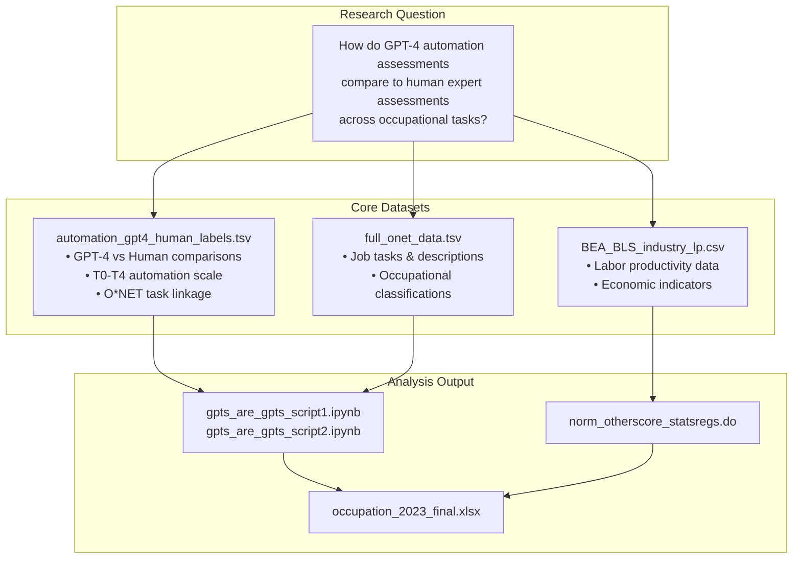
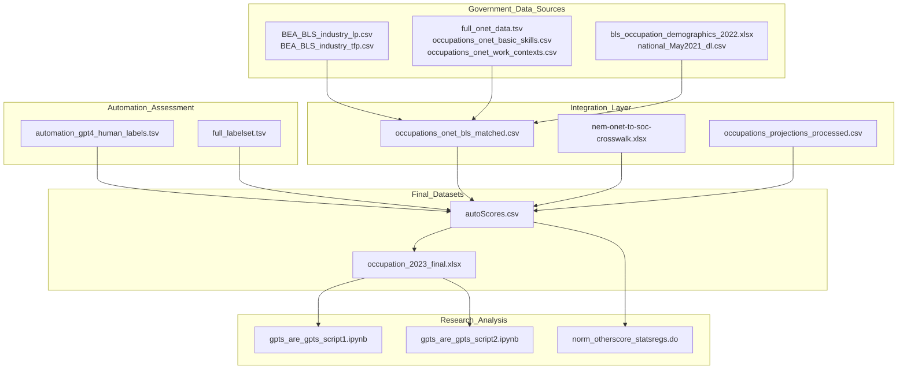
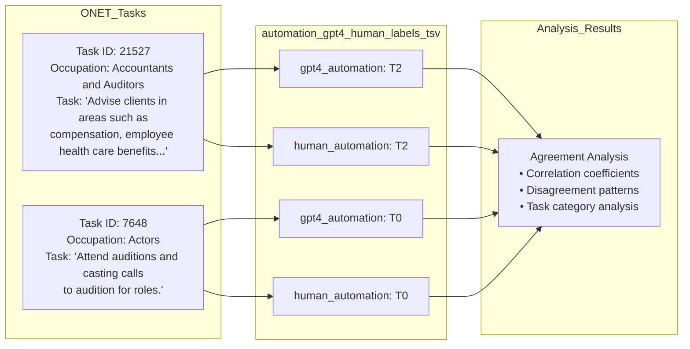
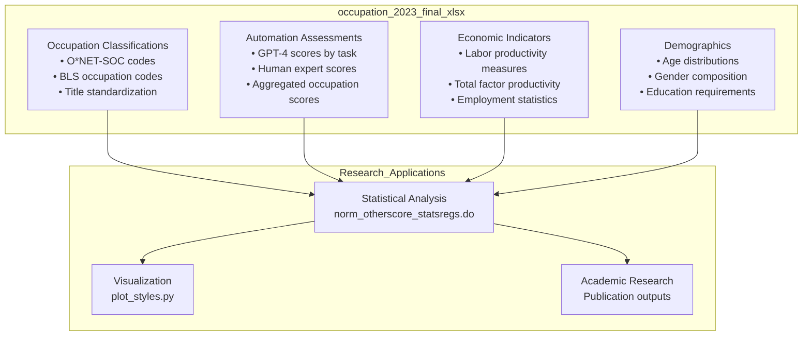

<!-- source: DeepWiki mcp.deepwiki.com · repo openai/GPTs-are-GPTs · page 1 Overview · fetched 2026-10-26 -->

# Overview

Relevant source files

The following files were used as context for generating this wiki page:

- [README.md](README.md)
- [data/automation_gpt4_human_labels.tsv](data/automation_gpt4_human_labels.tsv)
- [data/occupation_2023_final.xlsx](data/occupation_2023_final.xlsx)

This document provides a comprehensive overview of the GPTs-are-GPTs repository, a research platform designed to analyze the economic impact of AI and automation on occupations through systematic comparison of human expert assessments with GPT-4's evaluations of job task automation potential.

The system integrates authoritative government economic data with AI-generated automation assessments to create a comprehensive analytical framework for studying labor market disruption. For detailed research methodology, see [Research Methodology](#2). For specific data sources and formats, see [Data Sources](#3). For analysis code and tools, see [Analysis & Research Code](#4).

## Research Platform Purpose

The GPTs-are-GPTs platform serves as a comprehensive research infrastructure for answering the core question: **How do large language models like GPT-4 assess automation potential of job tasks compared to human experts?** 

The system processes thousands of occupational tasks from the O*NET database, applies both human expert and GPT-4 automation assessments using a standardized T0-T4 scale, and integrates this with economic productivity data to analyze automation's impact on the labor market.

Sources: [data/automation_gpt4_human_labels.tsv:1-400](), [data/full_onet_data.tsv](), [README.md:1]()

## System Architecture Overview

The platform follows a data integration pipeline that processes multiple government data sources, applies automation assessments, and feeds into statistical analysis tools for academic research.

### Core Data Integration Pipeline

Sources: [data/automation_gpt4_human_labels.tsv:1-10](), [data/occupations_onet_bls_matched.csv](), [data/autoScores.csv](), [data/occupation_2023_final.xlsx]()

## Automation Assessment Framework

The system employs a standardized T0-T4 automation scoring scale applied to individual job tasks extracted from the O*NET occupational database.

### T0-T4 Automation Scale

| Score | Automation Level | Description |
|-------|------------------|-------------|
| T0    | No Automation    | Tasks requiring human creativity, complex social interaction, or physical dexterity |
| T1    | Low Automation   | Tasks with some routine elements but requiring human judgment |
| T2    | Medium Automation| Tasks that are partially automatable with current technology |
| T3    | High Automation  | Tasks that are largely automatable but may require human oversight |
| T4    | Full Automation  | Tasks that can be completely automated with existing technology |

### Assessment Comparison Structure

Sources: [data/automation_gpt4_human_labels.tsv:2-50]()

## Key Research Components

### Primary Analysis Notebooks

The research analysis is conducted through two main Jupyter notebooks that process the automation assessment data:

- `gpts_are_gpts_script1.ipynb`: Primary comparative analysis between GPT-4 and human assessments
- `gpts_are_gpts_script2.ipynb`: Secondary analysis and validation studies

### Statistical Modeling

The `norm_otherscore_statsregs.do` Stata script performs regression analysis examining relationships between:

- **Dependent Variables**: GPT-4 exposure ratings, Human exposure ratings
- **Independent Variables**: Webb measures, SML scores, Routine task measures, AI impact scores

### Final Integrated Dataset

The `occupation_2023_final.xlsx` file represents the culmination of the data integration pipeline, containing:
- Matched occupational data across classification systems
- Automation scores from both sources
- Economic and productivity measures
- Demographics and employment projections

Sources: [data/occupation_2023_final.xlsx](), [analysis/norm_otherscore_statsregs.do](), [analysis/gpts_are_gpts_script1.ipynb]()

This research platform enables systematic analysis of how artificial intelligence, specifically large language models, assess automation potential compared to human domain experts, providing crucial insights into the future of work and economic disruption from AI technologies.

---

