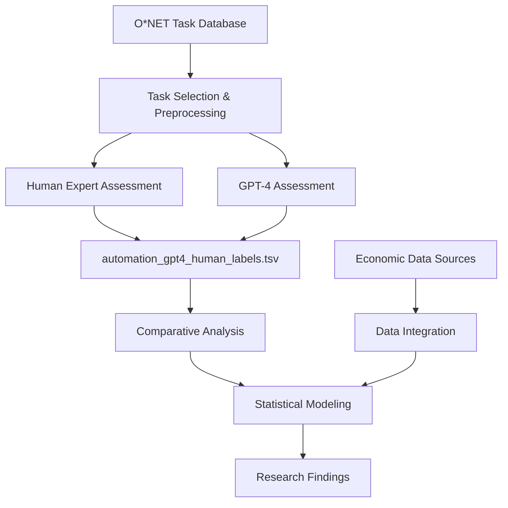
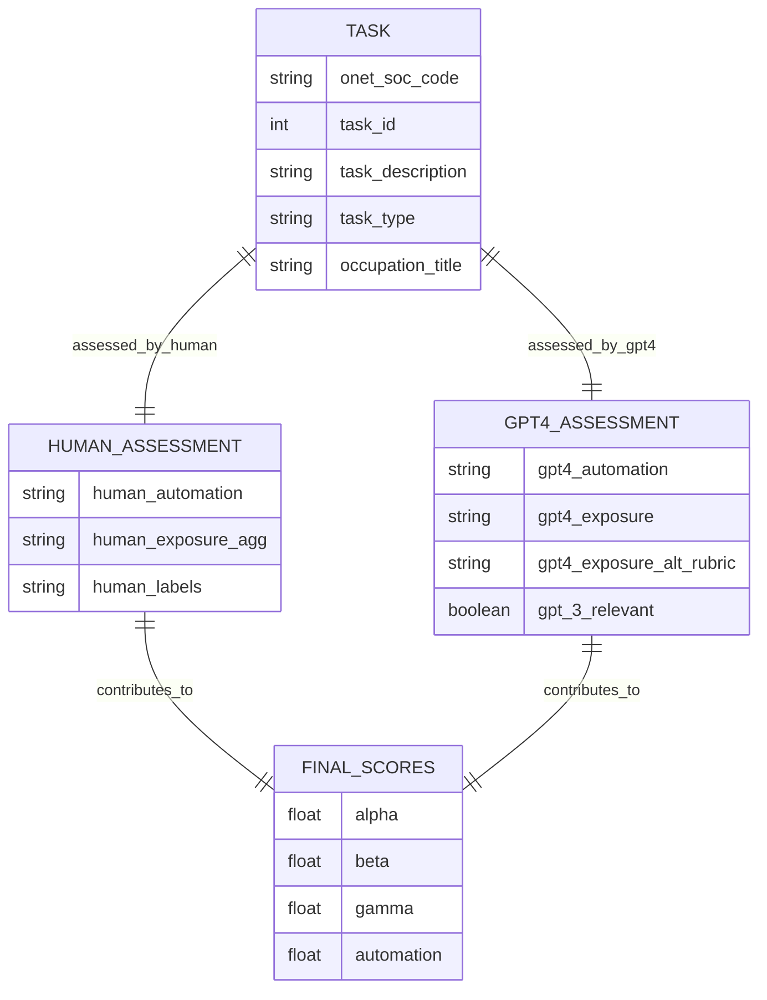
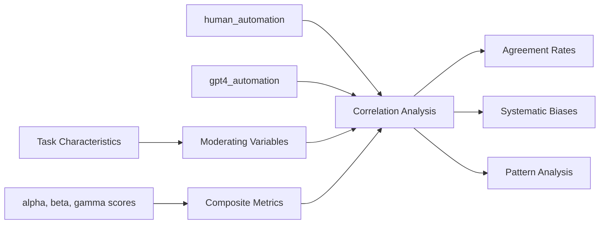
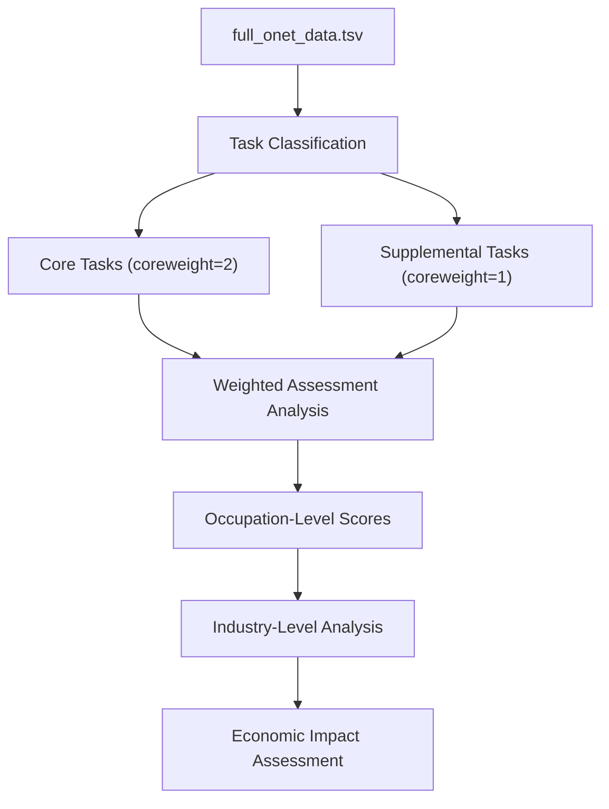

<!-- source: DeepWiki mcp.deepwiki.com · repo openai/GPTs-are-GPTs · page 2 Research Methodology · fetched 2026-10-26 -->

# Research Methodology

Relevant source files

The following files were used as context for generating this wiki page:

- [data/automation_gpt4_human_labels.tsv](data/automation_gpt4_human_labels.tsv)
- [data/full_labelset.tsv](data/full_labelset.tsv)
- [data/full_onet_data.tsv](data/full_onet_data.tsv)

This document explains the core research approach used in the GPTs-are-GPTs project to systematically compare human expert assessments with GPT-4 assessments of automation potential across occupational tasks. The methodology combines structured task evaluation, comparative analysis, and economic data integration to understand how AI systems assess automation risk relative to human judgment.

For information about the automation scoring framework details, see [Automation Assessment Framework](#2.1). For data source integration procedures, see [Data Integration Approach](#2.2).

## Core Research Approach

The research methodology centers on a systematic comparison between human expert evaluations and GPT-4 evaluations of task-level automation potential across thousands of occupational tasks from the O*NET database. The approach uses a standardized assessment framework to ensure comparable ratings between human and AI assessors.

### Assessment Workflow

The methodology involves parallel assessment tracks where both human experts and GPT-4 evaluate the same occupational tasks using identical criteria. Each task receives automation scores on the T0-T4 scale and exposure ratings on the E0-E2 scale, enabling direct statistical comparison of assessment patterns.

Sources: [data/automation_gpt4_human_labels.tsv:1-50](), [data/full_labelset.tsv:1-50]()

## Automation Assessment Protocol

The research uses a structured protocol where both human experts and GPT-4 assess occupational tasks using standardized rubrics. Each assessment generates multiple measurement dimensions to capture different aspects of automation potential.

### Assessment Data Structure

The assessment protocol ensures that each task in `automation_gpt4_human_labels.tsv` receives parallel evaluation from both human experts and GPT-4, with ratings recorded in the `human_automation` and `gpt4_automation` columns respectively.

Sources: [data/automation_gpt4_human_labels.tsv:1-10](), [data/full_labelset.tsv:1-20]()

## Comparative Analysis Framework

The methodology employs a systematic approach to compare human and AI assessments across multiple dimensions. The comparison framework examines both individual task-level differences and aggregate patterns across occupations and industries.

### Rating Scale Mapping

| Automation Level | Code | Description |
|------------------|------|-------------|
| No Automation | T0 | Tasks requiring human judgment, creativity, or physical presence |
| Minimal Automation | T1 | Tasks with some routine elements but requiring human oversight |
| Moderate Automation | T2 | Tasks with significant automatable components |
| High Automation | T3 | Tasks largely automatable with current technology |
| Full Automation | T4 | Tasks completely automatable |

| Exposure Level | Code | Description |
|----------------|------|-------------|
| No Exposure | E0 | Tasks unaffected by AI/automation |
| Some Exposure | E1 | Tasks partially affected by AI/automation |
| High Exposure | E2 | Tasks significantly affected by AI/automation |

The comparative analysis uses these standardized scales to measure agreement rates, systematic biases, and patterns of divergence between human expert and GPT-4 assessments.

Sources: [data/automation_gpt4_human_labels.tsv:1-100](), [data/full_labelset.tsv:30-50]()

## Statistical Comparison Methodology

The research methodology incorporates multiple statistical approaches to analyze the relationship between human and AI assessments. The analysis framework examines correlation patterns, disagreement rates, and systematic biases in automation assessments.

### Assessment Correlation Analysis

The statistical methodology measures multiple dimensions of human-AI agreement:
- Direct correlation between `human_automation` and `gpt4_automation` ratings
- Analysis of the `alpha`, `beta`, and `gamma` composite scores in the final dataset
- Examination of systematic patterns where human and AI assessments diverge

Sources: [data/full_labelset.tsv:40-60](), [data/automation_gpt4_human_labels.tsv:20-40]()

## Task-Level Analysis Framework

The methodology examines automation assessments at the individual task level to understand specific patterns of human-AI agreement and disagreement. This granular analysis reveals which types of occupational tasks show the highest and lowest levels of assessment concordance.

### Task Classification Integration

The research methodology integrates task classification data from the O*NET database to understand how task characteristics influence assessment patterns. Tasks are categorized as "Core" or "Supplemental" based on their centrality to the occupation, with weighted analysis reflecting task importance.

The methodology uses the `coreweight` and `equalweight` columns from the O*NET data to ensure that more central occupational tasks receive appropriate emphasis in the comparative analysis.

Sources: [data/full_onet_data.tsv:1-50](), [data/automation_gpt4_human_labels.tsv:1-20]()

## Multi-Dimensional Assessment Integration

The research methodology incorporates multiple assessment dimensions beyond simple automation ratings. The framework evaluates exposure levels, task relevance, and alternative rubric assessments to provide a comprehensive view of human-AI assessment patterns.

### Assessment Dimension Analysis

The methodology examines relationships between different assessment dimensions:
- Primary automation ratings (`human_automation` vs `gpt4_automation`)
- Exposure assessments (`human_exposure_agg` vs `gpt4_exposure`)
- Alternative rubric evaluations (`gpt4_exposure_alt_rubric`)
- Task relevance indicators (`gpt_3_relevant`)

This multi-dimensional approach enables the research to identify whether human-AI differences are consistent across assessment types or vary by evaluation criterion.

Sources: [data/full_labelset.tsv:10-30](), [data/automation_gpt4_human_labels.tsv:30-50]()

---

