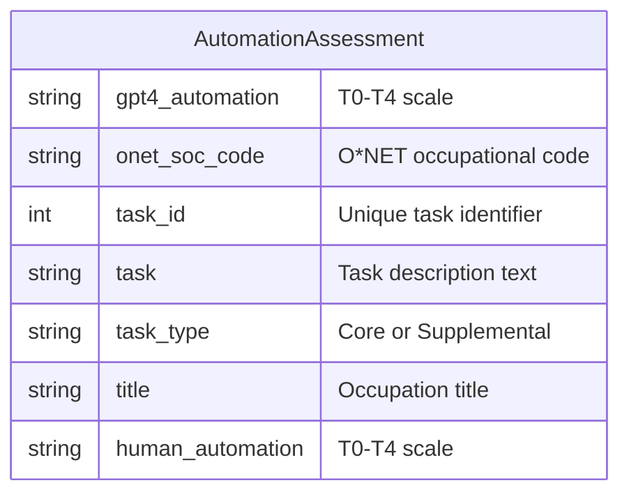
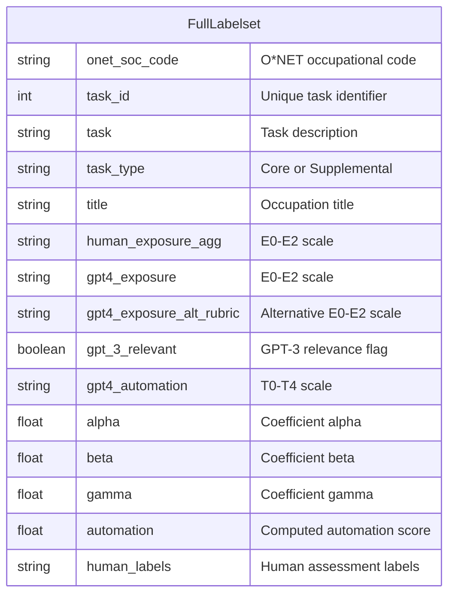
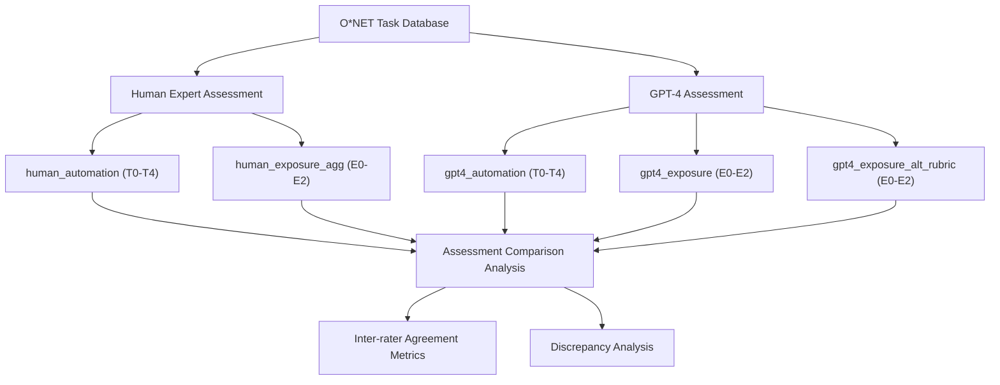
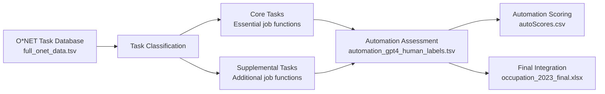
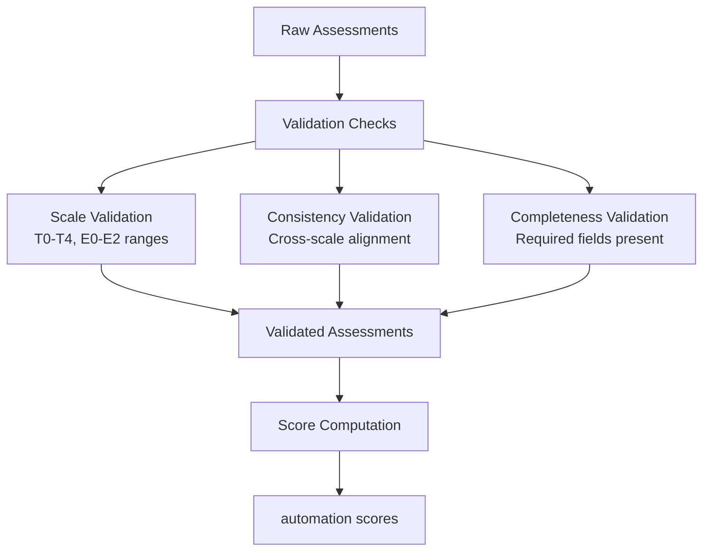
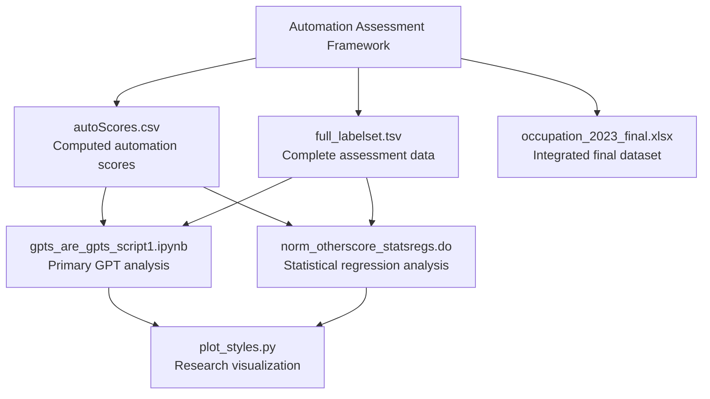

<!-- source: DeepWiki mcp.deepwiki.com · repo openai/GPTs-are-GPTs · page 2.1 Automation Assessment Framework · fetched 2026-10-26 -->

# Automation Assessment Framework

Relevant source files

The following files were used as context for generating this wiki page:

- [data/autoScores.csv](data/autoScores.csv)
- [data/automation_gpt4_human_labels.tsv](data/automation_gpt4_human_labels.tsv)
- [data/full_labelset.tsv](data/full_labelset.tsv)

## Purpose and Scope

The Automation Assessment Framework is the core methodology used to evaluate the automation potential of occupational tasks, comparing assessments made by human experts against those generated by GPT-4. This framework provides standardized scales, data structures, and comparison methodologies for measuring how susceptible different job tasks are to automation by AI systems.

For information about the broader data integration approach that feeds into this framework, see [Data Integration Approach](#2.2). For details about the statistical analysis of these assessments, see [Statistical Analysis](#4.2).

## Assessment Scales and Methodology

### Automation Scale (T0-T4)

The framework employs a 5-point automation scale ranging from T0 to T4, where higher values indicate greater automation potential:

| Scale | Description |
|-------|-------------|
| T0    | No automation potential |
| T1    | Low automation potential |
| T2    | Moderate automation potential |
| T3    | High automation potential |
| T4    | Very high automation potential |

### Exposure Scale (E0-E2)

A complementary 3-point exposure scale measures how much a task involves exposure to AI capabilities:

| Scale | Description |
|-------|-------------|
| E0    | No exposure to AI capabilities |
| E1    | Some exposure to AI capabilities |
| E2    | High exposure to AI capabilities |

Sources: [data/automation_gpt4_human_labels.tsv:1-400](), [data/full_labelset.tsv:1-400]()

## Data Structure and Assessment Records

### Primary Assessment Dataset

The core assessment data is stored in `automation_gpt4_human_labels.tsv`, containing comparative evaluations:

### Comprehensive Labelset

The `full_labelset.tsv` extends this with additional metrics and computed scores:

Sources: [data/automation_gpt4_human_labels.tsv:1-10](), [data/full_labelset.tsv:1-10]()

## Assessment Comparison Framework

### Human vs GPT-4 Assessment Pipeline

The framework enables systematic comparison between human expert assessments and GPT-4 evaluations:

### Task Classification Integration

The framework integrates with O*NET task classifications to provide comprehensive occupational coverage:

Sources: [data/automation_gpt4_human_labels.tsv:1-50](), [data/full_labelset.tsv:1-50]()

## Score Computation Methodology

### Coefficient-Based Scoring

The framework computes automation scores using weighted coefficients:

| Coefficient | Purpose | Value Range |
|-------------|---------|-------------|
| `alpha` | Base automation weight | 0.0 - 1.0 |
| `beta` | Exposure adjustment weight | 0.0 - 1.0 |
| `gamma` | Secondary exposure weight | 0.0 - 1.0 |

The final `automation` score represents a composite measure derived from these coefficients and the assessment scales.

### Assessment Validation Framework

Sources: [data/full_labelset.tsv:40-50]()

## Integration with Research Pipeline

### Data Flow to Analysis Components

The Automation Assessment Framework feeds into multiple downstream analysis components:

### Quality Assurance and Validation

The framework implements multiple validation layers to ensure assessment quality:

- **Scale Consistency**: Ensures all assessments fall within defined T0-T4 and E0-E2 ranges
- **Cross-Assessor Validation**: Compares human and GPT-4 assessments for outlier detection  
- **Task Type Validation**: Verifies appropriate classification as Core or Supplemental tasks
- **Occupational Code Validation**: Ensures proper O*NET-SOC code formatting and validity

Sources: [data/automation_gpt4_human_labels.tsv:1-400](), [data/full_labelset.tsv:1-400]()

---

