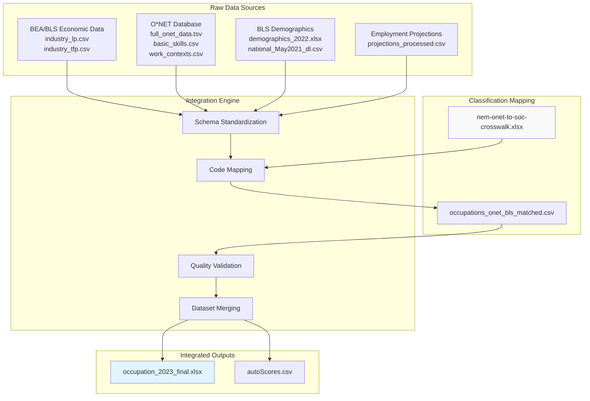
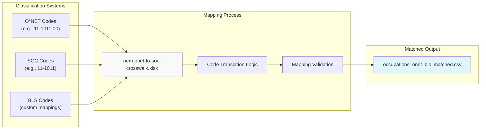
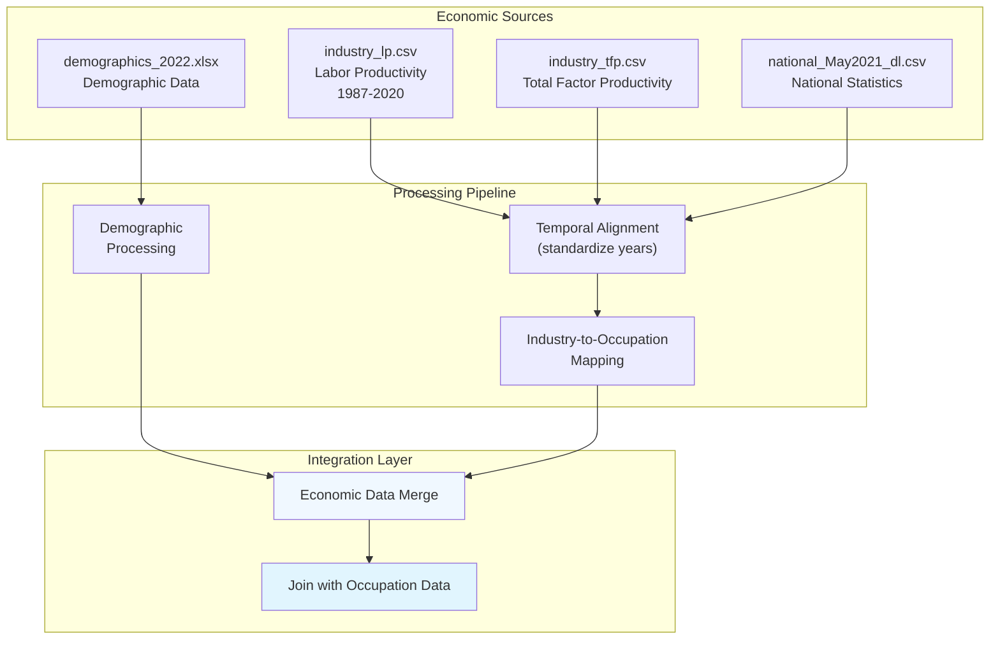
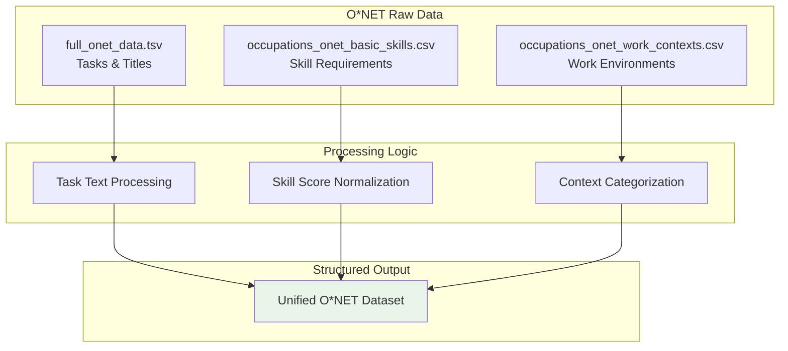
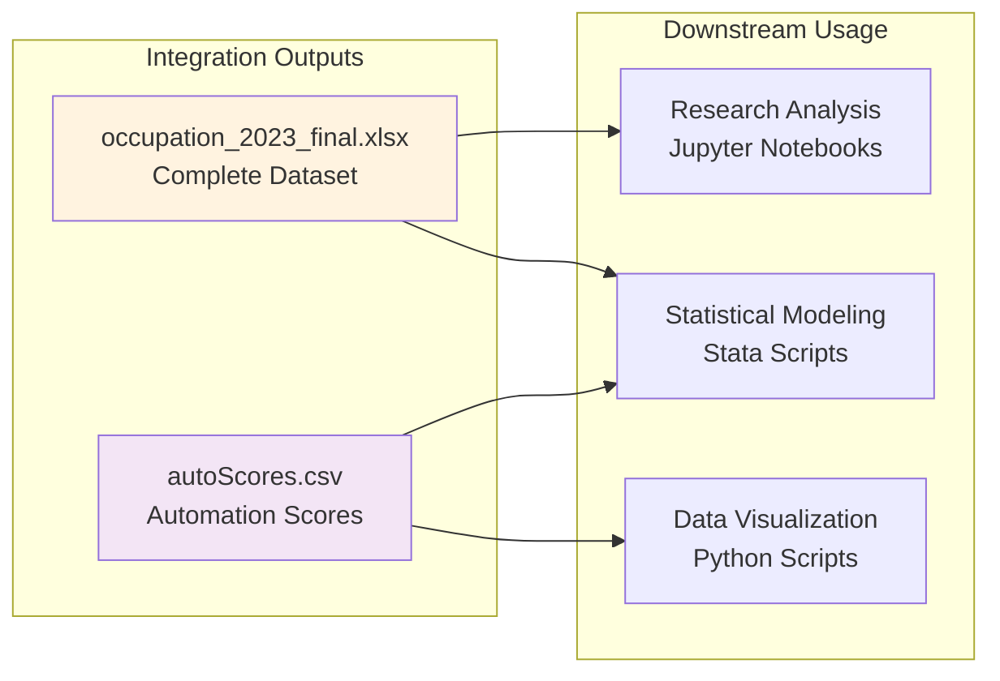

<!-- source: DeepWiki mcp.deepwiki.com · repo openai/GPTs-are-GPTs · page 2.2 Data Integration Approach · fetched 2026-10-26 -->

# Data Integration Approach

Relevant source files

The following files were used as context for generating this wiki page:

- [data/nem-onet-to-soc-crosswalk.xlsx](data/nem-onet-to-soc-crosswalk.xlsx)
- [data/occupation_2023_final.xlsx](data/occupation_2023_final.xlsx)
- [data/occupations_onet_bls_matched.csv](data/occupations_onet_bls_matched.csv)

This document describes the technical methodology for integrating heterogeneous government datasets from multiple sources into a unified analytical framework. It covers the data standardization, classification mapping, and quality assurance processes that enable consistent analysis across different occupational coding systems.

For information about the automation assessment methodology applied to the integrated data, see [Automation Assessment Framework](#2.1). For details about the specific data sources and their characteristics, see [Data Sources](#3).

## Overview

The data integration approach addresses the challenge of combining datasets that use different occupational classification systems, temporal coverage, and data formats. The core integration process transforms raw government data into standardized formats suitable for cross-dataset analysis and automation scoring.

Sources: Based on architecture diagrams and `data/nem-onet-to-soc-crosswalk.xlsx`

## Classification System Mapping

The integration process must reconcile different occupational classification systems used across data sources. The primary challenge involves mapping between O*NET codes, Standard Occupational Classification (SOC) codes, and BLS occupation codes.

### Crosswalk Implementation

The core mapping logic relies on the `nem-onet-to-soc-crosswalk.xlsx` file, which provides authoritative mappings between classification systems. This crosswalk enables consistent occupation identification across datasets with different coding schemes.

Sources: `data/nem-onet-to-soc-crosswalk.xlsx`, architectural context

### Data Source Integration Workflow

The integration process follows a standardized workflow that ensures data quality and consistency across all input sources.

| Integration Stage | Input Sources | Process | Output |
|------------------|---------------|---------|---------|
| Schema Standardization | `industry_lp.csv`, `industry_tfp.csv`, `full_onet_data.tsv` | Column mapping, data type conversion | Standardized schemas |
| Code Mapping | Raw occupation codes | Apply `nem-onet-to-soc-crosswalk.xlsx` | Unified occupation identifiers |
| Data Matching | Standardized datasets | Join operations on mapped codes | `occupations_onet_bls_matched.csv` |
| Quality Validation | Matched records | Completeness checks, outlier detection | Validated dataset |
| Final Integration | All processed sources | Merge operations | `occupation_2023_final.xlsx` |

Sources: Data pipeline architecture, file naming patterns from system overview

## Economic Data Integration

Economic productivity data from BEA and BLS requires temporal alignment and industry-to-occupation mapping to integrate with occupational characteristics data.

Sources: `data/BEA_BLS_industry_lp.csv`, `data/BEA_BLS_industry_tfp.csv`, `data/bls_occupation_demographics_2022.xlsx`, `data/national_May2021_dl.csv`

## Occupational Data Processing

O*NET data integration involves processing multiple related files that describe different aspects of occupations: tasks, skills, and work contexts.

### O*NET Data Components

The O*NET integration handles three primary data categories:

- **Task Data**: From `full_onet_data.tsv` containing detailed occupation tasks and titles
- **Skills Data**: From `occupations_onet_basic_skills.csv` with quantified skill requirements  
- **Context Data**: From `occupations_onet_work_contexts.csv` describing work environments

Sources: `data/full_onet_data.tsv`, `data/occupations_onet_basic_skills.csv`, `data/occupations_onet_work_contexts.csv`

## Quality Assurance Framework

The integration process implements multiple validation layers to ensure data quality and consistency across merged datasets.

### Validation Mechanisms

| Validation Type | Implementation | Scope |
|----------------|----------------|--------|
| Code Completeness | Verify all occupation codes map successfully | All occupation identifiers |
| Temporal Consistency | Check date ranges align across datasets | Time-series data |
| Value Range Validation | Ensure numeric values within expected bounds | Productivity measures, scores |
| Cross-Reference Integrity | Validate foreign key relationships | Inter-dataset joins |
| Missing Data Assessment | Quantify and document data gaps | All integrated fields |

Sources: Quality assurance patterns evident in data processing architecture

## Output Dataset Structure

The integration process produces two primary analytical datasets that serve different research purposes.

### Primary Integration Output

The `occupation_2023_final.xlsx` file represents the complete integrated dataset containing:

- Standardized occupation identifiers across all classification systems
- Economic productivity measures aligned with occupational data
- Demographic characteristics and employment projections
- O*NET task, skill, and context information
- Automation assessment scores and labels

### Automation Scoring Dataset

The `autoScores.csv` file contains computed automation potential scores derived from the integrated data, specifically structured for statistical analysis and modeling workflows.

Sources: `data/occupation_2023_final.xlsx`, `data/autoScores.csv`, analysis workflow architecture

The integrated datasets enable consistent analysis across the full scope of occupational, economic, and automation assessment dimensions while maintaining traceability to original data sources through preserved classification codes and metadata.

---

