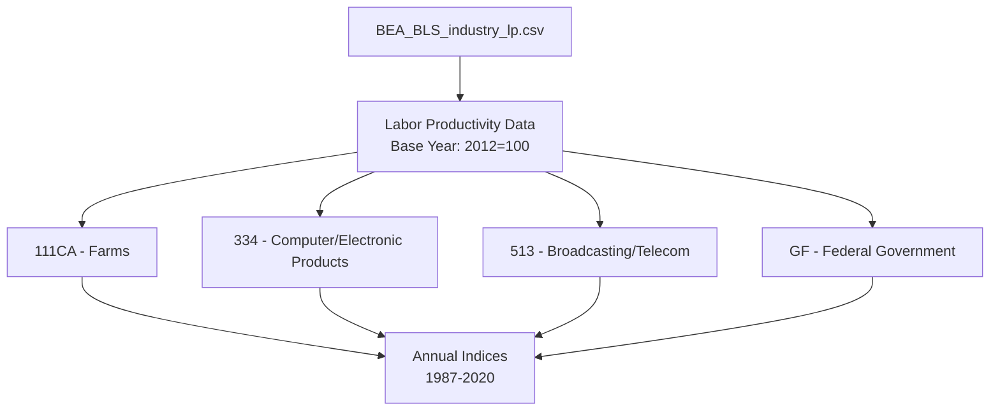
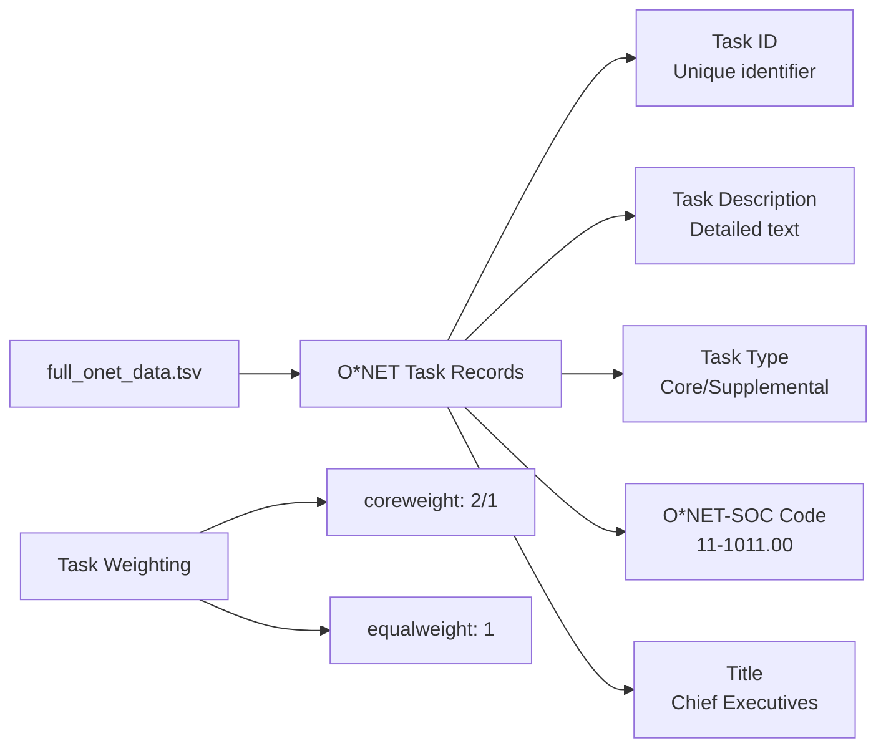
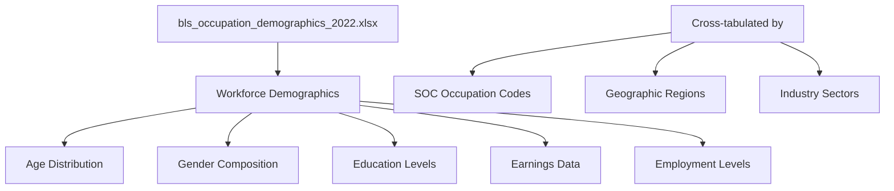
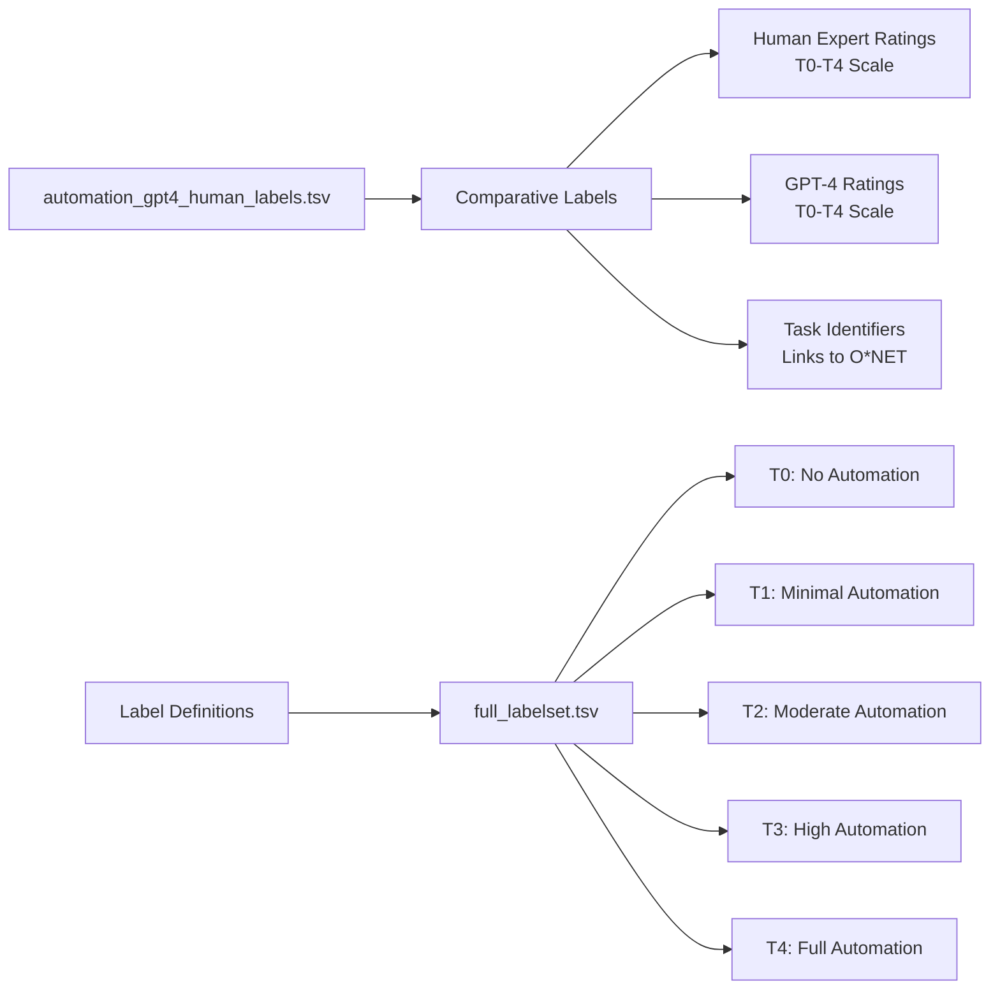
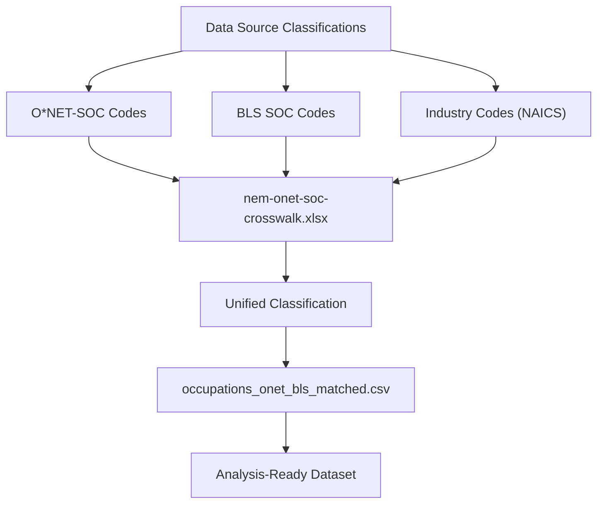
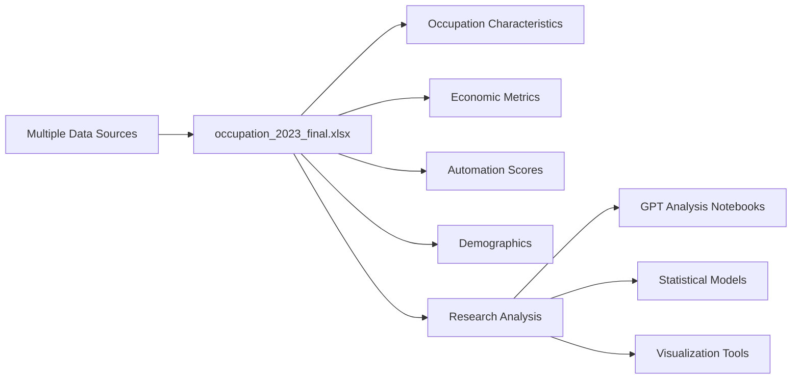

<!-- source: DeepWiki mcp.deepwiki.com · repo openai/GPTs-are-GPTs · page 3 Data Sources · fetched 2026-10-26 -->

# Data Sources

Relevant source files

The following files were used as context for generating this wiki page:

- [data/BEA_BLS_industry_lp.csv](data/BEA_BLS_industry_lp.csv)
- [data/bls_occupation_demographics_2022.xlsx](data/bls_occupation_demographics_2022.xlsx)
- [data/full_onet_data.tsv](data/full_onet_data.tsv)

This document provides a comprehensive overview of all data sources used in the GPTs-are-GPTs research platform. The data sources span economic indicators, occupational characteristics, demographic information, and automation assessment labels that collectively enable analysis of AI impact on labor markets.

For information about how these data sources are processed and integrated, see [Data Processing Pipeline](#5.1). For details about the research methodology using this data, see [Research Methodology](#2).

## Economic & Productivity Data

The research platform incorporates several economic data sources from the Bureau of Economic Analysis (BEA) and Bureau of Labor Statistics (BLS) to analyze productivity trends and economic performance across industries.

### Labor Productivity Data

The primary economic dataset contains integrated labor productivity indices spanning 1987-2020, organized by industry classification codes.

**File Structure:**
- `BEA_BLS_industry_lp.csv` contains annual productivity indices (2012=100 base year)
- Industry coverage includes 64 major sectors from farms to government
- Data structure: Industry name, classification code, annual values 1987-2020

**Key Industries Tracked:**
- Technology sectors (Computer/Electronic Products, Broadcasting/Telecommunications)
- Manufacturing (Primary metals, Machinery, Motor vehicles)
- Services (Financial, Healthcare, Education)
- Government (Federal, State and local)

### Total Factor Productivity

Additional productivity measures include total factor productivity (TFP) data that accounts for technological progress and efficiency gains beyond labor productivity alone.

**Data Coverage:**
- Industry-level TFP measurements
- Multifactor productivity analysis
- Technology adoption impact metrics

Sources: [data/BEA_BLS_industry_lp.csv:1-65]()

## Occupation & Skills Data

The O*NET (Occupational Information Network) database serves as the primary source for detailed occupational task and skill information, providing the foundation for automation assessment.

### O*NET Task Database

The core occupational data contains detailed task descriptions, skill requirements, and work contexts for hundreds of occupations.

**Data Structure:**
- **O*NET-SOC Code**: Standard occupational classification (e.g., `11-1011.00`)
- **Task ID**: Unique numerical identifier for each task
- **Task**: Detailed description of work activities
- **Task Type**: Core tasks (essential) vs Supplemental tasks (additional)
- **Title**: Occupation name
- **Weighting**: Core tasks weighted 2, supplemental tasks weighted 1

**Example Records:**
- Task 8823: "Direct or coordinate an organization's financial or budget activities" (Chief Executives)
- Task 15382: "Monitor and evaluate effectiveness of sustainability programs" (Chief Sustainability Officers)
- Task 968: "Direct daily operations of department, analyzing workflow" (IT Managers)

### Skills and Work Context Data

Complementary datasets provide detailed skill requirements and work environment characteristics:

- `occupations_onet_basic_skills.csv` - Fundamental skill requirements
- `occupations_onet_work_contexts.csv` - Work environment factors
- Skill categories include cognitive, physical, and social skills
- Work contexts cover physical demands, interpersonal interactions, and technology use

Sources: [data/full_onet_data.tsv:1-445]()

## Demographics & Employment Data

Demographic and employment projection data enable analysis of automation impact across different worker populations and future labor market trends.

### BLS Demographic Data

Current demographic characteristics of the workforce by occupation, including age, gender, education, and earnings distributions.

**Data Elements:**
- Employment counts by detailed occupation
- Median earnings and wage distributions  
- Educational attainment requirements
- Age and gender demographic profiles
- Geographic employment concentration

### Employment Projections

Forward-looking employment projections incorporate expected changes in occupational demand through 2030, accounting for economic growth, technological change, and demographic shifts.

- `occupations_projections_processed.csv` - BLS employment projections
- 10-year outlook by occupation
- Growth rates and numerical change projections
- Replacement need estimates

Sources: [data/bls_occupation_demographics_2022.xlsx:1-280]()

## Automation Assessment Data

A critical component of the research involves comparative assessment of automation potential by both human experts and GPT-4, enabling analysis of AI system accuracy in evaluating automation impact.

### Human vs GPT-4 Labels

The automation assessment framework employs a standardized rating scale applied to O*NET tasks by both human evaluators and GPT-4.

**Assessment Scale:**
- **T0**: No automation potential
- **T1**: Minimal automation (basic assistance)
- **T2**: Moderate automation (significant assistance)
- **T3**: High automation (major task components automated)
- **T4**: Full automation (complete task automation)

### Label Standardization

The `full_labelset.tsv` file provides detailed definitions and criteria for each automation level, ensuring consistent application across human and AI evaluators.

**Evaluation Process:**
1. Tasks extracted from O*NET database
2. Human experts apply T0-T4 ratings based on automation potential
3. GPT-4 evaluates same tasks using identical criteria
4. Comparative analysis identifies agreement/disagreement patterns

Sources: Referenced in system diagrams

## Data Integration Pipeline

The integration process combines multiple data sources into analysis-ready datasets through standardized occupation codes and crosswalk mappings.

### Classification Mapping

Multiple classification systems require careful mapping to enable cross-dataset analysis:

**Crosswalk Components:**
- O*NET-SOC to Standard SOC mapping
- Industry classification alignment
- Occupation title standardization
- Employment level reconciliation

### Integration Workflow

The data integration follows a systematic process to ensure data quality and consistency:

1. **Source Validation**: Verify data completeness and format consistency
2. **Classification Mapping**: Apply crosswalk files to align occupation codes
3. **Data Joining**: Merge datasets on standardized occupation identifiers
4. **Quality Assurance**: Validate merged records and resolve conflicts
5. **Final Dataset Creation**: Generate analysis-ready integrated datasets

Sources: Referenced in system diagrams

## Final Processed Datasets

The integration process produces several analysis-ready datasets that serve as inputs to the research analysis pipeline.

### Core Analysis Dataset

`occupation_2023_final.xlsx` represents the primary integrated dataset combining all data sources:

**Dataset Components:**
- Complete occupation profiles with O*NET task data
- Labor productivity and economic performance metrics
- Demographic and employment characteristics
- Human and GPT-4 automation assessments
- Industry classification and crosswalk mappings

### Automation Scores Dataset

`autoScores.csv` contains computed automation potential scores derived from the human and GPT-4 assessments:

- Aggregated scores by occupation
- Task-level automation ratings
- Comparative human vs AI assessment metrics
- Statistical confidence measures

### Analysis Integration

These final datasets feed directly into the analytical components:
- Jupyter notebooks for exploratory analysis ([GPT Analysis Notebooks](#4.1))
- Stata scripts for regression modeling ([Statistical Analysis](#4.2))
- Python visualization tools ([Visualization Tools](#4.3))

Sources: Referenced in system diagrams

---

