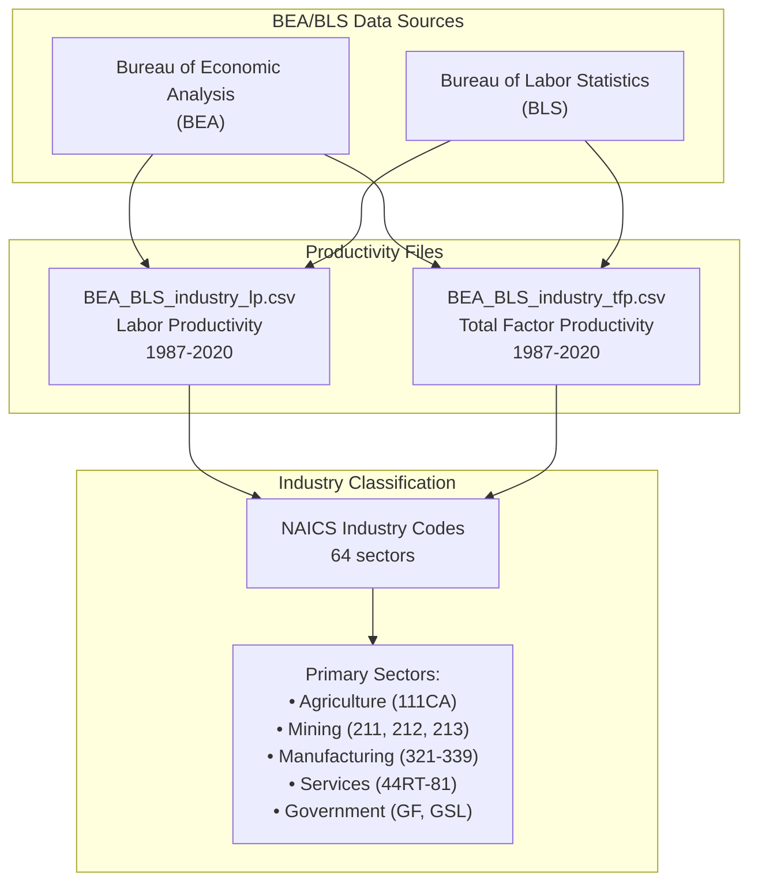
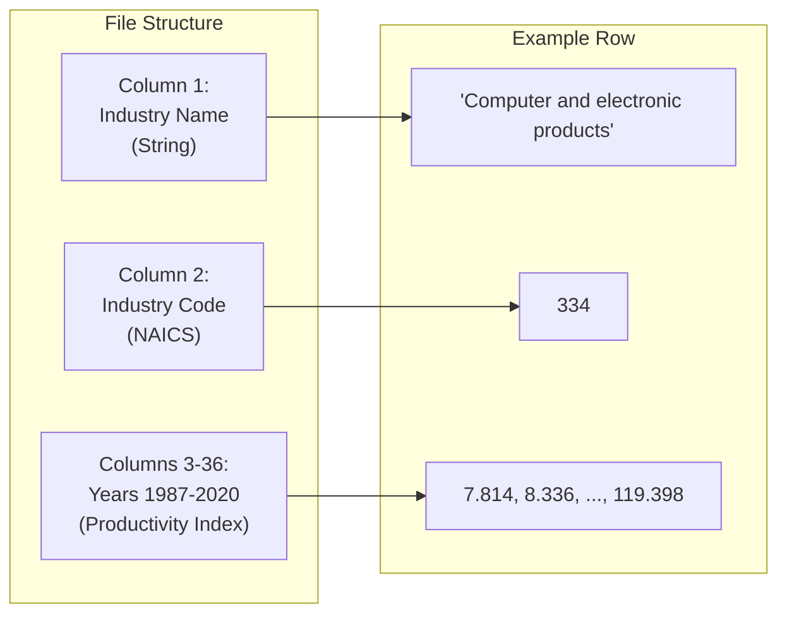
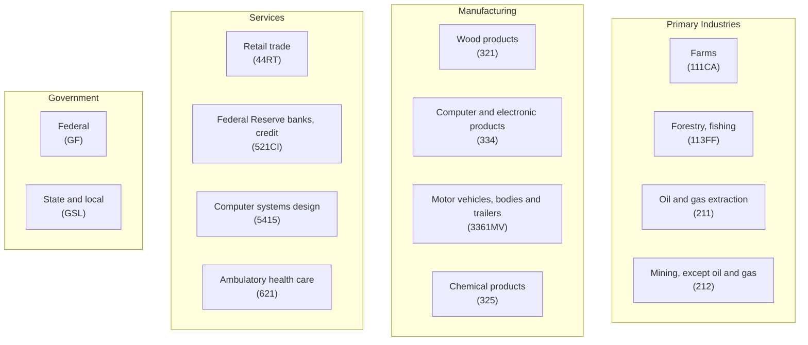
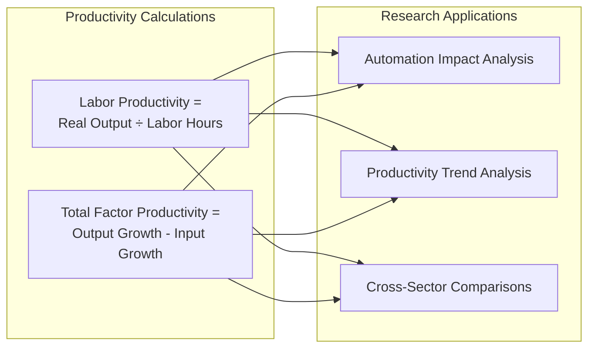
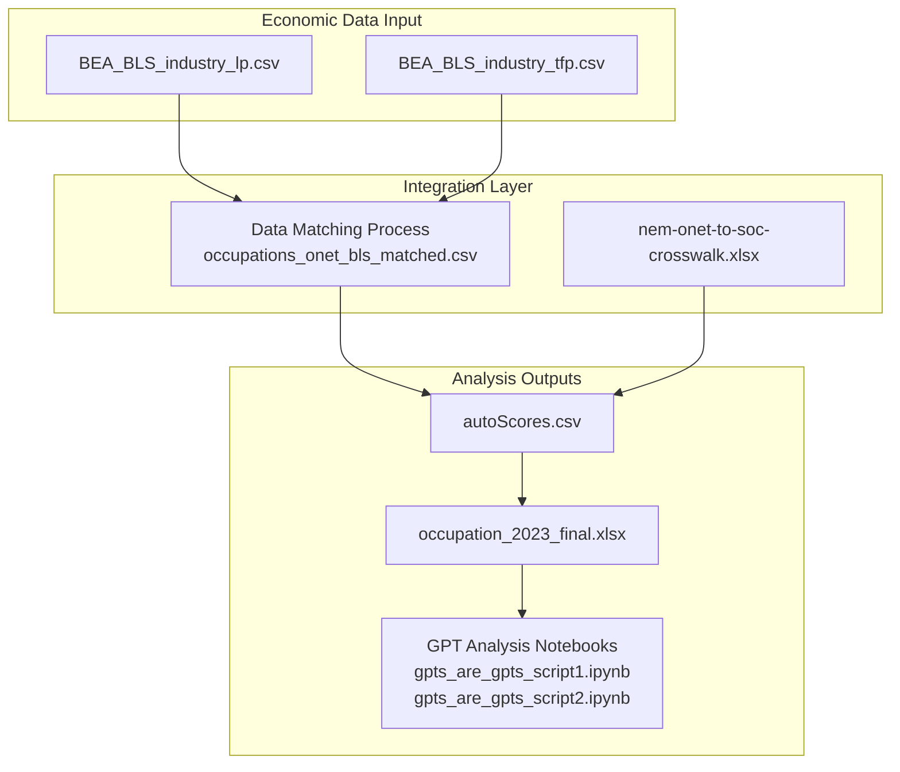

<!-- source: DeepWiki mcp.deepwiki.com · repo openai/GPTs-are-GPTs · page 3.1 Economic & Productivity Data · fetched 2026-10-26 -->

# Economic & Productivity Data

Relevant source files

The following files were used as context for generating this wiki page:

- [data/BEA_BLS_industry_lp.csv](data/BEA_BLS_industry_lp.csv)
- [data/BEA_BLS_industry_tfp.csv](data/BEA_BLS_industry_tfp.csv)
- [data/national_May2021_dl.csv](data/national_May2021_dl.csv)

This document covers the economic and productivity datasets sourced from the Bureau of Economic Analysis (BEA) and Bureau of Labor Statistics (BLS) that serve as foundational inputs for analyzing automation's impact on industry productivity. These datasets provide historical time series data on labor productivity and total factor productivity across U.S. industries from 1987-2020.

For information about occupation-specific data and skills requirements, see [Occupation & Skills Data](#3.2). For details about final processed datasets that integrate economic and occupational data, see [Final Processed Datasets](#3.4).

## Dataset Overview

The economic data consists of two primary CSV files containing productivity measures indexed to 2012=100 across 64 industry sectors:

| File | Content | Time Period | Industries |
|------|---------|-------------|------------|
| `BEA_BLS_industry_lp.csv` | Integrated Labor Productivity | 1987-2020 | 64 sectors |
| `BEA_BLS_industry_tfp.csv` | Integrated Total Factor Productivity | 1987-2020 | 64 sectors |

Sources: [data/BEA_BLS_industry_lp.csv:1-64](), [data/BEA_BLS_industry_tfp.csv:1-64]()

## Data Structure and Format

Both productivity files follow an identical structure with industries as rows and years as columns:

### Key Data Characteristics

- **Index Base**: All productivity values indexed to 2012=100
- **Missing Data**: No null values present in the dataset
- **Industry Coverage**: Comprehensive coverage from agriculture to government sectors
- **Time Series**: 34 years of annual data (1987-2020)

Sources: [data/BEA_BLS_industry_lp.csv:1-2](), [data/BEA_BLS_industry_tfp.csv:1-2]()

## Industry Sector Classification

The datasets cover major economic sectors with specific NAICS codes:

Sources: [data/BEA_BLS_industry_lp.csv:2-64](), [data/BEA_BLS_industry_tfp.csv:2-64]()

## Productivity Measure Definitions

### Labor Productivity (`BEA_BLS_industry_lp.csv`)
Measures output per hour worked, calculated as the ratio of real output to labor input (hours worked). This metric indicates how efficiently labor is utilized in production processes across industries.

### Total Factor Productivity (`BEA_BLS_industry_tfp.csv`)
Measures the portion of output not explained by the amount of inputs used in production. TFP represents technological progress and efficiency improvements beyond simple input increases.

Sources: [data/BEA_BLS_industry_lp.csv:1](), [data/BEA_BLS_industry_tfp.csv:1]()

## Integration with Research Pipeline

These productivity datasets serve as economic foundation data that gets integrated with occupational and automation assessment data in the broader research pipeline:

Sources: [data/BEA_BLS_industry_lp.csv](), [data/BEA_BLS_industry_tfp.csv]()

## Notable Productivity Trends

The data reveals significant productivity variations across sectors and time periods:

| Sector | Labor Productivity Growth (1987-2020) | Key Characteristics |
|--------|---------------------------------------|-------------------|
| Computer and electronic products (334) | 7.8 → 119.4 (+1428%) | Highest growth sector |
| Broadcasting and telecommunications (513) | 26.0 → 156.8 (+503%) | Technology-driven gains |
| Oil and gas extraction (211) | 69.5 → 235.0 (+238%) | Resource extraction efficiency |
| Federal government (GF) | 66.4 → 98.6 (+48%) | Modest public sector gains |

These trends provide context for understanding how automation and technological advancement have affected different industries over the analysis period.

Sources: [data/BEA_BLS_industry_lp.csv:14](), [data/BEA_BLS_industry_lp.csv:40](), [data/BEA_BLS_industry_lp.csv:4](), [data/BEA_BLS_industry_lp.csv:63]()

---

