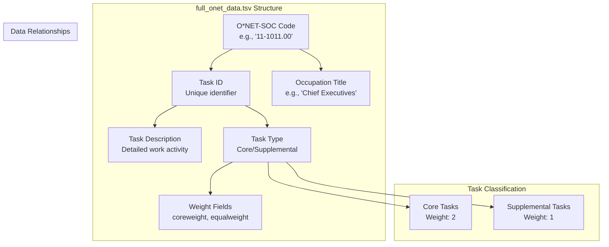
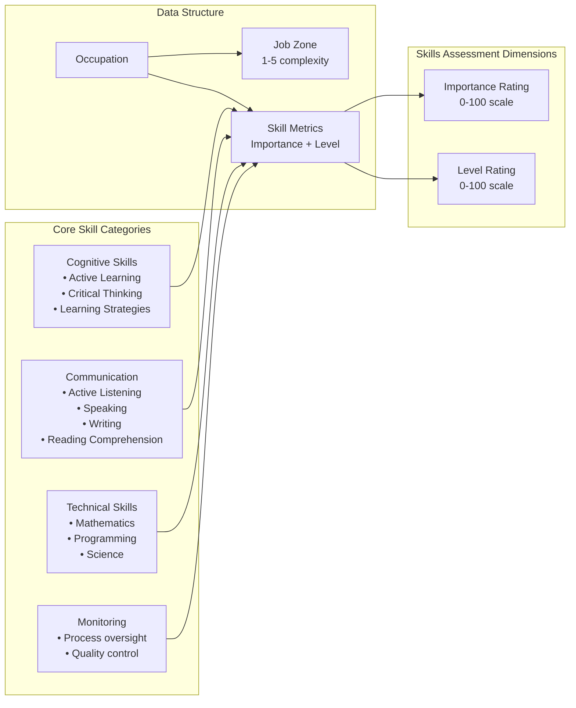
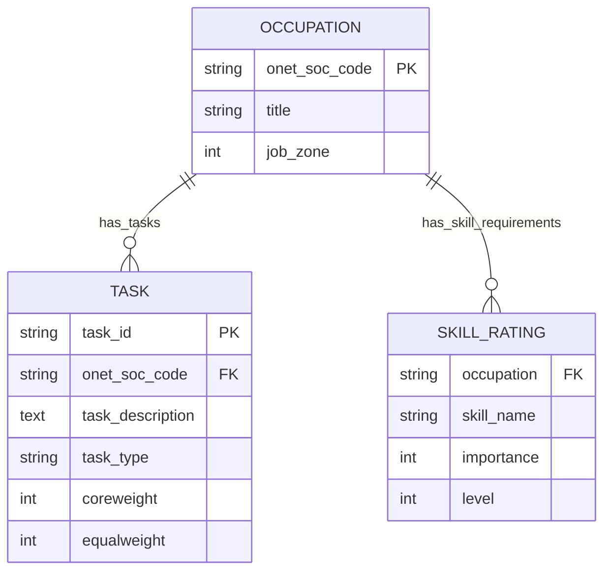
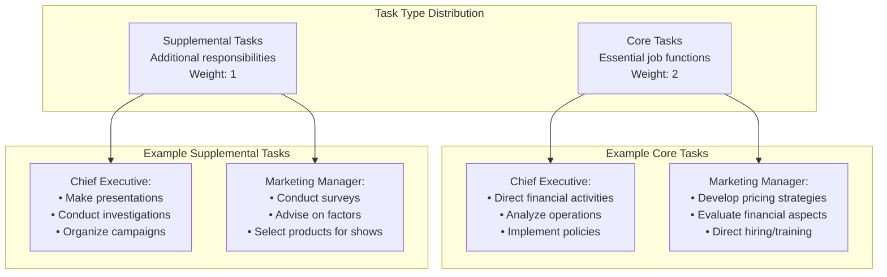

<!-- source: DeepWiki mcp.deepwiki.com · repo openai/GPTs-are-GPTs · page 3.2 Occupation & Skills Data · fetched 2026-10-26 -->

# Occupation & Skills Data

Relevant source files

The following files were used as context for generating this wiki page:

- [data/full_onet_data.tsv](data/full_onet_data.tsv)
- [data/occupations_onet_basic_skills.csv](data/occupations_onet_basic_skills.csv)
- [data/occupations_onet_work_contexts.csv](data/occupations_onet_work_contexts.csv)

This page documents the O*NET occupational data that forms the foundation of the automation assessment research. This includes detailed job task descriptions, skills requirements, and work contexts for thousands of occupations. For information about how this data is processed and integrated with other sources, see [Data Integration Approach](#2.2). For details about the final processed datasets, see [Final Processed Datasets](#3.4).

## O*NET Task Database Structure

The core occupational data is stored in `full_onet_data.tsv`, which contains detailed task descriptions for each occupation in the O*NET database. This dataset serves as the primary input for both human expert assessments and GPT-4 automation evaluations.

Sources: [data/full_onet_data.tsv:1-50]()

The dataset contains over 80,000 individual task records spanning thousands of occupations. Each task is classified as either "Core" (essential to the job) or "Supplemental" (additional responsibilities), with corresponding weight values used in automation scoring calculations.

## Skills Assessment Framework

The skills data is structured in `occupations_onet_basic_skills.csv` and provides standardized importance and proficiency level ratings across key competency areas.

Sources: [data/occupations_onet_basic_skills.csv:1-10]()

### Job Zone Classification

Occupations are classified into five Job Zones representing increasing levels of preparation and complexity:

| Job Zone | Preparation Level | Example Occupations |
|----------|------------------|-------------------|
| 1 | Little/no preparation | Fast Food Workers, Baristas |
| 2 | Some preparation | Cashiers, Security Guards |
| 3 | Medium preparation | Electricians, Firefighters |
| 4 | Considerable preparation | Engineers, Managers |
| 5 | Extensive preparation | Physicians, Lawyers, Scientists |

Sources: [data/occupations_onet_basic_skills.csv:1-700]()

## Occupational Data Schema

The relationship between tasks, occupations, and skills follows a hierarchical structure that enables comprehensive automation assessment.

Sources: [data/full_onet_data.tsv:1-7](), [data/occupations_onet_basic_skills.csv:1-2]()

## Task Distribution Analysis

The task classification system provides the foundation for automation assessment, with different task types receiving different weights in scoring algorithms.

Sources: [data/full_onet_data.tsv:2-50](), [data/full_onet_data.tsv:128-145]()

## Skills Data Integration

The skills framework provides standardized metrics that complement the task-based automation assessment approach.

| Skill Category | Key Metrics | Range | Purpose |
|---------------|-------------|-------|---------|
| `Active_Learning_Importance` | Importance rating | 0-100 | Learning capability requirements |
| `Critical_Thinking_Level` | Proficiency level | 0-100 | Analytical skill demands |
| `Programming_Importance` | Technical requirement | 0-100 or "Not relevant" | Software development needs |
| `Mathematics_Level` | Quantitative proficiency | 0-100 | Numerical skill requirements |

Sources: [data/occupations_onet_basic_skills.csv:1-5]()

The "Not relevant" and "Not available" values in the dataset indicate skills that either don't apply to specific occupations or lack sufficient data for rating.

## Data Quality and Coverage

The O*NET database provides comprehensive coverage across the occupational spectrum:

- **Task Coverage**: Over 80,000 individual task descriptions
- **Occupational Scope**: Hundreds of detailed occupation profiles 
- **Skills Framework**: 11 core competency areas with dual metrics
- **Classification System**: Standardized SOC coding for integration

This foundational data enables systematic comparison of automation potential across diverse job categories and serves as the input for both human expert evaluation and AI-based assessment in the research pipeline.

Sources: [data/full_onet_data.tsv:1-427](), [data/occupations_onet_basic_skills.csv:1-687]()

---

