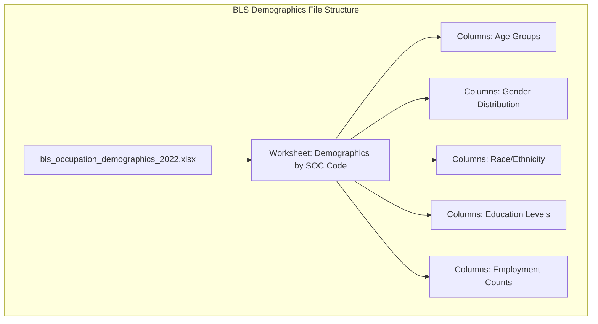
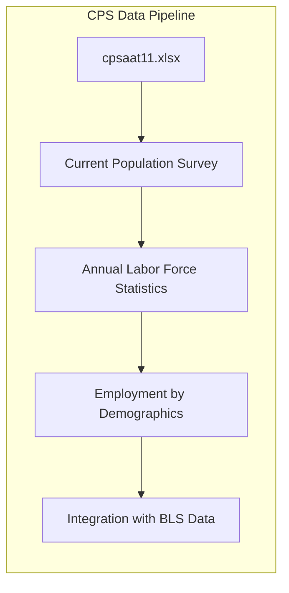
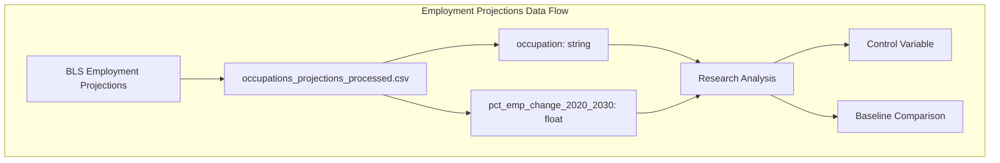
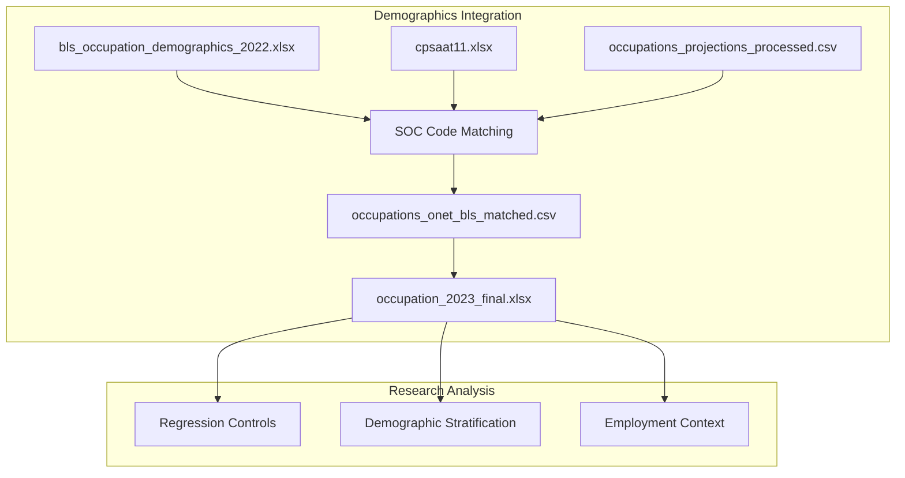

<!-- source: DeepWiki mcp.deepwiki.com · repo openai/GPTs-are-GPTs · page 3.3 Demographics & Employment Data · fetched 2026-10-26 -->

# Demographics & Employment Data

Relevant source files

The following files were used as context for generating this wiki page:

- [data/bls_occupation_demographics_2022.xlsx](data/bls_occupation_demographics_2022.xlsx)
- [data/cpsaat11.xlsx](data/cpsaat11.xlsx)
- [data/occupations_projections_processed.csv](data/occupations_projections_processed.csv)

This document describes the demographic and employment datasets used in the GPTs-are-GPTs research project. These datasets provide essential baseline statistics about the U.S. workforce, including demographic breakdowns by occupation and employment growth projections that serve as dependent variables and controls in the automation impact analysis.

For information about the final integrated datasets that combine this demographic data with other sources, see [Final Processed Datasets](#3.4). For details about the O*NET occupational data and skills information, see [Occupation & Skills Data](#3.2).

## Purpose and Scope

The demographics and employment data serves two primary functions in the research pipeline:
- **Baseline workforce statistics**: Demographic composition of occupations (age, gender, race, education levels)
- **Employment projections**: Bureau of Labor Statistics forecasts for employment growth by occupation from 2020-2030

This data enables researchers to control for demographic factors when analyzing automation's differential impacts across worker populations and to contextualize automation scores against expected employment trends.

## Core Demographic Datasets

### BLS Occupational Demographics

The primary demographic dataset is stored in `bls_occupation_demographics_2022.xlsx`, containing detailed demographic breakdowns from the Bureau of Labor Statistics.

The file structure follows BLS standard occupational classification (SOC) codes and provides percentage distributions across demographic categories for each occupation.

**Sources**: [data/bls_occupation_demographics_2022.xlsx:1-280]()

### Current Population Survey Data

Additional demographic data is provided through `cpsaat11.xlsx`, which contains Current Population Survey annual averages.

This dataset supplements the BLS data with additional labor force participation metrics and detailed employment statistics by demographic groups.

**Sources**: [data/cpsaat11.xlsx:1-375]()

## Employment Projections Data

### Processed Projections Dataset

The `occupations_projections_processed.csv` file contains BLS employment projections for 2020-2030, providing percentage change forecasts by occupation.

| Field | Description | Example |
|-------|-------------|---------|
| `occupation` | Occupation title | "Software developers and software quality assurance analysts and testers" |
| `pct_emp_change_2020_2030` | Projected employment change (%) | 22.2 |

The projections span from high-growth occupations like "Information security analysts" (33.3% growth) to declining ones like "Nuclear engineers" (-8.4% growth).

**Sources**: [data/occupations_projections_processed.csv:1-1071]()

## Data Integration Pipeline

The demographic and employment data integrates with the broader research pipeline through standardized occupation codes and crosswalk files.

This integration allows researchers to:
- Control for demographic composition when analyzing automation scores
- Stratify automation impact by worker demographics  
- Context automation potential against employment growth trends
- Weight findings by occupation size and demographic representation

**Sources**: [data/bls_occupation_demographics_2022.xlsx:1-280](), [data/cpsaat11.xlsx:1-375](), [data/occupations_projections_processed.csv:1-1071]()

## Technical Implementation

### File Format Specifications

The demographic datasets use standard formats for integration:

- **Excel files** (`.xlsx`): Structured worksheets with headers and categorical data
- **CSV files** (`.csv`): Comma-separated values with UTF-8 encoding
- **Occupation identifiers**: BLS SOC codes and descriptive occupation titles

### Data Processing Requirements

The demographic data requires preprocessing for integration:
1. SOC code standardization across datasets
2. Demographic category harmonization
3. Missing value handling for sparse demographic cells
4. Percentage calculation validation

**Sources**: [data/bls_occupation_demographics_2022.xlsx:1-280](), [data/occupations_projections_processed.csv:1-1071]()

---

