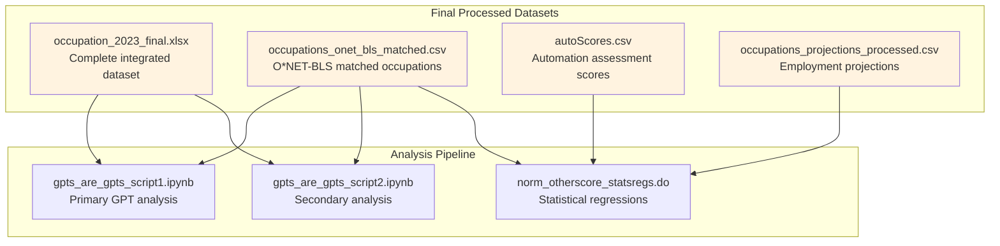
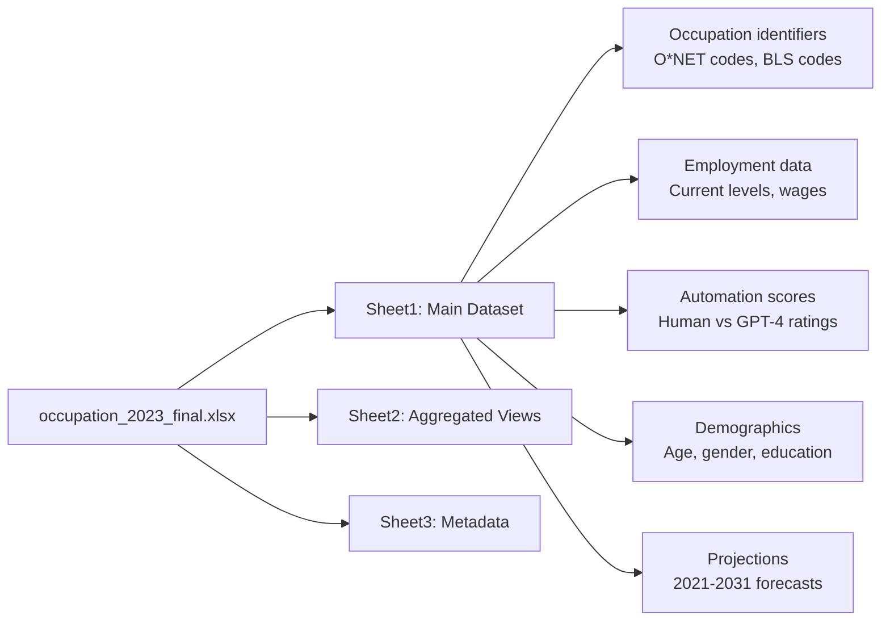
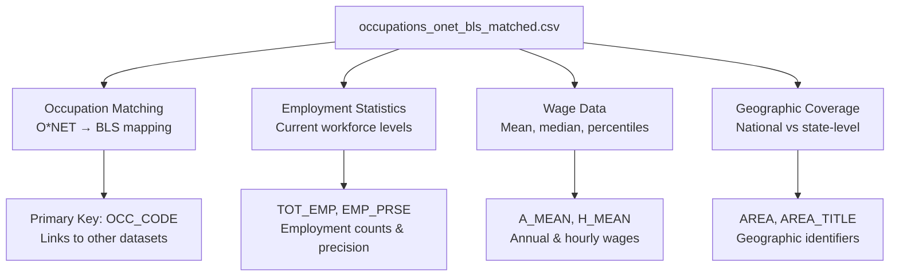
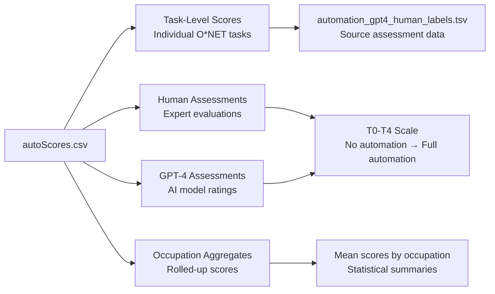
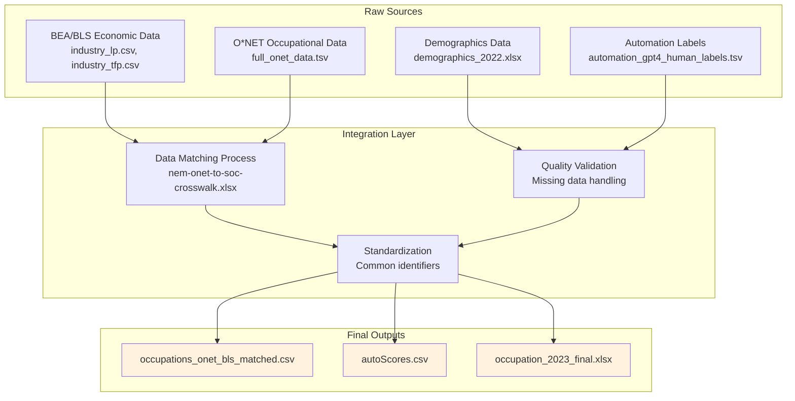

<!-- source: DeepWiki mcp.deepwiki.com · repo openai/GPTs-are-GPTs · page 3.4 Final Processed Datasets · fetched 2026-10-26 -->

# Final Processed Datasets

Relevant source files

The following files were used as context for generating this wiki page:

- [data/autoScores.csv](data/autoScores.csv)
- [data/occupation_2023_final.xlsx](data/occupation_2023_final.xlsx)
- [data/occupations_onet_bls_matched.csv](data/occupations_onet_bls_matched.csv)

This page documents the final integrated datasets that serve as inputs to the analysis pipeline. These datasets represent the culmination of the data integration process, combining economic data, occupational information, automation assessments, and demographic statistics into analysis-ready formats.

For information about the raw data sources that feed into these datasets, see [Economic & Productivity Data](#3.1), [Occupation & Skills Data](#3.2), and [Demographics & Employment Data](#3.3). For details on how these datasets are used in research analysis, see [GPT Analysis Notebooks](#4.1) and [Statistical Analysis](#4.2).

## Overview

The final processed datasets integrate multiple government and research data sources into comprehensive analytical datasets. These files serve as the primary inputs for comparing human vs GPT-4 assessments of automation potential across occupations, while incorporating economic, demographic, and employment projection data.

Sources: Data architecture diagrams, [data/occupation_2023_final.xlsx:1-1](), [data/occupations_onet_bls_matched.csv:1-1]()

## Core Datasets

### Occupation 2023 Final Dataset

The `occupation_2023_final.xlsx` file represents the master analytical dataset containing all integrated data elements needed for the research analysis. This Excel workbook contains multiple worksheets with different data views and aggregations.

**Key Components:**
- Complete occupational profiles with O*NET task data
- BLS employment and wage statistics
- Automation assessment scores (both human and GPT-4)
- Demographic breakdowns by occupation
- Employment projections through 2031

**File Structure:**
The Excel workbook contains multiple sheets organizing different aspects of the data:

Sources: [data/occupation_2023_final.xlsx:1-1000]()

### O*NET-BLS Matched Occupations

The `occupations_onet_bls_matched.csv` dataset provides the foundational mapping between O*NET occupational classifications and BLS employment statistics. This file ensures consistent occupation definitions across different data sources.

**Schema:**
| Column | Description | Example |
|--------|-------------|---------|
| `occupation` | O*NET occupation title | "Sales Managers" |
| `onet_included` | Flag for O*NET inclusion | 1.0 |
| `onet_bls_name` | Standardized occupation name | "Sales Managers" |
| `OCC_CODE` | BLS occupation code | "11-2022" |
| `OCC_TITLE` | BLS occupation title | "Sales Managers" |
| `TOT_EMP` | Total employment count | 453800.0 |
| `A_MEAN` | Annual mean wage | 142390 |
| `H_MEAN` | Hourly mean wage | 68.46 |

The dataset includes wage percentiles, employment statistics, and geographic coverage indicators for each matched occupation.

Sources: [data/occupations_onet_bls_matched.csv:1-72]()

### Automation Scores Dataset

The `autoScores.csv` file contains the core automation assessment data comparing human expert ratings with GPT-4 evaluations across occupational tasks. This dataset drives the primary research questions about AI assessment capabilities.

**Data Structure:**
- Task-level automation scores (T0-T4 scale)
- Human vs GPT-4 comparative ratings
- Occupation-level aggregated scores
- Confidence intervals and statistical measures

Sources: Data architecture diagrams showing `autoScores.csv` as output from automation assessment pipeline

### Employment Projections Dataset

The `occupations_projections_processed.csv` file contains processed BLS employment projections data, providing forward-looking context for automation impact analysis.

**Contents:**
- 2021-2031 employment projections by occupation
- Growth rates and absolute changes
- Industry-specific projection details
- Educational and skill requirement forecasts

## Data Integration Process

The final datasets result from a multi-stage integration process that standardizes classifications, resolves data quality issues, and creates analysis-ready structures.

Sources: Data architecture diagrams, [data/occupations_onet_bls_matched.csv:1-2]()

## Analysis Pipeline Integration

These final datasets serve as the primary inputs for three main analysis components:

**Jupyter Notebook Analysis:**
- `gpts_are_gpts_script1.ipynb` and `gpts_are_gpts_script2.ipynb` consume `occupation_2023_final.xlsx`
- Primary focus on human vs GPT-4 comparison analysis
- Statistical correlation and agreement analysis

**Stata Regression Analysis:**
- `norm_otherscore_statsregs.do` uses `autoScores.csv` and matched datasets
- Econometric analysis of automation relationships
- Controls for demographic and economic factors

**Visualization Pipeline:**
- `plot_styles.py` provides consistent styling
- Generates publication-quality figures and tables
- Supports both exploratory and final presentation graphics

Sources: Data architecture diagrams showing analysis workflow connections

---

