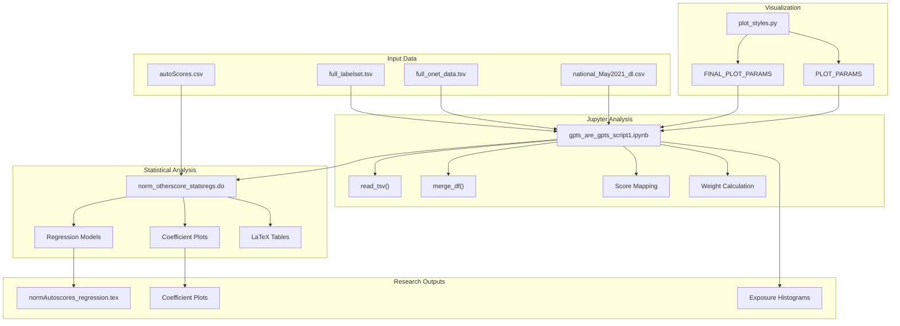
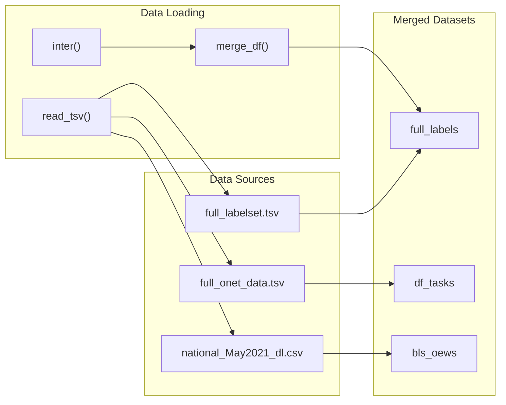
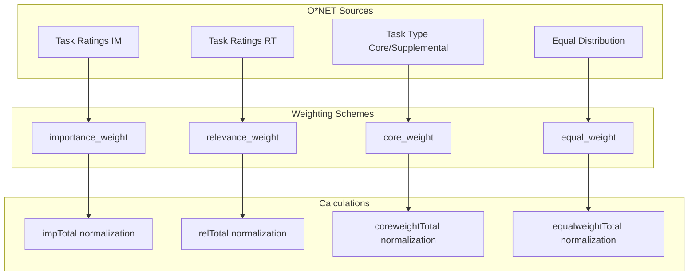
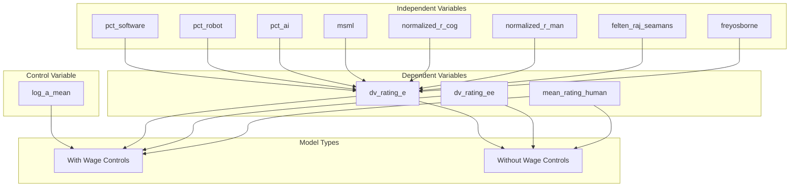
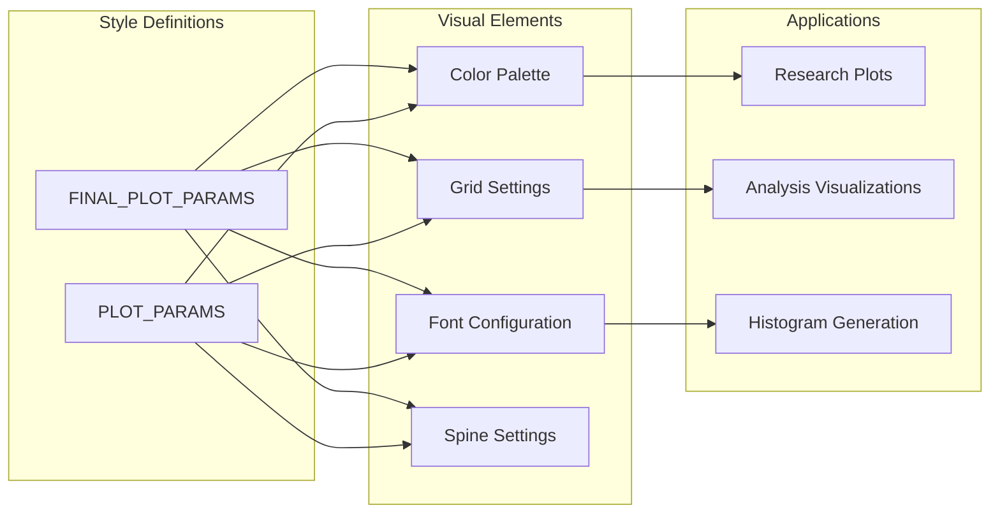
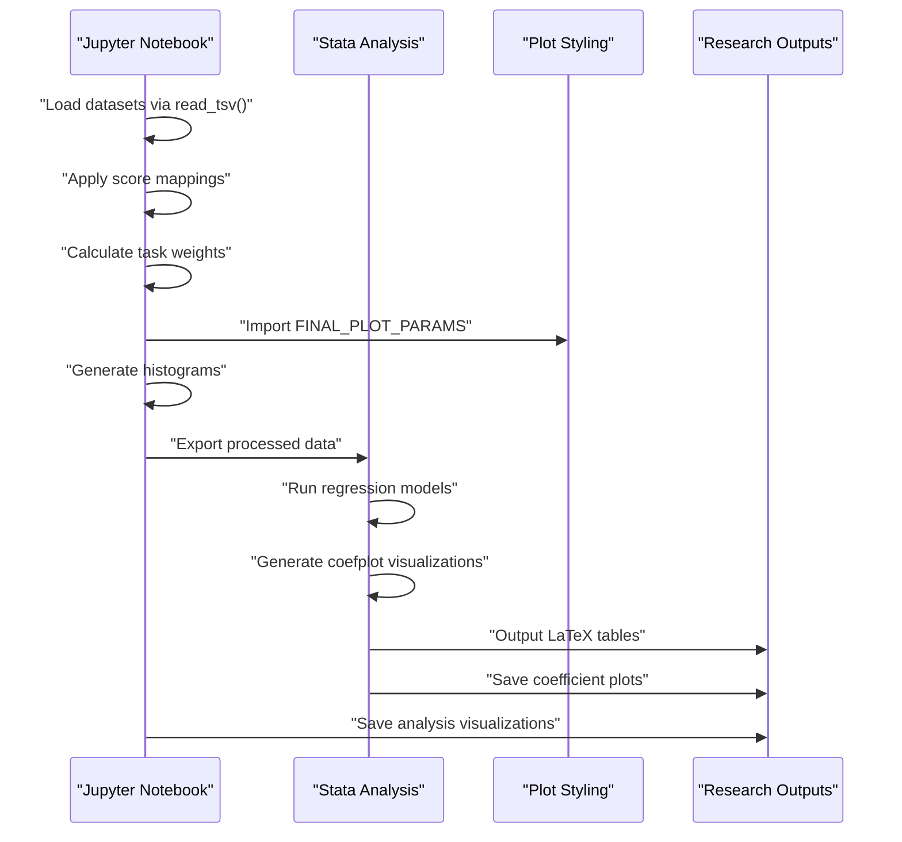

<!-- source: DeepWiki mcp.deepwiki.com · repo openai/GPTs-are-GPTs · page 4 Analysis & Research Code · fetched 2026-10-26 -->

# Analysis & Research Code

Relevant source files

The following files were used as context for generating this wiki page:

- [code/gpts_are_gpts_script1.ipynb](code/gpts_are_gpts_script1.ipynb)
- [code/norm_otherscore_statsregs.do](code/norm_otherscore_statsregs.do)
- [code/plot_styles.py](code/plot_styles.py)

This document covers the analytical code components that form the core research pipeline for comparing human expert assessments with GPT-4 assessments of automation potential across occupations. The analysis code processes integrated datasets to generate statistical models, visualizations, and research outputs.

For information about the underlying data sources and integration process, see [Data Sources](#3) and [Data Integration Approach](#2.2). For technical implementation details, see [Technical Implementation](#5).

## Analysis Pipeline Overview

The analysis pipeline consists of three main components that work together to transform processed datasets into research findings: data preprocessing and scoring in Jupyter notebooks, statistical modeling in Stata, and visualization styling utilities.

Sources: [code/gpts_are_gpts_script1.ipynb:1-280](), [code/norm_otherscore_statsregs.do:1-119](), [code/plot_styles.py:1-99]()

## Data Processing and Score Generation

The primary analysis begins in the Jupyter notebook `gpts_are_gpts_script1.ipynb`, which handles data loading, preprocessing, and score calculation. The notebook implements several key transformations to prepare data for statistical analysis.

### Core Data Loading Functions

The notebook defines utility functions for data manipulation:

Sources: [code/gpts_are_gpts_script1.ipynb:76-98]()

### Exposure Score Mapping

The notebook implements categorical-to-numerical conversion for exposure ratings using predefined mapping dictionaries:

| Score Type | E0 | E1 | E2 | E3 |
|------------|----|----|----|----|
| `alpha_score_map` | 0.0 | 1.0 | 0.0 | 0.0 |
| `beta_score_map` | 0.0 | 1.0 | 0.5 | 0.5 |
| `gamma_score_map` | 0.0 | 1.0 | 1.0 | 1.0 |

Automation scores use a T-scale mapping via `t_score_map`: T0→0.0, T1→0.25, T2→0.5, T3→0.75, T4→1.0.

Sources: [code/gpts_are_gpts_script1.ipynb:112-136]()

### Task Weighting System

The notebook implements four different task weighting schemes within occupations:

Sources: [code/gpts_are_gpts_script1.ipynb:142-212]()

## Statistical Regression Analysis

The statistical analysis is performed in `norm_otherscore_statsregs.do`, which conducts comprehensive regression modeling to examine relationships between various automation measures and both human and GPT-4 exposure ratings.

### Variable Definitions

The Stata script defines labeled variables for analysis:

| Variable | Label | Type |
|----------|-------|------|
| `dv_rating_e` | GPT-4 Exposure Rating 1 | Dependent |
| `dv_rating_ee` | GPT-4 Exposure Rating 2 | Dependent |
| `mean_rating_human` | Human Exposure Rating | Dependent |
| `pct_software` | Software (Webb) | Independent |
| `pct_robot` | Robot (Webb) | Independent |
| `pct_ai` | AI (Webb) | Independent |
| `msml` | Suitability for Machine Learning | Independent |
| `felten_raj_seamans` | AI Impact Score | Independent |

Sources: [code/norm_otherscore_statsregs.do:7-20]()

### Regression Model Structure

The analysis implements both controlled and uncontrolled regression models:

Sources: [code/norm_otherscore_statsregs.do:22-27]()

### Output Generation

The script generates multiple output formats for research publication:

1. **LaTeX Tables**: `normAutoscores_regression.tex` with formatted regression results
2. **Coefficient Plots**: Visual comparisons using `coefplot` command
3. **Univariate Analysis**: Individual variable effects on both human and GPT-4 ratings

Sources: [code/norm_otherscore_statsregs.do:29-34](), [code/norm_otherscore_statsregs.do:42-64]()

## Visualization Styling Framework

The `plot_styles.py` module provides consistent styling configurations for matplotlib visualizations used throughout the analysis pipeline.

### Style Configuration Architecture

### Key Styling Parameters

The styling system defines consistent visual elements:

- **Color Cycle**: 8-color palette starting with `#DB444B`, `#006BA2`, `#3EBCD2`
- **Typography**: Arial sans-serif font family with bold weight styling
- **Grid System**: Light gray grid (`#758D99`) with 0.5 linewidth
- **Spines**: Left spine only, removing top, right, and bottom borders

Sources: [code/plot_styles.py:4-50](), [code/plot_styles.py:52-98]()

## Analysis Workflow Integration

The three components work together in a coordinated workflow that transforms raw automation assessments into publication-ready research outputs:

This integrated approach ensures that human and GPT-4 automation assessments are systematically compared across multiple statistical frameworks while maintaining consistent visual presentation standards for research publication.

Sources: [code/gpts_are_gpts_script1.ipynb:1-280](), [code/norm_otherscore_statsregs.do:1-119](), [code/plot_styles.py:1-99]()

---

