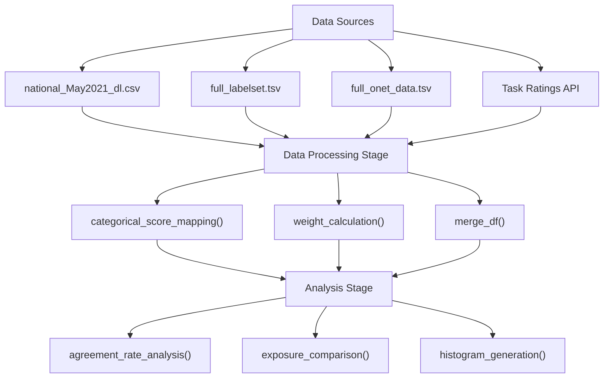
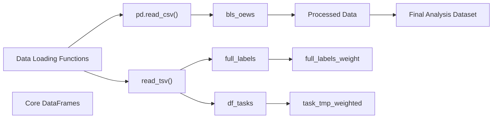
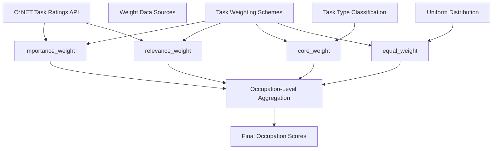
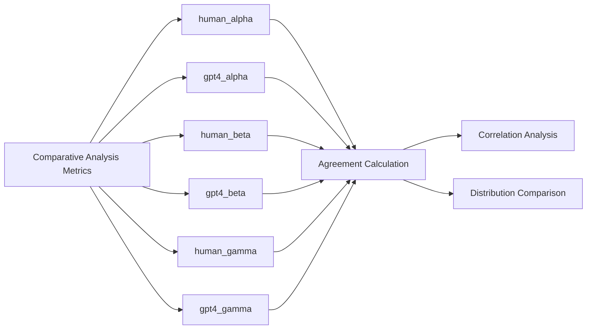

<!-- source: DeepWiki mcp.deepwiki.com · repo openai/GPTs-are-GPTs · page 4.1 GPT Analysis Notebooks · fetched 2026-10-26 -->

# GPT Analysis Notebooks

<details>
<summary>Relevant source files</summary>

The following files were used as context for generating this wiki page:

- [code/gpts_are_gpts_script1.ipynb](code/gpts_are_gpts_script1.ipynb)
- [code/gpts_are_gpts_script2.ipynb](code/gpts_are_gpts_script2.ipynb)
- [data/automation_gpt4_human_labels.tsv](data/automation_gpt4_human_labels.tsv)

</details>


This section covers the Jupyter notebooks that form the core analytical engine for comparing human expert assessments with GPT-4 assessments of automation potential across occupational tasks. These notebooks serve as the primary research interface for processing, analyzing, and visualizing the comparative automation scoring data that drives the research findings.

For information about the statistical regression analysis, see [Statistical Analysis](#4.2). For details about visualization utilities, see [Visualization Tools](#4.3).

## Notebook Architecture

The GPT analysis notebooks implement a multi-stage data processing and analysis pipeline that integrates economic data, occupational task descriptions, and comparative automation assessments from both human experts and GPT-4.

### Primary Analysis Notebook

The main analytical workflow is implemented in `gpts_are_gpts_script1.ipynb`, which orchestrates the complete data processing pipeline from raw inputs to analysis-ready datasets.



Sources: [code/gpts_are_gpts_script1.ipynb:1-400]()

## Data Loading and Integration Pipeline

### Core Data Sources Integration

The notebook implements a standardized data loading framework that handles multiple heterogeneous data sources and transforms them into a unified analytical dataset.



The primary data loading occurs through these key operations:

- `bls_oews = pd.read_csv("../data/national_May2021_dl.csv")` loads employment statistics
- `full_labels = read_tsv("../data/full_labelset.tsv")` loads comparative automation labels  
- `df_tasks = read_tsv("../data/full_onet_data.tsv")` loads O*NET occupational task data

Sources: [code/gpts_are_gpts_script1.ipynb:88-97]()

### Categorical Data Translation

The notebook implements systematic translation of categorical exposure ratings into numerical scores using predefined mapping dictionaries:

```python
alpha_score_map = {"E0": 0.0, "E1": 1.0, "E2": 0.0, "E3": 0.0}
beta_score_map = {"E0": 0.0, "E1": 1.0, "E2": 0.5, "E3": 0.5}
gamma_score_map = {"E0": 0.0, "E1": 1.0, "E2": 1.0, "E3": 1.0}
t_score_map = {"T0": 0.0, "T1": 0.25, "T2": 0.5, "T3": 0.75, "T4": 1.0}
```

These mappings transform categorical exposure ratings (`E0-E3`) and automation potential ratings (`T0-T4`) into continuous numerical scales for quantitative analysis.

Sources: [code/gpts_are_gpts_script1.ipynb:113-116]()

## Task Weighting Methodology

### Multi-Dimensional Weighting System

The notebook implements four distinct weighting schemes for aggregating task-level assessments to occupation-level metrics:



The weighting calculation process retrieves O*NET importance and relevance ratings via API call:

`df_taskratings = read_tsv("https://www.onetcenter.org/dl_files/database/db_27_2_text/Task%20Ratings.txt")`

Core vs. supplemental task classifications are mapped to numerical weights where core tasks receive double weighting:

`df_tasks["coreweight"] = df_tasks["Task Type"].map({"Core": 2, "Supplemental": 1, np.nan: 1})`

Sources: [code/gpts_are_gpts_script1.ipynb:157-212]()

## Analysis Functions and Data Structures

### Key Data Structures

The notebook maintains several critical data structures that bridge raw data to analysis-ready formats:

- `full_labels_weight`: Master dataframe containing task-level assessments with computed weights
- `task_tmp_weighted`: Intermediate dataframe with O*NET task ratings merged with weight calculations  
- `impWeightOcc`: Occupation-level weight totals for normalization

### Agreement Rate Analysis

The comparative analysis infrastructure enables direct comparison between human expert and GPT-4 assessments across multiple exposure metrics:



Sources: [code/gpts_are_gpts_script1.ipynb:118-135]()

## Integration with Research Pipeline

### Statistical Analysis Integration

The notebooks produce standardized output datasets that feed directly into the statistical modeling pipeline. The key integration points include:

- `autoScores.csv`: Processed automation scores for regression analysis
- `occupation_2023_final.xlsx`: Final integrated dataset with all variables
- `occupations_onet_bls_matched.csv`: Cross-walked occupation classifications

### Visualization Pipeline

The notebook implements initial exploratory data analysis through matplotlib and seaborn visualization functions:

`counts, bins, bars = plt.hist(full_labels[["human_exposure", "gpt4_exposure"]])`

This generates comparative distribution plots showing the frequency distribution of human vs. GPT-4 exposure ratings across all tasks.

Sources: [code/gpts_are_gpts_script1.ipynb:270-276]()

## Utility Functions

### Helper Functions

The notebook includes several utility functions for data manipulation:

- `inter(dfa, dfb)`: Computes column intersections between dataframes for merge operations
- `merge_df(dfa, dfb, how="outer")`: Performs automated dataframe merging based on common columns

These functions enable flexible data integration across the heterogeneous data sources while maintaining referential integrity.

Sources: [code/gpts_are_gpts_script1.ipynb:50-55]()

---

