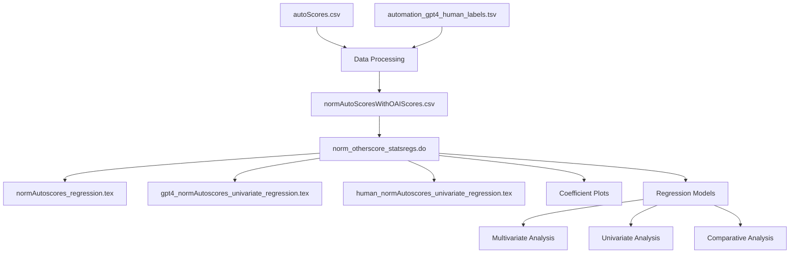
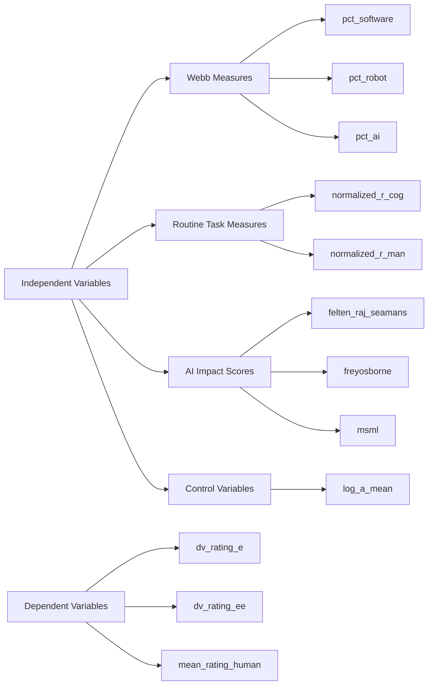
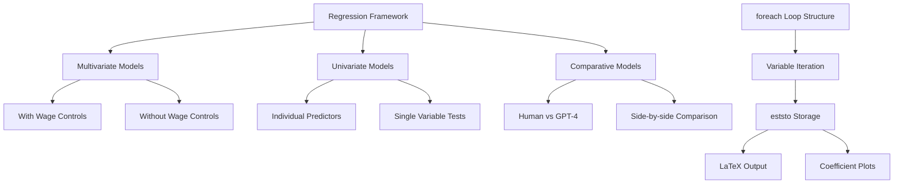
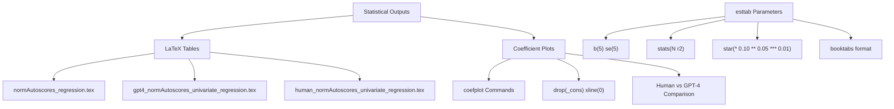

<!-- source: DeepWiki mcp.deepwiki.com · repo openai/GPTs-are-GPTs · page 4.2 Statistical Analysis · fetched 2026-10-26 -->

# Statistical Analysis

Relevant source files

The following files were used as context for generating this wiki page:

- [code/norm_otherscore_statsregs.do](code/norm_otherscore_statsregs.do)
- [data/autoScores.csv](data/autoScores.csv)
- [data/automation_gpt4_human_labels.tsv](data/automation_gpt4_human_labels.tsv)

This document covers the statistical regression analysis component that examines relationships between automation exposure scores and various occupational measures. The analysis compares GPT-4 assessments with human expert evaluations across multiple automation indicators.

For information about the underlying data sources and preprocessing, see [Data Sources](#3). For details about the GPT analysis notebooks that generate inputs to this statistical analysis, see [GPT Analysis Notebooks](#4.1).

## Purpose and Analytical Framework

The statistical analysis serves as the econometric backbone of the research, providing rigorous quantitative examination of automation exposure patterns. The primary objectives include:

- **Comparative Assessment**: Analyzing differences between GPT-4 and human expert automation ratings
- **Cross-Validation**: Testing relationships between established automation measures (Webb, Frey-Osborne, etc.) and new GPT-based assessments  
- **Wage Controls**: Examining how salary levels affect automation exposure relationships
- **Robustness Testing**: Running univariate and multivariate regressions to validate findings

**Sources**: [code/norm_otherscore_statsregs.do:1-119](), [data/autoScores.csv:1-100](), [data/automation_gpt4_human_labels.tsv:1-100]()

## Variable Definitions and Data Structure

The statistical framework operates on a comprehensive dataset with clearly defined dependent and independent variables:

### Dependent Variables
- `dv_rating_e`: GPT-4 Exposure Rating 1 (primary automation exposure measure)
- `dv_rating_ee`: GPT-4 Exposure Rating 2 (secondary automation exposure measure)  
- `mean_rating_human`: Human expert exposure rating (baseline comparison)

### Independent Variables
- `pct_software`: Webb Software automation percentage
- `pct_robot`: Webb Robotics automation percentage
- `pct_ai`: Webb AI automation percentage
- `msml`: Suitability for Machine Learning score
- `normalized_r_cog`: Normalized Routine Cognitive task measure
- `normalized_r_man`: Normalized Routine Manual task measure
- `felten_raj_seamans`: AI Impact Score from Felten, Raj & Seamans
- `freyosborne`: Frey & Osborne automation probability
- `log_a_mean`: Log average salary (control variable)

**Sources**: [code/norm_otherscore_statsregs.do:7-19](), [data/autoScores.csv:1-10]()

## Regression Analysis Framework

The statistical analysis employs a systematic regression framework that runs multiple model specifications to ensure robustness:

### Multivariate Analysis
The core analysis runs full regression models for each dependent variable with two specifications:
- **With wage controls**: Includes `log_a_mean` as control variable
- **Without wage controls**: Excludes salary controls to examine raw relationships

### Univariate Analysis  
Each independent variable is tested individually against the dependent variables to isolate specific relationships and identify the strongest predictors.

### Comparative Analysis
Direct comparison models examine differences between human and GPT-4 ratings using the same predictors, both with and without wage controls.

**Sources**: [code/norm_otherscore_statsregs.do:22-27](), [code/norm_otherscore_statsregs.do:38-41](), [code/norm_otherscore_statsregs.do:83-96]()

## Output Generation and Results

The analysis generates multiple output formats for research dissemination:

### LaTeX Tables
Three main regression tables are produced:
- `normAutoscores_regression.tex`: Main multivariate results comparing all dependent variables
- `gpt4_normAutoscores_univariate_regression.tex`: GPT-4 univariate analysis results  
- `human_normAutoscores_univariate_regression.tex`: Human rating univariate analysis results

### Coefficient Plots
Visual representations of regression coefficients using Stata's `coefplot` command:
- Individual model comparisons
- Side-by-side human vs GPT-4 comparisons
- With and without wage control specifications

**Sources**: [code/norm_otherscore_statsregs.do:29-35](), [code/norm_otherscore_statsregs.do:42-49](), [code/norm_otherscore_statsregs.do:88-89]()

## Implementation Details

### Data Import and Processing
The analysis begins by importing the processed dataset `normAutoScoresWithOAIScores.csv` which contains the normalized automation scores and OpenAI exposure ratings generated by the GPT analysis notebooks.

### Variable Labeling
Comprehensive variable labels are applied to ensure clear output formatting in regression tables and facilitate interpretation of results.

### Robust Standard Errors
All regression models use robust standard errors (`robust` option) to account for potential heteroskedasticity in the cross-sectional occupation data.

### Model Storage and Estimation
The `eststo` command systematically stores estimation results, allowing for flexible table generation and coefficient plotting across multiple model specifications.

**Sources**: [code/norm_otherscore_statsregs.do:1-6](), [code/norm_otherscore_statsregs.do:24](), [code/norm_otherscore_statsregs.do:39]()

---

