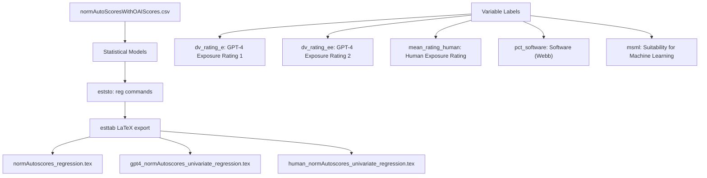
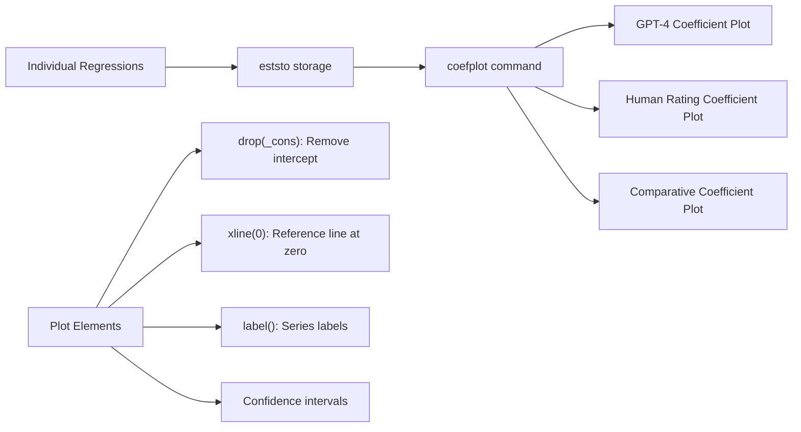
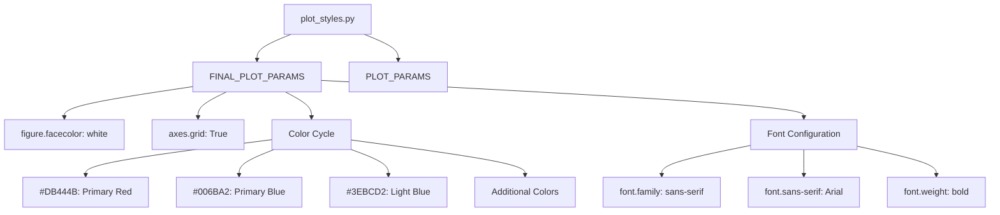
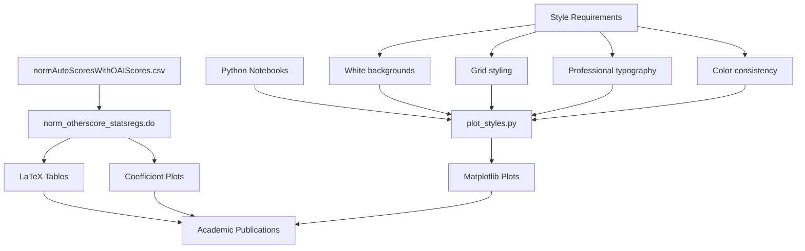
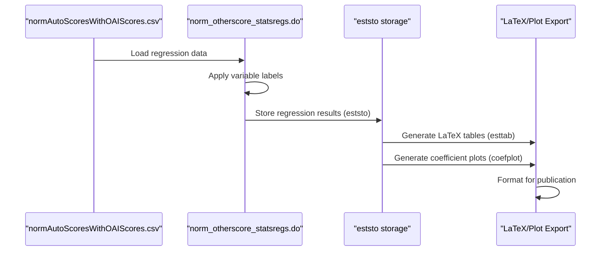

<!-- source: DeepWiki mcp.deepwiki.com · repo openai/GPTs-are-GPTs · page 4.3 Visualization Tools · fetched 2026-10-26 -->

# Visualization Tools

Relevant source files

The following files were used as context for generating this wiki page:

- [code/norm_otherscore_statsregs.do](code/norm_otherscore_statsregs.do)
- [code/plot_styles.py](code/plot_styles.py)

This document covers the visualization utilities and styling configurations used to generate research visualizations in the GPTs-are-GPTs analysis pipeline. The visualization tools consist of statistical plotting capabilities in Stata and Python matplotlib styling configurations that produce publication-ready charts and tables for academic research output.

For information about the statistical analysis that generates the underlying data for these visualizations, see [Statistical Analysis](#4.2). For details about the Jupyter notebooks that may incorporate these visualization tools, see [GPT Analysis Notebooks](#4.1).

## Overview

The visualization system operates through two primary components: Stata-based statistical plotting for regression analysis and coefficient plots, and Python-based matplotlib styling for standardized plot appearance. The system generates both LaTeX-formatted tables and graphical outputs suitable for academic publication.

## Stata Statistical Visualization

The primary statistical visualization functionality is implemented in [code/norm_otherscore_statsregs.do:1-119](), which performs regression analysis and generates multiple types of visualizations:

### Regression Table Generation

The script produces LaTeX-formatted regression tables using the `esttab` command:

The regression tables include:
- **Multivariate regression table** with both GPT-4 and human ratings as dependent variables
- **Univariate regression tables** for GPT-4 ratings against individual predictors  
- **Univariate regression tables** for human ratings against individual predictors

Sources: [code/norm_otherscore_statsregs.do:29-34](), [code/norm_otherscore_statsregs.do:44-49](), [code/norm_otherscore_statsregs.do:59-64]()

### Coefficient Plot Generation

The script generates coefficient plots using Stata's `coefplot` command to visualize regression coefficients:

The coefficient plots include:
- **Individual coefficient plots** for GPT-4 ratings [code/norm_otherscore_statsregs.do:42]()
- **Individual coefficient plots** for human ratings [code/norm_otherscore_statsregs.do:57]()  
- **Comparative plots** showing both GPT-4 and human coefficients [code/norm_otherscore_statsregs.do:88-89]()
- **Wage-controlled vs uncontrolled** comparisons [code/norm_otherscore_statsregs.do:111-114]()

Sources: [code/norm_otherscore_statsregs.do:38-42](), [code/norm_otherscore_statsregs.do:53-57](), [code/norm_otherscore_statsregs.do:83-89]()

### Variable Configuration

The regression analysis uses standardized variable labels for consistent output:

| Variable | Label | Description |
|----------|-------|-------------|
| `dv_rating_e` | GPT-4 Exposure Rating 1 | Primary GPT-4 automation assessment |
| `dv_rating_ee` | GPT-4 Exposure Rating 2 | Secondary GPT-4 assessment |
| `mean_rating_human` | Human Exposure Rating | Human expert assessment |
| `pct_software` | Software (Webb) | Webb et al. software exposure measure |
| `msml` | Suitability for Machine Learning | Machine learning suitability score |
| `normalized_r_cog` | Normalized Routine Cognitive | Routine cognitive task measure |
| `felten_raj_seamans` | AI Impact Score | AI impact assessment score |

Sources: [code/norm_otherscore_statsregs.do:7-18]()

## Python Plot Styling

The Python plotting configuration is defined in [code/plot_styles.py:1-99](), providing standardized matplotlib styling for consistent visualization appearance.

### Style Configuration Architecture

### Style Parameters

The styling configuration includes two main parameter dictionaries:

**FINAL_PLOT_PARAMS** and **PLOT_PARAMS** [code/plot_styles.py:4-50](), [code/plot_styles.py:52-98]() containing:

- **Background colors**: White figure and axes backgrounds
- **Grid styling**: Light gray grid lines (`#758D99`) with 0.5 linewidth
- **Axis configuration**: Left spines visible, others hidden
- **Color palette**: 8-color cycle starting with red (`#DB444B`) and blue (`#006BA2`)
- **Typography**: Arial font family with bold weight for labels
- **Tick styling**: Outward-facing x-ticks, hidden y-tick marks

Sources: [code/plot_styles.py:4-50](), [code/plot_styles.py:52-98]()

### Color Scheme

The standardized color palette uses 8 distinct colors optimized for academic publication:

| Color Code | Usage | Visual Description |
|------------|-------|-------------------|
| `#DB444B` | Primary series | Red |
| `#006BA2` | Secondary series | Dark blue |
| `#3EBCD2` | Tertiary series | Light blue |
| `#379A8B` | Additional series | Teal |
| `#EBB434` | Additional series | Yellow |
| `#B4BA39` | Additional series | Green |
| `#9A607F` | Additional series | Purple |
| `#D1B07C` | Additional series | Tan |

Sources: [code/plot_styles.py:23-35](), [code/plot_styles.py:71-82]()

## Visualization Pipeline Integration

The visualization tools integrate with the broader analysis pipeline through a structured workflow:

### Output Format Integration

The visualization system produces outputs in multiple formats suitable for academic publication:

- **LaTeX tables** with booktabs formatting and statistical significance indicators
- **Stata coefficient plots** with confidence intervals and reference lines
- **Python matplotlib figures** with standardized styling and color schemes

Sources: [code/norm_otherscore_statsregs.do:29-34](), [code/plot_styles.py:4-50]()

## Statistical Visualization Workflow

The complete statistical visualization process follows this sequence:

The workflow processes multiple regression specifications:
- **Multivariate regressions** with and without wage controls [code/norm_otherscore_statsregs.do:22-27]()
- **Univariate regressions** for each predictor variable [code/norm_otherscore_statsregs.do:38-41]()
- **Comparative analyses** between GPT-4 and human ratings [code/norm_otherscore_statsregs.do:83-89]()

Sources: [code/norm_otherscore_statsregs.do:1-119](), [code/plot_styles.py:1-99]()

---

