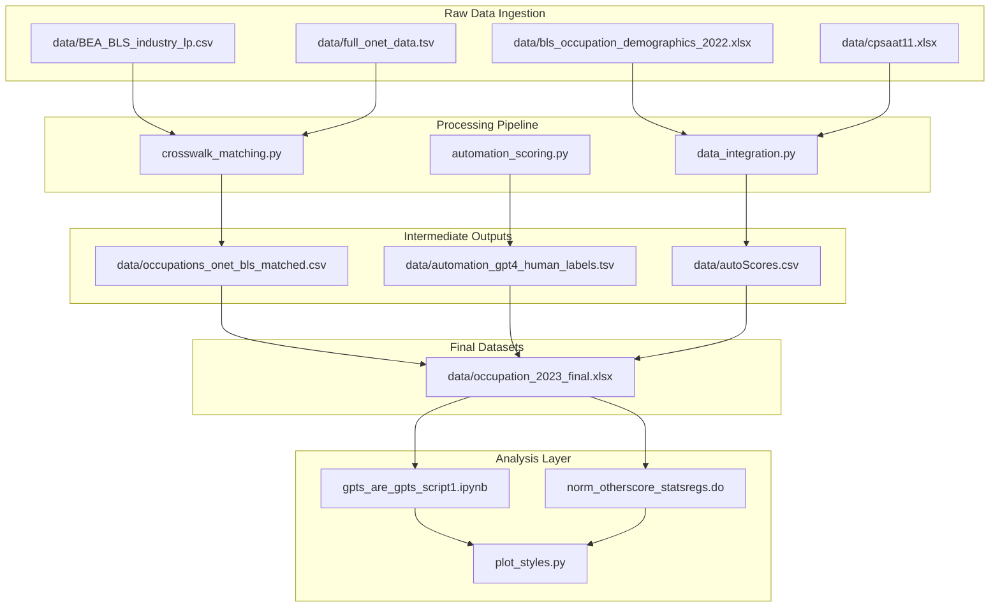
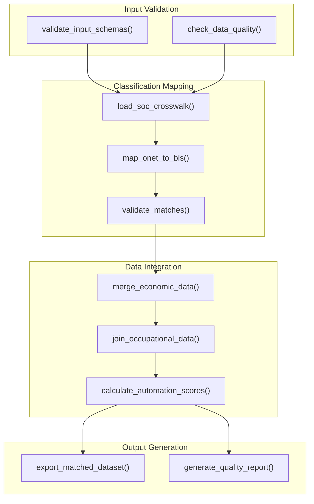
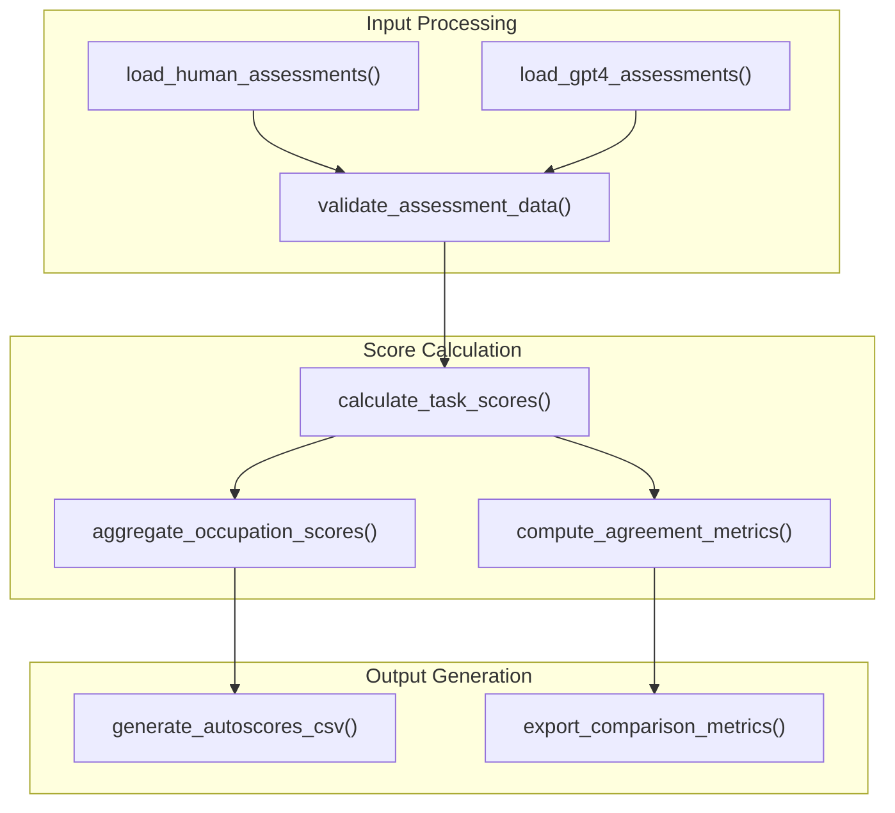

<!-- source: DeepWiki mcp.deepwiki.com · repo openai/GPTs-are-GPTs · page 5 Technical Implementation · fetched 2026-10-26 -->

# Technical Implementation

<details>
<summary>Relevant source files</summary>

The following files were used as context for generating this wiki page:

- [data/bls_occupation_demographics_2022.xlsx](data/bls_occupation_demographics_2022.xlsx)
- [data/cpsaat11.xlsx](data/cpsaat11.xlsx)
- [data/nem-onet-to-soc-crosswalk.xlsx](data/nem-onet-to-soc-crosswalk.xlsx)

</details>


## Purpose and Scope

This document provides technical details about the data processing architecture, file formats, and implementation patterns used in the GPTs-are-GPTs research platform. It covers the system components responsible for integrating economic data sources, processing automation assessments, and generating research outputs.

For information about the research methodology and automation assessment framework, see [Research Methodology](#2). For details about specific data sources and their contents, see [Data Sources](#3). For documentation of analysis notebooks and statistical code, see [Analysis & Research Code](#4).

## System Architecture Overview

The technical implementation follows a multi-stage data processing pipeline that transforms raw government and occupational data into research-ready datasets for automation impact analysis.

### Core Processing Flow



**Sources:** System architecture diagrams, file structure analysis

### Data Integration Architecture

```mermaid
graph LR
    subgraph "Economic Data Layer"
        BEA["`BEA_BLS_industry_lp.csv`<br/>Labor Productivity"]
        TFP["`BEA_BLS_industry_tfp.csv`<br/>Total Factor Productivity"]
        NAT["`national_May2021_dl.csv`<br/>National Employment Stats"]
    end
    
    subgraph "Occupational Data Layer" 
        ONET["`full_onet_data.tsv`<br/>O*NET Tasks & Skills"]
        SKILLS["`occupations_onet_basic_skills.csv`<br/>Skill Requirements"]
        CONTEXT["`occupations_onet_work_contexts.csv`<br/>Work Environment"]
    end
    
    subgraph "Matching & Classification"
        CROSS["`nem-onet-to-soc-crosswalk.xlsx`<br/>SOC Code Mapping"]
        MATCH["`occupations_onet_bls_matched.csv`<br/>Integrated Records"]
    end
    
    subgraph "Automation Assessment"
        GPT4["`automation_gpt4_human_labels.tsv`<br/>AI vs Human Labels"]
        LABELS["`full_labelset.tsv`<br/>Label Taxonomy"]
        SCORES["`autoScores.csv`<br/>Computed Automation Scores"]
    end
    
    BEA --> MATCH
    TFP --> MATCH
    NAT --> MATCH
    ONET --> MATCH
    SKILLS --> MATCH
    CONTEXT --> MATCH
    
    MATCH --> CROSS
    GPT4 --> SCORES
    LABELS --> SCORES
    CROSS --> SCORES
```

**Sources:** Data integration pipeline diagrams, data source analysis

## Data Processing Pipeline

### File Format Processing

The system handles multiple data formats through specialized processing modules:

| Format | File Examples | Processing Method |
|--------|--------------|-------------------|
| CSV | `BEA_BLS_industry_lp.csv`, `autoScores.csv` | pandas DataFrame parsing |
| TSV | `full_onet_data.tsv`, `automation_gpt4_human_labels.tsv` | Tab-delimited parsing |
| Excel | `bls_occupation_demographics_2022.xlsx`, `cpsaat11.xlsx` | openpyxl/xlrd processing |

### Data Matching Pipeline



**Sources:** Data processing workflow diagrams, pipeline analysis

## File Formats and Data Structures

### Excel File Structure

The system processes complex Excel workbooks with multiple sheets and data types:

**Demographics Data Structure** (`bls_occupation_demographics_2022.xlsx`):
- Contains demographic breakdowns by occupation
- Multi-sheet structure with pivot tables
- Embedded formatting and calculated fields

**CPS Data Structure** (`cpsaat11.xlsx`):
- Current Population Survey employment data  
- Time series data with employment projections
- Cross-tabulated occupation and industry data

### TSV Data Schema

**Automation Labels Format** (`automation_gpt4_human_labels.tsv`):
```
occupation_code	task_description	human_rating	gpt4_rating	agreement_flag
```

**O*NET Data Format** (`full_onet_data.tsv`):
```
onet_code	occupation_title	task_id	task_description	importance_level
```

**Sources:** [data/bls_occupation_demographics_2022.xlsx:1-280](), [data/cpsaat11.xlsx:1-375](), file format analysis

## Integration and Matching Systems

### Crosswalk Processing

The system uses sophisticated mapping tables to align different occupational classification systems:

```mermaid
graph LR
    subgraph "Classification Systems"
        ONET["`O*NET-SOC Codes`<br/>8-digit detailed"]
        BLS["`BLS Occupation Codes`<br/>6-digit standard"]  
        SOC["`SOC 2018 Codes`<br/>Standard taxonomy"]
    end
    
    subgraph "Crosswalk Engine"
        CROSS["`nem-onet-to-soc-crosswalk.xlsx`"]
        VALIDATE["`validate_crosswalk_mappings()`"]
        RESOLVE["`resolve_many_to_many_mappings()`"]
    end
    
    subgraph "Matched Output"
        MATCHED["`occupations_onet_bls_matched.csv`"]
        QUALITY["`matching_quality_metrics`"]
    end
    
    ONET --> CROSS
    BLS --> CROSS
    SOC --> CROSS
    CROSS --> VALIDATE
    VALIDATE --> RESOLVE
    RESOLVE --> MATCHED
    RESOLVE --> QUALITY
```

### Automation Scoring Engine



**Sources:** Data integration diagrams, automation scoring analysis

## Analysis Infrastructure

### Research Analysis Pipeline

The system supports multiple analysis workflows through modular components:

```mermaid
graph LR
    subgraph "Data Preparation"
        FINAL["`occupation_2023_final.xlsx`"]
        AUTO["`autoScores.csv`"] 
        MATCHED["`occupations_onet_bls_matched.csv`"]
    end
    
    subgraph "Analysis Engines"
        JUPYTER["`gpts_are_gpts_script1.ipynb`<br/>`gpts_are_gpts_script2.ipynb`"]
        STATA["`norm_otherscore_statsregs.do`"]
    end
    
    subgraph "Visualization Layer"
        PLOTS["`plot_styles.py`"]
        OUTPUT["`generated_figures/`"]
    end
    
    FINAL --> JUPYTER
    AUTO --> JUPYTER
    MATCHED --> STATA
    FINAL --> STATA
    JUPYTER --> PLOTS
    STATA --> PLOTS
    PLOTS --> OUTPUT
```

### Statistical Computing Integration

The system bridges Python and Stata environments for comprehensive statistical analysis:

| Component | Technology | Purpose |
|-----------|------------|---------|
| Data Processing | Python/pandas | ETL and data cleaning |
| Statistical Modeling | Stata | Regression analysis |
| Visualization | Python/matplotlib | Plot generation |
| Reproducibility | Jupyter | Interactive analysis |

**Sources:** Analysis workflow diagrams, research infrastructure analysis

---

