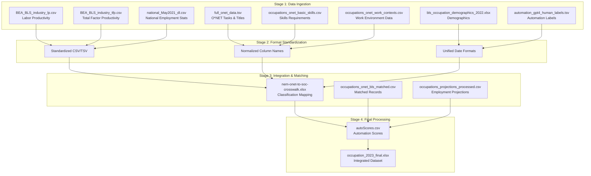
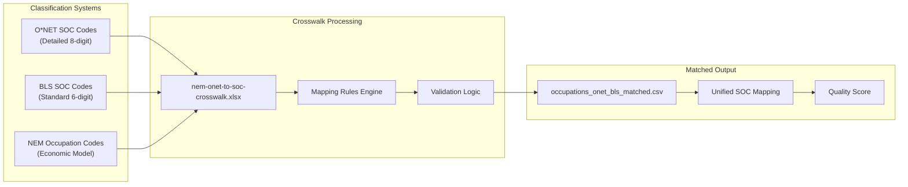
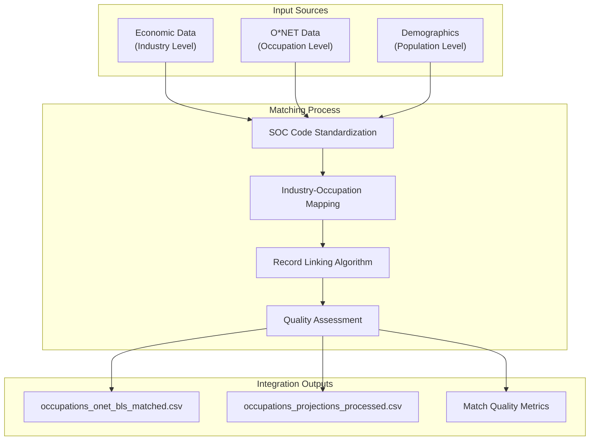

<!-- source: DeepWiki mcp.deepwiki.com · repo openai/GPTs-are-GPTs · page 5.1 Data Processing Pipeline · fetched 2026-10-26 -->

# Data Processing Pipeline

Relevant source files

The following files were used as context for generating this wiki page:

- [data/nem-onet-to-soc-crosswalk.xlsx](data/nem-onet-to-soc-crosswalk.xlsx)
- [data/occupation_2023_final.xlsx](data/occupation_2023_final.xlsx)
- [data/occupations_onet_bls_matched.csv](data/occupations_onet_bls_matched.csv)

## Purpose and Scope

This document describes the data processing pipeline that transforms raw economic, occupational, and demographic datasets into integrated analytical datasets for studying AI automation impact on employment. The pipeline handles data ingestion, standardization, matching across classification systems, and preparation of final datasets for research analysis.

For information about the research methodology and automation assessment framework, see [Research Methodology](#2). For details about the final analytical code and statistical analysis, see [Analysis & Research Code](#4).

## Pipeline Overview

The data processing pipeline consists of four main stages that transform disparate government and economic datasets into cohesive analytical datasets suitable for automation impact research.

### High-Level Data Flow

Sources: Overview diagrams provided, [data/nem-onet-to-soc-crosswalk.xlsx:1-500]()

## Input Data Sources

The pipeline processes three primary categories of input data, each requiring different handling approaches due to varying formats and structures.

### Economic and Productivity Data

Economic data forms the foundation for productivity analysis and comes primarily from Bureau of Economic Analysis (BEA) and Bureau of Labor Statistics (BLS) sources.

| File | Format | Content | Time Period |
|------|--------|---------|-------------|
| `BEA_BLS_industry_lp.csv` | CSV | Labor productivity by industry | 1987-2020 |
| `BEA_BLS_industry_tfp.csv` | CSV | Total factor productivity | Historical |
| `national_May2021_dl.csv` | CSV | National employment statistics | 2021 |

### Occupational and Skills Data

O*NET database provides comprehensive occupational information including task descriptions, skill requirements, and work contexts.

| File | Format | Content | Records |
|------|--------|---------|---------|
| `full_onet_data.tsv` | TSV | Complete O*NET task descriptions and job titles | ~25,000 |
| `occupations_onet_basic_skills.csv` | CSV | Basic skills requirements by occupation | ~900 |
| `occupations_onet_work_contexts.csv` | CSV | Work environment and context data | ~900 |

### Demographics and Automation Labels

Demographic data and automation assessment labels provide the human capital and AI impact dimensions for analysis.

| File | Format | Content | Purpose |
|------|--------|---------|---------|
| `bls_occupation_demographics_2022.xlsx` | Excel | Demographic breakdowns by occupation | Population analysis |
| `automation_gpt4_human_labels.tsv` | TSV | Human vs GPT-4 automation assessments | Comparative analysis |
| `full_labelset.tsv` | TSV | Complete automation label definitions | Label standardization |

Sources: Overview diagrams, [data/nem-onet-to-soc-crosswalk.xlsx:1-50]()

## Classification System Integration

A critical component of the pipeline is the integration of different occupational classification systems through standardized crosswalks.

### Crosswalk Mapping Process

The `nem-onet-to-soc-crosswalk.xlsx` file serves as the primary mapping mechanism between:
- **O*NET SOC codes**: Detailed 8-digit occupational codes from the Occupational Information Network
- **BLS SOC codes**: Standard 6-digit Standard Occupational Classification codes  
- **NEM codes**: Economic model-specific occupation identifiers

Sources: [data/nem-onet-to-soc-crosswalk.xlsx:1-500]()

## Data Processing Stages

### Stage 1: Data Ingestion and Validation

The pipeline begins by ingesting data from multiple file formats and performing initial validation:

- **CSV/TSV parsing**: Handles various delimiters and encoding formats
- **Excel processing**: Extracts data from multiple worksheets in `.xlsx` files
- **Schema validation**: Ensures required columns are present
- **Data type conversion**: Standardizes numeric and date formats

### Stage 2: Format Standardization

Raw data undergoes format standardization to enable downstream processing:

- **Column name normalization**: Converts to standardized naming conventions
- **Date format unification**: Standardizes temporal data across sources
- **Numeric standardization**: Handles different decimal and currency formats
- **Text encoding**: Ensures consistent UTF-8 encoding

### Stage 3: Integration and Matching

The core integration process matches records across data sources:

### Stage 4: Final Dataset Generation

The final stage produces analysis-ready datasets:

- **`autoScores.csv`**: Contains computed automation scores for each occupation
- **`occupation_2023_final.xlsx`**: Comprehensive integrated dataset with all variables
- **Quality metrics**: Data lineage and validation statistics

Sources: Overview diagrams, [data/nem-onet-to-soc-crosswalk.xlsx:1-100]()

## Output Dataset Structure

### Primary Output: occupation_2023_final.xlsx

The final integrated dataset combines all processed data sources into a single analytical file containing:

| Variable Category | Description | Source Integration |
|-------------------|-------------|-------------------|
| Occupation identifiers | SOC codes, O*NET codes, occupation titles | Crosswalk mapping |
| Economic variables | Productivity measures, employment levels | BEA/BLS data |
| Task characteristics | Detailed task descriptions, work contexts | O*NET database |
| Skills requirements | Basic and advanced skill requirements | O*NET skills data |
| Demographics | Age, education, gender distributions | BLS demographics |
| Automation scores | Human and GPT-4 automation assessments | Label processing |

### Secondary Output: autoScores.csv

Contains specifically computed automation vulnerability scores with standardized metrics for downstream analysis.

## Data Quality and Validation

The pipeline implements several data quality measures:

- **Coverage validation**: Ensures adequate representation across occupations
- **Consistency checks**: Validates data relationships across sources  
- **Completeness metrics**: Tracks missing data patterns
- **Cross-reference validation**: Verifies SOC code mappings

Sources: Overview diagrams provided

---

