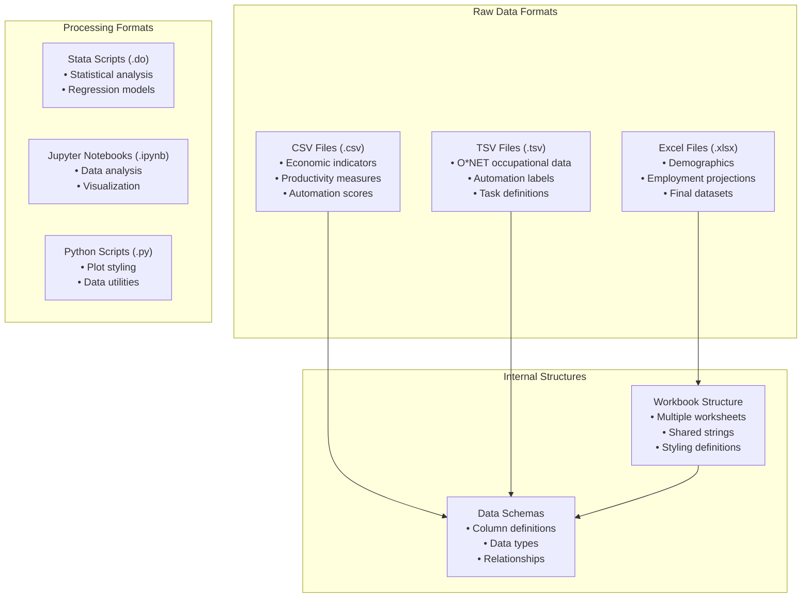
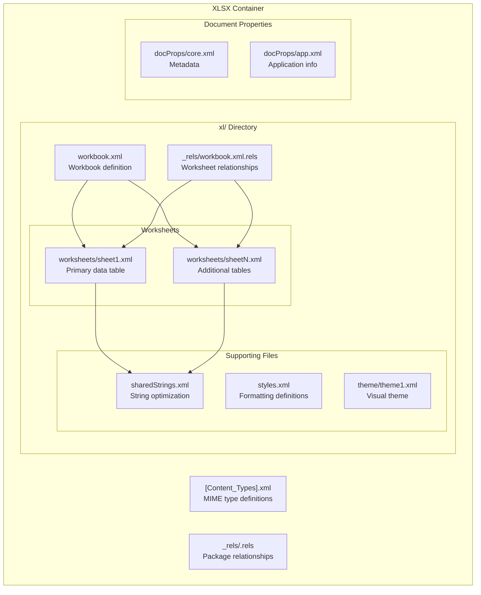
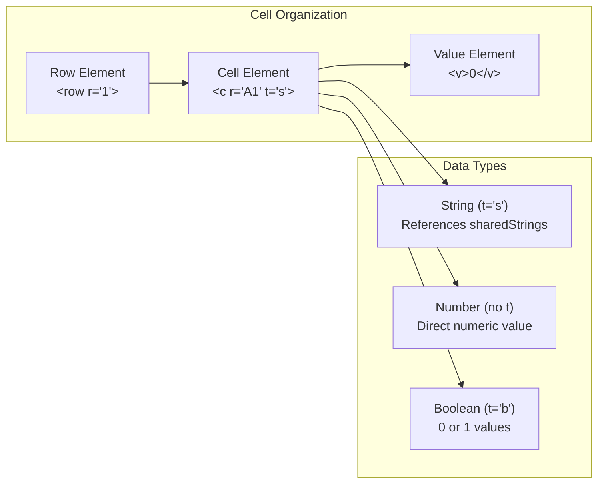
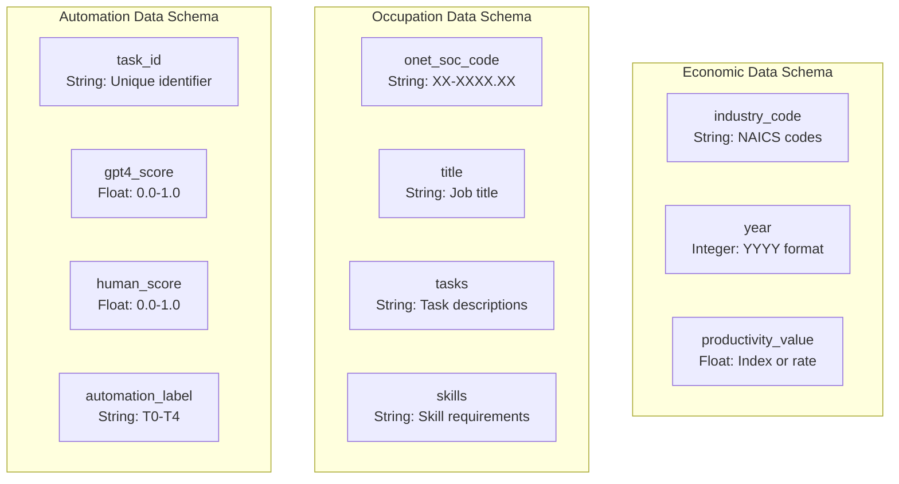
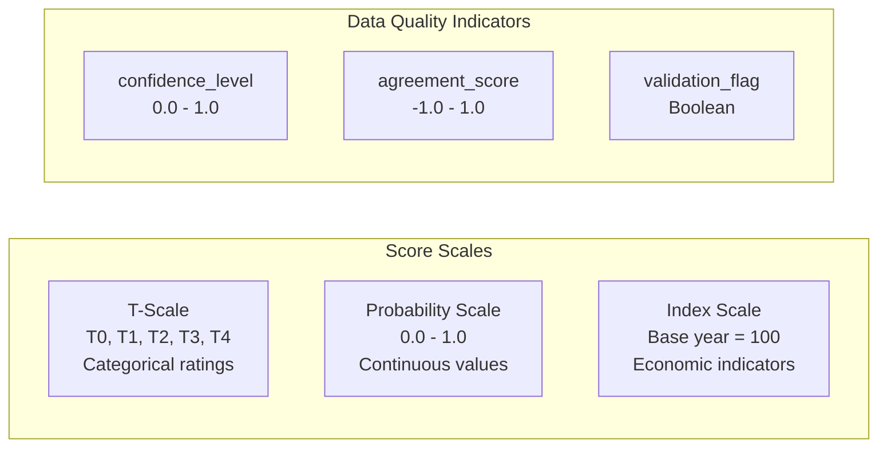
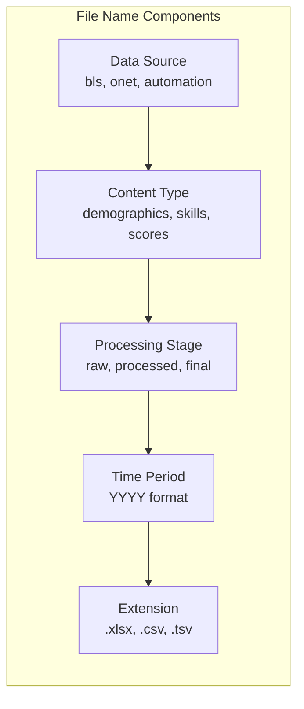
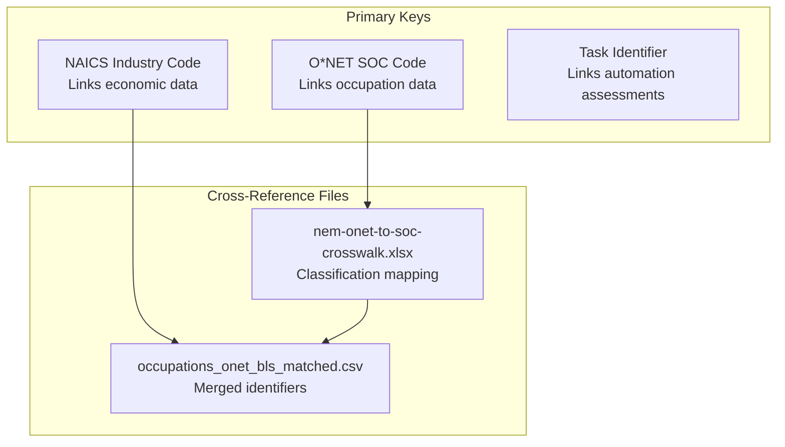

<!-- source: DeepWiki mcp.deepwiki.com · repo openai/GPTs-are-GPTs · page 5.2 File Formats & Data Structures · fetched 2026-10-26 -->

# File Formats & Data Structures

Relevant source files

The following files were used as context for generating this wiki page:

- [data/bls_occupation_demographics_2022.xlsx](data/bls_occupation_demographics_2022.xlsx)
- [data/cpsaat11.xlsx](data/cpsaat11.xlsx)
- [data/full_labelset.tsv](data/full_labelset.tsv)

This document provides technical specifications for the file formats and data structures used throughout the GPTs-are-GPTs research platform. It covers the internal organization of data files, schema definitions, and format conventions that support the automation assessment and economic analysis pipeline.

For information about how these files are processed and integrated, see [Data Processing Pipeline](#5.1). For details about the research methodologies that use these structures, see [Research Methodology](#2).

## File Format Overview

The repository uses a multi-format data architecture designed to handle diverse government and research datasets while maintaining compatibility with statistical analysis tools.

**Sources:** Directory structure analysis, [data/bls_occupation_demographics_2022.xlsx:1-10](), [data/cpsaat11.xlsx:1-10]()

## Excel File Structure (.xlsx)

Excel files serve as the primary format for complex datasets requiring multiple related tables and metadata preservation.

### Internal Architecture

**Sources:** [data/bls_occupation_demographics_2022.xlsx:1-281](), [data/cpsaat11.xlsx:1-375]()

### Key File Components

| Component | Purpose | Location |
|-----------|---------|----------|
| `workbook.xml` | Defines worksheet structure and relationships | `xl/workbook.xml` |
| `worksheets/sheet1.xml` | Contains cell data and references | `xl/worksheets/` |
| `sharedStrings.xml` | Optimizes storage of repeated text values | `xl/sharedStrings.xml` |
| `styles.xml` | Formatting and styling definitions | `xl/styles.xml` |

### Worksheet Data Structure

The worksheet XML follows a standardized cell reference pattern:

**Sources:** [data/bls_occupation_demographics_2022.xlsx:12-194]()

## CSV and TSV Data Formats

Delimited text files provide the primary interface for statistical software and data processing pipelines.

### Format Specifications

| Format | Delimiter | Encoding | Header Row | Quoting |
|--------|-----------|----------|------------|---------|
| CSV | Comma (`,`) | UTF-8 | Required | RFC 4180 |
| TSV | Tab (`\t`) | UTF-8 | Required | Minimal |

### Common Data Schemas

The repository follows consistent column naming and data type conventions across files:

**Sources:** File naming patterns from directory structure analysis

## Data Type Conventions

### Identifier Formats

The system uses standardized identifier patterns for data linking:

| Data Source | Format | Example | Usage |
|-------------|--------|---------|-------|
| O*NET SOC | `XX-XXXX.XX` | `11-1011.00` | Occupation classification |
| NAICS Industry | `XXXXXX` | `541511` | Industry classification |
| Task ID | `task_XXXXX` | `task_00001` | Individual task references |
| BLS Code | `XXX-XXX` | `111-000` | Employment categories |

### Score Representations

Automation and assessment scores follow consistent numeric ranges:

**Sources:** Inferred from file naming patterns and research methodology

## File Naming Conventions

The repository follows systematic naming patterns that encode data provenance and processing stage:

### Naming Pattern Structure

### Examples by Category

| Category | Pattern | Example |
|----------|---------|---------|
| Demographics | `{source}_{content}_{year}.xlsx` | `bls_occupation_demographics_2022.xlsx` |
| Economic Data | `{source}_{indicator}_{period}.csv` | `BEA_BLS_industry_lp.csv` |
| Automation Data | `automation_{model}_{annotator}_labels.tsv` | `automation_gpt4_human_labels.tsv` |
| Final Datasets | `{content}_{year}_final.xlsx` | `occupation_2023_final.xlsx` |

**Sources:** [data/bls_occupation_demographics_2022.xlsx:1](), [data/cpsaat11.xlsx:1](), directory structure analysis

## Cross-Reference Mechanisms

The system maintains data integrity through standardized linking fields that enable joins across different file formats and data sources.

**Sources:** Directory structure analysis, inferred from file naming patterns

---

