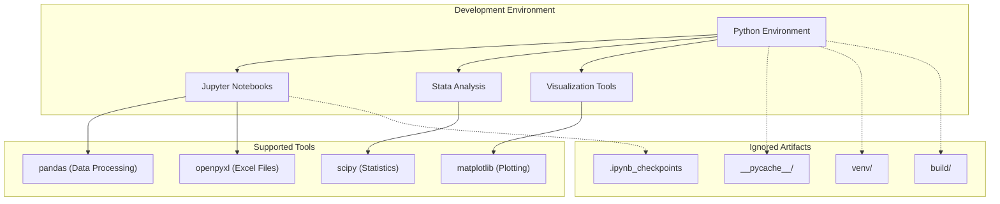
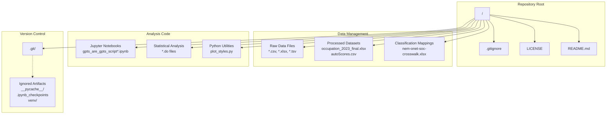

<!-- source: DeepWiki mcp.deepwiki.com · repo openai/GPTs-are-GPTs · page 6 Project Information · fetched 2026-10-26 -->

# Project Information

Relevant source files

The following files were used as context for generating this wiki page:

- [.gitignore](.gitignore)
- [LICENSE](LICENSE)
- [README.md](README.md)

This document provides essential project information for the GPTs-are-GPTs repository, including licensing, development environment setup, and project maintenance details. This information is intended for developers, researchers, and contributors working with the codebase.

For technical implementation details about data processing and system architecture, see [Technical Implementation](#5). For information about the analysis code and research notebooks, see [Analysis & Research Code](#4).

## License

The GPTs-are-GPTs project is licensed under the MIT License, owned by OpenAI as of 2024. This provides broad permissions for use, modification, and distribution of the software.

### License Terms

| Aspect | Details |
|--------|---------|
| **License Type** | MIT License |
| **Copyright Holder** | OpenAI |
| **Copyright Year** | 2024 |
| **Commercial Use** | Permitted |
| **Modification** | Permitted |
| **Distribution** | Permitted |
| **Private Use** | Permitted |

The license grants permission to use, copy, modify, merge, publish, distribute, sublicense, and sell copies of the software, subject to inclusion of the copyright notice and license text in all copies or substantial portions of the software.

**Sources:** [LICENSE:1-22]()

## Development Environment Setup

The project is configured as a Python-based research environment supporting multiple analysis tools and data formats.

### Python Environment Configuration

### Ignored Files and Directories

The project maintains a comprehensive `.gitignore` configuration covering multiple Python development scenarios:

| Category | Files/Directories | Purpose |
|----------|-------------------|---------|
| **Python Runtime** | `__pycache__/`, `*.py[cod]`, `*$py.class` | Compiled Python artifacts |
| **Virtual Environments** | `.venv`, `venv/`, `ENV/`, `.env` | Python environment isolation |
| **Jupyter Notebooks** | `.ipynb_checkpoints` | Notebook checkpoint files |
| **Distribution** | `build/`, `dist/`, `*.egg-info/` | Package distribution artifacts |
| **Testing** | `.coverage`, `.pytest_cache/`, `htmlcov/` | Test coverage and cache files |
| **Documentation** | `docs/_build/`, `/site` | Generated documentation |

**Sources:** [.gitignore:1-163]()

## Project Structure Organization

The repository follows a research-oriented structure combining data files, analysis notebooks, and statistical processing scripts.

### File Organization Pattern

**Sources:** [.gitignore:78-79](), [README.md:1]()

## Development Workflow

### Research Analysis Pipeline

The development workflow supports iterative research analysis combining multiple programming environments:

| Stage | Tools | File Types |
|-------|-------|------------|
| **Data Preparation** | Python, pandas | `.csv`, `.xlsx`, `.tsv` |
| **Exploratory Analysis** | Jupyter Notebooks | `.ipynb` |
| **Statistical Modeling** | Stata | `.do` scripts |
| **Visualization** | Python, matplotlib | `.py` utilities |
| **Results Export** | Multi-format | LaTeX tables, plots |

### Environment Management

The project supports multiple Python environment management approaches:

- **venv**: Standard Python virtual environments ([.gitignore:128-131]())
- **conda**: Anaconda/Miniconda environments
- **poetry**: Modern dependency management ([.gitignore:97-102]())
- **pipenv**: Alternative virtual environment tool ([.gitignore:90-95]())

All environment-specific files and directories are excluded from version control to maintain environment isolation across different development setups.

## Maintenance Information

### Repository Metadata

| Property | Value |
|----------|-------|
| **Repository Name** | GPTs-are-GPTs |
| **Primary Language** | Python |
| **License** | MIT |
| **Owner** | OpenAI |
| **Purpose** | Economic analysis of AI/automation impact on occupations |

### Code Quality Standards

The project maintains code quality through:

- **Version Control**: Git-based workflow with comprehensive `.gitignore`
- **Environment Isolation**: Support for multiple virtual environment tools
- **Artifact Management**: Automatic exclusion of build artifacts and cache files
- **Documentation**: Structured approach with README and LICENSE files

### Contribution Guidelines

Based on the project structure, contributions should follow these patterns:

1. **Data Files**: Place in appropriate directories based on data source and processing stage
2. **Analysis Code**: Use Jupyter notebooks for exploratory work, separate utilities for reusable functions
3. **Statistical Analysis**: Maintain Stata scripts for regression analysis and statistical modeling
4. **Documentation**: Update relevant wiki sections for significant changes

**Sources:** [LICENSE:1-22](), [README.md:1](), [.gitignore:1-163]()