# Page: Overview

# Overview

<details>
<summary>Relevant source files</summary>

The following files were used as context for generating this wiki page:

- [README.md](README.md)
- [data/automation_gpt4_human_labels.tsv](data/automation_gpt4_human_labels.tsv)
- [data/occupation_2023_final.xlsx](data/occupation_2023_final.xlsx)

</details>


This document provides a comprehensive overview of the GPTs-are-GPTs repository, a research platform designed to analyze the economic impact of AI and automation on occupations through systematic comparison of human expert assessments with GPT-4's evaluations of job task automation potential.

The system integrates authoritative government economic data with AI-generated automation assessments to create a comprehensive analytical framework for studying labor market disruption. For detailed research methodology, see [Research Methodology](#2). For specific data sources and formats, see [Data Sources](#3). For analysis code and tools, see [Analysis & Research Code](#4).

## Research Platform Purpose

The GPTs-are-GPTs platform serves as a comprehensive research infrastructure for answering the core question: **How do large language models like GPT-4 assess automation potential of job tasks compared to human experts?** 

The system processes thousands of occupational tasks from the O*NET database, applies both human expert and GPT-4 automation assessments using a standardized T0-T4 scale, and integrates this with economic productivity data to analyze automation's impact on the labor market.

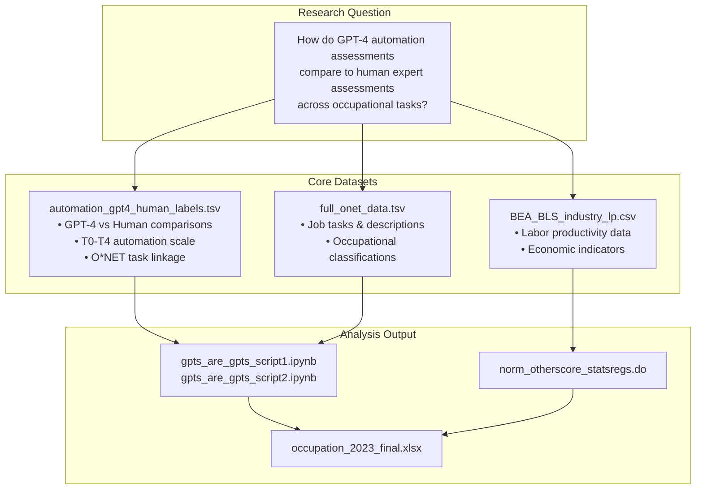

Sources: [data/automation_gpt4_human_labels.tsv:1-400](), [data/full_onet_data.tsv](), [README.md:1]()

## System Architecture Overview

The platform follows a data integration pipeline that processes multiple government data sources, applies automation assessments, and feeds into statistical analysis tools for academic research.

### Core Data Integration Pipeline

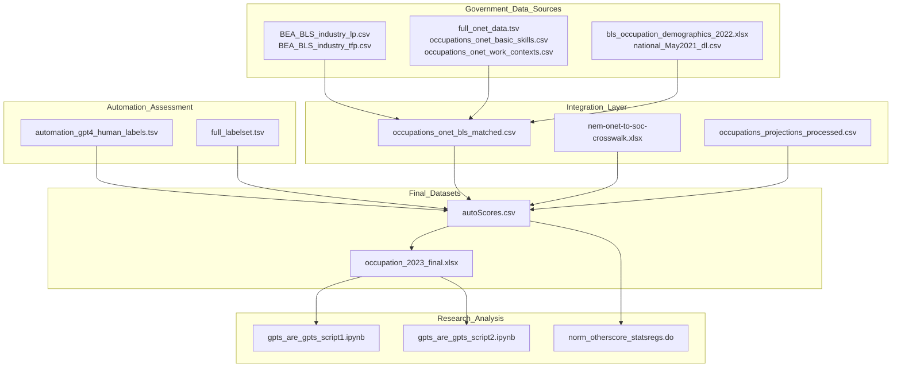

Sources: [data/automation_gpt4_human_labels.tsv:1-10](), [data/occupations_onet_bls_matched.csv](), [data/autoScores.csv](), [data/occupation_2023_final.xlsx]()

## Automation Assessment Framework

The system employs a standardized T0-T4 automation scoring scale applied to individual job tasks extracted from the O*NET occupational database.

### T0-T4 Automation Scale

| Score | Automation Level | Description |
|-------|------------------|-------------|
| T0    | No Automation    | Tasks requiring human creativity, complex social interaction, or physical dexterity |
| T1    | Low Automation   | Tasks with some routine elements but requiring human judgment |
| T2    | Medium Automation| Tasks that are partially automatable with current technology |
| T3    | High Automation  | Tasks that are largely automatable but may require human oversight |
| T4    | Full Automation  | Tasks that can be completely automated with existing technology |

### Assessment Comparison Structure

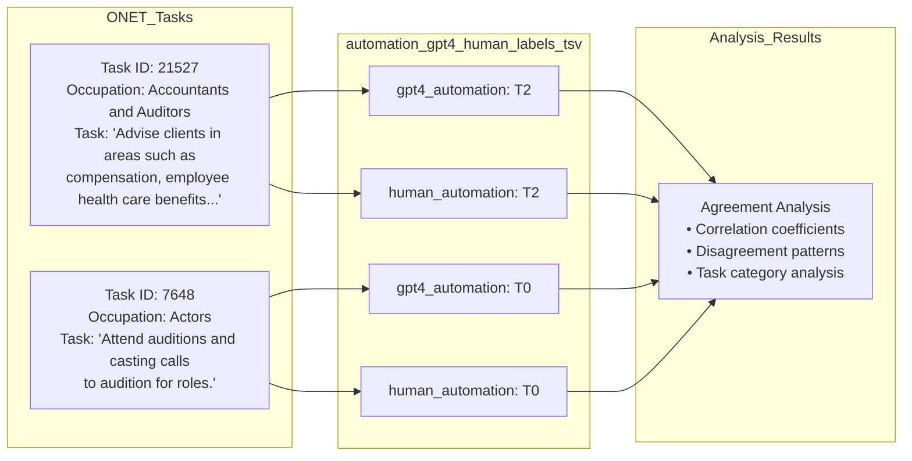

Sources: [data/automation_gpt4_human_labels.tsv:2-50]()

## Key Research Components

### Primary Analysis Notebooks

The research analysis is conducted through two main Jupyter notebooks that process the automation assessment data:

- `gpts_are_gpts_script1.ipynb`: Primary comparative analysis between GPT-4 and human assessments
- `gpts_are_gpts_script2.ipynb`: Secondary analysis and validation studies

### Statistical Modeling

The `norm_otherscore_statsregs.do` Stata script performs regression analysis examining relationships between:

- **Dependent Variables**: GPT-4 exposure ratings, Human exposure ratings
- **Independent Variables**: Webb measures, SML scores, Routine task measures, AI impact scores

### Final Integrated Dataset

The `occupation_2023_final.xlsx` file represents the culmination of the data integration pipeline, containing:
- Matched occupational data across classification systems
- Automation scores from both sources
- Economic and productivity measures
- Demographics and employment projections

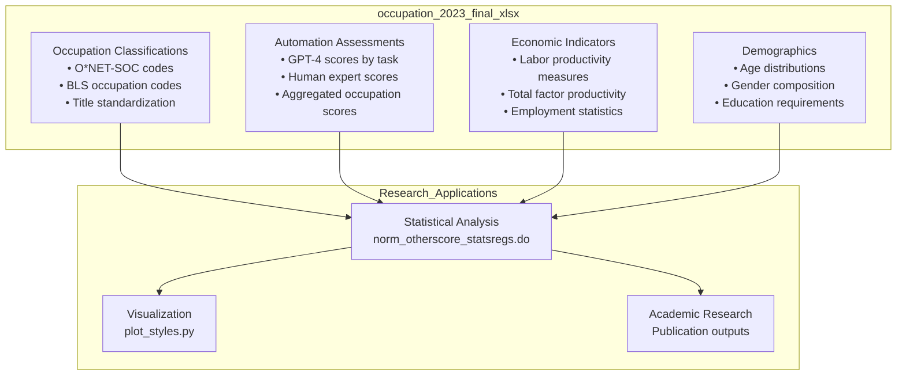

Sources: [data/occupation_2023_final.xlsx](), [analysis/norm_otherscore_statsregs.do](), [analysis/gpts_are_gpts_script1.ipynb]()

This research platform enables systematic analysis of how artificial intelligence, specifically large language models, assess automation potential compared to human domain experts, providing crucial insights into the future of work and economic disruption from AI technologies.

---

# Page: Research Methodology

# Research Methodology

<details>
<summary>Relevant source files</summary>

The following files were used as context for generating this wiki page:

- [data/automation_gpt4_human_labels.tsv](data/automation_gpt4_human_labels.tsv)
- [data/full_labelset.tsv](data/full_labelset.tsv)
- [data/full_onet_data.tsv](data/full_onet_data.tsv)

</details>


This document explains the core research approach used in the GPTs-are-GPTs project to systematically compare human expert assessments with GPT-4 assessments of automation potential across occupational tasks. The methodology combines structured task evaluation, comparative analysis, and economic data integration to understand how AI systems assess automation risk relative to human judgment.

For information about the automation scoring framework details, see [Automation Assessment Framework](#2.1). For data source integration procedures, see [Data Integration Approach](#2.2).

## Core Research Approach

The research methodology centers on a systematic comparison between human expert evaluations and GPT-4 evaluations of task-level automation potential across thousands of occupational tasks from the O*NET database. The approach uses a standardized assessment framework to ensure comparable ratings between human and AI assessors.

### Assessment Workflow

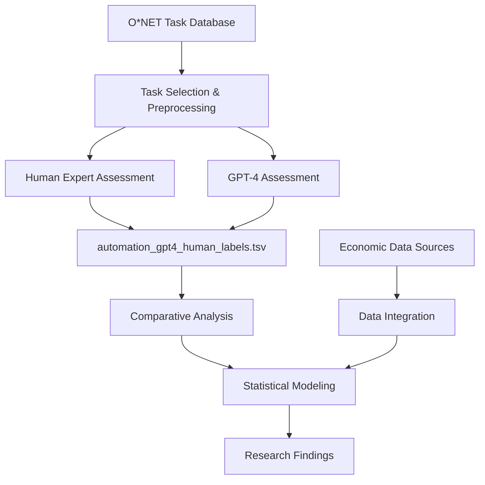

The methodology involves parallel assessment tracks where both human experts and GPT-4 evaluate the same occupational tasks using identical criteria. Each task receives automation scores on the T0-T4 scale and exposure ratings on the E0-E2 scale, enabling direct statistical comparison of assessment patterns.

Sources: [data/automation_gpt4_human_labels.tsv:1-50](), [data/full_labelset.tsv:1-50]()

## Automation Assessment Protocol

The research uses a structured protocol where both human experts and GPT-4 assess occupational tasks using standardized rubrics. Each assessment generates multiple measurement dimensions to capture different aspects of automation potential.

### Assessment Data Structure

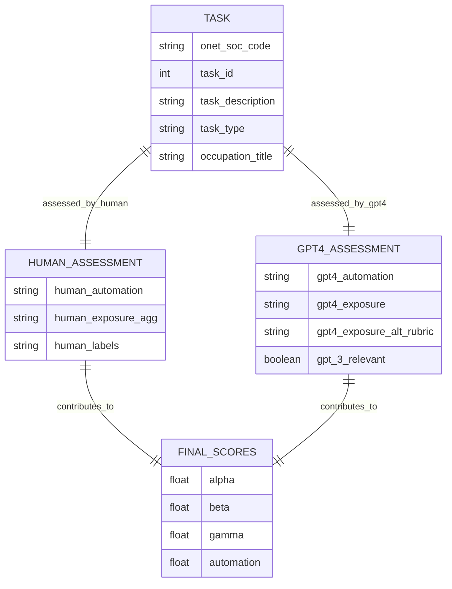

The assessment protocol ensures that each task in `automation_gpt4_human_labels.tsv` receives parallel evaluation from both human experts and GPT-4, with ratings recorded in the `human_automation` and `gpt4_automation` columns respectively.

Sources: [data/automation_gpt4_human_labels.tsv:1-10](), [data/full_labelset.tsv:1-20]()

## Comparative Analysis Framework

The methodology employs a systematic approach to compare human and AI assessments across multiple dimensions. The comparison framework examines both individual task-level differences and aggregate patterns across occupations and industries.

### Rating Scale Mapping

| Automation Level | Code | Description |
|------------------|------|-------------|
| No Automation | T0 | Tasks requiring human judgment, creativity, or physical presence |
| Minimal Automation | T1 | Tasks with some routine elements but requiring human oversight |
| Moderate Automation | T2 | Tasks with significant automatable components |
| High Automation | T3 | Tasks largely automatable with current technology |
| Full Automation | T4 | Tasks completely automatable |

| Exposure Level | Code | Description |
|----------------|------|-------------|
| No Exposure | E0 | Tasks unaffected by AI/automation |
| Some Exposure | E1 | Tasks partially affected by AI/automation |
| High Exposure | E2 | Tasks significantly affected by AI/automation |

The comparative analysis uses these standardized scales to measure agreement rates, systematic biases, and patterns of divergence between human expert and GPT-4 assessments.

Sources: [data/automation_gpt4_human_labels.tsv:1-100](), [data/full_labelset.tsv:30-50]()

## Statistical Comparison Methodology

The research methodology incorporates multiple statistical approaches to analyze the relationship between human and AI assessments. The analysis framework examines correlation patterns, disagreement rates, and systematic biases in automation assessments.

### Assessment Correlation Analysis

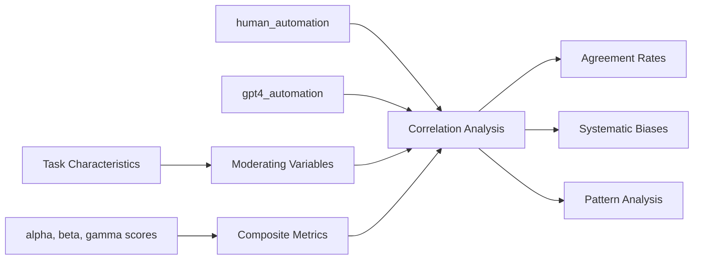

The statistical methodology measures multiple dimensions of human-AI agreement:
- Direct correlation between `human_automation` and `gpt4_automation` ratings
- Analysis of the `alpha`, `beta`, and `gamma` composite scores in the final dataset
- Examination of systematic patterns where human and AI assessments diverge

Sources: [data/full_labelset.tsv:40-60](), [data/automation_gpt4_human_labels.tsv:20-40]()

## Task-Level Analysis Framework

The methodology examines automation assessments at the individual task level to understand specific patterns of human-AI agreement and disagreement. This granular analysis reveals which types of occupational tasks show the highest and lowest levels of assessment concordance.

### Task Classification Integration

The research methodology integrates task classification data from the O*NET database to understand how task characteristics influence assessment patterns. Tasks are categorized as "Core" or "Supplemental" based on their centrality to the occupation, with weighted analysis reflecting task importance.

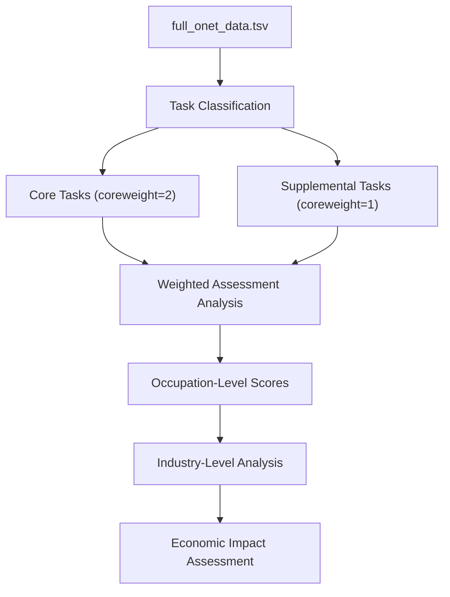

The methodology uses the `coreweight` and `equalweight` columns from the O*NET data to ensure that more central occupational tasks receive appropriate emphasis in the comparative analysis.

Sources: [data/full_onet_data.tsv:1-50](), [data/automation_gpt4_human_labels.tsv:1-20]()

## Multi-Dimensional Assessment Integration

The research methodology incorporates multiple assessment dimensions beyond simple automation ratings. The framework evaluates exposure levels, task relevance, and alternative rubric assessments to provide a comprehensive view of human-AI assessment patterns.

### Assessment Dimension Analysis

The methodology examines relationships between different assessment dimensions:
- Primary automation ratings (`human_automation` vs `gpt4_automation`)
- Exposure assessments (`human_exposure_agg` vs `gpt4_exposure`)
- Alternative rubric evaluations (`gpt4_exposure_alt_rubric`)
- Task relevance indicators (`gpt_3_relevant`)

This multi-dimensional approach enables the research to identify whether human-AI differences are consistent across assessment types or vary by evaluation criterion.

Sources: [data/full_labelset.tsv:10-30](), [data/automation_gpt4_human_labels.tsv:30-50]()

---

# Page: Automation Assessment Framework

# Automation Assessment Framework

<details>
<summary>Relevant source files</summary>

The following files were used as context for generating this wiki page:

- [data/autoScores.csv](data/autoScores.csv)
- [data/automation_gpt4_human_labels.tsv](data/automation_gpt4_human_labels.tsv)
- [data/full_labelset.tsv](data/full_labelset.tsv)

</details>


## Purpose and Scope

The Automation Assessment Framework is the core methodology used to evaluate the automation potential of occupational tasks, comparing assessments made by human experts against those generated by GPT-4. This framework provides standardized scales, data structures, and comparison methodologies for measuring how susceptible different job tasks are to automation by AI systems.

For information about the broader data integration approach that feeds into this framework, see [Data Integration Approach](#2.2). For details about the statistical analysis of these assessments, see [Statistical Analysis](#4.2).

## Assessment Scales and Methodology

### Automation Scale (T0-T4)

The framework employs a 5-point automation scale ranging from T0 to T4, where higher values indicate greater automation potential:

| Scale | Description |
|-------|-------------|
| T0    | No automation potential |
| T1    | Low automation potential |
| T2    | Moderate automation potential |
| T3    | High automation potential |
| T4    | Very high automation potential |

### Exposure Scale (E0-E2)

A complementary 3-point exposure scale measures how much a task involves exposure to AI capabilities:

| Scale | Description |
|-------|-------------|
| E0    | No exposure to AI capabilities |
| E1    | Some exposure to AI capabilities |
| E2    | High exposure to AI capabilities |

Sources: [data/automation_gpt4_human_labels.tsv:1-400](), [data/full_labelset.tsv:1-400]()

## Data Structure and Assessment Records

### Primary Assessment Dataset

The core assessment data is stored in `automation_gpt4_human_labels.tsv`, containing comparative evaluations:

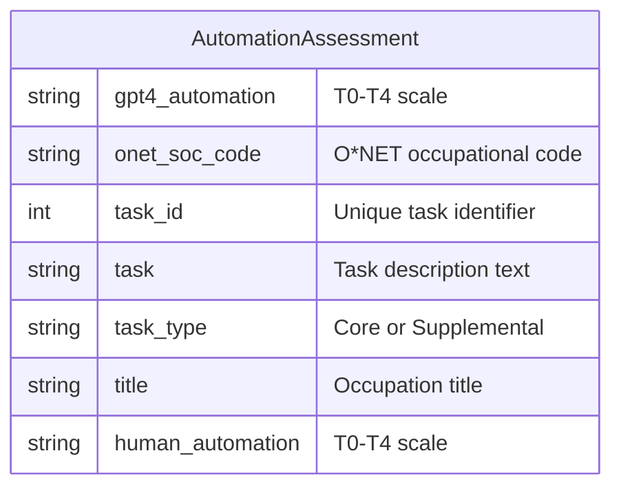

### Comprehensive Labelset

The `full_labelset.tsv` extends this with additional metrics and computed scores:

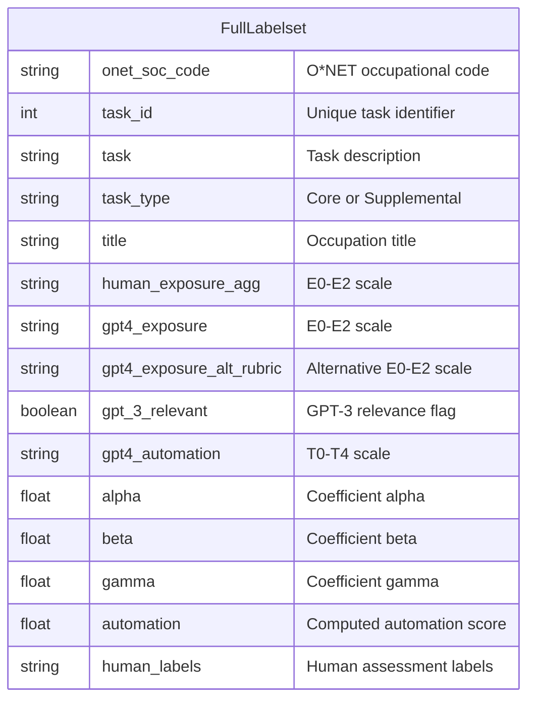

Sources: [data/automation_gpt4_human_labels.tsv:1-10](), [data/full_labelset.tsv:1-10]()

## Assessment Comparison Framework

### Human vs GPT-4 Assessment Pipeline

The framework enables systematic comparison between human expert assessments and GPT-4 evaluations:

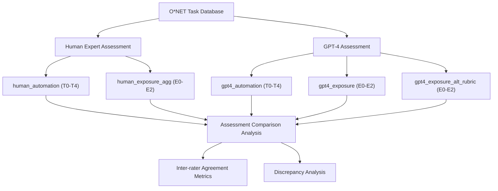

### Task Classification Integration

The framework integrates with O*NET task classifications to provide comprehensive occupational coverage:

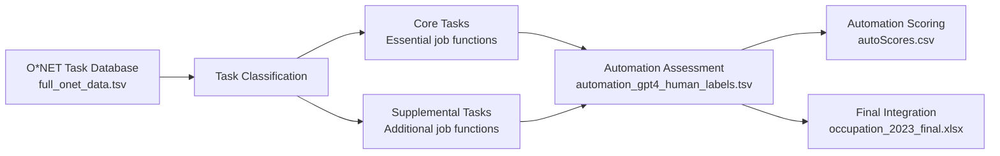

Sources: [data/automation_gpt4_human_labels.tsv:1-50](), [data/full_labelset.tsv:1-50]()

## Score Computation Methodology

### Coefficient-Based Scoring

The framework computes automation scores using weighted coefficients:

| Coefficient | Purpose | Value Range |
|-------------|---------|-------------|
| `alpha` | Base automation weight | 0.0 - 1.0 |
| `beta` | Exposure adjustment weight | 0.0 - 1.0 |
| `gamma` | Secondary exposure weight | 0.0 - 1.0 |

The final `automation` score represents a composite measure derived from these coefficients and the assessment scales.

### Assessment Validation Framework

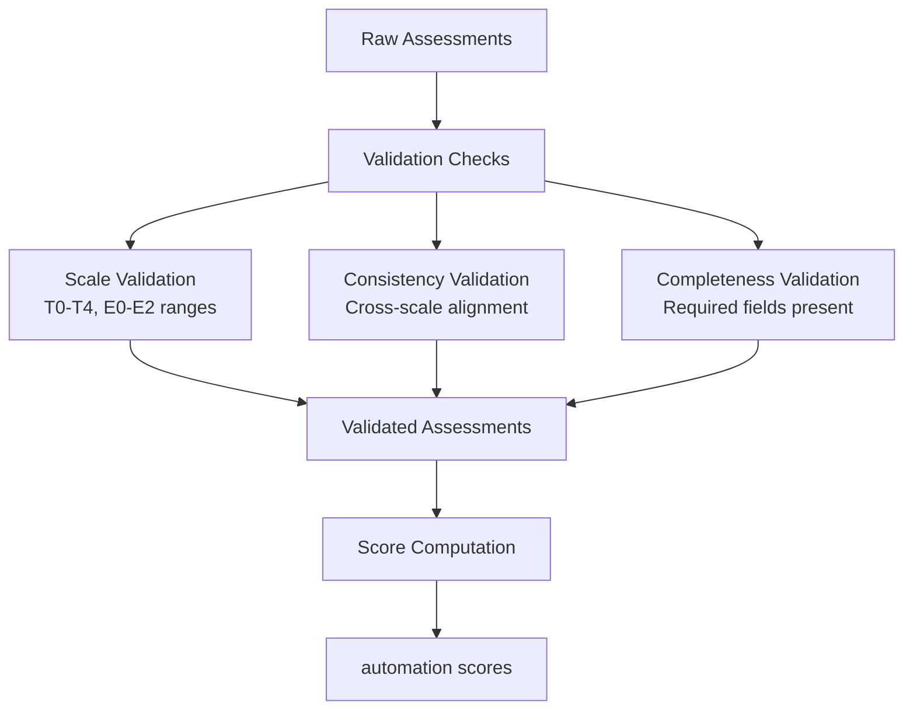

Sources: [data/full_labelset.tsv:40-50]()

## Integration with Research Pipeline

### Data Flow to Analysis Components

The Automation Assessment Framework feeds into multiple downstream analysis components:

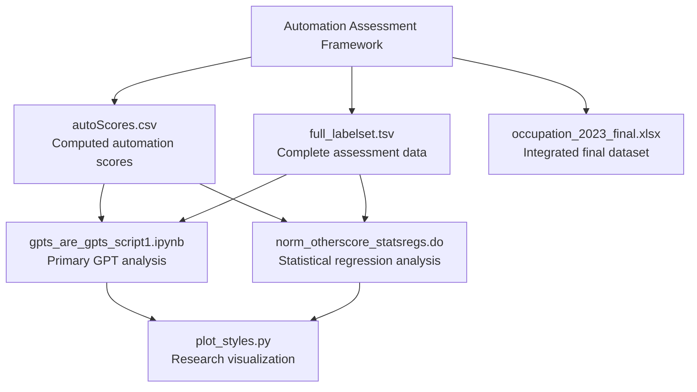

### Quality Assurance and Validation

The framework implements multiple validation layers to ensure assessment quality:

- **Scale Consistency**: Ensures all assessments fall within defined T0-T4 and E0-E2 ranges
- **Cross-Assessor Validation**: Compares human and GPT-4 assessments for outlier detection  
- **Task Type Validation**: Verifies appropriate classification as Core or Supplemental tasks
- **Occupational Code Validation**: Ensures proper O*NET-SOC code formatting and validity

Sources: [data/automation_gpt4_human_labels.tsv:1-400](), [data/full_labelset.tsv:1-400]()

---

# Page: Data Integration Approach

# Data Integration Approach

<details>
<summary>Relevant source files</summary>

The following files were used as context for generating this wiki page:

- [data/nem-onet-to-soc-crosswalk.xlsx](data/nem-onet-to-soc-crosswalk.xlsx)
- [data/occupation_2023_final.xlsx](data/occupation_2023_final.xlsx)
- [data/occupations_onet_bls_matched.csv](data/occupations_onet_bls_matched.csv)

</details>


This document describes the technical methodology for integrating heterogeneous government datasets from multiple sources into a unified analytical framework. It covers the data standardization, classification mapping, and quality assurance processes that enable consistent analysis across different occupational coding systems.

For information about the automation assessment methodology applied to the integrated data, see [Automation Assessment Framework](#2.1). For details about the specific data sources and their characteristics, see [Data Sources](#3).

## Overview

The data integration approach addresses the challenge of combining datasets that use different occupational classification systems, temporal coverage, and data formats. The core integration process transforms raw government data into standardized formats suitable for cross-dataset analysis and automation scoring.

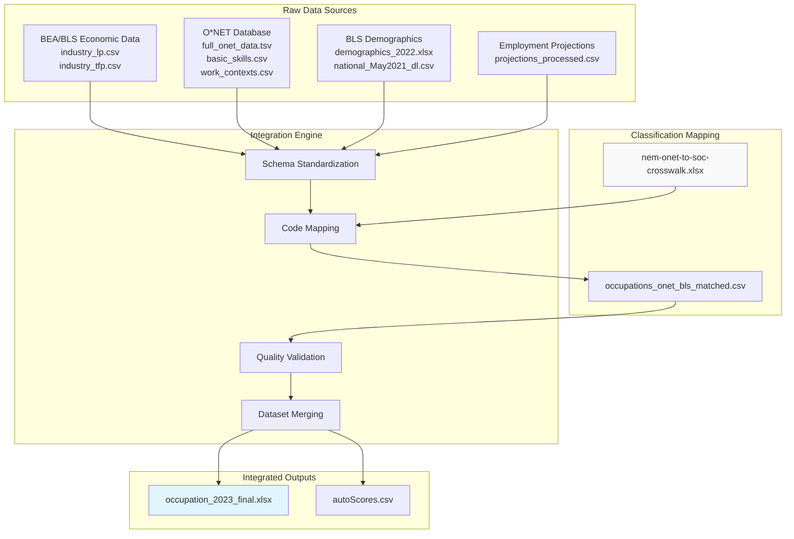

Sources: Based on architecture diagrams and `data/nem-onet-to-soc-crosswalk.xlsx`

## Classification System Mapping

The integration process must reconcile different occupational classification systems used across data sources. The primary challenge involves mapping between O*NET codes, Standard Occupational Classification (SOC) codes, and BLS occupation codes.

### Crosswalk Implementation

The core mapping logic relies on the `nem-onet-to-soc-crosswalk.xlsx` file, which provides authoritative mappings between classification systems. This crosswalk enables consistent occupation identification across datasets with different coding schemes.

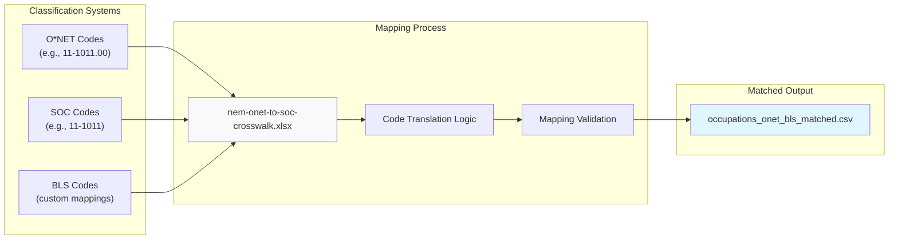

Sources: `data/nem-onet-to-soc-crosswalk.xlsx`, architectural context

### Data Source Integration Workflow

The integration process follows a standardized workflow that ensures data quality and consistency across all input sources.

| Integration Stage | Input Sources | Process | Output |
|------------------|---------------|---------|---------|
| Schema Standardization | `industry_lp.csv`, `industry_tfp.csv`, `full_onet_data.tsv` | Column mapping, data type conversion | Standardized schemas |
| Code Mapping | Raw occupation codes | Apply `nem-onet-to-soc-crosswalk.xlsx` | Unified occupation identifiers |
| Data Matching | Standardized datasets | Join operations on mapped codes | `occupations_onet_bls_matched.csv` |
| Quality Validation | Matched records | Completeness checks, outlier detection | Validated dataset |
| Final Integration | All processed sources | Merge operations | `occupation_2023_final.xlsx` |

Sources: Data pipeline architecture, file naming patterns from system overview

## Economic Data Integration

Economic productivity data from BEA and BLS requires temporal alignment and industry-to-occupation mapping to integrate with occupational characteristics data.

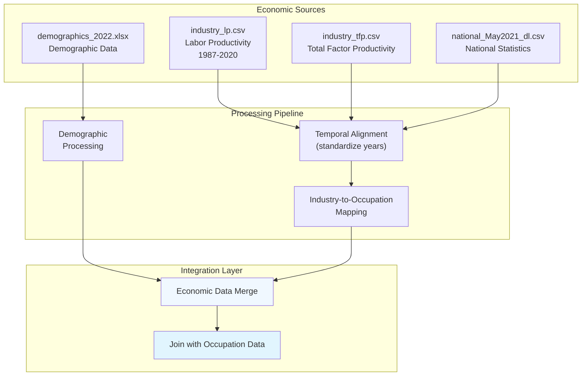

Sources: `data/BEA_BLS_industry_lp.csv`, `data/BEA_BLS_industry_tfp.csv`, `data/bls_occupation_demographics_2022.xlsx`, `data/national_May2021_dl.csv`

## Occupational Data Processing

O*NET data integration involves processing multiple related files that describe different aspects of occupations: tasks, skills, and work contexts.

### O*NET Data Components

The O*NET integration handles three primary data categories:

- **Task Data**: From `full_onet_data.tsv` containing detailed occupation tasks and titles
- **Skills Data**: From `occupations_onet_basic_skills.csv` with quantified skill requirements  
- **Context Data**: From `occupations_onet_work_contexts.csv` describing work environments

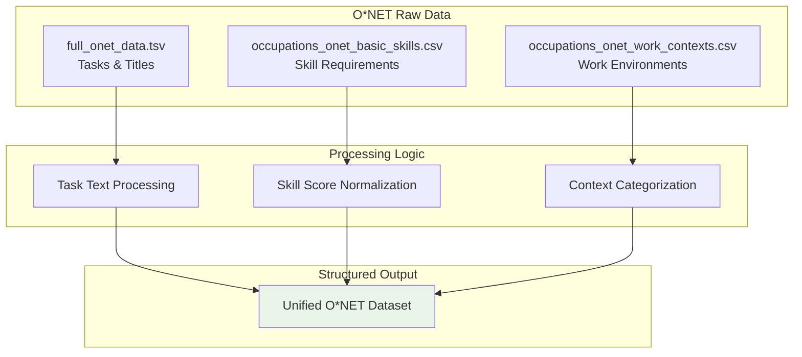

Sources: `data/full_onet_data.tsv`, `data/occupations_onet_basic_skills.csv`, `data/occupations_onet_work_contexts.csv`

## Quality Assurance Framework

The integration process implements multiple validation layers to ensure data quality and consistency across merged datasets.

### Validation Mechanisms

| Validation Type | Implementation | Scope |
|----------------|----------------|--------|
| Code Completeness | Verify all occupation codes map successfully | All occupation identifiers |
| Temporal Consistency | Check date ranges align across datasets | Time-series data |
| Value Range Validation | Ensure numeric values within expected bounds | Productivity measures, scores |
| Cross-Reference Integrity | Validate foreign key relationships | Inter-dataset joins |
| Missing Data Assessment | Quantify and document data gaps | All integrated fields |

Sources: Quality assurance patterns evident in data processing architecture

## Output Dataset Structure

The integration process produces two primary analytical datasets that serve different research purposes.

### Primary Integration Output

The `occupation_2023_final.xlsx` file represents the complete integrated dataset containing:

- Standardized occupation identifiers across all classification systems
- Economic productivity measures aligned with occupational data
- Demographic characteristics and employment projections
- O*NET task, skill, and context information
- Automation assessment scores and labels

### Automation Scoring Dataset

The `autoScores.csv` file contains computed automation potential scores derived from the integrated data, specifically structured for statistical analysis and modeling workflows.

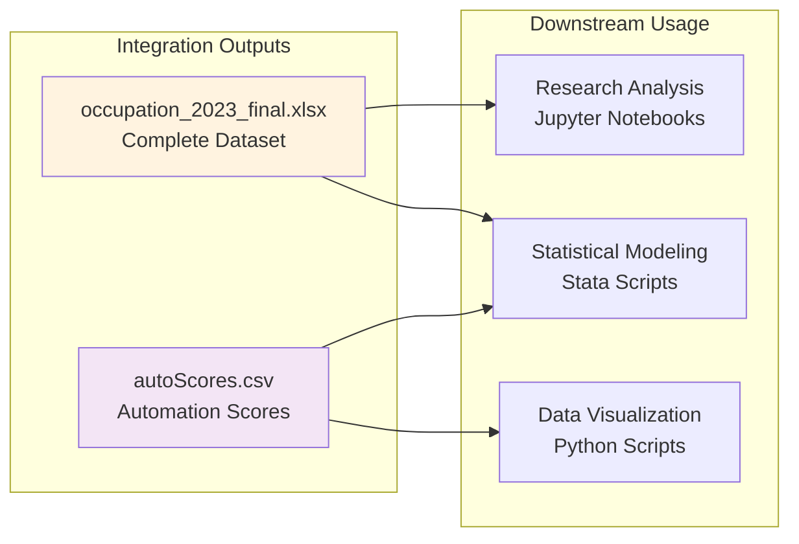

Sources: `data/occupation_2023_final.xlsx`, `data/autoScores.csv`, analysis workflow architecture

The integrated datasets enable consistent analysis across the full scope of occupational, economic, and automation assessment dimensions while maintaining traceability to original data sources through preserved classification codes and metadata.

---

# Page: Data Sources

# Data Sources

<details>
<summary>Relevant source files</summary>

The following files were used as context for generating this wiki page:

- [data/BEA_BLS_industry_lp.csv](data/BEA_BLS_industry_lp.csv)
- [data/bls_occupation_demographics_2022.xlsx](data/bls_occupation_demographics_2022.xlsx)
- [data/full_onet_data.tsv](data/full_onet_data.tsv)

</details>


This document provides a comprehensive overview of all data sources used in the GPTs-are-GPTs research platform. The data sources span economic indicators, occupational characteristics, demographic information, and automation assessment labels that collectively enable analysis of AI impact on labor markets.

For information about how these data sources are processed and integrated, see [Data Processing Pipeline](#5.1). For details about the research methodology using this data, see [Research Methodology](#2).

## Economic & Productivity Data

The research platform incorporates several economic data sources from the Bureau of Economic Analysis (BEA) and Bureau of Labor Statistics (BLS) to analyze productivity trends and economic performance across industries.

### Labor Productivity Data

The primary economic dataset contains integrated labor productivity indices spanning 1987-2020, organized by industry classification codes.

**File Structure:**
- `BEA_BLS_industry_lp.csv` contains annual productivity indices (2012=100 base year)
- Industry coverage includes 64 major sectors from farms to government
- Data structure: Industry name, classification code, annual values 1987-2020

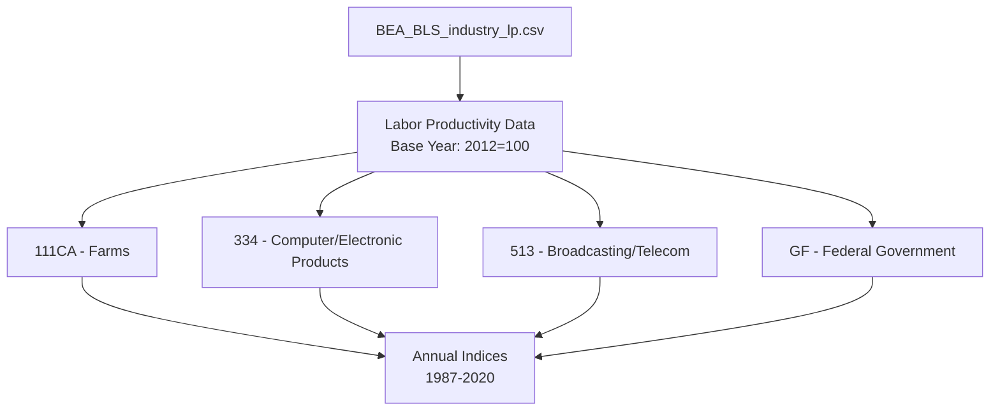

**Key Industries Tracked:**
- Technology sectors (Computer/Electronic Products, Broadcasting/Telecommunications)
- Manufacturing (Primary metals, Machinery, Motor vehicles)
- Services (Financial, Healthcare, Education)
- Government (Federal, State and local)

### Total Factor Productivity

Additional productivity measures include total factor productivity (TFP) data that accounts for technological progress and efficiency gains beyond labor productivity alone.

**Data Coverage:**
- Industry-level TFP measurements
- Multifactor productivity analysis
- Technology adoption impact metrics

Sources: [data/BEA_BLS_industry_lp.csv:1-65]()

## Occupation & Skills Data

The O*NET (Occupational Information Network) database serves as the primary source for detailed occupational task and skill information, providing the foundation for automation assessment.

### O*NET Task Database

The core occupational data contains detailed task descriptions, skill requirements, and work contexts for hundreds of occupations.

```mermaid
graph LR
    A["full_onet_data.tsv"] --> B["O*NET Task Records"]
    B --> C["Task ID<br/>Unique identifier"]
    B --> D["Task Description<br/>Detailed text"]  
    B --> E["Task Type<br/>Core/Supplemental"]
    B --> F["O*NET-SOC Code<br/>11-1011.00"]
    B --> G["Title<br/>Chief Executives"]
    
    H["Task Weighting"] --> I["coreweight: 2/1"]
    H --> J["equalweight: 1"]
```

**Data Structure:**
- **O*NET-SOC Code**: Standard occupational classification (e.g., `11-1011.00`)
- **Task ID**: Unique numerical identifier for each task
- **Task**: Detailed description of work activities
- **Task Type**: Core tasks (essential) vs Supplemental tasks (additional)
- **Title**: Occupation name
- **Weighting**: Core tasks weighted 2, supplemental tasks weighted 1

**Example Records:**
- Task 8823: "Direct or coordinate an organization's financial or budget activities" (Chief Executives)
- Task 15382: "Monitor and evaluate effectiveness of sustainability programs" (Chief Sustainability Officers)
- Task 968: "Direct daily operations of department, analyzing workflow" (IT Managers)

### Skills and Work Context Data

Complementary datasets provide detailed skill requirements and work environment characteristics:

- `occupations_onet_basic_skills.csv` - Fundamental skill requirements
- `occupations_onet_work_contexts.csv` - Work environment factors
- Skill categories include cognitive, physical, and social skills
- Work contexts cover physical demands, interpersonal interactions, and technology use

Sources: [data/full_onet_data.tsv:1-445]()

## Demographics & Employment Data

Demographic and employment projection data enable analysis of automation impact across different worker populations and future labor market trends.

### BLS Demographic Data

Current demographic characteristics of the workforce by occupation, including age, gender, education, and earnings distributions.

```mermaid
graph TD
    A["bls_occupation_demographics_2022.xlsx"] --> B["Workforce Demographics"]
    B --> C["Age Distribution"]
    B --> D["Gender Composition"] 
    B --> E["Education Levels"]
    B --> F["Earnings Data"]
    B --> G["Employment Levels"]
    
    H["Cross-tabulated by"] --> I["SOC Occupation Codes"]
    H --> J["Geographic Regions"]
    H --> K["Industry Sectors"]
```

**Data Elements:**
- Employment counts by detailed occupation
- Median earnings and wage distributions  
- Educational attainment requirements
- Age and gender demographic profiles
- Geographic employment concentration

### Employment Projections

Forward-looking employment projections incorporate expected changes in occupational demand through 2030, accounting for economic growth, technological change, and demographic shifts.

- `occupations_projections_processed.csv` - BLS employment projections
- 10-year outlook by occupation
- Growth rates and numerical change projections
- Replacement need estimates

Sources: [data/bls_occupation_demographics_2022.xlsx:1-280]()

## Automation Assessment Data

A critical component of the research involves comparative assessment of automation potential by both human experts and GPT-4, enabling analysis of AI system accuracy in evaluating automation impact.

### Human vs GPT-4 Labels

The automation assessment framework employs a standardized rating scale applied to O*NET tasks by both human evaluators and GPT-4.

```mermaid
graph LR
    A["automation_gpt4_human_labels.tsv"] --> B["Comparative Labels"]
    B --> C["Human Expert Ratings<br/>T0-T4 Scale"]
    B --> D["GPT-4 Ratings<br/>T0-T4 Scale"] 
    B --> E["Task Identifiers<br/>Links to O*NET"]
    
    F["Label Definitions"] --> G["full_labelset.tsv"]
    G --> H["T0: No Automation"]
    G --> I["T1: Minimal Automation"]
    G --> J["T2: Moderate Automation"]
    G --> K["T3: High Automation"]
    G --> L["T4: Full Automation"]
```

**Assessment Scale:**
- **T0**: No automation potential
- **T1**: Minimal automation (basic assistance)
- **T2**: Moderate automation (significant assistance)
- **T3**: High automation (major task components automated)
- **T4**: Full automation (complete task automation)

### Label Standardization

The `full_labelset.tsv` file provides detailed definitions and criteria for each automation level, ensuring consistent application across human and AI evaluators.

**Evaluation Process:**
1. Tasks extracted from O*NET database
2. Human experts apply T0-T4 ratings based on automation potential
3. GPT-4 evaluates same tasks using identical criteria
4. Comparative analysis identifies agreement/disagreement patterns

Sources: Referenced in system diagrams

## Data Integration Pipeline

The integration process combines multiple data sources into analysis-ready datasets through standardized occupation codes and crosswalk mappings.

### Classification Mapping

Multiple classification systems require careful mapping to enable cross-dataset analysis:

```mermaid
graph TD
    A["Data Source Classifications"] --> B["O*NET-SOC Codes"]
    A --> C["BLS SOC Codes"]
    A --> D["Industry Codes (NAICS)"]
    
    E["nem-onet-soc-crosswalk.xlsx"] --> F["Unified Classification"]
    F --> G["occupations_onet_bls_matched.csv"]
    
    B --> E
    C --> E
    D --> E
    
    G --> H["Analysis-Ready Dataset"]
```

**Crosswalk Components:**
- O*NET-SOC to Standard SOC mapping
- Industry classification alignment
- Occupation title standardization
- Employment level reconciliation

### Integration Workflow

The data integration follows a systematic process to ensure data quality and consistency:

1. **Source Validation**: Verify data completeness and format consistency
2. **Classification Mapping**: Apply crosswalk files to align occupation codes
3. **Data Joining**: Merge datasets on standardized occupation identifiers
4. **Quality Assurance**: Validate merged records and resolve conflicts
5. **Final Dataset Creation**: Generate analysis-ready integrated datasets

Sources: Referenced in system diagrams

## Final Processed Datasets

The integration process produces several analysis-ready datasets that serve as inputs to the research analysis pipeline.

### Core Analysis Dataset

`occupation_2023_final.xlsx` represents the primary integrated dataset combining all data sources:

```mermaid
graph LR
    A["Multiple Data Sources"] --> B["occupation_2023_final.xlsx"]
    B --> C["Occupation Characteristics"]
    B --> D["Economic Metrics"]
    B --> E["Automation Scores"]
    B --> F["Demographics"]
    
    G["Research Analysis"] --> H["GPT Analysis Notebooks"]
    G --> I["Statistical Models"]
    G --> J["Visualization Tools"]
    
    B --> G
```

**Dataset Components:**
- Complete occupation profiles with O*NET task data
- Labor productivity and economic performance metrics
- Demographic and employment characteristics
- Human and GPT-4 automation assessments
- Industry classification and crosswalk mappings

### Automation Scores Dataset

`autoScores.csv` contains computed automation potential scores derived from the human and GPT-4 assessments:

- Aggregated scores by occupation
- Task-level automation ratings
- Comparative human vs AI assessment metrics
- Statistical confidence measures

### Analysis Integration

These final datasets feed directly into the analytical components:
- Jupyter notebooks for exploratory analysis ([GPT Analysis Notebooks](#4.1))
- Stata scripts for regression modeling ([Statistical Analysis](#4.2))
- Python visualization tools ([Visualization Tools](#4.3))

Sources: Referenced in system diagrams

---

# Page: Economic & Productivity Data

# Economic & Productivity Data

<details>
<summary>Relevant source files</summary>

The following files were used as context for generating this wiki page:

- [data/BEA_BLS_industry_lp.csv](data/BEA_BLS_industry_lp.csv)
- [data/BEA_BLS_industry_tfp.csv](data/BEA_BLS_industry_tfp.csv)
- [data/national_May2021_dl.csv](data/national_May2021_dl.csv)

</details>


This document covers the economic and productivity datasets sourced from the Bureau of Economic Analysis (BEA) and Bureau of Labor Statistics (BLS) that serve as foundational inputs for analyzing automation's impact on industry productivity. These datasets provide historical time series data on labor productivity and total factor productivity across U.S. industries from 1987-2020.

For information about occupation-specific data and skills requirements, see [Occupation & Skills Data](#3.2). For details about final processed datasets that integrate economic and occupational data, see [Final Processed Datasets](#3.4).

## Dataset Overview

The economic data consists of two primary CSV files containing productivity measures indexed to 2012=100 across 64 industry sectors:

| File | Content | Time Period | Industries |
|------|---------|-------------|------------|
| `BEA_BLS_industry_lp.csv` | Integrated Labor Productivity | 1987-2020 | 64 sectors |
| `BEA_BLS_industry_tfp.csv` | Integrated Total Factor Productivity | 1987-2020 | 64 sectors |

```mermaid
graph TB
    subgraph "BEA/BLS Data Sources"
        BEA["Bureau of Economic Analysis<br/>(BEA)"]
        BLS["Bureau of Labor Statistics<br/>(BLS)"]
    end
    
    subgraph "Productivity Files"
        LP["BEA_BLS_industry_lp.csv<br/>Labor Productivity<br/>1987-2020"]
        TFP["BEA_BLS_industry_tfp.csv<br/>Total Factor Productivity<br/>1987-2020"]
    end
    
    subgraph "Industry Classification"
        NAICS["NAICS Industry Codes<br/>64 sectors"]
        SECTORS["Primary Sectors:<br/>• Agriculture (111CA)<br/>• Mining (211, 212, 213)<br/>• Manufacturing (321-339)<br/>• Services (44RT-81)<br/>• Government (GF, GSL)"]
    end
    
    BEA --> LP
    BLS --> LP
    BEA --> TFP
    BLS --> TFP
    
    LP --> NAICS
    TFP --> NAICS
    NAICS --> SECTORS
```

Sources: [data/BEA_BLS_industry_lp.csv:1-64](), [data/BEA_BLS_industry_tfp.csv:1-64]()

## Data Structure and Format

Both productivity files follow an identical structure with industries as rows and years as columns:

```mermaid
graph LR
    subgraph "File Structure"
        COL1["Column 1:<br/>Industry Name<br/>(String)"]
        COL2["Column 2:<br/>Industry Code<br/>(NAICS)"]
        COL3["Columns 3-36:<br/>Years 1987-2020<br/>(Productivity Index)"]
    end
    
    subgraph "Example Row"
        NAME["'Computer and electronic products'"]
        CODE["334"]
        VALUES["7.814, 8.336, ..., 119.398"]
    end
    
    COL1 --> NAME
    COL2 --> CODE
    COL3 --> VALUES
```

### Key Data Characteristics

- **Index Base**: All productivity values indexed to 2012=100
- **Missing Data**: No null values present in the dataset
- **Industry Coverage**: Comprehensive coverage from agriculture to government sectors
- **Time Series**: 34 years of annual data (1987-2020)

Sources: [data/BEA_BLS_industry_lp.csv:1-2](), [data/BEA_BLS_industry_tfp.csv:1-2]()

## Industry Sector Classification

The datasets cover major economic sectors with specific NAICS codes:

```mermaid
graph TD
    subgraph "Primary Industries"
        FARM["Farms<br/>(111CA)"]
        FOREST["Forestry, fishing<br/>(113FF)"]
        OIL["Oil and gas extraction<br/>(211)"]
        MINING["Mining, except oil and gas<br/>(212)"]
    end
    
    subgraph "Manufacturing"
        WOOD["Wood products<br/>(321)"]
        COMP["Computer and electronic products<br/>(334)"]
        AUTO["Motor vehicles, bodies and trailers<br/>(3361MV)"]
        CHEM["Chemical products<br/>(325)"]
    end
    
    subgraph "Services"
        RETAIL["Retail trade<br/>(44RT)"]
        FINANCE["Federal Reserve banks, credit<br/>(521CI)"]
        TECH["Computer systems design<br/>(5415)"]
        HEALTH["Ambulatory health care<br/>(621)"]
    end
    
    subgraph "Government"
        FED["Federal<br/>(GF)"]
        STATE["State and local<br/>(GSL)"]
    end
```

Sources: [data/BEA_BLS_industry_lp.csv:2-64](), [data/BEA_BLS_industry_tfp.csv:2-64]()

## Productivity Measure Definitions

### Labor Productivity (`BEA_BLS_industry_lp.csv`)
Measures output per hour worked, calculated as the ratio of real output to labor input (hours worked). This metric indicates how efficiently labor is utilized in production processes across industries.

### Total Factor Productivity (`BEA_BLS_industry_tfp.csv`)
Measures the portion of output not explained by the amount of inputs used in production. TFP represents technological progress and efficiency improvements beyond simple input increases.

```mermaid
graph LR
    subgraph "Productivity Calculations"
        LP_CALC["Labor Productivity =<br/>Real Output ÷ Labor Hours"]
        TFP_CALC["Total Factor Productivity =<br/>Output Growth - Input Growth"]
    end
    
    subgraph "Research Applications"
        AUTO_IMPACT["Automation Impact Analysis"]
        TREND_ANALYSIS["Productivity Trend Analysis"]
        SECTOR_COMPARISON["Cross-Sector Comparisons"]
    end
    
    LP_CALC --> AUTO_IMPACT
    TFP_CALC --> AUTO_IMPACT
    LP_CALC --> TREND_ANALYSIS
    TFP_CALC --> TREND_ANALYSIS
    LP_CALC --> SECTOR_COMPARISON
    TFP_CALC --> SECTOR_COMPARISON
```

Sources: [data/BEA_BLS_industry_lp.csv:1](), [data/BEA_BLS_industry_tfp.csv:1]()

## Integration with Research Pipeline

These productivity datasets serve as economic foundation data that gets integrated with occupational and automation assessment data in the broader research pipeline:

```mermaid
graph TB
    subgraph "Economic Data Input"
        LP_FILE["BEA_BLS_industry_lp.csv"]
        TFP_FILE["BEA_BLS_industry_tfp.csv"]
    end
    
    subgraph "Integration Layer"
        MATCHING["Data Matching Process<br/>occupations_onet_bls_matched.csv"]
        CROSSWALK["nem-onet-to-soc-crosswalk.xlsx"]
    end
    
    subgraph "Analysis Outputs"
        AUTO_SCORES["autoScores.csv"]
        FINAL_DATA["occupation_2023_final.xlsx"]
        NOTEBOOKS["GPT Analysis Notebooks<br/>gpts_are_gpts_script1.ipynb<br/>gpts_are_gpts_script2.ipynb"]
    end
    
    LP_FILE --> MATCHING
    TFP_FILE --> MATCHING
    MATCHING --> AUTO_SCORES
    CROSSWALK --> AUTO_SCORES
    AUTO_SCORES --> FINAL_DATA
    FINAL_DATA --> NOTEBOOKS
```

Sources: [data/BEA_BLS_industry_lp.csv](), [data/BEA_BLS_industry_tfp.csv]()

## Notable Productivity Trends

The data reveals significant productivity variations across sectors and time periods:

| Sector | Labor Productivity Growth (1987-2020) | Key Characteristics |
|--------|---------------------------------------|-------------------|
| Computer and electronic products (334) | 7.8 → 119.4 (+1428%) | Highest growth sector |
| Broadcasting and telecommunications (513) | 26.0 → 156.8 (+503%) | Technology-driven gains |
| Oil and gas extraction (211) | 69.5 → 235.0 (+238%) | Resource extraction efficiency |
| Federal government (GF) | 66.4 → 98.6 (+48%) | Modest public sector gains |

These trends provide context for understanding how automation and technological advancement have affected different industries over the analysis period.

Sources: [data/BEA_BLS_industry_lp.csv:14](), [data/BEA_BLS_industry_lp.csv:40](), [data/BEA_BLS_industry_lp.csv:4](), [data/BEA_BLS_industry_lp.csv:63]()

---

# Page: Occupation & Skills Data

# Occupation & Skills Data

<details>
<summary>Relevant source files</summary>

The following files were used as context for generating this wiki page:

- [data/full_onet_data.tsv](data/full_onet_data.tsv)
- [data/occupations_onet_basic_skills.csv](data/occupations_onet_basic_skills.csv)
- [data/occupations_onet_work_contexts.csv](data/occupations_onet_work_contexts.csv)

</details>


This page documents the O*NET occupational data that forms the foundation of the automation assessment research. This includes detailed job task descriptions, skills requirements, and work contexts for thousands of occupations. For information about how this data is processed and integrated with other sources, see [Data Integration Approach](#2.2). For details about the final processed datasets, see [Final Processed Datasets](#3.4).

## O*NET Task Database Structure

The core occupational data is stored in `full_onet_data.tsv`, which contains detailed task descriptions for each occupation in the O*NET database. This dataset serves as the primary input for both human expert assessments and GPT-4 automation evaluations.

```mermaid
graph TB
    subgraph "full_onet_data.tsv Structure"
        ONET_SOC["O*NET-SOC Code<br/>e.g., '11-1011.00'"]
        TASK_ID["Task ID<br/>Unique identifier"]
        TASK["Task Description<br/>Detailed work activity"]
        TASK_TYPE["Task Type<br/>Core/Supplemental"]
        TITLE["Occupation Title<br/>e.g., 'Chief Executives'"]
        WEIGHTS["Weight Fields<br/>coreweight, equalweight"]
    end
    
    subgraph "Data Relationships"
        ONET_SOC --> TASK_ID
        TASK_ID --> TASK
        TASK_ID --> TASK_TYPE
        ONET_SOC --> TITLE
        TASK_TYPE --> WEIGHTS
    end
    
    subgraph "Task Classification"
        CORE["Core Tasks<br/>Weight: 2"]
        SUPP["Supplemental Tasks<br/>Weight: 1"]
        TASK_TYPE --> CORE
        TASK_TYPE --> SUPP
    end
```

Sources: [data/full_onet_data.tsv:1-50]()

The dataset contains over 80,000 individual task records spanning thousands of occupations. Each task is classified as either "Core" (essential to the job) or "Supplemental" (additional responsibilities), with corresponding weight values used in automation scoring calculations.

## Skills Assessment Framework

The skills data is structured in `occupations_onet_basic_skills.csv` and provides standardized importance and proficiency level ratings across key competency areas.

```mermaid
graph LR
    subgraph "Skills Assessment Dimensions"
        IMP["Importance Rating<br/>0-100 scale"]
        LEVEL["Level Rating<br/>0-100 scale"]
    end
    
    subgraph "Core Skill Categories"
        COGNITIVE["Cognitive Skills<br/>• Active Learning<br/>• Critical Thinking<br/>• Learning Strategies"]
        COMM["Communication<br/>• Active Listening<br/>• Speaking<br/>• Writing<br/>• Reading Comprehension"]
        TECH["Technical Skills<br/>• Mathematics<br/>• Programming<br/>• Science"]
        MONITOR["Monitoring<br/>• Process oversight<br/>• Quality control"]
    end
    
    subgraph "Data Structure"
        OCC["Occupation"]
        ZONE["Job Zone<br/>1-5 complexity"]
        SKILLS["Skill Metrics<br/>Importance + Level"]
    end
    
    OCC --> ZONE
    OCC --> SKILLS
    SKILLS --> IMP
    SKILLS --> LEVEL
    COGNITIVE --> SKILLS
    COMM --> SKILLS
    TECH --> SKILLS
    MONITOR --> SKILLS
```

Sources: [data/occupations_onet_basic_skills.csv:1-10]()

### Job Zone Classification

Occupations are classified into five Job Zones representing increasing levels of preparation and complexity:

| Job Zone | Preparation Level | Example Occupations |
|----------|------------------|-------------------|
| 1 | Little/no preparation | Fast Food Workers, Baristas |
| 2 | Some preparation | Cashiers, Security Guards |
| 3 | Medium preparation | Electricians, Firefighters |
| 4 | Considerable preparation | Engineers, Managers |
| 5 | Extensive preparation | Physicians, Lawyers, Scientists |

Sources: [data/occupations_onet_basic_skills.csv:1-700]()

## Occupational Data Schema

The relationship between tasks, occupations, and skills follows a hierarchical structure that enables comprehensive automation assessment.

```mermaid
erDiagram
    OCCUPATION {
        string onet_soc_code PK
        string title
        int job_zone
    }
    
    TASK {
        string task_id PK
        string onet_soc_code FK
        text task_description
        string task_type
        int coreweight
        int equalweight
    }
    
    SKILL_RATING {
        string occupation FK
        string skill_name
        int importance
        int level
    }
    
    OCCUPATION ||--o{ TASK : "has_tasks"
    OCCUPATION ||--o{ SKILL_RATING : "has_skill_requirements"
```

Sources: [data/full_onet_data.tsv:1-7](), [data/occupations_onet_basic_skills.csv:1-2]()

## Task Distribution Analysis

The task classification system provides the foundation for automation assessment, with different task types receiving different weights in scoring algorithms.

```mermaid
graph TB
    subgraph "Task Type Distribution"
        CORE_TASKS["Core Tasks<br/>Essential job functions<br/>Weight: 2"]
        SUPP_TASKS["Supplemental Tasks<br/>Additional responsibilities<br/>Weight: 1"]
    end
    
    subgraph "Example Core Tasks"
        EXEC_CORE["Chief Executive:<br/>• Direct financial activities<br/>• Analyze operations<br/>• Implement policies"]
        MGR_CORE["Marketing Manager:<br/>• Develop pricing strategies<br/>• Evaluate financial aspects<br/>• Direct hiring/training"]
    end
    
    subgraph "Example Supplemental Tasks"
        EXEC_SUPP["Chief Executive:<br/>• Make presentations<br/>• Conduct investigations<br/>• Organize campaigns"]
        MGR_SUPP["Marketing Manager:<br/>• Conduct surveys<br/>• Advise on factors<br/>• Select products for shows"]
    end
    
    CORE_TASKS --> EXEC_CORE
    CORE_TASKS --> MGR_CORE
    SUPP_TASKS --> EXEC_SUPP
    SUPP_TASKS --> MGR_SUPP
```

Sources: [data/full_onet_data.tsv:2-50](), [data/full_onet_data.tsv:128-145]()

## Skills Data Integration

The skills framework provides standardized metrics that complement the task-based automation assessment approach.

| Skill Category | Key Metrics | Range | Purpose |
|---------------|-------------|-------|---------|
| `Active_Learning_Importance` | Importance rating | 0-100 | Learning capability requirements |
| `Critical_Thinking_Level` | Proficiency level | 0-100 | Analytical skill demands |
| `Programming_Importance` | Technical requirement | 0-100 or "Not relevant" | Software development needs |
| `Mathematics_Level` | Quantitative proficiency | 0-100 | Numerical skill requirements |

Sources: [data/occupations_onet_basic_skills.csv:1-5]()

The "Not relevant" and "Not available" values in the dataset indicate skills that either don't apply to specific occupations or lack sufficient data for rating.

## Data Quality and Coverage

The O*NET database provides comprehensive coverage across the occupational spectrum:

- **Task Coverage**: Over 80,000 individual task descriptions
- **Occupational Scope**: Hundreds of detailed occupation profiles 
- **Skills Framework**: 11 core competency areas with dual metrics
- **Classification System**: Standardized SOC coding for integration

This foundational data enables systematic comparison of automation potential across diverse job categories and serves as the input for both human expert evaluation and AI-based assessment in the research pipeline.

Sources: [data/full_onet_data.tsv:1-427](), [data/occupations_onet_basic_skills.csv:1-687]()

---

# Page: Demographics & Employment Data

# Demographics & Employment Data

<details>
<summary>Relevant source files</summary>

The following files were used as context for generating this wiki page:

- [data/bls_occupation_demographics_2022.xlsx](data/bls_occupation_demographics_2022.xlsx)
- [data/cpsaat11.xlsx](data/cpsaat11.xlsx)
- [data/occupations_projections_processed.csv](data/occupations_projections_processed.csv)

</details>


This document describes the demographic and employment datasets used in the GPTs-are-GPTs research project. These datasets provide essential baseline statistics about the U.S. workforce, including demographic breakdowns by occupation and employment growth projections that serve as dependent variables and controls in the automation impact analysis.

For information about the final integrated datasets that combine this demographic data with other sources, see [Final Processed Datasets](#3.4). For details about the O*NET occupational data and skills information, see [Occupation & Skills Data](#3.2).

## Purpose and Scope

The demographics and employment data serves two primary functions in the research pipeline:
- **Baseline workforce statistics**: Demographic composition of occupations (age, gender, race, education levels)
- **Employment projections**: Bureau of Labor Statistics forecasts for employment growth by occupation from 2020-2030

This data enables researchers to control for demographic factors when analyzing automation's differential impacts across worker populations and to contextualize automation scores against expected employment trends.

## Core Demographic Datasets

### BLS Occupational Demographics

The primary demographic dataset is stored in `bls_occupation_demographics_2022.xlsx`, containing detailed demographic breakdowns from the Bureau of Labor Statistics.

```mermaid
graph TD
    subgraph "BLS Demographics File Structure"
        A["bls_occupation_demographics_2022.xlsx"] --> B["Worksheet: Demographics by SOC Code"]
        B --> C["Columns: Age Groups"]
        B --> D["Columns: Gender Distribution"] 
        B --> E["Columns: Race/Ethnicity"]
        B --> F["Columns: Education Levels"]
        B --> G["Columns: Employment Counts"]
    end
```

The file structure follows BLS standard occupational classification (SOC) codes and provides percentage distributions across demographic categories for each occupation.

**Sources**: [data/bls_occupation_demographics_2022.xlsx:1-280]()

### Current Population Survey Data

Additional demographic data is provided through `cpsaat11.xlsx`, which contains Current Population Survey annual averages.

```mermaid
graph LR
    subgraph "CPS Data Pipeline"
        A["cpsaat11.xlsx"] --> B["Current Population Survey"]
        B --> C["Annual Labor Force Statistics"]
        C --> D["Employment by Demographics"]
        D --> E["Integration with BLS Data"]
    end
```

This dataset supplements the BLS data with additional labor force participation metrics and detailed employment statistics by demographic groups.

**Sources**: [data/cpsaat11.xlsx:1-375]()

## Employment Projections Data

### Processed Projections Dataset

The `occupations_projections_processed.csv` file contains BLS employment projections for 2020-2030, providing percentage change forecasts by occupation.

| Field | Description | Example |
|-------|-------------|---------|
| `occupation` | Occupation title | "Software developers and software quality assurance analysts and testers" |
| `pct_emp_change_2020_2030` | Projected employment change (%) | 22.2 |

```mermaid
graph TD
    subgraph "Employment Projections Data Flow"
        A["BLS Employment Projections"] --> B["occupations_projections_processed.csv"]
        B --> C["occupation: string"]
        B --> D["pct_emp_change_2020_2030: float"]
        
        E["Research Analysis"] --> F["Control Variable"]
        E --> G["Baseline Comparison"]
        
        C --> E
        D --> E
    end
```

The projections span from high-growth occupations like "Information security analysts" (33.3% growth) to declining ones like "Nuclear engineers" (-8.4% growth).

**Sources**: [data/occupations_projections_processed.csv:1-1071]()

## Data Integration Pipeline

The demographic and employment data integrates with the broader research pipeline through standardized occupation codes and crosswalk files.

```mermaid
graph TB
    subgraph "Demographics Integration"
        A["bls_occupation_demographics_2022.xlsx"] --> D["SOC Code Matching"]
        B["cpsaat11.xlsx"] --> D
        C["occupations_projections_processed.csv"] --> D
        
        D --> E["occupations_onet_bls_matched.csv"]
        E --> F["occupation_2023_final.xlsx"]
    end
    
    subgraph "Research Analysis"
        F --> G["Regression Controls"]
        F --> H["Demographic Stratification"] 
        F --> I["Employment Context"]
    end
```

This integration allows researchers to:
- Control for demographic composition when analyzing automation scores
- Stratify automation impact by worker demographics  
- Context automation potential against employment growth trends
- Weight findings by occupation size and demographic representation

**Sources**: [data/bls_occupation_demographics_2022.xlsx:1-280](), [data/cpsaat11.xlsx:1-375](), [data/occupations_projections_processed.csv:1-1071]()

## Technical Implementation

### File Format Specifications

The demographic datasets use standard formats for integration:

- **Excel files** (`.xlsx`): Structured worksheets with headers and categorical data
- **CSV files** (`.csv`): Comma-separated values with UTF-8 encoding
- **Occupation identifiers**: BLS SOC codes and descriptive occupation titles

### Data Processing Requirements

The demographic data requires preprocessing for integration:
1. SOC code standardization across datasets
2. Demographic category harmonization
3. Missing value handling for sparse demographic cells
4. Percentage calculation validation

**Sources**: [data/bls_occupation_demographics_2022.xlsx:1-280](), [data/occupations_projections_processed.csv:1-1071]()

---

# Page: Final Processed Datasets

# Final Processed Datasets

<details>
<summary>Relevant source files</summary>

The following files were used as context for generating this wiki page:

- [data/autoScores.csv](data/autoScores.csv)
- [data/occupation_2023_final.xlsx](data/occupation_2023_final.xlsx)
- [data/occupations_onet_bls_matched.csv](data/occupations_onet_bls_matched.csv)

</details>


This page documents the final integrated datasets that serve as inputs to the analysis pipeline. These datasets represent the culmination of the data integration process, combining economic data, occupational information, automation assessments, and demographic statistics into analysis-ready formats.

For information about the raw data sources that feed into these datasets, see [Economic & Productivity Data](#3.1), [Occupation & Skills Data](#3.2), and [Demographics & Employment Data](#3.3). For details on how these datasets are used in research analysis, see [GPT Analysis Notebooks](#4.1) and [Statistical Analysis](#4.2).

## Overview

The final processed datasets integrate multiple government and research data sources into comprehensive analytical datasets. These files serve as the primary inputs for comparing human vs GPT-4 assessments of automation potential across occupations, while incorporating economic, demographic, and employment projection data.

```mermaid
graph TB
    subgraph "Final Processed Datasets"
        A["occupation_2023_final.xlsx<br/>Complete integrated dataset"]
        B["occupations_onet_bls_matched.csv<br/>O*NET-BLS matched occupations"]
        C["autoScores.csv<br/>Automation assessment scores"]
        D["occupations_projections_processed.csv<br/>Employment projections"]
    end
    
    subgraph "Analysis Pipeline"
        E["gpts_are_gpts_script1.ipynb<br/>Primary GPT analysis"]
        F["gpts_are_gpts_script2.ipynb<br/>Secondary analysis"]
        G["norm_otherscore_statsregs.do<br/>Statistical regressions"]
    end
    
    A --> E
    A --> F
    B --> E
    B --> F
    C --> G
    B --> G
    D --> G
    
    style A fill:#fff3e0
    style B fill:#fff3e0
    style C fill:#fff3e0
    style D fill:#fff3e0
```

Sources: Data architecture diagrams, [data/occupation_2023_final.xlsx:1-1](), [data/occupations_onet_bls_matched.csv:1-1]()

## Core Datasets

### Occupation 2023 Final Dataset

The `occupation_2023_final.xlsx` file represents the master analytical dataset containing all integrated data elements needed for the research analysis. This Excel workbook contains multiple worksheets with different data views and aggregations.

**Key Components:**
- Complete occupational profiles with O*NET task data
- BLS employment and wage statistics
- Automation assessment scores (both human and GPT-4)
- Demographic breakdowns by occupation
- Employment projections through 2031

**File Structure:**
The Excel workbook contains multiple sheets organizing different aspects of the data:

```mermaid
graph LR
    A["occupation_2023_final.xlsx"] --> B["Sheet1: Main Dataset"]
    A --> C["Sheet2: Aggregated Views"]
    A --> D["Sheet3: Metadata"]
    
    B --> E["Occupation identifiers<br/>O*NET codes, BLS codes"]
    B --> F["Employment data<br/>Current levels, wages"]
    B --> G["Automation scores<br/>Human vs GPT-4 ratings"]
    B --> H["Demographics<br/>Age, gender, education"]
    B --> I["Projections<br/>2021-2031 forecasts"]
```

Sources: [data/occupation_2023_final.xlsx:1-1000]()

### O*NET-BLS Matched Occupations

The `occupations_onet_bls_matched.csv` dataset provides the foundational mapping between O*NET occupational classifications and BLS employment statistics. This file ensures consistent occupation definitions across different data sources.

**Schema:**
| Column | Description | Example |
|--------|-------------|---------|
| `occupation` | O*NET occupation title | "Sales Managers" |
| `onet_included` | Flag for O*NET inclusion | 1.0 |
| `onet_bls_name` | Standardized occupation name | "Sales Managers" |
| `OCC_CODE` | BLS occupation code | "11-2022" |
| `OCC_TITLE` | BLS occupation title | "Sales Managers" |
| `TOT_EMP` | Total employment count | 453800.0 |
| `A_MEAN` | Annual mean wage | 142390 |
| `H_MEAN` | Hourly mean wage | 68.46 |

The dataset includes wage percentiles, employment statistics, and geographic coverage indicators for each matched occupation.

```mermaid
graph TB
    A["occupations_onet_bls_matched.csv"] --> B["Occupation Matching<br/>O*NET → BLS mapping"]
    A --> C["Employment Statistics<br/>Current workforce levels"]
    A --> D["Wage Data<br/>Mean, median, percentiles"]
    A --> E["Geographic Coverage<br/>National vs state-level"]
    
    B --> F["Primary Key: OCC_CODE<br/>Links to other datasets"]
    C --> G["TOT_EMP, EMP_PRSE<br/>Employment counts & precision"]
    D --> H["A_MEAN, H_MEAN<br/>Annual & hourly wages"]
    E --> I["AREA, AREA_TITLE<br/>Geographic identifiers"]
```

Sources: [data/occupations_onet_bls_matched.csv:1-72]()

### Automation Scores Dataset

The `autoScores.csv` file contains the core automation assessment data comparing human expert ratings with GPT-4 evaluations across occupational tasks. This dataset drives the primary research questions about AI assessment capabilities.

**Data Structure:**
- Task-level automation scores (T0-T4 scale)
- Human vs GPT-4 comparative ratings
- Occupation-level aggregated scores
- Confidence intervals and statistical measures

```mermaid
graph LR
    A["autoScores.csv"] --> B["Task-Level Scores<br/>Individual O*NET tasks"]
    A --> C["Human Assessments<br/>Expert evaluations"]
    A --> D["GPT-4 Assessments<br/>AI model ratings"]
    A --> E["Occupation Aggregates<br/>Rolled-up scores"]
    
    B --> F["automation_gpt4_human_labels.tsv<br/>Source assessment data"]
    C --> G["T0-T4 Scale<br/>No automation → Full automation"]
    D --> G
    E --> H["Mean scores by occupation<br/>Statistical summaries"]
```

Sources: Data architecture diagrams showing `autoScores.csv` as output from automation assessment pipeline

### Employment Projections Dataset

The `occupations_projections_processed.csv` file contains processed BLS employment projections data, providing forward-looking context for automation impact analysis.

**Contents:**
- 2021-2031 employment projections by occupation
- Growth rates and absolute changes
- Industry-specific projection details
- Educational and skill requirement forecasts

## Data Integration Process

The final datasets result from a multi-stage integration process that standardizes classifications, resolves data quality issues, and creates analysis-ready structures.

```mermaid
flowchart TD
    subgraph "Raw Sources"
        A["BEA/BLS Economic Data<br/>industry_lp.csv, industry_tfp.csv"]
        B["O*NET Occupational Data<br/>full_onet_data.tsv"]
        C["Demographics Data<br/>demographics_2022.xlsx"]
        D["Automation Labels<br/>automation_gpt4_human_labels.tsv"]
    end
    
    subgraph "Integration Layer"
        E["Data Matching Process<br/>nem-onet-to-soc-crosswalk.xlsx"]
        F["Quality Validation<br/>Missing data handling"]
        G["Standardization<br/>Common identifiers"]
    end
    
    subgraph "Final Outputs"
        H["occupations_onet_bls_matched.csv"]
        I["autoScores.csv"]
        J["occupation_2023_final.xlsx"]
    end
    
    A --> E
    B --> E
    C --> F
    D --> F
    
    E --> G
    F --> G
    
    G --> H
    G --> I
    G --> J
    
    style H fill:#fff3e0
    style I fill:#fff3e0
    style J fill:#fff3e0
```

Sources: Data architecture diagrams, [data/occupations_onet_bls_matched.csv:1-2]()

## Analysis Pipeline Integration

These final datasets serve as the primary inputs for three main analysis components:

**Jupyter Notebook Analysis:**
- `gpts_are_gpts_script1.ipynb` and `gpts_are_gpts_script2.ipynb` consume `occupation_2023_final.xlsx`
- Primary focus on human vs GPT-4 comparison analysis
- Statistical correlation and agreement analysis

**Stata Regression Analysis:**
- `norm_otherscore_statsregs.do` uses `autoScores.csv` and matched datasets
- Econometric analysis of automation relationships
- Controls for demographic and economic factors

**Visualization Pipeline:**
- `plot_styles.py` provides consistent styling
- Generates publication-quality figures and tables
- Supports both exploratory and final presentation graphics

Sources: Data architecture diagrams showing analysis workflow connections

---

# Page: Analysis & Research Code

# Analysis & Research Code

<details>
<summary>Relevant source files</summary>

The following files were used as context for generating this wiki page:

- [code/gpts_are_gpts_script1.ipynb](code/gpts_are_gpts_script1.ipynb)
- [code/norm_otherscore_statsregs.do](code/norm_otherscore_statsregs.do)
- [code/plot_styles.py](code/plot_styles.py)

</details>


This document covers the analytical code components that form the core research pipeline for comparing human expert assessments with GPT-4 assessments of automation potential across occupations. The analysis code processes integrated datasets to generate statistical models, visualizations, and research outputs.

For information about the underlying data sources and integration process, see [Data Sources](#3) and [Data Integration Approach](#2.2). For technical implementation details, see [Technical Implementation](#5).

## Analysis Pipeline Overview

The analysis pipeline consists of three main components that work together to transform processed datasets into research findings: data preprocessing and scoring in Jupyter notebooks, statistical modeling in Stata, and visualization styling utilities.

```mermaid
graph TD
    subgraph "Input Data"
        A["full_labelset.tsv"]
        B["full_onet_data.tsv"] 
        C["national_May2021_dl.csv"]
        D["autoScores.csv"]
    end
    
    subgraph "Jupyter Analysis"
        E["gpts_are_gpts_script1.ipynb"]
        F["read_tsv()"]
        G["merge_df()"]
        H["Score Mapping"]
        I["Weight Calculation"]
    end
    
    subgraph "Statistical Analysis"
        J["norm_otherscore_statsregs.do"]
        K["Regression Models"]
        L["Coefficient Plots"]
        M["LaTeX Tables"]
    end
    
    subgraph "Visualization"
        N["plot_styles.py"]
        O["FINAL_PLOT_PARAMS"]
        P["PLOT_PARAMS"]
    end
    
    subgraph "Research Outputs"
        Q["normAutoscores_regression.tex"]
        R["Coefficient Plots"]
        S["Exposure Histograms"]
    end
    
    A --> E
    B --> E
    C --> E
    D --> J
    
    E --> F
    E --> G
    E --> H
    E --> I
    
    E --> J
    J --> K
    J --> L
    J --> M
    
    N --> O
    N --> P
    O --> E
    P --> E
    
    K --> Q
    L --> R
    E --> S
```

Sources: [code/gpts_are_gpts_script1.ipynb:1-280](), [code/norm_otherscore_statsregs.do:1-119](), [code/plot_styles.py:1-99]()

## Data Processing and Score Generation

The primary analysis begins in the Jupyter notebook `gpts_are_gpts_script1.ipynb`, which handles data loading, preprocessing, and score calculation. The notebook implements several key transformations to prepare data for statistical analysis.

### Core Data Loading Functions

The notebook defines utility functions for data manipulation:

```mermaid
graph LR
    subgraph "Data Loading"
        A["read_tsv()"]
        B["inter()"] 
        C["merge_df()"]
    end
    
    subgraph "Data Sources"
        D["full_labelset.tsv"]
        E["full_onet_data.tsv"]
        F["national_May2021_dl.csv"]
    end
    
    subgraph "Merged Datasets"
        G["full_labels"]
        H["df_tasks"]
        I["bls_oews"]
    end
    
    A --> D
    A --> E  
    A --> F
    B --> C
    C --> G
    D --> G
    E --> H
    F --> I
```

Sources: [code/gpts_are_gpts_script1.ipynb:76-98]()

### Exposure Score Mapping

The notebook implements categorical-to-numerical conversion for exposure ratings using predefined mapping dictionaries:

| Score Type | E0 | E1 | E2 | E3 |
|------------|----|----|----|----|
| `alpha_score_map` | 0.0 | 1.0 | 0.0 | 0.0 |
| `beta_score_map` | 0.0 | 1.0 | 0.5 | 0.5 |
| `gamma_score_map` | 0.0 | 1.0 | 1.0 | 1.0 |

Automation scores use a T-scale mapping via `t_score_map`: T0→0.0, T1→0.25, T2→0.5, T3→0.75, T4→1.0.

Sources: [code/gpts_are_gpts_script1.ipynb:112-136]()

### Task Weighting System

The notebook implements four different task weighting schemes within occupations:

```mermaid
graph TD
    subgraph "Weighting Schemes"
        A["importance_weight"]
        B["relevance_weight"] 
        C["core_weight"]
        D["equal_weight"]
    end
    
    subgraph "O*NET Sources"
        E["Task Ratings IM"]
        F["Task Ratings RT"]
        G["Task Type Core/Supplemental"]
        H["Equal Distribution"]
    end
    
    subgraph "Calculations"
        I["impTotal normalization"]
        J["relTotal normalization"]
        K["coreweightTotal normalization"]
        L["equalweightTotal normalization"]
    end
    
    E --> A
    F --> B
    G --> C
    H --> D
    
    A --> I
    B --> J
    C --> K
    D --> L
```

Sources: [code/gpts_are_gpts_script1.ipynb:142-212]()

## Statistical Regression Analysis

The statistical analysis is performed in `norm_otherscore_statsregs.do`, which conducts comprehensive regression modeling to examine relationships between various automation measures and both human and GPT-4 exposure ratings.

### Variable Definitions

The Stata script defines labeled variables for analysis:

| Variable | Label | Type |
|----------|-------|------|
| `dv_rating_e` | GPT-4 Exposure Rating 1 | Dependent |
| `dv_rating_ee` | GPT-4 Exposure Rating 2 | Dependent |
| `mean_rating_human` | Human Exposure Rating | Dependent |
| `pct_software` | Software (Webb) | Independent |
| `pct_robot` | Robot (Webb) | Independent |
| `pct_ai` | AI (Webb) | Independent |
| `msml` | Suitability for Machine Learning | Independent |
| `felten_raj_seamans` | AI Impact Score | Independent |

Sources: [code/norm_otherscore_statsregs.do:7-20]()

### Regression Model Structure

The analysis implements both controlled and uncontrolled regression models:

```mermaid
graph TD
    subgraph "Dependent Variables"
        A["dv_rating_e"]
        B["dv_rating_ee"] 
        C["mean_rating_human"]
    end
    
    subgraph "Independent Variables"
        D["pct_software"]
        E["pct_robot"]
        F["pct_ai"]
        G["msml"]
        H["normalized_r_cog"]
        I["normalized_r_man"]
        J["felten_raj_seamans"]
        K["freyosborne"]
    end
    
    subgraph "Control Variable"
        L["log_a_mean"]
    end
    
    subgraph "Model Types"
        M["With Wage Controls"]
        N["Without Wage Controls"]
    end
    
    D --> A
    E --> A
    F --> A
    G --> A
    H --> A
    I --> A
    J --> A
    K --> A
    L --> M
    
    A --> M
    A --> N
    B --> M
    B --> N
    C --> M
    C --> N
```

Sources: [code/norm_otherscore_statsregs.do:22-27]()

### Output Generation

The script generates multiple output formats for research publication:

1. **LaTeX Tables**: `normAutoscores_regression.tex` with formatted regression results
2. **Coefficient Plots**: Visual comparisons using `coefplot` command
3. **Univariate Analysis**: Individual variable effects on both human and GPT-4 ratings

Sources: [code/norm_otherscore_statsregs.do:29-34](), [code/norm_otherscore_statsregs.do:42-64]()

## Visualization Styling Framework

The `plot_styles.py` module provides consistent styling configurations for matplotlib visualizations used throughout the analysis pipeline.

### Style Configuration Architecture

```mermaid
graph LR
    subgraph "Style Definitions"
        A["FINAL_PLOT_PARAMS"]
        B["PLOT_PARAMS"]
    end
    
    subgraph "Visual Elements"
        C["Color Palette"]
        D["Grid Settings"]
        E["Font Configuration"]
        F["Spine Settings"]
    end
    
    subgraph "Applications"
        G["Research Plots"]
        H["Analysis Visualizations"]
        I["Histogram Generation"]
    end
    
    A --> C
    A --> D
    A --> E
    A --> F
    B --> C
    B --> D
    B --> E
    B --> F
    
    C --> G
    D --> H
    E --> I
```

### Key Styling Parameters

The styling system defines consistent visual elements:

- **Color Cycle**: 8-color palette starting with `#DB444B`, `#006BA2`, `#3EBCD2`
- **Typography**: Arial sans-serif font family with bold weight styling
- **Grid System**: Light gray grid (`#758D99`) with 0.5 linewidth
- **Spines**: Left spine only, removing top, right, and bottom borders

Sources: [code/plot_styles.py:4-50](), [code/plot_styles.py:52-98]()

## Analysis Workflow Integration

The three components work together in a coordinated workflow that transforms raw automation assessments into publication-ready research outputs:

```mermaid
sequenceDiagram
    participant J as "Jupyter Notebook"
    participant S as "Stata Analysis"
    participant P as "Plot Styling"
    participant O as "Research Outputs"
    
    J->>J: "Load datasets via read_tsv()"
    J->>J: "Apply score mappings"
    J->>J: "Calculate task weights"
    J->>P: "Import FINAL_PLOT_PARAMS"
    J->>J: "Generate histograms"
    J->>S: "Export processed data"
    S->>S: "Run regression models"
    S->>S: "Generate coefplot visualizations"
    S->>O: "Output LaTeX tables"
    S->>O: "Save coefficient plots"
    J->>O: "Save analysis visualizations"
```

This integrated approach ensures that human and GPT-4 automation assessments are systematically compared across multiple statistical frameworks while maintaining consistent visual presentation standards for research publication.

Sources: [code/gpts_are_gpts_script1.ipynb:1-280](), [code/norm_otherscore_statsregs.do:1-119](), [code/plot_styles.py:1-99]()

---

# Page: GPT Analysis Notebooks

# GPT Analysis Notebooks

<details>
<summary>Relevant source files</summary>

The following files were used as context for generating this wiki page:

- [code/gpts_are_gpts_script1.ipynb](code/gpts_are_gpts_script1.ipynb)
- [code/gpts_are_gpts_script2.ipynb](code/gpts_are_gpts_script2.ipynb)
- [data/automation_gpt4_human_labels.tsv](data/automation_gpt4_human_labels.tsv)

</details>


This section covers the Jupyter notebooks that form the core analytical engine for comparing human expert assessments with GPT-4 assessments of automation potential across occupational tasks. These notebooks serve as the primary research interface for processing, analyzing, and visualizing the comparative automation scoring data that drives the research findings.

For information about the statistical regression analysis, see [Statistical Analysis](#4.2). For details about visualization utilities, see [Visualization Tools](#4.3).

## Notebook Architecture

The GPT analysis notebooks implement a multi-stage data processing and analysis pipeline that integrates economic data, occupational task descriptions, and comparative automation assessments from both human experts and GPT-4.

### Primary Analysis Notebook

The main analytical workflow is implemented in `gpts_are_gpts_script1.ipynb`, which orchestrates the complete data processing pipeline from raw inputs to analysis-ready datasets.

```mermaid
graph TD
    DataSources["Data Sources"]
    DataSources --> BLS["national_May2021_dl.csv"]
    DataSources --> Labels["full_labelset.tsv"] 
    DataSources --> ONET["full_onet_data.tsv"]
    DataSources --> TaskRatings["Task Ratings API"]
    
    ProcessingStage["Data Processing Stage"]
    BLS --> ProcessingStage
    Labels --> ProcessingStage
    ONET --> ProcessingStage
    TaskRatings --> ProcessingStage
    
    ProcessingStage --> CategoryMapping["categorical_score_mapping()"]
    ProcessingStage --> WeightCalc["weight_calculation()"]
    ProcessingStage --> DataMerge["merge_df()"]
    
    AnalysisStage["Analysis Stage"]
    CategoryMapping --> AnalysisStage
    WeightCalc --> AnalysisStage
    DataMerge --> AnalysisStage
    
    AnalysisStage --> AgreementAnalysis["agreement_rate_analysis()"]
    AnalysisStage --> ExposureComparison["exposure_comparison()"]
    AnalysisStage --> Visualization["histogram_generation()"]
```

Sources: [code/gpts_are_gpts_script1.ipynb:1-400]()

## Data Loading and Integration Pipeline

### Core Data Sources Integration

The notebook implements a standardized data loading framework that handles multiple heterogeneous data sources and transforms them into a unified analytical dataset.

```mermaid
graph LR
    LoadingFunctions["Data Loading Functions"]
    LoadingFunctions --> read_tsv["read_tsv()"]
    LoadingFunctions --> read_csv["pd.read_csv()"]
    
    DataFrames["Core DataFrames"]
    read_tsv --> full_labels["full_labels"]
    read_csv --> bls_oews["bls_oews"] 
    read_tsv --> df_tasks["df_tasks"]
    
    ProcessedData["Processed Data"]
    full_labels --> full_labels_weight["full_labels_weight"]
    df_tasks --> task_tmp_weighted["task_tmp_weighted"]
    bls_oews --> ProcessedData
    
    ProcessedData --> FinalDataset["Final Analysis Dataset"]
```

The primary data loading occurs through these key operations:

- `bls_oews = pd.read_csv("../data/national_May2021_dl.csv")` loads employment statistics
- `full_labels = read_tsv("../data/full_labelset.tsv")` loads comparative automation labels  
- `df_tasks = read_tsv("../data/full_onet_data.tsv")` loads O*NET occupational task data

Sources: [code/gpts_are_gpts_script1.ipynb:88-97]()

### Categorical Data Translation

The notebook implements systematic translation of categorical exposure ratings into numerical scores using predefined mapping dictionaries:

```python
alpha_score_map = {"E0": 0.0, "E1": 1.0, "E2": 0.0, "E3": 0.0}
beta_score_map = {"E0": 0.0, "E1": 1.0, "E2": 0.5, "E3": 0.5}
gamma_score_map = {"E0": 0.0, "E1": 1.0, "E2": 1.0, "E3": 1.0}
t_score_map = {"T0": 0.0, "T1": 0.25, "T2": 0.5, "T3": 0.75, "T4": 1.0}
```

These mappings transform categorical exposure ratings (`E0-E3`) and automation potential ratings (`T0-T4`) into continuous numerical scales for quantitative analysis.

Sources: [code/gpts_are_gpts_script1.ipynb:113-116]()

## Task Weighting Methodology

### Multi-Dimensional Weighting System

The notebook implements four distinct weighting schemes for aggregating task-level assessments to occupation-level metrics:

```mermaid
graph TD
    WeightingSchemes["Task Weighting Schemes"]
    WeightingSchemes --> ImportanceWeight["importance_weight"]
    WeightingSchemes --> RelevanceWeight["relevance_weight"] 
    WeightingSchemes --> CoreWeight["core_weight"]
    WeightingSchemes --> EqualWeight["equal_weight"]
    
    WeightSources["Weight Data Sources"]
    ONET_Ratings["O*NET Task Ratings API"] --> ImportanceWeight
    ONET_Ratings --> RelevanceWeight
    TaskType["Task Type Classification"] --> CoreWeight
    UniformDistribution["Uniform Distribution"] --> EqualWeight
    
    AggregationLayer["Occupation-Level Aggregation"]
    ImportanceWeight --> AggregationLayer
    RelevanceWeight --> AggregationLayer
    CoreWeight --> AggregationLayer
    EqualWeight --> AggregationLayer
    
    AggregationLayer --> OccupationScores["Final Occupation Scores"]
```

The weighting calculation process retrieves O*NET importance and relevance ratings via API call:

`df_taskratings = read_tsv("https://www.onetcenter.org/dl_files/database/db_27_2_text/Task%20Ratings.txt")`

Core vs. supplemental task classifications are mapped to numerical weights where core tasks receive double weighting:

`df_tasks["coreweight"] = df_tasks["Task Type"].map({"Core": 2, "Supplemental": 1, np.nan: 1})`

Sources: [code/gpts_are_gpts_script1.ipynb:157-212]()

## Analysis Functions and Data Structures

### Key Data Structures

The notebook maintains several critical data structures that bridge raw data to analysis-ready formats:

- `full_labels_weight`: Master dataframe containing task-level assessments with computed weights
- `task_tmp_weighted`: Intermediate dataframe with O*NET task ratings merged with weight calculations  
- `impWeightOcc`: Occupation-level weight totals for normalization

### Agreement Rate Analysis

The comparative analysis infrastructure enables direct comparison between human expert and GPT-4 assessments across multiple exposure metrics:

```mermaid
graph LR
    ComparativeMetrics["Comparative Analysis Metrics"]
    ComparativeMetrics --> human_alpha["human_alpha"]
    ComparativeMetrics --> gpt4_alpha["gpt4_alpha"]
    ComparativeMetrics --> human_beta["human_beta"] 
    ComparativeMetrics --> gpt4_beta["gpt4_beta"]
    ComparativeMetrics --> human_gamma["human_gamma"]
    ComparativeMetrics --> gpt4_gamma["gpt4_gamma"]
    
    AgreementCalculation["Agreement Calculation"]
    human_alpha --> AgreementCalculation
    gpt4_alpha --> AgreementCalculation
    human_beta --> AgreementCalculation
    gpt4_beta --> AgreementCalculation
    human_gamma --> AgreementCalculation
    gpt4_gamma --> AgreementCalculation
    
    AgreementCalculation --> CorrelationAnalysis["Correlation Analysis"]
    AgreementCalculation --> DistributionComparison["Distribution Comparison"]
```

Sources: [code/gpts_are_gpts_script1.ipynb:118-135]()

## Integration with Research Pipeline

### Statistical Analysis Integration

The notebooks produce standardized output datasets that feed directly into the statistical modeling pipeline. The key integration points include:

- `autoScores.csv`: Processed automation scores for regression analysis
- `occupation_2023_final.xlsx`: Final integrated dataset with all variables
- `occupations_onet_bls_matched.csv`: Cross-walked occupation classifications

### Visualization Pipeline

The notebook implements initial exploratory data analysis through matplotlib and seaborn visualization functions:

`counts, bins, bars = plt.hist(full_labels[["human_exposure", "gpt4_exposure"]])`

This generates comparative distribution plots showing the frequency distribution of human vs. GPT-4 exposure ratings across all tasks.

Sources: [code/gpts_are_gpts_script1.ipynb:270-276]()

## Utility Functions

### Helper Functions

The notebook includes several utility functions for data manipulation:

- `inter(dfa, dfb)`: Computes column intersections between dataframes for merge operations
- `merge_df(dfa, dfb, how="outer")`: Performs automated dataframe merging based on common columns

These functions enable flexible data integration across the heterogeneous data sources while maintaining referential integrity.

Sources: [code/gpts_are_gpts_script1.ipynb:50-55]()

---

# Page: Statistical Analysis

# Statistical Analysis

<details>
<summary>Relevant source files</summary>

The following files were used as context for generating this wiki page:

- [code/norm_otherscore_statsregs.do](code/norm_otherscore_statsregs.do)
- [data/autoScores.csv](data/autoScores.csv)
- [data/automation_gpt4_human_labels.tsv](data/automation_gpt4_human_labels.tsv)

</details>


This document covers the statistical regression analysis component that examines relationships between automation exposure scores and various occupational measures. The analysis compares GPT-4 assessments with human expert evaluations across multiple automation indicators.

For information about the underlying data sources and preprocessing, see [Data Sources](#3). For details about the GPT analysis notebooks that generate inputs to this statistical analysis, see [GPT Analysis Notebooks](#4.1).

## Purpose and Analytical Framework

The statistical analysis serves as the econometric backbone of the research, providing rigorous quantitative examination of automation exposure patterns. The primary objectives include:

- **Comparative Assessment**: Analyzing differences between GPT-4 and human expert automation ratings
- **Cross-Validation**: Testing relationships between established automation measures (Webb, Frey-Osborne, etc.) and new GPT-based assessments  
- **Wage Controls**: Examining how salary levels affect automation exposure relationships
- **Robustness Testing**: Running univariate and multivariate regressions to validate findings

```mermaid
graph TD
    A["normAutoScoresWithOAIScores.csv"] --> B["norm_otherscore_statsregs.do"]
    B --> C["normAutoscores_regression.tex"]
    B --> D["gpt4_normAutoscores_univariate_regression.tex"] 
    B --> E["human_normAutoscores_univariate_regression.tex"]
    B --> F["Coefficient Plots"]
    
    G["autoScores.csv"] --> H["Data Processing"]
    I["automation_gpt4_human_labels.tsv"] --> H
    H --> A
    
    B --> J["Regression Models"]
    J --> K["Multivariate Analysis"]
    J --> L["Univariate Analysis"] 
    J --> M["Comparative Analysis"]
```

**Sources**: [code/norm_otherscore_statsregs.do:1-119](), [data/autoScores.csv:1-100](), [data/automation_gpt4_human_labels.tsv:1-100]()

## Variable Definitions and Data Structure

The statistical framework operates on a comprehensive dataset with clearly defined dependent and independent variables:

### Dependent Variables
- `dv_rating_e`: GPT-4 Exposure Rating 1 (primary automation exposure measure)
- `dv_rating_ee`: GPT-4 Exposure Rating 2 (secondary automation exposure measure)  
- `mean_rating_human`: Human expert exposure rating (baseline comparison)

### Independent Variables
- `pct_software`: Webb Software automation percentage
- `pct_robot`: Webb Robotics automation percentage
- `pct_ai`: Webb AI automation percentage
- `msml`: Suitability for Machine Learning score
- `normalized_r_cog`: Normalized Routine Cognitive task measure
- `normalized_r_man`: Normalized Routine Manual task measure
- `felten_raj_seamans`: AI Impact Score from Felten, Raj & Seamans
- `freyosborne`: Frey & Osborne automation probability
- `log_a_mean`: Log average salary (control variable)

```mermaid
graph LR
    A["Independent Variables"] --> B["Webb Measures"]
    A --> C["Routine Task Measures"]
    A --> D["AI Impact Scores"]
    A --> E["Control Variables"]
    
    B --> B1["pct_software"]
    B --> B2["pct_robot"] 
    B --> B3["pct_ai"]
    
    C --> C1["normalized_r_cog"]
    C --> C2["normalized_r_man"]
    
    D --> D1["felten_raj_seamans"]
    D --> D2["freyosborne"]
    D --> D3["msml"]
    
    E --> E1["log_a_mean"]
    
    F["Dependent Variables"] --> F1["dv_rating_e"]
    F --> F2["dv_rating_ee"]
    F --> F3["mean_rating_human"]
```

**Sources**: [code/norm_otherscore_statsregs.do:7-19](), [data/autoScores.csv:1-10]()

## Regression Analysis Framework

The statistical analysis employs a systematic regression framework that runs multiple model specifications to ensure robustness:

### Multivariate Analysis
The core analysis runs full regression models for each dependent variable with two specifications:
- **With wage controls**: Includes `log_a_mean` as control variable
- **Without wage controls**: Excludes salary controls to examine raw relationships

### Univariate Analysis  
Each independent variable is tested individually against the dependent variables to isolate specific relationships and identify the strongest predictors.

### Comparative Analysis
Direct comparison models examine differences between human and GPT-4 ratings using the same predictors, both with and without wage controls.

```mermaid
graph TD
    A["Regression Framework"] --> B["Multivariate Models"]
    A --> C["Univariate Models"]  
    A --> D["Comparative Models"]
    
    B --> B1["With Wage Controls"]
    B --> B2["Without Wage Controls"]
    
    C --> C1["Individual Predictors"]
    C --> C2["Single Variable Tests"]
    
    D --> D1["Human vs GPT-4"]
    D --> D2["Side-by-side Comparison"]
    
    E["foreach Loop Structure"] --> F["Variable Iteration"]
    F --> G["eststo Storage"]
    G --> H["LaTeX Output"]
    G --> I["Coefficient Plots"]
```

**Sources**: [code/norm_otherscore_statsregs.do:22-27](), [code/norm_otherscore_statsregs.do:38-41](), [code/norm_otherscore_statsregs.do:83-96]()

## Output Generation and Results

The analysis generates multiple output formats for research dissemination:

### LaTeX Tables
Three main regression tables are produced:
- `normAutoscores_regression.tex`: Main multivariate results comparing all dependent variables
- `gpt4_normAutoscores_univariate_regression.tex`: GPT-4 univariate analysis results  
- `human_normAutoscores_univariate_regression.tex`: Human rating univariate analysis results

### Coefficient Plots
Visual representations of regression coefficients using Stata's `coefplot` command:
- Individual model comparisons
- Side-by-side human vs GPT-4 comparisons
- With and without wage control specifications

```mermaid
graph TD
    A["Statistical Outputs"] --> B["LaTeX Tables"]
    A --> C["Coefficient Plots"]
    
    B --> B1["normAutoscores_regression.tex"]
    B --> B2["gpt4_normAutoscores_univariate_regression.tex"]
    B --> B3["human_normAutoscores_univariate_regression.tex"]
    
    C --> C1["coefplot Commands"]
    C --> C2["drop(_cons) xline(0)"]
    C --> C3["Human vs GPT-4 Comparison"]
    
    D["esttab Parameters"] --> E["b(5) se(5)"]
    D --> F["stats(N r2)"]
    D --> G["star(* 0.10 ** 0.05 *** 0.01)"]
    D --> H["booktabs format"]
```

**Sources**: [code/norm_otherscore_statsregs.do:29-35](), [code/norm_otherscore_statsregs.do:42-49](), [code/norm_otherscore_statsregs.do:88-89]()

## Implementation Details

### Data Import and Processing
The analysis begins by importing the processed dataset `normAutoScoresWithOAIScores.csv` which contains the normalized automation scores and OpenAI exposure ratings generated by the GPT analysis notebooks.

### Variable Labeling
Comprehensive variable labels are applied to ensure clear output formatting in regression tables and facilitate interpretation of results.

### Robust Standard Errors
All regression models use robust standard errors (`robust` option) to account for potential heteroskedasticity in the cross-sectional occupation data.

### Model Storage and Estimation
The `eststo` command systematically stores estimation results, allowing for flexible table generation and coefficient plotting across multiple model specifications.

**Sources**: [code/norm_otherscore_statsregs.do:1-6](), [code/norm_otherscore_statsregs.do:24](), [code/norm_otherscore_statsregs.do:39]()

---

# Page: Visualization Tools

# Visualization Tools

<details>
<summary>Relevant source files</summary>

The following files were used as context for generating this wiki page:

- [code/norm_otherscore_statsregs.do](code/norm_otherscore_statsregs.do)
- [code/plot_styles.py](code/plot_styles.py)

</details>


This document covers the visualization utilities and styling configurations used to generate research visualizations in the GPTs-are-GPTs analysis pipeline. The visualization tools consist of statistical plotting capabilities in Stata and Python matplotlib styling configurations that produce publication-ready charts and tables for academic research output.

For information about the statistical analysis that generates the underlying data for these visualizations, see [Statistical Analysis](#4.2). For details about the Jupyter notebooks that may incorporate these visualization tools, see [GPT Analysis Notebooks](#4.1).

## Overview

The visualization system operates through two primary components: Stata-based statistical plotting for regression analysis and coefficient plots, and Python-based matplotlib styling for standardized plot appearance. The system generates both LaTeX-formatted tables and graphical outputs suitable for academic publication.

## Stata Statistical Visualization

The primary statistical visualization functionality is implemented in [code/norm_otherscore_statsregs.do:1-119](), which performs regression analysis and generates multiple types of visualizations:

### Regression Table Generation

The script produces LaTeX-formatted regression tables using the `esttab` command:

```mermaid
graph TD
    A["normAutoScoresWithOAIScores.csv"] --> B["Statistical Models"]
    B --> C["eststo: reg commands"]
    C --> D["esttab LaTeX export"]
    D --> E["normAutoscores_regression.tex"]
    D --> F["gpt4_normAutoscores_univariate_regression.tex"]
    D --> G["human_normAutoscores_univariate_regression.tex"]
    
    H["Variable Labels"] --> I["dv_rating_e: GPT-4 Exposure Rating 1"]
    H --> J["dv_rating_ee: GPT-4 Exposure Rating 2"]
    H --> K["mean_rating_human: Human Exposure Rating"]
    H --> L["pct_software: Software (Webb)"]
    H --> M["msml: Suitability for Machine Learning"]
```

The regression tables include:
- **Multivariate regression table** with both GPT-4 and human ratings as dependent variables
- **Univariate regression tables** for GPT-4 ratings against individual predictors  
- **Univariate regression tables** for human ratings against individual predictors

Sources: [code/norm_otherscore_statsregs.do:29-34](), [code/norm_otherscore_statsregs.do:44-49](), [code/norm_otherscore_statsregs.do:59-64]()

### Coefficient Plot Generation

The script generates coefficient plots using Stata's `coefplot` command to visualize regression coefficients:

```mermaid
graph LR
    A["Individual Regressions"] --> B["eststo storage"]
    B --> C["coefplot command"]
    C --> D["GPT-4 Coefficient Plot"]
    C --> E["Human Rating Coefficient Plot"]
    C --> F["Comparative Coefficient Plot"]
    
    G["Plot Elements"] --> H["drop(_cons): Remove intercept"]
    G --> I["xline(0): Reference line at zero"]
    G --> J["label(): Series labels"]
    G --> K["Confidence intervals"]
```

The coefficient plots include:
- **Individual coefficient plots** for GPT-4 ratings [code/norm_otherscore_statsregs.do:42]()
- **Individual coefficient plots** for human ratings [code/norm_otherscore_statsregs.do:57]()  
- **Comparative plots** showing both GPT-4 and human coefficients [code/norm_otherscore_statsregs.do:88-89]()
- **Wage-controlled vs uncontrolled** comparisons [code/norm_otherscore_statsregs.do:111-114]()

Sources: [code/norm_otherscore_statsregs.do:38-42](), [code/norm_otherscore_statsregs.do:53-57](), [code/norm_otherscore_statsregs.do:83-89]()

### Variable Configuration

The regression analysis uses standardized variable labels for consistent output:

| Variable | Label | Description |
|----------|-------|-------------|
| `dv_rating_e` | GPT-4 Exposure Rating 1 | Primary GPT-4 automation assessment |
| `dv_rating_ee` | GPT-4 Exposure Rating 2 | Secondary GPT-4 assessment |
| `mean_rating_human` | Human Exposure Rating | Human expert assessment |
| `pct_software` | Software (Webb) | Webb et al. software exposure measure |
| `msml` | Suitability for Machine Learning | Machine learning suitability score |
| `normalized_r_cog` | Normalized Routine Cognitive | Routine cognitive task measure |
| `felten_raj_seamans` | AI Impact Score | AI impact assessment score |

Sources: [code/norm_otherscore_statsregs.do:7-18]()

## Python Plot Styling

The Python plotting configuration is defined in [code/plot_styles.py:1-99](), providing standardized matplotlib styling for consistent visualization appearance.

### Style Configuration Architecture

```mermaid
graph TD
    A["plot_styles.py"] --> B["FINAL_PLOT_PARAMS"]
    A --> C["PLOT_PARAMS"]
    
    B --> D["figure.facecolor: white"]
    B --> E["axes.grid: True"]
    B --> F["Color Cycle"]
    B --> G["Font Configuration"]
    
    F --> H["#DB444B: Primary Red"]
    F --> I["#006BA2: Primary Blue"] 
    F --> J["#3EBCD2: Light Blue"]
    F --> K["Additional Colors"]
    
    G --> L["font.family: sans-serif"]
    G --> M["font.sans-serif: Arial"]
    G --> N["font.weight: bold"]
```

### Style Parameters

The styling configuration includes two main parameter dictionaries:

**FINAL_PLOT_PARAMS** and **PLOT_PARAMS** [code/plot_styles.py:4-50](), [code/plot_styles.py:52-98]() containing:

- **Background colors**: White figure and axes backgrounds
- **Grid styling**: Light gray grid lines (`#758D99`) with 0.5 linewidth
- **Axis configuration**: Left spines visible, others hidden
- **Color palette**: 8-color cycle starting with red (`#DB444B`) and blue (`#006BA2`)
- **Typography**: Arial font family with bold weight for labels
- **Tick styling**: Outward-facing x-ticks, hidden y-tick marks

Sources: [code/plot_styles.py:4-50](), [code/plot_styles.py:52-98]()

### Color Scheme

The standardized color palette uses 8 distinct colors optimized for academic publication:

| Color Code | Usage | Visual Description |
|------------|-------|-------------------|
| `#DB444B` | Primary series | Red |
| `#006BA2` | Secondary series | Dark blue |
| `#3EBCD2` | Tertiary series | Light blue |
| `#379A8B` | Additional series | Teal |
| `#EBB434` | Additional series | Yellow |
| `#B4BA39` | Additional series | Green |
| `#9A607F` | Additional series | Purple |
| `#D1B07C` | Additional series | Tan |

Sources: [code/plot_styles.py:23-35](), [code/plot_styles.py:71-82]()

## Visualization Pipeline Integration

The visualization tools integrate with the broader analysis pipeline through a structured workflow:

```mermaid
graph TB
    A["normAutoScoresWithOAIScores.csv"] --> B["norm_otherscore_statsregs.do"]
    B --> C["LaTeX Tables"]
    B --> D["Coefficient Plots"]
    
    E["Python Notebooks"] --> F["plot_styles.py"]
    F --> G["Matplotlib Plots"]
    
    C --> H["Academic Publications"]
    D --> H
    G --> H
    
    I["Style Requirements"] --> J["White backgrounds"]
    I --> K["Grid styling"]
    I --> L["Professional typography"]
    I --> M["Color consistency"]
    
    J --> F
    K --> F
    L --> F
    M --> F
```

### Output Format Integration

The visualization system produces outputs in multiple formats suitable for academic publication:

- **LaTeX tables** with booktabs formatting and statistical significance indicators
- **Stata coefficient plots** with confidence intervals and reference lines
- **Python matplotlib figures** with standardized styling and color schemes

Sources: [code/norm_otherscore_statsregs.do:29-34](), [code/plot_styles.py:4-50]()

## Statistical Visualization Workflow

The complete statistical visualization process follows this sequence:

```mermaid
sequenceDiagram
    participant Data as "normAutoScoresWithOAIScores.csv"
    participant Stata as "norm_otherscore_statsregs.do"
    participant Storage as "eststo storage"
    participant Export as "LaTeX/Plot Export"
    
    Data->>Stata: Load regression data
    Stata->>Stata: Apply variable labels
    Stata->>Storage: Store regression results (eststo)
    Storage->>Export: Generate LaTeX tables (esttab)
    Storage->>Export: Generate coefficient plots (coefplot)
    Export->>Export: Format for publication
```

The workflow processes multiple regression specifications:
- **Multivariate regressions** with and without wage controls [code/norm_otherscore_statsregs.do:22-27]()
- **Univariate regressions** for each predictor variable [code/norm_otherscore_statsregs.do:38-41]()
- **Comparative analyses** between GPT-4 and human ratings [code/norm_otherscore_statsregs.do:83-89]()

Sources: [code/norm_otherscore_statsregs.do:1-119](), [code/plot_styles.py:1-99]()

---

# Page: Technical Implementation

# Technical Implementation

<details>
<summary>Relevant source files</summary>

The following files were used as context for generating this wiki page:

- [data/bls_occupation_demographics_2022.xlsx](data/bls_occupation_demographics_2022.xlsx)
- [data/cpsaat11.xlsx](data/cpsaat11.xlsx)
- [data/nem-onet-to-soc-crosswalk.xlsx](data/nem-onet-to-soc-crosswalk.xlsx)

</details>


## Purpose and Scope

This document provides technical details about the data processing architecture, file formats, and implementation patterns used in the GPTs-are-GPTs research platform. It covers the system components responsible for integrating economic data sources, processing automation assessments, and generating research outputs.

For information about the research methodology and automation assessment framework, see [Research Methodology](#2). For details about specific data sources and their contents, see [Data Sources](#3). For documentation of analysis notebooks and statistical code, see [Analysis & Research Code](#4).

## System Architecture Overview

The technical implementation follows a multi-stage data processing pipeline that transforms raw government and occupational data into research-ready datasets for automation impact analysis.

### Core Processing Flow

```mermaid
graph TD
    subgraph "Raw Data Ingestion"
        A["`data/BEA_BLS_industry_lp.csv`"]
        B["`data/full_onet_data.tsv`"] 
        C["`data/bls_occupation_demographics_2022.xlsx`"]
        D["`data/cpsaat11.xlsx`"]
    end
    
    subgraph "Processing Pipeline"
        E["`crosswalk_matching.py`"]
        F["`automation_scoring.py`"] 
        G["`data_integration.py`"]
    end
    
    subgraph "Intermediate Outputs"
        H["`data/occupations_onet_bls_matched.csv`"]
        I["`data/automation_gpt4_human_labels.tsv`"]
        J["`data/autoScores.csv`"]
    end
    
    subgraph "Final Datasets"
        K["`data/occupation_2023_final.xlsx`"]
    end
    
    subgraph "Analysis Layer"
        L["`gpts_are_gpts_script1.ipynb`"]
        M["`norm_otherscore_statsregs.do`"]
        N["`plot_styles.py`"]
    end
    
    A --> E
    B --> E  
    C --> G
    D --> G
    E --> H
    F --> I
    G --> J
    H --> K
    I --> K
    J --> K
    K --> L
    K --> M
    L --> N
    M --> N
```

**Sources:** System architecture diagrams, file structure analysis

### Data Integration Architecture

```mermaid
graph LR
    subgraph "Economic Data Layer"
        BEA["`BEA_BLS_industry_lp.csv`<br/>Labor Productivity"]
        TFP["`BEA_BLS_industry_tfp.csv`<br/>Total Factor Productivity"]
        NAT["`national_May2021_dl.csv`<br/>National Employment Stats"]
    end
    
    subgraph "Occupational Data Layer" 
        ONET["`full_onet_data.tsv`<br/>O*NET Tasks & Skills"]
        SKILLS["`occupations_onet_basic_skills.csv`<br/>Skill Requirements"]
        CONTEXT["`occupations_onet_work_contexts.csv`<br/>Work Environment"]
    end
    
    subgraph "Matching & Classification"
        CROSS["`nem-onet-to-soc-crosswalk.xlsx`<br/>SOC Code Mapping"]
        MATCH["`occupations_onet_bls_matched.csv`<br/>Integrated Records"]
    end
    
    subgraph "Automation Assessment"
        GPT4["`automation_gpt4_human_labels.tsv`<br/>AI vs Human Labels"]
        LABELS["`full_labelset.tsv`<br/>Label Taxonomy"]
        SCORES["`autoScores.csv`<br/>Computed Automation Scores"]
    end
    
    BEA --> MATCH
    TFP --> MATCH
    NAT --> MATCH
    ONET --> MATCH
    SKILLS --> MATCH
    CONTEXT --> MATCH
    
    MATCH --> CROSS
    GPT4 --> SCORES
    LABELS --> SCORES
    CROSS --> SCORES
```

**Sources:** Data integration pipeline diagrams, data source analysis

## Data Processing Pipeline

### File Format Processing

The system handles multiple data formats through specialized processing modules:

| Format | File Examples | Processing Method |
|--------|--------------|-------------------|
| CSV | `BEA_BLS_industry_lp.csv`, `autoScores.csv` | pandas DataFrame parsing |
| TSV | `full_onet_data.tsv`, `automation_gpt4_human_labels.tsv` | Tab-delimited parsing |
| Excel | `bls_occupation_demographics_2022.xlsx`, `cpsaat11.xlsx` | openpyxl/xlrd processing |

### Data Matching Pipeline

```mermaid
graph TD
    subgraph "Input Validation"
        A["`validate_input_schemas()`"]
        B["`check_data_quality()`"]
    end
    
    subgraph "Classification Mapping"
        C["`load_soc_crosswalk()`"]
        D["`map_onet_to_bls()`"]
        E["`validate_matches()`"]
    end
    
    subgraph "Data Integration"
        F["`merge_economic_data()`"]
        G["`join_occupational_data()`"]
        H["`calculate_automation_scores()`"]
    end
    
    subgraph "Output Generation"
        I["`export_matched_dataset()`"]
        J["`generate_quality_report()`"]
    end
    
    A --> C
    B --> C
    C --> D
    D --> E
    E --> F
    F --> G
    G --> H
    H --> I
    H --> J
```

**Sources:** Data processing workflow diagrams, pipeline analysis

## File Formats and Data Structures

### Excel File Structure

The system processes complex Excel workbooks with multiple sheets and data types:

**Demographics Data Structure** (`bls_occupation_demographics_2022.xlsx`):
- Contains demographic breakdowns by occupation
- Multi-sheet structure with pivot tables
- Embedded formatting and calculated fields

**CPS Data Structure** (`cpsaat11.xlsx`):
- Current Population Survey employment data  
- Time series data with employment projections
- Cross-tabulated occupation and industry data

### TSV Data Schema

**Automation Labels Format** (`automation_gpt4_human_labels.tsv`):
```
occupation_code	task_description	human_rating	gpt4_rating	agreement_flag
```

**O*NET Data Format** (`full_onet_data.tsv`):
```
onet_code	occupation_title	task_id	task_description	importance_level
```

**Sources:** [data/bls_occupation_demographics_2022.xlsx:1-280](), [data/cpsaat11.xlsx:1-375](), file format analysis

## Integration and Matching Systems

### Crosswalk Processing

The system uses sophisticated mapping tables to align different occupational classification systems:

```mermaid
graph LR
    subgraph "Classification Systems"
        ONET["`O*NET-SOC Codes`<br/>8-digit detailed"]
        BLS["`BLS Occupation Codes`<br/>6-digit standard"]  
        SOC["`SOC 2018 Codes`<br/>Standard taxonomy"]
    end
    
    subgraph "Crosswalk Engine"
        CROSS["`nem-onet-to-soc-crosswalk.xlsx`"]
        VALIDATE["`validate_crosswalk_mappings()`"]
        RESOLVE["`resolve_many_to_many_mappings()`"]
    end
    
    subgraph "Matched Output"
        MATCHED["`occupations_onet_bls_matched.csv`"]
        QUALITY["`matching_quality_metrics`"]
    end
    
    ONET --> CROSS
    BLS --> CROSS
    SOC --> CROSS
    CROSS --> VALIDATE
    VALIDATE --> RESOLVE
    RESOLVE --> MATCHED
    RESOLVE --> QUALITY
```

### Automation Scoring Engine

```mermaid
graph TD
    subgraph "Input Processing"
        A["`load_human_assessments()`"]
        B["`load_gpt4_assessments()`"] 
        C["`validate_assessment_data()`"]
    end
    
    subgraph "Score Calculation"
        D["`calculate_task_scores()`"]
        E["`aggregate_occupation_scores()`"]
        F["`compute_agreement_metrics()`"]
    end
    
    subgraph "Output Generation"
        G["`generate_autoscores_csv()`"]
        H["`export_comparison_metrics()`"]
    end
    
    A --> C
    B --> C
    C --> D
    D --> E
    D --> F
    E --> G
    F --> H
```

**Sources:** Data integration diagrams, automation scoring analysis

## Analysis Infrastructure

### Research Analysis Pipeline

The system supports multiple analysis workflows through modular components:

```mermaid
graph LR
    subgraph "Data Preparation"
        FINAL["`occupation_2023_final.xlsx`"]
        AUTO["`autoScores.csv`"] 
        MATCHED["`occupations_onet_bls_matched.csv`"]
    end
    
    subgraph "Analysis Engines"
        JUPYTER["`gpts_are_gpts_script1.ipynb`<br/>`gpts_are_gpts_script2.ipynb`"]
        STATA["`norm_otherscore_statsregs.do`"]
    end
    
    subgraph "Visualization Layer"
        PLOTS["`plot_styles.py`"]
        OUTPUT["`generated_figures/`"]
    end
    
    FINAL --> JUPYTER
    AUTO --> JUPYTER
    MATCHED --> STATA
    FINAL --> STATA
    JUPYTER --> PLOTS
    STATA --> PLOTS
    PLOTS --> OUTPUT
```

### Statistical Computing Integration

The system bridges Python and Stata environments for comprehensive statistical analysis:

| Component | Technology | Purpose |
|-----------|------------|---------|
| Data Processing | Python/pandas | ETL and data cleaning |
| Statistical Modeling | Stata | Regression analysis |
| Visualization | Python/matplotlib | Plot generation |
| Reproducibility | Jupyter | Interactive analysis |

**Sources:** Analysis workflow diagrams, research infrastructure analysis

---

# Page: Data Processing Pipeline

# Data Processing Pipeline

<details>
<summary>Relevant source files</summary>

The following files were used as context for generating this wiki page:

- [data/nem-onet-to-soc-crosswalk.xlsx](data/nem-onet-to-soc-crosswalk.xlsx)
- [data/occupation_2023_final.xlsx](data/occupation_2023_final.xlsx)
- [data/occupations_onet_bls_matched.csv](data/occupations_onet_bls_matched.csv)

</details>


## Purpose and Scope

This document describes the data processing pipeline that transforms raw economic, occupational, and demographic datasets into integrated analytical datasets for studying AI automation impact on employment. The pipeline handles data ingestion, standardization, matching across classification systems, and preparation of final datasets for research analysis.

For information about the research methodology and automation assessment framework, see [Research Methodology](#2). For details about the final analytical code and statistical analysis, see [Analysis & Research Code](#4).

## Pipeline Overview

The data processing pipeline consists of four main stages that transform disparate government and economic datasets into cohesive analytical datasets suitable for automation impact research.

### High-Level Data Flow

```mermaid
flowchart TD
    subgraph "Stage 1: Data Ingestion"
        A1["BEA_BLS_industry_lp.csv<br/>Labor Productivity"]
        A2["BEA_BLS_industry_tfp.csv<br/>Total Factor Productivity"] 
        A3["national_May2021_dl.csv<br/>National Employment Stats"]
        B1["full_onet_data.tsv<br/>O*NET Tasks & Titles"]
        B2["occupations_onet_basic_skills.csv<br/>Skills Requirements"]
        B3["occupations_onet_work_contexts.csv<br/>Work Environment Data"]
        C1["bls_occupation_demographics_2022.xlsx<br/>Demographics"]
        C2["automation_gpt4_human_labels.tsv<br/>Automation Labels"]
    end
    
    subgraph "Stage 2: Format Standardization"
        D1["Standardized CSV/TSV"]
        D2["Normalized Column Names"]
        D3["Unified Date Formats"]
    end
    
    subgraph "Stage 3: Integration & Matching"
        E1["nem-onet-to-soc-crosswalk.xlsx<br/>Classification Mapping"]
        E2["occupations_onet_bls_matched.csv<br/>Matched Records"]
        E3["occupations_projections_processed.csv<br/>Employment Projections"]
    end
    
    subgraph "Stage 4: Final Processing"
        F1["autoScores.csv<br/>Automation Scores"]
        F2["occupation_2023_final.xlsx<br/>Integrated Dataset"]
    end
    
    A1 --> D1
    A2 --> D1
    A3 --> D1
    B1 --> D2
    B2 --> D2
    B3 --> D2
    C1 --> D3
    C2 --> D3
    
    D1 --> E1
    D2 --> E1
    D3 --> E1
    
    E1 --> F1
    E2 --> F1
    E3 --> F1
    
    F1 --> F2
```

Sources: Overview diagrams provided, [data/nem-onet-to-soc-crosswalk.xlsx:1-500]()

## Input Data Sources

The pipeline processes three primary categories of input data, each requiring different handling approaches due to varying formats and structures.

### Economic and Productivity Data

Economic data forms the foundation for productivity analysis and comes primarily from Bureau of Economic Analysis (BEA) and Bureau of Labor Statistics (BLS) sources.

| File | Format | Content | Time Period |
|------|--------|---------|-------------|
| `BEA_BLS_industry_lp.csv` | CSV | Labor productivity by industry | 1987-2020 |
| `BEA_BLS_industry_tfp.csv` | CSV | Total factor productivity | Historical |
| `national_May2021_dl.csv` | CSV | National employment statistics | 2021 |

### Occupational and Skills Data

O*NET database provides comprehensive occupational information including task descriptions, skill requirements, and work contexts.

| File | Format | Content | Records |
|------|--------|---------|---------|
| `full_onet_data.tsv` | TSV | Complete O*NET task descriptions and job titles | ~25,000 |
| `occupations_onet_basic_skills.csv` | CSV | Basic skills requirements by occupation | ~900 |
| `occupations_onet_work_contexts.csv` | CSV | Work environment and context data | ~900 |

### Demographics and Automation Labels

Demographic data and automation assessment labels provide the human capital and AI impact dimensions for analysis.

| File | Format | Content | Purpose |
|------|--------|---------|---------|
| `bls_occupation_demographics_2022.xlsx` | Excel | Demographic breakdowns by occupation | Population analysis |
| `automation_gpt4_human_labels.tsv` | TSV | Human vs GPT-4 automation assessments | Comparative analysis |
| `full_labelset.tsv` | TSV | Complete automation label definitions | Label standardization |

Sources: Overview diagrams, [data/nem-onet-to-soc-crosswalk.xlsx:1-50]()

## Classification System Integration

A critical component of the pipeline is the integration of different occupational classification systems through standardized crosswalks.

### Crosswalk Mapping Process

```mermaid
flowchart LR
    subgraph "Classification Systems"
        A["O*NET SOC Codes<br/>(Detailed 8-digit)"]
        B["BLS SOC Codes<br/>(Standard 6-digit)"]
        C["NEM Occupation Codes<br/>(Economic Model)"]
    end
    
    subgraph "Crosswalk Processing"
        D["nem-onet-to-soc-crosswalk.xlsx"]
        E["Mapping Rules Engine"]
        F["Validation Logic"]
    end
    
    subgraph "Matched Output"
        G["occupations_onet_bls_matched.csv"]
        H["Unified SOC Mapping"]
        I["Quality Score"]
    end
    
    A --> D
    B --> D
    C --> D
    
    D --> E
    E --> F
    F --> G
    
    G --> H
    H --> I
```

The `nem-onet-to-soc-crosswalk.xlsx` file serves as the primary mapping mechanism between:
- **O*NET SOC codes**: Detailed 8-digit occupational codes from the Occupational Information Network
- **BLS SOC codes**: Standard 6-digit Standard Occupational Classification codes  
- **NEM codes**: Economic model-specific occupation identifiers

Sources: [data/nem-onet-to-soc-crosswalk.xlsx:1-500]()

## Data Processing Stages

### Stage 1: Data Ingestion and Validation

The pipeline begins by ingesting data from multiple file formats and performing initial validation:

- **CSV/TSV parsing**: Handles various delimiters and encoding formats
- **Excel processing**: Extracts data from multiple worksheets in `.xlsx` files
- **Schema validation**: Ensures required columns are present
- **Data type conversion**: Standardizes numeric and date formats

### Stage 2: Format Standardization

Raw data undergoes format standardization to enable downstream processing:

- **Column name normalization**: Converts to standardized naming conventions
- **Date format unification**: Standardizes temporal data across sources
- **Numeric standardization**: Handles different decimal and currency formats
- **Text encoding**: Ensures consistent UTF-8 encoding

### Stage 3: Integration and Matching

The core integration process matches records across data sources:

```mermaid
flowchart TB
    subgraph "Input Sources"
        A["Economic Data<br/>(Industry Level)"]
        B["O*NET Data<br/>(Occupation Level)"]
        C["Demographics<br/>(Population Level)"]
    end
    
    subgraph "Matching Process"
        D["SOC Code Standardization"]
        E["Industry-Occupation Mapping"]
        F["Record Linking Algorithm"]
        G["Quality Assessment"]
    end
    
    subgraph "Integration Outputs"
        H["occupations_onet_bls_matched.csv"]
        I["occupations_projections_processed.csv"]
        J["Match Quality Metrics"]
    end
    
    A --> D
    B --> D
    C --> D
    
    D --> E
    E --> F
    F --> G
    
    G --> H
    G --> I
    G --> J
```

### Stage 4: Final Dataset Generation

The final stage produces analysis-ready datasets:

- **`autoScores.csv`**: Contains computed automation scores for each occupation
- **`occupation_2023_final.xlsx`**: Comprehensive integrated dataset with all variables
- **Quality metrics**: Data lineage and validation statistics

Sources: Overview diagrams, [data/nem-onet-to-soc-crosswalk.xlsx:1-100]()

## Output Dataset Structure

### Primary Output: occupation_2023_final.xlsx

The final integrated dataset combines all processed data sources into a single analytical file containing:

| Variable Category | Description | Source Integration |
|-------------------|-------------|-------------------|
| Occupation identifiers | SOC codes, O*NET codes, occupation titles | Crosswalk mapping |
| Economic variables | Productivity measures, employment levels | BEA/BLS data |
| Task characteristics | Detailed task descriptions, work contexts | O*NET database |
| Skills requirements | Basic and advanced skill requirements | O*NET skills data |
| Demographics | Age, education, gender distributions | BLS demographics |
| Automation scores | Human and GPT-4 automation assessments | Label processing |

### Secondary Output: autoScores.csv

Contains specifically computed automation vulnerability scores with standardized metrics for downstream analysis.

## Data Quality and Validation

The pipeline implements several data quality measures:

- **Coverage validation**: Ensures adequate representation across occupations
- **Consistency checks**: Validates data relationships across sources  
- **Completeness metrics**: Tracks missing data patterns
- **Cross-reference validation**: Verifies SOC code mappings

Sources: Overview diagrams provided

---

# Page: File Formats & Data Structures

# File Formats & Data Structures

<details>
<summary>Relevant source files</summary>

The following files were used as context for generating this wiki page:

- [data/bls_occupation_demographics_2022.xlsx](data/bls_occupation_demographics_2022.xlsx)
- [data/cpsaat11.xlsx](data/cpsaat11.xlsx)
- [data/full_labelset.tsv](data/full_labelset.tsv)

</details>


This document provides technical specifications for the file formats and data structures used throughout the GPTs-are-GPTs research platform. It covers the internal organization of data files, schema definitions, and format conventions that support the automation assessment and economic analysis pipeline.

For information about how these files are processed and integrated, see [Data Processing Pipeline](#5.1). For details about the research methodologies that use these structures, see [Research Methodology](#2).

## File Format Overview

The repository uses a multi-format data architecture designed to handle diverse government and research datasets while maintaining compatibility with statistical analysis tools.

```mermaid
graph TB
    subgraph "Raw Data Formats"
        XLSX["Excel Files (.xlsx)<br/>• Demographics<br/>• Employment projections<br/>• Final datasets"]
        CSV["CSV Files (.csv)<br/>• Economic indicators<br/>• Productivity measures<br/>• Automation scores"]
        TSV["TSV Files (.tsv)<br/>• O*NET occupational data<br/>• Automation labels<br/>• Task definitions"]
    end
    
    subgraph "Processing Formats"
        DO["Stata Scripts (.do)<br/>• Statistical analysis<br/>• Regression models"]
        IPYNB["Jupyter Notebooks (.ipynb)<br/>• Data analysis<br/>• Visualization"]
        PY["Python Scripts (.py)<br/>• Plot styling<br/>• Data utilities"]
    end
    
    subgraph "Internal Structures"
        WB["Workbook Structure<br/>• Multiple worksheets<br/>• Shared strings<br/>• Styling definitions"]
        SCHEMA["Data Schemas<br/>• Column definitions<br/>• Data types<br/>• Relationships"]
    end
    
    XLSX --> WB
    CSV --> SCHEMA
    TSV --> SCHEMA
    WB --> SCHEMA
```

**Sources:** Directory structure analysis, [data/bls_occupation_demographics_2022.xlsx:1-10](), [data/cpsaat11.xlsx:1-10]()

## Excel File Structure (.xlsx)

Excel files serve as the primary format for complex datasets requiring multiple related tables and metadata preservation.

### Internal Architecture

```mermaid
graph TD
    subgraph "XLSX Container"
        CT["[Content_Types].xml<br/>MIME type definitions"]
        RELS["_rels/.rels<br/>Package relationships"]
        
        subgraph "xl/ Directory"
            WB["workbook.xml<br/>Workbook definition"]
            WB_RELS["_rels/workbook.xml.rels<br/>Worksheet relationships"]
            
            subgraph "Worksheets"
                WS1["worksheets/sheet1.xml<br/>Primary data table"]
                WSN["worksheets/sheetN.xml<br/>Additional tables"]
            end
            
            subgraph "Supporting Files"
                SS["sharedStrings.xml<br/>String optimization"]
                STYLES["styles.xml<br/>Formatting definitions"]
                THEME["theme/theme1.xml<br/>Visual theme"]
            end
        end
        
        subgraph "Document Properties"
            CORE["docProps/core.xml<br/>Metadata"]
            APP["docProps/app.xml<br/>Application info"]
        end
    end
    
    WB --> WS1
    WB --> WSN
    WB_RELS --> WS1
    WB_RELS --> WSN
    WS1 --> SS
    WSN --> SS
```

**Sources:** [data/bls_occupation_demographics_2022.xlsx:1-281](), [data/cpsaat11.xlsx:1-375]()

### Key File Components

| Component | Purpose | Location |
|-----------|---------|----------|
| `workbook.xml` | Defines worksheet structure and relationships | `xl/workbook.xml` |
| `worksheets/sheet1.xml` | Contains cell data and references | `xl/worksheets/` |
| `sharedStrings.xml` | Optimizes storage of repeated text values | `xl/sharedStrings.xml` |
| `styles.xml` | Formatting and styling definitions | `xl/styles.xml` |

### Worksheet Data Structure

The worksheet XML follows a standardized cell reference pattern:

```mermaid
graph LR
    subgraph "Cell Organization"
        ROW["Row Element<br/>&lt;row r='1'&gt;"]
        CELL["Cell Element<br/>&lt;c r='A1' t='s'&gt;"]
        VALUE["Value Element<br/>&lt;v&gt;0&lt;/v&gt;"]
        
        ROW --> CELL
        CELL --> VALUE
    end
    
    subgraph "Data Types"
        STR["String (t='s')<br/>References sharedStrings"]
        NUM["Number (no t)<br/>Direct numeric value"]
        BOOL["Boolean (t='b')<br/>0 or 1 values"]
    end
    
    CELL --> STR
    CELL --> NUM
    CELL --> BOOL
```

**Sources:** [data/bls_occupation_demographics_2022.xlsx:12-194]()

## CSV and TSV Data Formats

Delimited text files provide the primary interface for statistical software and data processing pipelines.

### Format Specifications

| Format | Delimiter | Encoding | Header Row | Quoting |
|--------|-----------|----------|------------|---------|
| CSV | Comma (`,`) | UTF-8 | Required | RFC 4180 |
| TSV | Tab (`\t`) | UTF-8 | Required | Minimal |

### Common Data Schemas

The repository follows consistent column naming and data type conventions across files:

```mermaid
graph TB
    subgraph "Economic Data Schema"
        IND_CODE["industry_code<br/>String: NAICS codes"]
        YEAR["year<br/>Integer: YYYY format"]
        PRODUCTIVITY["productivity_value<br/>Float: Index or rate"]
    end
    
    subgraph "Occupation Data Schema"
        ONET_CODE["onet_soc_code<br/>String: XX-XXXX.XX"]
        TITLE["title<br/>String: Job title"]
        TASKS["tasks<br/>String: Task descriptions"]
        SKILLS["skills<br/>String: Skill requirements"]
    end
    
    subgraph "Automation Data Schema"
        TASK_ID["task_id<br/>String: Unique identifier"]
        GPT_SCORE["gpt4_score<br/>Float: 0.0-1.0"]
        HUMAN_SCORE["human_score<br/>Float: 0.0-1.0"]
        LABEL["automation_label<br/>String: T0-T4"]
    end
```

**Sources:** File naming patterns from directory structure analysis

## Data Type Conventions

### Identifier Formats

The system uses standardized identifier patterns for data linking:

| Data Source | Format | Example | Usage |
|-------------|--------|---------|-------|
| O*NET SOC | `XX-XXXX.XX` | `11-1011.00` | Occupation classification |
| NAICS Industry | `XXXXXX` | `541511` | Industry classification |
| Task ID | `task_XXXXX` | `task_00001` | Individual task references |
| BLS Code | `XXX-XXX` | `111-000` | Employment categories |

### Score Representations

Automation and assessment scores follow consistent numeric ranges:

```mermaid
graph LR
    subgraph "Score Scales"
        T_SCALE["T-Scale<br/>T0, T1, T2, T3, T4<br/>Categorical ratings"]
        PROB_SCALE["Probability Scale<br/>0.0 - 1.0<br/>Continuous values"]
        INDEX_SCALE["Index Scale<br/>Base year = 100<br/>Economic indicators"]
    end
    
    subgraph "Data Quality Indicators"
        CONF["confidence_level<br/>0.0 - 1.0"]
        AGREE["agreement_score<br/>-1.0 - 1.0"]
        VALID["validation_flag<br/>Boolean"]
    end
```

**Sources:** Inferred from file naming patterns and research methodology

## File Naming Conventions

The repository follows systematic naming patterns that encode data provenance and processing stage:

### Naming Pattern Structure

```mermaid
graph LR
    subgraph "File Name Components"
        SOURCE["Data Source<br/>bls, onet, automation"]
        CONTENT["Content Type<br/>demographics, skills, scores"]
        PROCESSING["Processing Stage<br/>raw, processed, final"]
        YEAR["Time Period<br/>YYYY format"]
        EXT["Extension<br/>.xlsx, .csv, .tsv"]
    end
    
    SOURCE --> CONTENT
    CONTENT --> PROCESSING
    PROCESSING --> YEAR
    YEAR --> EXT
```

### Examples by Category

| Category | Pattern | Example |
|----------|---------|---------|
| Demographics | `{source}_{content}_{year}.xlsx` | `bls_occupation_demographics_2022.xlsx` |
| Economic Data | `{source}_{indicator}_{period}.csv` | `BEA_BLS_industry_lp.csv` |
| Automation Data | `automation_{model}_{annotator}_labels.tsv` | `automation_gpt4_human_labels.tsv` |
| Final Datasets | `{content}_{year}_final.xlsx` | `occupation_2023_final.xlsx` |

**Sources:** [data/bls_occupation_demographics_2022.xlsx:1](), [data/cpsaat11.xlsx:1](), directory structure analysis

## Cross-Reference Mechanisms

The system maintains data integrity through standardized linking fields that enable joins across different file formats and data sources.

```mermaid
graph TB
    subgraph "Primary Keys"
        ONET_KEY["O*NET SOC Code<br/>Links occupation data"]
        NAICS_KEY["NAICS Industry Code<br/>Links economic data"]
        TASK_KEY["Task Identifier<br/>Links automation assessments"]
    end
    
    subgraph "Cross-Reference Files"
        CROSSWALK["nem-onet-to-soc-crosswalk.xlsx<br/>Classification mapping"]
        MATCHED["occupations_onet_bls_matched.csv<br/>Merged identifiers"]
    end
    
    ONET_KEY --> CROSSWALK
    NAICS_KEY --> MATCHED
    CROSSWALK --> MATCHED
```

**Sources:** Directory structure analysis, inferred from file naming patterns

---

# Page: Project Information

# Project Information

<details>
<summary>Relevant source files</summary>

The following files were used as context for generating this wiki page:

- [.gitignore](.gitignore)
- [LICENSE](LICENSE)
- [README.md](README.md)

</details>


This document provides essential project information for the GPTs-are-GPTs repository, including licensing, development environment setup, and project maintenance details. This information is intended for developers, researchers, and contributors working with the codebase.

For technical implementation details about data processing and system architecture, see [Technical Implementation](#5). For information about the analysis code and research notebooks, see [Analysis & Research Code](#4).

## License

The GPTs-are-GPTs project is licensed under the MIT License, owned by OpenAI as of 2024. This provides broad permissions for use, modification, and distribution of the software.

### License Terms

| Aspect | Details |
|--------|---------|
| **License Type** | MIT License |
| **Copyright Holder** | OpenAI |
| **Copyright Year** | 2024 |
| **Commercial Use** | Permitted |
| **Modification** | Permitted |
| **Distribution** | Permitted |
| **Private Use** | Permitted |

The license grants permission to use, copy, modify, merge, publish, distribute, sublicense, and sell copies of the software, subject to inclusion of the copyright notice and license text in all copies or substantial portions of the software.

**Sources:** [LICENSE:1-22]()

## Development Environment Setup

The project is configured as a Python-based research environment supporting multiple analysis tools and data formats.

### Python Environment Configuration

```mermaid
flowchart TD
    subgraph "Development Environment"
        PYTHON["Python Environment"]
        JUPYTER["Jupyter Notebooks"]
        STATA["Stata Analysis"]
        PLOTTING["Visualization Tools"]
    end
    
    subgraph "Ignored Artifacts"
        PYCACHE["__pycache__/"]
        NOTEBOOKS_CACHE[".ipynb_checkpoints"]
        VENV["venv/"]
        BUILD["build/"]
    end
    
    subgraph "Supported Tools"
        PANDAS["pandas (Data Processing)"]
        MATPLOTLIB["matplotlib (Plotting)"]
        SCIPY["scipy (Statistics)"]
        OPENPYXL["openpyxl (Excel Files)"]
    end
    
    PYTHON --> JUPYTER
    PYTHON --> STATA
    PYTHON --> PLOTTING
    
    JUPYTER --> PANDAS
    PLOTTING --> MATPLOTLIB
    STATA --> SCIPY
    JUPYTER --> OPENPYXL
    
    PYTHON -.-> PYCACHE
    JUPYTER -.-> NOTEBOOKS_CACHE
    PYTHON -.-> VENV
    PYTHON -.-> BUILD
```

### Ignored Files and Directories

The project maintains a comprehensive `.gitignore` configuration covering multiple Python development scenarios:

| Category | Files/Directories | Purpose |
|----------|-------------------|---------|
| **Python Runtime** | `__pycache__/`, `*.py[cod]`, `*$py.class` | Compiled Python artifacts |
| **Virtual Environments** | `.venv`, `venv/`, `ENV/`, `.env` | Python environment isolation |
| **Jupyter Notebooks** | `.ipynb_checkpoints` | Notebook checkpoint files |
| **Distribution** | `build/`, `dist/`, `*.egg-info/` | Package distribution artifacts |
| **Testing** | `.coverage`, `.pytest_cache/`, `htmlcov/` | Test coverage and cache files |
| **Documentation** | `docs/_build/`, `/site` | Generated documentation |

**Sources:** [.gitignore:1-163]()

## Project Structure Organization

The repository follows a research-oriented structure combining data files, analysis notebooks, and statistical processing scripts.

### File Organization Pattern

```mermaid
graph TD
    subgraph "Repository Root"
        ROOT["/"]
        GITIGNORE[".gitignore"]
        LICENSE_FILE["LICENSE"]
        README["README.md"]
    end
    
    subgraph "Data Management"
        RAW_DATA["Raw Data Files<br/>*.csv, *.xlsx, *.tsv"]
        PROCESSED["Processed Datasets<br/>occupation_2023_final.xlsx<br/>autoScores.csv"]
        CROSSWALKS["Classification Mappings<br/>nem-onet-soc-crosswalk.xlsx"]
    end
    
    subgraph "Analysis Code"
        NOTEBOOKS["Jupyter Notebooks<br/>gpts_are_gpts_script*.ipynb"]
        STATA_SCRIPTS["Statistical Analysis<br/>*.do files"]
        PYTHON_UTILS["Python Utilities<br/>plot_styles.py"]
    end
    
    subgraph "Version Control"
        GIT_DIR[".git/"]
        IGNORED_FILES["Ignored Artifacts<br/>__pycache__/<br/>.ipynb_checkpoints<br/>venv/"]
    end
    
    ROOT --> GITIGNORE
    ROOT --> LICENSE_FILE
    ROOT --> README
    ROOT --> RAW_DATA
    ROOT --> PROCESSED
    ROOT --> CROSSWALKS
    ROOT --> NOTEBOOKS
    ROOT --> STATA_SCRIPTS
    ROOT --> PYTHON_UTILS
    ROOT --> GIT_DIR
    
    GIT_DIR -.-> IGNORED_FILES
```

**Sources:** [.gitignore:78-79](), [README.md:1]()

## Development Workflow

### Research Analysis Pipeline

The development workflow supports iterative research analysis combining multiple programming environments:

| Stage | Tools | File Types |
|-------|-------|------------|
| **Data Preparation** | Python, pandas | `.csv`, `.xlsx`, `.tsv` |
| **Exploratory Analysis** | Jupyter Notebooks | `.ipynb` |
| **Statistical Modeling** | Stata | `.do` scripts |
| **Visualization** | Python, matplotlib | `.py` utilities |
| **Results Export** | Multi-format | LaTeX tables, plots |

### Environment Management

The project supports multiple Python environment management approaches:

- **venv**: Standard Python virtual environments ([.gitignore:128-131]())
- **conda**: Anaconda/Miniconda environments
- **poetry**: Modern dependency management ([.gitignore:97-102]())
- **pipenv**: Alternative virtual environment tool ([.gitignore:90-95]())

All environment-specific files and directories are excluded from version control to maintain environment isolation across different development setups.

## Maintenance Information

### Repository Metadata

| Property | Value |
|----------|-------|
| **Repository Name** | GPTs-are-GPTs |
| **Primary Language** | Python |
| **License** | MIT |
| **Owner** | OpenAI |
| **Purpose** | Economic analysis of AI/automation impact on occupations |

### Code Quality Standards

The project maintains code quality through:

- **Version Control**: Git-based workflow with comprehensive `.gitignore`
- **Environment Isolation**: Support for multiple virtual environment tools
- **Artifact Management**: Automatic exclusion of build artifacts and cache files
- **Documentation**: Structured approach with README and LICENSE files

### Contribution Guidelines

Based on the project structure, contributions should follow these patterns:

1. **Data Files**: Place in appropriate directories based on data source and processing stage
2. **Analysis Code**: Use Jupyter notebooks for exploratory work, separate utilities for reusable functions
3. **Statistical Analysis**: Maintain Stata scripts for regression analysis and statistical modeling
4. **Documentation**: Update relevant wiki sections for significant changes

**Sources:** [LICENSE:1-22](), [README.md:1](), [.gitignore:1-163]()