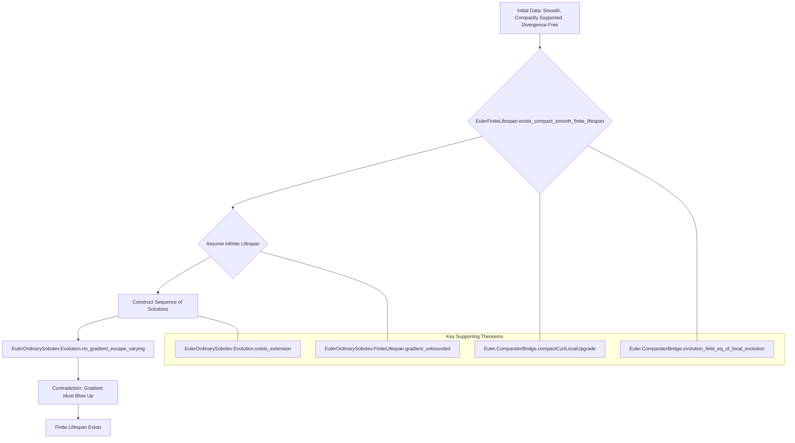
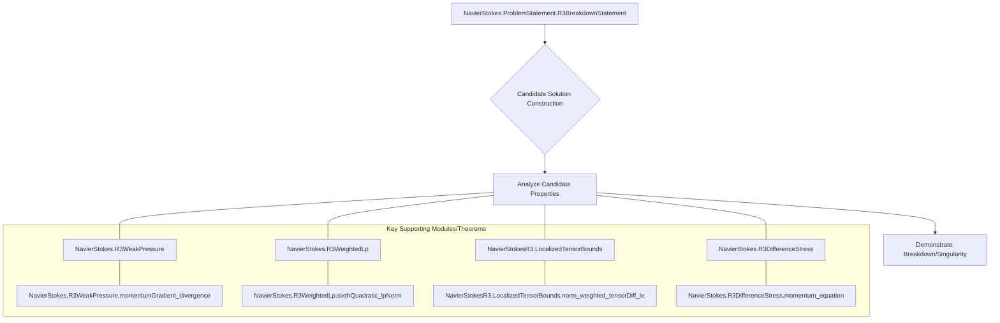

<!-- source: DeepWiki mcp.deepwiki.com · repo openai/NavierStokesAndEuler · page 1.2 Main Theorems and Problem Statements · fetched 2026-10-26 -->

# Main Theorems and Problem Statements

Relevant source files

The following files were used as context for generating this wiki page:

- [Euler/CanonicalPacketHorizons.lean](Euler/CanonicalPacketHorizons.lean)
- [Euler/CompactVorticityContradiction.lean](Euler/CompactVorticityContradiction.lean)
- [Euler/ComparatorEvolutionIdentification.lean](Euler/ComparatorEvolutionIdentification.lean)
- [Euler/ComparatorIdentification.lean](Euler/ComparatorIdentification.lean)
- [Euler/ComparatorLocalEvolution.lean](Euler/ComparatorLocalEvolution.lean)
- [Euler/ComparatorSingularityNorms.lean](Euler/ComparatorSingularityNorms.lean)
- [Euler/DevelopmentBridge.lean](Euler/DevelopmentBridge.lean)
- [Euler/EulerFiniteLifespan.lean](Euler/EulerFiniteLifespan.lean)
- [Euler/H3CurlConvergence.lean](Euler/H3CurlConvergence.lean)
- [Euler/OrdinaryBKMReduction.lean](Euler/OrdinaryBKMReduction.lean)
- [Euler/OrdinaryEulerBKM.lean](Euler/OrdinaryEulerBKM.lean)
- [Euler/OrdinaryEulerCauchy.lean](Euler/OrdinaryEulerCauchy.lean)
- [Euler/OrdinaryEulerContinuation.lean](Euler/OrdinaryEulerContinuation.lean)
- [Euler/OrdinaryEulerEndpoint.lean](Euler/OrdinaryEulerEndpoint.lean)
- [Euler/OrdinaryEulerLocalCauchy.lean](Euler/OrdinaryEulerLocalCauchy.lean)
- [Euler/OrdinaryEulerStability.lean](Euler/OrdinaryEulerStability.lean)
- [Euler/OrdinaryEulerVaryingHorizon.lean](Euler/OrdinaryEulerVaryingHorizon.lean)
- [Euler/OrdinaryEulerVorticity.lean](Euler/OrdinaryEulerVorticity.lean)
- [Euler/OrdinaryGradientLimit.lean](Euler/OrdinaryGradientLimit.lean)
- [Euler/OrdinaryLogarithmicGradient.lean](Euler/OrdinaryLogarithmicGradient.lean)
- [Euler/PacketFiniteLifespan.lean](Euler/PacketFiniteLifespan.lean)
- [Euler/PacketStageContradiction.lean](Euler/PacketStageContradiction.lean)
- [Euler/PacketStageLocalExistence.lean](Euler/PacketStageLocalExistence.lean)
- [NavierStokes/R3/LocalizedTensorBounds.lean](NavierStokes/R3/LocalizedTensorBounds.lean)
- [NavierStokes/R3DifferenceStress.lean](NavierStokes/R3DifferenceStress.lean)
- [NavierStokes/R3PressureFlux.lean](NavierStokes/R3PressureFlux.lean)
- [NavierStokes/R3SmoothPressure.lean](NavierStokes/R3SmoothPressure.lean)
- [NavierStokes/R3SpaceTimeCalculus.lean](NavierStokes/R3SpaceTimeCalculus.lean)
- [NavierStokes/R3WeakPressure.lean](NavierStokes/R3WeakPressure.lean)
- [NavierStokes/R3WeightedLp.lean](NavierStokes/R3WeightedLp.lean)

This page details the formal statements of the main theorems proven in the `NavierStokesAndEuler` repository. These include the finite-lifespan result for the 3D Euler equations, and the breakdown statements for the Navier-Stokes equations in both periodic and whole-space $\mathbb{R}^3$ settings. We will explore where these statements are defined in the Lean 4 codebase and how they relate to the overall proof strategy.

## Euler Finite-Lifespan Theorem

The core result for the Euler equations is the existence of a finite lifespan for certain smooth initial data. This implies that solutions to the 3D Euler equations can develop singularities in finite time.

The main theorem for the Euler equations is `EulerFiniteLifespan.exists_compact_smooth_finite_lifespan` [Euler/EulerFiniteLifespan.lean](). This theorem asserts that for any smooth, compactly supported, and divergence-free initial velocity field, there exists a finite time $T$ such that the corresponding Euler solution cannot be smoothly continued beyond $T$.

The proof of this theorem relies on a contradiction argument, where the assumption of an infinite lifespan leads to a contradiction with the growth of certain quantities, such as the gradient of the velocity field. Key components involved in establishing this include:

*   **Local Existence and Uniqueness:** The `Evolution` structure [Euler/OrdinaryEulerCauchy.lean:32-32]() represents a smooth Euler solution on a time interval. Local existence and uniqueness are established in `EulerOrdinarySobolev.Evolution.exists_extension` [Euler/OrdinaryEulerContinuation.lean:20-33](), which allows for the continuation of solutions.
*   **Gradient Blow-up Criterion:** The `FiniteLifespan` structure [Euler/OrdinaryEulerContinuation.lean:49-50]() encapsulates the concept of a maximal lifespan. The `gradient_unbounded` theorem [Euler/OrdinaryEulerContinuation.lean:65-76]() states that if a solution has a finite lifespan, then the gradient of its velocity must become unbounded as time approaches the maximal lifespan. This is further refined by `gradient_unbounded_near_endpoint` [Euler/OrdinaryEulerContinuation.lean:86-105](), which localizes the blow-up near the endpoint.
*   **Stability and Convergence:** The `EulerOrdinarySobolev.Evolution.eventually_h3_bound` [Euler/OrdinaryEulerStability.lean:49-63]() and `EulerOrdinarySobolev.Evolution.no_gradient_escape` [Euler/OrdinaryEulerStability.lean:74-104]() theorems are crucial for showing that if a sequence of solutions converges initially and remains bounded in some Sobolev norm, then their gradients cannot escape to infinity. These are extended to varying horizons in `EulerOrdinarySobolev.Evolution.no_gradient_escape_varying` [Euler/OrdinaryEulerVaryingHorizon.lean:61-95]().
*   **Comparator Bridge:** The `Euler.ComparatorBridge.compactCurlLocalUpgrade` [Euler/ComparatorLocalEvolution.lean:91-98]() theorem provides a bridge between the abstract `EulerExistenceAndSmoothnessR3` definition (used by the Comparator) and the concrete `Evolution` structure. This allows the results proven within the Lean 4 framework to be applied to the Comparator challenge. The `Euler.ComparatorBridge.evolution_field_eq_of_local_evolution` [Euler/ComparatorEvolutionIdentification.lean:52-130]() theorem is key to identifying the Comparator's solution with an ordinary evolution.

The overall strategy involves constructing a sequence of solutions that would contradict the gradient blow-up criterion if the lifespan were infinite. This construction is detailed in the `Euler.PacketStageContradiction` and `Euler.PacketFiniteLifespan` modules.

Title: Euler Finite Lifespan Proof Flow
Sources:
- [Euler/EulerFiniteLifespan.lean]()
- [Euler/OrdinaryEulerCauchy.lean:32-32]()
- [Euler/OrdinaryEulerContinuation.lean:20-33]()
- [Euler/OrdinaryEulerContinuation.lean:49-50]()
- [Euler/OrdinaryEulerContinuation.lean:65-76]()
- [Euler/OrdinaryEulerContinuation.lean:86-105]()
- [Euler/OrdinaryEulerStability.lean:49-63]()
- [Euler/OrdinaryEulerStability.lean:74-104]()
- [Euler/OrdinaryEulerVaryingHorizon.lean:61-95]()
- [Euler/ComparatorLocalEvolution.lean:91-98]()
- [Euler/ComparatorEvolutionIdentification.lean:52-130]()

## Navier-Stokes Breakdown Statement

For the Navier-Stokes equations, the problem statement focuses on the possibility of a breakdown (singularity formation) for certain initial conditions, or the exclusion of global smooth solutions under specific circumstances. The repository explores a candidate solution that exhibits breakdown behavior.

The main problem statement for Navier-Stokes is defined in `NavierStokes.ProblemStatement.R3BreakdownStatement` [NavierStokes/ProblemStatement.lean](). This statement describes the conditions under which a smooth solution to the 3D Navier-Stokes equations in $\mathbb{R}^3$ might cease to exist or lose its regularity.

The approach involves constructing a specific candidate solution and demonstrating its properties. Key aspects include:

*   **Weak Pressure Recovery:** The `NavierStokes.R3WeakPressure` module [NavierStokes/R3WeakPressure.lean:1-10]() is dedicated to recovering the physical pressure gradient from a distribution, even without assuming growth conditions on the pressure. This is crucial for analyzing the momentum equation. The `momentumGradient_divergence` theorem [NavierStokes/R3WeakPressure:120-146]() shows how the divergence of the momentum gradient relates to the stress tensor.
*   **Weighted $L^p$ Spaces:** The `NavierStokes.R3WeightedLp` module [NavierStokes/R3WeightedLp.lean:1-10]() introduces weighted $L^p$ spaces and interpolation estimates. These are used to control the growth of terms in the energy estimates, particularly for the pressure and transport terms. For example, `sixthQuadratic_lpNorm` [NavierStokes/R3WeightedLp:90-106]() provides bounds for quadratic terms.
*   **Localized Tensor Bounds:** The `NavierStokesR3.LocalizedTensorBounds` module [NavierStokes/R3/LocalizedTensorBounds.lean:1-10]() provides bounds for the difference stress tensor, which is central to analyzing the difference between two solutions. The `norm_weighted_tensorDiff_le` theorem [NavierStokes/R3/LocalizedTensorBounds:119-148]() gives a pointwise domination for the weighted tensor difference.
*   **Difference Stress and Pressure Equation:** The `NavierStokes.R3DifferenceStress` module [NavierStokes/R3DifferenceStress.lean:1-10]() defines the stress tensor for the difference between two velocity fields and relates its divergence to the pressure gradient. The `momentum_equation` theorem [NavierStokes/R3DifferenceStress:101-134]() is a key identity showing how the difference in momentum equations relates to the pressure difference.

The overall goal is to show that the constructed candidate solution, despite being smooth for a finite time, eventually leads to a breakdown, thus demonstrating the possibility of singularity formation for the Navier-Stokes equations.

Title: Navier-Stokes Breakdown Proof Flow
Sources:
- [NavierStokes/ProblemStatement.lean]()
- [NavierStokes/R3WeakPressure.lean:1-10]()
- [NavierStokes/R3WeakPressure:120-146]()
- [NavierStokes/R3WeightedLp.lean:1-10]()
- [NavierStokes/R3WeightedLp:90-106]()
- [NavierStokes/R3/LocalizedTensorBounds.lean:1-10]()
- [NavierStokes/R3/LocalizedTensorBounds:119-148]()
- [NavierStokes/R3DifferenceStress.lean:1-10]()
- [NavierStokes/R3DifferenceStress:101-134]()

---

