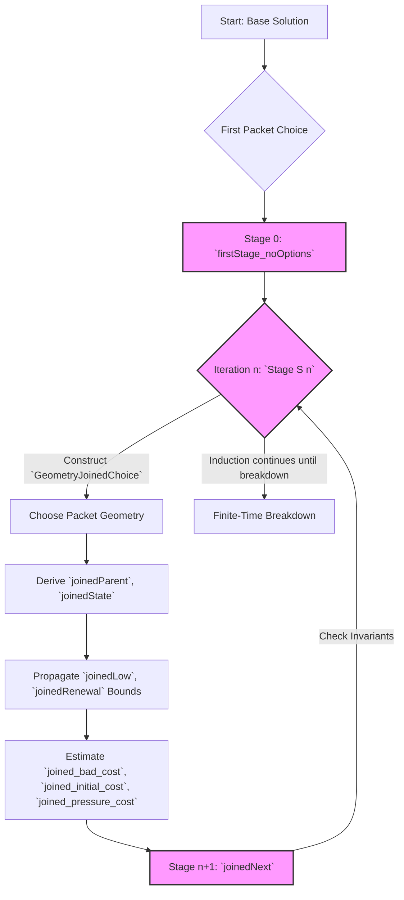
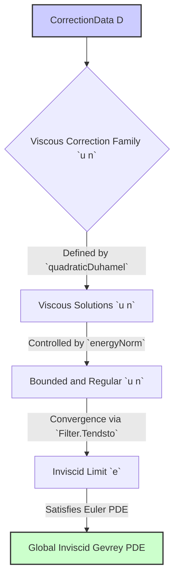
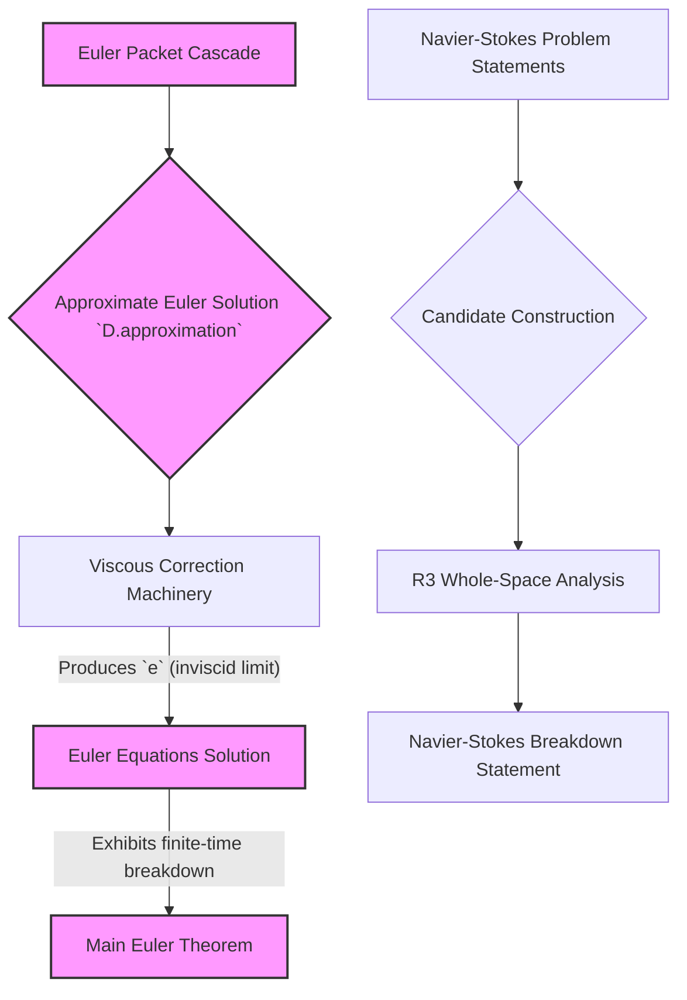

<!-- source: DeepWiki mcp.deepwiki.com · repo openai/NavierStokesAndEuler · page 1.3 Proof Strategy at a Glance · fetched 2026-10-26 -->

# Proof Strategy at a Glance

Relevant source files

The following files were used as context for generating this wiki page:

- [Euler/BaseInductionStage.lean](Euler/BaseInductionStage.lean)
- [Euler/BaseInductionStageNoOptions.lean](Euler/BaseInductionStageNoOptions.lean)
- [Euler/DriftGevreyInviscidEnergyCompactness.lean](Euler/DriftGevreyInviscidEnergyCompactness.lean)
- [Euler/DriftGlobalGevreyCorrection.lean](Euler/DriftGlobalGevreyCorrection.lean)
- [Euler/DriftGlobalInviscidGevrey.lean](Euler/DriftGlobalInviscidGevrey.lean)
- [Euler/GevreyInviscidEnergyCompactness.lean](Euler/GevreyInviscidEnergyCompactness.lean)
- [Euler/GlobalGevreyCorrection.lean](Euler/GlobalGevreyCorrection.lean)
- [Euler/GlobalInviscidGevrey.lean](Euler/GlobalInviscidGevrey.lean)
- [Euler/PacketForwardSuccessor.lean](Euler/PacketForwardSuccessor.lean)
- [Euler/PacketInductionStage.lean](Euler/PacketInductionStage.lean)
- [Euler/PacketInfiniteConstruction.lean](Euler/PacketInfiniteConstruction.lean)
- [Euler/PacketJoinedSuccessor.lean](Euler/PacketJoinedSuccessor.lean)
- [Euler/PacketStageEstimates.lean](Euler/PacketStageEstimates.lean)
- [Euler/PacketStageLowPropagation.lean](Euler/PacketStageLowPropagation.lean)
- [Euler/ParentGeometryJoinedChoice.lean](Euler/ParentGeometryJoinedChoice.lean)
- [Euler/ParentGeometryJoinedChoiceInvestigation.lean](Euler/ParentGeometryJoinedChoiceInvestigation.lean)

This page outlines the high-level proof strategy employed in this repository for both the 3D Euler and Navier–Stokes equations. For Euler, the core idea revolves around a self-similar packet cascade. For Navier–Stokes, the strategy involves viscous corrections and limit machinery, with candidates for solutions in both periodic and R3 domains. The composition of these pieces forms the complete formalization.

## Euler: Self-Similar Packet Cascade

The proof for the finite-time breakdown of the 3D Euler equations on a cylinder relies on constructing a self-similar packet cascade. This cascade iteratively builds a solution by adding increasingly complex "packets" of fluid motion. Each packet is designed to amplify certain features, leading to a finite-time singularity.

The construction proceeds inductively, defining a sequence of `Stage` objects [Euler/PacketInductionStage.lean:23-56](). Each `Stage` `P` at index `n` represents a partial solution up to a certain time `P.time` and scale `P.scale_eq`.

### Stage Construction

The initial stage, `firstStage_noOptions` [Euler/BaseInductionStageNoOptions.lean:48-121](), is built from a literal compact base solution and a first packet choice. This base solution provides the initial conditions for the cascade.

Each subsequent stage `n+1` is constructed from the previous stage `n` using either a "joined" or "forward" successor. The `joinedNext` function [Euler/PacketJoinedSuccessor.lean:97-138]() defines how to construct the next stage in the cascade. This involves:
1.  **Choosing Geometry**: A `GeometryJoinedChoice` [Euler/ParentGeometryJoinedChoice.lean:26-43]() is made, which determines the activation geometry and frequency comparison for the new packet. This choice is crucial for ensuring the self-similar nature of the cascade.
2.  **Constructing Parent and State**: A new `Parent` [Euler/ParentGeometryJoinedChoice.lean:78-78]() and `SmoothState` [Euler/ParentGeometryJoinedChoice.lean:80-83]() are derived for the next stage, incorporating the new packet.
3.  **Propagating Bounds**: The `joinedLow` [Euler/PacketJoinedSuccessor.lean:69-72]() and `joinedRenewal` [Euler/PacketJoinedSuccessor.lean:74-82]() functions ensure that the low-order bounds and frame properties are propagated and renewed, maintaining control over the solution's behavior. The `initial_step_bound` [Euler/PacketStageLowPropagation.lean:18-23]() and `pressure_step_bound` [Euler/PacketStageLowPropagation.lean:25-29]() theorems are key in propagating these bounds.
4.  **Estimating Costs**: Various cost estimates, such as `joined_bad_cost` [Euler/PacketStageEstimates.lean:38-47](), `joined_initial_cost` [Euler/PacketStageEstimates.lean:49-58](), and `joined_pressure_cost` [Euler/PacketStageEstimates.lean:60-75](), are calculated to ensure that the budgets for the cascade are maintained.

The `Stage` structure itself contains various bounds and properties that must hold at each step of the induction, such as `gradient_bound`, `hessian_bound`, and `frame_error` [Euler/PacketInductionStage.lean:35-50](). These invariants are critical for proving the overall breakdown.

### Diagram: Euler Packet Cascade Induction

Sources:
- [Euler/PacketInductionStage.lean:23-56]()
- [Euler/BaseInductionStageNoOptions.lean:48-121]()
- [Euler/PacketJoinedSuccessor.lean:97-138]()
- [Euler/ParentGeometryJoinedChoice.lean:26-43]()
- [Euler/ParentGeometryJoinedChoice.lean:78-78]()
- [Euler/ParentGeometryJoinedChoice.lean:80-83]()
- [Euler/PacketJoinedSuccessor.lean:69-72]()
- [Euler/PacketJoinedSuccessor.lean:74-82]()
- [Euler/PacketStageLowPropagation.lean:18-23]()
- [Euler/PacketStageLowPropagation.lean:25-29]()
- [Euler/PacketStageEstimates.lean:38-47]()
- [Euler/PacketStageEstimates.lean:49-58]()
- [Euler/PacketStageEstimates.lean:60-75]()
- [Euler/PacketInductionStage.lean:35-50]()

## Navier–Stokes: Viscous Correction and Limit Machinery

For the Navier–Stokes equations, the strategy involves constructing a sequence of viscous solutions and then taking a limit as viscosity approaches zero. This "viscous correction" machinery is designed to handle the additional diffusion term present in Navier–Stokes.

### Viscous Correction Family

The core of this approach is the `exists_gevrey_inviscid_energy_limit` theorem [Euler/GevreyInviscidEnergyCompactness.lean:28-59]() (and its drift-aware counterpart `EulerDriftGevreyInviscidEnergyCompactness.exists_gevrey_inviscid_energy_limit` [Euler/DriftGevreyInviscidEnergyCompactness.lean:28-59]()). This theorem asserts the existence of a family of viscous corrections `u n` that converge to an inviscid limit `e`.

Key components of this machinery include:
*   **CorrectionData**: The `CorrectionData` structure [Euler/GevreyInviscidEnergyCompactness.lean:30-30]() encapsulates the metric, linear, and quadratic coefficients of the approximate solution.
*   **Quadratic Duhamel Formula**: The viscous corrections `u n` are defined via a `quadraticDuhamel` formula [Euler/GevreyInviscidEnergyCompactness.lean:48-49](), which is a solution to a quadratic PDE with a viscosity term.
*   **Energy Norms**: The `energyNorm` [Euler/GevreyInviscidEnergyCompactness.lean:56-59]() is used to control the size and regularity of the corrections, ensuring they remain bounded and converge appropriately.
*   **Compactness and Limit**: The `Filter.Tendsto` [Euler/GevreyInviscidEnergyCompactness.lean:52-53]() statement formally expresses the convergence of the viscous solutions to the inviscid limit `e`. This relies on compactness arguments within appropriate function spaces.

### Global Inviscid Gevrey PDE

The `exists_global_inviscid_gevrey_PDE` theorem [Euler/GlobalInviscidGevrey.lean:20-57]() (and its drift-aware version `EulerDriftGlobalInviscidGevrey.exists_global_inviscid_gevrey_PDE` [Euler/DriftGlobalInviscidGevrey.lean:20-57]()) then establishes that this inviscid limit `e` is indeed a solution to the Euler equations (an inviscid PDE). This involves showing that the limit `e` satisfies the Euler equations with a literal signed-pressure derivative in `Hq`. The `correction_sobolev_hasDerivAt` and `correction_limit_equation` are crucial lemmas in this step [Euler/GlobalInviscidGevrey.lean:62-67]().

### Diagram: Viscous Correction and Limit

Sources:
- [Euler/GevreyInviscidEnergyCompactness.lean:28-59]()
- [Euler/DriftGevreyInviscidEnergyCompactness.lean:28-59]()
- [Euler/GevreyInviscidEnergyCompactness.lean:30-30]()
- [Euler/GevreyInviscidEnergyCompactness.lean:48-49]()
- [Euler/GevreyInviscidEnergyCompactness.lean:56-59]()
- [Euler/GevreyInviscidEnergyCompactness.lean:52-53]()
- [Euler/GlobalInviscidGevrey.lean:20-57]()
- [Euler/DriftGlobalInviscidGevrey.lean:20-57]()
- [Euler/GlobalInviscidGevrey.lean:62-67]()

## Composition of Pieces

The overall proof strategy for the Euler equations combines the self-similar packet cascade with the viscous correction machinery. The packet cascade constructs an approximate solution that exhibits the desired breakdown behavior. This approximate solution then serves as the `D.approximation` [Euler/GevreyInviscidEnergyCompactness.lean:43-43]() for the viscous correction process.

The `exists_global_gevrey_correction` theorem [Euler/GlobalGevreyCorrection.lean:22-47]() (and its drift-aware version `EulerDriftGlobalGevreyCorrection.exists_global_gevrey_correction` [Euler/DriftGlobalGevreyCorrection.lean:22-47]()) is a crucial bridge. It states that given concrete coefficient and residual budgets, an actual viscous correction exists throughout a prescribed interval. This correction is bounded and satisfies the `quadraticDuhamel` equation. The `partial_correction_bootstrap` [Euler/GlobalGevreyCorrection.lean:67-68]() lemma is used to establish the a-priori energy estimates and continuation bounds for these corrections.

The Navier–Stokes part of the library also explores solutions in R3 (whole-space analysis), which involves different analytical tools like heat kernels and Riesz operators. The `NavierStokes/R3` directory contains these specific R3 analyses.

The composition can be visualized as follows:

Sources:
- [Euler/GevreyInviscidEnergyCompactness.lean:43-43]()
- [Euler/GlobalGevreyCorrection.lean:22-47]()
- [Euler/DriftGlobalGevreyCorrection.lean:22-47]()
- [Euler/GlobalGevreyCorrection.lean:67-68]()

---

