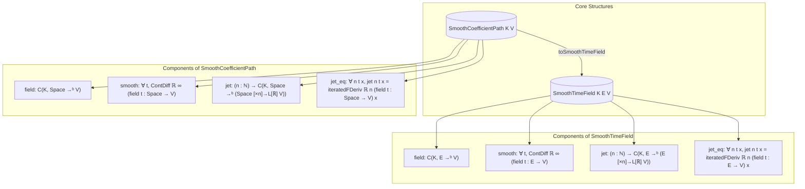

<!-- source: DeepWiki mcp.deepwiki.com · repo openai/NavierStokesAndEuler · page 2.1 Smooth Time Fields and Jet Calculus · fetched 2026-10-26 -->

# Smooth Time Fields and Jet Calculus

<details>
<summary>Relevant source files</summary>

The following files were used as context for generating this wiki page:

- [Euler/BaseEulerParent.lean](Euler/BaseEulerParent.lean)
- [Euler/ChildParticleFieldTime.lean](Euler/ChildParticleFieldTime.lean)
- [Euler/ChildParticleTime.lean](Euler/ChildParticleTime.lean)
- [Euler/CylinderJetLpMap.lean](Euler/CylinderJetLpMap.lean)
- [Euler/FieldTowerSmoothTimeField.lean](Euler/FieldTowerSmoothTimeField.lean)
- [Euler/LiftedSmoothTimeField.lean](Euler/LiftedSmoothTimeField.lean)
- [Euler/LiftedSmoothTimeFieldBounds.lean](Euler/LiftedSmoothTimeFieldBounds.lean)
- [Euler/MeanSobolevBoundedField.lean](Euler/MeanSobolevBoundedField.lean)
- [Euler/MeanSpatialDerivative.lean](Euler/MeanSpatialDerivative.lean)
- [Euler/MeanSpatialEvaluation.lean](Euler/MeanSpatialEvaluation.lean)
- [Euler/MeanSpatialTimeDerivative.lean](Euler/MeanSpatialTimeDerivative.lean)
- [Euler/PacketPressureJet.lean](Euler/PacketPressureJet.lean)
- [Euler/PacketSlicedAssembly.lean](Euler/PacketSlicedAssembly.lean)
- [Euler/PacketSlicedJets.lean](Euler/PacketSlicedJets.lean)
- [Euler/SmoothCoefficientPath.lean](Euler/SmoothCoefficientPath.lean)
- [Euler/SmoothCoefficientTimeRestriction.lean](Euler/SmoothCoefficientTimeRestriction.lean)
- [Euler/SmoothTimeField.lean](Euler/SmoothTimeField.lean)
- [Euler/SmoothTimeFieldAlgebra.lean](Euler/SmoothTimeFieldAlgebra.lean)
- [Euler/SmoothTimeFieldBilinear.lean](Euler/SmoothTimeFieldBilinear.lean)
- [Euler/SmoothTimeFieldChain.lean](Euler/SmoothTimeFieldChain.lean)
- [Euler/SmoothTimeFieldComposition.lean](Euler/SmoothTimeFieldComposition.lean)
- [Euler/SmoothTimeFieldDerivativeBounds.lean](Euler/SmoothTimeFieldDerivativeBounds.lean)
- [Euler/SmoothTimeFieldJoint.lean](Euler/SmoothTimeFieldJoint.lean)
- [Euler/SmoothTimeFieldLinear.lean](Euler/SmoothTimeFieldLinear.lean)
- [Euler/SmoothTimeFieldPrecomp.lean](Euler/SmoothTimeFieldPrecomp.lean)
- [Euler/SmoothTimeFieldRestriction.lean](Euler/SmoothTimeFieldRestriction.lean)
- [Euler/SmoothTimeFieldSecondJoint.lean](Euler/SmoothTimeFieldSecondJoint.lean)
- [Euler/SmoothTimeFieldTimeJets.lean](Euler/SmoothTimeFieldTimeJets.lean)
- [Euler/SobolevJointEvaluation.lean](Euler/SobolevJointEvaluation.lean)
- [Euler/SobolevPointEvaluation.lean](Euler/SobolevPointEvaluation.lean)

</details>


This page details the `SmoothTimeField` and `SmoothCoefficientPath` structures, which are fundamental for representing smooth functions of time and space within the Euler and Navier-Stokes formalizations. It covers the definition of spatial and time jets, operations like `derivative`, `map`, `precompLinear`, `add`, and `compDisplacement`, as well as the chain and bilinear rules for these structures. The page also introduces concepts like sliced and pressure jets, which are crucial for analyzing the differentiability of packet assemblies.

## SmoothTimeField and SmoothCoefficientPath Structures

The codebase defines two primary structures for representing smooth functions: `SmoothTimeField` and `SmoothCoefficientPath`. Both capture the notion of a function that is smooth in its spatial arguments and varies continuously over a compact time domain.

### SmoothTimeField

A `SmoothTimeField K E V` represents a field `f : K → E → V` where `K` is a compact topological space (typically representing time), `E` is a normed vector space (spatial domain), and `V` is a normed vector space (codomain).
The structure ensures that for each time `t ∈ K`, the spatial function `f t : E → V` is infinitely differentiable (`ContDiff ℝ ∞`). It also explicitly stores the spatial jets (iterated Fréchet derivatives) as continuous functions of time and space.

```lean
structure SmoothTimeField (K E V : Type u) [TopologicalSpace K] [CompactSpace K]
    [NormedAddCommGroup E] [NormedSpace ℝ E]
    [NormedAddCommGroup V] [NormedSpace ℝ V] where
  field : C(K, E →ᵇ V)
  smooth : ∀ t, ContDiff ℝ ∞ (field t : E → V)
  jet : (n : ℕ) → C(K, E →ᵇ (E [×n]→L[ℝ] V))
  jet_eq : ∀ n t x, jet n t x = iteratedFDeriv ℝ n (field t : E → V) x
```
Sources: [Euler/SmoothTimeField.lean:13-19]()

- `field`: A continuous map from `K` to `E →ᵇ V`, where `E →ᵇ V` denotes bounded continuous functions from `E` to `V`. This ensures that the field itself is continuous in time in the uniform norm.
- `smooth`: A proof that for every `t ∈ K`, the spatial function `field t` is infinitely differentiable.
- `jet`: A family of continuous maps, where `jet n` provides the `n`-th iterated Fréchet derivative (spatial jet) as a continuous function from `K` to `E →ᵇ (E [×n]→L[ℝ] V)`.
- `jet_eq`: An axiom asserting that `jet n t x` is indeed the `n`-th iterated Fréchet derivative of `field t` at `x`.

### SmoothCoefficientPath

`SmoothCoefficientPath K V` is a specialized version of `SmoothTimeField` where the spatial domain `E` is fixed to `Space` (a 3-dimensional Euclidean space, `ℝ³`). It represents "all-order spatial translation regularity uniformly over a compact parameter interval."
```lean
structure SmoothCoefficientPath (K : Type u) [TopologicalSpace K] [CompactSpace K]
    (V : Type v) [NormedAddCommGroup V] [NormedSpace ℝ V] where
  field : C(K, Space →ᵇ V)
  smooth : ∀ t, ContDiff ℝ ∞ (field t : Space → V)
  jet : (n : ℕ) → C(K, Space →ᵇ (Space [×n]→L[ℝ] V))
  jet_eq : ∀ n t x, jet n t x = iteratedFDeriv ℝ n (field t : Space → V) x
```
Sources: [Euler/SmoothCoefficientPath.lean:35-40]()

The `SmoothCoefficientPath` can be converted to a `SmoothTimeField` using `toSmoothTimeField` [Euler/SmoothTimeField.lean:86-88]().

## Spatial and Time Jets

The `SmoothTimeField` and `SmoothCoefficientPath` structures inherently define spatial jets through their `jet` field. These `jet` fields capture the iterated Fréchet derivatives with respect to the spatial variable `x`.

Time jets, or time derivatives, are handled through the `TimeDerivative` predicate, which asserts that one `SmoothTimeField` is the time derivative of another.
```lean
theorem TimeDerivative.congr_fields
    {A A₁ B B₁ : SmoothTimeField (Icc (0 : ℝ) T) E V}
    (hA : TimeDerivative T hT A A₁)
    (he : ∀ t x, A.field t x=B.field t x)
    (he₁ : ∀ t x, A₁.field t x=B₁.field t x) :
    TimeDerivative T hT B B₁ := by
  intro t x
  have hf : (fun s => B.realField T hT s x) = (fun s => A.realField T hT s x) := by
    funext s
    exact (he (projIcc 0 T hT s) x).symm
  rw [hf,← he₁]
  exact hA t x
```
Sources: [Euler/SmoothTimeFieldChain.lean:42-54]()

This predicate is used to propagate time differentiability through various operations.

## Operations on SmoothTimeField

Several operations are defined for `SmoothTimeField` and `SmoothCoefficientPath` to facilitate calculus.

### Derivative

The `derivative` operation computes the spatial derivative of a `SmoothTimeField`. It returns a new `SmoothTimeField` whose values are continuous linear maps.
```lean
def derivative (A : SmoothTimeField K E V) : SmoothTimeField K E (E →L[ℝ] V) where
  field := A.derivativeField
  smooth t := by
    have he : (A.derivativeField t : E → E →L[ℝ] V) = fderiv ℝ (A.field t : E → V) :=
      funext (A.derivativeField_eq t)
    rw [he]
    exact (A.smooth t).fderiv_right (m := ∞) (by simp)
  jet := A.derivativeJet
  jet_eq n t x := by
    have he : (A.derivativeField t : E → E →L[ℝ] V) = fderiv ℝ (A.field t : E → V) :=
      funext (A.derivativeField_eq t)
    rw [he]
    exact A.derivativeJet_eq n t x
```
Sources: [Euler/SmoothTimeField.lean:65-78]()

- `derivativeField`: Computes the first Fréchet derivative of `A.field t` at `x`.
- `derivativeJet`: Computes the `n`-th Fréchet derivative of `fderiv ℝ (A.field t : E → V)`.

A similar `derivative` is defined for `SmoothCoefficientPath` [Euler/SmoothCoefficientPath.lean:80-93]().

### Map

The `map` operation applies a continuous linear map `L : V →L[ℝ] W` to the codomain of a `SmoothTimeField`.
```lean
def map (L : V →L[ℝ] W) (A : SmoothTimeField K E V) : SmoothTimeField K E W where
  field := mapPath L A.field
  smooth t := L.contDiff.comp (A.smooth t)
  jet n := mapPath
    (ContinuousLinearMap.compContinuousMultilinearMapL ℝ (fun _ : Fin n => E) V W L) (A.jet n)
  jet_eq n t x := by
    change L.compContinuousMultilinearMap (A.jet n t x) =
      iteratedFDeriv ℝ n (L ∘ (A.field t : E → V)) x
    rw [A.jet_eq]
    exact (L.iteratedFDeriv_comp_left (A.smooth t).contDiffAt (by simp)).symm
```
Sources: [Euler/SmoothTimeFieldLinear.lean:29-38]()

- `mapPath`: A helper function to apply a linear map to the `field` component.
- `map_jet_apply`: Shows that the `n`-th jet of `A.map L` is `L` composed with the `n`-th jet of `A`.
- `map_jet_norm_le`: Provides a bound on the norm of the mapped jet.

A similar `mapCoefficientPath` is defined for `SmoothCoefficientPath` [Euler/SmoothCoefficientPath.lean:25-26]().

### PrecompLinear

The `precompLinear` operation precomposes a `SmoothTimeField` with a continuous linear map `L : F →L[ℝ] E` on its spatial domain.
```lean
def precompLinear (A : SmoothTimeField K E V) (L : F →L[ℝ] E) :
    SmoothTimeField K F V where
  field := (BoundedContinuousFunction.compContinuousCLM V ℝ ⟨L,L.continuous⟩).compLeftContinuous ℝ K A.field
  smooth t := (A.smooth t).comp_continuousLinearMap
  jet n := ((BoundedContinuousFunction.compContinuousCLM (F [×n]→L[ℝ] V) ℝ ⟨L,L.continuous⟩).compLeftContinuous ℝ K)
    (mapPath (ContinuousMultilinearMap.compContinuousLinearMapL (F := V) (fun _ : Fin n => L)) (A.jet n))
  jet_eq n t x := by
    change (A.jet n t (L x)).compContinuousLinearMap (fun _ : Fin n => L) =
      iteratedFDeriv ℝ n ((A.field t : E → V) ∘ L) x
    rw [A.jet_eq]
    exact (L.iteratedFDeriv_comp_right (A.smooth t) x (by simp)).symm
```
Sources: [Euler/SmoothTimeFieldPrecomp.lean:30-40]()

- `precompLinear_apply`: Shows that the field of `A.precompLinear L` at `(t, x)` is `A.field t (L x)`.
- `precompLinear_jet_apply`: Shows how the jets transform under precomposition.
- `precompLinear_jet_norm_le`: Provides a bound on the norm of the precomposed jet.

### Add

The `add` operation performs pointwise addition of two `SmoothTimeField`s.
```lean
def add (A B : SmoothTimeField K E V) : SmoothTimeField K E V where
  field := A.field + B.field
  smooth t := (A.smooth t).add (B.smooth t)
  jet n := A.jet n + B.jet n
  jet_eq n t x := by
    change A.jet n t x + B.jet n t x =
      iteratedFDeriv ℝ n ((A.field t : E → V) + (B.field t : E → V)) x
    rw [A.jet_eq, B.jet_eq]
    exact (iteratedFDeriv_add_apply ((A.smooth t).contDiffAt.of_le (by simp))
      ((B.smooth t).contDiffAt.of_le (by simp))).symm
```
Sources: [Euler/SmoothTimeFieldAlgebra.lean:23-33]()

- `add_apply`: Shows that the field of `A.add B` is the sum of the fields of `A` and `B`.
- `add_jet_norm_le`: Provides a bound on the norm of the sum of jets.

### CompDisplacement

The `compDisplacement` operation composes a `SmoothTimeField` `A` with a "displacement" `SmoothTimeField` `D`. This is a crucial operation for handling particle trajectories.
```lean
def compDisplacement (A : SmoothTimeField K E V) (D : SmoothTimeField K E E) :
    SmoothTimeField K E V :=
  SmoothTimeField.ofCoordinateJets (EuclideanSpace.basisFun (Fin (FiniteDimensional.finrank ℝ E)) ℝ)
    (A.field.comp (D.field.add (ContinuousMap.const K (BoundedContinuousFunction.id E))))
    (fun t => (A.smooth t).comp ((D.smooth t).add (contDiff_id (E := E))))
    (fun n => (A.jet n).comp (D.field.add (ContinuousMap.const K (BoundedContinuousFunction.id E))))
    (fun n t x => by
      rw [A.jet_eq, D.jet_eq]
      exact iteratedFDeriv_comp_add_id (A.smooth t) (D.smooth t) x n)
```
Sources: [Euler/SmoothTimeFieldComposition.lean:29-37]()

This operation is defined in `Euler/SmoothTimeFieldComposition.lean` and is used in the chain rule for time derivatives.

## Chain and Bilinear Rules

The codebase formalizes chain and bilinear rules for `SmoothTimeField`s, particularly concerning their time derivatives.

### Bilinear Rule

The `TimeDerivative.bilinear` theorem states the product rule for time derivatives when a bilinear map `L` is applied to two `SmoothTimeField`s.
```lean
theorem TimeDerivative.bilinear (L : V →L[ℝ] W →L[ℝ] Z)
    {A A₁ : SmoothTimeField (Icc (0 : ℝ) T) E V}
    {B B₁ : SmoothTimeField (Icc (0 : ℝ) T) E W}
    (hA : TimeDerivative T hT A A₁) (hB : TimeDerivative T hT B B₁) :
    TimeDerivative T hT (bilinear L A B) ((bilinear L A₁ B).add (bilinear L A B₁)) := by
  intro t x
  have hL := L.hasFDerivAt.comp_hasDerivWithinAt (t : ℝ) (hA t x)
  have h := hL.clm_apply (hB t x)
  change HasDerivWithinAt (fun s => L (A.realField T hT s x) (B.realField T hT s x))
    (L (A₁.field t x) (B.field t x)+L (A.field t x) (B₁.field t x)) (Icc (0 : ℝ) T) t
  simpa only [Function.comp_def,realField_apply] using h
```
Sources: [Euler/SmoothTimeFieldChain.lean:56-66]()

This theorem is used to define `applyField`, which applies a `SmoothTimeField` of linear maps to another `SmoothTimeField`.

### Chain Rule for CompDisplacement

The `TimeDerivative.compDisplacement` theorem provides the chain rule for the time derivative of a composed `SmoothTimeField`.
```lean
theorem TimeDerivative.compDisplacement
    {A A₁ : SmoothTimeField (Icc (0 : ℝ) T) E V}
    {D D₁ : SmoothTimeField (Icc (0 : ℝ) T) E E}
    (hA : TimeDerivative T hT A A₁) (hD : TimeDerivative T hT D D₁) :
    TimeDerivative T hT (A.compDisplacement D)
      ((A₁.compDisplacement D).add (SmoothTimeField.applyField (A.derivative.compDisplacement D) D₁)) := by
  intro t x
  let C := A.compDisplacement D
  let C₁ := (A₁.compDisplacement D).add (SmoothTimeField.applyField (A.derivative.compDisplacement D) D₁)
  have hh := EulerSeparatingTimeDerivative.hasDerivWithinAt T hT
    (sliceFamily T C x) (sliceFamily T C₁ x)
    (fun _ : Unit => ContinuousLinearMap.id ℝ V)
    (by intro u v huv; exact congrFun huv ())
    (by
      intro _ s hs
      exact compDisplacement_time_interior A A₁ D D₁ hA hD ⟨s,hs.1.le,hs.2.le⟩ hs x)
  exact hh
```
Sources: [Euler/SmoothTimeFieldChain.lean:92-109]()

This rule is fundamental for calculating the time derivatives of quantities that depend on evolving spatial displacements, such as particle trajectories. It is used in `EulerChildParticleTime` to define `displacement`, `velocity`, and `acceleration` of child particles.

## Sliced and Pressure Jets

These concepts are defined in `Euler/PacketSlicedAssembly.lean` and are used for analyzing the differentiability of packet assemblies.

### Sliced Differentiability and Sliced Jet

`SliceDifferentiable` describes a function `f : Domain → E` (where `Domain` is `ℝ × SpatialDomain`) that is differentiable with respect to its first argument (time) within a set `s`, and differentiable with respect to its second argument (space) at a specific point.
```lean
def SliceDifferentiable (s : Set ℝ) (f : Domain → E) (z : Domain) : Prop :=
  DifferentiableWithinAt ℝ (fun t => f (t,z.2)) s z.1 ∧
    DifferentiableAt ℝ (fun y => f (z.1,y)) z.2
```
Sources: [Euler/PacketSlicedAssembly.lean:14-16]()

The `slicedJet` function computes a pair of derivatives: the time derivative (within `s`) and the spatial Fréchet derivative.
```lean
def slicedJet (s : Set ℝ) (f : Domain → E) (z : Domain) : ℝ × (SpatialDomain →L[ℝ] E) :=
  (derivWithin (fun t => f (t,z.2)) s z.1, fderiv ℝ (fun y => f (z.1,y)) z.2)
```
Sources: [Euler/PacketSlicedJets.lean:14-15]()

The `slicedJet_add` theorem shows that `slicedJet` is additive [Euler/PacketSlicedAssembly.lean:33-37]().

### Pressure Jet

The `pressureJet` is a specialized form of spatial jet, focusing on the spatial derivative of a scalar field.
```lean
def pressureJet (f : Domain → ℝ) (z : Domain) : ℝ × (SpatialDomain →L[ℝ] ℝ) :=
  (0, fderiv ℝ (fun y => f (z.1,y)) z.2)
```
Sources: [Euler/PacketPressureJet.lean:14-15]()

The `pressureJet_add` theorem shows that `pressureJet` is additive [Euler/PacketSlicedAssembly.lean:87-92]().

These sliced and pressure jets are used in the context of `truncate`, `shiftUp`, and `assemble` operations on sequences of functions, which are part of the packet assembly process. For example, `slicedJet_assemble` and `pressureJet_assemble` demonstrate how these jets behave under the assembly operation [Euler/PacketSlicedAssembly.lean:68-76, Euler/PacketSlicedAssembly.lean:107-128]().

## Diagram: SmoothTimeField and SmoothCoefficientPath


Sources:
- [Euler/SmoothTimeField.lean:13-19]()
- [Euler/SmoothCoefficientPath.lean:35-40]()
- [Euler/SmoothTimeField.lean:86-88]()

## Diagram: SmoothTimeField Operations and Calculus Rules

```mermaid
graph TD
    subgraph "SmoothTimeField Operations"
        STF_A[("SmoothTimeField K E V")]
        STF_B[("SmoothTimeField K E V")]
        STF_D[("SmoothTimeField K E E")]
        STF_L_V_W[("L: V →L[ℝ] W")]
        STF_L_F_E[("L: F →L[ℝ] E")]
        STF_L_V_W_W_Z[("L: V →L[ℝ] W →L[ℝ] Z")]

        Op_Derivative["derivative"]
        Op_Map["map L"]
        Op_PrecompLinear["precompLinear L"]
        Op_Add["add"]
        Op_CompDisplacement["compDisplacement"]
        Op_ApplyField["applyField"]
    end

    subgraph "Calculus Rules"
        Rule_TimeDerivative["TimeDerivative T hT A A₁"]
        Rule_TimeDerivative_B["TimeDerivative T hT B B₁"]
        Rule_TimeDerivative_D["TimeDerivative T hT D D₁"]
        Rule_TimeDerivative_A_prime["TimeDerivative T hT A.derivative A₁.derivative"]

        Rule_Bilinear["TimeDerivative.bilinear"]
        Rule_ChainCompDisplacement["TimeDerivative.compDisplacement"]
    end

    STF_A -- Op_Derivative --> STF_A_prime[("SmoothTimeField K E (E →L[ℝ] V)")]
    STF_A -- Op_Map --> STF_A_mapped[("SmoothTimeField K E W")]
    STF_A -- Op_PrecompLinear --> STF_A_precomp[("SmoothTimeField K F V")]
    STF_A -- Op_Add --> STF_A_plus_B[("SmoothTimeField K E V")]
    STF_B -- Op_Add --> STF_A_plus_B
    STF_A -- Op_CompDisplacement --> STF_A_comp_D[("SmoothTimeField K E V")]
    STF_D -- Op_CompDisplacement --> STF_A_comp_D

    STF_A_prime_LM[("SmoothTimeField K E (V →L[ℝ] W)")] -- Op_ApplyField --> STF_A_prime_LM_applied[("SmoothTimeField K E W")]
    STF_B -- Op_ApplyField --> STF_A_prime_LM_applied

    STF_A -- Op_Derivative --> STF_A_prime
    STF_L_V_W -- Op_Map --> STF_A_mapped
    STF_L_F_E -- Op_PrecompLinear --> STF_A_precomp

    Rule_TimeDerivative -- Rule_Bilinear --> STF_Bilinear_Result[("TimeDerivative T hT (bilinear L A B) (...)")]
    Rule_TimeDerivative_B -- Rule_Bilinear --> STF_Bilinear_Result
    STF_L_V_W_W_Z -- Rule_Bilinear --> STF_Bilinear_Result

    Rule_TimeDerivative -- Rule_ChainCompDisplacement --> STF_Chain_Result[("TimeDerivative T hT (A.compDisplacement D) (...)")]
    Rule_TimeDerivative_D -- Rule_ChainCompDisplacement --> STF_Chain_Result

    Rule_TimeDerivative -- "TimeDerivative.map" --> STF_A_mapped_TD[("TimeDerivative T hT (A.map L) (A₁.map L)")]
    Rule_TimeDerivative -- "TimeDerivative.precompLinear" --> STF_A_precomp_TD[("TimeDerivative T hT (A.precompLinear L) (A₁.precompLinear L)")]
    Rule_TimeDerivative -- "TimeDerivative.add" --> STF_A_plus_B_TD[("TimeDerivative T hT (A.add B) (A₁.add B₁)")]
    Rule_TimeDerivative_B -- "TimeDerivative.add" --> STF_A_plus_B_TD

    classDef STF_A fill:#fff,stroke:#333,stroke-width:2px
    classDef STF_B fill:#fff,stroke:#333,stroke-width:2px
    classDef STF_D fill:#fff,stroke:#333,stroke-width:2px
    classDef STF_L_V_W fill:#fff,stroke:#333,stroke-width:2px
    classDef STF_L_F_E fill:#fff,stroke:#333,stroke-width:2px
    classDef STF_L_V_W_W_Z fill:#fff,stroke:#333,stroke-width:2px
    classDef Op_Derivative fill:#f9f,stroke:#333,stroke-width:2px
    classDef Op_Map fill:#f9f,stroke:#333,stroke-width:2px
    classDef Op_PrecompLinear fill:#f9f,stroke:#333,stroke-width:2px
    classDef Op_Add fill:#f9f,stroke:#333,stroke-width:2px
    classDef Op_CompDisplacement fill:#f9f,stroke:#333,stroke-width:2px
    classDef Op_ApplyField fill:#f9f,stroke:#333,stroke-width:2px
    classDef Rule_TimeDerivative fill:#9cf,stroke:#333,stroke-width:2px
    classDef Rule_TimeDerivative_B fill:#9cf,stroke:#333,stroke-width:2px
    classDef Rule_TimeDerivative_D fill:#9cf,stroke:#333,stroke-width:2px
    classDef Rule_TimeDerivative_A_prime fill:#9cf,stroke:#333,stroke-width:2px
    classDef Rule_Bilinear fill:#9cf,stroke:#333,stroke-width:2px
    classDef Rule_ChainCompDisplacement fill:#9cf,stroke:#333,stroke-width:2px
    classDef STF_A_prime fill:#fff,stroke:#333,stroke-width:2px
    classDef STF_A_mapped fill:#fff,stroke:#333,stroke-width:2px
    classDef STF_A_precomp fill:#fff,stroke:#333,stroke-width:2px
    classDef STF_A_plus_B fill:#fff,stroke:#333,stroke-width:2px
    classDef STF_A_comp_D fill:#fff,stroke:#333,stroke-width:2px
    classDef STF_A_prime_LM_applied fill:#fff,stroke:#333,stroke-width:2px
    classDef STF_Bilinear_Result fill:#9cf,stroke:#333,stroke-width:2px
    classDef STF_Chain_Result fill:#9cf,stroke:#333,stroke-width:2px
    classDef STF_A_mapped_TD fill:#9cf,stroke:#333,stroke-width:2px
    classDef STF_A_precomp_TD fill:#9cf,stroke:#333,stroke-width:2px
    classDef STF_A_plus_B_TD fill:#9cf,stroke:#333,stroke-width:2px
```


Sources:
- [Euler/SmoothTimeField.lean:65-78]()
- [Euler/SmoothTimeFieldLinear.lean:29-38]()
- [Euler/SmoothTimeFieldPrecomp.lean:30-40]()
- [Euler/SmoothTimeFieldAlgebra.lean:23-33]()
- [Euler/SmoothTimeFieldComposition.lean:29-37]()
- [Euler/SmoothTimeFieldChain.lean:26-28]() (for `applyField`)
- [Euler/SmoothTimeFieldChain.lean:56-66]() (for `TimeDerivative.bilinear`)
- [Euler/SmoothTimeFieldChain.lean:92-109]() (for `TimeDerivative.compDisplacement`)
- [Euler/SmoothTimeFieldLinear.lean:70-74]() (for `TimeDerivative.map`)
- [Euler/SmoothTimeFieldPrecomp.lean:74-78]() (for `TimeDerivative.precompLinear`)
- [Euler/SmoothTimeFieldAlgebra.lean:60-64]() (for `TimeDerivative.add`)

## FieldTower and Sobolev Point Evaluation

The `FieldTower` structure [Euler/FieldTowerSmoothTimeField.lean:32]() represents a tower of Sobolev spaces, which can be converted into a `SmoothTimeField`. This conversion relies on `EulerSobolevPointEvaluation.pointEvaluation` to extract point values from Sobolev functions and `coverPathMap` to handle the cylinder cover.

```lean
def toSmoothTimeField : SmoothTimeField (Icc (0 : ℝ) T) LiftTangent Space :=
  SmoothTimeField.ofCoordinateJets coverBasis A.boundedCover
    (fun t => coverField_contDiff P (A.pointField t) (A.pointField_smooth t))
    A.boundedWord A.boundedWord_tensor
```
Sources: [Euler/FieldTowerSmoothTimeField.lean:69-72]()

This `toSmoothTimeField` provides a way to obtain a `SmoothTimeField` from a `FieldTower`, ensuring that the resulting field is smooth and its jets are correctly defined. The `toSmoothTimeField_timeDerivative` and `toSmoothTimeField_timeDerivative_of_interior` theorems [Euler/FieldTowerSmoothTimeField.lean:74-122]() show how time derivatives of the `FieldTower` translate to time derivatives of the `SmoothTimeField`.

The `EulerMeanSobolevBoundedField` namespace provides `sobolevField` and `sobolevMap` [Euler/MeanSobolevBoundedField.lean:26-51]() to construct bounded continuous functions from Sobolev spaces, which are then used to build `SmoothL2Field`s. The `finiteField` function [Euler/MeanSobolevBoundedField.lean:104-105]() reconstructs a bounded field from its finite scalar coordinates, demonstrating how finite-dimensional targets are handled.

## Cylinder Jet Lp Map

The `EulerCylinderJetLp` namespace defines operations on `tensor`s (iterated derivatives) of functions on the cylinder cover, specifically how linear maps interact with these tensors in `Lp` spaces.

```lean
theorem tensor_map (L : V →L[ℝ] W) (f : LiftDomain P → V)
    (hf : ∀ q, ContDiff ℝ ∞ (localFieldLift P f q)) (n : ℕ) (q : LiftDomain P) :
    tensor P (fun x => L (f x)) n q = L.compContinuousMultilinearMap (tensor P f n q) := by
  change iteratedFDeriv ℝ n (L ∘ fun z => f (coveringMap P z)) (sectionPoint P q) = _
  exact L.iteratedFDeriv_comp_left ((coverField_contDiff P f hf).contDiffAt) (by simp)
```
Sources: [Euler/CylinderJetLpMap.lean:21-26]()

This `tensor_map` theorem shows that applying a linear map `L` to a function `f` commutes with taking its spatial tensor (iterated derivative). This property is extended to `Lp` norms in `tensor_map_norm_le` [Euler/CylinderJetLpMap.lean:39-50](), which is crucial for bounding the norms of derivatives. The `tensor_transport_split` and `tensor_transport_norm_le` theorems [Euler/CylinderJetLpMap.lean:65-110]() further detail how these tensors behave under transport operations, which are essential for analyzing the evolution of fields in the Euler equations.

Sources:
- [Euler/SmoothTimeField.lean]()
- [Euler/SmoothCoefficientPath.lean]()
- [Euler/SmoothTimeFieldChain.lean]()
- [Euler/SmoothTimeFieldPrecomp.lean]()
- [Euler/SmoothTimeFieldLinear.lean]()
- [Euler/SmoothTimeFieldAlgebra.lean]()
- [Euler/SmoothTimeFieldComposition.lean]()
- [Euler/PacketSlicedAssembly.lean]()
- [Euler/PacketPressureJet.lean]()
- [Euler/PacketSlicedJets.lean]()
- [Euler/FieldTowerSmoothTimeField.lean]()
- [Euler/MeanSobolevBoundedField.lean]()
- [Euler/CylinderJetLpMap.lean]()
- [Euler/ChildParticleTime.lean]()
- [Euler/ChildParticleFieldTime.lean]()

---

