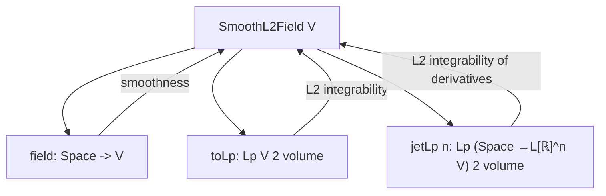
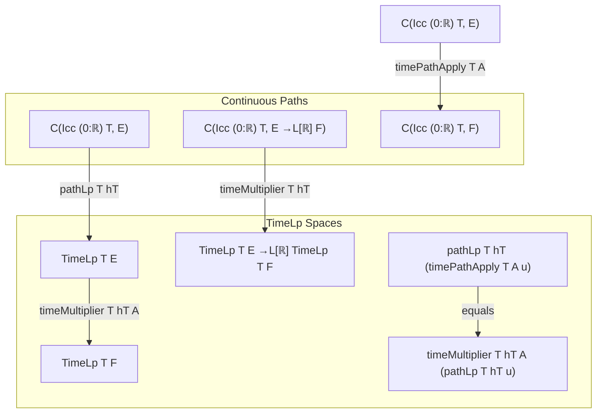
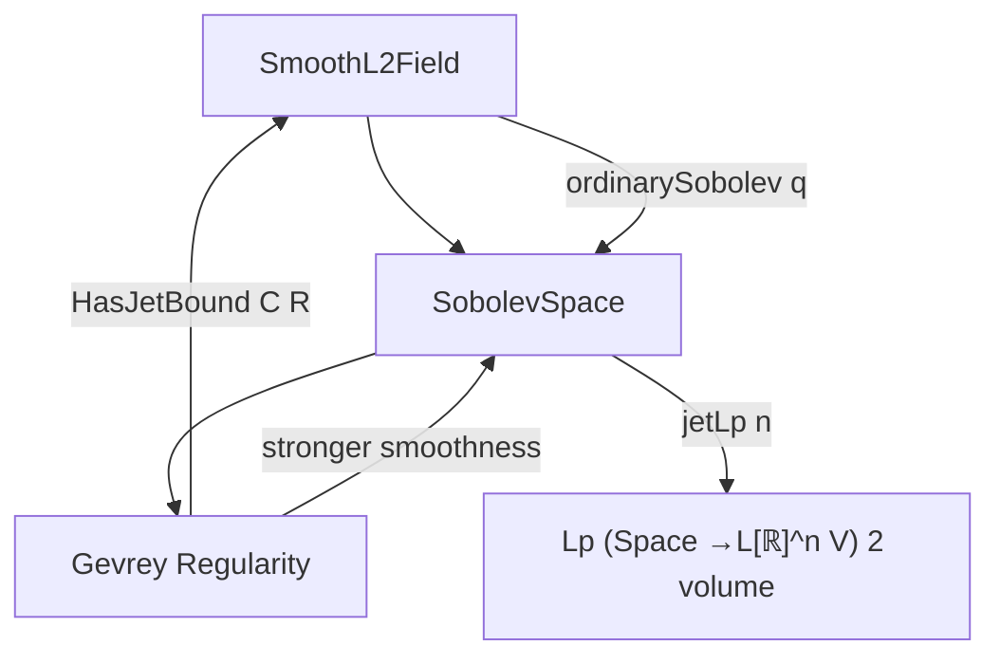

<!-- source: DeepWiki mcp.deepwiki.com · repo openai/NavierStokesAndEuler · page 2.2 Function Spaces: Lp, Sobolev, Gevrey · fetched 2026-10-26 -->

# Function Spaces: Lp, Sobolev, Gevrey

Relevant source files

The following files were used as context for generating this wiki page:

- [Euler/CompactSmoothL2Bounds.lean](Euler/CompactSmoothL2Bounds.lean)
- [Euler/CompactVorticityTimeUpgrade.lean](Euler/CompactVorticityTimeUpgrade.lean)
- [Euler/ComparatorSobolevEvolution.lean](Euler/ComparatorSobolevEvolution.lean)
- [Euler/MeanPathLpBlocks.lean](Euler/MeanPathLpBlocks.lean)
- [Euler/OrdinaryEulerClassicalClass.lean](Euler/OrdinaryEulerClassicalClass.lean)
- [Euler/OrdinaryEulerSobolevClass.lean](Euler/OrdinaryEulerSobolevClass.lean)
- [Euler/SmoothFieldSobolevTime.lean](Euler/SmoothFieldSobolevTime.lean)
- [Euler/SmoothL2ClassicalBounds.lean](Euler/SmoothL2ClassicalBounds.lean)
- [Euler/SmoothL2Gevrey.lean](Euler/SmoothL2Gevrey.lean)
- [Euler/TimeForcingRepresentative.lean](Euler/TimeForcingRepresentative.lean)
- [Euler/TimeLp.lean](Euler/TimeLp.lean)
- [Euler/TimeLpLinearity.lean](Euler/TimeLpLinearity.lean)
- [Euler/TimeLpMap.lean](Euler/TimeLpMap.lean)
- [Euler/TimeLpMultiplier.lean](Euler/TimeLpMultiplier.lean)
- [Euler/TimeLpObservation.lean](Euler/TimeLpObservation.lean)
- [Euler/TimeLpStrongOperators.lean](Euler/TimeLpStrongOperators.lean)
- [Euler/TimePathApply.lean](Euler/TimePathApply.lean)

This page provides a high-level overview of the function spaces used throughout the Euler and Navier-Stokes formalizations. These include `SmoothL2Field`, `TimeLp`, and various Sobolev and Gevrey regularity classes. These structures are fundamental for defining and analyzing the properties of velocity fields, pressure, and other quantities in the PDEs.

The codebase extensively uses these function spaces to characterize the smoothness, integrability, and differentiability of fields, both in space and time. Understanding these concepts is crucial for following the formal proofs of existence, uniqueness, and breakdown phenomena.

## SmoothL2Field

The `SmoothL2Field` structure represents spatially smooth functions that are also square-integrable (L2) over the domain. It encapsulates both the field itself and its associated L2 representation and derivatives. This structure is a cornerstone for defining the state of the fluid in the Euler and Navier-Stokes equations.

A `SmoothL2Field` `A` provides:
*   `A.field`: The underlying smooth function `Space → V` [Euler/SmoothL2Gevrey.lean:19-19]().
*   `A.toLp`: The L2 representation of the field [Euler/ComparatorSobolevEvolution.lean:14-14]().
*   `A.jetLp n`: The L2 representation of the `n`-th spatial derivative (jet) of the field [Euler/ComparatorSobolevEvolution.lean:18-18]().

The `SmoothL2Field` is used to bridge between classical function theory and the L2-based formalization in Lean. For instance, the `Euler.ComparatorBridge.toL2_field` theorem [Euler/ComparatorSobolevEvolution.lean:14-16]() explicitly links the field to its L2 representation.

### Diagram: SmoothL2Field Structure

Sources: [Euler/SmoothL2Gevrey.lean:19-19](), [Euler/ComparatorSobolevEvolution.lean:14-14](), [Euler/ComparatorSobolevEvolution.lean:18-18]()

## TimeLp Spaces

`TimeLp` spaces are Bochner L2 spaces for time-dependent functions. They are used to represent the time evolution of fields, where the values at each time point are elements of a normed space (e.g., `SmoothL2Field` or Sobolev spaces). This allows for the analysis of time-dependent behavior using L2 norms.

The `TimeLp` type is defined as `Lp E 2 (timeMeasure T)` [Euler/TimeLp.lean:23-23](), where `E` is the normed space of values and `timeMeasure T` is the Lebesgue measure restricted to a compact time interval `[0, T]` [Euler/TimeLp.lean:15-15]().

Key functionalities related to `TimeLp` include:
*   `pathLp`: Embeds a continuous time path into `TimeLp` [Euler/TimeLp.lean:34-35]().
*   `timeMultiplier`: Represents a time-dependent linear operator acting on `TimeLp` fields [Euler/TimeLpMultiplier.lean:65-66]().
*   `timePathApply`: Applies a continuous operator path to a continuous field path [Euler/TimePathApply.lean:17-19]().

For details on `TimeLp` multipliers, maps, observations, and time integration, see [Time-Lp Spaces and Time Integration](#2.2.3).

### Diagram: TimeLp and its Operations

Sources: [Euler/TimeLp.lean:34-35](), [Euler/TimeLpMultiplier.lean:65-66](), [Euler/TimePathApply.lean:17-19](), [Euler/TimePathApply.lean:23-25]()

## Sobolev Spaces and Word Calculus

Sobolev spaces are crucial for quantifying the spatial regularity of fields. The codebase uses a "word calculus" approach to define and manipulate Sobolev norms, particularly for fields on the cylinder. This involves representing derivatives as "words" of directional derivatives.

The `ordinarySobolev` function [Euler/SmoothFieldSobolevTime.lean:40-41]() constructs a continuous path in a Sobolev space from a `SmoothL2Field`. The `Euler.SobolevSmoothOn` structure [Euler/ComparatorSobolevEvolution.lean:22-22]() is used to characterize fields that are smooth in space and have continuous L2 jets in time.

Key concepts include:
*   **Parameter Sobolev families**: These are used to define Sobolev norms that depend on parameters, allowing for flexible regularity analysis.
*   **Isometric action words**: Derivatives are represented as sequences of directional derivatives, forming "words."
*   **Sobolev word constraints/interpolation**: These provide bounds and relationships between different Sobolev norms.

For a detailed exploration of `ParameterSobolev` families, isometric action words, and Sobolev word constraints, see [Parameter Sobolev and Word Calculus](#2.2.1).

## Gevrey Regularity Classes

Gevrey regularity is a stronger form of smoothness than Sobolev regularity, often associated with analytic functions. It is used in the codebase to establish finer control over the behavior of solutions, particularly in the context of operator composition and product estimates.

The `HasJetBound` predicate [Euler/SmoothL2Gevrey.lean:19-20]() defines Gevrey regularity for a `SmoothL2Field`, requiring that the norm of its `n`-th jet grows no faster than `C * R^n * (n!)^2`. This exponential growth with factorial terms is characteristic of Gevrey spaces.

Key aspects of Gevrey calculus include:
*   **Gevrey composition/product estimates in Lp**: These provide bounds on the Gevrey regularity of composite or product functions.
*   **Operator Gevrey calculus**: This extends Gevrey regularity to operators, allowing for the analysis of their smoothing properties.
*   **Gram-inverse Gevrey/Sobolev block bounds**: These are used to control the regularity of inverse operators.

For a deeper dive into Gevrey composition, product estimates, and operator Gevrey calculus, see [Gevrey Calculus and Operator Composition](#2.2.2).

### Diagram: Regularity Classes and their Relationships

Sources: [Euler/SmoothL2Gevrey.lean:19-20](), [Euler/SmoothFieldSobolevTime.lean:40-41](), [Euler/SmoothL2Gevrey.lean:22-23]()

---

