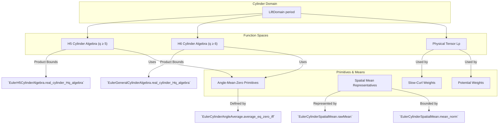
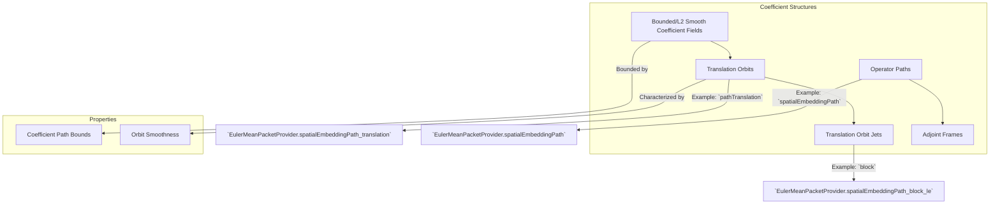
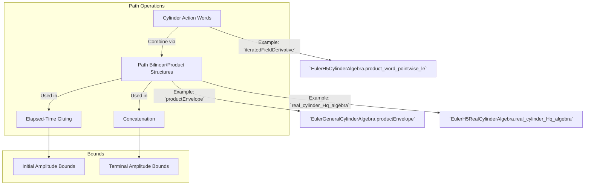

<!-- source: DeepWiki mcp.deepwiki.com · repo openai/NavierStokesAndEuler · page 2.3 Cylinder Geometry and Coefficient Paths · fetched 2026-10-26 -->

# Cylinder Geometry and Coefficient Paths

Relevant source files

The following files were used as context for generating this wiki page:

- [Euler/CylinderAngleAverageRepresentative.lean](Euler/CylinderAngleAverageRepresentative.lean)
- [Euler/CylinderGraphRealization.lean](Euler/CylinderGraphRealization.lean)
- [Euler/CylinderSpatialMean.lean](Euler/CylinderSpatialMean.lean)
- [Euler/CylinderSpatialMeanPath.lean](Euler/CylinderSpatialMeanPath.lean)
- [Euler/CylinderSpatialMeanRepresentative.lean](Euler/CylinderSpatialMeanRepresentative.lean)
- [Euler/GeneralCylinderAlgebra.lean](Euler/GeneralCylinderAlgebra.lean)
- [Euler/GeneralRealCylinderAlgebra.lean](Euler/GeneralRealCylinderAlgebra.lean)
- [Euler/H5CylinderAlgebra.lean](Euler/H5CylinderAlgebra.lean)
- [Euler/H5RealCylinderAlgebra.lean](Euler/H5RealCylinderAlgebra.lean)
- [Euler/LpBochnerRealization.lean](Euler/LpBochnerRealization.lean)
- [Euler/MeanCylinderWordBounds.lean](Euler/MeanCylinderWordBounds.lean)
- [Euler/MeanPacketCylinderFields.lean](Euler/MeanPacketCylinderFields.lean)

This page provides a high-level overview of the cylinder domain, its associated function spaces, spatial means, angular primitives, and the structure of coefficient fields and their translation properties. These concepts are fundamental to defining and analyzing the behavior of fluid dynamics equations within this specific geometric setting. Detailed discussions of each topic are deferred to their respective child pages.

## Cylinder Algebras, Means, and Angular Primitives

The cylinder domain introduces specific algebraic structures for function spaces, particularly Sobolev spaces like H5 and H6. These algebras define how functions on the cylinder interact under operations like multiplication, ensuring that the resulting functions maintain a certain level of smoothness and integrability. Key concepts include angle-mean-zero primitives, which are functions whose average over the angular dimension is zero, and spatial mean representatives, which capture the average behavior of a field across the spatial domain. The codebase also considers slow-curl and potential weights, which are crucial for decomposing vector fields, and physical tensor Lp spaces, which are Lp spaces equipped with a tensor product structure relevant to physical quantities.

For details, see [Cylinder Algebras, Means, and Angular Primitives](#2.3.1).

Sources: [Euler/H5CylinderAlgebra.lean:16-33](), [Euler/GeneralCylinderAlgebra.lean:17-33](), [Euler/CylinderAngleAverageRepresentative.lean:71-99](), [Euler/CylinderSpatialMeanRepresentative.lean:30-45](), [Euler/CylinderSpatialMean.lean:38-41]()

## Coefficient Paths, Translation Orbits, and Frames

This section introduces the concept of bounded and L2 smooth coefficient fields, which are functions that describe the evolution of physical quantities over time and space. A crucial aspect is the notion of translation orbits, which describe how these fields behave under spatial translations, and their jets, which capture their derivatives under such translations. Operator paths represent the time evolution of operators acting on these fields. The framework also includes adjoint frames, which are essential for duality arguments, and bounds on coefficient paths and the smoothness of translation orbits, ensuring well-behaved mathematical properties.

For details, see [Coefficient Paths, Translation Orbits, and Frames](#2.3.2).

Sources: [Euler/MeanPacketCylinderFields.lean:36-41](), [Euler/MeanCylinderWordBounds.lean:50-68](), [Euler/MeanPacketCylinderFields.lean:30-32]()

## Action Words, Path Products, and Amplitudes

Action words are symbolic representations of operations on cylinder fields, often involving derivatives and products. This section delves into the bilinear and product structures of these paths, describing how different fields combine. Key operations include elapsed-time gluing and concatenation, which allow for the construction of longer time evolutions from shorter segments. Finally, initial and terminal amplitude bounds are established, providing control over the magnitude of fields at the beginning and end of their evolution.

For details, see [Action Words, Path Products, and Amplitudes](#2.3.3).

Sources: [Euler/H5CylinderAlgebra.lean:51-82](), [Euler/GeneralCylinderAlgebra.lean:84-87](), [Euler/H5RealCylinderAlgebra.lean:16-33]()

---

