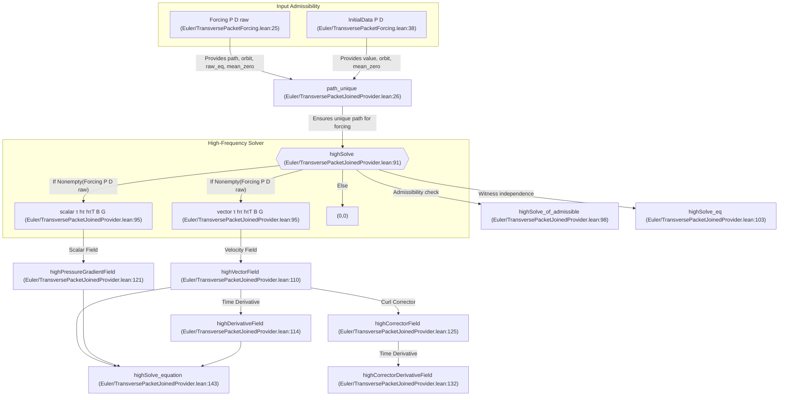

<!-- source: DeepWiki mcp.deepwiki.com · repo openai/NavierStokesAndEuler · page 3 Euler: Cylinder PDE Solvers · fetched 2026-10-26 -->

# Euler: Cylinder PDE Solvers

Relevant source files

The following files were used as context for generating this wiki page:

- [Euler/ContinuousAccelerationSobolev.lean](Euler/ContinuousAccelerationSobolev.lean)
- [Euler/ContinuousGramSobolev.lean](Euler/ContinuousGramSobolev.lean)
- [Euler/CylinderDirichletPhysicalBounds.lean](Euler/CylinderDirichletPhysicalBounds.lean)
- [Euler/CylinderDirichletRegularity.lean](Euler/CylinderDirichletRegularity.lean)
- [Euler/CylinderDirichletSobolev.lean](Euler/CylinderDirichletSobolev.lean)
- [Euler/CylinderDirichletTimeBounds.lean](Euler/CylinderDirichletTimeBounds.lean)
- [Euler/FixedEvolutionSobolev.lean](Euler/FixedEvolutionSobolev.lean)
- [Euler/LinearDuhamelFrozenGevrey.lean](Euler/LinearDuhamelFrozenGevrey.lean)
- [Euler/LinearDuhamelFrozenOperator.lean](Euler/LinearDuhamelFrozenOperator.lean)
- [Euler/LinearDuhamelSobolevGevrey.lean](Euler/LinearDuhamelSobolevGevrey.lean)
- [Euler/MeanPacketForcing.lean](Euler/MeanPacketForcing.lean)
- [Euler/MeanPacketForcingAlgebra.lean](Euler/MeanPacketForcingAlgebra.lean)
- [Euler/MeanPacketOrbitForcing.lean](Euler/MeanPacketOrbitForcing.lean)
- [Euler/MeanPacketProvider.lean](Euler/MeanPacketProvider.lean)
- [Euler/SourceCylinderRegularity.lean](Euler/SourceCylinderRegularity.lean)
- [Euler/TimeLpAccelerationSobolev.lean](Euler/TimeLpAccelerationSobolev.lean)
- [Euler/TimeLpGramSobolev.lean](Euler/TimeLpGramSobolev.lean)
- [Euler/TransverseHighSolveFields.lean](Euler/TransverseHighSolveFields.lean)
- [Euler/TransversePacketCylinderFields.lean](Euler/TransversePacketCylinderFields.lean)
- [Euler/TransversePacketForcing.lean](Euler/TransversePacketForcing.lean)
- [Euler/TransversePacketForwardBounds.lean](Euler/TransversePacketForwardBounds.lean)
- [Euler/TransversePacketHistory.lean](Euler/TransversePacketHistory.lean)
- [Euler/TransversePacketHistoryBounds.lean](Euler/TransversePacketHistoryBounds.lean)
- [Euler/TransversePacketInitial.lean](Euler/TransversePacketInitial.lean)
- [Euler/TransversePacketJoinedProvider.lean](Euler/TransversePacketJoinedProvider.lean)
- [Euler/TransversePacketRegularity.lean](Euler/TransversePacketRegularity.lean)

This page provides a high-level overview of the linear PDE solvers used on the cylinder domain within the Euler codebase. These solvers are crucial for constructing and analyzing solutions to the Euler equations, particularly in the context of packet construction and regularity theory. We will introduce the Dirichlet history inverse, the mean component solver, and the transverse packet provider, along with their associated regularity and bound theories. Detailed discussions for each solver are deferred to their respective child pages.

## Cylinder Dirichlet Problem and Fixed-Sobolev Bounds

The cylinder Dirichlet problem involves solving for fields on the cylinder subject to certain boundary conditions. A key aspect is understanding the regularity of the "history inverse" – the solution obtained by inverting a differential operator. The codebase establishes mixed-translation smoothness for this history, meaning that the solution maintains its smoothness properties even when translated across the cylinder. This is critical for ensuring the well-behavedness of solutions under spatial shifts.

The theory also includes fixed-Sobolev/Gevrey block bounds, which quantify the regularity of solutions in specific function spaces. These bounds are essential for controlling the growth of derivatives and ensuring the validity of various analytical estimates. Physical bounds are derived to relate these abstract function space norms to physically meaningful quantities. The concept of Duhamel frozen operators is employed to analyze the evolution of solutions, treating certain operators as "frozen" at a given time to simplify analysis. Fixed-evolution acceleration techniques are used to improve the efficiency and accuracy of numerical methods or theoretical estimates.

For details, see [Cylinder Dirichlet Problem and Fixed-Sobolev Bounds](#3.1).

Sources:
* [Euler/CylinderDirichletRegularity.lean:5-10]()
* [Euler/CylinderDirichletTimeBounds.lean:9-14]()
* [Euler/CylinderDirichletSobolev.lean:9-14]()
* [Euler/CylinderDirichletPhysicalBounds.lean:11-16]()

## Mean-Component Solver

The mean-component solver addresses the part of the solution that is constant across the angular dimension of the cylinder. This involves solving a "mean strong equation" which describes the evolution of this mean component. Variational and space inverses are utilized to find solutions to this equation, leveraging the properties of the underlying function spaces.

The regularity of the mean source in Sobolev-Gevrey spaces is a significant consideration, as it dictates the smoothness of the resulting mean field. Mean Gram translation refers to how the Gram operator (related to inner products and norms) behaves under translations of the mean component. Finally, classical time regularity and pressure analysis are performed to ensure that the mean solution is well-behaved in time and that the associated pressure field is properly defined.

For details, see [Mean-Component Solver](#3.2).

Sources:
* [Euler/MeanPacketProvider.lean:10-13]()

## Transverse Packet Provider

The transverse packet provider is responsible for generating the non-mean, or "transverse," components of the solution, often in the form of localized packets. This involves defining "Forcing/InitialData admissibility" conditions [Euler/TransversePacketForcing.lean:25-37]() which specify what constitutes a valid input for the solver. The core of this provider is the `highSolve` function [Euler/TransversePacketJoinedProvider.lean:91-96](), which computes the high-frequency components of the velocity and scalar fields.

The provider distinguishes between "joined vs primary fields," referring to how different components of the solution are combined or treated independently. History and forward bounds are established to control the behavior of these packets over time. Correctors and their supports are used to refine the solution and ensure certain properties, while endpoint matching and parity considerations ensure consistency and symmetry.

For details, see [Transverse Packet Provider](#3.3).

### Transverse Packet Provider Overview

The `highSolve` function is a central component, providing the high-frequency velocity and scalar fields based on admissible forcing.

Sources:
* [Euler/TransversePacketForcing.lean:25-37]()
* [Euler/TransversePacketJoinedProvider.lean:91-96]()
* [Euler/TransversePacketJoinedProvider.lean:110-112]()
* [Euler/TransversePacketJoinedProvider.lean:114-116]()
* [Euler/TransversePacketJoinedProvider.lean:121-123]()
* [Euler/TransversePacketJoinedProvider.lean:125-130]()
* [Euler/TransversePacketJoinedProvider.lean:132-135]()
* [Euler/TransversePacketJoinedProvider.lean:143-144]()

### Fixed-Sobolev Bounds for Cylinder History

The `EulerCylinderDirichlet.Coefficients` namespace contains theorems for establishing fixed-Sobolev bounds for the cylinder history inverse. These bounds are crucial for ensuring the regularity of solutions.

```mermaid
graph TD
    subgraph "Cylinder Dirichlet Coefficients (Euler/CylinderDirichletSobolev.lean:17)"
        D_Coefficients["D: Coefficients T U E"]
        P_Real["P: ℝ"]
        U_E_Types["U, E: Type*"]
    end

    subgraph "Input Regularity"
        hQ_ContDiff["hQ: ContDiff ℝ ∞ (translateCoefficientPath D.Q) (Euler/CylinderDirichletSobolev.lean:63)"]
        hQ1_ContDiff["hQ₁: ContDiff ℝ ∞ (translateCoefficientPath D.Q₁) (Euler/CylinderDirichletSobolev.lean:64)"]
        hH_ContDiff["hH: ContDiff ℝ ∞ (translateCoefficientPath D.H) (Euler/CylinderDirichletSobolev.lean:65)"]
        f_TimeLp_CylinderL2_E["f: TimeLp T (CylinderL2 P E)"]
        hf_ContDiff["hf: ContDiff ℝ ∞ (fun a => timeLift T (translate P a).toContinuousLinearMap f)"]
    end

    subgraph "Coefficient Bounds"
        hbQ["hbQ: ∀ n a, ‖iteratedFDeriv ℝ n (translateCoefficientPath D.Q) a‖ ≤ C₀*majorant Rc 0 n (Euler/CylinderDirichletSobolev.lean:68)"]
        hbQ1["hbQ₁: ∀ n a, ‖iteratedFDeriv ℝ n (translateCoefficientPath D.Q₁) a‖ ≤ C₁*majorant Rc 0 n (Euler/CylinderDirichletSobolev.lean:69)"]
        hbH["hbH: ∀ n a, ‖iteratedFDeriv ℝ n (translateCoefficientPath D.H) a‖ ≤ CH*majorant Rc 0 n (Euler/CylinderDirichletSobolev.lean:70)"]
    end

    subgraph "Radius and Cost Parameters"
        Rc_C0_C1_CH_Cf_R["Rc, C₀, C₁, CH, Cf, R: ℝ"]
        hR_weak["hRweak: 2*blockCost ... ≤ R (Euler/CylinderDirichletSobolev.lean:71)"]
        hR_strong["hRstrong: 2*gramBlockCost ... ≤ R (Euler/CylinderDirichletTimeBounds.lean:58)"]
    end

    hQ_ContDiff & hQ1_ContDiff & hH_ContDiff --> D_Coefficients
    hbQ & hbQ1 & hbH --> D_Coefficients
    Rc_C0_C1_CH_Cf_R & hR_weak & hR_strong --> D_Coefficients

    D_Coefficients -- "Uses D.velocityLp P f" --> velocityLp_block_bound["velocityLp_block_bound (Euler/CylinderDirichletSobolev.lean:77)"]
    D_Coefficients -- "Uses D.accelerationLp P f" --> accelerationLp_block_bound["accelerationLp_block_bound (Euler/CylinderDirichletTimeBounds.lean:64)"]
    D_Coefficients -- "Uses D.velocityPath P (pathLp T D.time_pos.le f)" --> continuousVelocity_block_bound["continuousVelocity_block_bound (Euler/CylinderDirichletTimeBounds.lean:97)"]

    f_TimeLp_CylinderL2_E & hf_ContDiff --> velocityLp_block_bound
    f_TimeLp_CylinderL2_E & hf_ContDiff --> accelerationLp_block_bound
    f_TimeLp_CylinderL2_E & hf_ContDiff --> continuousVelocity_block_bound

    velocityLp_block_bound -- "Output: block directions q ... ≤ majorant R (d+1) n" --> Result1["Velocity L² Block Bound"]
    accelerationLp_block_bound -- "Output: block directions q ... ≤ majorant R (d+2) n" --> Result2["Acceleration L² Block Bound"]
    continuousVelocity_block_bound -- "Output: block directions q ... ≤ traceCost T*majorant R (d+2) n" --> Result3["Continuous Velocity Block Bound"]
```

Sources:
* [Euler/CylinderDirichletSobolev.lean:17-41]()
* [Euler/CylinderDirichletSobolev.lean:63-71]()
* [Euler/CylinderDirichletSobolev.lean:77-83]()
* [Euler/CylinderDirichletTimeBounds.lean:58-60]()
* [Euler/CylinderDirichletTimeBounds.lean:64-70]()
* [Euler/CylinderDirichletTimeBounds.lean:97-103]()

## Pressure and Source Cylinder Fields

This section delves into the "source-cylinder equations" and the associated "pressure fields." These equations describe the dynamics of the fluid on the cylinder, and the pressure field is a crucial component for understanding the forces within the fluid. Scalar pressure gradients and weights are used to analyze the spatial variation of pressure and its influence on the flow. Potential coefficients/multipliers are mathematical tools employed to simplify or solve these equations. Finally, cylinder flows and inverse-flow regularity refer to the properties of the fluid motion on the cylinder and the regularity of the inverse operations used to reconstruct the flow from its derivatives or other properties.

For details, see [Pressure and Source Cylinder Fields](#3.4).

Sources:
* [Euler/TransversePacketForcing.lean:65-77]()
* [Euler/MeanPacketProvider.lean:53-57]()

---

