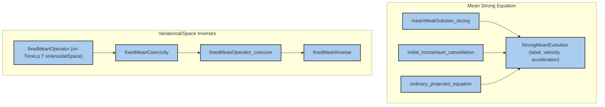
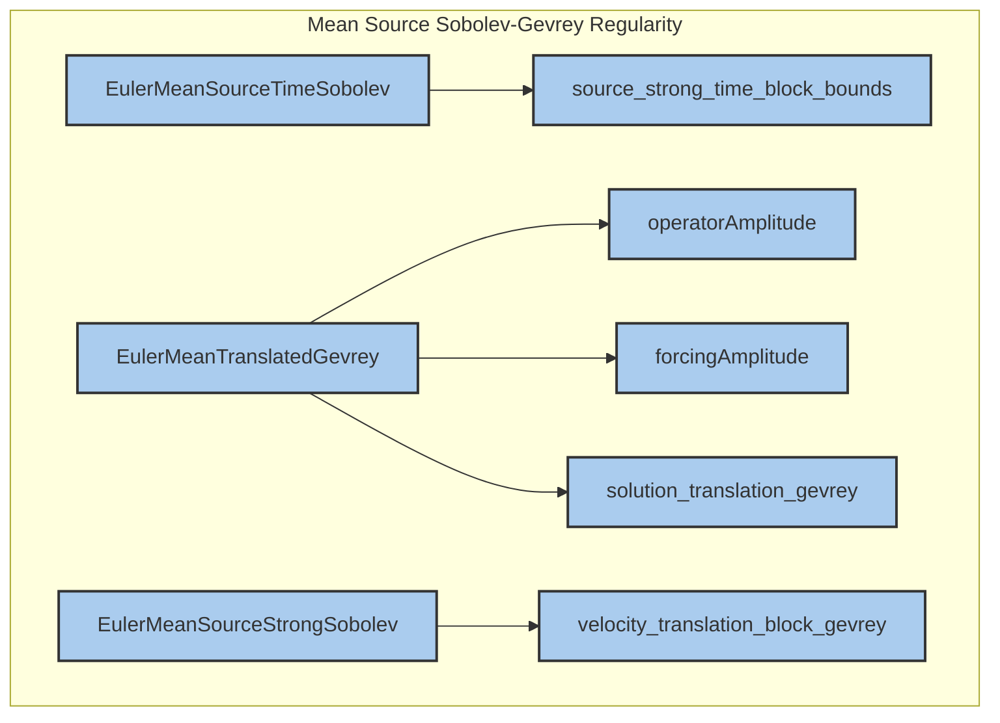
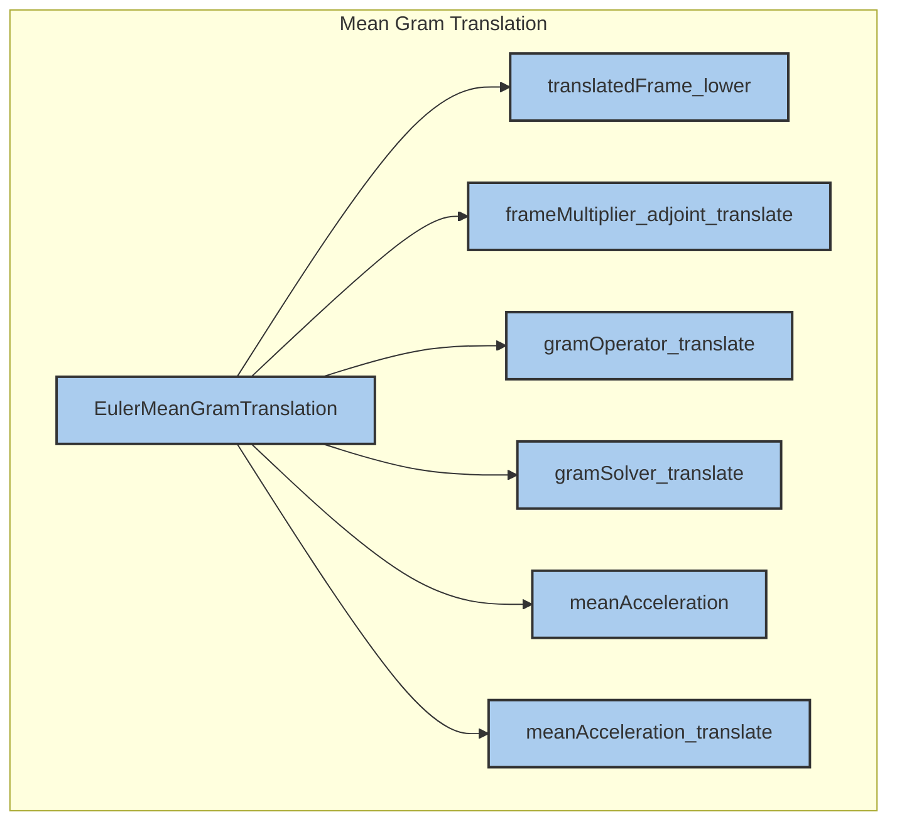

<!-- source: DeepWiki mcp.deepwiki.com · repo openai/NavierStokesAndEuler · page 3.2 Mean-Component Solver · fetched 2026-10-26 -->

# Mean-Component Solver

Relevant source files

The following files were used as context for generating this wiki page:

- [Euler/MeanAccelerationGevrey.lean](Euler/MeanAccelerationGevrey.lean)
- [Euler/MeanAccelerationSobolev.lean](Euler/MeanAccelerationSobolev.lean)
- [Euler/MeanClassicalTime.lean](Euler/MeanClassicalTime.lean)
- [Euler/MeanContinuousAcceleration.lean](Euler/MeanContinuousAcceleration.lean)
- [Euler/MeanContinuousPhysical.lean](Euler/MeanContinuousPhysical.lean)
- [Euler/MeanContinuousSobolev.lean](Euler/MeanContinuousSobolev.lean)
- [Euler/MeanFixedCoefficientGevrey.lean](Euler/MeanFixedCoefficientGevrey.lean)
- [Euler/MeanFixedCoefficientRegularity.lean](Euler/MeanFixedCoefficientRegularity.lean)
- [Euler/MeanFixedSobolevGevrey.lean](Euler/MeanFixedSobolevGevrey.lean)
- [Euler/MeanFixedSpaceInverse.lean](Euler/MeanFixedSpaceInverse.lean)
- [Euler/MeanFormGevrey.lean](Euler/MeanFormGevrey.lean)
- [Euler/MeanGramTranslation.lean](Euler/MeanGramTranslation.lean)
- [Euler/MeanPhysicalTranslation.lean](Euler/MeanPhysicalTranslation.lean)
- [Euler/MeanPointwiseGramTranslation.lean](Euler/MeanPointwiseGramTranslation.lean)
- [Euler/MeanPressureSobolev.lean](Euler/MeanPressureSobolev.lean)
- [Euler/MeanSourceFixedInverse.lean](Euler/MeanSourceFixedInverse.lean)
- [Euler/MeanSourceGevrey.lean](Euler/MeanSourceGevrey.lean)
- [Euler/MeanSourcePressureSobolev.lean](Euler/MeanSourcePressureSobolev.lean)
- [Euler/MeanSourceSobolev.lean](Euler/MeanSourceSobolev.lean)
- [Euler/MeanSourceSpatialRegularity.lean](Euler/MeanSourceSpatialRegularity.lean)
- [Euler/MeanSourceStrongInverse.lean](Euler/MeanSourceStrongInverse.lean)
- [Euler/MeanSourceStrongSobolev.lean](Euler/MeanSourceStrongSobolev.lean)
- [Euler/MeanSourceTimeSobolev.lean](Euler/MeanSourceTimeSobolev.lean)
- [Euler/MeanSourceVariationalInverse.lean](Euler/MeanSourceVariationalInverse.lean)
- [Euler/MeanStrongContinuousGevrey.lean](Euler/MeanStrongContinuousGevrey.lean)
- [Euler/MeanStrongEquation.lean](Euler/MeanStrongEquation.lean)
- [Euler/MeanStrongGevrey.lean](Euler/MeanStrongGevrey.lean)
- [Euler/MeanStrongInverse.lean](Euler/MeanStrongInverse.lean)
- [Euler/MeanStrongSobolev.lean](Euler/MeanStrongSobolev.lean)
- [Euler/MeanTimeSobolev.lean](Euler/MeanTimeSobolev.lean)
- [Euler/MeanTranslatedGevrey.lean](Euler/MeanTranslatedGevrey.lean)
- [Euler/MeanVariationalOperator.lean](Euler/MeanVariationalOperator.lean)
- [Euler/MeanVelocityPressure.lean](Euler/MeanVelocityPressure.lean)
- [Euler/SourceForwardCoefficient.lean](Euler/SourceForwardCoefficient.lean)
- [Euler/SourceNormalResidualBounds.lean](Euler/SourceNormalResidualBounds.lean)
- [Euler/TransverseFixedSpaceInverse.lean](Euler/TransverseFixedSpaceInverse.lean)

This page details the mean-component solver, which is responsible for solving the mean strong equation. It covers the variational and space inverses, the Sobolev-Gevrey regularity of the mean source, the mean Gram translation, and the classical time regularity and pressure. The solver upgrades variational solutions to genuine H² solenoidal coordinates, handles initial momentum cancellation, and establishes the spatial regularity of physical mean fields.

## Mean Strong Equation and Variational/Space Inverses

The core of the mean-component solver is the `StrongMeanEvolution` structure, which represents the strong mean evolution of the system [Euler/MeanStrongEquation.lean:26-47](). This structure encapsulates the label, velocity, and acceleration of the mean field, along with their time derivatives and the governing equation.

The `StrongMeanEvolution` is constructed by upgrading a variational solution to H² solenoidal coordinates. This involves using the derived AC momentum and a constructed coercive Gram inverse [Euler/MeanStrongEquation.lean:7-11](). The initial momentum trace is designed to cancel the original `M0` boundary term [Euler/MeanStrongEquation.lean:11]().

The `meanWeakSolution_strong` theorem [Euler/MeanStrongEquation:108-109]() asserts that a genuine mean weak solution possesses actual H² label coordinates, satisfies the literal projected equation, and adheres to the original initial velocity condition. This theorem relies on several helper functions and theorems:
*   `solenoidalFrame` [Euler/MeanStrongEquation:110]() and its derivatives `solenoidalFrame_hasDerivWithinAt` [Euler/MeanStrongEquation:118]() are used to define the frame in solenoidal space.
*   `meanFrameCoercivity` [Euler/MeanStrongEquation:113]() and `solenoidalFrame_lower` [Euler/MeanStrongEquation:115]() establish coercivity properties of the frame.
*   `meanPrimitive_in_frame_range` [Euler/MeanStrongEquation:122]() ensures that the mean primitive lies within the frame's range.
*   `meanMomentum_with_initial` [Euler/MeanStrongEquation:126]() provides the momentum with initial conditions.

The `fixedMeanOperator` [Euler/MeanFixedSpaceInverse:68]() represents the full original mean form as an operator on a fixed Hilbert space, specifically `TimeLp T solenoidalSpace`. This operator incorporates kinetic, potential, and nonlocal initial-trace terms [Euler/MeanFixedSpaceInverse:7-8](). Its coercivity is established by `fixedMeanOperator_coercive` [Euler/MeanFixedSpaceInverse:108](), which relies on source smallness and transport bounds. The `fixedMeanInverse` [Euler/MeanFixedSpaceInverse:134]() is then defined as the coercive inverse of this operator.

**Diagram: Mean Strong Equation and Variational/Space Inverses**

Sources:
*   [Euler/MeanStrongEquation.lean:7-11]()
*   [Euler/MeanStrongEquation.lean:26-47]()
*   [Euler/MeanStrongEquation.lean:108-109]()
*   [Euler/MeanStrongEquation.lean:110]()
*   [Euler/MeanStrongEquation.lean:113]()
*   [Euler/MeanStrongEquation.lean:115]()
*   [Euler/MeanStrongEquation.lean:118]()
*   [Euler/MeanStrongEquation.lean:122]()
*   [Euler/MeanStrongEquation.lean:126]()
*   [Euler/MeanFixedSpaceInverse.lean:7-8]()
*   [Euler/MeanFixedSpaceInverse.lean:68]()
*   [Euler/MeanFixedSpaceInverse.lean:108]()
*   [Euler/MeanFixedSpaceInverse.lean:134]()

## Mean Source Sobolev-Gevrey Regularity

The mean source Sobolev-Gevrey regularity ensures that the solution to the mean strong equation exhibits specific smoothness properties. The `EulerMeanSourceTimeSobolev` namespace provides concrete source estimates for the strong mean inverse [Euler/MeanSourceTimeSobolev.lean:7-14]().

The `source_strong_time_block_bounds` theorem [Euler/MeanSourceTimeSobolev:77]() states that literal source coefficient bounds and forcing orbit bounds imply successive coordinate and physical-field factorial estimates. This theorem leverages coercivity, boundary cutoff calculus, Gram inversion, and time reconstruction.

The `EulerMeanTranslatedGevrey` namespace focuses on all-order spatial estimates for the translated mean inverse [Euler/MeanTranslatedGevrey.lean:6-11](). It defines `operatorAmplitude` [Euler/MeanTranslatedGevrey:34]() and `forcingAmplitude` [Euler/MeanTranslatedGevrey:38]() as polynomial amplitudes for the fixed mean operator and forcing pullback, respectively. The `solution_translation_gevrey` theorem [Euler/MeanTranslatedGevrey:55]() proves that every spatial derivative of the solved mean field satisfies a factorial bound, without assuming a solution-jet recurrence.

The `EulerMeanSourceStrongSobolev` namespace further details the Sobolev regularity. The `velocity_translation_block_gevrey` theorem [Euler/MeanSourceStrongSobolev:72]() establishes that the strong coordinate velocity inherits the bound of the actual source solver.

**Diagram: Mean Source Sobolev-Gevrey Regularity Components**

Sources:
*   [Euler/MeanSourceTimeSobolev.lean:7-14]()
*   [Euler/MeanSourceTimeSobolev.lean:77]()
*   [Euler/MeanTranslatedGevrey.lean:6-11]()
*   [Euler/MeanTranslatedGevrey.lean:34]()
*   [Euler/MeanTranslatedGevrey.lean:38]()
*   [Euler/MeanTranslatedGevrey.lean:55]()
*   [Euler/MeanSourceStrongSobolev.lean:72]()

## Mean Gram Translation

The mean Gram translation addresses the covariance of the mean acceleration under spatial translation. The `EulerMeanGramTranslation` namespace focuses on this aspect [Euler/MeanGramTranslation.lean:6-11]().

Key theorems in this section include:
*   `translatedFrame_lower` [Euler/MeanGramTranslation:37]() which states that a spatially translated frame retains its original lower bound.
*   `frameMultiplier_adjoint_translate` [Euler/MeanGramTranslation:48]() demonstrates that the adjoint frame multiplier transforms by ordinary spatial translation.
*   `gramOperator_translate` [Euler/MeanGramTranslation:65]() shows that spatial translation conjugates the actual time Gram operator.
*   `gramSolver_translate` [Euler/MeanGramTranslation:76]() proves that the coercive Gram inverse is covariant with spatial translation. This is crucial as it implies that no regularity of the inverse or the unknown solution is assumed.

The `meanAcceleration` function [Euler/MeanGramTranslation:97]() defines the genuine fixed-coordinate acceleration recovered from velocity and forcing. The `meanAcceleration_translate` theorem [Euler/MeanGramTranslation:105]() then shows that the translated acceleration is obtained by applying the actual translated coefficients.

**Diagram: Mean Gram Translation Workflow**

Sources:
*   [Euler/MeanGramTranslation.lean:6-11]()
*   [Euler/MeanGramTranslation.lean:37]()
*   [Euler/MeanGramTranslation.lean:48]()
*   [Euler/MeanGramTranslation.lean:65]()
*   [Euler/MeanGramTranslation.lean:76]()
*   [Euler/MeanGramTranslation.lean:97]()
*   [Euler/MeanGramTranslation.lean:105]()

## Classical Time Regularity and Pressure

This section deals with the continuous acceleration and classical time derivatives for the mean inverse, as well as the pressure field.

The `EulerMeanVariationalInverse.StrongMeanEvolution` namespace in `Euler/MeanClassicalTime.lean` defines `coordinateVelocityPath` [Euler/MeanClassicalTime:35]() as a continuous representative of the actual L² coordinate velocity. The `coordinateVelocityPath_norm` theorem [Euler/MeanClassicalTime:53]() provides an H¹ trace bound for this path.

The `classicalAcceleration` [Euler/MeanClassicalTime:81]() is constructed using the actual Gram inverse, and its norm is estimated by `classicalAcceleration_norm` [Euler/MeanClassicalTime:86](). The `classicalAcceleration_ae` theorem [Euler/MeanClassicalTime:102]() confirms that the L² acceleration is genuinely represented by this continuous path. Furthermore, `velocity_hasDerivWithinAt` [Euler/MeanClassicalTime:109]() states that the coordinate velocity has the classical acceleration as its derivative within the interval.

The `classicalPhysicalDerivative` [Euler/MeanClassicalTime:119]() represents the actual continuous product-rule expression for the physical derivative.

The `EulerMeanContinuousAcceleration` namespace focuses on the spatial orbits of continuous mean acceleration. The `meanAccelerationPath` [Euler/MeanContinuousAcceleration:43]() is defined as the continuous mean acceleration constructed at each actual time. The `meanAccelerationPath_orbit_eq` theorem [Euler/MeanContinuousAcceleration:47]() establishes that the genuine spatial orbit equals the actual solve with translated data. The `meanAccelerationPath_translation_contDiff` [Euler/MeanContinuousAcceleration:59]() and `meanAccelerationPath_translation_gevrey` [Euler/MeanContinuousAcceleration:78]() theorems prove the smoothness and factorial bounds for the acceleration's spatial derivatives.

The `EulerMeanSourcePressureSobolev` namespace provides concrete source estimates for the pressure. The `source_pressure_block_bounds` theorem [Euler/MeanSourcePressureSobolev:76]() states that the literal source pressure force is smooth and has the same fixed-Hq grade as the time derivative of the velocity.

```mermaid
graph TD
    subgraph "Classical Time Regularity"
        A["StrongMeanEvolution"]
        B["coordinateVelocityPath"]
        C["coordinateVelocityPath_norm"]
        D["classicalAcceleration"]
        E["classicalAcceleration_norm"]
        F["classicalAcceleration_ae"]
        G["velocity_hasDerivWithinAt"]
        H["classicalPhysicalDerivative"]
    end

    subgraph "Continuous Acceleration"
        I["EulerMeanContinuousAcceleration"]
        J["meanAccelerationPath"]
        K["meanAccelerationPath_orbit_eq"]
        L["meanAccelerationPath_translation_contDiff"]
        M["meanAccelerationPath_translation_gevrey"]
    end

    subgraph "Pressure"
        N["EulerMeanSourcePressureSobolev"]
        O["source_pressure_block_bounds"]
    end

    A --> B
    B --> C
    D --> E
    D --> F
    D --> G
    H --> A
    I --> J
    J --> K
    J --> L
    J --> M
    N --> O

    style A fill:#ace,stroke:#333,stroke-width:2px
    style B fill:#ace,stroke:#333,stroke-width:2px
    style C fill:#ace,stroke:#333,stroke-width:2px
    style D fill:#ace,stroke:#333,stroke-width:2px
    style E fill:#ace,stroke:#333,stroke-width:2px
    style F fill:#ace,stroke:#333,stroke-width:2px
    style G fill:#ace,stroke:#333,stroke-width:2px
    style H fill:#ace,stroke:#333,stroke-width:2px
    style I fill:#ace,stroke:#333,stroke-width:2px
    style J fill:#ace,stroke:#333,stroke-width:2px
    style K fill:#ace,stroke:#333,stroke-width:2px
    style L fill:#ace,stroke:#333,stroke-width:2px
    style M fill:#ace,stroke:#333,stroke-width:2px
    style N fill:#ace,stroke:#333,stroke-width:2px
    style O fill:#ace,stroke:#333,stroke-width:2px
```

**Diagram: Classical Time Regularity and Pressure Components**

Sources:
*   [Euler/MeanClassicalTime.lean:35]()
*   [Euler/MeanClassicalTime.lean:53]()
*   [Euler/MeanClassicalTime.lean:81]()
*   [Euler/MeanClassicalTime.lean:86]()
*   [Euler/MeanClassicalTime.lean:102]()
*   [Euler/MeanClassicalTime.lean:109]()
*   [Euler/MeanClassicalTime.lean:119]()
*   [Euler/MeanContinuousAcceleration.lean:43]()
*   [Euler/MeanContinuousAcceleration.lean:47]()
*   [Euler/MeanContinuousAcceleration.lean:59]()
*   [Euler/MeanContinuousAcceleration.lean:78]()
*   [Euler/MeanSourcePressureSobolev.lean:76]()

---

