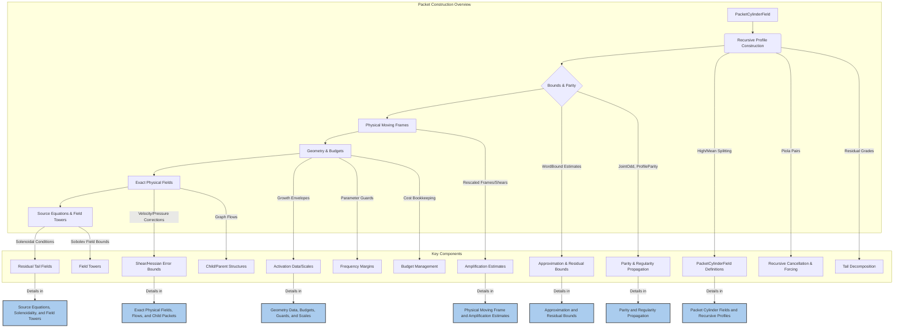

<!-- source: DeepWiki mcp.deepwiki.com · repo openai/NavierStokesAndEuler · page 4 Euler: Packet Construction · fetched 2026-10-26 -->

# Euler: Packet Construction

Relevant source files

The following files were used as context for generating this wiki page:

- [Euler/FieldTowerGraphGevrey.lean](Euler/FieldTowerGraphGevrey.lean)
- [Euler/PacketCylinderAngularRegularity.lean](Euler/PacketCylinderAngularRegularity.lean)
- [Euler/PacketCylinderField.lean](Euler/PacketCylinderField.lean)
- [Euler/PacketCylinderHighMean.lean](Euler/PacketCylinderHighMean.lean)
- [Euler/PacketCylinderMeanStep.lean](Euler/PacketCylinderMeanStep.lean)
- [Euler/PacketCylinderPiolaCorrector.lean](Euler/PacketCylinderPiolaCorrector.lean)
- [Euler/PacketCylinderPiolaPair.lean](Euler/PacketCylinderPiolaPair.lean)
- [Euler/PacketCylinderPrefixLocality.lean](Euler/PacketCylinderPrefixLocality.lean)
- [Euler/PacketCylinderSpatialInvariance.lean](Euler/PacketCylinderSpatialInvariance.lean)
- [Euler/PacketKnownTermSums.lean](Euler/PacketKnownTermSums.lean)
- [Euler/PacketLowGrades.lean](Euler/PacketLowGrades.lean)
- [Euler/PacketMomentumExpansion.lean](Euler/PacketMomentumExpansion.lean)
- [Euler/PacketRecursionAlgebra.lean](Euler/PacketRecursionAlgebra.lean)
- [Euler/PacketRecursiveBase.lean](Euler/PacketRecursiveBase.lean)
- [Euler/PacketRecursiveCancellation.lean](Euler/PacketRecursiveCancellation.lean)
- [Euler/PacketRecursiveForcing.lean](Euler/PacketRecursiveForcing.lean)
- [Euler/PacketRecursiveResidual.lean](Euler/PacketRecursiveResidual.lean)
- [Euler/PacketResidualGrades.lean](Euler/PacketResidualGrades.lean)
- [Euler/PacketResidualTailDecomposition.lean](Euler/PacketResidualTailDecomposition.lean)
- [Euler/SourceCylinderClassical.lean](Euler/SourceCylinderClassical.lean)
- [Euler/StaticCylinderField.lean](Euler/StaticCylinderField.lean)

This page provides a high-level overview of the self-similar packet machinery used in the Euler proof. This machinery constructs the velocity and pressure fields as a sum of "packets," each representing a specific scale and contributing to the overall solution. The construction involves defining cylinder packet fields, recursively building profiles, estimating bounds, managing parity, and setting up physical frames and budgets. Detailed explanations for each of these components are provided in the linked child pages.

The core idea is to represent the solution as a sum of profiles, where each profile `a i` consists of high-frequency, mean, and corrector components for velocity, and corresponding pressure components [Euler/PacketRecursiveForcing.lean:12-14](). These profiles are assembled to form the total velocity and pressure fields [Euler/PacketRecursiveCancellation.lean:13-14](). The recursive construction aims to cancel out lower-order terms in the momentum equation, leaving a controlled residual.

**Diagram: High-Level Packet Construction Flow**

### Packet Cylinder Fields and Recursive Profiles

The fundamental building blocks are `PacketCylinderField` definitions, which represent the velocity and pressure fields on a cylinder domain. The construction involves splitting fields into high-frequency and mean components, and using Piola pairs for specific vector field decompositions. A recursive process is employed to construct profiles (`Profile` in [Euler/PacketProfileRecursion.lean]()), aiming for cancellation of terms in the momentum equation. This recursion generates residual grades, which are then decomposed into tail sums. The `recursiveGrade` function [Euler/PacketRecursiveCancellation.lean:22]() calculates the coefficient of the momentum equation at a specific grade `p`. The goal is to make these `recursiveGrade`s zero for lower orders, as shown in `recursiveGrade_eq_zero` [Euler/PacketRecursiveCancellation.lean:62]().

For details, see [Packet Cylinder Fields and Recursive Profiles](#4.1).

Sources:
- [Euler/PacketRecursiveCancellation.lean:13-14]()
- [Euler/PacketRecursiveCancellation.lean:22]()
- [Euler/PacketRecursiveCancellation.lean:62]()
- [Euler/PacketProfileRecursion.lean]()

### Approximation and Residual Bounds

A critical aspect of the packet construction is controlling the errors introduced by approximations. This involves estimating `WordBound`s for normalized packet velocity, tail sums, residuals, and normal drift. Both forward and joined variants of these bounds are considered. The process also includes managing grade and term budgets to ensure that the overall error remains within acceptable limits. The `momentumResidual` function [Euler/PacketMomentumExpansion.lean:26]() defines the residual of the momentum equation for a finite sum of fields. The `norm_momentum_fieldSum_le` theorem [Euler/PacketMomentumExpansion.lean:54]() provides a bound on this residual based on the norms of the remaining coefficients.

For details, see [Approximation and Residual Bounds](#4.2).

Sources:
- [Euler/PacketMomentumExpansion.lean:26]()
- [Euler/PacketMomentumExpansion.lean:54]()

### Parity and Regularity Propagation

The construction carefully maintains parity properties, such as `JointOdd` and `ProfileParity`, and coefficient evenness. This ensures that the regularity of the fields is preserved throughout the recursive steps. The `AngleIndependentJet` structure [Euler/PacketCylinderSpatialInvariance.lean:14]() and its associated theorems, like `slicedJet_angleIndependent_of_support` [Euler/PacketCylinderSpatialInvariance.lean:54](), are crucial for demonstrating how angle-independent properties are maintained, especially for fields outside their support. This is important for controlling the behavior of nonlinear terms.

For details, see [Parity and Regularity Propagation](#4.3).

Sources:
- [Euler/PacketCylinderSpatialInvariance.lean:14]()
- [Euler/PacketCylinderSpatialInvariance.lean:54]()

### Physical Moving Frame and Amplification Estimates

The packet construction operates within rescaled frames and shears, which are essential for managing the geometry and dynamics of the fluid. This involves matrix error bounds, stage and neighbor references, and careful control over the size and horizon of the packets. Frame renewal and propagators are used to maintain stability and estimate amplification factors. The `Field` structure [Euler/PacketCylinderField.lean:21]() provides a witness for raw packet fields, ensuring they have a continuous L² path and a smooth mixed translation orbit.

For details, see [Physical Moving Frame and Amplification Estimates](#4.4).

Sources:
- [Euler/PacketCylinderField.lean:21]()

### Geometry Data, Budgets, Guards, and Scales

This section deals with the practical aspects of packet construction, including the assembly of packet geometry and the definition of growth envelopes. It covers activation data and scales, parameter guards, and frequency margins to ensure the well-behavedness of the construction. Cost and budget bookkeeping are also crucial for managing the computational and analytical resources required. The `PrefixLocality` structure [Euler/PacketCylinderPrefixLocality.lean:13]() defines properties related to the spatial support and angle independence of packet components, which are vital for controlling the locality of interactions.

For details, see [Geometry Data, Budgets, Guards, and Scales](#4.5).

Sources:
- [Euler/PacketCylinderPrefixLocality.lean:13]()

### Exact Physical Fields, Flows, and Child Packets

The goal of the packet construction is to produce exact physical velocity and pressure fields, along with necessary corrections. This involves analyzing shear and Hessian error bounds, understanding graph flows, and defining the parent-child relationships between packets. The `EulerSourceCylinderClassical.field` function [Euler/SourceCylinderClassical.lean:32]() reconstructs the actual physical field from the solved L² class, ensuring joint continuity and spatial/angular smoothness.

For details, see [Exact Physical Fields, Flows, and Child Packets](#4.6).

Sources:
- [Euler/SourceCylinderClassical.lean:32]()

### Source Equations, Solenoidality, and Field Towers

This section focuses on the underlying mathematical equations and constraints. It covers packet source and joined-source equations, solenoidal and Piola conditions, and the treatment of residual tail fields. The concept of field towers and Sobolev field bounds is used to characterize the regularity and behavior of the constructed fields. The `recursiveGrade_tail` theorem [Euler/PacketResidualTailDecomposition.lean:77]() shows how the recursive grade for higher orders (beyond `N+1`) can be expressed in terms of linear and nonlinear components, which is crucial for managing residuals.

For details, see [Source Equations, Solenoidality, and Field Towers](#4.7).

Sources:
- [Euler/PacketResidualTailDecomposition.lean:77]()

---

