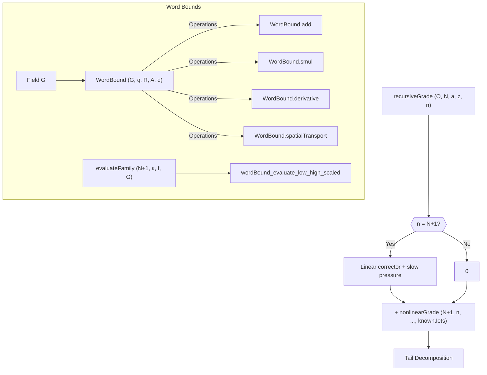

<!-- source: DeepWiki mcp.deepwiki.com · repo openai/NavierStokesAndEuler · page 4.1 Packet Cylinder Fields and Recursive Profiles · fetched 2026-10-26 -->

# Packet Cylinder Fields and Recursive Profiles

<details>
<summary>Relevant source files</summary>

The following files were used as context for generating this wiki page:

- [Euler/FieldTowerGraphGevrey.lean](Euler/FieldTowerGraphGevrey.lean)
- [Euler/MeanPacketBudget.lean](Euler/MeanPacketBudget.lean)
- [Euler/PacketConvolutionBounds.lean](Euler/PacketConvolutionBounds.lean)
- [Euler/PacketCylinderAngularRegularity.lean](Euler/PacketCylinderAngularRegularity.lean)
- [Euler/PacketCylinderField.lean](Euler/PacketCylinderField.lean)
- [Euler/PacketCylinderFieldBounds.lean](Euler/PacketCylinderFieldBounds.lean)
- [Euler/PacketCylinderHighMean.lean](Euler/PacketCylinderHighMean.lean)
- [Euler/PacketCylinderMeanStep.lean](Euler/PacketCylinderMeanStep.lean)
- [Euler/PacketCylinderPiolaCorrector.lean](Euler/PacketCylinderPiolaCorrector.lean)
- [Euler/PacketCylinderPiolaPair.lean](Euler/PacketCylinderPiolaPair.lean)
- [Euler/PacketCylinderPrefixLocality.lean](Euler/PacketCylinderPrefixLocality.lean)
- [Euler/PacketCylinderSpatialInvariance.lean](Euler/PacketCylinderSpatialInvariance.lean)
- [Euler/PacketFieldJetLp.lean](Euler/PacketFieldJetLp.lean)
- [Euler/PacketFiniteRemainderBounds.lean](Euler/PacketFiniteRemainderBounds.lean)
- [Euler/PacketFiniteSumBounds.lean](Euler/PacketFiniteSumBounds.lean)
- [Euler/PacketInitialBounds.lean](Euler/PacketInitialBounds.lean)
- [Euler/PacketKnownTermSums.lean](Euler/PacketKnownTermSums.lean)
- [Euler/PacketLowGrades.lean](Euler/PacketLowGrades.lean)
- [Euler/PacketMomentumExpansion.lean](Euler/PacketMomentumExpansion.lean)
- [Euler/PacketRecursionAlgebra.lean](Euler/PacketRecursionAlgebra.lean)
- [Euler/PacketRecursiveBase.lean](Euler/PacketRecursiveBase.lean)
- [Euler/PacketRecursiveCancellation.lean](Euler/PacketRecursiveCancellation.lean)
- [Euler/PacketRecursiveForcing.lean](Euler/PacketRecursiveForcing.lean)
- [Euler/PacketRecursiveResidual.lean](Euler/PacketRecursiveResidual.lean)
- [Euler/PacketResidualGrades.lean](Euler/PacketResidualGrades.lean)
- [Euler/PacketResidualTailDecomposition.lean](Euler/PacketResidualTailDecomposition.lean)
- [Euler/SourceCylinderClassical.lean](Euler/SourceCylinderClassical.lean)
- [Euler/StaticCylinderField.lean](Euler/StaticCylinderField.lean)

</details>


This page details the construction and properties of `PacketCylinderField` instances, which represent the velocity and pressure fields within the self-similar packet cascade. It covers the splitting of fields into high and mean components, the use of Piola pairs for solenoidal conditions, the recursive cancellation and forcing mechanisms, and the decomposition of residual grades and tail sums.

## Packet Cylinder Field Definitions

A `PacketCylinderField.Field` [Euler/PacketCylinderField.lean:21-24]() is a structure that encapsulates a raw `VectorField` with its corresponding continuous L² path and a smooth mixed translation orbit. This ensures that the field is well-behaved and can be differentiated.

```lean
structure Field (P T : ℝ) [Fact (0 < P)] (raw : VectorField) where
  path : C(Icc (0 : ℝ) T,LiftL2 P)
  orbit : ContDiff ℝ ∞ (fun a : LiftTangent => pathTranslate P a path)
  raw_eq : ∀ (t : Icc (0 : ℝ) T) x θ,
    raw (t,(x,θ)) = pointField P path orbit t (x,(θ : AddCircle P))
```

- `path`: A continuous path in `LiftL2 P`, representing the L²-normed field over time.
- `orbit`: A proof that the field's translation orbit is infinitely differentiable (`ContDiff ℝ ∞`). This is crucial for applying jet calculus and estimating derivatives.
- `raw_eq`: An assertion that the `raw` field (a `VectorField` function `(t, (x, θ)) ↦ Space`) is pointwise equal to the `pointField` derived from the `path` and `orbit`.

The `TimeDerivative` property [Euler/PacketCylinderField.lean:30-32]() defines what it means for one `Field` to be the time derivative of another. This is an actual within-interval derivative in the Hilbert L² space.

Sources:
- [Euler/PacketCylinderField.lean:21-32]()

## High/Mean Splitting and Piola Pairs

Within the packet construction, fields are often split into "high" and "mean" components. The "mean" component refers to the angular average of the field, while the "high" component is the remainder. This decomposition is fundamental for handling the specific symmetries and conservation laws of the Euler equations.

The `EulerPacketProfileRecursion.Profile` structure [Euler/PacketProfileRecursion.lean]() (not shown in full) defines these components:
- `high`: The high-frequency part of the velocity.
- `mean`: The angular mean of the velocity.
- `corrector`: A correction term.
- `highPressure`: The pressure associated with the high velocity.
- `meanPressure`: The pressure associated with the mean velocity.

Piola pairs are implicitly used to ensure the solenoidal (divergence-free) condition for the velocity fields. The `O.normal` and `O.inverseFrame` operators, which are part of the `Operators` structure, play a role in this. For instance, the condition `inner ℝ (O.normal z,primary.high z) = 0` [Euler/PacketRecursiveCancellation.lean:65]() ensures that the high component is tangent to the cylinder, which is a step towards maintaining solenoidality.

The `meanForce` and `highForce` functions [Euler/PacketRecursiveForcing.lean:99]() represent the forcing terms for the mean and high components, respectively. These are derived from the `knownForce` [Euler/PacketRecursiveForcing.lean:80]() which is the full nonlinear coefficient forcing.

### Angle-Independent Fields

A key property for the mean component and for fields outside the support of a packet is angle independence. The `AngleIndependentJet` structure [Euler/PacketCylinderSpatialInvariance.lean:14-18]() captures this:

```lean
structure AngleIndependentJet (J : ℝ → VectorJet) : Prop where
  value : ∀ θ, (J θ).1 = (J 0).1
  spatial : ∀ θ v, (J θ).2 (spatialInjection v) = (J 0).2 (spatialInjection v)
  angular : ∀ θ, (J θ).2 angleDirection = 0
```

This structure asserts that the jet's value and its spatial derivatives are independent of the angular coordinate `θ`, and its angular derivative is zero. This property is crucial for simplifying calculations and proving bounds. For example, `Field.slicedJet_angleIndependent` [Euler/PacketCylinderSpatialInvariance.lean:81-93]() proves that if a raw field is angle-independent, its sliced jet also satisfies `AngleIndependentJet`.

Sources:
- [Euler/PacketCylinderSpatialInvariance.lean:14-18]()
- [Euler/PacketCylinderSpatialInvariance.lean:81-93]()
- [Euler/PacketRecursiveCancellation.lean:65]()
- [Euler/PacketRecursiveForcing.lean:80]()
- [Euler/PacketRecursiveForcing.lean:99]()
- [Euler/PacketProfileRecursion.lean]()

## Recursive Cancellation and Forcing

The packet construction relies on a recursive process where each "grade" of the packet is constructed to cancel out specific forcing terms. The `recursiveGrade` function [Euler/PacketRecursiveCancellation.lean:22-25]() calculates the coefficient of the recursively constructed packet fields.

```lean
def recursiveGrade (O : Operators) (N : ℕ) (a : ℕ → Profile) (z : Domain) (p : ℕ) : Space :=
  coefficient (N+1) (linearPart (O.strain z)) (slowPressure (O.inverseFrame z))
    (fastPressure (O.normal z)) (slowAdvection (O.inverseFrame z)) (fastAdvection (O.normal z))
    (assembledJets O N a z) (pressureJets N a z) p
```

The core idea of recursive cancellation is demonstrated by `recursiveGrade_eq_zero` [Euler/PacketRecursiveCancellation.lean:61-86](). This theorem states that if the primary profile's mean is zero, and certain tangency conditions (`hprimary`, `hhigh`) and linear equations (`hmeanEquation`, `hhighEquation`) are satisfied, then the `recursiveGrade` for a given `p` becomes zero. This means that the construction at each step `p` is designed to precisely cancel out the forcing terms generated by previous steps.

The `assembledJets` [Euler/PacketRecursiveForcing.lean:22-24]() and `pressureJets` [Euler/PacketRecursiveCancellation.lean:19-21]() functions combine the jets of the high, mean, and corrector components of the profiles up to a certain grade `N`. These assembled jets are then used in the `coefficient` function to compute the `recursiveGrade`.

The `fullForce` [Euler/PacketRecursiveForcing.lean:80-83]() represents the total forcing term that needs to be cancelled. The `recursive_forces_sum` theorem [Euler/PacketRecursiveForcing.lean:96-116]() shows that the sum of the `meanForce` and `highForce` equals the `fullForce`, confirming that the splitting and individual solutions correctly account for the total forcing.

### Diagram: Recursive Forcing and Cancellation

```mermaid
graph TD
    subgraph "Packet Profile Recursion"
        A["Profile (a i)"] --> B{{"Split: high, mean, corrector, pressures"}}
        B --> C["assembledJets (O, N, a, z)"]
        B --> D["pressureJets (N, a, z)"]
        C & D --> E["coefficient (N+1, ..., p)"]
        E --> F["recursiveGrade (O, N, a, z, p)"]
    end

    subgraph "Forcing Terms"
        G["knownForce (O, p, a, z)"]
        H["meanForce (O, p, a, z)"]
        I["highForce (O, p, a, z)"]
        J["fullForce (O, N, p, a, z)"]
    end

    F -- "If conditions met" --> K["recursiveGrade_eq_zero"]
    H + I --> J
    J -- "Equals" --> F
```
Sources:
- [Euler/PacketRecursiveCancellation.lean:19-25]()
- [Euler/PacketRecursiveCancellation.lean:61-86]()
- [Euler/PacketRecursiveForcing.lean:22-24]()
- [Euler/PacketRecursiveForcing.lean:80-83]()
- [Euler/PacketRecursiveForcing.lean:96-116]()

## Residual Grades and Tail Decomposition

The `recursiveGrade_tail` theorem [Euler/PacketResidualTailDecomposition.lean:77-99]() describes the structure of the `recursiveGrade` for `n ≥ N+1`. It states that beyond grade `N`, the `recursiveGrade` simplifies significantly. Specifically, the fast pressure component is absent, and only the `N+1` degree retains the linear terminal corrector and slow pressure terms.

```lean
theorem recursiveGrade_tail (O : Operators) (N n : ℕ) (hn : N+1 ≤ n)
    (a : ℕ → Profile) (ha : a 0=0) (z : Domain) :
    recursiveGrade O N a z n =
      (if n=N+1 then
        linearPart (O.strain z) (slicedJet O.interval (a N).corrector z)+
        slowPressure (O.inverseFrame z) (pressureJet (a N).highPressure z) else 0) +
      nonlinearGrade (N+1) n (O.inverseFrame z) (O.normal z) (knownJets O (N+1) a z) := by
  -- ... proof ...
```

This decomposition is crucial for bounding the "tail" of the packet cascade, which consists of terms beyond the explicitly constructed grades. The `nonlinearGrade` [Euler/PacketResidualGrades.lean]() (not shown in full) represents the nonlinear advection terms.

The `WordBound` definitions [Euler/PacketCylinderFieldBounds.lean:20-22]() are used to quantify the size and regularity of these fields and their derivatives. A `WordBound` provides an upper bound on the block norm of the path's translation orbit, scaled by a `majorant` function.

```lean
def WordBound (G : Field P T raw) (q : ℕ) (R A : ℝ) (d : ℕ) : Prop :=
  ∀ n, block standardDirection q (fun a : LiftTangent => pathTranslate P a G.path) n 0 ≤
    A*majorant R d n
```

These bounds are propagated through various operations like addition (`WordBound.add` [Euler/PacketCylinderFieldBounds.lean:50-56]()), scalar multiplication (`WordBound.smul` [Euler/PacketCylinderFieldBounds.lean:76-82]()), and differentiation (`WordBound.derivative` [Euler/PacketCylinderFieldBounds.lean:91-93]()). The `WordBound.spatialTransport` [Euler/PacketCylinderFieldBounds.lean:126-129]() and `WordBound.bilinear` [Euler/PacketCylinderFieldBounds.lean:121-124]() theorems are particularly important for bounding the nonlinear terms arising from advection.

The `wordBound_evaluate_low_high_scaled` theorem [Euler/PacketInitialBounds.lean:33-59]() demonstrates how the `WordBound` applies to the `evaluateFamily` function, which sums up the contributions from different grades of the packet. It shows that the initial high and mean estimates retain their distinct small factors, and the truncation-dependent quantity (the tail base) is controlled.

### Diagram: Residual Grades and Word Bounds


Sources:
- [Euler/PacketCylinderFieldBounds.lean:20-22]()
- [Euler/PacketCylinderFieldBounds.lean:50-56]()
- [Euler/PacketCylinderFieldBounds.lean:76-82]()
- [Euler/PacketCylinderFieldBounds.lean:91-93]()
- [Euler/PacketCylinderFieldBounds.lean:121-124]()
- [Euler/PacketCylinderFieldBounds.lean:126-129]()
- [Euler/PacketInitialBounds.lean:33-59]()
- [Euler/PacketResidualTailDecomposition.lean:77-99]()

---

