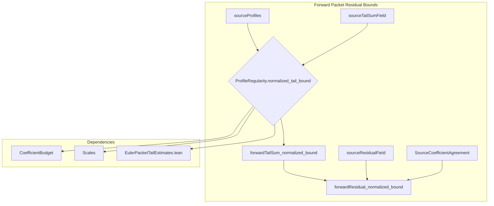
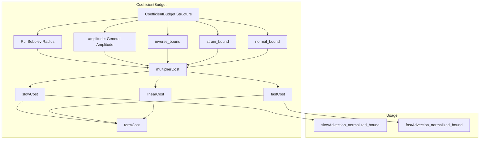

<!-- source: DeepWiki mcp.deepwiki.com · repo openai/NavierStokesAndEuler · page 4.2 Approximation and Residual Bounds · fetched 2026-10-26 -->

# Approximation and Residual Bounds

<details>
<summary>Relevant source files</summary>

The following files were used as context for generating this wiki page:

- [Euler/PacketAngularPressureStepBound.lean](Euler/PacketAngularPressureStepBound.lean)
- [Euler/PacketApproximationBounds.lean](Euler/PacketApproximationBounds.lean)
- [Euler/PacketCylinderLinearTermBudget.lean](Euler/PacketCylinderLinearTermBudget.lean)
- [Euler/PacketCylinderTermBudget.lean](Euler/PacketCylinderTermBudget.lean)
- [Euler/PacketCylinderWeightedAdvection.lean](Euler/PacketCylinderWeightedAdvection.lean)
- [Euler/PacketFiniteApproximationBounds.lean](Euler/PacketFiniteApproximationBounds.lean)
- [Euler/PacketFiniteProfileBounds.lean](Euler/PacketFiniteProfileBounds.lean)
- [Euler/PacketForwardApproximationBounds.lean](Euler/PacketForwardApproximationBounds.lean)
- [Euler/PacketForwardForcedBounds.lean](Euler/PacketForwardForcedBounds.lean)
- [Euler/PacketForwardPressureBudgets.lean](Euler/PacketForwardPressureBudgets.lean)
- [Euler/PacketForwardResidualBounds.lean](Euler/PacketForwardResidualBounds.lean)
- [Euler/PacketForwardStepBudget.lean](Euler/PacketForwardStepBudget.lean)
- [Euler/PacketJoinedApproximationBounds.lean](Euler/PacketJoinedApproximationBounds.lean)
- [Euler/PacketJoinedGradeBounds.lean](Euler/PacketJoinedGradeBounds.lean)
- [Euler/PacketJoinedResidualBounds.lean](Euler/PacketJoinedResidualBounds.lean)
- [Euler/PacketJoinedStepBudget.lean](Euler/PacketJoinedStepBudget.lean)
- [Euler/PacketKnownPieceBounds.lean](Euler/PacketKnownPieceBounds.lean)
- [Euler/PacketKnownPieces.lean](Euler/PacketKnownPieces.lean)
- [Euler/PacketMaskedProductBounds.lean](Euler/PacketMaskedProductBounds.lean)
- [Euler/PacketMeanPressureStepBound.lean](Euler/PacketMeanPressureStepBound.lean)
- [Euler/PacketNormalDriftBounds.lean](Euler/PacketNormalDriftBounds.lean)
- [Euler/PacketPrimaryGradeBounds.lean](Euler/PacketPrimaryGradeBounds.lean)
- [Euler/PacketProfileTailEstimates.lean](Euler/PacketProfileTailEstimates.lean)
- [Euler/PacketTailProductBounds.lean](Euler/PacketTailProductBounds.lean)
- [Euler/PacketUnweightedAdvection.lean](Euler/PacketUnweightedAdvection.lean)
- [Euler/TransversePacketForwardFullBounds.lean](Euler/TransversePacketForwardFullBounds.lean)
- [Euler/TransversePacketForwardGradeBounds.lean](Euler/TransversePacketForwardGradeBounds.lean)
- [Euler/TransversePacketJoinedFullBounds.lean](Euler/TransversePacketJoinedFullBounds.lean)

</details>


This page details the bounds on the normalized packet velocity, tail sums, residuals, and normal drift for both forward and joined packet variants. It also covers the grade and term budgets that underpin these bounds, ensuring the recursive construction of packet profiles remains well-behaved.

## Normalized Packet Velocity and Normal Drift Bounds

The core of the packet construction relies on ensuring that the velocity of the constructed packets remains bounded and that their normal component (drift) is small. These properties are crucial for the self-similar cascade to function correctly.

### Forward Packet Bounds

For the forward packet, the normalized velocity and normal drift are bounded. The `forwardPacket_normalized_bound` theorem establishes a `WordBound` for the normalized velocity of a source packet [Euler/PacketForwardApproximationBounds.lean:32-46](). This bound depends on the `CoefficientBudget` (`BC`), the `Scales` (`S`), and various budget parameters (`L`, `NB`, `W`, `LM`, `WM`). The `sourcePacketPullbackField` represents the packet velocity, scaled by `k`.

Similarly, `forwardPacket_normal_bound` provides a `WordBound` for the normal component of the forward packet's velocity [Euler/PacketForwardApproximationBounds.lean:48-71](). This bound is significantly smaller, scaled by `1/k`, indicating a small normal drift. The normal component is extracted using `normalComponentMap D.m₀`.

Both theorems rely on the `ProfileRegularity.normalizedVelocity_bound` and `ProfileRegularity.normalizedNormal_bound` lemmas, which are applied to the sequence of profiles `a i` generated by `sourceProfiles`. These profiles are guaranteed to satisfy their respective budgets by `forwardSource_profile_budgets`.

```mermaid
graph TD
    subgraph "Forward Packet Bounds"
        A[sourcePacketPullbackField] --> B{normalizedVelocity_bound};
        A --> C[normalComponentMap D.m₀];
        C --> D{normalizedNormal_bound};
        B --> E[forwardPacket_normalized_bound];
        D --> F[forwardPacket_normal_bound];
        G[sourceProfiles] --> B;
        G --> D;
        H[forwardSource_profile_budgets] --> B;
        H --> D;
    end
    subgraph "Dependencies"
        B & D --> I[ProfileRegularity];
        H --> J[ProfileBudget];
        J --> K[CoefficientBudget];
        J --> L[Scales];
        J --> M[EulerTransversePacketForward.Budget];
        J --> N[EulerTransversePacketJoin.NormalBudget];
        J --> O[EulerMeanPacketProvider.Budget];
    end
    E & F --> "Bounded Packet Properties";
```
**Diagram: Forward Packet Velocity and Normal Drift Bounds**

Sources:
* [Euler/PacketForwardApproximationBounds.lean:32-46]()
* [Euler/PacketForwardApproximationBounds.lean:48-71]()

### Joined Packet Bounds

The joined packet, which incorporates a history, also has its normalized velocity and normal drift bounded. The `joinedPacket_normalized_bound` theorem establishes a `WordBound` for the normalized velocity of a joined source packet [Euler/PacketJoinedApproximationBounds.lean:36-49](). This is analogous to the forward packet, but uses `joinedPacketPullbackField` and `joinedSourceProfiles`.

Similarly, `joinedPacket_normal_bound` provides a `WordBound` for the normal component of the joined packet's velocity [Euler/PacketJoinedApproximationBounds.lean:51-75](). This also shows a small normal drift, scaled by `1/k`.

These theorems similarly rely on `ProfileRegularity.normalizedVelocity_bound` and `ProfileRegularity.normalizedNormal_bound`, applied to profiles generated by `joinedSourceProfiles` and validated by `joinedSource_profile_budgets`.

```mermaid
graph TD
    subgraph "Joined Packet Bounds"
        A[joinedPacketPullbackField] --> B{normalizedVelocity_bound};
        A --> C[normalComponentMap D.m₀];
        C --> D{normalizedNormal_bound};
        B --> E[joinedPacket_normalized_bound];
        D --> F[joinedPacket_normal_bound];
        G[joinedSourceProfiles] --> B;
        G --> D;
        H[joinedSource_profile_budgets] --> B;
        H --> D;
    end
    subgraph "Dependencies"
        B & D --> I[ProfileRegularity];
        H --> J[ProfileBudget];
        J --> K[CoefficientBudget];
        J --> L[Scales];
        J --> M[EulerTransversePacketJoin.Budget];
        J --> N[EulerTransversePacketJoin.NormalBudget];
        J --> O[EulerMeanPacketProvider.Budget];
    end
    E & F --> "Bounded Joined Packet Properties";
```
**Diagram: Joined Packet Velocity and Normal Drift Bounds**

Sources:
* [Euler/PacketJoinedApproximationBounds.lean:36-49]()
* [Euler/PacketJoinedApproximationBounds.lean:51-75]()

## Tail Sums and Residual Bounds

The recursive construction of packets generates a sequence of profiles. The "tail sum" refers to the sum of profiles beyond a certain grade `N`. The "residual" is the error term that arises from truncating this sum. These need to be exponentially small to ensure convergence.

### Forward Packet Tail Sum and Residual

The `forwardTailSum_normalized_bound` theorem establishes an exponentially decaying `WordBound` for the normalized tail sum of the forward packet [Euler/PacketForwardResidualBounds.lean:31-48](). The bound is `Real.exp (-(7/10)*X*Real.log k)`, where `k` is a scaling factor and `X` is related to the number of profiles `N`. This exponential decay is crucial for the convergence of the packet construction. It relies on `ProfileRegularity.normalized_tail_bound`.

The `forwardResidual_normalized_bound` theorem then leverages the tail sum bound to establish a similar exponentially decaying `WordBound` for the normalized residual of the forward packet [Euler/PacketForwardResidualBounds.lean:50-61](). This is achieved by showing that the residual is equivalent to the tail sum under certain conditions (`Cagree`).


**Diagram: Forward Packet Tail Sum and Residual Bounds**

Sources:
* [Euler/PacketForwardResidualBounds.lean:31-48]()
* [Euler/PacketForwardResidualBounds.lean:50-61]()
* [Euler/PacketProfileTailEstimates.lean:54-63]()

### Joined Packet Tail Sum and Residual

Similar bounds exist for the joined packet. The `joinedTailSum_normalized_bound` and `joinedResidual_normalized_bound` (not shown in provided files but implied by the structure) would establish analogous exponentially decaying `WordBound`s for the joined packet's tail sum and residual, respectively. These would rely on `joinedSourceProfiles` and `joinedSource_profile_budgets`.

## Grade and Term Budgets

The bounds discussed above are built upon a system of budgets that control the growth of various quantities during the recursive construction of profiles. These budgets ensure that each step of the recursion remains within acceptable limits.

### Coefficient Budget

The `CoefficientBudget` structure [Euler/PacketCylinderTermBudget.lean:17-27]() defines bounds on the coefficients used in the packet construction. It includes:
* `Rc`: A radius parameter for Sobolev coefficient bounds.
* `amplitude`: A general amplitude for coefficient bounds.
* `inverse_bound`, `strain_bound`, `normal_bound`: Bounds on the iterated Frechet derivatives of the inverse, strain, and normal coefficient paths.

It also defines various cost metrics derived from these bounds:
* `multiplierCost`: Cost associated with coefficient multiplication [Euler/PacketCylinderTermBudget.lean:32]().
* `slowCost`: Cost for slow advection terms [Euler/PacketCylinderTermBudget.lean:33]().
* `fastCost`: Cost for fast advection terms [Euler/PacketCylinderTermBudget.lean:34]().
* `linearCost`: Cost for linear terms [Euler/PacketCylinderTermBudget.lean:35]().
* `termCost`: Total cost for elementary nonlinear packet terms [Euler/PacketCylinderTermBudget.lean:36]().

These costs are used in theorems like `slow_bound` [Euler/PacketCylinderTermBudget.lean:98-105]() and `fast_bound` [Euler/PacketCylinderTermBudget.lean:107-118]() to bound the `WordBound` of advection terms.


**Diagram: Coefficient Budget Structure and Costs**

Sources:
* [Euler/PacketCylinderTermBudget.lean:17-27]()
* [Euler/PacketCylinderTermBudget.lean:32]()
* [Euler/PacketCylinderTermBudget.lean:33]()
* [Euler/PacketCylinderTermBudget.lean:34]()
* [Euler/PacketCylinderTermBudget.lean:35]()
* [Euler/PacketCylinderTermBudget.lean:36]()
* [Euler/PacketCylinderTermBudget.lean:98-105]()
* [Euler/PacketCylinderTermBudget.lean:107-118]()

### Profile Budget

The `ProfileBudget` structure (implicitly used in many theorems, e.g., [Euler/PacketPrimaryGradeBounds.lean:90-98]()) encapsulates the bounds for a single profile's components (high, mean, corrector, etc.) at a specific grade.

The `forwardStep` theorem [Euler/PacketForwardStepBudget.lean:40-145]() describes how a `ProfileBudget` is maintained during a single recursive step for the forward packet. It takes as input the budgets for previous profiles (`hG`) and various other parameters, and outputs a `ProfileBudget` for the current step. This involves bounding mean forces (`hMF`), high forces (`hHF`), and the resulting vector, derivative, corrector, and pressure fields.

Similarly, `joinedStep` [Euler/PacketJoinedStepBudget.lean:42-146]() performs the same function for the joined packet, incorporating the history data `B`.

The `forwardAngularPressure_step_exists` theorem [Euler/PacketForwardPressureBudgets.lean:39-94]() specifically ensures that the angular derivative of the high pressure component also retains its unit grade budget during a forward step.

### Grade Guards

`GradeGuards` are conditions that must be met by the budget parameters to ensure the validity of the bounds.

For the forward packet, `EulerTransversePacketForward.Budget.GradeGuards` [Euler/TransversePacketForwardGradeBounds.lean:48-54]() ensures that the common cost, corrector amplitudes, and pressure gradient amplitudes, scaled by a data cost `C`, are all less than or equal to the radius `L.R`.

For the joined packet, `EulerTransversePacketJoin.Budget.GradeGuards` [Euler/PacketJoinedGradeBounds.lean:84-88]() similarly ensures that the common cost, corrector amplitudes, and pressure gradient amplitudes are less than or equal to the radius `L.R`.

These guards are critical for theorems like `grade_fields` in both `EulerTransversePacketForward.Budget` [Euler/TransversePacketForwardGradeBounds.lean:65-116]() and `EulerTransversePacketJoin.Budget` [Euler/PacketJoinedGradeBounds.105-142]() to establish the `WordBound`s for the various fields (vector, derivative, corrector, scalar gradient).

```mermaid
graph TD
    subgraph "Profile Budget and Grade Guards"
        A[ProfileBudget] --> B[forwardStep];
        A --> C[joinedStep];
        B --> D[EulerTransversePacketForward.Budget.GradeGuards];
        C --> E[EulerTransversePacketJoin.Budget.GradeGuards];
        D --> F[forwardAngularPressure_step_exists];
        D --> G[EulerTransversePacketForward.Budget.grade_fields];
        E --> H[EulerTransversePacketJoin.Budget.grade_fields];
    end
    subgraph "Dependencies"
        D & E --> I[L.R (Radius)];
        D & E --> J[Common Cost];
        D & E --> K[Corrector Amplitude];
        D & E --> L[Pressure Amplitude];
        G & H --> M[WordBound];
    end
```
**Diagram: Profile Budget and Grade Guard Relationships**

Sources:
* [Euler/PacketPrimaryGradeBounds.lean:90-98]()
* [Euler/PacketForwardStepBudget.lean:40-145]()
* [Euler/PacketJoinedStepBudget.lean:42-146]()
* [Euler/PacketForwardPressureBudgets.lean:39-94]()
* [Euler/TransversePacketForwardGradeBounds.lean:48-54]()
* [Euler/PacketJoinedGradeBounds.lean:84-88]()
* [Euler/TransversePacketForwardGradeBounds.lean:65-116]()
* [Euler/PacketJoinedGradeBounds.105-142]()

---

