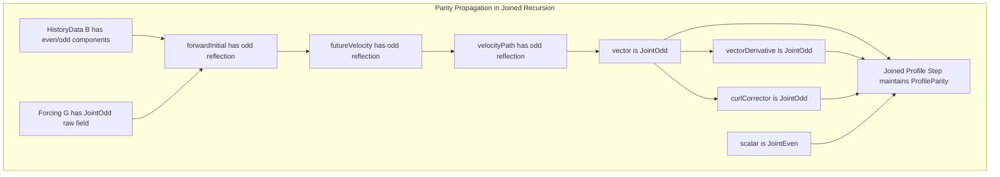

<!-- source: DeepWiki mcp.deepwiki.com · repo openai/NavierStokesAndEuler · page 4.3 Parity and Regularity Propagation · fetched 2026-10-26 -->

# Parity and Regularity Propagation

<details>
<summary>Relevant source files</summary>

The following files were used as context for generating this wiki page:

- [Euler/CorrectionAssemblyParity.lean](Euler/CorrectionAssemblyParity.lean)
- [Euler/CylinderDirichletParity.lean](Euler/CylinderDirichletParity.lean)
- [Euler/InviscidCorrectionParity.lean](Euler/InviscidCorrectionParity.lean)
- [Euler/MeanPacketParity.lean](Euler/MeanPacketParity.lean)
- [Euler/PacketCorrectionCoefficientParity.lean](Euler/PacketCorrectionCoefficientParity.lean)
- [Euler/PacketCylinderHighParity.lean](Euler/PacketCylinderHighParity.lean)
- [Euler/PacketCylinderJetParity.lean](Euler/PacketCylinderJetParity.lean)
- [Euler/PacketCylinderParity.lean](Euler/PacketCylinderParity.lean)
- [Euler/PacketFieldParityAlgebra.lean](Euler/PacketFieldParityAlgebra.lean)
- [Euler/PacketFiniteParity.lean](Euler/PacketFiniteParity.lean)
- [Euler/PacketForwardInitializedFieldParity.lean](Euler/PacketForwardInitializedFieldParity.lean)
- [Euler/PacketInitializedFieldParity.lean](Euler/PacketInitializedFieldParity.lean)
- [Euler/PacketJoinedProfilesParity.lean](Euler/PacketJoinedProfilesParity.lean)
- [Euler/PacketJoinedProfilesRegularity.lean](Euler/PacketJoinedProfilesRegularity.lean)
- [Euler/PacketJoinedStepParity.lean](Euler/PacketJoinedStepParity.lean)
- [Euler/PacketProfileParity.lean](Euler/PacketProfileParity.lean)
- [Euler/PacketProfileStepParity.lean](Euler/PacketProfileStepParity.lean)
- [Euler/PacketProfilesParity.lean](Euler/PacketProfilesParity.lean)
- [Euler/PacketProfilesRegularity.lean](Euler/PacketProfilesRegularity.lean)
- [Euler/PacketSourceParity.lean](Euler/PacketSourceParity.lean)
- [Euler/ParentPacketSourceData.lean](Euler/ParentPacketSourceData.lean)
- [Euler/SmallCorrectionParity.lean](Euler/SmallCorrectionParity.lean)
- [Euler/StaticEulerParity.lean](Euler/StaticEulerParity.lean)
- [Euler/TransversePacketData.lean](Euler/TransversePacketData.lean)
- [Euler/TransversePacketHistoryParity.lean](Euler/TransversePacketHistoryParity.lean)
- [Euler/TransversePacketJoinedParity.lean](Euler/TransversePacketJoinedParity.lean)
- [Euler/TransversePacketParity.lean](Euler/TransversePacketParity.lean)
- [Euler/TransversePacketPressureParity.lean](Euler/TransversePacketPressureParity.lean)
- [Euler/TransversePacketPrimaryParity.lean](Euler/TransversePacketPrimaryParity.lean)

</details>


This page details the mechanisms by which parity and regularity properties are preserved throughout the construction of packet fields in the Euler equations. It covers the definitions of `JointOdd` and `ProfileParity`, the evenness of coefficient fields, and how these properties are maintained through various recursive steps and field operations, including both literal and joined recursions.

## JointOdd Parity

The `JointOdd` property [Euler/PacketCylinderJetParity.lean:15-16]() defines a vector field `raw` as jointly odd if, for any time `t`, spatial coordinate `x`, and angular coordinate `θ`, `raw(t, (-x, -θ)) = -raw(t, (x, θ))`. This means the field is odd with respect to simultaneous reflection of both spatial and angular coordinates.

The `JointOdd` namespace provides several theorems demonstrating the propagation of this property through common vector field operations:
*   `JointOdd.smul`: Scalar multiplication preserves `JointOdd` parity [Euler/PacketFiniteParity.lean:19-23]().
*   `JointOdd.sum`: Finite sums of `JointOdd` fields are `JointOdd` [Euler/PacketFiniteParity.lean:25-29]().
*   `JointOdd.matrix_apply`: Applying a matrix `A` to an `JointOdd` field `f` results in an `JointOdd` field, provided `A` itself is even with respect to the reflection [Euler/PacketFiniteParity.lean:31-35]().
*   `JointOdd.truncate`: Truncating a sequence of `JointOdd` fields preserves `JointOdd` for the truncated terms [Euler/PacketFiniteParity.lean:37-44]().
*   `JointOdd.assemble`: The assembly operation for packet fields, which combines truncated fields, also preserves `JointOdd` parity [Euler/PacketFiniteParity.lean:46-54]().
*   `JointOdd.fieldSum`: The `fieldSum` operation, which sums scaled fields, maintains `JointOdd` parity [Euler/PacketFiniteParity.lean:56-59]().

### Parity of Derivatives and Advection Terms

The `Field.raw_fderiv_even_of_odd` theorem [Euler/PacketCylinderJetParity.lean:46-61]() establishes that if a raw vector field is `JointOdd`, its spatial derivative is even. This is a crucial property for the advection terms.

The `SpatialJetField` namespace further elaborates on how `JointOdd` parity propagates through advection terms:
*   `SpatialJetField.spatial_even_of_value_odd`: If the value of a spatial jet field is `JointOdd`, its spatial derivative component is even [Euler/PacketCylinderJetParity.lean:69-77]().
*   `SpatialJetField.slowAdvection_odd`: The `slowAdvection` term, which involves the inverse frame and two `JointOdd` jet fields, maintains `JointOdd` parity, provided the inverse frame is even [Euler/PacketCylinderJetParity.lean:79-92]().
*   `SpatialJetField.fastAdvection_odd`: Similarly, the `fastAdvection` term, involving a normal vector field and two `JointOdd` jet fields, preserves `JointOdd` parity if the normal vector field is even [Euler/PacketCylinderJetParity.lean:94-102]().

Sources:
*   [Euler/PacketFiniteParity.lean:19-59]()
*   [Euler/PacketCylinderJetParity.lean:15-102]()

## ProfileParity

The `ProfileParity` structure [Euler/PacketProfileParity.lean:15-21]() encapsulates the parity properties of a `Profile`, which consists of high, mean, and corrector components, along with their associated pressure fields. A `Profile` has `ProfileParity` if all its components (high, mean, corrector, pressure, highPressure, meanPressure) are `JointOdd` (for vector fields) or `JointEven` (for scalar fields).

```mermaid
graph TD
    subgraph "ProfileParity"
        ProfileParity --> HighField[high: JointOdd]
        ProfileParity --> MeanField[mean: JointOdd]
        ProfileParity --> CorrectorField[corrector: JointOdd]
        ProfileParity --> PressureGradient[pressure: JointOdd]
        ProfileParity --> HighPressure[highPressure: JointEven]
        ProfileParity --> MeanPressure[meanPressure: JointEven]
    end
```
Title: ProfileParity Structure
Sources:
*   [Euler/PacketProfileParity.lean:15-21]()

### Preservation through Profile Recursion

The `ProfileParity.assembledVelocity_odd` theorem [Euler/PacketFiniteParity.lean:102-105]() states that the `assembledVelocity` of a profile, which combines its high, mean, and corrector components, is `JointOdd` if each of these components has `ProfileParity`. The `ProfileParity.velocity_odd` theorem [Euler/PacketFiniteParity.lean:107-108]() extends this to the `fieldSum` of assembled velocities.

The `ProfileParity.step` theorem [Euler/PacketProfileStepParity.lean:30-87]() is central to preserving `ProfileParity` through a single step of the recursive profile construction. It asserts that if all profiles up to `p-1` have `ProfileParity` and `ProfileRegularity`, then the profile at step `p` also possesses `ProfileParity`. This involves checking the parity of the high, mean, corrector, and pressure components generated by the `meanSolve` and `highSolve` operators.

```mermaid
graph TD
    subgraph "Profile Recursion Step"
        A[Profiles a[0]...a[p-1] have ProfileParity] --> B{Compute meanForce and highForce}
        B --> C[meanForce is JointOdd]
        B --> D[highForce is JointOdd]
        C --> E[meanSolve output (velocity) is JointOdd]
        C --> F[meanSolve output (pressure) is JointEven]
        D --> G[highSolve output (velocity) is JointOdd]
        D --> H[highSolve output (pressure gradient) is JointOdd]
        D --> I[highSolve output (pressure) is JointEven]
        G --> J[curlCorrector output is JointOdd]
        E & F & G & H & I & J --> K[Profile at step p has ProfileParity]
    end
```
Title: ProfileParity Preservation in Recursive Step
Sources:
*   [Euler/PacketFiniteParity.lean:102-108]()
*   [Euler/PacketProfileStepParity.lean:30-87]()

## Coefficient Evenness

Coefficient fields, such as the frame, frame derivative, and inverse frame, often exhibit even parity. This evenness is crucial for maintaining the `JointOdd` property of vector fields and the `JointEven` property of scalar fields.

*   `Data.frame_even`: The `frame` coefficient field is even with respect to spatial reflection [Euler/TransversePacketParity.lean:19-23]().
*   `Data.frameDerivative_even`: The `frameDerivative` coefficient field is also even [Euler/TransversePacketParity.lean:25-29]().
*   `Data.inverse_even`: The inverse of the frame, `FInv`, is even [Euler/TransversePacketParity.lean:31-38]().
*   `Data.normal_even`: The `normal` vector field, derived from `FInv`, is even [Euler/TransversePacketParity.lean:40-44]().

These evenness properties are used in theorems like `SpatialJetField.slowAdvection_odd` and `SpatialJetField.fastAdvection_odd` to ensure that advection terms remain `JointOdd`.

Sources:
*   [Euler/TransversePacketParity.lean:19-44]()

## Step-by-Step Preservation of Parity and Regularity

### Literal Recursions

The `EulerPacketCylinderField.JointOdd` namespace in `Euler/PacketFiniteParity.lean` demonstrates how `JointOdd` parity is preserved through the construction of finite packet velocities and residual tails.
*   `JointOdd.truncate` and `JointOdd.assemble` ensure that the `truncate` and `assemble` operations, which are fundamental to building packet profiles, maintain `JointOdd` parity for the velocity components [Euler/PacketFiniteParity.lean:37-54]().
*   `ProfileRegularity.recursiveTail_odd` proves that the `recursiveGrade` (which forms part of the residual tail) is `JointOdd` if the prefix fields and coefficient data satisfy their respective parity conditions [Euler/PacketFiniteParity.lean:120-142](). This relies on the `linearPart_odd` and `slowPressure_odd` theorems, which show that these components are `JointOdd` under certain conditions [Euler/PacketFiniteParity.lean:64-84]().
*   `ProfileRegularity.residualTail_odd` extends this to the sum of recursive grades, confirming the `JointOdd` parity of the `residualTail` [Euler/PacketFiniteParity.lean:144-147]().

### Joined Recursions

Joined recursions, which combine history and forward solutions, also rigorously preserve parity.
The `EulerTransversePacketJoin` namespace in `Euler/TransversePacketJoinedParity.lean` is dedicated to proving the joint parity of the complete constructed high inverse, pressure, and actual corrector in the context of joined solutions.
*   `forwardInitial_reflection_neg`: The initial data for the forward solution maintains odd reflection parity [Euler/TransversePacketJoinedParity.lean:28-32]().
*   `futureVelocity_reflection_neg`: The future velocity also preserves odd reflection parity [Euler/TransversePacketJoinedParity.lean:36-40]().
*   `velocityPath_reflection_neg`: The `velocityPath` of the joined solution is odd [Euler/TransversePacketJoinedParity.lean:42-55]().
*   `vector_odd` and `vectorDerivative_odd`: The vector field and its time derivative are `JointOdd` [Euler/TransversePacketJoinedParity.lean:57-64]().
*   `scalar_even`: The scalar pressure field is even [Euler/TransversePacketJoinedParity.lean:66-84]().
*   `curlCorrector_odd` and `correctorDerivative_odd`: The curl corrector and its time derivative are `JointOdd` [Euler/TransversePacketJoinedParity.lean:86-99]().

These properties are then leveraged in `Euler/PacketJoinedStepParity.lean` to prove `ProfileParity.joinedStep` [Euler/PacketJoinedStepParity.lean:31-90](), which is the equivalent of `ProfileParity.step` but for joined recursions. It ensures that if the previous profiles and coefficient data have the correct parities, the current step of the joined profile recursion also maintains `ProfileParity`.


Title: Parity Propagation in Joined Recursion
Sources:
*   [Euler/PacketFiniteParity.lean:120-147]()
*   [Euler/TransversePacketJoinedParity.lean:28-99]()
*   [Euler/PacketJoinedStepParity.lean:31-90]()

### Regularity Propagation

While the primary focus of this page is parity, regularity (smoothness) is intrinsically linked. The `ProfileRegularity` structure [Euler/PacketProfilesRegularity.lean:15-21]() captures the regularity properties of a profile. The `ProfileRegularity.recursiveTail_odd` theorem [Euler/PacketFiniteParity.lean:120-142]() implicitly relies on the regularity of the prefix fields (`F`) to define the `nonlinearGrade` and ensure its `JointOdd` property.

The `EulerPacketCylinderField.joined_profiles_regular` theorem [Euler/PacketJoinedProfilesRegularity.lean:23-40]() is a key result demonstrating the propagation of `ProfileRegularity` through joined recursions. It uses strong induction to show that if all preceding profiles are regular, the current profile generated by `profiles O primary p` is also regular. This theorem is essential for ensuring that the constructed packet fields remain sufficiently smooth.

Sources:
*   [Euler/PacketFiniteParity.lean:120-142]()
*   [Euler/PacketProfilesRegularity.lean:15-21]()
*   [Euler/PacketJoinedProfilesRegularity.lean:23-40]()

---

