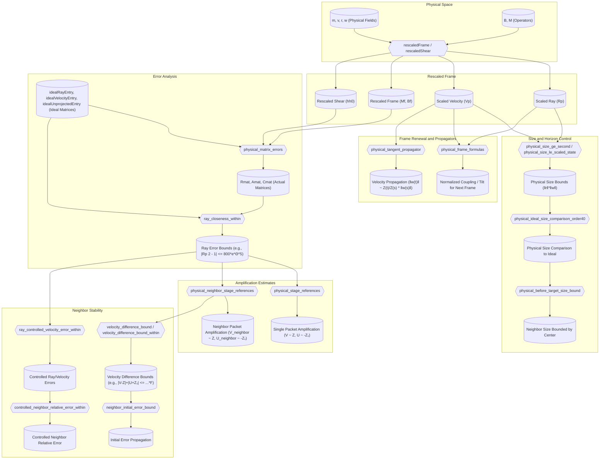
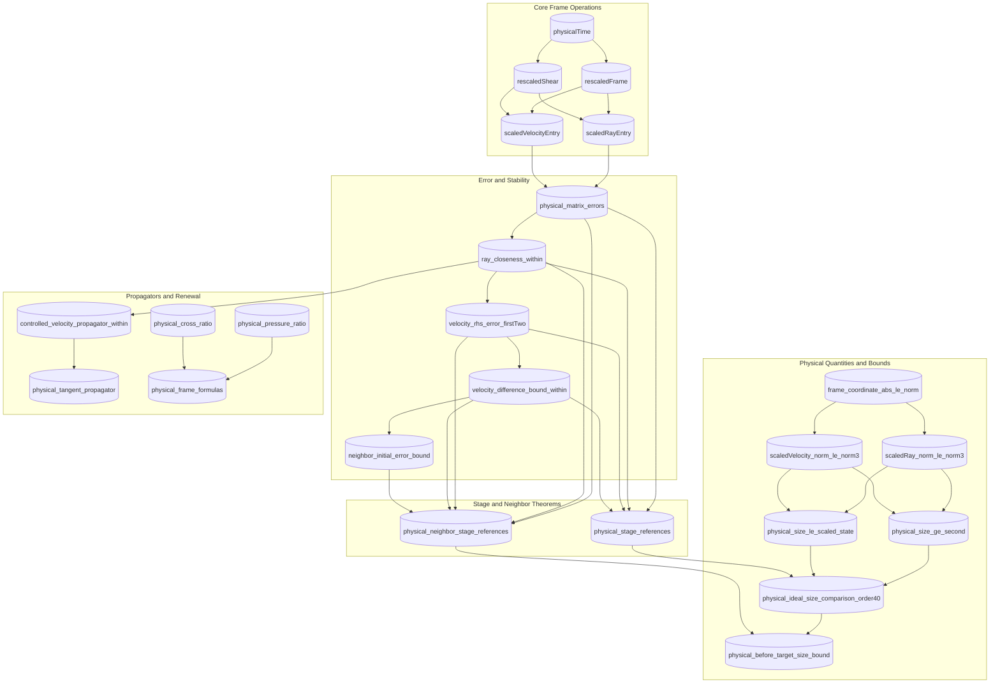

<!-- source: DeepWiki mcp.deepwiki.com · repo openai/NavierStokesAndEuler · page 4.4 Physical Moving Frame and Amplification Estimates · fetched 2026-10-26 -->

# Physical Moving Frame and Amplification Estimates

Relevant source files

The following files were used as context for generating this wiki page:

- [Euler/PacketActivationScales.lean](Euler/PacketActivationScales.lean)
- [Euler/PacketActualFrameEstimates.lean](Euler/PacketActualFrameEstimates.lean)
- [Euler/PacketBeforeTargetSize.lean](Euler/PacketBeforeTargetSize.lean)
- [Euler/PacketControlledPropagator.lean](Euler/PacketControlledPropagator.lean)
- [Euler/PacketEarlyPhysical.lean](Euler/PacketEarlyPhysical.lean)
- [Euler/PacketFrameRenewalAlgebra.lean](Euler/PacketFrameRenewalAlgebra.lean)
- [Euler/PacketHorizonSize.lean](Euler/PacketHorizonSize.lean)
- [Euler/PacketMatrixContinuity.lean](Euler/PacketMatrixContinuity.lean)
- [Euler/PacketNeighborControlled.lean](Euler/PacketNeighborControlled.lean)
- [Euler/PacketNeighborInitial.lean](Euler/PacketNeighborInitial.lean)
- [Euler/PacketNeighborStability.lean](Euler/PacketNeighborStability.lean)
- [Euler/PacketParentMeanCoercivity.lean](Euler/PacketParentMeanCoercivity.lean)
- [Euler/PacketPhysicalCoefficients.lean](Euler/PacketPhysicalCoefficients.lean)
- [Euler/PacketPhysicalFamily.lean](Euler/PacketPhysicalFamily.lean)
- [Euler/PacketPhysicalFrameRenewal.lean](Euler/PacketPhysicalFrameRenewal.lean)
- [Euler/PacketPhysicalNeighbor.lean](Euler/PacketPhysicalNeighbor.lean)
- [Euler/PacketPhysicalNormBounds.lean](Euler/PacketPhysicalNormBounds.lean)
- [Euler/PacketPhysicalPropagator.lean](Euler/PacketPhysicalPropagator.lean)
- [Euler/PacketPhysicalSize.lean](Euler/PacketPhysicalSize.lean)
- [Euler/PacketPhysicalStage.lean](Euler/PacketPhysicalStage.lean)
- [Euler/PacketScaledVelocity.lean](Euler/PacketScaledVelocity.lean)
- [Euler/PacketScaledVelocityAlgebra.lean](Euler/PacketScaledVelocityAlgebra.lean)
- [Euler/PacketShearMotion.lean](Euler/PacketShearMotion.lean)
- [Euler/PacketSizeComparison.lean](Euler/PacketSizeComparison.lean)
- [Euler/PacketTangentNorm.lean](Euler/PacketTangentNorm.lean)
- [Euler/PacketVelocityPropagator.lean](Euler/PacketVelocityPropagator.lean)
- [Euler/PacketWithinStage.lean](Euler/PacketWithinStage.lean)
- [Euler/ParentNeighborThreshold.lean](Euler/ParentNeighborThreshold.lean)
- [Euler/ParentPacketBadRatioPolynomial.lean](Euler/ParentPacketBadRatioPolynomial.lean)
- [Euler/ParentPacketHistoryNeighbor.lean](Euler/ParentPacketHistoryNeighbor.lean)
- [Euler/ParentPacketNeighborBounds.lean](Euler/ParentPacketNeighborBounds.lean)
- [Euler/ParentPacketNeighborPolynomial.lean](Euler/ParentPacketNeighborPolynomial.lean)
- [Euler/ParentPacketNeighborScaleGuard.lean](Euler/ParentPacketNeighborScaleGuard.lean)
- [Euler/TransverseHistoryBounds.lean](Euler/TransverseHistoryBounds.lean)
- [Euler/TransverseHistoryLipschitz.lean](Euler/TransverseHistoryLipschitz.lean)
- [Euler/TransverseHistoryParentCost.lean](Euler/TransverseHistoryParentCost.lean)
- [Euler/TransverseHistoryPolynomialCost.lean](Euler/TransverseHistoryPolynomialCost.lean)

This page details the construction and analysis of the physical moving frame, which is crucial for understanding the self-similar packet cascade in the Euler equations. It covers how physical quantities are rescaled into a local frame, the error bounds associated with this transformation, and how these frames are renewed across different stages of the packet construction. A significant part of this involves estimating the amplification of velocity components and ensuring stability for neighboring packets.

## Rescaled Frames and Shears

The core idea is to transform the physical velocity and ray fields into a local, moving orthonormal frame. This frame is defined by the packet's primary direction `m` and its transverse direction `v`. The transformation allows for a simplified analysis of the packet's evolution in a coordinate system that moves and rotates with the packet.

The `rescaledFrame` function [Euler/PacketPhysicalStage.lean:41-43]() and `rescaledShear` function [Euler/PacketPhysicalStage.lean:44]() are central to this process. They map the global physical fields `B`, `M`, `m`, `v` to their representations in the local frame, scaled by `a` and `ε`.

The `physicalTime` function [Euler/PacketPhysicalNormBounds.lean:32]() is used to evaluate fields at a specific physical time `t₀ + a * ε * τ`. This scaling is fundamental to the self-similar nature of the packets.

## Matrix Error Bounds

The transformation to the rescaled frame introduces matrix representations of operators. The accuracy of these representations is critical. The `physical_matrix_errors` theorem [Euler/PacketPhysicalStage.lean:87]() establishes bounds on the difference between the actual rescaled matrices (`Rmat`, `Amat`, `Cmat`) and their "ideal" counterparts (`idealRayEntry`, `idealVelocityEntry`, `idealUnprojectedEntry`). These bounds are expressed in terms of `e`, which encapsulates the error contributions from various sources, including `ε`, `Θ`, `G`, and `d`.

The `ray_closeness_within` theorem [Euler/PacketNeighborControlled.lean:45]() is used to show that the scaled ray components (`P`, `Q`, `N`) remain close to their ideal self-similar profiles. This theorem is applied in both `physical_stage_references` [Euler/PacketPhysicalStage.lean:124]() and `physical_neighbor_stage_references` [Euler/PacketNeighborControlled.lean:129]().

## Stage and Neighbor References

The `physical_stage_references` theorem [Euler/PacketPhysicalStage.lean:20-61]() provides the main amplification estimates for a single packet. It establishes the existence of scalar functions `F`, `F₁`, `Z`, `Z₁` that describe the evolution of the scaled velocity components `U` and `V`. The theorem states that the difference between the actual scaled velocities and these ideal solutions is bounded, and that `V` remains positive for `τ ∈ Icc 1 T`.

For neighboring packets, the `physical_neighbor_stage_references` theorem [Euler/PacketNeighborControlled.lean:19-66]() extends these estimates. It considers the initial discrepancy between neighboring packets and shows that the amplification estimates still hold, with constants adjusted by `neighborStabilityConstant`. This is crucial for ensuring that errors do not grow uncontrollably between adjacent packets.

## Size and Horizon Control

The physical size of the packet is related to the scaled ray and velocity components. The `physical_size_ge_second` [Euler/PacketPhysicalNormBounds.lean:71]() and `physical_size_le_scaled_state` [Euler/PacketPhysicalNormBounds.lean:99]() theorems provide lower and upper bounds on the product of the physical ray and velocity norms (`‖r‖*‖w‖`) in terms of the scaled components.

The `physical_ideal_size_comparison_order40` theorem [Euler/PacketBeforeTargetSize.lean:16-35]() compares the physical size of a packet to an "ideal primary size" derived from the scalar reference ODE. This comparison is used to control the growth of the packet's physical size before it reaches a target size.

The `physical_before_target_size_bound` theorem [Euler/PacketBeforeTargetSize.lean:60-85]() extends this to neighboring packets, ensuring that the size of any controlled neighbor is bounded by a multiple of the center packet's target size.

## Frame Renewal

Frame renewal involves defining the next frame based on the current state of the packet. The `physical_frame_formulas` theorem [Euler/PacketPhysicalFrameRenewal.lean:81-99]() provides exact formulas for the `normalizedCoupling` and `normalizedTilt` of the next frame in terms of the scaled ray and velocity components. These formulas are derived from the physical equations and ensure that the new frame accurately reflects the packet's orientation and shear.

## Propagators and Neighbor Stability

The `physical_tangent_propagator` theorem [Euler/PacketPhysicalPropagator.lean:19-54]() describes how the physical velocity `w` propagates in time relative to the scalar reference solution `Z`. It shows that the norm of `w` is bounded by a polynomial factor of `Θ` times the ratio of `Z` values, scaled by `1/ε`. This theorem is essential for controlling the growth of the velocity field.

Neighbor stability is further analyzed in `Euler/PacketNeighborStability.lean` and `Euler/PacketNeighborControlled.lean`. The `velocity_difference_bound` [Euler/PacketNeighborStability.lean:17-38]() and `velocity_difference_bound_within` [Euler/PacketNeighborStability.lean:74-94]() theorems provide bounds on the difference between the actual velocity components and the ideal scalar solutions, taking into account initial discrepancies. The `neighbor_initial_error_bound` theorem [Euler/PacketNeighborStability.lean:110-122]() quantifies how initial errors propagate.

The `ray_controlled_velocity_error_within` theorem [Euler/PacketNeighborControlled.lean:19-41]() ensures that the ray and velocity errors remain controlled within a given time interval. The `controlled_neighbor_relative_error_within` theorem [Euler/PacketNeighborControlled.lean:77-115]() then uses these controlled errors to establish bounds on the relative difference between the actual scaled velocities of a neighbor and the ideal scalar solutions.

### Diagram: Physical Frame Transformation and Error Propagation

Sources:
- [Euler/PacketPhysicalNormBounds.lean:32]()
- [Euler/PacketPhysicalNormBounds.lean:71]()
- [Euler/PacketPhysicalNormBounds.lean:99]()
- [Euler/PacketPhysicalStage.lean:20-61]()
- [Euler/PacketPhysicalStage.lean:41-43]()
- [Euler/PacketPhysicalStage.lean:44]()
- [Euler/PacketPhysicalStage.lean:87]()
- [Euler/PacketPhysicalStage.lean:124]()
- [Euler/PacketPhysicalFrameRenewal.lean:81-99]()
- [Euler/PacketPhysicalPropagator.lean:19-54]()
- [Euler/PacketBeforeTargetSize.lean:16-35]()
- [Euler/PacketBeforeTargetSize.lean:60-85]()
- [Euler/PacketNeighborControlled.lean:19-41]()
- [Euler/PacketNeighborControlled.lean:19-66]()
- [Euler/PacketNeighborControlled.lean:77-115]()
- [Euler/PacketNeighborControlled.lean:129]()
- [Euler/PacketNeighborStability.lean:17-38]()
- [Euler/PacketNeighborStability.lean:74-94]()
- [Euler/PacketNeighborStability.lean:110-122]()

### Diagram: Key Functions and Their Interactions

Sources:
- [Euler/PacketPhysicalNormBounds.lean:12-17]()
- [Euler/PacketPhysicalNormBounds.lean:31-49]()
- [Euler/PacketPhysicalNormBounds.lean:51-69]()
- [Euler/PacketPhysicalNormBounds.lean:71-97]()
- [Euler/PacketPhysicalNormBounds.lean:99-133]()
- [Euler/PacketPhysicalStage.lean:20-61]()
- [Euler/PacketPhysicalStage.lean:87]()
- [Euler/PacketPhysicalFrameRenewal.lean:19-33]()
- [Euler/PacketPhysicalFrameRenewal.lean:35-79]()
- [Euler/PacketPhysicalFrameRenewal.lean:81-99]()
- [Euler/PacketPhysicalPropagator.lean:19-54]()
- [Euler/PacketBeforeTargetSize.lean:16-35]()
- [Euler/PacketBeforeTargetSize.lean:60-85]()
- [Euler/PacketNeighborControlled.lean:19-41]()
- [Euler/PacketNeighborControlled.lean:77-115]()
- [Euler/PacketNeighborStability.lean:110-122]()
- [Euler/PacketNeighborStability.lean:74-94]()
- [Euler/PacketNeighborStability.lean:17-38]()

## Polynomial Bounds for Neighbor Costs

The cost associated with neighboring packets, particularly in terms of history and activation, is bounded by polynomials.

The `EulerParentBadRatio.formula` [Euler/ParentPacketBadRatioPolynomial.lean:87-88]() and `EulerParentBadRatio.envelope` [Euler/ParentPacketBadRatioPolynomial.lean:90-91]() define the polynomial structure for bounding the "bad ratio" in the early-time size ratio. The `envelope_power` theorem [Euler/ParentPacketBadRatioPolynomial.lean:108-131]() shows that this envelope is bounded by a constant times a power of a combined parameter `(1+K+Ti+Hi+CM+CH)`.

Similarly, for the neighbor scale cost, `EulerParentNeighborCost.formula` [Euler/ParentPacketNeighborPolynomial.lean:15-16]() and `EulerParentNeighborCost.envelope` [Euler/ParentPacketNeighborPolynomial.lean:18-19]() define the polynomial. The `neighborScaleCost_envelope` theorem [Euler/ParentPacketNeighborPolynomial.lean:130-155]() demonstrates that the `neighborScaleCost` is bounded by this polynomial envelope. These polynomial bounds are crucial for managing the complexity and growth of costs in the packet construction.

Sources:
- [Euler/ParentPacketBadRatioPolynomial.lean:87-88]()
- [Euler/ParentPacketBadRatioPolynomial.lean:90-91]()
- [Euler/ParentPacketBadRatioPolynomial.lean:108-131]()
- [Euler/ParentPacketNeighborPolynomial.lean:15-16]()
- [Euler/ParentPacketNeighborPolynomial.lean:18-19]()
- [Euler/ParentPacketNeighborPolynomial.lean:130-155]()

---

