<!-- source: DeepWiki mcp.deepwiki.com · repo openai/NavierStokesAndEuler · page 4.5 Geometry Data, Budgets, Guards, and Scales · fetched 2026-10-26 -->

# Geometry Data, Budgets, Guards, and Scales

<details>
<summary>Relevant source files</summary>

The following files were used as context for generating this wiki page:

- [Euler/BasePacketFrequencyCost.lean](Euler/BasePacketFrequencyCost.lean)
- [Euler/NormalPacketFrequencyGuards.lean](Euler/NormalPacketFrequencyGuards.lean)
- [Euler/PacketActivationConstructed.lean](Euler/PacketActivationConstructed.lean)
- [Euler/PacketActivationData.lean](Euler/PacketActivationData.lean)
- [Euler/PacketActivationInitial.lean](Euler/PacketActivationInitial.lean)
- [Euler/PacketActivationRay.lean](Euler/PacketActivationRay.lean)
- [Euler/PacketActivationSourceData.lean](Euler/PacketActivationSourceData.lean)
- [Euler/PacketAmplitudeBounds.lean](Euler/PacketAmplitudeBounds.lean)
- [Euler/PacketFiveCostGuards.lean](Euler/PacketFiveCostGuards.lean)
- [Euler/PacketForwardGeometryAssembly.lean](Euler/PacketForwardGeometryAssembly.lean)
- [Euler/PacketForwardGeometryData.lean](Euler/PacketForwardGeometryData.lean)
- [Euler/PacketForwardInitializedAllOrderBudget.lean](Euler/PacketForwardInitializedAllOrderBudget.lean)
- [Euler/PacketForwardOutputCosts.lean](Euler/PacketForwardOutputCosts.lean)
- [Euler/PacketForwardUniformBudget.lean](Euler/PacketForwardUniformBudget.lean)
- [Euler/PacketForwardUniformCosts.lean](Euler/PacketForwardUniformCosts.lean)
- [Euler/PacketGeometryAssembly.lean](Euler/PacketGeometryAssembly.lean)
- [Euler/PacketGeometryControlledGrowth.lean](Euler/PacketGeometryControlledGrowth.lean)
- [Euler/PacketGeometryData.lean](Euler/PacketGeometryData.lean)
- [Euler/PacketGeometryGuards.lean](Euler/PacketGeometryGuards.lean)
- [Euler/PacketGeometryInitialAmplitude.lean](Euler/PacketGeometryInitialAmplitude.lean)
- [Euler/PacketGeometryJoinedBudget.lean](Euler/PacketGeometryJoinedBudget.lean)
- [Euler/PacketGeometryProfileEnvelope.lean](Euler/PacketGeometryProfileEnvelope.lean)
- [Euler/PacketGeometrySourceGrowth.lean](Euler/PacketGeometrySourceGrowth.lean)
- [Euler/PacketInitialGeometry.lean](Euler/PacketInitialGeometry.lean)
- [Euler/PacketInitializedAllOrderBudget.lean](Euler/PacketInitializedAllOrderBudget.lean)
- [Euler/PacketInitializedOutputCosts.lean](Euler/PacketInitializedOutputCosts.lean)
- [Euler/PacketInitializedParameterBounds.lean](Euler/PacketInitializedParameterBounds.lean)
- [Euler/PacketInitializedUniformBounds.lean](Euler/PacketInitializedUniformBounds.lean)
- [Euler/PacketInitializedUniformBudget.lean](Euler/PacketInitializedUniformBudget.lean)
- [Euler/PacketInitializedUniformCosts.lean](Euler/PacketInitializedUniformCosts.lean)
- [Euler/PacketParameterEnvelope.lean](Euler/PacketParameterEnvelope.lean)
- [Euler/PacketSourceFrequency.lean](Euler/PacketSourceFrequency.lean)
- [Euler/PacketSourceGeometryAssembly.lean](Euler/PacketSourceGeometryAssembly.lean)
- [Euler/PacketSourceGeometryData.lean](Euler/PacketSourceGeometryData.lean)
- [Euler/PacketSourceGeometryGrowth.lean](Euler/PacketSourceGeometryGrowth.lean)
- [Euler/PacketSourceParameterScales.lean](Euler/PacketSourceParameterScales.lean)
- [Euler/PacketSourceScaleBounds.lean](Euler/PacketSourceScaleBounds.lean)
- [Euler/PacketSourceScaleChoice.lean](Euler/PacketSourceScaleChoice.lean)
- [Euler/PacketSourceScaleFromCosts.lean](Euler/PacketSourceScaleFromCosts.lean)
- [Euler/PacketUniformFrequencyMargin.lean](Euler/PacketUniformFrequencyMargin.lean)
- [Euler/PacketUniformFrequencyScales.lean](Euler/PacketUniformFrequencyScales.lean)
- [Euler/PacketUniformInitialBounds.lean](Euler/PacketUniformInitialBounds.lean)
- [Euler/ParentForwardGeometryGuards.lean](Euler/ParentForwardGeometryGuards.lean)
- [Euler/ParentForwardGeometryInput.lean](Euler/ParentForwardGeometryInput.lean)
- [Euler/ParentForwardNormalParameters.lean](Euler/ParentForwardNormalParameters.lean)
- [Euler/ParentFrameReframe.lean](Euler/ParentFrameReframe.lean)
- [Euler/ParentHistoryFrequencyGuard.lean](Euler/ParentHistoryFrequencyGuard.lean)
- [Euler/ParentNormalPacketParameters.lean](Euler/ParentNormalPacketParameters.lean)
- [Euler/ParentPacketGeometryFrame.lean](Euler/ParentPacketGeometryFrame.lean)
- [Euler/ParentPacketGeometryGuards.lean](Euler/ParentPacketGeometryGuards.lean)
- [Euler/ParentPacketGeometryInput.lean](Euler/ParentPacketGeometryInput.lean)
- [Euler/ParentPacketJoinedInput.lean](Euler/ParentPacketJoinedInput.lean)
- [Euler/ParentRenewalParameters.lean](Euler/ParentRenewalParameters.lean)
- [Euler/ParentStageDirection.lean](Euler/ParentStageDirection.lean)
- [Euler/TransverseActivationSelection.lean](Euler/TransverseActivationSelection.lean)

</details>


This page details the mechanisms for assembling packet geometry data, defining growth envelopes, managing activation data and scales, implementing parameter guards and frequency margins, and performing cost/budget bookkeeping within the Euler packet construction. These components are crucial for ensuring the well-posedness and controlled growth of the self-similar packet cascade.

## Geometry Data Assembly

The construction of Euler packets relies on a precise definition and assembly of geometric data. This involves defining source matrices, rays, and velocities, and ensuring their consistency with the underlying physical equations.

The `sourceMatrix` and `sourceRay` functions in `EulerPacketSourceGeometry` define the matrix and ray fields for a given packet [Euler/PacketSourceGeometryAssembly.lean:20-21](). These are derived from the `Data U` structure, which encapsulates the overall problem data.

```lean
def sourceMatrix (D : Data U) (x : Space) (t : ℝ) : Space →L[ℝ] Space := D.M.field (D.clamp t) x
def sourceRay (D : Data U) (x : Space) (t : ℝ) : Space := D.normal.field (D.clamp t) x
```

The continuity of `sourceMatrix` is established by `sourceMatrix_continuous` [Euler/PacketSourceGeometryAssembly.lean:23-24]().

The `ParentFrame.sourceError` function quantifies the error between the actual source matrix and an approximation based on the parent frame's properties [Euler/PacketSourceGeometryAssembly.lean:30-31](). This error is critical for bounding the deviations in the packet's evolution.

The `sourceVelocity` in `EulerPacketSourceGeometry.Guards` is defined as the uncut velocity from the `EulerTransversePacketProvider` [Euler/PacketSourceGeometryAssembly.lean:37-37](). This velocity satisfies specific differential equations, as shown by `sourceVelocity_equation` [Euler/PacketSourceGeometryAssembly.lean:52-63](), and maintains an initial tangent condition `source_initial_tangent` [Euler/PacketSourceGeometryAssembly.lean:65-68]().

The `geometryFrameOfCenterExpansion` function in `EulerParentPacketFrames.Parent` constructs a `ParentFrame` from the center expansion data, incorporating strain, curvature, and error bounds [Euler/ParentPacketGeometryFrame.lean:121-154](). This function is vital for bridging the parent packet's properties to the current packet's geometric frame.

Sources:
* [Euler/PacketSourceGeometryAssembly.lean:20-21]()
* [Euler/PacketSourceGeometryAssembly.lean:23-24]()
* [Euler/PacketSourceGeometryAssembly.lean:30-31]()
* [Euler/PacketSourceGeometryAssembly.lean:37-37]()
* [Euler/PacketSourceGeometryAssembly.lean:52-63]()
* [Euler/PacketSourceGeometryAssembly.lean:65-68]()
* [Euler/ParentPacketGeometryFrame.lean:121-154]()

## Growth Envelopes and Activation Data

Growth envelopes define the bounds for the packet's amplitude over time, while activation data specifies the conditions under which a packet becomes active or contributes to the overall solution.

The `growthProfile` in `EulerPacketGeometrySourceGrowth` is a continuous map that describes the temporal evolution of the packet's amplitude [Euler/PacketGeometrySourceGrowth.lean:20-24](). This profile is directly linked to the `physicalProfile` of the underlying geometry [Euler/PacketGeometrySourceGrowth.lean:26-28]().

```lean
def growthProfile : C(Icc (0 : ℝ) D.T,ℝ) where
  toFun t := Z ((G.a/G.ε)*t)
  continuous_toFun := (continuous_iff_continuousAt.mpr
    (fun t => (H.Z_derivative t).continuousAt)).comp
      (continuous_const.mul continuous_subtype_val)
```

The `growthProfile_amplitude_bound` theorem ensures that the amplitude of the growth profile remains within specified limits [Euler/PacketGeometryControlledGrowth.lean:18-31]().

The `EulerPacketSourceGeometry.Guards.sourceGrowthProfile_amplitude_frame` theorem further refines this bound by incorporating the parent frame's `frameBound` [Euler/PacketGeometryProfileEnvelope.lean:40-46]().

The `budget_fullProfile_amplitude` theorem in `EulerPacketSourceGeometry.Guards` provides an amplitude bound for the full profile of a packet budget, considering both the source growth profile and the frame bounds [Euler/PacketGeometryProfileEnvelope.lean:51-69]().

The `historyAmplitude` in `EulerParentPacketFrames.LabelData` quantifies the amplitude of the parent coefficient, which controls the strain and pressure Hessian throughout the history interval [Euler/ParentPacketGeometryGuards.lean:79-80]().

Sources:
* [Euler/PacketGeometryControlledGrowth.lean:18-31]()
* [Euler/PacketGeometryProfileEnvelope.lean:40-46]()
* [Euler/PacketGeometryProfileEnvelope.lean:51-69]()
* [Euler/PacketGeometrySourceGrowth.lean:20-24]()
* [Euler/PacketGeometrySourceGrowth.lean:26-28]()
* [Euler/ParentPacketGeometryGuards.lean:79-80]()

## Parameter Guards and Frequency Margins

Parameter guards and frequency margins are essential for maintaining the stability and regularity of the packet construction. They ensure that various quantities remain within acceptable bounds.

The `EulerPacketSourceScaleChoice.CostSpec` structure defines a specification for various costs associated with packet construction, including parameters like `d`, `B`, `N`, `a`, `b`, `c`, `C`, `p`, and `q` [Euler/PacketSourceScaleChoice.lean:18-28]().

```lean
structure CostSpec where
  d : ℕ
  B : ℕ
  N : ℕ
  a : ℝ
  b : ℝ
  c : ℝ
  C : ℝ
  p : ℕ
  q : ℕ
  d_le_two : d ≤ 2
  a_nonneg : 0 ≤ a
  a_lt_B : a < B
  a_le_N : a ≤ N
  b_pos : 0 < b
  C_pos : 0 < C
```

The `finite_uniform_choice` theorem demonstrates that for a finite set of `CostSpec` instances, there exists a starting stage `J` and a base scale `X₀` such that all associated costs are summable and uniformly small [Euler/PacketSourceScaleChoice.lean:39-75](). This is crucial for controlling the overall budget.

The `sourceCostSpec` function provides concrete `CostSpec` instances for different types of source costs, such as shear, prior, neighbor, extra, width, parent, and good costs [Euler/PacketSourceScaleChoice.lean:84-119]().

The `EulerPacketTerminalDatum.initializedAllOrderBudget` and `EulerPacketTerminalDatum.forwardInitializedAllOrderBudget` functions define the all-order correction budgets for initialized and forward packets, respectively [Euler/PacketInitializedAllOrderBudget.lean:64-133](), [Euler/PacketForwardInitializedAllOrderBudget.lean:43-115](). These budgets rely on explicit scalar frequency guards to ensure the analytic inputs to the correction theorem are well-controlled.

The `EulerPacketSourceGeometry.ParentFrame.activation_normal_le` theorem provides a bound on the activation normal, which is important for controlling the compression of the packet [Euler/ParentPacketGeometryGuards.lean:19-46]().

The `EulerParentPacketFrames.LabelData.geometryGuardsOfStage` function assembles various guards for a given stage of the packet construction, ensuring that parameters like shear, sigma, horizon, and error are consistent with the stage's properties [Euler/ParentPacketGeometryGuards.lean:104-140]().

Sources:
* [Euler/PacketForwardInitializedAllOrderBudget.lean:43-115]()
* [Euler/PacketInitializedAllOrderBudget.lean:64-133]()
* [Euler/PacketSourceScaleChoice.lean:18-28]()
* [Euler/PacketSourceScaleChoice.lean:39-75]()
* [Euler/PacketSourceScaleChoice.lean:84-119]()
* [Euler/ParentPacketGeometryGuards.lean:19-46]()
* [Euler/ParentPacketGeometryGuards.lean:104-140]()

## Cost and Budget Bookkeeping

Effective cost and budget bookkeeping are vital for tracking resource consumption and ensuring that the overall construction remains within predefined limits.

The `EulerPacketInitializedCost.envelope` and `EulerPacketInitializedCost.polynomial` functions define an envelope and a polynomial that bound the costs associated with the initialized packet radius [Euler/PacketInitializedUniformCosts.lean:16-22]().

```lean
def envelope (W : ℝ) : ℝ := 1+W+EulerPacketRadiusPolynomial.radiusEnvelope W+
  EulerPacketCorrectionPrimitive.primitiveEnvelope period W

def polynomial : Polynomial ℝ :=
  Polynomial.C (EulerPacketFiveCost.costConstant period)*
    (1+Polynomial.X+EulerPacketRadiusPolynomial.radiusPolynomial+
      EulerPacketCorrectionPrimitive.primitivePolynomial period)^(EulerPacketFiveCost.costPower period)
```

The `initialized_five_costs_bound` theorem ensures that five key costs (tail polynomial constant, multiplier cost, growth cost, drift cost, and error cost) are bounded by a uniform constant and power of `W` [Euler/PacketInitializedUniformCosts.lean:53-93]().

The `EulerPacketInitializedOutputCost.envelope` and `EulerPacketInitializedOutputCost.polynomial` functions provide similar bounding mechanisms for the output costs, which control correction admissibility and source multipliers [Euler/PacketInitializedOutputCosts.lean:16-25]().

The `actual_output_costs` theorem in `EulerPacketInitializedOutputCost` provides detailed bounds for various output costs, including weight size, physical input radius, and lifted input constants, ensuring they are controlled by the `extraEnvelope` [Euler/PacketInitializedOutputCosts.lean:65-133]().

The `EulerParentPacketFrames.LabelData.geometryForwardRaw` function constructs a `EulerTransversePacketForward.Budget` for the forward packet, incorporating various parameters and growth profiles [Euler/ParentForwardGeometryInput.lean:61-68](). This budget is then used to create `geometryForwardInputs`, which encapsulate the linear, normal, and mean budgets for the forward packet [Euler/ParentForwardGeometryInput.lean:70-82]().

Sources:
* [Euler/PacketInitializedOutputCosts.lean:16-25]()
* [Euler/PacketInitializedOutputCosts.lean:65-133]()
* [Euler/PacketInitializedUniformCosts.lean:16-22]()
* [Euler/PacketInitializedUniformCosts.lean:53-93]()
* [Euler/ParentForwardGeometryInput.lean:61-68]()
* [Euler/ParentForwardGeometryInput.lean:70-82]()

## Diagram: Packet Geometry and Budget Flow

```mermaid
graph TD
    subgraph "Packet Geometry Assembly"
        A[EulerPacketSourceGeometry.sourceMatrix] --> B{Geometric Data}
        C[EulerPacketSourceGeometry.sourceRay] --> B
        D[EulerPacketSourceGeometry.Guards.sourceVelocity] --> B
        E[EulerParentPacketFrames.Parent.geometryFrameOfCenterExpansion] --> B
    end

    subgraph "Growth Envelopes & Activation"
        F[EulerPacketGeometrySourceGrowth.growthProfile] --> G{Growth Profile}
        H[EulerPacketGeometryControlledGrowth.growthProfile_amplitude_bound] --> G
        I[EulerPacketGeometryProfileEnvelope.sourceGrowthProfile_amplitude_frame] --> G
        J[EulerPacketGeometryProfileEnvelope.budget_fullProfile_amplitude] --> G
        K[EulerParentPacketFrames.LabelData.historyAmplitude] --> L{Activation Data}
    end

    subgraph "Parameter Guards & Frequency Margins"
        M[EulerPacketSourceScaleChoice.CostSpec] --> N{Cost Specifications}
        O[EulerPacketSourceScaleChoice.finite_uniform_choice] --> N
        P[EulerPacketSourceScaleChoice.sourceCostSpec] --> N
        Q[EulerPacketTerminalDatum.initializedAllOrderBudget] --> R{Correction Budgets}
        S[EulerPacketTerminalDatum.forwardInitializedAllOrderBudget] --> R
        T[EulerPacketSourceGeometry.ParentFrame.activation_normal_le] --> U{Activation Guards}
        V[EulerParentPacketFrames.LabelData.geometryGuardsOfStage] --> U
    end

    subgraph "Cost & Budget Bookkeeping"
        W[EulerPacketInitializedCost.envelope] --> X{Initialized Packet Costs}
        Y[EulerPacketInitializedCost.polynomial] --> X
        Z[EulerPacketInitializedCost.initialized_five_costs_bound] --> X
        AA[EulerPacketInitializedOutputCost.envelope] --> BB{Output Costs}
        CC[EulerPacketInitializedOutputCost.polynomial] --> BB
        DD[EulerPacketInitializedOutputCost.actual_output_costs] --> BB
        EE[EulerParentPacketFrames.LabelData.geometryForwardRaw] --> FF{Forward Packet Budgets}
        GG[EulerParentPacketFrames.LabelData.geometryForwardInputs] --> FF
    end

    B -- "Informs" --> G
    G -- "Constrains" --> R
    U -- "Ensures Validity" --> R
    N -- "Defines" --> X
    N -- "Defines" --> BB
    X -- "Contributes to" --> R
    BB -- "Contributes to" --> R
    FF -- "Provides" --> R
```



## Diagram: Interplay of Guards and Budgets

```mermaid
graph TD
    subgraph "Parent Packet Context"
        ParentFrame[ParentFrame D τ]
        HistoryData[HistoryData (D.initial τ hτ hτT.le)]
        ParentLabelData[EulerParentPacketFrames.LabelData]
    end

    subgraph "Current Packet Construction"
        Guards[EulerPacketSourceGeometry.Guards]
        ForwardGuards[EulerPacketSourceGeometry.ForwardGuards]
        InitializedBudget[EulerPacketTerminalDatum.initializedAllOrderBudget]
        ForwardBudget[EulerPacketTerminalDatum.forwardInitializedAllOrderBudget]
    end

    subgraph "Cost and Scale Definitions"
        CostSpec[EulerPacketSourceScaleChoice.CostSpec]
        SourceCost[EulerPacketSourceScaleChoice.SourceCost]
        UniformChoice[EulerPacketSourceScaleChoice.finite_uniform_choice]
        InitializedCost[EulerPacketInitializedCost]
        OutputCost[EulerPacketInitializedOutputCost]
    end

    ParentFrame -- "Provides P" --> Guards
    HistoryData -- "Provides H" --> Guards
    ParentLabelData -- "Uses P, H" --> Guards
    ParentLabelData -- "Uses P" --> ForwardGuards

    Guards -- "Defines sourceVelocity" --> InitializedBudget
    Guards -- "Defines sourceGrowthProfile" --> InitializedBudget
    ForwardGuards -- "Defines sourceGrowthProfile" --> ForwardBudget

    CostSpec -- "Defines cost structure" --> UniformChoice
    SourceCost -- "Categorizes costs" --> CostSpec
    UniformChoice -- "Selects J, X₀ for small series" --> InitializedBudget
    UniformChoice -- "Selects J, X₀ for small series" --> ForwardBudget

    InitializedCost -- "Bounds 5 costs" --> InitializedBudget
    OutputCost -- "Bounds output costs" --> InitializedBudget
    OutputCost -- "Bounds output costs" --> ForwardBudget

    InitializedBudget -- "Ensures all-order correction budget" --> FinalSolution[Final Euler Solution]
    ForwardBudget -- "Ensures all-order correction budget" --> FinalSolution

    ParentLabelData -- "geometryGuardsOfStage" --> Guards
    ParentLabelData -- "geometryForwardInputs" --> ForwardBudget
```

---

