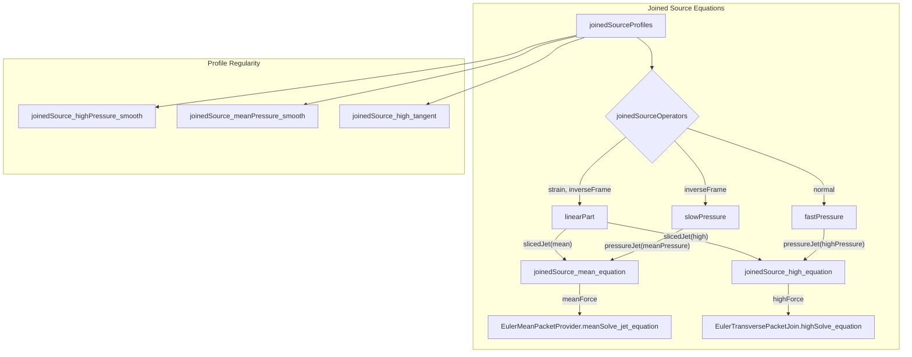
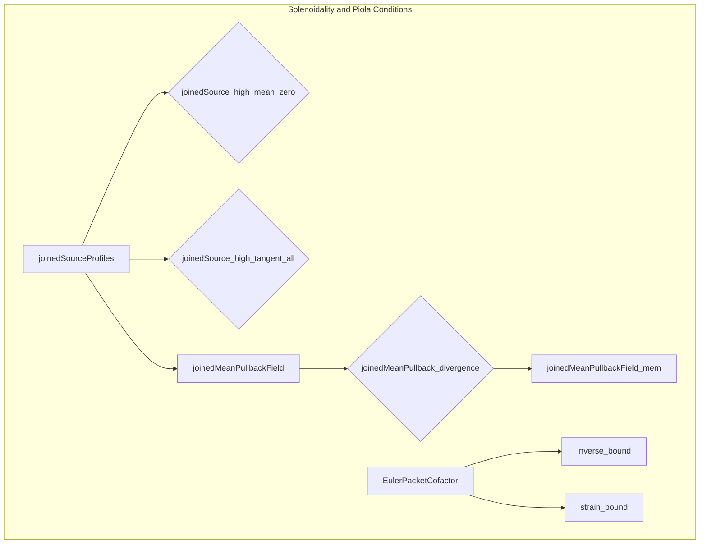
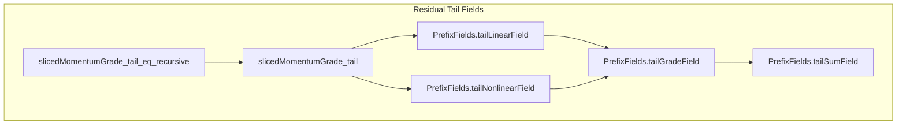
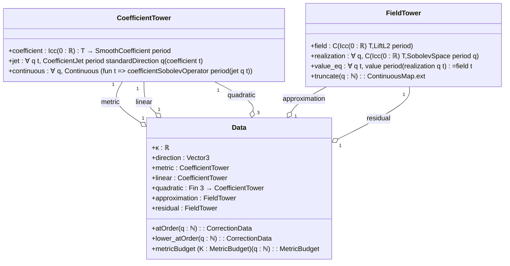

<!-- source: DeepWiki mcp.deepwiki.com · repo openai/NavierStokesAndEuler · page 4.7 Source Equations, Solenoidality, and Field Towers · fetched 2026-10-26 -->

# Source Equations, Solenoidality, and Field Towers

Relevant source files

The following files were used as context for generating this wiki page:

- [Euler/AllOrderCorrectionData.lean](Euler/AllOrderCorrectionData.lean)
- [Euler/AllOrderDriftFieldDecomposition.lean](Euler/AllOrderDriftFieldDecomposition.lean)
- [Euler/AllOrderDriftGraph.lean](Euler/AllOrderDriftGraph.lean)
- [Euler/AllOrderDriftPointwiseBounds.lean](Euler/AllOrderDriftPointwiseBounds.lean)
- [Euler/AllOrderDriftPressureBounds.lean](Euler/AllOrderDriftPressureBounds.lean)
- [Euler/CorrectionAssemblyRealizations.lean](Euler/CorrectionAssemblyRealizations.lean)
- [Euler/CorrectionAssemblySourceTower.lean](Euler/CorrectionAssemblySourceTower.lean)
- [Euler/CorrectionAssemblyTime.lean](Euler/CorrectionAssemblyTime.lean)
- [Euler/CorrectionSmoothTimeField.lean](Euler/CorrectionSmoothTimeField.lean)
- [Euler/ExactLiftedJointDifferentiability.lean](Euler/ExactLiftedJointDifferentiability.lean)
- [Euler/ExactLiftedPointwise.lean](Euler/ExactLiftedPointwise.lean)
- [Euler/MeanPacketData.lean](Euler/MeanPacketData.lean)
- [Euler/MeanPacketSobolevData.lean](Euler/MeanPacketSobolevData.lean)
- [Euler/PacketCofactorGevrey.lean](Euler/PacketCofactorGevrey.lean)
- [Euler/PacketCoordinateJets.lean](Euler/PacketCoordinateJets.lean)
- [Euler/PacketCoordinateSobolev.lean](Euler/PacketCoordinateSobolev.lean)
- [Euler/PacketCorrectionMetric.lean](Euler/PacketCorrectionMetric.lean)
- [Euler/PacketCorrectionMetricBounds.lean](Euler/PacketCorrectionMetricBounds.lean)
- [Euler/PacketCorrectionMetricBudget.lean](Euler/PacketCorrectionMetricBudget.lean)
- [Euler/PacketCorrectionMetricTime.lean](Euler/PacketCorrectionMetricTime.lean)
- [Euler/PacketCylinderMeanSolenoidal.lean](Euler/PacketCylinderMeanSolenoidal.lean)
- [Euler/PacketCylinderWeightedLinear.lean](Euler/PacketCylinderWeightedLinear.lean)
- [Euler/PacketFieldGraphBounds.lean](Euler/PacketFieldGraphBounds.lean)
- [Euler/PacketFieldMap.lean](Euler/PacketFieldMap.lean)
- [Euler/PacketFieldPhysicalSobolev.lean](Euler/PacketFieldPhysicalSobolev.lean)
- [Euler/PacketFieldSobolev.lean](Euler/PacketFieldSobolev.lean)
- [Euler/PacketFieldTensorBounds.lean](Euler/PacketFieldTensorBounds.lean)
- [Euler/PacketFieldTower.lean](Euler/PacketFieldTower.lean)
- [Euler/PacketJoinedResidualFields.lean](Euler/PacketJoinedResidualFields.lean)
- [Euler/PacketJoinedSourceConstraints.lean](Euler/PacketJoinedSourceConstraints.lean)
- [Euler/PacketJoinedSourceEquations.lean](Euler/PacketJoinedSourceEquations.lean)
- [Euler/PacketJoinedSourcePiola.lean](Euler/PacketJoinedSourcePiola.lean)
- [Euler/PacketJoinedSourceRegularity.lean](Euler/PacketJoinedSourceRegularity.lean)
- [Euler/PacketJoinedSourceResidual.lean](Euler/PacketJoinedSourceResidual.lean)
- [Euler/PacketJoinedSourceSolenoidal.lean](Euler/PacketJoinedSourceSolenoidal.lean)
- [Euler/PacketLiftedParity.lean](Euler/PacketLiftedParity.lean)
- [Euler/PacketParentCoefficientBounds.lean](Euler/PacketParentCoefficientBounds.lean)
- [Euler/PacketResidualTailActual.lean](Euler/PacketResidualTailActual.lean)
- [Euler/PacketResidualTailFields.lean](Euler/PacketResidualTailFields.lean)
- [Euler/PacketSlicedResidual.lean](Euler/PacketSlicedResidual.lean)
- [Euler/PacketSourceCoefficientGevrey.lean](Euler/PacketSourceCoefficientGevrey.lean)
- [Euler/PacketSourceEquations.lean](Euler/PacketSourceEquations.lean)
- [Euler/PacketSourcePiola.lean](Euler/PacketSourcePiola.lean)
- [Euler/PacketSourceRegularity.lean](Euler/PacketSourceRegularity.lean)
- [Euler/PacketSourceResidual.lean](Euler/PacketSourceResidual.lean)
- [Euler/PacketSourceResidualFields.lean](Euler/PacketSourceResidualFields.lean)
- [Euler/PacketSourceSolenoidal.lean](Euler/PacketSourceSolenoidal.lean)
- [Euler/PacketTailSumBounds.lean](Euler/PacketTailSumBounds.lean)
- [Euler/ParentPacketHistoryPolynomial.lean](Euler/ParentPacketHistoryPolynomial.lean)
- [Euler/StaticEulerWeightedBounds.lean](Euler/StaticEulerWeightedBounds.lean)
- [Euler/TransversePacketCoefficientBounds.lean](Euler/TransversePacketCoefficientBounds.lean)
- [Euler/TransverseSourceCoefficientPath.lean](Euler/TransverseSourceCoefficientPath.lean)

This page details the mathematical framework and Lean 4 implementation for handling source equations, ensuring solenoidal and Piola conditions, managing residual tail fields, and defining field towers with Sobolev bounds within the Euler packet construction. These concepts are crucial for the rigorous formalization of the finite-time breakdown results.

## Packet Source and Joined-Source Equations

The core of the packet construction involves defining and solving source equations for both primary and "joined" packets. These equations govern the evolution of the packet profiles and their associated pressure fields. The `EulerPacketCylinderField` namespace contains the definitions and theorems related to these equations.

The `joinedSource_mean_equation` and `joinedSource_high_equation` theorems [Euler/PacketJoinedSourceEquations.lean:36-80]() establish that the mean and high components of the joined source profiles satisfy their respective linear equations. These equations are derived from the underlying mean and transverse packet provider data (`M` and `D` respectively) and involve terms like `linearPart`, `slowPressure`, `fastPressure`, `meanForce`, and `highForce`. The `joinedSourceOperators` structure encapsulates the relevant operators (strain, inverse frame, normal field) for the joined source.

**Diagram: Joined Source Equation Dependencies**

Sources:
- [Euler/PacketJoinedSourceEquations.lean:36-80]()
- [Euler/PacketJoinedSourceEquations.lean:100-115]()
- [Euler/PacketJoinedSourceEquations.lean:117-129]()

The `source_high_slice` and `source_mean_slice` theorems [Euler/PacketSourceRegularity.lean:25-34]() assert the slice differentiability of the high and mean components of the source profiles. This ensures sufficient regularity for further operations. Similarly, `source_highPressure_smooth` and `source_meanPressure_smooth` [Euler/PacketSourceRegularity.lean:43-90]() guarantee the smoothness of the pressure fields.

Sources:
- [Euler/PacketSourceRegularity.lean:25-34]()
- [Euler/PacketSourceRegularity.lean:43-90]()

## Solenoidality and Piola Conditions

Solenoidality (divergence-free condition) and Piola conditions are fundamental for incompressible fluid dynamics. The codebase ensures these properties are maintained throughout the packet construction.

The `joinedSource_high_mean_zero` theorem [Euler/PacketJoinedSourceConstraints.lean:31-50]() states that the mean of the high component of the joined source profiles is zero, which is a form of solenoidal condition in the angular direction. The `joinedSource_high_tangent_all` theorem [Euler/PacketJoinedSourceConstraints.lean:53-63]() ensures that the high component of the joined source profiles is tangent to the normal field, another crucial constraint.

The `joinedMeanPullback_divergence` theorem [Euler/PacketJoinedSourceConstraints.lean:71-101]() proves that the pullback of the mean component of the joined source profiles is divergence-free. This is a key step in establishing the solenoidal property of the mean field. The `joinedMeanPullbackField_mem` theorem [Euler/PacketJoinedSourceConstraints.lean:103-114]() then uses this to show that the mean pullback field belongs to the `divergenceFreeSpace`.

Sources:
- [Euler/PacketJoinedSourceConstraints.lean:31-50]()
- [Euler/PacketJoinedSourceConstraints.lean:53-63]()
- [Euler/PacketJoinedSourceConstraints.lean:71-101]()
- [Euler/PacketJoinedSourceConstraints.lean:103-114]()

The `EulerPacketCofactor` namespace provides Gevrey bounds for the inverse, strain, and curvature operators, which are crucial for maintaining regularity and controlling growth in the presence of deformations. The `inverse_bound` [Euler/PacketCofactorGevrey.lean:57-67]() and `strain_bound` [Euler/PacketCofactorGevrey.lean:94-107]() theorems establish these bounds, relying on the determinant-one property of the deformation matrix.

**Diagram: Solenoidality and Piola Condition Flow**

Sources:
- [Euler/PacketCofactorGevrey.lean:57-67]()
- [Euler/PacketCofactorGevrey.lean:94-107]()

## Residual Tail Fields

The packet construction involves a recursive definition of profiles, leading to residual terms. These residuals are decomposed into "tail fields" that capture the higher-order contributions.

The `slicedMomentumGrade_tail_eq_recursive` theorem [Euler/PacketResidualTailActual.lean:30-39]() establishes an equivalence between the `slicedMomentumGrade` and the `recursiveGrade` for tail terms. This is fundamental for analyzing the structure of the residuals. The `slicedMomentumGrade_tail` theorem [Euler/PacketResidualTailActual.lean:41-65]() further refines this, showing how the tail grade can be expressed in terms of linear and nonlinear components.

The `PrefixFields.tailNonlinearField` and `PrefixFields.tailLinearField` definitions [Euler/PacketResidualTailFields.lean:14-40]() construct the continuous cylinder L² fields for the nonlinear and linear parts of the tail grades, respectively. These are then combined in `PrefixFields.tailGradeField` [Euler/PacketResidualTailFields.lean:42-50]() to form the full tail grade field. Finally, `PrefixFields.tailSumField` [Euler/PacketResidualTailFields.lean:66-83]() defines the field representing the sum of these tail grades, which is crucial for bounding the overall residual.

**Diagram: Residual Tail Field Construction**

Sources:
- [Euler/PacketResidualTailActual.lean:30-39]()
- [Euler/PacketResidualTailActual.lean:41-65]()
- [Euler/PacketResidualTailFields.lean:14-40]()
- [Euler/PacketResidualTailFields.lean:42-50]()
- [Euler/PacketResidualTailFields.lean:66-83]()

## Field Towers and Sobolev Field Bounds

The concept of "field towers" is introduced to manage the Sobolev regularity of fields across different orders. A `FieldTower` [Euler/AllOrderCorrectionData.lean:26-33]() represents a single L² path that has consistent Sobolev realizations at every order. Similarly, a `CoefficientTower` [Euler/AllOrderCorrectionData.lean:18-24]() handles coefficients.

**Diagram: FieldTower and CoefficientTower Structure**

Sources:
- [Euler/AllOrderCorrectionData.lean:18-24]()
- [Euler/AllOrderCorrectionData.lean:26-33]()

The `FieldTower.truncate` theorem [Euler/AllOrderCorrectionData.lean:36-41]() ensures coherence between different Sobolev realizations within a `FieldTower`. The `Data` structure [Euler/AllOrderCorrectionData.lean:45-73]() aggregates these towers along with other parameters like scale, direction, and coercivity constants. The `Data.atOrder` function [Euler/AllOrderCorrectionData.lean:75-87]() extracts finite-order correction data from a coherent tower, and `Data.lower_atOrder` [Euler/AllOrderCorrectionData.lean:89-97]() demonstrates the consistency of this extraction.

The `sobolev_residual_identity` theorem [Euler/PacketCoordinateSobolev.lean:115-135]() is a critical identity that relates the residual field to the time derivative and nonlinearity terms in a given Sobolev space. This identity is used to discharge the approximation equation and is fundamental for proving Sobolev bounds. It relies on the `nonlinearity_value_ae` [Euler/PacketCoordinateSobolev.lean:66-100]() and `coefficient_value_ae` [Euler/PacketCoordinateSobolev.lean:28-38]() theorems, which connect the abstract Sobolev operators to their pointwise field values.

Sources:
- [Euler/AllOrderCorrectionData.lean:36-41]()
- [Euler/AllOrderCorrectionData.lean:45-73]()
- [Euler/AllOrderCorrectionData.lean:75-87]()
- [Euler/AllOrderCorrectionData.lean:89-97]()
- [Euler/PacketCoordinateSobolev.lean:115-135]()
- [Euler/PacketCoordinateSobolev.lean:66-100]()
- [Euler/PacketCoordinateSobolev.lean:28-38]()

The `EulerPacketCorrectionCoefficients` namespace provides Gevrey bounds for various coefficients. For instance, `frameCoefficient_bound` [Euler/PacketSourceCoefficientGevrey.lean:24-26]() and `inverseCoefficient_bound` [Euler/PacketSourceCoefficientGevrey.lean:36-39]() establish bounds for the frame and inverse coefficients, respectively. These bounds are crucial for controlling the growth of terms in the equations.

The `sourceMetricBudget` [Euler/PacketCorrectionMetricBudget.lean:93-114]() defines a budget for the inverse metric, providing fields for its time derivative, symmetry, coercivity, and inverse identity. This budget is essential for energy estimates and stability analysis.

Sources:
- [Euler/PacketSourceCoefficientGevrey.lean:24-26]()
- [Euler/PacketSourceCoefficientGevrey.lean:36-39]()
- [Euler/PacketCorrectionMetricBudget.lean:93-114]()

The `EulerTransverseSourceCoefficientPath` module deals with the evaluation and bounds of coefficient paths. The `pointPath_gevrey` theorem [Euler/TransverseSourceCoefficientPath.lean:73-79]() shows that Gevrey bounds for pointwise derivatives are preserved when constructing time paths. Similarly, `pointPath_pullback_gevrey` [Euler/TransverseSourceCoefficientPath.lean:109-115]() extends this to spatial projections.

Sources:
- [Euler/TransverseSourceCoefficientPath.lean:73-79]()
- [Euler/TransverseSourceCoefficientPath.lean:109-115]()

---

