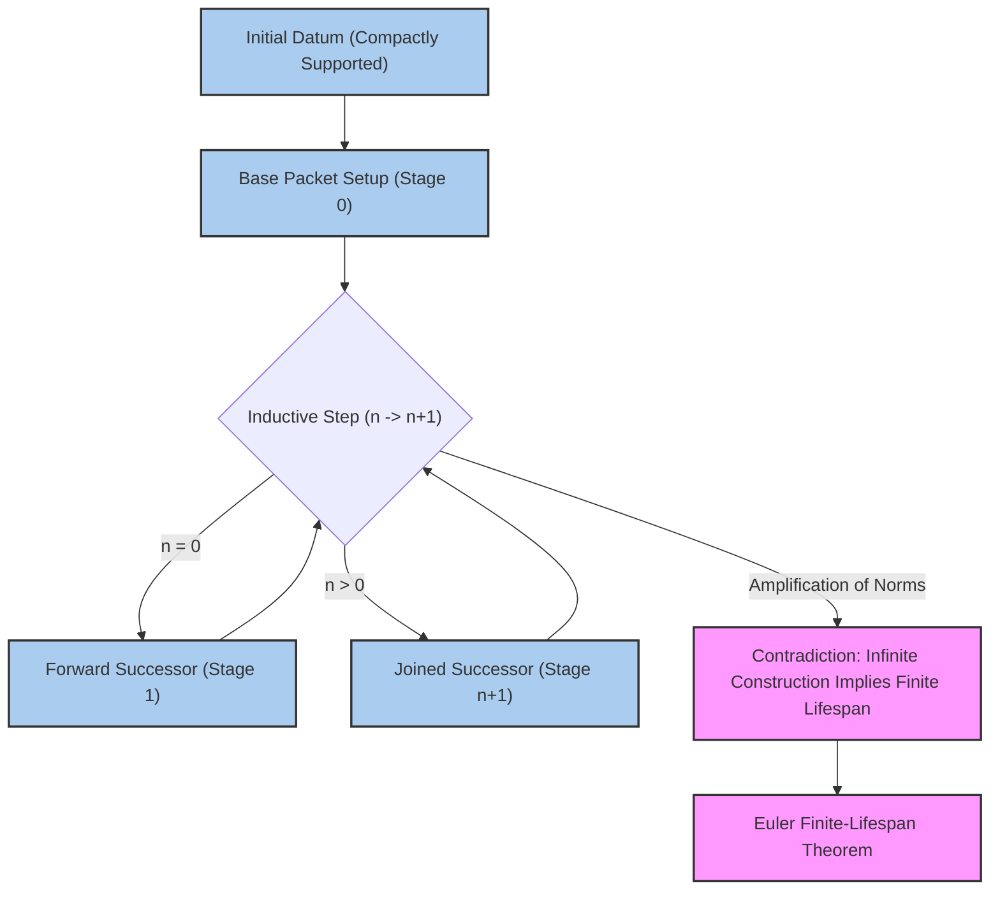

<!-- source: DeepWiki mcp.deepwiki.com · repo openai/NavierStokesAndEuler · page 5 Euler: Ordinary Solutions and Finite Lifespan · fetched 2026-10-26 -->

# Euler: Ordinary Solutions and Finite Lifespan

<details>
<summary>Relevant source files</summary>

The following files were used as context for generating this wiki page:

- [Euler/BaseInductionStage.lean](Euler/BaseInductionStage.lean)
- [Euler/BaseInductionStageNoOptions.lean](Euler/BaseInductionStageNoOptions.lean)
- [Euler/OrdinaryAdvectionLimit.lean](Euler/OrdinaryAdvectionLimit.lean)
- [Euler/OrdinaryEulerConcatenation.lean](Euler/OrdinaryEulerConcatenation.lean)
- [Euler/OrdinaryEulerDifference.lean](Euler/OrdinaryEulerDifference.lean)
- [Euler/OrdinaryEulerLimit.lean](Euler/OrdinaryEulerLimit.lean)
- [Euler/OrdinaryEulerLocalExistence.lean](Euler/OrdinaryEulerLocalExistence.lean)
- [Euler/OrdinaryHelmholtzField.lean](Euler/OrdinaryHelmholtzField.lean)
- [Euler/OrdinaryRegularizedEquation.lean](Euler/OrdinaryRegularizedEquation.lean)
- [Euler/PacketForwardSuccessor.lean](Euler/PacketForwardSuccessor.lean)
- [Euler/PacketInductionStage.lean](Euler/PacketInductionStage.lean)
- [Euler/PacketInfiniteConstruction.lean](Euler/PacketInfiniteConstruction.lean)
- [Euler/PacketJoinedSuccessor.lean](Euler/PacketJoinedSuccessor.lean)
- [Euler/PacketStageEstimates.lean](Euler/PacketStageEstimates.lean)
- [Euler/PacketStageLowPropagation.lean](Euler/PacketStageLowPropagation.lean)
- [Euler/ParentGeometryJoinedChoice.lean](Euler/ParentGeometryJoinedChoice.lean)
- [Euler/ParentGeometryJoinedChoiceInvestigation.lean](Euler/ParentGeometryJoinedChoiceInvestigation.lean)
- [Euler/SmoothEulerEvolution.lean](Euler/SmoothEulerEvolution.lean)

</details>


This page provides a high-level overview of the theory of ordinary solutions for the Euler equations and the inductive construction that leads to a compactly supported datum with a finite maximal lifespan. We will explore the well-posedness of Euler solutions in Sobolev spaces, the iterative process of constructing a sequence of solutions, and how these concepts bridge to the formal statements within the Lean 4 codebase.

The core idea is to demonstrate that for certain initial conditions, the 3D Euler equations do not admit global smooth solutions, leading to a finite lifespan. This is achieved through an inductive construction of "packet stages" that progressively amplify certain norms, ultimately leading to a contradiction if a global solution were to exist.

## Ordinary Euler Well-Posedness

The foundation of our analysis lies in establishing the well-posedness of Euler solutions in appropriate function spaces. This involves defining the structure of an "Evolution" object, proving local existence, and deriving difference and stability estimates.

The `Evolution` structure [Euler/OrdinaryEulerDifference.lean:20-33]() encapsulates a smooth solution to the Euler equations over a time interval `T`. It includes the velocity field (`velocity`), the pressure gradient (`pressureForce`), and proofs of their continuity in Sobolev norms (`velocity_continuous`, `pressure_continuous`), solenoidal and gradient conditions (`solenoidal`, `gradient`), and the time evolution law (`time_law`).

Local existence of solutions is established by considering a sequence of regularized Euler evolutions and taking a limit. The `localEvolution` function [Euler/OrdinaryEulerLocalExistence.lean:139-140]() constructs such a solution from an initial `SmoothL2Field`. This process relies on the `SmoothLimitData` structure [Euler/OrdinaryEulerLimit.lean:18-23]() which handles the convergence of regularized solutions to a true Euler solution.

Difference and stability estimates, such as those found in `Euler/OrdinaryEulerDifference.lean`, are crucial for controlling the behavior of solutions and proving uniqueness. The `difference` and `pressureDifference` definitions [Euler/OrdinaryEulerDifference.lean:81-85]() quantify the deviation between two solutions, while `energyPath` [Euler/OrdinaryEulerDifference.lean:120-121]() tracks a Sobolev energy of this difference. The `energy_hasDerivWithinAt` theorem [Euler/OrdinaryEulerDifference.lean:127-130]() provides a differential inequality for this energy, which is key to stability.

The theory also covers concatenation and continuation of solutions, allowing for the extension of local solutions to larger time intervals. Rescaling techniques are implicitly used throughout the packet construction to manage the growth of norms. Vorticity and the Beale-Kato-Majda (BKM) criterion are fundamental to understanding blow-up mechanisms in Euler equations, though the direct formalization of BKM is not explicitly detailed on this page.

For details, see [Ordinary Euler Well-Posedness](#5.1).

Sources:
- [Euler/OrdinaryEulerLimit.lean]()
- [Euler/OrdinaryEulerDifference.lean]()
- [Euler/OrdinaryEulerLocalExistence.lean]()
- [Euler/SmoothEulerEvolution.lean]()
- [Euler/OrdinaryHelmholtzField.lean]()

## Induction Stages and Blowup

The core of the finite lifespan proof is an inductive construction of a sequence of "packet stages." Each stage represents a solution to the Euler equations with specific properties, and the induction demonstrates that these properties lead to an amplification of certain norms, ultimately implying a finite maximal horizon.

The induction starts with a "base packet setup" [Euler/BaseInductionStageNoOptions.lean:48-120]() which provides the initial conditions for the first stage. This `firstStage_noOptions` [Euler/BaseInductionStageNoOptions.lean:48-120]() is a compactly supported solution with controlled initial norms.

Each subsequent stage is constructed as a "successor" of the previous one. This involves defining a new packet, `joinedNext` [Euler/PacketJoinedSuccessor.lean:97-138]() (for `n > 0`) or `forwardNext` [Euler/PacketForwardSuccessor.lean:92-133]() (for `n = 0`), which inherits properties from its parent stage and introduces new features that contribute to norm amplification. The `Stage` structure [Euler/PacketInductionStage.lean:23-56]() captures the invariant properties of each stage, including its parent solution, low bounds, time interval, and frame data.

The "low propagation" refers to how the bounds on the solution's properties (e.g., `low.Be`, `low.Bc`, `low.K` in `Stage` [Euler/PacketInductionStage.lean:41-43]()) are maintained and updated from one stage to the next. Theorems like `initial_step_bound` [Euler/PacketStageLowPropagation.lean:18-22]() and `pressure_step_bound` [Euler/PacketStageLowPropagation.lean:24-27]() ensure that these bounds remain controlled.

The "stage estimates" [Euler/PacketStageEstimates.lean]() are crucial for demonstrating the amplification. These estimates show that certain norms grow sufficiently fast, leading to a "contradiction" if the solution were to exist for an arbitrarily long time. The `ratio_absorption` theorem [Euler/PacketStageLowPropagation.lean:51-79]() is an example of how error terms are absorbed into the growing norms.

The "infinite construction" refers to the ability to continue this inductive process indefinitely, generating a sequence of solutions. However, the "support/vorticity confinement" ensures that these solutions remain localized, and the amplification of norms ultimately implies a "finite lifespan" for any smooth solution originating from such initial data.

For details, see [Induction Stages and Blowup](#5.2).


**Diagram: High-Level Induction Flow for Finite Lifespan**

Sources:
- [Euler/PacketInductionStage.lean]()
- [Euler/BaseInductionStageNoOptions.lean]()
- [Euler/PacketJoinedSuccessor.lean]()
- [Euler/PacketForwardSuccessor.lean]()
- [Euler/PacketStageLowPropagation.lean]()
- [Euler/PacketStageEstimates.lean]()

## Comparator Bridge for Euler

The "Comparator Bridge" serves to connect the internal mathematical objects and theorems developed within the Lean 4 formalization to the external problem statements defined by the Comparator challenge. This involves identifying the `Evolution` objects, which represent internal solutions, with the external Euler statements.

This bridge ensures that the formal proofs directly address the requirements of the challenge. It involves mapping the Sobolev and classical solution concepts used internally to the expected definitions in the Comparator. This includes handling "time shifts" and defining "singularity norms" that quantify the breakdown of solutions, which are then used to prove the finite lifespan.

For details, see [Comparator Bridge for Euler](#5.3).

```mermaid
graph TD
    subgraph Lean4 Formalization
        A["`Evolution` Object (Internal Solution)"]
        B["Sobolev/Classical Solution Theory"]
        C["`EulerOrdinarySobolev.Evolution`"]:::code
    end

    subgraph Comparator Challenge
        D["External Euler Statements"]
        E["Singularity Norms"]
        F["Time Shifts"]
    end

    C -- "Identifies with" --> D
    B -- "Provides basis for" --> E
    A -- "Incorporates" --> F

    classDef code fill:#bbf,stroke:#333,stroke-width:2px;
```
**Diagram: Comparator Bridge for Euler**

Sources:
- (No specific file citations provided for this section, as it describes a conceptual bridge rather than direct code implementation details on this page. The concept is pervasive across the formalization.)

---

