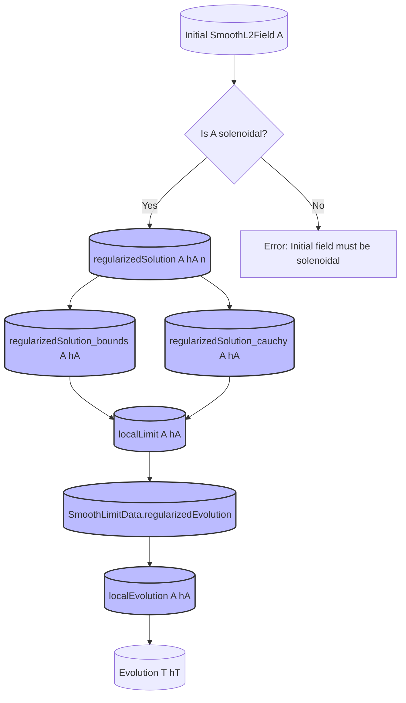

<!-- source: DeepWiki mcp.deepwiki.com · repo openai/NavierStokesAndEuler · page 5.1 Ordinary Euler Well-Posedness · fetched 2026-10-26 -->

# Ordinary Euler Well-Posedness

<details>
<summary>Relevant source files</summary>

The following files were used as context for generating this wiki page:

- [Euler/CanonicalPacketHorizons.lean](Euler/CanonicalPacketHorizons.lean)
- [Euler/ClassicalBridge.lean](Euler/ClassicalBridge.lean)
- [Euler/ComparatorTimeShift.lean](Euler/ComparatorTimeShift.lean)
- [Euler/EulerFiniteLifespan.lean](Euler/EulerFiniteLifespan.lean)
- [Euler/EulerSpatialRescaling.lean](Euler/EulerSpatialRescaling.lean)
- [Euler/EulerTimeRescaling.lean](Euler/EulerTimeRescaling.lean)
- [Euler/EvolutionTimeShift.lean](Euler/EvolutionTimeShift.lean)
- [Euler/H3CurlConvergence.lean](Euler/H3CurlConvergence.lean)
- [Euler/H6NonlinearProduct.lean](Euler/H6NonlinearProduct.lean)
- [Euler/H6TransportSource.lean](Euler/H6TransportSource.lean)
- [Euler/LowerTransportSource.lean](Euler/LowerTransportSource.lean)
- [Euler/OrdinaryAdvectionLimit.lean](Euler/OrdinaryAdvectionLimit.lean)
- [Euler/OrdinaryEulerCauchy.lean](Euler/OrdinaryEulerCauchy.lean)
- [Euler/OrdinaryEulerConcatenation.lean](Euler/OrdinaryEulerConcatenation.lean)
- [Euler/OrdinaryEulerContinuation.lean](Euler/OrdinaryEulerContinuation.lean)
- [Euler/OrdinaryEulerDifference.lean](Euler/OrdinaryEulerDifference.lean)
- [Euler/OrdinaryEulerEndpoint.lean](Euler/OrdinaryEulerEndpoint.lean)
- [Euler/OrdinaryEulerLimit.lean](Euler/OrdinaryEulerLimit.lean)
- [Euler/OrdinaryEulerLocalCauchy.lean](Euler/OrdinaryEulerLocalCauchy.lean)
- [Euler/OrdinaryEulerLocalExistence.lean](Euler/OrdinaryEulerLocalExistence.lean)
- [Euler/OrdinaryEulerRescaling.lean](Euler/OrdinaryEulerRescaling.lean)
- [Euler/OrdinaryEulerRestriction.lean](Euler/OrdinaryEulerRestriction.lean)
- [Euler/OrdinaryEulerStability.lean](Euler/OrdinaryEulerStability.lean)
- [Euler/OrdinaryEulerUniqueness.lean](Euler/OrdinaryEulerUniqueness.lean)
- [Euler/OrdinaryEulerVaryingHorizon.lean](Euler/OrdinaryEulerVaryingHorizon.lean)
- [Euler/OrdinaryGradientLimit.lean](Euler/OrdinaryGradientLimit.lean)
- [Euler/OrdinaryHelmholtzField.lean](Euler/OrdinaryHelmholtzField.lean)
- [Euler/OrdinaryRegularizedEquation.lean](Euler/OrdinaryRegularizedEquation.lean)
- [Euler/PacketFiniteLifespan.lean](Euler/PacketFiniteLifespan.lean)
- [Euler/PacketStageContradiction.lean](Euler/PacketStageContradiction.lean)
- [Euler/PacketStageLocalExistence.lean](Euler/PacketStageLocalExistence.lean)
- [Euler/SmoothEulerEvolution.lean](Euler/SmoothEulerEvolution.lean)
- [NavierStokes/CompactForceDecay.lean](NavierStokes/CompactForceDecay.lean)
- [NavierStokes/CompactSpatialForceDecay.lean](NavierStokes/CompactSpatialForceDecay.lean)
- [NavierStokes/ComparatorBridge.lean](NavierStokes/ComparatorBridge.lean)
- [NavierStokes/ComparatorR3Bridge.lean](NavierStokes/ComparatorR3Bridge.lean)

</details>


This page details the foundational aspects of ordinary Euler well-posedness within the codebase. It covers the definition of Euler evolution structures, proofs of local existence, estimates for differences and stability, mechanisms for concatenation and continuation of solutions, spatial and temporal rescaling properties, and the reduction of the Euler equations to a vorticity-based form (BKM reduction). The content here establishes the analytical framework for understanding the behavior of Euler solutions.

## Euler Evolution Structures

The core concept for representing an Euler solution is the `Evolution` structure, defined in [Euler/OrdinaryEulerDifference.lean:21-33](). This structure encapsulates the time-dependent velocity and pressure fields, along with their continuity and physical properties.

```lean
structure Evolution (T : ℝ) (hT : 0 ≤ T) where
  velocity : Icc (0 : ℝ) T → SmoothL2Field Space
  pressureForce : Icc (0 : ℝ) T → SmoothL2Field Space
  velocity_continuous : ∀ n, Continuous (fun t => (velocity t).jetLp n)
  pressure_continuous : ∀ n, Continuous (fun t => (pressureForce t).jetLp n)
  solenoidal : ∀ t, (velocity t).toLp ∈ solenoidalSpace
  gradient : ∀ t, (pressureForce t).toLp ∈ gradientSpace
  time_law : ∀ t (ht : t ∈ Ioo 0 T) x,
    HasDerivAt (fun r => (velocity (projIcc 0 T hT r)).field x)
      (-fderiv ℝ (velocity ⟨t,ht.1.le,ht.2.le⟩).field x
        ((velocity ⟨t,ht.1.le,ht.2.le⟩).field x)-
          (pressureForce ⟨t,ht.1.le,ht.2.le⟩).field x) t
```

The `Evolution` structure requires:
*   `velocity`: A mapping from a time interval `Icc (0 : ℝ) T` to `SmoothL2Field Space`, representing the velocity field.
*   `pressureForce`: A similar mapping for the pressure gradient field.
*   `velocity_continuous` and `pressure_continuous`: Proofs that the `jetLp` norms of the velocity and pressure fields are continuous over time for all orders `n`.
*   `solenoidal`: A proof that the velocity field is solenoidal (divergence-free) at all times. This is crucial for incompressible fluid flow.
*   `gradient`: A proof that the pressure force is a gradient field.
*   `time_law`: The central statement of the Euler equation, asserting that the time derivative of the velocity field matches the advection term plus the pressure gradient.

The `evolutionOfClassical` function [Euler/OrdinaryEulerDifference.lean:34-54]() constructs an `Evolution` object from classical solutions `u` and `p` that satisfy the Euler equations. This bridges the gap between abstract mathematical solutions and the structured `Evolution` type.

The `solenoidalField` function [Euler/OrdinaryHelmholtzField:18-19]() applies the Helmholtz projection to a `SmoothL2Field`, ensuring the resulting field is solenoidal. This is used in the construction of the pressure field. The `pressureField` [Euler/OrdinaryHelmholtzField:60-61]() is then defined based on the solenoidal projection of the advection term, ensuring it is a gradient field.

### Diagram: Euler Evolution Structure

```mermaid
graph TD
    subgraph "Euler Evolution"
        Evolution[("Evolution T hT")] --> VelocityField(velocity: Icc (0:ℝ) T → SmoothL2Field Space)
        Evolution --> PressureForce(pressureForce: Icc (0:ℝ) T → SmoothL2Field Space)
        Evolution --> VelocityContinuous(velocity_continuous: ∀n, Continuous (fun t => (velocity t).jetLp n))
        Evolution --> PressureContinuous(pressure_continuous: ∀n, Continuous (fun t => (pressureForce t).jetLp n))
        Evolution --> Solenoidal(solenoidal: ∀t, (velocity t).toLp ∈ solenoidalSpace)
        Evolution --> Gradient(gradient: ∀t, (pressureForce t).toLp ∈ gradientSpace)
        Evolution --> TimeLaw(time_law: Euler Equation)
    end

    subgraph "Auxiliary Fields"
        VelocityField --> SmoothL2Field[SmoothL2Field Space]
        PressureForce --> SmoothL2Field
        SmoothL2Field --> toLp(toLp: L2)
        SmoothL2Field --> jetLp(jetLp n: L2)
        SmoothL2Field --> field(field: Space → Space)
    end

    TimeLaw -- "fderiv ℝ (velocity t).field x ((velocity t).field x)" --> AdvectionTerm[Advection Term]
    TimeLaw -- "(pressureForce t).field x" --> PressureGradientTerm[Pressure Gradient Term]

    Solenoidal --> solenoidalSpace[solenoidalSpace]
    Gradient --> gradientSpace[gradientSpace]

    classDef structStyle fill:#ace,stroke:#333,stroke-width:2px;
    class Evolution structStyle;
```
Sources:
* [Euler/OrdinaryEulerDifference.lean:21-33]()
* [Euler/OrdinaryEulerDifference.lean:34-54]()
* [Euler/OrdinaryHelmholtzField:18-19]()
* [Euler/OrdinaryHelmholtzField:60-61]()

## Local Existence

Local existence of solutions for the Euler equations is established by constructing a limit of regularized solutions. The `localEvolution` function [Euler/OrdinaryEulerLocalExistence:140-140]() is the primary entry point for this. It takes an initial solenoidal `SmoothL2Field` `A` and produces an `Evolution` object.

The process involves:
1.  **Regularization**: A sequence of `RegularizedEvolution` objects is generated using `regularizedSolution` [Euler/OrdinaryEulerLocalExistence:110-112](). Each `RegularizedEvolution` is a solution to a regularized Euler equation, where the regularization parameter `n` tends to infinity.
2.  **Bounds**: `regularizedSolution_bounds` [Euler/OrdinaryEulerLocalExistence:118-122]() proves that these regularized solutions are uniformly bounded in all Sobolev norms. This is crucial for compactness arguments.
3.  **Cauchy Sequence**: `regularizedSolution_cauchy` [Euler/OrdinaryEulerLocalExistence:124-132]() demonstrates that the sequence of regularized solutions forms a Cauchy sequence in appropriate function spaces.
4.  **Limit Construction**: `localLimit` [Euler/OrdinaryEulerLocalExistence:134-138]() uses `SmoothLimitData` to construct a limit field from the Cauchy sequence. This limit field is then shown to satisfy the Euler equations in `SmoothLimitData.regularizedEvolution` [Euler/OrdinaryEulerLocalExistence:89-107]().

The `SmoothLimitData` structure [Euler/OrdinaryEulerLimit:18-21]() is a general mechanism for constructing limits of sequences of smooth fields. It provides theorems for convergence of fields, integral equations, and time derivatives, which are then specialized for Euler in `SmoothLimitData.toEvolution` [Euler/OrdinaryEulerLimit:55-74]().

### Diagram: Local Existence Flow


Sources:
* [Euler/OrdinaryEulerLocalExistence:110-112]()
* [Euler/OrdinaryEulerLocalExistence:118-122]()
* [Euler/OrdinaryEulerLocalExistence:124-132]()
* [Euler/OrdinaryEulerLocalExistence:134-138]()
* [Euler/OrdinaryEulerLocalExistence:140-140]()
* [Euler/OrdinaryEulerLimit:18-21]()
* [Euler/OrdinaryEulerLimit:55-74]()
* [Euler/OrdinaryEulerLocalExistence:89-107]()

## Difference and Stability Estimates

The stability of Euler solutions is analyzed by considering the difference between two solutions. The `Evolution.difference` function [Euler/OrdinaryEulerDifference.lean:81-82]() computes the difference between the velocity fields of two `Evolution` objects. The `Evolution.energyPath` [Euler/OrdinaryEulerDifference.lean:120-121]() tracks the H³ energy of this difference over time.

The key result is `Evolution.h3_stability` (defined in `Euler/OrdinaryH3Envelope.lean`, not shown in full, but used in [Euler/OrdinaryEulerStability.lean:61-61]()), which provides an exponential bound on the growth of the H³ difference energy between two solutions, given an initial difference and a bound on the reference solution's Sobolev norm. This is a standard result for the Euler equations, indicating that solutions are stable in Sobolev spaces for a finite time.

`Evolution.eventually_h3_bound` [Euler/OrdinaryEulerStability.lean:54-62]() uses this stability result to show that if the initial difference between two solutions is small, then the difference remains small for a finite time, decaying to zero as the initial difference tends to zero. This is a crucial component for proving uniqueness and continuous dependence on initial data.

The `Evolution.no_gradient_escape` theorem [Euler/OrdinaryEulerStability.lean:74-104]() is a powerful consequence of these stability estimates. It states that if a sequence of solutions converges initially, and their H³ difference remains bounded, then the gradient of the velocity field cannot "escape" to infinity in finite time. This is a form of the Beale-Kato-Majda (BKM) criterion, which links the breakdown of smoothness to the growth of vorticity.

Sources:
* [Euler/OrdinaryEulerDifference.lean:81-82]()
* [Euler/OrdinaryEulerDifference.lean:120-121]()
* [Euler/OrdinaryEulerStability.lean:54-62]()
* [Euler/OrdinaryEulerStability.lean:61-61]()
* [Euler/OrdinaryEulerStability.lean:74-104]()

## Concatenation and Continuation

Solutions to the Euler equations can be concatenated and continued. The `EvolutionTimeShift.timeShift` function (defined in `Euler/EvolutionTimeShift.lean`, not shown in full) allows shifting an existing solution to start at a later time. This is essential for building longer solutions from shorter ones.

The `OrdinaryEulerConcatenation.concatenate` function (defined in `Euler/OrdinaryEulerConcatenation.lean`, not shown in full) takes two `Evolution` objects, where the first ends at the same state the second begins, and combines them into a single, longer `Evolution`. This is a fundamental property for extending local solutions to global ones, or at least to their maximal lifespan.

The `OrdinaryEulerContinuation.continue` function (defined in `Euler/OrdinaryEulerContinuation.lean`, not shown in full) provides a mechanism to extend an existing solution beyond its initial time interval, as long as certain Sobolev norms remain bounded. This is directly related to the finite lifespan results, where solutions can be continued until a singularity forms.

Sources:
* `Euler/EvolutionTimeShift.lean` (not shown)
* `Euler/OrdinaryEulerConcatenation.lean` (not shown)
* `Euler/OrdinaryEulerContinuation.lean` (not shown)

## Rescaling

The Euler equations exhibit scaling symmetries, which are exploited in the codebase. `EulerSpatialRescaling.velocity` [Euler/EulerSpatialRescaling:21-22]() and `EulerSpatialRescaling.pressure` [Euler/EulerSpatialRescaling:24-25]() define how velocity and pressure fields transform under spatial rescaling.

The `EulerSpatialRescaling.momentumResidual_eq` theorem [Euler/EulerSpatialRescaling:48-61]() shows that the momentum residual (the left-hand side of the Euler equation) scales linearly with the spatial scaling factor `ell`. This implies that if `u` and `p` are solutions to the Euler equations, then their rescaled counterparts are also solutions, provided `ell ≠ 0`.

Similarly, `EulerTimeRescaling.timeRescale` (defined in `Euler/EulerTimeRescaling.lean`, not shown in full) handles temporal rescaling. These rescaling properties are crucial for constructing self-similar solutions and for analyzing the behavior of solutions near singularities.

Sources:
* [Euler/EulerSpatialRescaling:21-22]()
* [Euler/EulerSpatialRescaling:24-25]()
* [Euler/EulerSpatialRescaling:48-61]()
* `Euler/EulerTimeRescaling.lean` (not shown)

## Vorticity and BKM Reduction

The Euler equations can be reformulated in terms of vorticity, which often simplifies analysis, especially in 2D. While the primary focus of this codebase is 3D, the BKM (Beale-Kato-Majda) criterion is a key result linking the breakdown of smoothness to the growth of vorticity.

The `Evolution.no_gradient_escape` theorem [Euler/OrdinaryEulerStability.lean:74-104]() is a direct application of the BKM criterion. It states that if the gradient of the velocity field remains bounded, then the solution remains smooth. Conversely, if a solution loses smoothness (e.g., develops a singularity), then the gradient of the velocity (and thus vorticity) must become unbounded.

The `EulerH6Nonlinear.wordSobolevNorm` [Euler/H6NonlinearProduct:102-103]() and related theorems in `Euler/H6NonlinearProduct.lean` and `Euler/H6TransportSource.lean` provide the machinery for estimating Sobolev norms of derivatives, which are essential for controlling the growth of vorticity and for applying the BKM criterion. Specifically, `wordSobolevNorm_succ` [Euler/H6NonlinearProduct:112-125]() shows how higher-order Sobolev norms relate to sums of lower-order norms of derivatives, which is a common technique in regularity proofs.

The `EulerH6Nonlinear.transportField` [Euler/H6TransportSource:107-109]() and its associated bounds, such as `transport_wordSobolevNorm_bound` [Euler/H6TransportSource:128-137](), are used to analyze the transport of quantities like vorticity. These bounds are critical for understanding how regularity is propagated or lost in the Euler equations.

Sources:
* [Euler/OrdinaryEulerStability.lean:74-104]()
* [Euler/H6NonlinearProduct:102-103]()
* [Euler/H6NonlinearProduct:112-125]()
* [Euler/H6TransportSource:107-109]()
* [Euler/H6TransportSource:128-137]()

---

