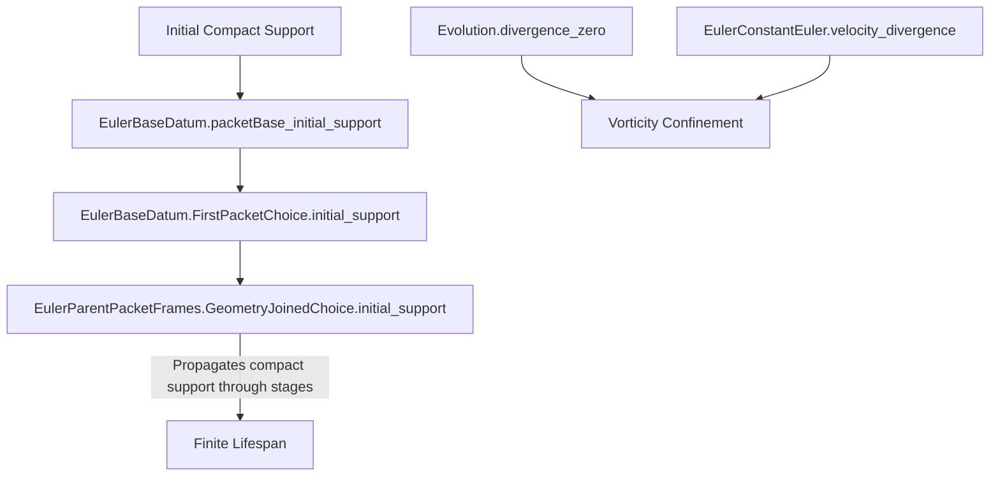

<!-- source: DeepWiki mcp.deepwiki.com · repo openai/NavierStokesAndEuler · page 5.2 Induction Stages and Blowup · fetched 2026-10-26 -->

# Induction Stages and Blowup

<details>
<summary>Relevant source files</summary>

The following files were used as context for generating this wiki page:

- [Euler/BaseFirstPacket.lean](Euler/BaseFirstPacket.lean)
- [Euler/BaseFirstPacketSupport.lean](Euler/BaseFirstPacketSupport.lean)
- [Euler/BaseInductionStage.lean](Euler/BaseInductionStage.lean)
- [Euler/BaseInductionStageNoOptions.lean](Euler/BaseInductionStageNoOptions.lean)
- [Euler/BaseLiteralFirstPacket.lean](Euler/BaseLiteralFirstPacket.lean)
- [Euler/BasePacketLowBounds.lean](Euler/BasePacketLowBounds.lean)
- [Euler/BasePacketSetup.lean](Euler/BasePacketSetup.lean)
- [Euler/BasePacketUniformCosts.lean](Euler/BasePacketUniformCosts.lean)
- [Euler/CanonicalVorticityConfinement.lean](Euler/CanonicalVorticityConfinement.lean)
- [Euler/ConstantEulerGraph.lean](Euler/ConstantEulerGraph.lean)
- [Euler/PacketFirstStageSupport.lean](Euler/PacketFirstStageSupport.lean)
- [Euler/PacketForwardSuccessor.lean](Euler/PacketForwardSuccessor.lean)
- [Euler/PacketInductionStage.lean](Euler/PacketInductionStage.lean)
- [Euler/PacketInfiniteConstruction.lean](Euler/PacketInfiniteConstruction.lean)
- [Euler/PacketInitialDatumSupport.lean](Euler/PacketInitialDatumSupport.lean)
- [Euler/PacketJoinedSuccessor.lean](Euler/PacketJoinedSuccessor.lean)
- [Euler/PacketParentLabelBounds.lean](Euler/PacketParentLabelBounds.lean)
- [Euler/PacketParentLabelBudgets.lean](Euler/PacketParentLabelBudgets.lean)
- [Euler/PacketStageEstimates.lean](Euler/PacketStageEstimates.lean)
- [Euler/PacketStageLowPropagation.lean](Euler/PacketStageLowPropagation.lean)
- [Euler/ParentChoiceInitialSupport.lean](Euler/ParentChoiceInitialSupport.lean)
- [Euler/ParentEulerLowBounds.lean](Euler/ParentEulerLowBounds.lean)
- [Euler/ParentEulerParity.lean](Euler/ParentEulerParity.lean)
- [Euler/ParentEulerState.lean](Euler/ParentEulerState.lean)
- [Euler/ParentForwardUniformCosts.lean](Euler/ParentForwardUniformCosts.lean)
- [Euler/ParentGeometryInitialBounds.lean](Euler/ParentGeometryInitialBounds.lean)
- [Euler/ParentGeometryJoinedChoice.lean](Euler/ParentGeometryJoinedChoice.lean)
- [Euler/ParentGeometryJoinedChoiceInvestigation.lean](Euler/ParentGeometryJoinedChoiceInvestigation.lean)
- [Euler/ParentInitializedUniformCosts.lean](Euler/ParentInitializedUniformCosts.lean)
- [Euler/ParentPacketHistoryLowBounds.lean](Euler/ParentPacketHistoryLowBounds.lean)
- [Euler/ParentPacketLabelData.lean](Euler/ParentPacketLabelData.lean)
- [Euler/ParentPacketPhysicalCoefficients.lean](Euler/ParentPacketPhysicalCoefficients.lean)
- [Euler/ParentPacketPhysicalFrame.lean](Euler/ParentPacketPhysicalFrame.lean)
- [Euler/ParentPacketSobolevFields.lean](Euler/ParentPacketSobolevFields.lean)
- [Euler/ParentParticleInverse.lean](Euler/ParentParticleInverse.lean)
- [Euler/ParentParticleRegularity.lean](Euler/ParentParticleRegularity.lean)
- [Euler/StageInitialSupport.lean](Euler/StageInitialSupport.lean)
- [Euler/StageVorticityConfinement.lean](Euler/StageVorticityConfinement.lean)
- [Euler/StaticEulerForceField.lean](Euler/StaticEulerForceField.lean)
- [Euler/StaticEulerRegularity.lean](Euler/StaticEulerRegularity.lean)
- [Euler/StaticEulerSolution.lean](Euler/StaticEulerSolution.lean)

</details>


This page details the construction of the finite-time blowup solution for the 3D Euler equations. It focuses on the inductive process that generates a sequence of "stages," each representing a more refined approximation of the singular solution. The core idea involves setting up a base packet, defining how subsequent stages are constructed, estimating their properties, and ultimately demonstrating a contradiction that implies finite lifespan. Key aspects include support and vorticity confinement, and the infinite construction leading to the blowup.

## Base Packet Setup

The induction begins with a "base packet," which is a compactly supported initial datum for the Euler equations. This base packet is defined in `Euler/BasePacketSetup.lean` and `Euler/BaseFirstPacketSupport.lean`.

The `EulerPacketSupport` namespace in `Euler/BasePacketSetup.lean` defines the `support` of the initial packet, which is a compact set within a half-ball [Euler/BasePacketSetup.lean:13-18](). This ensures the initial data is localized. The `symmetric` theorem [Euler/BasePacketSetup.lean:19-28]() confirms the support is symmetric around the origin.

The `EulerBaseDatum` namespace then constructs the `packetBaseParent` and `packetBaseState` [Euler/BasePacketSetup.lean:60-64]() by restricting an `initialParent` and `initialState` to a short time `T`. This restriction ensures that the initial conditions are well-behaved for the first stage of the induction. The `firstPacketInputs` [Euler/BasePacketSetup:109-122]() are derived from this base state, providing the necessary parameters for the packet construction machinery.

The initial support of the base packet's velocity field is shown to be contained within `Metric.closedBall 0 2` [Euler/BaseFirstPacketSupport.lean:17-28](). This compact support is crucial for the finite lifespan argument.

```mermaid
graph TD
    subgraph "Euler/BasePacketSetup.lean"
        A[EulerPacketSupport.support] --> B{IsCompact support};
        A --> C{support ⊆ Metric.ball 0 (1/2)};
        D[EulerBaseDatum.packetBaseParent] --> E[EulerBaseDatum.packetBaseState];
        E --> F[EulerBaseDatum.firstPacketInputs];
    end

    subgraph "Euler/BaseFirstPacketSupport.lean"
        G[EulerBaseDatum.packetBase_initial_support] --> H{tsupport velocity ⊆ Metric.closedBall 0 2};
    end

    B -- "Ensures localization" --> G;
    C -- "Defines spatial extent" --> G;
    F -- "Provides parameters for first packet" --> G;
```
Sources:
- [Euler/BasePacketSetup.lean:13-28]()
- [Euler/BasePacketSetup.lean:60-64]()
- [Euler/BasePacketSetup.lean:109-122]()
- [Euler/BaseFirstPacketSupport.lean:17-28]()

## Stage Successors and Low Propagation

The induction proceeds by defining a `Stage` structure [Euler/PacketInductionStage.lean:23-56]() that encapsulates the properties of an Euler solution at a given step `n`. This structure includes the `parent` (a `Parent` object representing the underlying flow), its `state` (a `SmoothState`), `low` bounds (`LowBounds`), and various other properties like time, horizon, scale, and bounds on gradients and Hessians.

The `joinedNext` function [Euler/PacketJoinedSuccessor.lean:97-146]() is responsible for constructing the successor stage `n+1` from stage `n`. This involves:
1.  **Choosing a `GeometryJoinedChoice`**: This choice, made by `chooseJoined` [Euler/PacketJoinedSuccessor.lean:34-38](), determines the geometric parameters for the next packet. It relies on `exists_geometryJoinedChoice` [Euler/ParentGeometryJoinedChoice.lean:50-73]() to ensure such a choice exists, given frequency and scale constraints.
2.  **Constructing `joinedParent` and `joinedState`**: These are the `Parent` and `SmoothState` objects for the next stage, built using the chosen geometry [Euler/PacketJoinedSuccessor.lean:44-49]().
3.  **Propagating `LowBounds`**: The `joinedLow` [Euler/PacketJoinedSuccessor.lean:69-72]() function calculates the low bounds for the next stage, ensuring they remain within acceptable limits. This propagation is supported by `next_localized` [Euler/PacketStageLowPropagation.lean:30-48](), which verifies that the localized costs (pressure, exterior, core) remain small enough for the next stage.
4.  **Renewing the `ParentFrame`**: The `joinedRenewal` [Euler/PacketJoinedSuccessor.lean:74-83]() and `joinedNextFrame` [Euler/PacketJoinedSuccessor.lean:94-95]() functions update the moving frame, which tracks the local geometry of the solution. This renewal process ensures that the frame properties (shear, error, coupling) are maintained or improved.

The `ratio_absorption` theorem [Euler/PacketStageLowPropagation.lean:49-79]() demonstrates how the error terms from the previous stage are absorbed into the bounds of the current stage, ensuring that the growth of errors is controlled.

```mermaid
graph TD
    A[Stage S n] --> B{chooseJoined};
    B -- "GeometryJoinedChoice F" --> C[joinedParent];
    B -- "GeometryJoinedChoice F" --> D[joinedState];
    B -- "GeometryJoinedChoice F" --> E[joinedLow];
    B -- "GeometryJoinedChoice F" --> F[joinedRenewal];
    C --> G[Stage S (n+1)];
    D --> G;
    E --> G;
    F --> G;

    subgraph "Low Propagation"
        E -- "Uses" --> H[next_localized];
        H -- "Uses" --> I[initial_step_bound];
        H -- "Uses" --> J[pressure_step_bound];
        K[ratio_absorption] -- "Ensures error control" --> G;
    end
```
Sources:
- [Euler/PacketInductionStage.lean:23-56]()
- [Euler/PacketJoinedSuccessor.lean:34-38]()
- [Euler/PacketJoinedSuccessor.lean:44-49]()
- [Euler/PacketJoinedSuccessor.lean:69-72]()
- [Euler/PacketJoinedSuccessor.lean:74-83]()
- [Euler/PacketJoinedSuccessor.lean:94-95]()
- [Euler/PacketJoinedSuccessor.lean:97-146]()
- [Euler/PacketStageLowPropagation.lean:30-48]()
- [Euler/PacketStageLowPropagation.lean:49-79]()
- [Euler/ParentGeometryJoinedChoice.lean:50-73]()

## Stage Estimates and Contradiction

Each `Stage` [Euler/PacketInductionStage.lean:23-56]() carries various bounds and estimates that are crucial for the induction. These include `gradient_bound`, `hessian_bound`, `exterior_bound`, `core_bound`, and `pressure_bound` [Euler/PacketInductionStage.lean:36-42](). The `coupling_error` [Euler/PacketInductionStage.lean:53]() and `tilt_lower`/`tilt_upper` [Euler/PacketInductionStage.lean:54-55]() bounds relate to the properties of the moving frame.

The `Stage` also includes a `compression` property [Euler/PacketInductionStage.lean:56]() which, for `n ≠ 0`, asserts a negative value for a specific inner product related to the frame's `B` matrix and `m` vector, plus a `priorError`. This `compression` property is designed to eventually lead to a contradiction.

The `RenewalAtTarget.background_compression_of_error_le_one` theorem [Euler/PacketStageLowPropagation.lean:124-136]() shows that if the error `e` is small enough (e.g., `e ≤ 1`), then the background compression term will be negative. This is a key step in demonstrating the blowup.

The overall strategy is to show that if the solution were to exist for an infinite time, the `compression` term would eventually become positive, contradicting the established bounds. This contradiction implies that the solution must have a finite lifespan.

## Infinite Construction

The inductive construction of stages is designed to continue indefinitely if the solution were global. The `EulerPacketInduction.Stage` structure [Euler/PacketInductionStage.lean:23-56]() and the `joinedNext` function [Euler/PacketJoinedSuccessor.lean:97-146]() provide the machinery for this infinite sequence of approximations.

The `EulerPacketInfiniteConstruction.lean` file (not fully shown but mentioned in the TOC) would formalize the existence of an infinite sequence of such stages, assuming a global solution. The contradiction derived from the `compression` property then refutes this assumption.

## Support/Vorticity Confinement

The compact support of the initial data is propagated through the induction. The `initial_support` theorems in `Euler/BaseFirstPacketSupport.lean` and `Euler/ParentChoiceInitialSupport.lean` ensure that the velocity field of each stage remains compactly supported within `Metric.closedBall 0 2`.

For example, `EulerBaseDatum.FirstPacketChoice.initial_support` [Euler/BaseFirstPacketSupport.lean:37-52]() shows that the initial velocity of the first packet choice is compactly supported. Similarly, `GeometryJoinedChoice.initial_support` [Euler/ParentChoiceInitialSupport.lean:98-106]() ensures that the initial velocity of a joined packet also maintains compact support.

Vorticity confinement is implicitly handled by the properties of the `SmoothState` and `Parent` objects, which are built upon smooth fields and jet calculus (as described in section 2.1). The `divergence_zero` property of `Evolution` [Euler/ParentEulerState.lean:28]() ensures the incompressibility of the fluid, which is directly related to the behavior of vorticity.

The `EulerConstantEuler.velocity_divergence` theorem [Euler/ConstantEulerGraph.lean:82-88]() explicitly states that the divergence of the velocity field is zero, confirming the solenoidal nature of the constructed solutions.


Sources:
- [Euler/BaseFirstPacketSupport.lean:37-52]()
- [Euler/ConstantEulerGraph.lean:82-88]()
- [Euler/ParentChoiceInitialSupport.lean:98-106]()
- [Euler/ParentEulerState.lean:28]()

## Finite Lifespan

The culmination of the induction is the proof of finite lifespan. The `EulerStaticEuler` namespace in `Euler/StaticEulerSolution.lean` defines a `localVelocity` and `localPressure` [Euler/StaticEulerSolution.lean:24-27]() for a classical Euler solution. This solution is constructed from a genuine solenoidal Gevrey datum and is shown to satisfy the Euler equations (e.g., `localMomentum` [Euler/StaticEulerSolution.lean:60-68]() is zero, `localVelocity_divergence` [Euler/StaticEulerSolution.lean:78-91]() is zero).

The inductive construction of stages, with their associated bounds and the `compression` property, is designed to show that such a smooth, global solution cannot exist. The `compression` term, which is initially negative, is shown to eventually become positive if the solution were to exist for an arbitrarily long time. This contradiction implies that the solution must break down in finite time.

The `EulerPacketInduction.Stage.compression` property [Euler/PacketInductionStage.lean:56]() is the key element that, when combined with the propagation of errors and bounds, leads to the finite lifespan result. The `RenewalAtTarget.background_compression_of_error_le_one` theorem [Euler/PacketStageLowPropagation.lean:124-136]() provides the mechanism for this contradiction.

Sources:
- [Euler/PacketInductionStage.lean:56]()
- [Euler/PacketStageLowPropagation.lean:124-136]()
- [Euler/StaticEulerSolution.lean:24-27]()
- [Euler/StaticEulerSolution.lean:60-68]()
- [Euler/StaticEulerSolution.lean:78-91]()

---

