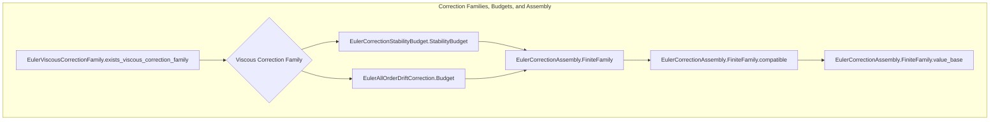
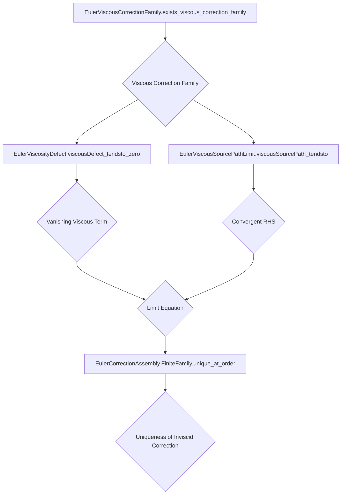
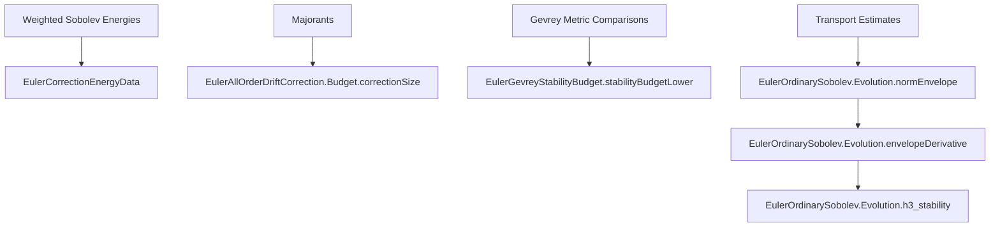

<!-- source: DeepWiki mcp.deepwiki.com · repo openai/NavierStokesAndEuler · page 6 Viscous Corrections and Limit Machinery · fetched 2026-10-26 -->

# Viscous Corrections and Limit Machinery

Relevant source files

The following files were used as context for generating this wiki page:

- [Euler/AllOrderCorrectionBudget.lean](Euler/AllOrderCorrectionBudget.lean)
- [Euler/AllOrderCorrectionFamily.lean](Euler/AllOrderCorrectionFamily.lean)
- [Euler/AllOrderCorrectionStability.lean](Euler/AllOrderCorrectionStability.lean)
- [Euler/AllOrderDriftBudget.lean](Euler/AllOrderDriftBudget.lean)
- [Euler/AllOrderDriftRadiusBounds.lean](Euler/AllOrderDriftRadiusBounds.lean)
- [Euler/CorrectionAssemblyCompatibility.lean](Euler/CorrectionAssemblyCompatibility.lean)
- [Euler/CorrectionAssemblyData.lean](Euler/CorrectionAssemblyData.lean)
- [Euler/CorrectionContinuation.lean](Euler/CorrectionContinuation.lean)
- [Euler/CorrectionFamilyCompactness.lean](Euler/CorrectionFamilyCompactness.lean)
- [Euler/CorrectionLimitDerivative.lean](Euler/CorrectionLimitDerivative.lean)
- [Euler/CorrectionLimitEquation.lean](Euler/CorrectionLimitEquation.lean)
- [Euler/CorrectionLimitPathDerivative.lean](Euler/CorrectionLimitPathDerivative.lean)
- [Euler/CorrectionMildEquation.lean](Euler/CorrectionMildEquation.lean)
- [Euler/CorrectionStabilityBudget.lean](Euler/CorrectionStabilityBudget.lean)
- [Euler/CorrectionStabilityConstants.lean](Euler/CorrectionStabilityConstants.lean)
- [Euler/DriftCorrectionBudget.lean](Euler/DriftCorrectionBudget.lean)
- [Euler/DriftViscousCorrectionFamily.lean](Euler/DriftViscousCorrectionFamily.lean)
- [Euler/GevreyFamilyCompactness.lean](Euler/GevreyFamilyCompactness.lean)
- [Euler/GevreyStabilityBudget.lean](Euler/GevreyStabilityBudget.lean)
- [Euler/OrdinaryH3Envelope.lean](Euler/OrdinaryH3Envelope.lean)
- [Euler/SmallCorrectionBudget.lean](Euler/SmallCorrectionBudget.lean)
- [Euler/ViscosityCauchy.lean](Euler/ViscosityCauchy.lean)
- [Euler/ViscosityDefect.lean](Euler/ViscosityDefect.lean)
- [Euler/ViscousCorrectionFamily.lean](Euler/ViscousCorrectionFamily.lean)
- [Euler/ViscousPathDerivative.lean](Euler/ViscousPathDerivative.lean)
- [Euler/ViscousSourcePathLimit.lean](Euler/ViscousSourcePathLimit.lean)

This page provides a high-level overview of the viscous correction and limit machinery used to bridge approximate solutions to exact solutions within the codebase. This apparatus is crucial for demonstrating the existence and uniqueness of solutions in the context of the Euler and Navier-Stokes equations. It involves constructing families of viscous approximations, analyzing their convergence properties, and deriving the exact inviscid equations in the limit.

The core idea is to introduce a small viscosity term, solve the regularized (viscous) problem, and then take the limit as viscosity vanishes. This process requires careful control over various quantities, including energy, regularity, and defect terms, to ensure that the limit exists and satisfies the desired properties of the inviscid equations.

This page serves as a parent page, providing an introduction to the main concepts. Detailed technical discussions and proofs are delegated to its child pages.

## Correction Families, Budgets, and Assembly

The construction of exact solutions often begins with families of approximate solutions, which are then refined through a correction process. This section introduces the concept of "correction families" and the associated "budgets" that quantify their properties and ensure their well-behaved nature.

Correction families are sequences of solutions to regularized problems, typically involving a small viscosity parameter. These families are designed to converge to the desired inviscid solution as the regularization parameter tends to zero. The `EulerViscousCorrectionFamily.lean` file, for instance, defines the existence of such a family with uniform energy control and a vanishing viscous term [Euler/ViscousCorrectionFamily.lean:19-54]().

Central to managing these families are "budgets," which are sets of bounds and constants that control the behavior of coefficients, fields, and residuals at various orders of approximation. Examples include `EulerCorrectionStabilityBudget.StabilityBudget` [Euler/CorrectionStabilityBudget.lean:16-56]() and `EulerAllOrderDriftCorrection.Budget` [Euler/AllOrderDriftBudget.lean:19-53](). These budgets ensure that the corrections remain small and well-behaved throughout the approximation process.

The assembly of these corrections involves ensuring compatibility and coherence across different orders of approximation. The `EulerCorrectionAssembly.FiniteFamily` structure [Euler/CorrectionAssemblyData.lean:66-78]() represents a family of finite-order corrections, each satisfying specific initial conditions, divergence constraints, and literal PDEs. The `FiniteFamily.compatible` theorem [Euler/CorrectionAssemblyData.lean:19-41]() demonstrates that adjacent finite corrections coincide after restriction, a crucial step for constructing a coherent limit.

For details, see [Correction Families, Budgets, and Assembly](#6.1).

### Correction Family and Budget Overview

Sources:
- [Euler/ViscousCorrectionFamily.lean:19-54]()
- [Euler/CorrectionStabilityBudget.lean:16-56]()
- [Euler/AllOrderDriftBudget.lean:19-53]()
- [Euler/CorrectionAssemblyData.lean:66-78]()
- [Euler/CorrectionAssemblyData.lean:19-41]()

## Viscosity Limits, Compactness, and Uniqueness

This section focuses on the process of taking the limit as viscosity vanishes, establishing compactness properties, and proving the uniqueness of the resulting inviscid solutions.

The concept of "viscous correction families" is central here, as they provide the sequence of approximate solutions. The `EulerViscousCorrectionFamily.exists_viscous_correction_family` theorem [Euler/ViscousCorrectionFamily.lean:19-54]() guarantees the existence of such a family with controlled energy and a vanishing viscous defect. The "viscous defect" itself, defined in `EulerViscosityDefect.lean`, quantifies the difference between the viscous and inviscid equations. The `viscousDefect_tendsto_zero` theorem [Euler/ViscousCorrectionFamily.lean:53-54]() is key to showing that this defect vanishes in the limit.

Compactness arguments, often involving Gevrey regularity, are used to extract convergent subsequences from these viscous families. This ensures that a limit solution exists. The `EulerViscousSourcePathLimit.viscousSourcePath_tendsto` theorem [Euler/ViscousSourcePathLimit.lean:33-51]() demonstrates the strong convergence of the nonlinear and viscous right-hand sides, which is crucial for passing to the limit in the PDE.

Finally, uniqueness of the inviscid correction is established. The `EulerCorrectionAssembly.FiniteFamily.unique_at_order` theorem [Euler/CorrectionAssemblyData.lean:58-79]() asserts that any other finite-order correction satisfying the same conditions must be identical to the constructed one. This relies on stability estimates and the properties of the underlying PDE.

For details, see [Viscosity Limits, Compactness, and Uniqueness](#6.2).

### Viscosity Limit Process

Sources:
- [Euler/ViscousCorrectionFamily.lean:19-54]()
- [Euler/ViscousCorrectionFamily.lean:53-54]()
- [Euler/ViscousSourcePathLimit.lean:33-51]()
- [Euler/CorrectionAssemblyData.lean:58-79]()

## Energy Metrics, Majorants, and Transport Estimates

This section delves into the quantitative tools used to control the behavior of solutions and corrections, particularly weighted Sobolev energies, majorants, and transport estimates.

Weighted Sobolev energies, such as those defined in `EulerCorrectionEnergyData.lean`, provide a way to measure the "size" and regularity of solutions in a manner that is adapted to the specific problem. These energies are often combined with "majorants," which are upper bounds that simplify analysis and allow for robust estimates. The `EulerAllOrderDriftCorrection.Budget.correctionSize` definition [Euler/AllOrderDriftRadiusBounds.lean:20-21]() is an example of such a majorant, quantifying the target error envelope.

Gevrey metric comparisons and path norms are used to track the evolution of regularity and to compare different solutions or approximations. The `EulerGevreyStabilityBudget.stabilityBudgetLower` function [Euler/GevreyStabilityBudget.lean:48-80]() constructs a stability budget for the lower equation, which is crucial for comparing solutions in the presence of viscosity.

Transport estimates, such as those found in `EulerSobolevTransport.lean`, describe how quantities are advected by the flow. These are essential for understanding the propagation of regularity and for deriving bounds on the growth of errors. The `EulerOrdinarySobolev.Evolution.normEnvelope` [Euler/OrdinaryH3Envelope.lean:60-61]() and `EulerOrdinarySobolev.Evolution.envelopeDerivative` [Euler/OrdinaryH3Envelope.lean:63-64]() are examples of envelopes and their derivatives used to track the evolution of norms. The `h3_stability` theorem [Euler/OrdinaryH3Envelope.lean:120-143]() demonstrates how these estimates lead to stability results for the difference between solutions.

For details, see [Energy Metrics, Majorants, and Transport Estimates](#6.3).

### Energy and Stability Components

Sources:
- [Euler/AllOrderDriftRadiusBounds.lean:20-21]()
- [Euler/GevreyStabilityBudget.lean:48-80]()
- [Euler/OrdinaryH3Envelope.lean:60-61]()
- [Euler/OrdinaryH3Envelope.lean:63-64]()
- [Euler/OrdinaryH3Envelope.lean:120-143]()

---

