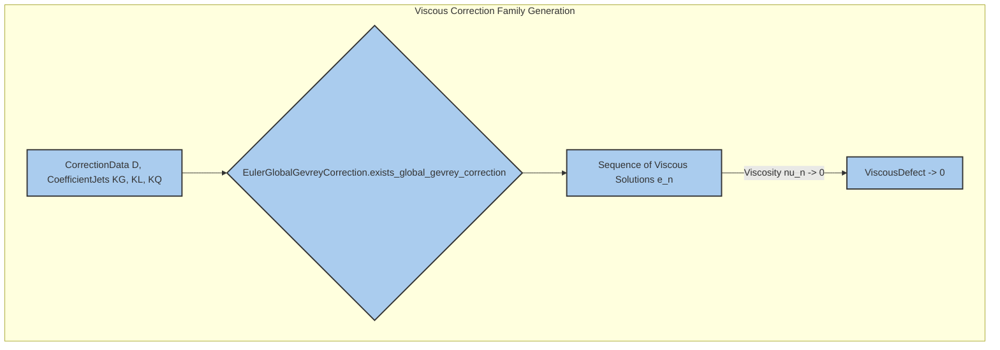
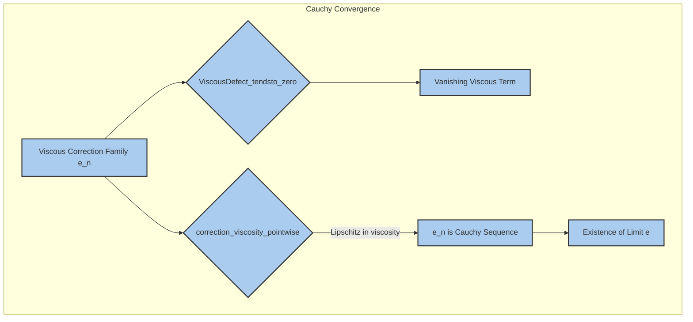

<!-- source: DeepWiki mcp.deepwiki.com · repo openai/NavierStokesAndEuler · page 6.2 Viscosity Limits, Compactness, and Uniqueness · fetched 2026-10-26 -->

# Viscosity Limits, Compactness, and Uniqueness

<details>
<summary>Relevant source files</summary>

The following files were used as context for generating this wiki page:

- [Euler/CorrectionDifferenceMetric.lean](Euler/CorrectionDifferenceMetric.lean)
- [Euler/CorrectionDifferencePDE.lean](Euler/CorrectionDifferencePDE.lean)
- [Euler/CorrectionFamilyCompactness.lean](Euler/CorrectionFamilyCompactness.lean)
- [Euler/CorrectionLimitDerivative.lean](Euler/CorrectionLimitDerivative.lean)
- [Euler/CorrectionLimitEquation.lean](Euler/CorrectionLimitEquation.lean)
- [Euler/CorrectionLimitPathDerivative.lean](Euler/CorrectionLimitPathDerivative.lean)
- [Euler/CorrectionViscosityStability.lean](Euler/CorrectionViscosityStability.lean)
- [Euler/CylinderViscousEnergy.lean](Euler/CylinderViscousEnergy.lean)
- [Euler/DriftGevreyInviscidEnergyCompactness.lean](Euler/DriftGevreyInviscidEnergyCompactness.lean)
- [Euler/DriftGlobalGevreyCorrection.lean](Euler/DriftGlobalGevreyCorrection.lean)
- [Euler/DriftGlobalInviscidGevrey.lean](Euler/DriftGlobalInviscidGevrey.lean)
- [Euler/DriftViscousCorrectionFamily.lean](Euler/DriftViscousCorrectionFamily.lean)
- [Euler/GevreyFamilyCompactness.lean](Euler/GevreyFamilyCompactness.lean)
- [Euler/GevreyInviscidEnergyCompactness.lean](Euler/GevreyInviscidEnergyCompactness.lean)
- [Euler/GlobalGevreyCorrection.lean](Euler/GlobalGevreyCorrection.lean)
- [Euler/GlobalInviscidGevrey.lean](Euler/GlobalInviscidGevrey.lean)
- [Euler/InviscidCorrectionUniqueness.lean](Euler/InviscidCorrectionUniqueness.lean)
- [Euler/SobolevDifferenceEnergy.lean](Euler/SobolevDifferenceEnergy.lean)
- [Euler/SobolevViscousEnergy.lean](Euler/SobolevViscousEnergy.lean)
- [Euler/SquaredMetricStability.lean](Euler/SquaredMetricStability.lean)
- [Euler/ViscosityCauchy.lean](Euler/ViscosityCauchy.lean)
- [Euler/ViscosityDefect.lean](Euler/ViscosityDefect.lean)
- [Euler/ViscousCorrectionFamily.lean](Euler/ViscousCorrectionFamily.lean)
- [Euler/ViscousPathDerivative.lean](Euler/ViscousPathDerivative.lean)
- [Euler/ViscousSourcePathLimit.lean](Euler/ViscousSourcePathLimit.lean)

</details>


This page details the theoretical framework and Lean 4 formalizations for handling viscosity limits, establishing compactness properties of solution families, and proving uniqueness of the resulting inviscid solutions. It covers the construction of viscous correction families, the use of Cauchy and defect arguments to demonstrate convergence, the preservation of Gevrey regularity and energy compactness in the limit, the derivation of limit equations and their derivatives, and finally, the uniqueness of these inviscid corrections.

## Viscous Correction Families

The core idea behind viscous correction families is to approximate an inviscid solution (Euler equations) with a sequence of viscous solutions (Navier-Stokes equations) where the viscosity parameter $\nu$ tends to zero. Each member of this family, denoted `u n` for a viscosity `viscositySequence n`, is a solution to a viscous correction equation.

The existence of such a family is established by `EulerViscousCorrectionFamily.exists_viscous_correction_family` [Euler/ViscousCorrectionFamily.lean:20-55]() (and its drift-aware counterpart `EulerDriftViscousCorrectionFamily.exists_viscous_correction_family` [Euler/DriftViscousCorrectionFamily.lean]()). This theorem asserts that given certain conditions on the `CorrectionData` (D), coefficient jets (`KG`, `KL`, `KQ`), continuity of operators (`hGq`, `hLq`, `hQq`, `hG`), Sobolev regularity (`q`), time interval (`S`), and various budget and metric parameters (`N`, `R`, `B`, `K`, `C`, `Δ`, `ρ0`), there exists a sequence of functions `e : ℕ → C(Icc (0 : ℝ) S, SobolevSpace period (q+1))` such that:
1. Each `e n` is a solution to a quadratic Duhamel equation with viscosity `viscositySequence n` [Euler/ViscousCorrectionFamily.lean:39-41]().
2. Each `e n` starts at zero at `t=0` [Euler/ViscousCorrectionFamily.lean:37]().
3. Each `e n` is divergence-free [Euler/ViscousCorrectionFamily.lean:38]().
4. Each `e n` satisfies quantitative Gevrey energy bounds [Euler/ViscousCorrectionFamily.lean:42-44]().
5. The sequence `e n` is uniformly bounded in a suitable norm [Euler/ViscousCorrectionFamily.lean:45]().

Crucially, this theorem also guarantees that the "viscous defect" of this family tends to zero as `n` approaches infinity [Euler/ViscousCorrectionFamily.lean:45-46](). The `viscousDefect` [Euler/ViscosityDefect.lean]() quantifies the error introduced by the viscosity term.


Sources:
* [Euler/ViscousCorrectionFamily.lean:20-55]()
* [Euler/DriftViscousCorrectionFamily.lean]()
* [Euler/ViscosityDefect.lean]()

## Cauchy and Defect Arguments

The convergence of the viscous correction family to an inviscid limit is established through Cauchy arguments, leveraging the `viscousDefect` and stability estimates. The `viscositySequence` [Euler/ViscosityDefect.lean]() is a sequence of positive real numbers tending to zero, representing the decreasing viscosity.

The `viscousDefect_tendsto_zero` theorem [Euler/ViscosityDefect.lean]() is central here. It states that for a sequence of solutions `e n` to the viscous equation, if the solutions are uniformly bounded, then the term `ν n • jetLaplacian period (toJet period (e n t))` (which represents the viscous term) tends to zero in a suitable norm as `n` goes to infinity. This vanishing viscous term is what allows the limit to satisfy the inviscid Euler equations.

The `correction_viscosity_pointwise` theorem [Euler/CorrectionViscosityStability.lean:24-100]() provides a Lipschitz estimate for the difference between two viscous solutions with different viscosities. This is a crucial stability result:
`‖value period (u t)-value period (v t)‖ ≤ B.comparisonConstant period R*|ν-μ|` [Euler/CorrectionViscosityStability.lean:34]().
This inequality shows that as `ν` and `μ` get closer, the solutions `u` and `v` also get closer, implying that the family `u n` is a Cauchy sequence in the appropriate function space. The `StabilityBudget` (B) and `comparisonConstant` play a key role in quantifying this Lipschitz bound.


Sources:
* [Euler/ViscosityDefect.lean]()
* [Euler/CorrectionViscosityStability.lean:24-100]()

## Gevrey Inviscid Energy Compactness

The `exists_gevrey_inviscid_energy_limit` theorem [Euler/GevreyInviscidEnergyCompactness.lean:28-92]() (and its drift-aware version `EulerDriftGevreyInviscidEnergyCompactness.exists_gevrey_inviscid_energy_limit` [Euler/DriftGevreyInviscidEnergyCompactness.lean:28-92]()) demonstrates that the strong inviscid limit `e` of the viscous correction family retains quantitative Gevrey energy bounds. This is a powerful compactness result, ensuring that the limit solution inherits the regularity properties of the viscous approximations.

The theorem states that given a viscous correction family `u n` (as described above) and its convergence to a limit `e`, the limit `e` satisfies:
1. `e` starts at zero and is divergence-free [Euler/GevreyInviscidEnergyCompactness.lean:53-54]().
2. `e` is uniformly bounded [Euler/GevreyInviscidEnergyCompactness.lean:55]().
3. `e` satisfies Gevrey energy bounds for all relevant Sobolev orders `P` [Euler/GevreyInviscidEnergyCompactness.lean:56-59](). These bounds are derived from the bounds on the viscous family `u n` using `energyNorm_path_limit_bound` [Euler/GevreyInviscidEnergyCompactness.lean:88-92]().

This compactness is crucial for ensuring that the limit solution is well-behaved and physically meaningful.

Sources:
* [Euler/GevreyInviscidEnergyCompactness.lean:28-92]()
* [Euler/DriftGevreyInviscidEnergyCompactness.lean:28-92]()

## Limit Equations and Derivatives

Once the existence and compactness of the inviscid limit `e` are established, the next step is to show that `e` indeed solves the inviscid Euler correction equation. This is achieved by passing to the limit in the viscous Duhamel equation that each `u n` satisfies.

The `correction_limit_equation` theorem [Euler/CorrectionLimitEquation.lean:34-74]() proves that the limit `e` satisfies the inviscid correction equation in a strong sense, specifically, its time derivative exists and equals the inviscid source term.
The proof involves:
1. Showing that the `viscousSourcePath` (which includes the viscous term) converges to the `sourcePath` (the inviscid source) [Euler/CorrectionLimitEquation.lean:57-58](). This relies on `viscousSourcePath_tendsto` [Euler/CorrectionLimitEquation.lean:58]().
2. Using `integral_equation_limit` [Euler/CorrectionLimitEquation.lean:67-68]() to pass the integral form of the Duhamel equation to the limit.
3. Applying `hasDerivAt_of_integral_equation` [Euler/CorrectionLimitEquation.lean:69]() to conclude that the limit `e` has a derivative that matches the inviscid source term.

The `exists_global_inviscid_gevrey_PDE` theorem [Euler/GlobalInviscidGevrey.lean:20-68]() (and its drift-aware version `EulerDriftGlobalInviscidGevrey.exists_global_inviscid_gevrey_PDE` [Euler/DriftGlobalInviscidGevrey.lean:20-69]()) then combines the Gevrey compactness with the limit equation result to show that the global inviscid correction `e` satisfies the PDE and retains quantitative energy bounds. It also establishes the existence of the literal signed-pressure derivative in Hq.

```mermaid
graph TD
    subgraph "Deriving Limit Equation"
        A[Viscous Solutions u_n] --> B{correction_limit_equation};
        B -- "Passage to limit in Duhamel equation" --> C[Limit e satisfies inviscid correction equation];
        C --> D[HasDerivAt (value e) = inviscid source];
        E[Gevrey Inviscid Energy Compactness] --> F{exists_global_inviscid_gevrey_PDE};
        F --> G[Global inviscid correction e with Gevrey bounds and PDE satisfaction];
    end
    style A fill:#ace,stroke:#333,stroke-width:2px
    style B fill:#ace,stroke:#333,stroke-width:2px
    style C fill:#ace,stroke:#333,stroke-width:2px
    style D fill:#ace,stroke:#333,stroke-width:2px
    style E fill:#ace,stroke:#333,stroke-width:2px
    style F fill:#ace,stroke:#333,stroke-width:2px
    style G fill:#ace,stroke:#333,stroke-width:2px
```
Sources:
* [Euler/CorrectionLimitEquation.lean:34-74]()
* [Euler/GlobalInviscidGevrey.lean:20-68]()
* [Euler/DriftGlobalInviscidGevrey.lean:20-69]()

## Correction Uniqueness

The uniqueness of the inviscid correction is established by `inviscid_correction_unique` [Euler/InviscidCorrectionUniqueness.lean:25-100](). This theorem proves that if two inviscid corrections `u` and `v` have the same initial data and satisfy the same inviscid correction equation, then they must be identical.

The proof strategy involves:
1. Defining a "difference energy" `E s := ⟪K s (e s),e s⟫_ℝ` [Euler/InviscidCorrectionUniqueness.lean:42](), where `e` is the difference `u-v` and `K` is a metric operator.
2. Showing that this difference energy starts at zero (`E 0 ≤ 0`) due to identical initial data [Euler/InviscidCorrectionUniqueness.lean:55-57]().
3. Deriving a differential inequality for `E` using `inviscid_difference_hasDerivAt` [Euler/InviscidDifferencePDE.lean]() and `difference_metric_deriv_bound` [Euler/CorrectionDifferenceMetric.lean:25-118](). This inequality takes the form `deriv E t ≤ B.growth period R*E t` [Euler/InviscidCorrectionUniqueness.lean:69-70]().
4. Applying a linear growth bound (`linear_growth_bound`) to conclude that `E t ≤ 0` for all `t` [Euler/InviscidCorrectionUniqueness.lean:82-83]().
5. Since `E` is a squared energy, `E t ≤ 0` combined with its non-negativity (due to the coercivity of `K` [Euler/InviscidCorrectionUniqueness.lean:85-88]()) implies `E t = 0`.
6. The coercivity of `K` then implies that the difference `e t` must be zero, hence `u = v` [Euler/InviscidCorrectionUniqueness.lean:93-99]().

```mermaid
graph TD
    subgraph "Inviscid Correction Uniqueness"
        A[Two inviscid solutions u, v] --> B{Same initial data};
        A --> C{Satisfy same inviscid correction equation};
        D[Define difference e = u - v] --> E[Define difference energy E = <K e, e>];
        B --> F[E(0) = 0];
        C --> G{Derive differential inequality for E};
        G -- "inviscid_difference_hasDerivAt, difference_metric_deriv_bound" --> H[deriv E <= Growth * E];
        F, H --> I{linear_growth_bound};
        I --> J[E(t) = 0 for all t];
        J -- "Coercivity of K" --> K[e(t) = 0 for all t];
        K --> L[u = v (Uniqueness)];
    end
    style A fill:#ace,stroke:#333,stroke-width:2px
    style B fill:#ace,stroke:#333,stroke-width:2px
    style C fill:#ace,stroke:#333,stroke-width:2px
    style D fill:#ace,stroke:#333,stroke-width:2px
    style E fill:#ace,stroke:#333,stroke-width:2px
    style F fill:#ace,stroke:#333,stroke-width:2px
    style G fill:#ace,stroke:#333,stroke-width:2px
    style H fill:#ace,stroke:#333,stroke-width:2px
    style I fill:#ace,stroke:#333,stroke-width:2px
    style J fill:#ace,stroke:#333,stroke-width:2px
    style K fill:#ace,stroke:#333,stroke-width:2px
    style L fill:#ace,stroke:#333,stroke-width:2px
```
Sources:
* [Euler/InviscidCorrectionUniqueness.lean:25-100]()
* [Euler/InviscidDifferencePDE.lean]()
* [Euler/CorrectionDifferenceMetric.lean:25-118]()

---

