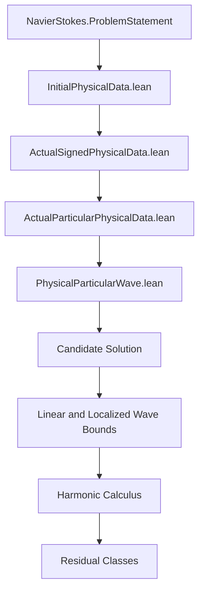
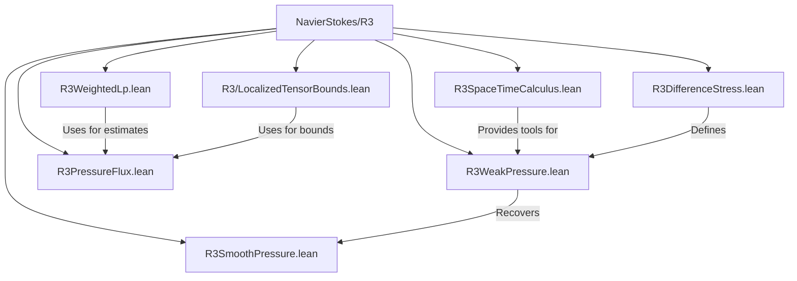

<!-- source: DeepWiki mcp.deepwiki.com · repo openai/NavierStokesAndEuler · page 7 NavierStokes Library · fetched 2026-10-26 -->

# NavierStokes Library

Relevant source files

The following files were used as context for generating this wiki page:

- [NavierStokes/ActualParticularPhysicalData.lean](NavierStokes/ActualParticularPhysicalData.lean)
- [NavierStokes/ActualSignedPhysicalData.lean](NavierStokes/ActualSignedPhysicalData.lean)
- [NavierStokes/InitialPhysicalData.lean](NavierStokes/InitialPhysicalData.lean)
- [NavierStokes/PhysicalParticularWave.lean](NavierStokes/PhysicalParticularWave.lean)
- [NavierStokes/R3/LocalizedTensorBounds.lean](NavierStokes/R3/LocalizedTensorBounds.lean)
- [NavierStokes/R3DifferenceStress.lean](NavierStokes/R3DifferenceStress.lean)
- [NavierStokes/R3PressureFlux.lean](NavierStokes/R3PressureFlux.lean)
- [NavierStokes/R3SmoothPressure.lean](NavierStokes/R3SmoothPressure.lean)
- [NavierStokes/R3SpaceTimeCalculus.lean](NavierStokes/R3SpaceTimeCalculus.lean)
- [NavierStokes/R3WeakPressure.lean](NavierStokes/R3WeakPressure.lean)
- [NavierStokes/R3WeightedLp.lean](NavierStokes/R3WeightedLp.lean)

This page provides a high-level overview of the `NavierStokes/` library, which formalizes finite-time breakdown results for the 3D Navier–Stokes equations. It covers the problem statements, the construction of a forced candidate solution, and the whole-space analysis in R3. For detailed technical information, please refer to the linked child pages.

## Problem Statements and Comparator Theorems

This section introduces the formal problem statements for the Navier–Stokes equations, including the `NavierStokes.ProblemStatement` [NavierStokes/ProblemStatement.lean]() and the `R3 breakdownStatement` [NavierStokes/R3/ProblemStatement.lean](). It also discusses the `ComparatorBridge/Theorem` [ComparatorChallenges/NavierStokes.lean]() which connects the formalization to the external challenge harness. Key topics include the rescaling of forces and the exclusion of global solutions to establish maximal lifespan.

For details, see [Problem Statements and Comparator Theorems](#7.1).

## Candidate Construction: Physical Data and Waves

This section describes the construction of the candidate solution, focusing on the `Actual*`, `Signed*`, and `Wave*` families of definitions. This involves defining initial and signed physical data, constructing particular waves, and assembling them through cycles and stages. It also covers linear and localized wave bounds, harmonic calculus, and the classification of residual classes.

The construction relies on several key components:
- `NavierStokes.ActualSignedPhysicalData`: Defines the physical data for the actual native signed copies [NavierStokes/ActualSignedPhysicalData.lean]().
- `NavierStokes.InitialPhysicalData`: Describes the actual initial primary potential and its physical copies [NavierStokes/InitialPhysicalData.lean]().
- `NavierStokes.ActualParticularPhysicalData`: Provides physical copy data for the actual particular reference solve [NavierStokes/ActualParticularPhysicalData.lean]().
- `NavierStokes.PhysicalParticularWave`: Details the actual reference particular waves in physical coordinates [NavierStokes/PhysicalParticularWave.lean]().

**Candidate Construction Flow**

Sources:
- [NavierStokes/ActualSignedPhysicalData.lean]()
- [NavierStokes/InitialPhysicalData.lean]()
- [NavierStokes/ActualParticularPhysicalData.lean]()
- [NavierStokes/PhysicalParticularWave.lean]()

For details, see [Candidate Construction: Physical Data and Waves](#7.2).

## Axis, Similarity, and Transport Machinery

This section outlines the machinery used for handling axisymmetric fields and residuals. It covers axis holomorphic/resolvent series, similarity coordinates and profiles, Volterra/ODE systems, and transport primitives with parametric integrals. This machinery is crucial for simplifying and analyzing the complex behavior of the Navier–Stokes equations.

For details, see [Axis, Similarity, and Transport Machinery](#7.3).

## R3 Whole-Space Analysis

This section focuses on the `NavierStokes/R3` analysis, which deals with the whole-space problem. It includes estimates derived from the heat kernel and Riesz operators, methods for pressure recovery, and flux identities. The analysis also employs weighted Sobolev/Lp tools, localized energy limits, and techniques for establishing whole-space uniqueness and comparison closure.

Key components of the R3 analysis include:
- `NavierStokes.R3WeakPressure`: Focuses on recovering the physical pressure gradient [NavierStokes/R3WeakPressure.lean]().
- `NavierStokes.R3SmoothPressure`: Provides the smooth momentum equation for pressure representation [NavierStokes/R3SmoothPressure.lean]().
- `NavierStokes.R3SpaceTimeCalculus`: Defines real fields in the complex space-time pressure calculation [NavierStokes/R3SpaceTimeCalculus.lean]().
- `NavierStokes.R3DifferenceStress`: Deals with the actual difference stress and pressure equation [NavierStokes/R3DifferenceStress.lean]().
- `NavierStokes.R3WeightedLp`: Implements weighted interpolation for pressure and transport terms [NavierStokes/R3WeightedLp.lean]().
- `NavierStokes.R3PressureFlux`: Provides flux bounds for physical Gaussian pressure approximations [NavierStokes/R3PressureFlux.lean]().
- `NavierStokes.R3.LocalizedTensorBounds`: Contains weighted tensor bounds for the localized pressure [NavierStokes/R3/LocalizedTensorBounds.lean]().

**R3 Whole-Space Analysis Components**

Sources:
- [NavierStokes/R3WeakPressure.lean]()
- [NavierStokes/R3SmoothPressure.lean]()
- [NavierStokes/R3SpaceTimeCalculus.lean]()
- [NavierStokes/R3DifferenceStress.lean]()
- [NavierStokes/R3WeightedLp.lean]()
- [NavierStokes/R3PressureFlux.lean]()
- [NavierStokes/R3/LocalizedTensorBounds.lean]()

For details, see [R3 Whole-Space Analysis](#7.4).

---

