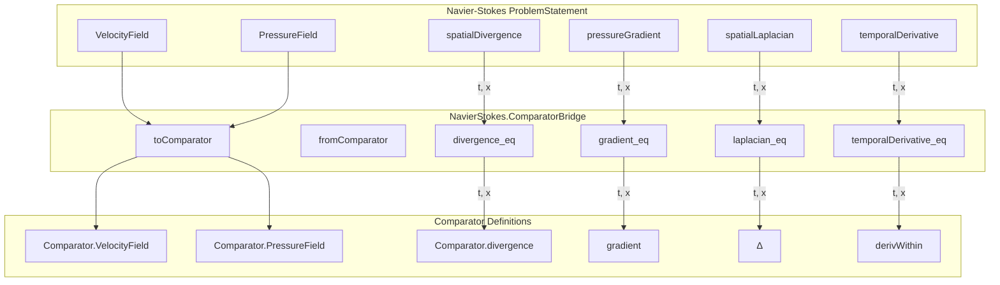

<!-- source: DeepWiki mcp.deepwiki.com · repo openai/NavierStokesAndEuler · page 7.1 Problem Statements and Comparator Theorems · fetched 2026-10-26 -->

# Problem Statements and Comparator Theorems

<details>
<summary>Relevant source files</summary>

The following files were used as context for generating this wiki page:

- [Euler/ClassicalBridge.lean](Euler/ClassicalBridge.lean)
- [Euler/ComparatorTimeShift.lean](Euler/ComparatorTimeShift.lean)
- [Euler/EulerSpatialRescaling.lean](Euler/EulerSpatialRescaling.lean)
- [Euler/EulerTimeRescaling.lean](Euler/EulerTimeRescaling.lean)
- [Euler/EvolutionTimeShift.lean](Euler/EvolutionTimeShift.lean)
- [Euler/OrdinaryEulerRescaling.lean](Euler/OrdinaryEulerRescaling.lean)
- [Euler/OrdinaryEulerRestriction.lean](Euler/OrdinaryEulerRestriction.lean)
- [Euler/OrdinaryEulerUniqueness.lean](Euler/OrdinaryEulerUniqueness.lean)
- [NavierStokes/CompactForceDecay.lean](NavierStokes/CompactForceDecay.lean)
- [NavierStokes/CompactSpatialForceDecay.lean](NavierStokes/CompactSpatialForceDecay.lean)
- [NavierStokes/ComparatorBridge.lean](NavierStokes/ComparatorBridge.lean)
- [NavierStokes/ComparatorR3Bridge.lean](NavierStokes/ComparatorR3Bridge.lean)
- [NavierStokes/R3/LocalizedTensorBounds.lean](NavierStokes/R3/LocalizedTensorBounds.lean)
- [NavierStokes/R3DifferenceStress.lean](NavierStokes/R3DifferenceStress.lean)
- [NavierStokes/R3PressureFlux.lean](NavierStokes/R3PressureFlux.lean)
- [NavierStokes/R3SmoothPressure.lean](NavierStokes/R3SmoothPressure.lean)
- [NavierStokes/R3SpaceTimeCalculus.lean](NavierStokes/R3SpaceTimeCalculus.lean)
- [NavierStokes/R3WeakPressure.lean](NavierStokes/R3WeakPressure.lean)
- [NavierStokes/R3WeightedLp.lean](NavierStokes/R3WeightedLp.lean)

</details>


This page details the problem statements for the Navier-Stokes equations, particularly focusing on the R3 breakdown statement, and how these statements are bridged to the `Comparator` framework. It also covers the rescaling of forces and the exclusion of global solutions based on maximal lifespan.

## NavierStokes.ProblemStatement and R3 Breakdown Statement

The core problem statements for the Navier-Stokes equations are defined within the `NavierStokes.ProblemStatement` namespace. These definitions establish the mathematical framework for velocity and pressure fields, their regularity requirements, and the equations they must satisfy.

The `NavierStokes.ProblemStatement` defines types such as `VelocityField` and `PressureField` [NavierStokes/ProblemStatement.lean](). It also specifies the fundamental differential operators:
* `spatialDivergence` [NavierStokes/ProblemStatement.lean:28-31]()
* `pressureGradient` [NavierStokes/ProblemStatement.lean:33-36]()
* `spatialLaplacian` [NavierStokes/ProblemStatement.lean:38-41]()
* `temporalDerivative` [NavierStokes/ProblemStatement.lean:43-46]()
* `advection` [NavierStokes/ProblemStatement.lean:48-51]()
* `navierStokesResidual` [NavierStokes/ProblemStatement.lean:53-57]()

These operators are used to formulate the Navier-Stokes equations. A solution `(u, p)` is considered valid if `navierStokesResidual u p t x = 0` for all `t, x` and `spatialDivergence u t x = 0`.

The R3 breakdown statement, specifically for the whole-space analysis, is implicitly built upon these foundational definitions. The `NavierStokes/R3WeakPressure.lean` and `NavierStokes/R3DifferenceStress.lean` files, for instance, delve into the properties of pressure and stress tensors in R3, which are crucial for proving breakdown results.

The `NavierStokes.R3WeakPressure` module focuses on recovering the physical pressure gradient [NavierStokes/R3WeakPressure.lean:7-12](). It defines `Represents` for tempered distributions [NavierStokes/R3WeakPressure.lean:21-24]() and provides theorems for their properties, such as `Represents.lineDeriv` [NavierStokes/R3WeakPressure.lean:63-68]() and `Represents.spatialLaplacian` [NavierStokes/R3WeakPressure.lean:63-68](). These are essential for working with weak solutions and distributions in the R3 setting.

The `NavierStokes.R3DifferenceStress` module defines the `stress` tensor [NavierStokes/R3DifferenceStress.lean:15-16]() and its divergence [NavierStokes/R3DifferenceStress.lean:71-98](), which are critical components in the momentum equation when analyzing differences between solutions. The `momentum_equation` theorem [NavierStokes/R3DifferenceStress.lean:101-144]() shows how the difference in Navier-Stokes residuals relates to the pressure gradient.

Sources:
* [NavierStokes/ProblemStatement.lean]()
* [NavierStokes/R3WeakPressure.lean]()
* [NavierStokes/R3DifferenceStress.lean]()

## ComparatorBridge and ComparatorTheorem

The `ComparatorBridge` module in `NavierStokes/ComparatorBridge.lean` is responsible for translating the project's internal definitions of differential operators and fields to the format expected by the `Comparator` framework. This is crucial for verifying the formalizations against external challenge specifications.

The `toComparator` and `fromComparator` functions [NavierStokes/ComparatorBridge.lean:21-26]() handle the argument order conversion between `(time, space)` and `(space, time)`.
The module provides theorems to equate the project's operators with the `Comparator`'s:
* `divergence_eq` [NavierStokes/ComparatorBridge.lean:28-32]()
* `gradient_eq` [NavierStokes/ComparatorBridge.lean:34-38]()
* `laplacian_eq` [NavierStokes/ComparatorBridge.lean:40-54]()
* `temporalDerivative_eq` [NavierStokes/ComparatorBridge.lean:56-59]()

These theorems ensure that the mathematical properties of the operators are preserved during the translation.

### Diagram: Bridging Navier-Stokes Operators to Comparator


Sources:
* [NavierStokes/ComparatorBridge.lean:21-59]()
* [NavierStokes/ProblemStatement.lean]()

## Rescaling of Forces

The `rescale` function [NavierStokes/ComparatorBridge.lean:61-62]() in `NavierStokes.ComparatorBridge` allows for scaling both the amplitude and time of a spacetime field. This is particularly relevant for the `rescaledForce` [NavierStokes/ComparatorBridge.lean:65]() definition, which scales a force field based on viscosity `ν`.

```lean
def rescale {V : Type*} [SMul ℝ V] (a c : ℝ) (f : SpaceTime → V) : SpaceTime → V :=
  fun z => a • f (c * z.1, z.2)
```
[NavierStokes/ComparatorBridge.lean:61-62]()

The `rescale_smooth` [NavierStokes/ComparatorBridge.lean:67-72](), `rescale_periodic` [NavierStokes/ComparatorBridge.lean:74-77](), and `rescale_support` [NavierStokes/ComparatorBridge.lean:79-84]() theorems demonstrate that these rescaling operations preserve important properties like smoothness, periodicity, and compact future time support.

Similar rescaling concepts are also present in the Euler library:
* `EulerSpatialRescaling.velocity` [Euler/EulerSpatialRescaling.lean:21-22]() and `EulerSpatialRescaling.pressure` [Euler/EulerSpatialRescaling.lean:24-25]() define how velocity and pressure fields are rescaled spatially.
* `EulerTimeRescaling.velocity` [Euler/EulerTimeRescaling.lean:21-22]() and `EulerTimeRescaling.pressure` [Euler/EulerTimeRescaling.lean:24-25]() define how velocity and pressure fields are rescaled temporally.

These rescaling operations are crucial for constructing self-similar solutions or for analyzing the behavior of solutions under different scales. For instance, `EulerSpatialRescaling.momentumResidual_zero` [Euler/EulerSpatialRescaling.lean:67-69]() shows that if the original fields satisfy the Euler equations, their spatially rescaled counterparts also do. Similarly, `EulerTimeRescaling.momentumResidual_zero` [Euler/EulerTimeRescaling.lean:60-65]() demonstrates this for temporal rescaling.

Sources:
* [NavierStokes/ComparatorBridge.lean:61-84]()
* [Euler/EulerSpatialRescaling.lean:21-69]()
* [Euler/EulerTimeRescaling.lean:21-65]()

## Maximal Lifespan Exclusion of Global Solutions

The concept of "maximal lifespan exclusion of global solutions" refers to proving that certain solutions to the Navier-Stokes or Euler equations cannot exist for all time (i.e., they "blow up" in finite time). This is a central theme in the study of these PDEs.

For the Euler equations, the `Euler.OrdinaryEulerRescaling.Evolution.rescale` function [Euler/OrdinaryEulerRescaling.lean:29-75]() demonstrates how an existing evolution can be rescaled in time and amplitude. This self-similarity is a key property exploited in blow-up constructions. The `Euler.EvolutionTimeShift.Evolution.shiftTime` function [Euler/EvolutionTimeShift.lean:28-51]() allows for shifting an evolution in time, which is useful for concatenating solutions or analyzing their behavior over different time intervals.

The `NavierStokes.CompactForceDecay` module provides tools to analyze the decay properties of forces. The `iteratedFDeriv_decay` theorem [NavierStokes/CompactForceDecay.lean:138-164]() states that for a smooth, periodic force with compact future time support, all its iterated derivatives exhibit arbitrary polynomial decay. This is important for controlling the behavior of forcing terms in the equations.

```lean
theorem iteratedFDeriv_decay (f : VelocityField)
    (hf : ContDiff ℝ ∞ f) (hper : UnitSpatialPeriodsOn univ f)
    (hsupport : CompactFutureTimeSupport f) (m : ℕ) (K : ℝ) (hK : 0 ≤ K) :
    ∃ C : ℝ, 0 < C ∧ ∀ t : ℝ, 0 ≤ t → ∀ x : Space,
      ‖iteratedFDeriv ℝ m f (t, x)‖ ≤ C * (1 + t) ^ (-K) := by
  -- ... proof details ...
```
[NavierStokes/CompactForceDecay.lean:138-143]()

This decay property is crucial for establishing bounds and proving the non-existence of global smooth solutions, as a blow-up often manifests as a growth in some norm that contradicts such decay. The `NavierStokes.R3WeightedLp` module, for example, provides weighted interpolation estimates [NavierStokes/R3WeightedLp.lean:11-12]() that are used to control norms of terms in the energy equations, which are fundamental to proving blow-up.

Sources:
* [Euler/EvolutionTimeShift.lean:28-51]()
* [Euler/OrdinaryEulerRescaling.lean:29-75]()
* [NavierStokes/CompactForceDecay.lean:138-164]()
* [NavierStokes/R3WeightedLp.lean:11-12]()

---

