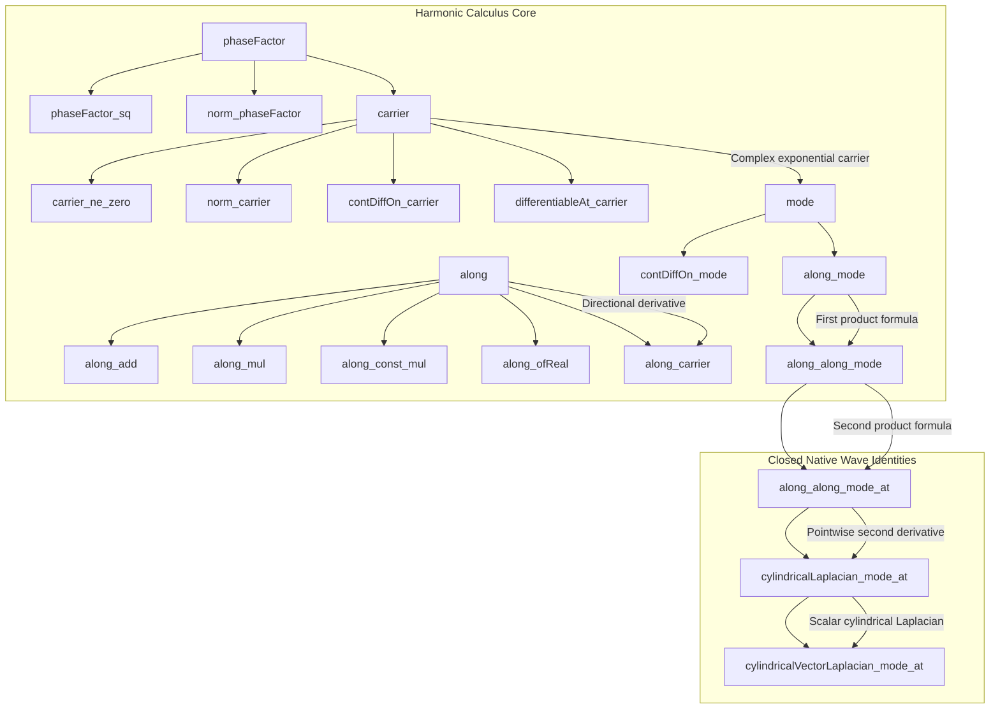

<!-- source: DeepWiki mcp.deepwiki.com · repo openai/NavierStokesAndEuler · page 7.2 Candidate Construction: Physical Data and Waves · fetched 2026-10-26 -->

# Candidate Construction: Physical Data and Waves

Relevant source files

The following files were used as context for generating this wiki page:

- [NavierStokes/ActualParticularPhysicalData.lean](NavierStokes/ActualParticularPhysicalData.lean)
- [NavierStokes/ActualSignedPhysicalData.lean](NavierStokes/ActualSignedPhysicalData.lean)
- [NavierStokes/ClosedNativeWaveIdentities.lean](NavierStokes/ClosedNativeWaveIdentities.lean)
- [NavierStokes/HarmonicCalculus.lean](NavierStokes/HarmonicCalculus.lean)
- [NavierStokes/InitialPhysicalData.lean](NavierStokes/InitialPhysicalData.lean)
- [NavierStokes/LinearWaveBounds.lean](NavierStokes/LinearWaveBounds.lean)
- [NavierStokes/LocalizedWaveBounds.lean](NavierStokes/LocalizedWaveBounds.lean)
- [NavierStokes/PhysicalParticularWave.lean](NavierStokes/PhysicalParticularWave.lean)
- [NavierStokes/PrimaryResidualClass.lean](NavierStokes/PrimaryResidualClass.lean)

This page details the construction of physical data and waves within the Navier-Stokes library. It focuses on the `Actual*`, `Signed*`, and `Wave*` families of structures and functions, which are crucial for defining initial and signed physical data, particular waves, and their assembly into cycles and stages. The scope includes linear and localized wave bounds, harmonic calculus, and residual classes, providing a foundational understanding of how wave-like solutions are represented and manipulated in the codebase.

## Actual and Signed Physical Data

The `NavierStokes.ActualSignedPhysicalData` namespace [NavierStokes/ActualSignedPhysicalData.lean:17-18]() defines the physical data for the "actual native signed copies." This involves repartitioning auxiliary cutoffs and using the midpoint of lattice-translated slots for the physical carrier.

### Repartitioning of Wave Coefficients

The `repartition_amplitude` [NavierStokes/ActualSignedPhysicalData.lean:39-43]() and `repartition_pressure` [NavierStokes/ActualSignedPhysicalData.lean:45-49]() theorems demonstrate that moving a scalar cutoff from the raw signed mask to the final cutoff preserves both the amplitude and pressure coefficients before differentiation. This is formalized by `coefficients_repartition` [NavierStokes/ActualSignedPhysicalData.lean:61-78]().

The `coefficients_outer` [NavierStokes/ActualSignedPhysicalData.lean:81-92]() theorem shows that if an outer bump (e.g., `PrimaryCopyBounds.outerCutoff`) is one on the Gaussian support, it can be removed from the raw mask without altering the once-cutoff signed wave. This property is extended to corrected coefficients via `corrected_outer` [NavierStokes/ActualSignedPhysicalData.lean:94-100]().

### Copy Data Equality

The `common_eq_of_localized` [NavierStokes/ActualSignedPhysicalData.lean:110-125]() theorem establishes that if the background and all localized copies are equal between two `PeriodizedWaveBounds.CopyData` structures, then their common coefficients (amplitude and pressure) are also equal. This is important for verifying the consistency of wave constructions. This equality extends to corrected common coefficients through `commonCorrected_eq_of_localized` [NavierStokes/ActualSignedPhysicalData.lean:127-132]().

### Geometry of Signed Waves

The `geometry` [NavierStokes/ActualSignedPhysicalData.lean:140-141]() and `center` [NavierStokes/ActualSignedPhysicalData.lean:144-145]() definitions specify the geometric aspects of the signed waves. The `geometry` is derived from a `PartitionedCovariance.SlotSystem`, while the `center` represents the midpoint of the physical slot, including lattice translation.

Sources:
* [NavierStokes/ActualSignedPhysicalData.lean:1-145]()

## Initial Physical Data

The `NavierStokes.InitialPhysicalData` namespace [NavierStokes/InitialPhysicalData.lean:22-23]() defines the actual initial primary potential and its physical copies. This involves applying the normal-potential operator to the actual cutoff amplitude, with estimates derived from existing support-local primitive controls.

### Native Potential

The `potentialCoefficient` [NavierStokes/InitialPhysicalData.lean:41-45]() function computes the coefficient of the genuine vector potential. It uses `CurlClassBounds.inverseCarrier` and `CurlClassBounds.normalCoefficient`. The `potentialCoefficient_zero` [NavierStokes/InitialPhysicalData.lean:47-52]() and `potentialCoefficient_zero_germ` [NavierStokes/InitialPhysicalData.lean:54-58]() theorems ensure that if the amplitude is zero, the potential coefficient is also zero.

The `potentialCoefficient_local` [NavierStokes/InitialPhysicalData.lean:60-85]() theorem asserts that the potential coefficient satisfies the `LocalizedWaveBounds.LocalWave` property, indicating local regularity. `potentialCoefficient_uniform` [NavierStokes/InitialPhysicalData.lean:88-102]() extends this to `LabelSumBounds.UniformWaveClass`, ensuring uniformity across the signed label family.

### Germ Bounds

The `uniform_of_germ_or_zero` [NavierStokes/InitialPhysicalData.lean:114-134]() theorem is crucial for establishing uniform class properties. It states that if a function `g0` is locally equal to either `f0` (which is a `LabelSumBounds.UniformClass`) or zero, then `g0` itself belongs to the same uniform class. This is used to propagate regularity and bounds.

### Native Copies

The `copyAmplitude` [NavierStokes/InitialPhysicalData.lean:141-144](), `copyPressureCoefficient` [NavierStokes/InitialPhysicalData.lean:146-149](), and `copyPotentialCoefficient` [NavierStokes/InitialPhysicalData.lean:151-155]() functions define the amplitude, pressure, and potential coefficients for individual localized copies. The `copyAmplitude_germ` [NavierStokes/InitialPhysicalData.lean:157-160]() theorem describes the local behavior of `copyAmplitude`.

Sources:
* [NavierStokes/InitialPhysicalData.lean:1-160]()

## Particular Waves

The `NavierStokes.ActualParticularPhysicalData` namespace [NavierStokes/ActualParticularPhysicalData.lean:22-23]() handles the physical copy data for the actual particular reference solve. This involves Volterra copy solves with a selected reference tangent, interval, and cutoff.

### Common Amplitude and Pressure

The `copyAmplitude` [NavierStokes/ActualParticularPhysicalData.lean:37-41]() and `copyPressure` [NavierStokes/ActualParticularPhysicalData.lean:43-47]() functions define the amplitude and pressure for individual copies. These are then summed to form the `commonAmplitude` [NavierStokes/ActualParticularPhysicalData.lean:49-52]() and `commonPressure` [NavierStokes/ActualParticularPhysicalData.lean:54-57]() for a given assembly data `D` and source `f`. The equality between the common fields and the sum of copy fields is established by `commonAmplitude_eq_sum` [NavierStokes/ActualParticularPhysicalData.lean:59-60]() and `commonPressure_eq_sum` [NavierStokes/ActualParticularPhysicalData.lean:62-63]().

The `finite_copies` [NavierStokes/ActualParticularPhysicalData.lean:65-69]() theorem states that for any point, only a finite number of copies contribute to the amplitude and pressure, implying summability (`amplitude_summable` [NavierStokes/ActualParticularPhysicalData.lean:71-74]() and `pressure_summable` [NavierStokes/ActualParticularPhysicalData.lean:76-79]()). The `copyAmplitude_ne_zero_source` [NavierStokes/ActualParticularPhysicalData.lean:81-87]() and `copyPressure_ne_zero_source` [NavierStokes/ActualParticularPhysicalData.lean:89-98]() theorems link non-zero copy values back to non-zero source values.

### Potential and Potential Mode

The `normal` [NavierStokes/ActualParticularPhysicalData.lean:100-101]() function defines the normal vector for a given wave. The `potentialMap` [NavierStokes/ActualParticularPhysicalData.lean:103-106]() is a linear map that transforms a `ComplexVector` into a potential, using `CurlClassBounds.inverseCarrier` and `CurlClassBounds.complexCrossLinear`. This map is applied to individual copy amplitudes to get `copyPotential` [NavierStokes/ActualParticularPhysicalData.lean:111-113]() and to the common amplitude to get `potential` [NavierStokes/ActualParticularPhysicalData.lean:115-117](). The `potential_eq_sum` [NavierStokes/ActualParticularPhysicalData.lean:119-122]() theorem confirms that the total potential is the sum of copy potentials.

The `copyPotentialMode` [NavierStokes/ActualParticularPhysicalData.lean:125-127]() and `potentialMode` [NavierStokes/ActualParticularPhysicalData.lean:129-131]() functions introduce the concept of a "mode" by multiplying the potential with a `carrier` (a complex harmonic). Again, the total potential mode is the sum of copy potential modes (`potentialMode_eq_sum` [NavierStokes/ActualParticularPhysicalData.lean:133-136]()), and these are summable (`copyPotentialMode_summable` [NavierStokes/ActualParticularPhysicalData.lean:138-143]()).

Sources:
* [NavierStokes/ActualParticularPhysicalData.lean:1-143]()

## Cycle/Stage Assembly: Physical Particular Waves

The `NavierStokes.PhysicalParticularWave` namespace [NavierStokes/PhysicalParticularWave.lean:14-15]() describes the actual reference particular waves in physical coordinates. It uses the constructed reference Volterra solve, where curl identities are conclusions rather than assumptions.

### Raw Common Coefficients

The `rawCommon` [NavierStokes/PhysicalParticularWave.lean:25-28]() function defines the raw common wave coefficients, which are then used to derive `commonPotential` [NavierStokes/PhysicalParticularWave.lean:30-32]() and `commonPressure` [NavierStokes/PhysicalParticularWave.lean:34-36]().

The `commonRaw_germ` [NavierStokes/PhysicalParticularWave.lean:45-53]() and `commonRaw_smooth` [NavierStokes/PhysicalParticularWave.lean:55-60]() theorems establish the local behavior and smoothness of the raw common amplitude. `commonRaw_tangent` [NavierStokes/PhysicalParticularWave.lean:62-78]() proves that the normal dot product of the normal vector and the amplitude is zero, which is a key property for solenoidal fields.

### Potential and Pressure Properties

The `commonPotential_smooth` [NavierStokes/PhysicalParticularWave.lean:80-84]() theorem asserts the smoothness of the common potential. `commonPotential_curl` [NavierStokes/PhysicalParticularWave.lean:86-94]() proves that the cylindrical curl of the common potential equals the vector mode of the wave, confirming its construction.

The `commonPotential_fullTurn` [NavierStokes/PhysicalParticularWave.lean:96-116]() and `commonPressure_fullTurn` [NavierStokes/PhysicalParticularWave.lean:118-137]() theorems demonstrate that both the common potential and pressure are invariant under a full angular turn, reflecting the cylindrical symmetry of the problem.

Sources:
* [NavierStokes/PhysicalParticularWave.lean:1-137]()

## Linear and Localized Wave Bounds

The `NavierStokes.LinearWaveBounds` namespace [NavierStokes/LinearWaveBounds.lean:15-16]() provides weighted bounds for the actual linear wave remainder. It explicitly handles radial graph differentiation, axial rescaling, and the fast direction.

### Class Operations

The `MemClass` structure represents a class of functions with certain smoothness and boundedness properties. `class_congr` [NavierStokes/LinearWaveBounds.lean:26-40]() allows for congruence of classes if functions are equal on the domain. `class_neg` [NavierStokes/LinearWaveBounds.lean:42-44]() and `class_sub` [NavierStokes/LinearWaveBounds.lean:46-49]() show that negation and subtraction preserve class membership.

`unweighted_mul` [NavierStokes/LinearWaveBounds.lean:51-54]() and `unweighted_smul` [NavierStokes/LinearWaveBounds.lean:56-59]() define multiplication and scalar multiplication for `UnweightedClass` and `MemClass`. `real_mul_complex` [NavierStokes/LinearWaveBounds.lean:61-64]() and `complex_mul_real` [NavierStokes/LinearWaveBounds.lean:66-69]() handle mixed-type multiplications. `constant_complex_mul` [NavierStokes/LinearWaveBounds.lean:71-74]() and `constant_real_mul` [NavierStokes/LinearWaveBounds.lean:76-80]() deal with constant multiplications.

`band_epsilon` [NavierStokes/LinearWaveBounds.lean:82-83]() provides a band bound for the epsilon function. `mean_unweighted` [NavierStokes/LinearWaveBounds.lean:85-88]() converts a `MeanClass` to an `UnweightedClass` under certain conditions.

### Graph Directions

The `GraphDirections` [NavierStokes/LinearWaveBounds.lean:93-103]() structure encapsulates various directional vectors and scaling factors relevant to the graph. Functions like `radialField` [NavierStokes/LinearWaveBounds.lean:106-107](), `axialField` [NavierStokes/LinearWaveBounds.lean:109-110](), and `fastField` [NavierStokes/LinearWaveBounds.lean:112-113]() define these fields.

The `Dr`, `Dz`, `Dt`, and `Dfast` functions [NavierStokes/LinearWaveBounds.lean:115-125]() represent directional derivatives along these fields. Theorems like `Dr_mem` [NavierStokes/LinearWaveBounds.lean:132-138](), `Dz_mem` [NavierStokes/LinearWaveBounds.lean:140-145](), `Dt_mem` [NavierStokes/LinearWaveBounds.lean:147-149](), and `Dfast_mem` [NavierStokes/LinearWaveBounds.lean:151-155]() establish how these derivatives affect class membership and exponents. `Dr_base_mem` [NavierStokes/LinearWaveBounds.lean:158-165]() provides a special case for base fields.

### Localized Wave Bounds

The `NavierStokes.LocalizedWaveBounds` namespace [NavierStokes/LocalizedWaveBounds.lean:13-14]() defines wave bounds based on primitive jets on native support cells.

The `LocalClass` [NavierStokes/LocalizedWaveBounds.lean:27-34]() structure defines a local all-jet class, which includes properties for weight non-negativity, smoothness, and bounds. `LocalWave` [NavierStokes/LocalizedWaveBounds.lean:36-38]() and `LocalUnweighted` [NavierStokes/LocalizedWaveBounds.lean:40-42]() are specific instantiations of `LocalClass`.

The `LocalClass.of_global` [NavierStokes/LocalizedWaveBounds.lean:85-92]() and `LocalClass.of_localJets` [NavierStokes/LocalizedWaveBounds.lean:94-98]() theorems show how to construct a `LocalClass` from a global `MemClass` or `PeriodizedWaveBounds.LocalJets`. `LocalClass.to_localJets` [NavierStokes/LocalizedWaveBounds.lean:100-102]() provides the reverse conversion.

`LocalClass.congr_germ` [NavierStokes/LocalizedWaveBounds.lean:104-113]() and `LocalClass.congr` [NavierStokes/LocalizedWaveBounds.lean:115-117]() allow for congruence of local classes. `LocalClass.enlarge` [NavierStokes/LocalizedWaveBounds.lean:121-137]() allows enlarging the support of a local class. `LocalClass.map` [NavierStokes/LocalizedWaveBounds.lean:139-152]() shows that applying a continuous linear map preserves local class membership. `LocalClass.mono_exponent` [NavierStokes/LocalizedWaveBounds.lean:154-155]() allows for monotonic changes in the exponent.

Sources:
* [NavierStokes/LinearWaveBounds.lean:1-165]()
* [NavierStokes/LocalizedWaveBounds.lean:1-155]()

## Harmonic Calculus

The `NavierStokes.HarmonicCalculus` namespace [NavierStokes/HarmonicCalculus.lean:17-18]() provides the differential calculus for a single harmonic. It defines directional operators as evaluations of the Fréchet derivative, accounting for varying direction fields.

### Directional Derivatives

The `along` [NavierStokes/HarmonicCalculus.lean:27-28]() function computes the derivative of a function `f` along a direction field `V`. `contDiffOn_along` [NavierStokes/HarmonicCalculus.lean:30-33]() ensures that `along` preserves `ContDiffOn` properties. `along_congr` [NavierStokes/HarmonicCalculus.lean:35-39]() allows for congruence of `along` if functions are equal on a set.

`along_add` [NavierStokes/HarmonicCalculus.lean:41-44](), `along_mul` [NavierStokes/HarmonicCalculus.lean:46-51](), `along_const_mul` [NavierStokes/HarmonicCalculus.lean:53-56](), and `along_ofReal` [NavierStokes/HarmonicCalculus.lean:58-65]() define how `along` interacts with addition, multiplication, constant multiplication, and conversion from real to complex numbers.

### Harmonic Components

The `phaseFactor` [NavierStokes/HarmonicCalculus.lean:68]() represents the imaginary frequency `iκ`. `phaseFactor_sq` [NavierStokes/HarmonicCalculus.lean:70-71]() and `norm_phaseFactor` [NavierStokes/HarmonicCalculus.lean:73-74]() provide its square and norm.

The `carrier` [NavierStokes/HarmonicCalculus.lean:77-78]() function defines the complex exponential carrier, which is crucial for representing harmonic waves. `carrier_ne_zero` [NavierStokes/HarmonicCalculus.lean:81-82]() and `norm_carrier` [NavierStokes/HarmonicCalculus.lean:84-91]() establish its non-zero nature and unit norm. `contDiffOn_carrier` [NavierStokes/HarmonicCalculus.lean:93-95]() and `differentiableAt_carrier` [NavierStokes/HarmonicCalculus.lean:97-99]() ensure its smoothness. `along_carrier` [NavierStokes/HarmonicCalculus.lean:101-113]() describes the derivative of the carrier along a direction.

The `mode` [NavierStokes/HarmonicCalculus.lean:116-117]() function combines a coefficient `a` with the `carrier` to form a harmonic mode. `contDiffOn_mode` [NavierStokes/HarmonicCalculus.lean:119-121]() ensures its smoothness.

### Product Formulas for Derivatives

`along_mode` [NavierStokes/HarmonicCalculus.lean:125-133]() provides the first product formula for the derivative of a mode, separating the phase and coefficient derivatives. `along_along_mode` [NavierStokes/HarmonicCalculus.lean:137-157]() gives the second product formula for the second derivative of a mode, accounting for the derivative of the direction field itself.

Sources:
* [NavierStokes/HarmonicCalculus.lean:1-157]()

## Residual Classes

The `NavierStokes.PrimaryResidualClass` namespace [NavierStokes/PrimaryResidualClass.lean:13-14]() defines initial primary residual classes, focusing on the actual cutoff/curl construction and the improved nonlinear bound.

### Lifted Graph Directions

The `directions` [NavierStokes/PrimaryResidualClass.lean:23-35]() function lifts the context's literal graph directions to the explicit angle. `directions_radial` [NavierStokes/PrimaryResidualClass.lean:37-41](), `directions_axial` [NavierStokes/PrimaryResidualClass.lean:43-49](), and `directions_time` [NavierStokes/PrimaryResidualClass.lean:51-57]() provide specific properties for these lifted directions.

### Matching and Angular Data

The `Matches` [NavierStokes/PrimaryResidualClass.lean:62-68]() structure defines conditions for a `LinearWaveBounds.WaveCoefficients` to match a given context, including epsilon, radius, and base properties.

The `AngularData` [NavierStokes/PrimaryResidualClass.lean:71-80]() structure describes the angular invariance properties of wave coefficients and a cutoff function. `invariant_fst` [NavierStokes/PrimaryResidualClass.lean:82-85]() is a helper theorem for invariance. `directions_radial_invariant` [NavierStokes/PrimaryResidualClass.lean:87-90]() shows that the radial field is angularly invariant.

`AngularData.corrected_amplitude` [NavierStokes/PrimaryResidualClass.lean:92-98]() and `AngularData.corrected_pressure` [NavierStokes/PrimaryResidualClass.lean:100-106]() prove that corrected amplitude and pressure maintain angular invariance.

### Invariant Operators

The `principal_invariant` [NavierStokes/PrimaryResidualClass.lean:112-124]() and `remainder_invariant` [NavierStokes/PrimaryResidualClass.lean:126-143]() theorems demonstrate that the principal and remainder terms of the linear wave residual are invariant under angular translation, given certain invariance properties of their components.

Sources:
* [NavierStokes/PrimaryResidualClass.lean:1-143]()

## Cylindrical Laplacian and Wave Identities

The `NavierStokes.ClosedNativeWaveIdentities` namespace [NavierStokes/ClosedNativeWaveIdentities.lean:12-13]() focuses on actual wave identities at closed native-cell points, where derivatives are ambient and do not require quantitative control cells.

### Along Derivatives and ContDiff

`along_germ` [NavierStokes/ClosedNativeWaveIdentities.lean:20-23]() and `contDiffAt_along` [NavierStokes/ClosedNativeWaveIdentities.lean:25-28]() provide properties for `along` derivatives and their `ContDiffAt` behavior. `eventually_differentiableAt` [NavierStokes/ClosedNativeWaveIdentities.lean:30-33]() ensures differentiability.

### Second Derivative of Mode

The `along_along_mode_at` [NavierStokes/ClosedNativeWaveIdentities.lean:35-77]() theorem provides a detailed formula for the second `along` derivative of a `mode` at a specific point, which is crucial for analyzing wave propagation.

### Cylindrical Laplacian

The `cylindricalLaplacian_mode_at` [NavierStokes/ClosedNativeWaveIdentities.lean:79-88]() theorem extends the `along_along_mode_at` result to the cylindrical Laplacian of a mode. This is a key identity for analyzing wave equations in cylindrical coordinates.

`along_along_const_germ` [NavierStokes/ClosedNativeWaveIdentities.lean:98-102]() simplifies the second `along` derivative if the first derivative is eventually constant. `cylindricalLaplacian_angular_independent_at` [NavierStokes/ClosedNativeWaveIdentities.lean:104-111]() simplifies the cylindrical Laplacian for angularly independent functions. `cylindricalLaplacian_phase_at` [NavierStokes/ClosedNativeWaveIdentities.lean:113-120]() provides a specific form for the cylindrical Laplacian of a phase function.

The `cylindricalVectorLaplacian_mode_at` [NavierStokes/ClosedNativeWaveIdentities.lean:122-144]() theorem generalizes the cylindrical Laplacian to vector-valued modes, incorporating the angular generator. `cylindricalVectorLaplacian_angular_independent_at` [NavierStokes/ClosedNativeWaveIdentities.lean:146-147]() provides a simplified form for angularly independent vector fields.

Sources:
* [NavierStokes/ClosedNativeWaveIdentities.lean:1-147]()

## Code Entity Diagram: Wave Construction Flow

```mermaid
graph TD
    subgraph "Initial Data"
        A[NavierStokes.InitialPhysicalData.potentialCoefficient] --> B{NavierStokes.InitialPhysicalData.potentialCoefficient_local};
        B --> C{NavierStokes.InitialPhysicalData.potentialCoefficient_uniform};
        C --> D[NavierStokes.InitialPhysicalData.copyAmplitude];
        D --> E[NavierStokes.InitialPhysicalData.copyPotentialCoefficient];
    end

    subgraph "Signed Data"
        F[NavierStokes.ActualSignedPhysicalData.coefficients_repartition] --> G[NavierStokes.ActualSignedPhysicalData.coefficients_outer];
        G --> H[NavierStokes.ActualSignedPhysicalData.corrected_outer];
        H --> I[NavierStokes.ActualSignedPhysicalData.common_eq_of_localized];
        I --> J[NavierStokes.ActualSignedPhysicalData.commonCorrected_eq_of_localized];
    end

    subgraph "Particular Waves"
        K[NavierStokes.ActualParticularPhysicalData.copyAmplitude] --> L[NavierStokes.ActualParticularPhysicalData.commonAmplitude];
        K --> M[NavierStokes.ActualParticularPhysicalData.copyPotential];
        L --> N[NavierStokes.ActualParticularPhysicalData.potential];
        M --> O[NavierStokes.ActualParticularPhysicalData.copyPotentialMode];
        N --> P[NavierStokes.ActualParticularPhysicalData.potentialMode];
    end

    subgraph "Physical Particular Waves"
        Q[NavierStokes.PhysicalParticularWave.rawCommon] --> R[NavierStokes.PhysicalParticularWave.commonPotential];
        Q --> S[NavierStokes.PhysicalParticularWave.commonPressure];
        R --> T{NavierStokes.PhysicalParticularWave.commonPotential_curl};
        S --> U{NavierStokes.PhysicalParticularWave.commonPressure_fullTurn};
    end

    subgraph "Harmonic Calculus"
        V[NavierStokes.HarmonicCalculus.along] --> W[NavierStokes.HarmonicCalculus.mode];
        W --> X[NavierStokes.HarmonicCalculus.along_mode];
        X --> Y[NavierStokes.HarmonicCalculus.along_along_mode];
    end

    subgraph "Wave Identities"
        Y --> Z[NavierStokes.ClosedNativeWaveIdentities.cylindricalLaplacian_mode_at];
        Z --> AA[NavierStokes.ClosedNativeWaveIdentities.cylindricalVectorLaplacian_mode_at];
    end

    subgraph "Linear Wave Bounds"
        BB[NavierStokes.LinearWaveBounds.MemClass] --> CC[NavierStokes.LinearWaveBounds.GraphDirections];
        CC --> DD[NavierStokes.LinearWaveBounds.Dr_mem];
    end

    subgraph "Localized Wave Bounds"
        EE[NavierStokes.LocalizedWaveBounds.LocalClass] --> FF[NavierStokes.LocalizedWaveBounds.LocalClass.map];
        FF --> GG[NavierStokes.LocalizedWaveBounds.LocalClass.enlarge];
    end

    subgraph "Primary Residual Class"
        HH[NavierStokes.PrimaryResidualClass.directions] --> II[NavierStokes.PrimaryResidualClass.AngularData];
        II --> JJ[NavierStokes.PrimaryResidualClass.principal_invariant];
        II --> KK[NavierStokes.PrimaryResidualClass.remainder_invariant];
    end

    A -- "Defines initial potential" --> D;
    F -- "Ensures cutoff consistency" --> I;
    K -- "Forms common fields" --> L;
    Q -- "Provides raw coefficients" --> R;
    V -- "Fundamental derivative" --> W;
    Y -- "Higher-order derivatives" --> Z;
    BB -- "Defines function properties" --> DD;
    EE -- "Defines local function properties" --> GG;
    HH -- "Lifts context directions" --> II;
```

**Diagram 1: Wave Construction Flow**
This diagram illustrates the high-level dependencies and flow between key components involved in constructing and analyzing physical data and waves. It shows how initial data leads to signed data, which then contributes to particular waves, and how these are assembled into physical particular waves. The diagram also highlights the role of harmonic calculus in defining wave modes and how these modes are analyzed using cylindrical Laplacian and wave identities. Finally, it shows how linear and localized wave bounds, along with primary residual classes, contribute to the overall framework.
Sources:
* [NavierStokes/InitialPhysicalData.lean]()
* [NavierStokes/ActualSignedPhysicalData.lean]()
* [NavierStokes/ActualParticularPhysicalData.lean]()
* [NavierStokes/PhysicalParticularWave.lean]()
* [NavierStokes/HarmonicCalculus.lean]()
* [NavierStokes/ClosedNativeWaveIdentities.lean]()
* [NavierStokes/LinearWaveBounds.lean]()
* [NavierStokes/LocalizedWaveBounds.lean]()
* [NavierStokes/PrimaryResidualClass.lean]()

## Code Entity Diagram: Harmonic Calculus Details

**Diagram 2: Harmonic Calculus Details**
This diagram provides a more detailed view of the `HarmonicCalculus` namespace and its interaction with `ClosedNativeWaveIdentities`. It shows how the fundamental `along` derivative is built upon, leading to various operations like addition, multiplication, and handling of real-to-complex conversions. The `phaseFactor` and `carrier` are central to defining harmonic `mode`s. The diagram then illustrates how `along_mode` and `along_along_mode` are derived, culminating in the `cylindricalLaplacian_mode_at` and `cylindricalVectorLaplacian_mode_at` theorems, which are critical for analyzing wave behavior in cylindrical coordinates.
Sources:
* [NavierStokes/HarmonicCalculus.lean]()
* [NavierStokes/ClosedNativeWaveIdentities.lean]()

---

