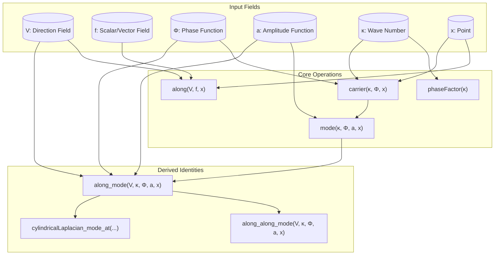
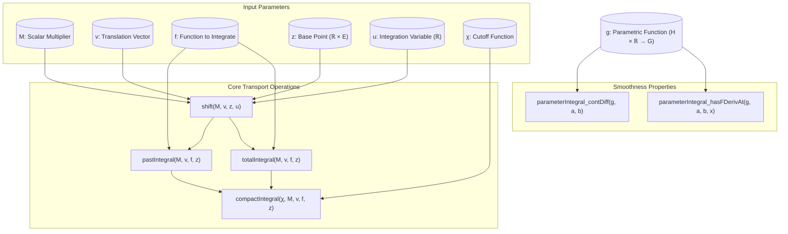

<!-- source: DeepWiki mcp.deepwiki.com · repo openai/NavierStokesAndEuler · page 7.3 Axis, Similarity, and Transport Machinery · fetched 2026-10-26 -->

# Axis, Similarity, and Transport Machinery

<details>
<summary>Relevant source files</summary>

The following files were used as context for generating this wiki page:

- [Euler/CompactParameterIntegral.lean](Euler/CompactParameterIntegral.lean)
- [NavierStokes/ClosedNativeWaveIdentities.lean](NavierStokes/ClosedNativeWaveIdentities.lean)
- [NavierStokes/HarmonicCalculus.lean](NavierStokes/HarmonicCalculus.lean)
- [NavierStokes/LinearWaveBounds.lean](NavierStokes/LinearWaveBounds.lean)
- [NavierStokes/LocalizedWaveBounds.lean](NavierStokes/LocalizedWaveBounds.lean)
- [NavierStokes/PrimaryResidualClass.lean](NavierStokes/PrimaryResidualClass.lean)
- [NavierStokes/R3/CompactTimeIntegral.lean](NavierStokes/R3/CompactTimeIntegral.lean)
- [NavierStokes/R3/PressureTemporalIdentity.lean](NavierStokes/R3/PressureTemporalIdentity.lean)
- [NavierStokes/R3CompactParametricIntegral.lean](NavierStokes/R3CompactParametricIntegral.lean)
- [NavierStokes/TransportPrimitive.lean](NavierStokes/TransportPrimitive.lean)

</details>


This page details the mathematical and computational machinery used for handling axisymmetric fields, similarity coordinates, and transport phenomena within the Navier-Stokes codebase. It covers the implementation of axis-holomorphic and resolvent series, the definition and manipulation of similarity coordinates and profiles, the underlying Volterra and ODE systems, and the primitives for parametric integrals and transport.

## Axisymmetric Fields and Residuals

The codebase extensively uses axisymmetric fields, particularly in the context of wave solutions. These fields are often represented in a cylindrical coordinate system. The `NavierStokes.HarmonicCalculus` namespace provides fundamental tools for working with these fields, including directional derivatives and harmonic modes.

The `along` function [NavierStokes/HarmonicCalculus.lean:27-28]() computes the derivative of a function `f` along a specified direction field `V`. This is crucial for defining derivatives in cylindrical coordinates, where the basis vectors themselves can vary with position.

```lean
noncomputable def along (V : E → E) (f : E → F) (x : E) : F :=
  fderiv ℝ f x (V x)
```

The `mode` function [NavierStokes/HarmonicCalculus.lean:116-117]() defines a coefficient multiplied by a complex harmonic, which is a common form for axisymmetric wave solutions.

```lean
noncomputable def mode (κ : ℝ) (Φ : E → ℝ) (a : E → ℂ) (x : E) : ℂ :=
  a x * carrier κ Φ x
```

The `carrier` function [NavierStokes/HarmonicCalculus.lean:77-78]() represents the complex exponential phase factor.

```lean
noncomputable def carrier (κ : ℝ) (Φ : E → ℝ) (x : E) : ℂ :=
  Complex.exp (phaseFactor κ * (Φ x : ℂ))
```

The `phaseFactor` [NavierStokes/HarmonicCalculus.lean:68-68]() is `iκ`.

The `NavierStokes.ClosedNativeWaveIdentities` module provides identities for these harmonic modes under various differential operators, such as `along_along_mode_at` [NavierStokes/ClosedNativeWaveIdentities.lean:40-46]() and `cylindricalLaplacian_mode_at` [NavierStokes/ClosedNativeWaveIdentities.lean:80-88](). These identities are essential for calculating residuals and ensuring the correctness of the wave solutions.

### Diagram: Harmonic Calculus Flow


Sources:
- [NavierStokes/HarmonicCalculus.lean:27-28]()
- [NavierStokes/HarmonicCalculus.lean:68-68]()
- [NavierStokes/HarmonicCalculus.lean:77-78]()
- [NavierStokes/HarmonicCalculus.lean:116-117]()
- [NavierStokes/ClosedNativeWaveIdentities.lean:40-46]()
- [NavierStokes/ClosedNativeWaveIdentities.lean:80-88]()

## Axis Holomorphic/Resolvent Series

The concept of "axis holomorphic/resolvent series" is implicitly handled through the use of `MemClass` and `LocalClass` structures, which provide a framework for bounding functions and their derivatives. These classes are defined in `NavierStokes.LinearWaveBounds` and `NavierStokes.LocalizedWaveBounds`.

The `MemClass` [NavierStokes/LinearWaveBounds.lean:27-28]() structure defines a class of functions that satisfy certain smoothness and boundedness conditions, weighted by a function `w`.

```lean
structure MemClass (s : StripData D) (w : ℕ → D → ℝ) (α : ℝ) (f : ℕ → D → E) : Prop where
  -- ...
```

The `LocalClass` [NavierStokes/LocalizedWaveBounds.lean:27-34]() extends this concept to functions defined on local support cells `K`, allowing for localized analysis of wave properties.

```lean
structure LocalClass (s : StripData D) (K : ℕ → I → Set D)
    (w : ℕ → I → D → ℝ) (α : ℝ) (f : ℕ → I → D → E) : Prop where
  -- ...
```

These classes are used to establish bounds on the iterated Fréchet derivatives of functions, which is crucial for proving regularity and convergence properties of solutions, including those that might be expressed as series. The `bounds` field within these structures [NavierStokes/LinearWaveBounds.lean:31-32](), [NavierStokes/LocalizedWaveBounds.lean:31-34]() ensures that the derivatives are controlled by a majorant function.

The `NavierStokes.PrimaryResidualClass` module defines `GraphDirections` [NavierStokes/PrimaryResidualClass.lean:23-35]() which encapsulates the radial, axial, angular, slow, and fast directions, along with their scaling factors. These directions are used to define derivatives in the context of wave propagation.

```lean
structure GraphDirections (D : Type*) [NormedAddCommGroup D] [NormedSpace ℝ D] where
  radial : D
  auxiliary : D
  axial : D
  angular : D
  slow : D
  fast : D
  radialScale : ℕ → ℝ
  fastScale : ℕ → ℝ
  radialProfile : D → ℝ
```

The `Dr_mem`, `Dz_mem`, `Dt_mem`, and `Dfast_mem` theorems [NavierStokes/LinearWaveBounds.lean:136-154]() demonstrate how these directional derivatives preserve membership in `MemClass`, indicating how regularity is maintained under differentiation along these specific axes.

Sources:
- [NavierStokes/LinearWaveBounds.lean:27-28]()
- [NavierStokes/LinearWaveBounds.lean:136-154]()
- [NavierStokes/LocalizedWaveBounds.lean:27-34]()
- [NavierStokes/PrimaryResidualClass.lean:23-35]()

## Similarity Coordinates and Profiles

The concept of "similarity coordinates and profiles" is addressed through the `GraphDirections` structure and the `radialProfile` field [NavierStokes/PrimaryResidualClass.lean:34-34](). The `radialProfile` function allows for a spatially varying scaling in the radial direction, which is characteristic of similarity solutions.

The `Dr_eq` theorem [NavierStokes/LinearWaveBounds.lean:127-130]() explicitly links the `Dr` (radial derivative) operator to a `graphDerivative` function, which incorporates the `radialScale` and `radialProfile`.

```lean
theorem Dr_eq (d : GraphDirections D) (f : ℕ → D → E) :
    d.Dr f = graphDerivative d.radialScale d.radialProfile d.radial d.auxiliary f := by
  funext n x
  exact (graphDerivative_eq_along _ _ _ _ _ n x).symm
```

This mechanism allows for the definition of profiles that are scaled and shaped according to the problem's similarity properties. The `Dr_mem` theorem [NavierStokes/LinearWaveBounds.lean:136-139]() shows how the `radialProfile` (via `hρ`) influences the bounds of the radial derivative, reflecting the behavior of similarity profiles.

Sources:
- [NavierStokes/LinearWaveBounds.lean:127-130]()
- [NavierStokes/LinearWaveBounds.lean:136-139]()
- [NavierStokes/PrimaryResidualClass.lean:34-34]()

## Volterra/ODE Systems

While not explicitly named "Volterra/ODE systems," the codebase handles time integration and derivatives of functions with respect to time, which are fundamental to solving ODEs and Volterra integral equations.

The `NavierStokes.R3.CompactTimeIntegral` module provides theorems for differentiating under the integral sign when functions have uniform compact spatial support. This is crucial for analyzing the time evolution of solutions.

The `hasDerivAt_integral` theorem [NavierStokes/R3/CompactTimeIntegral.lean:71-79]() states that if a function `F` and its time derivative `G` are continuous and `F` has compact support, then the derivative of the integral of `F` is the integral of `G`.

```lean
theorem hasDerivAt_integral {F G : ℝ × Space → E} {a b t : ℝ} {K : Set Space}
    (hK : IsCompact K) (hF : ContinuousOn F (Ioo a b ×ˢ univ))
    (hG : ContinuousOn G (Ioo a b ×ˢ univ))
    (hsupp : ∀ r ∈ Ioo a b, ∀ x ∉ K, F (r, x) = 0)
    (hderiv : ∀ r ∈ Ioo a b, ∀ x : Space,
      HasDerivAt (fun q => F (q, x)) (G (r, x)) r)
    (ht : t ∈ Ioo a b) :
    HasDerivAt (fun r => ∫ x : Space, F (r, x))
      (∫ x : Space, G (t, x)) t := by
  -- ...
```

Similarly, `NavierStokes.R3CompactParametricIntegral` provides `integral_hasDerivAt` [NavierStokes/R3CompactParametricIntegral.lean:64-71]() for parametric integrals over compact time intervals.

The `NavierStokes.TransportPrimitive` module defines `pastIntegral` [NavierStokes/TransportPrimitive.lean:117-118]() and `totalIntegral` [NavierStokes/TransportPrimitive.lean:121-122]() for integrating functions along a fixed translation direction, which can be seen as a primitive for solving transport equations.

```lean
noncomputable def pastIntegral (M : ℝ) (v : E) (f : ℝ × E → F) (z : ℝ × E) : F :=
  ∫ u in Iic (0 : ℝ), f (shift M v z u)
```

These theorems and definitions lay the groundwork for analyzing and solving ODE-like systems that arise from the time evolution of the Navier-Stokes equations.

Sources:
- [NavierStokes/R3/CompactTimeIntegral.lean:71-79]()
- [NavierStokes/R3CompactParametricIntegral.lean:64-71]()
- [NavierStokes/TransportPrimitive.lean:117-118]()
- [NavierStokes/TransportPrimitive.lean:121-122]()

## Transport Primitives and Parametric Integrals

The `NavierStokes.TransportPrimitive` module is dedicated to defining and analyzing integrals along a fixed translation direction, which are fundamental "transport primitives."

The `shift` function [NavierStokes/TransportPrimitive.lean:113-114]() defines a translation operation, which is the core of the transport mechanism.

```lean
noncomputable def shift (M : ℝ) (v : E) (z : ℝ × E) (u : ℝ) : ℝ × E :=
  z + (u, (M * u) • v)
```

The `pastIntegral` [NavierStokes/TransportPrimitive.lean:117-118]() and `totalIntegral` [NavierStokes/TransportPrimitive.lean:121-122]() functions perform integration along this shifted path. The `compactIntegral` [NavierStokes/TransportPrimitive.lean:125-127]() function introduces a radial cutoff for compactification.

```lean
noncomputable def compactIntegral (χ : ℝ → ℝ) (M : ℝ) (v : E)
    (f : ℝ × E → F) (z : ℝ × E) : F :=
  pastIntegral M v f z - χ z.1 • totalIntegral M v f z
```

The `parameterIntegral_contDiff` theorem [NavierStokes/TransportPrimitive.lean:100-103]() proves that these parametric integrals are smooth with respect to their parameters, which is a crucial property for further analysis and differentiation.

```lean
theorem parameterIntegral_contDiff [CompleteSpace G] {g : H × ℝ → G}
    (hg : ContDiff ℝ ∞ g) (a b : ℝ) :
    ContDiff ℝ ∞ (fun y => ∫ u in a..b, g (y, u)) :=
  contDiff_infty.mpr fun n => parameterIntegral_contDiff_nat n hg a b
```

This theorem, along with its supporting lemmas like `parameterIntegral_hasFDerivAt` [NavierStokes/TransportPrimitive.lean:65-81](), ensures that the derivatives of these integrals can be computed, which is essential for solving PDEs involving transport terms.

### Diagram: Transport Primitive Data Flow


Sources:
- [NavierStokes/TransportPrimitive.lean:65-81]()
- [NavierStokes/TransportPrimitive.lean:100-103]()
- [NavierStokes/TransportPrimitive.lean:113-114]()
- [NavierStokes/TransportPrimitive.lean:117-118]()
- [NavierStokes/TransportPrimitive.lean:121-122]()
- [NavierStokes/TransportPrimitive.lean:125-127]()

The `Euler/CompactParameterIntegral.lean` file provides similar functionality for general parametric integrals over compact intervals, ensuring smoothness with respect to the parameter. The `integral_contDiff` theorem [Euler/CompactParameterIntegral.lean:70-72]() is a key result in this file.

```lean
theorem integral_contDiff (a b : ℝ) (hab : a ≤ b) (F : X × ℝ → E)
    (hF : ContDiff ℝ ∞ F) : ContDiff ℝ ∞ (fun y => ∫ t in a..b, F (y,t)) :=
  contDiff_infty.mpr fun n => integral_contDiff_finite n a b hab F hF
```

This machinery is essential for handling the integral terms that arise in the weak formulations of PDEs and for constructing solutions via integral representations.

Sources:
- [Euler/CompactParameterIntegral.lean:70-72]()

---

